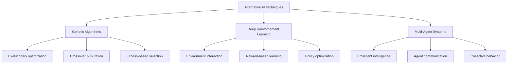
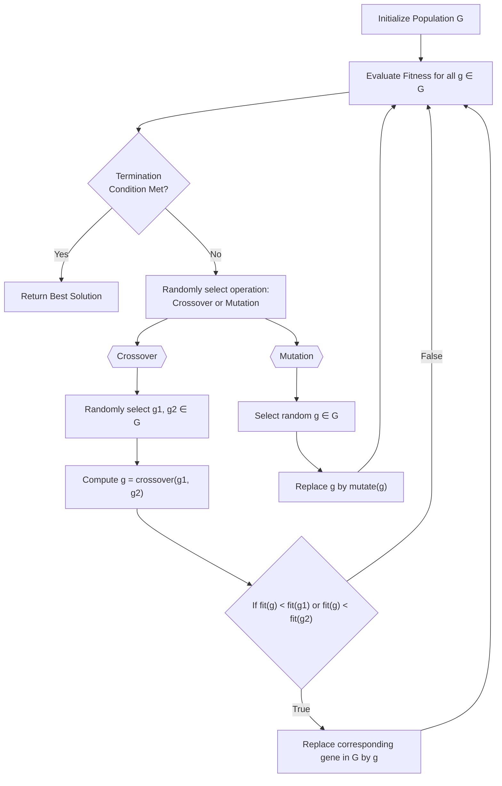
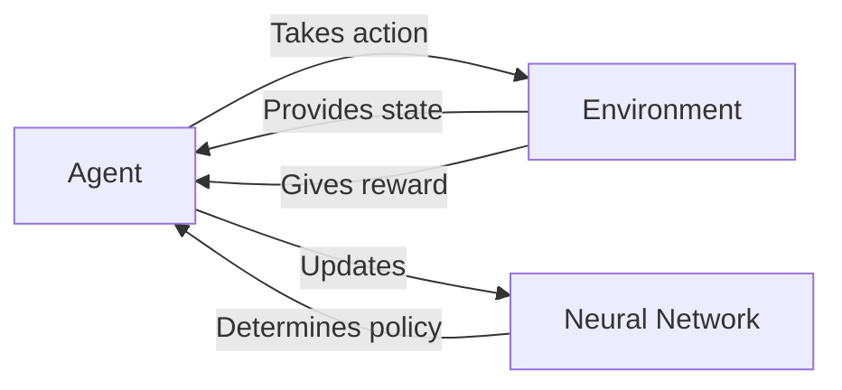
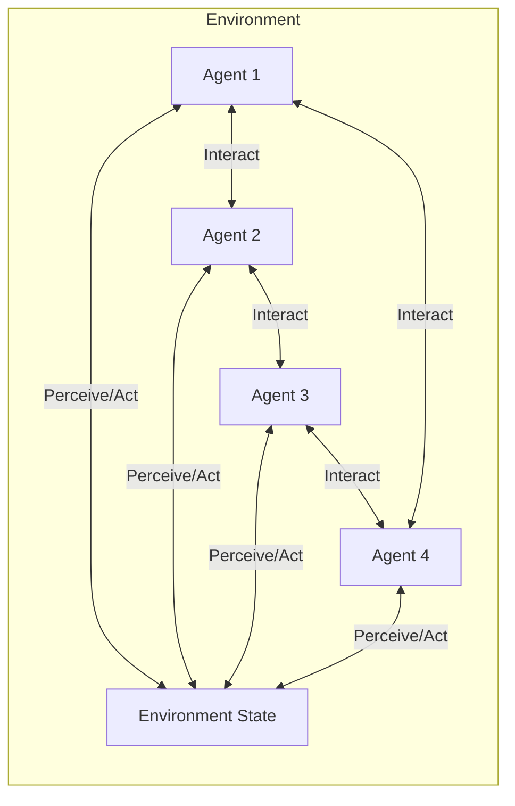
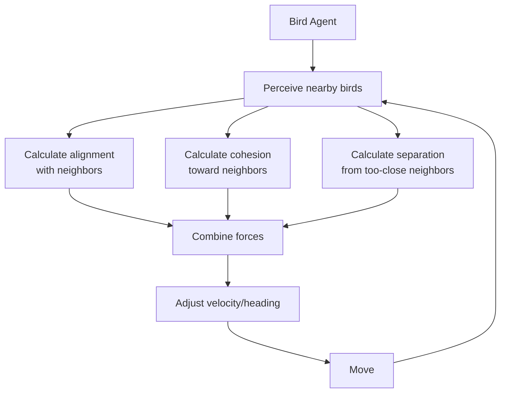
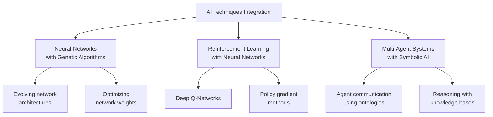

<!-- source: DeepWiki mcp.deepwiki.com · repo microsoft/AI-For-Beginners · page 3.8 Other AI Techniques · fetched 2026-10-26 -->

# Other AI Techniques

Relevant source files

The following files were used as context for generating this wiki page:

- [etc/quiz-app/src/assets/translations/en/lesson-21.json](etc/quiz-app/src/assets/translations/en/lesson-21.json)
- [lessons/5-NLP/16-RNN/README.md](lessons/5-NLP/16-RNN/README.md)
- [lessons/5-NLP/18-Transformers/README.md](lessons/5-NLP/18-Transformers/README.md)
- [lessons/5-NLP/18-Transformers/assignment.md](lessons/5-NLP/18-Transformers/assignment.md)
- [lessons/6-Other/21-GeneticAlgorithms/README.md](lessons/6-Other/21-GeneticAlgorithms/README.md)
- [lessons/6-Other/23-MultiagentSystems/README.md](lessons/6-Other/23-MultiagentSystems/README.md)
- [lessons/6-Other/23-MultiagentSystems/assignment.md](lessons/6-Other/23-MultiagentSystems/assignment.md)

This page explores alternative AI approaches beyond the main neural network techniques covered elsewhere in the curriculum. Here we focus on evolutionary computation methods like genetic algorithms, reinforcement learning approaches, and multi-agent systems that enable emergent intelligence. These techniques often solve problems that are less suited to traditional neural network approaches.

For neural network techniques, see [Neural Networks Foundations](#3.3). For computer vision approaches, see [Computer Vision](#3.4), and for natural language processing, see [Natural Language Processing](#3.5).

## Overview of Alternative AI Techniques

The field of artificial intelligence extends beyond just neural networks and deep learning approaches. This section examines three important alternative paradigms that offer unique capabilities for solving complex problems:

Sources: [lessons/6-Other/21-GeneticAlgorithms/README.md:1-13](), [lessons/6-Other/23-MultiagentSystems/README.md:1-3]()

## Genetic Algorithms

Genetic algorithms (GAs) represent an **evolutionary approach** to AI, simulating natural selection to find optimal solutions for problems [lessons/6-Other/21-GeneticAlgorithms/README.md:1-5](). They were proposed in 1975 by John Henry Holland [lessons/6-Other/21-GeneticAlgorithms/README.md:5]().

### Key Concepts

Genetic algorithms operate based on several fundamental principles borrowed from biological evolution [lessons/6-Other/21-GeneticAlgorithms/README.md:7-13]():

| Concept | Description | Implementation |
|---------|-------------|----------------|
| Genes | Valid solutions to the problem represented as `g` in `Γ` [lessons/6-Other/21-GeneticAlgorithms/README.md:9]() | Bit strings, vectors, or other data structures |
| Fitness Function | Evaluates how good a solution is, `fit: Γ → R`. Smaller values correspond to better solutions [lessons/6-Other/21-GeneticAlgorithms/README.md:11,17]() | Problem-specific evaluation metric |
| Selection | Used to select more optimal solutions using the fitness function [lessons/6-Other/21-GeneticAlgorithms/README.md:11]() | Tournament, roulette wheel, or rank-based selection |
| Crossover | Combines two solutions (`g1`, `g2`) to obtain a new valid solution (`crossover(g1, g2)`) [lessons/6-Other/21-GeneticAlgorithms/README.md:10,18]() | Single-point, multi-point, or uniform crossover |
| Mutation | Introduces random changes (`mutate(g)`) to destabilize optimization and escape local minima [lessons/6-Other/21-GeneticAlgorithms/README.md:12,19]() | Bit flips, random value adjustments |
| Population | Collection of candidate solutions, `G ⊂ Γ` [lessons/6-Other/21-GeneticAlgorithms/README.md:25]() | Typically 50-1000 individuals |

### Algorithm Flow

Sources: [lessons/6-Other/21-GeneticAlgorithms/README.md:24-33]()

### Implementation Process

To implement a genetic algorithm, you need to:

1. Find a method of coding problem solutions using **genes** [lessons/6-Other/21-GeneticAlgorithms/README.md:16]().
2. Define a **fitness function** `fit: Γ → R` where smaller values correspond to better solutions [lessons/6-Other/21-GeneticAlgorithms/README.md:17]().
3. Define a **crossover** mechanism `crossover: Γ² → Γ` to combine two genes [lessons/6-Other/21-GeneticAlgorithms/README.md:18]().
4. Define a **mutation** mechanism `mutate: Γ → Γ` [lessons/6-Other/21-GeneticAlgorithms/README.md:19]().

### Sample Applications

Genetic algorithms are used to solve many problems, including logistics and search problems [lessons/6-Other/21-GeneticAlgorithms/README.md:53](). Typical tasks include:

1.  Schedule optimization [lessons/6-Other/21-GeneticAlgorithms/README.md:38]()
2.  Optimal packing [lessons/6-Other/21-GeneticAlgorithms/README.md:39]()
3.  Optimal cutting [lessons/6-Other/21-GeneticAlgorithms/README.md:40]()
4.  Speeding up exhaustive search [lessons/6-Other/21-GeneticAlgorithms/README.md:41]()

### Code Example

The repository provides examples of using Genetic Algorithms in the `Genetic.ipynb` notebook [lessons/6-Other/21-GeneticAlgorithms/README.md:47]():

1.  Fair division of treasure [lessons/6-Other/21-GeneticAlgorithms/README.md:49]()
2.  8 Queens Problem [lessons/6-Other/21-GeneticAlgorithms/README.md:50]()

Additionally, an assignment involves solving a **Diophantine equation** using genetic algorithms [lessons/6-Other/21-GeneticAlgorithms/README.md:66-68]().

Sources: [lessons/6-Other/21-GeneticAlgorithms/README.md:1-53](), [etc/quiz-app/src/assets/translations/en/lesson-21.json:9-110]()

## Deep Reinforcement Learning

Deep Reinforcement Learning (Deep RL) combines reinforcement learning with deep neural networks to create agents that can learn to make decisions through interaction with an environment. This topic is covered in Lesson 22 [lessons/6-Other/21-GeneticAlgorithms/README.md:64]().

### Core Components

### Key RL Concepts

| Component | Description |
|-----------|-------------|
| Agent | The entity making decisions (e.g., game character, robot) |
| Environment | The world the agent interacts with |
| State | The current situation the agent observes |
| Action | A choice the agent can make |
| Reward | Feedback signal indicating action quality |
| Policy | Strategy for selecting actions in states |
| Value Function | Estimate of future reward from a state |

### Deep RL Frameworks

Deep reinforcement learning implementations typically leverage existing neural network frameworks:

- PyTorch-based implementations
- TensorFlow-based implementations

The CartPole example in the curriculum demonstrates how to implement deep reinforcement learning using both frameworks.

### Applications

Deep reinforcement learning has been successfully applied to:

- Game playing (Chess, Go, Atari games)
- Robotics and control systems
- Recommendation systems
- Resource management
- Autonomous vehicles
- Financial trading

Sources: [lessons/6-Other/21-GeneticAlgorithms/README.md:64]()

## Multi-Agent Systems

**Multi-Agent Systems** (MAS) represent an **emergent** (or **synergetic**) approach to AI, where the combined behavior of many relatively simple agents can result in overall more complex (or intelligent) behavior of the system as a whole [lessons/6-Other/23-MultiagentSystems/README.md:1-3](). This approach is based on principles of Collective Intelligence, Emergentism, and Evolutionary Cybernetics [lessons/6-Other/23-MultiagentSystems/README.md:3]().

### Core Principles

Central to the multi-agent approach is the notion of an **Agent** – an entity that lives in an **environment**, which it can perceive and act upon [lessons/6-Other/23-MultiagentSystems/README.md:9]().

### Agent Types

Agents can be classified in various ways [lessons/6-Other/23-MultiagentSystems/README.md:10-21]():

| Classification | Agent Types | Description |
|----------------|-------------|-------------|
| By reasoning ability | **Reactive** | Simple request-response behavior [lessons/6-Other/23-MultiagentSystems/README.md:12]() |
| | **Deliberative** | Employ logical reasoning and/or planning capabilities [lessons/6-Other/23-MultiagentSystems/README.md:13]() |
| By execution location | **Static** | Work on a dedicated network node [lessons/6-Other/23-MultiagentSystems/README.md:15]() |
| | **Mobile** | Can move their code between network nodes [lessons/6-Other/23-MultiagentSystems/README.md:16]() |
| By behavior | **Passive agents** | Do not have specific goals; react to external stimuli but do not initiate actions [lessons/6-Other/23-MultiagentSystems/README.md:18]() |
| | **Active agents** | Have specific goals they pursue [lessons/6-Other/23-MultiagentSystems/README.md:19]() |
| | **Cognitive agents** | Involve complex planning and reasoning [lessons/6-Other/23-MultiagentSystems/README.md:20]() |

### NetLogo

**NetLogo** is a multi-agent modeling environment based on a modified version of the Logo programming language [lessons/6-Other/23-MultiagentSystems/README.md:32-33](). It allows controlling agents called **turtles** that can move and leave traces, enabling the creation of complex geometric figures [lessons/6-Other/23-MultiagentSystems/README.md:33-34]().

In NetLogo, you can create multiple turtles using `create-turtles` and command them using `ask turtles [...]` [lessons/6-Other/23-MultiagentSystems/README.md:38-42](). Different *breeds* of turtles can also be created using `breed [cats cat]` [lessons/6-Other/23-MultiagentSystems/README.md:44]().

The NetLogo world consists of:
*   **Agents** (turtles): Can move and perform actions. Code in `ask turtles [...]` is executed by all agents in *turtle mode* [lessons/6-Other/23-MultiagentSystems/README.md:86-87]().
*   **Patches**: Square areas of the field where agents live. You can `ask patches` to do something [lessons/6-Other/23-MultiagentSystems/README.md:88-89]().
*   **Observer**: A unique agent that controls the world; all button handlers are executed in *observer mode* [lessons/6-Other/23-MultiagentSystems/README.md:90]().

The beauty of NetLogo is that code running in turtle or patch mode is executed simultaneously by all agents in parallel, allowing complex simulation behavior from simple individual agent rules [lessons/6-Other/23-MultiagentSystems/README.md:92-94]().

### Flocking Behavior Example

**Flocking** is a complex pattern similar to how birds fly, emerging from simple rules followed by individual agents [lessons/6-Other/23-MultiagentSystems/README.md:93-95](). This complex behavior arises when each individual agent (a "bird") observes other agents nearby and follows three simple rules [lessons/6-Other/23-MultiagentSystems/README.md:95-96]():

1.  **Alignment**: Steers towards the average heading of neighboring agents [lessons/6-Other/23-MultiagentSystems/README.md:96]()
2.  **Cohesion**: Moves toward the average position of neighbors (long-range attraction)
3.  **Separation**: Moves away when too close to others (short-range repulsion)

### Applications

Multi-agent systems are used in a number of applications [lessons/6-Other/23-MultiagentSystems/README.md:22-28]():

*   In games, non-player characters (NPCs) can be considered intelligent agents [lessons/6-Other/23-MultiagentSystems/README.md:24]().
*   In video production, rendering complex 3D scenes with crowds is typically done using multi-agent simulation [lessons/6-Other/23-MultiagentSystems/README.md:25]().
*   In systems modeling, multi-agent approaches simulate complex models, such as the spread of COVID-19 or city traffic [lessons/6-Other/23-MultiagentSystems/README.md:26]().
*   In complex automation systems, devices can act as independent agents, making the system more robust [lessons/6-Other/23-MultiagentSystems/README.md:27]().

Sources: [lessons/6-Other/23-MultiagentSystems/README.md:1-141]()

## Integration with Other AI Techniques

These alternative techniques don't exist in isolation - they often complement or integrate with other AI approaches covered in this curriculum:

### Cross-Technique Applications

| Combination | Applications |
|-------------|--------------|
| RL + Genetic Algorithms | Evolving game-playing agents, robot control policies |
| Neural Networks + Genetic Algorithms | Architecture search, hyperparameter optimization |
| Multi-Agent + Neural Networks | Swarm intelligence with learning capabilities |
| Multi-Agent + Reinforcement Learning | Cooperative or competitive agent training |

These hybrid approaches often unlock capabilities beyond what any single technique can achieve, allowing AI systems to solve increasingly complex problems.

Sources: [lessons/6-Other/21-GeneticAlgorithms/README.md:64](), [lessons/5-NLP/16-RNN/README.md](), [lessons/5-NLP/18-Transformers/README.md]()

## Comparison with Neural Approaches

While neural networks have dominated AI research in recent years, the techniques covered in this section offer important alternatives or complements:

| Aspect | Neural Networks | Alternative Techniques |
|--------|----------------|------------------------|
| Training data requirements | Often need large labeled datasets | May require less or no labeled data |
| Explainability | Often "black box" | Some approaches more transparent |
| Problem types | Pattern recognition, prediction | Optimization, simulation, planning |
| Strengths | Learning complex patterns | Exploring solution spaces, emergent behavior |
| Weaknesses | Data hungry, hard to interpret | May be computationally expensive |

Understanding when to apply each of these approaches is a key skill for AI practitioners. The most powerful AI systems often combine multiple techniques to leverage their complementary strengths.

Sources: [lessons/5-NLP/18-Transformers/README.md:24-25](), [lessons/5-NLP/16-RNN/README.md:5-6]()

## Conclusion

The alternative AI techniques covered in this section - genetic algorithms, deep reinforcement learning, and multi-agent systems - represent important approaches that can solve problems differently than traditional neural network methods. These techniques draw inspiration from biological evolution, behavioral psychology, and social systems to create AI solutions with unique capabilities.

As the field of AI continues to advance, the integration of these diverse approaches will likely play an increasingly important role in developing more capable, robust, and versatile AI systems.

---

