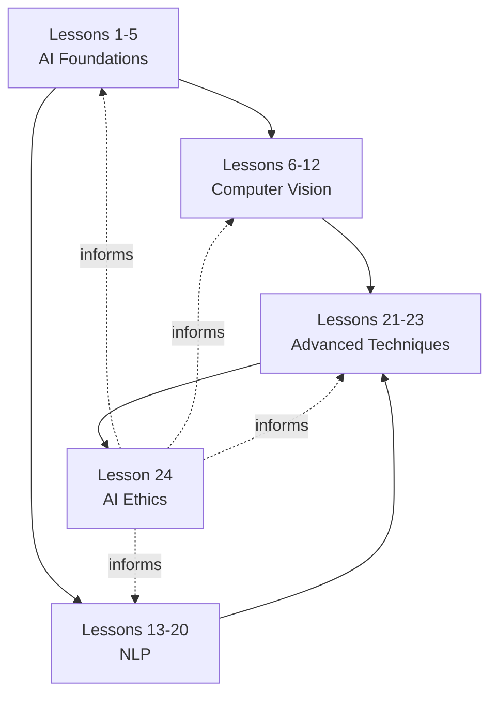
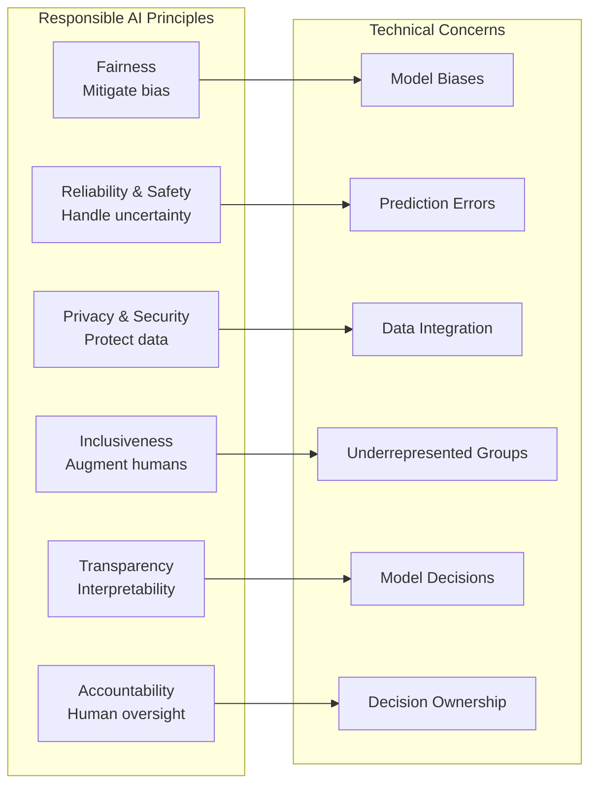
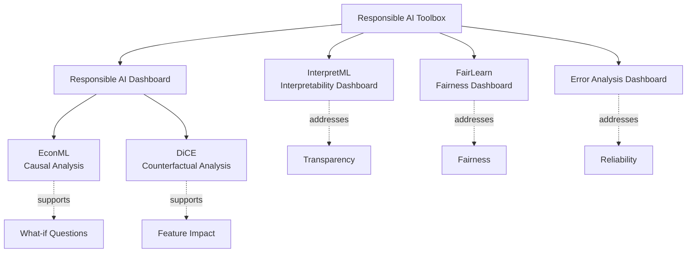
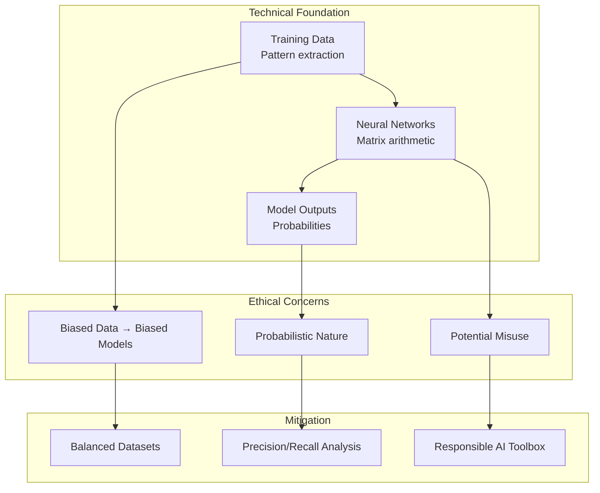
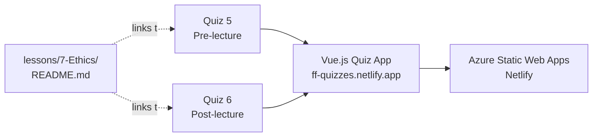

<!-- source: DeepWiki mcp.deepwiki.com · repo microsoft/AI-For-Beginners · page 3.9 AI Ethics · fetched 2026-10-26 -->

# AI Ethics

Relevant source files

The following files were used as context for generating this wiki page:

- [lessons/4-ComputerVision/12-Segmentation/README.md](lessons/4-ComputerVision/12-Segmentation/README.md)
- [lessons/4-ComputerVision/12-Segmentation/SemanticSegmentationPytorch.ipynb](lessons/4-ComputerVision/12-Segmentation/SemanticSegmentationPytorch.ipynb)
- [lessons/4-ComputerVision/12-Segmentation/SemanticSegmentationTF.ipynb](lessons/4-ComputerVision/12-Segmentation/SemanticSegmentationTF.ipynb)
- [lessons/4-ComputerVision/README.md](lessons/4-ComputerVision/README.md)
- [lessons/5-NLP/13-TextRep/README.md](lessons/5-NLP/13-TextRep/README.md)
- [lessons/5-NLP/13-TextRep/TextRepresentationPyTorch.ipynb](lessons/5-NLP/13-TextRep/TextRepresentationPyTorch.ipynb)
- [lessons/5-NLP/13-TextRep/assignment.md](lessons/5-NLP/13-TextRep/assignment.md)
- [lessons/5-NLP/14-Embeddings/EmbeddingsPyTorch.ipynb](lessons/5-NLP/14-Embeddings/EmbeddingsPyTorch.ipynb)
- [lessons/5-NLP/14-Embeddings/README.md](lessons/5-NLP/14-Embeddings/README.md)
- [lessons/5-NLP/14-Embeddings/assignment.md](lessons/5-NLP/14-Embeddings/assignment.md)
- [lessons/5-NLP/16-RNN/RNNTF.ipynb](lessons/5-NLP/16-RNN/RNNTF.ipynb)
- [lessons/5-NLP/16-RNN/assignment.md](lessons/5-NLP/16-RNN/assignment.md)
- [lessons/5-NLP/17-GenerativeNetworks/GenerativePyTorch.ipynb](lessons/5-NLP/17-GenerativeNetworks/GenerativePyTorch.ipynb)
- [lessons/5-NLP/17-GenerativeNetworks/GenerativeTF.ipynb](lessons/5-NLP/17-GenerativeNetworks/GenerativeTF.ipynb)
- [lessons/5-NLP/17-GenerativeNetworks/README.md](lessons/5-NLP/17-GenerativeNetworks/README.md)
- [lessons/5-NLP/17-GenerativeNetworks/lab/README.md](lessons/5-NLP/17-GenerativeNetworks/lab/README.md)
- [lessons/5-NLP/README.md](lessons/5-NLP/README.md)
- [lessons/7-Ethics/README.md](lessons/7-Ethics/README.md)

## Purpose and Scope

This document covers Lesson 24 (the final lesson) of the AI-For-Beginners curriculum, which addresses responsible and ethical AI development. The lesson focuses on understanding potential misuse of AI technologies, applying principles of responsible AI, and utilizing tools to identify and mitigate issues such as bias, unfairness, and privacy concerns in AI systems.

For technical implementation of specific AI techniques covered earlier in the curriculum, see [Natural Language Processing](#3.5), [Computer Vision](#3.4), or [Neural Networks Foundations](#3.3). For practical AI applications, see [Reinforcement Learning](#3.7) or [Other AI Techniques](#3.8).

**Sources:** [lessons/7-Ethics/README.md:1-40]()

## Curriculum Position

Lesson 24 on AI Ethics serves as the capstone lesson of the 12-week, 24-lesson curriculum. It is positioned after all technical content including:
- Neural network fundamentals (Lessons 3-5)
- Computer vision techniques (Lessons 6-12)
- Natural language processing (Lessons 13-20)
- Advanced topics: genetic algorithms, reinforcement learning, multi-agent systems (Lessons 21-23)

This placement reflects the pedagogical approach that ethical considerations should be understood in the context of specific AI capabilities and their potential applications.

**Lesson 24: AI Ethics and Responsible AI**
- Positioned as final integrative lesson
- Applies ethical framework to previously learned technical content
- Provides retrospective analysis of potential misuse scenarios

**Sources:** [lessons/7-Ethics/README.md:1-7]()

## Responsible AI Principles

Microsoft's Responsible AI framework defines six core principles that guide ethical AI development. These principles address different aspects of AI system design, deployment, and governance.

### Fairness

**Definition:** Ensuring AI systems do not exhibit bias against individuals or groups.

**Technical Manifestation:**
- **Model biases** arise from biased training data
- Example: Gender bias in job prediction models due to historically male-dominated datasets

**Mitigation Strategies:**
- Balance training data across demographic groups
- Analyze feature importance to identify discriminatory features
- Test model performance across different demographic segments

**Sources:** [lessons/7-Ethics/README.md:15]()

### Reliability and Safety

**Definition:** AI models should acknowledge uncertainty and handle errors gracefully.

**Technical Considerations:**
- Neural networks output probabilities, not certainties
- Models have measurable precision and recall metrics
- Understanding these metrics prevents harmful decisions based on incorrect predictions

**Key Insight:** Every model has inherent limitations in precision and recall that must be communicated to users and decision-makers.

**Sources:** [lessons/7-Ethics/README.md:16]()

### Privacy and Security

**Definition:** Protecting user data while training and deploying AI models.

**Technical Aspects:**
- Training data becomes "integrated" into model parameters
- Models may inadvertently memorize sensitive information
- Need to track data provenance and usage

**Implications:**
- Maintain records of training data sources
- Implement data anonymization techniques
- Consider differential privacy approaches

**Sources:** [lessons/7-Ethics/README.md:17]()

### Inclusiveness

**Definition:** AI should augment human capabilities rather than replace people entirely.

**Relationship to Fairness:**
- Closely tied to ensuring underrepresented communities are included
- Datasets for underrepresented groups often contain bias
- Requires deliberate effort to collect representative data

**Goal:** AI as a collaborative tool that enhances human decision-making while ensuring equitable access and representation.

**Sources:** [lessons/7-Ethics/README.md:18]()

### Transparency

**Definition:** Clear communication about AI usage and interpretable system behavior.

**Requirements:**
- Explicit disclosure when AI is being used
- Preference for interpretable models where possible
- Clear documentation of model capabilities and limitations

**Trade-offs:** Balance between model performance and interpretability must be carefully considered based on application context.

**Sources:** [lessons/7-Ethics/README.md:19]()

### Accountability

**Definition:** Establishing clear responsibility for AI-driven decisions.

**Challenge:** Determining who is responsible when AI makes decisions is non-trivial.

**Approach:**
- Include human oversight in critical decision loops
- Ensure actual people are accountable for outcomes
- Maintain audit trails for AI decisions

**Sources:** [lessons/7-Ethics/README.md:20]()

## Responsible AI Toolbox

Microsoft provides a comprehensive toolkit for implementing responsible AI principles in practice. The toolbox consists of multiple specialized tools addressing different aspects of responsible AI.

### Tool Components

| Tool | Purpose | Principle Addressed |
|------|---------|-------------------|
| **Interpretability Dashboard (InterpretML)** | Understand model predictions and feature importance | Transparency |
| **Fairness Dashboard (FairLearn)** | Detect and mitigate unfairness across demographic groups | Fairness |
| **Error Analysis Dashboard** | Identify error patterns and model weaknesses | Reliability and Safety |
| **EconML** | Causal analysis for what-if scenarios | Accountability |
| **DiCE** | Counterfactual analysis showing required feature changes for different outcomes | Transparency |

### Integration with Development Workflow

The Responsible AI Dashboard integrates multiple tools into a unified interface, allowing practitioners to:
1. Analyze model interpretability
2. Assess fairness metrics
3. Identify systematic errors
4. Perform causal and counterfactual analyses

**Repository Location:** `https://github.com/microsoft/responsible-ai-toolbox`

**Sources:** [lessons/7-Ethics/README.md:24-33]()

## Relationship to Technical Content

The lesson emphasizes that AI ethics must be understood in the context of actual AI capabilities and limitations. The curriculum structure deliberately teaches technical skills first, then applies ethical analysis.

### Key Insights from the Lesson

**AI as a Tool:**
- Current AI is "nothing more than large matrix arithmetic" [lessons/7-Ethics/README.md:8]()
- Powerful tool that can be used for good or bad purposes [lessons/7-Ethics/README.md:9]()
- Importantly, it can be **misused** either accidentally or purposefully [lessons/7-Ethics/README.md:9]()

**Matrix Arithmetic Foundation:** The lesson emphasizes that despite the power of AI systems covered in previous lessons (neural networks, CNNs, RNNs, transformers, etc.), they fundamentally perform mathematical operations without inherent understanding or intention. For example, Recurrent Neural Networks (RNNs) learn sequential dependencies by passing state vectors through network blocks with shared weights [lessons/5-NLP/16-RNN/RNNTF.ipynb:15-17](), and generative networks produce text by sampling from probability distributions [lessons/5-NLP/17-GenerativeNetworks/README.md:51](). Similarly, embeddings represent words as lower-dimensional dense vectors, reflecting semantic meaning through mathematical relationships [lessons/5-NLP/14-Embeddings/README.md:7]().

**Distinction from Science Fiction:** The lesson explicitly addresses the gap between current AI capabilities and science fiction scenarios involving AI "rebellion" or autonomous decision-making with emotions [lessons/7-Ethics/README.md:7-8]().

**Sources:** [lessons/7-Ethics/README.md:3-9](), [lessons/5-NLP/16-RNN/RNNTF.ipynb:15-17](), [lessons/5-NLP/17-GenerativeNetworks/README.md:51](), [lessons/5-NLP/14-Embeddings/README.md:7]()

## Assessment and Learning Resources

### Pre/Post-Lecture Quizzes

The lesson includes assessment through the quiz system:
- **Pre-lecture quiz:** `https://white-water-09ec41f0f.azurestaticapps.net/quiz/5/` [lessons/7-Ethics/README.md:5]()
- **Post-lecture quiz:** `https://white-water-09ec41f0f.azurestaticapps.net/quiz/6/` [lessons/7-Ethics/README.md:40]()

These quizzes test understanding of responsible AI principles and their practical application.

**Sources:** [lessons/7-Ethics/README.md:5,40]()

### External Learning Paths

The lesson references additional resources for deeper exploration:

1. **Microsoft Learn Module:** Responsible AI Principles
   - URL: `https://docs.microsoft.com/learn/modules/responsible-ai-principles/?WT.mc_id=academic-77998-cacaste` [lessons/7-Ethics/README.md:38]()
   - Provides structured learning path on responsible AI concepts

2. **ML-For-Beginners Curriculum:** Fairness Lesson
   - Path: `https://github.com/microsoft/ML-For-Beginners/tree/main/1-Introduction/3-fairness?WT.mc_id=academic-77998-cacaste` [lessons/7-Ethics/README.md:34]()
   - Includes practical assignments on fairness in machine learning
   - Complementary curriculum focusing on traditional ML approaches

**Sources:** [lessons/7-Ethics/README.md:34,38]()

## Integration with Quiz System

The AI Ethics lesson is supported by the quiz application infrastructure, which provides interactive assessment.

**Quiz IDs:**
- Pre-lecture: Quiz ID 105 (Lesson 24, pre-quiz)
- Post-lecture: Quiz ID 206 (Lesson 24, post-quiz)

Note: The quiz ID convention uses format `[1|2]XX` where:
- First digit: 1 for pre-quiz, 2 for post-quiz
- XX: Lesson number (5 and 6 map to lesson 24 in this case)

**Sources:** [lessons/7-Ethics/README.md:5,40](), based on quiz system architecture described in high-level diagrams

## Content Structure

The lesson is structured as a conceptual overview rather than a hands-on coding exercise, reflecting its role as an integrative capstone.

**File:** [lessons/7-Ethics/README.md:1-40]()
**Length:** 41 lines (shortest lesson in curriculum)
**Format:** Markdown with external links

**Content Breakdown:**
1. Introduction (lines 1-9): Contextualizes AI ethics relative to technical capabilities
2. Principles of Responsible AI (lines 11-20): Defines six core principles
3. Tools for Responsible AI (lines 22-33): Introduces Microsoft's toolbox
4. External Resources (lines 34-38): Links to additional learning materials
5. Assessment Links (lines 5, 40): Pre/post-lecture quizzes

**Notable Absence:** Unlike other lessons, there are no accompanying Jupyter notebooks or code implementations. The focus is entirely conceptual and framework-oriented.

**Sources:** [lessons/7-Ethics/README.md:1-40]()

---

