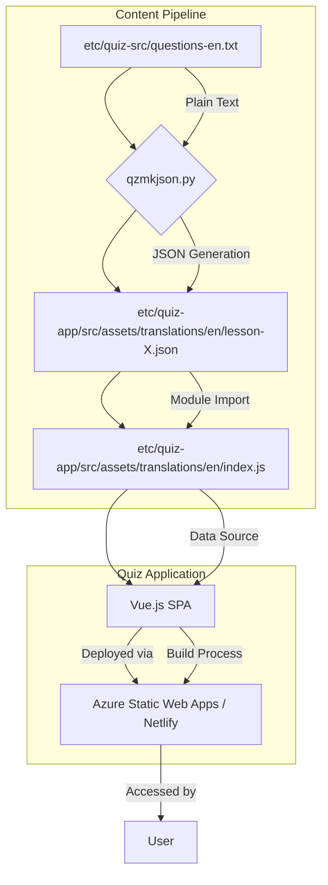

<!-- source: DeepWiki mcp.deepwiki.com · repo microsoft/AI-For-Beginners · page 4 Assessment System · fetched 2026-10-26 -->

# Assessment System

<details>
<summary>Relevant source files</summary>

The following files were used as context for generating this wiki page:

- [etc/quiz-app/README.md](etc/quiz-app/README.md)
- [etc/quiz-app/babel.config.js](etc/quiz-app/babel.config.js)
- [etc/quiz-app/dist/index.html](etc/quiz-app/dist/index.html)
- [etc/quiz-app/dist/js/app.dfcb35f3.js](etc/quiz-app/dist/js/app.dfcb35f3.js)
- [etc/quiz-app/dist/js/app.dfcb35f3.js.map](etc/quiz-app/dist/js/app.dfcb35f3.js.map)
- [etc/quiz-app/dist/js/chunk-vendors.c1571e8f.js](etc/quiz-app/dist/js/chunk-vendors.c1571e8f.js)
- [etc/quiz-app/dist/js/chunk-vendors.c1571e8f.js.map](etc/quiz-app/dist/js/chunk-vendors.c1571e8f.js.map)
- [etc/quiz-app/package-lock.json](etc/quiz-app/package-lock.json)
- [etc/quiz-app/package.json](etc/quiz-app/package.json)
- [etc/quiz-app/public/favicon.ico](etc/quiz-app/public/favicon.ico)
- [etc/quiz-app/public/index.html](etc/quiz-app/public/index.html)
- [etc/quiz-app/public/routes.json](etc/quiz-app/public/routes.json)
- [etc/quiz-app/src/assets/translations/en/index.js](etc/quiz-app/src/assets/translations/en/index.js)
- [etc/quiz-app/src/assets/translations/en/lesson-11.json](etc/quiz-app/src/assets/translations/en/lesson-11.json)
- [etc/quiz-app/src/assets/translations/en/lesson-12.json](etc/quiz-app/src/assets/translations/en/lesson-12.json)
- [etc/quiz-app/src/assets/translations/en/lesson-13.json](etc/quiz-app/src/assets/translations/en/lesson-13.json)
- [etc/quiz-app/src/assets/translations/en/lesson-14.json](etc/quiz-app/src/assets/translations/en/lesson-14.json)
- [etc/quiz-app/src/assets/translations/en/lesson-15.json](etc/quiz-app/src/assets/translations/en/lesson-15.json)
- [etc/quiz-app/src/assets/translations/en/lesson-16.json](etc/quiz-app/src/assets/translations/en/lesson-16.json)
- [etc/quiz-app/src/assets/translations/en/lesson-17.json](etc/quiz-app/src/assets/translations/en/lesson-17.json)
- [etc/quiz-app/src/assets/translations/en/lesson-18.json](etc/quiz-app/src/assets/translations/en/lesson-18.json)
- [etc/quiz-app/src/assets/translations/en/lesson-19.json](etc/quiz-app/src/assets/translations/en/lesson-19.json)
- [etc/quiz-app/src/assets/translations/en/lesson-20.json](etc/quiz-app/src/assets/translations/en/lesson-20.json)
- [etc/quiz-app/src/assets/translations/en/lesson-22.json](etc/quiz-app/src/assets/translations/en/lesson-22.json)
- [etc/quiz-app/src/assets/translations/en/lesson-23.json](etc/quiz-app/src/assets/translations/en/lesson-23.json)
- [etc/quiz-src/questions-en.txt](etc/quiz-src/questions-en.txt)
- [lessons/5-NLP/14-Embeddings/EmbeddingsTF.ipynb](lessons/5-NLP/14-Embeddings/EmbeddingsTF.ipynb)

</details>


This document provides a technical overview of the Assessment System used in the AI-For-Beginners curriculum. The assessment system consists of interactive quizzes for each lesson to evaluate student understanding of AI concepts. It documents the quiz content format, transformation process, and the technical implementation of the quiz application.

## Purpose and Scope

The Assessment System serves the following purposes:

1. Provide pre-quizzes to introduce key concepts before lessons
2. Provide post-quizzes to evaluate learning after lessons
3. Deliver immediate feedback to students on their understanding
4. Support multiple languages through internationalization

## System Architecture Overview

The Assessment System follows a data transformation pipeline that converts plain text quiz questions into an interactive web application. This pipeline involves generating structured JSON data from plain text, which is then consumed by a Vue.js Single Page Application (SPA).

### Quiz System High-Level Architecture


Sources: [etc/quiz-src/questions-en.txt:1-639](), [etc/quiz-app/src/assets/translations/en/index.js:1-26]()

For a detailed breakdown of the Vue.js application structure, component architecture, `vue-router` configuration, and `vue-i18n` internationalization setup, see [Quiz Application Architecture](#4.1).

## Quiz Content Structure

The quiz content originates from plain text files and is transformed into a structured JSON format for the Vue.js application.

### Source Question Format

Quiz questions are authored in plain text in the file `etc/quiz-src/questions-en.txt` [etc/quiz-src/questions-en.txt:1-639](). Each lesson has a pre-quiz and post-quiz section, typically with three multiple-choice questions per quiz.

The format follows these conventions:
- Lesson title and quiz type on the first line (e.g., `Lesson 1B Introduction to AI: Pre Quiz` [etc/quiz-src/questions-en.txt:1]())
- Questions marked with an asterisk (`*`)
- Incorrect answers marked with a dash (`-`)
- Correct answers marked with a plus sign (`+`)

**Example source format:**

```
Lesson 1B Introduction to AI: Pre Quiz
* A famous 19th century proto-computer engineer was
- Charles Barkley
+ Charles Babbage
- Charles Darwin
* Weak AI is a system designed to solve many tasks
- True
+ False
```
Sources: [etc/quiz-src/questions-en.txt:1-8]()

### JSON Format

The source questions are transformed into JSON files, such as `etc/quiz-app/src/assets/translations/en/lesson-18.json` [etc/quiz-app/src/assets/translations/en/lesson-18.json:1-119](), stored in the `translations` directory. Each lesson has its own JSON file containing both pre-quiz and post-quiz content. This transformation is handled by the `qzmkjson.py` script (not provided in the current context, but implied by the pipeline).

**Example JSON structure (from `lesson-18.json`):**

```json
[
  {
    "title": "AI for Beginners: Quizzes",
    "complete": "Congratulations, you completed the quiz!",
    "error": "Sorry, try again",
    "quizzes": [
      {
        "id": 118,
        "title": "Transformers: Pre Quiz",
        "quiz": [
          {
            "questionText": "Attention mechanism provides a means of _____ the impact of an inout vector on an output prediction of RNN",
            "answerOptions": [
              {
                "answerText": "weighting",
                "isCorrect": true
              },
              {
                "answerText": "training",
                "isCorrect": false
              }
            ]
          }
        ]
      }
    ]
  }
]
```
Sources: [etc/quiz-app/src/assets/translations/en/lesson-18.json:1-26]()

For a detailed explanation of the quiz content format, the `qzmkjson.py` generator, `template.json`, `lesson-X.json` schema, and quiz ID conventions, see [Quiz Content Structure](#4.2).

### Quiz ID System

Each quiz has a unique numeric ID used for routing in the application. This ID system helps categorize quizzes as either "pre-quiz" or "post-quiz" for a given lesson.

| Quiz Type | ID Format | Example |
|-----------|-----------|---------|
| Pre-Quiz  | 1XX       | 101 = Lesson 1 Pre-Quiz [etc/quiz-app/src/assets/translations/en/lesson-1.json:8]() |
| Post-Quiz | 2XX       | 201 = Lesson 1 Post-Quiz [etc/quiz-app/src/assets/translations/en/lesson-1.json:65]() |

This consistent pattern allows the `vue-router` to load the correct quiz based on the URL parameter.

## Technical Implementation

The quiz application is a Vue.js Single Page Application (SPA) that leverages `vue-router` for navigation and `vue-i18n` for internationalization.

### Quiz Application Structure

The application is built with Vue.js 2.6 [etc/quiz-app/package.json:13]() and its dependencies are managed via `package.json` [etc/quiz-app/package.json:1-45]() and `package-lock.json` [etc/quiz-app/package-lock.json:1-183](). Key components include `App.vue`, `Home.vue`, and `Quiz.vue`.

### Quiz Application Component Diagram

```mermaid
classDiagram
    direction LR
    class "App.vue" {
        +components: {Quiz}
        +data(): {locale}
        +computed: {questions()}
        +watch: {locale}
    }
    
    class "Home.vue" {
        +data(): {locale}
        +computed: {questions(), currLocale()}
    }
    
    class "Quiz.vue" {
        +data(): {currentQuestion, complete, error, route}
        +computed: {questions(), currLocale()}
        +methods: {handleAnswerClick()}
    }
    
    class "vue-router" {
        +routes: Home, Quiz, NotFound
        +beforeEach()
    }
    
    class "translations/index.js" {
        +en: englishQuizzes
        +es: spanishQuizzes
    }
    
    "App.vue" --|> "Quiz.vue" : uses
    "vue-router" --|> "Home.vue" : routes to
    "vue-router" --|> "Quiz.vue" : routes to
    "translations/index.js" --|> "App.vue" : provides data
    "translations/index.js" --|> "Quiz.vue" : provides data
    "translations/index.js" --|> "Home.vue" : provides data
```
Sources: [etc/quiz-app/package.json:13-15](), [etc/quiz-app/src/assets/translations/en/index.js:1-26]()

For a detailed look at the Vue.js application structure, component architecture, `vue-router` configuration, and `vue-i18n` internationalization setup, see [Quiz Application Architecture](#4.1).

## Building and Deployment

The quiz application is built using Vue CLI [etc/quiz-app/package.json:8]() and webpack. The build process compiles Vue components, bundles JavaScript modules, minifies assets, and generates static HTML, CSS, and JavaScript files. The resulting static site can be deployed to various hosting services.

For a comprehensive overview of the GitHub Actions workflow, Azure Static Web Apps deployment, Netlify hosting, Vue CLI build process, and `routes.json` SPA routing, see [Quiz Deployment Pipeline](#4.3).

## Integration with Curriculum

The quizzes are typically accessed through links embedded within the lesson materials.
- Pre-quizzes are linked at the beginning of each lesson.
- Post-quizzes are linked at the end of each lesson.

Links follow the pattern: `/quiz/[id]?loc=[language]`.

For example:
- `/quiz/101?loc=en` - Lesson 1 Pre-Quiz in English
- `/quiz/207?loc=es` - Lesson 7 Post-Quiz in Spanish

## Summary

The Assessment System provides a simple but effective way to evaluate student understanding throughout the AI-For-Beginners curriculum. The architecture separates content from presentation, making it easy to:

1. Add new quiz questions
2. Support additional languages
3. Extend the application functionality

For information about specific quiz content, see the relevant lesson documentation in the [Curriculum Content](#3) section of the wiki.

---

