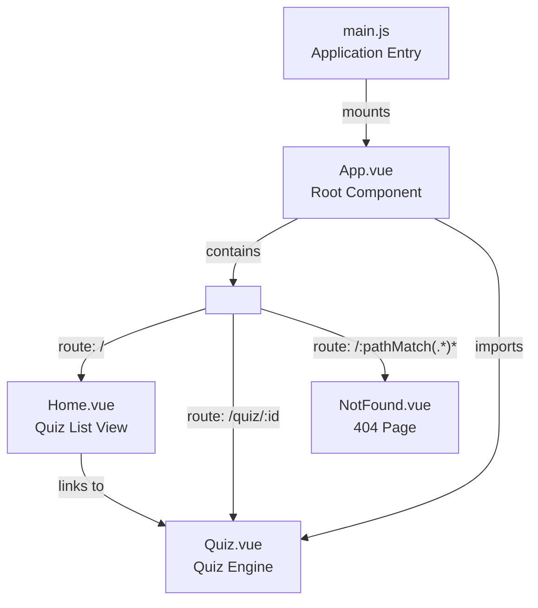
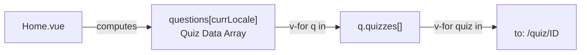
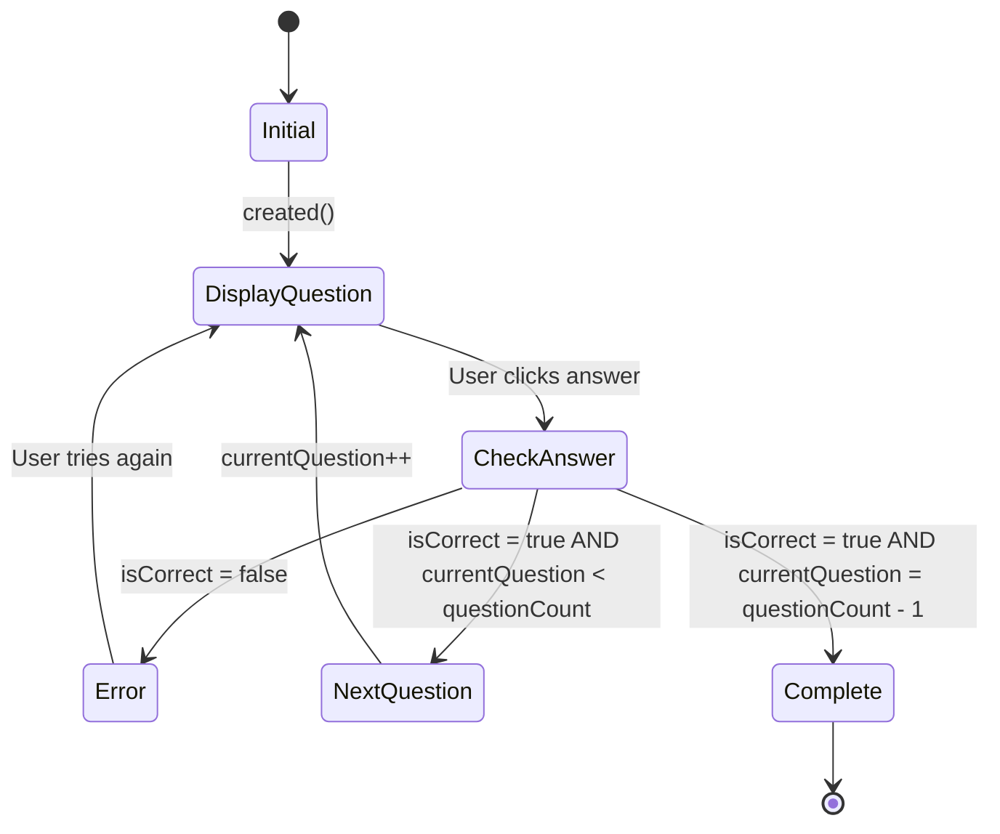
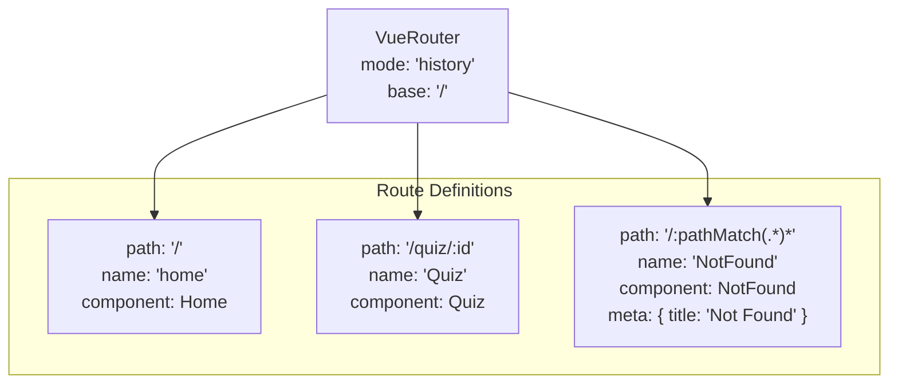
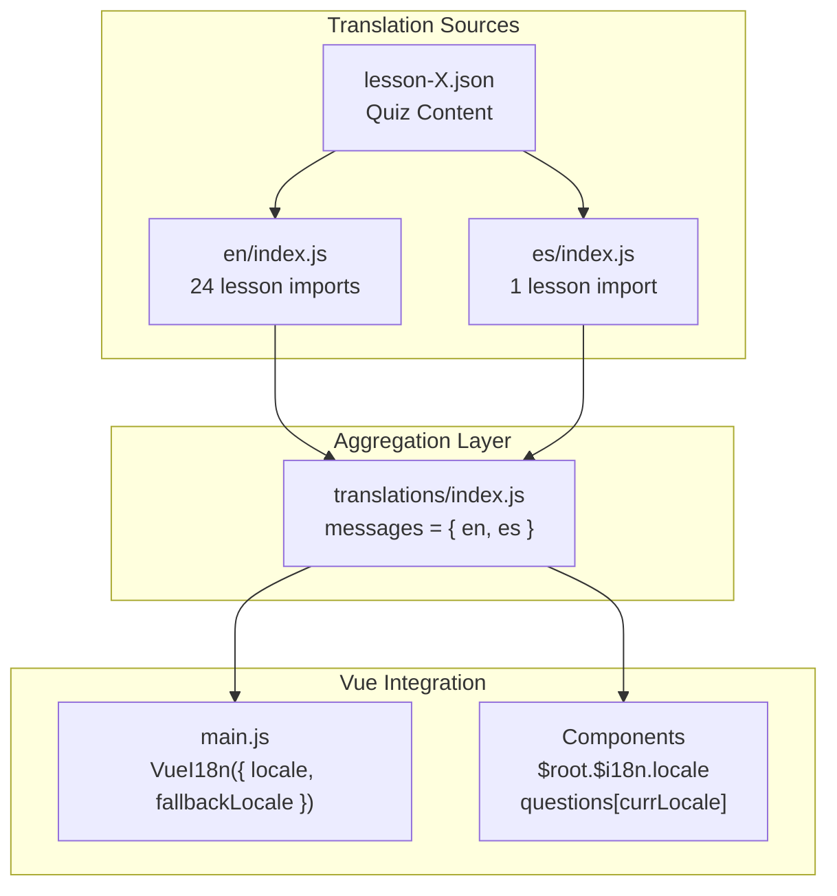
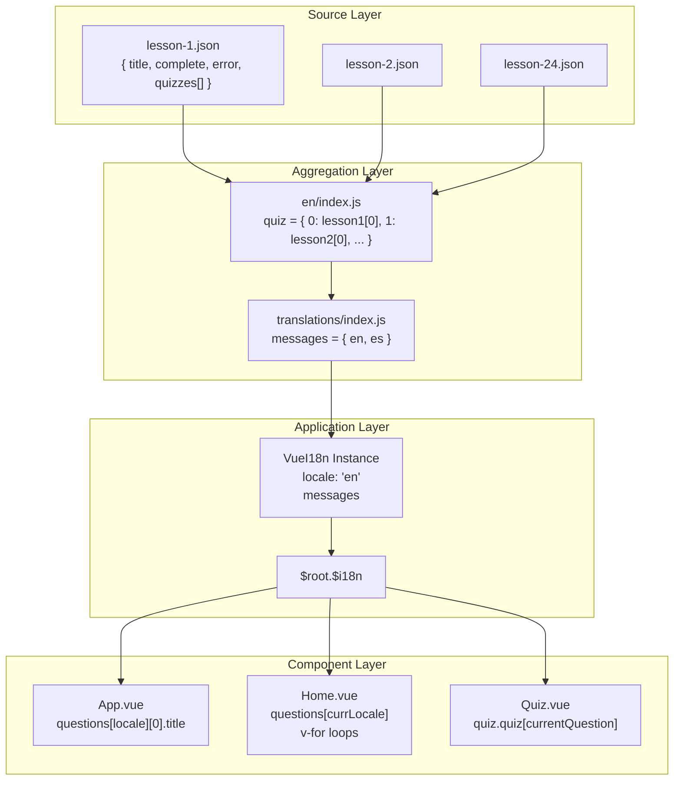
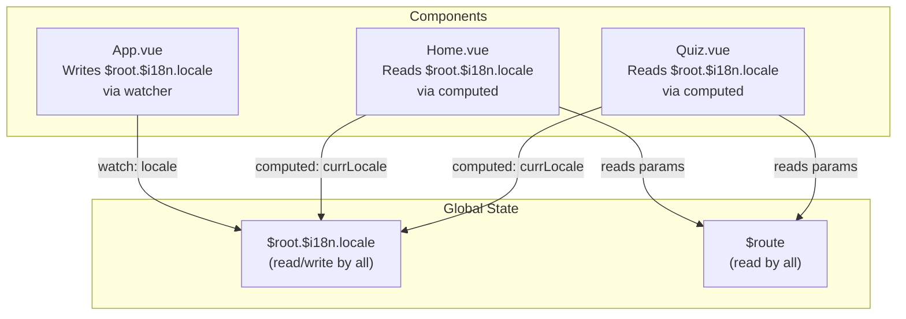

<!-- source: DeepWiki mcp.deepwiki.com · repo microsoft/AI-For-Beginners · page 4.1 Quiz Application Architecture · fetched 2026-10-26 -->

# Quiz Application Architecture

<details>
<summary>Relevant source files</summary>

The following files were used as context for generating this wiki page:

- [etc/quiz-app/README.md](etc/quiz-app/README.md)
- [etc/quiz-app/babel.config.js](etc/quiz-app/babel.config.js)
- [etc/quiz-app/dist/index.html](etc/quiz-app/dist/index.html)
- [etc/quiz-app/dist/js/app.dfcb35f3.js](etc/quiz-app/dist/js/app.dfcb35f3.js)
- [etc/quiz-app/dist/js/app.dfcb35f3.js.map](etc/quiz-app/dist/js/app.dfcb35f3.js.map)
- [etc/quiz-app/dist/js/chunk-vendors.c1571e8f.js](etc/quiz-app/dist/js/chunk-vendors.c1571e8f.js)
- [etc/quiz-app/dist/js/chunk-vendors.c1571e8f.js.map](etc/quiz-app/dist/js/chunk-vendors.c1571e8f.js.map)
- [etc/quiz-app/package-lock.json](etc/quiz-app/package-lock.json)
- [etc/quiz-app/package.json](etc/quiz-app/package.json)
- [etc/quiz-app/public/favicon.ico](etc/quiz-app/public/favicon.ico)
- [etc/quiz-app/public/index.html](etc/quiz-app/public/index.html)
- [etc/quiz-app/public/routes.json](etc/quiz-app/public/routes.json)
- [etc/quiz-app/src/components/Quiz.vue](etc/quiz-app/src/components/Quiz.vue)

</details>


## Purpose and Scope

This document describes the technical architecture of the Vue.js quiz application, including its component hierarchy, routing system, state management, and internationalization infrastructure. The application serves as an interactive assessment tool for the AI-For-Beginners curriculum, providing pre- and post-lesson quizzes with multilingual support.

For information about quiz content structure and authoring, see [Quiz Content Structure](#4.2). For deployment pipeline details, see [Quiz Deployment Pipeline](#4.3). For translation infrastructure, see [Translation Infrastructure](#5.1).

---

## Application Stack and Entry Point

The quiz application is a Vue 2.6 single-page application (SPA) using the following core dependencies:

| Dependency | Version | Purpose |
|------------|---------|---------|
| `vue` | ^2.6.11 | Core framework |
| `vue-router` | ^3.4.9 | Client-side routing |
| `vue-i18n` | ^8.28.2 | Internationalization |
| `core-js` | ^3.6.5 | Polyfills for browser compatibility |

The application entry point is [`src/main.js`](etc/quiz-app/src/main.js:1-24), which initializes the Vue instance, configures the i18n system, and mounts the application:

```javascript
// Simplified structure
Vue.config.productionTip = false
Vue.use(VueI18n)

const i18n = new VueI18n({
  locale: 'en',
  fallbackLocale: 'en'
})

new Vue({ i18n, router, render: h => h(App) }).$mount('#app')
```

**Sources:** [etc/quiz-app/src/main.js:1-14](), [etc/quiz-app/package.json:10-14]()

---

## Component Hierarchy

### Component Tree Structure



**Sources:** [etc/quiz-app/src/main.js:1-14](), [etc/quiz-app/src/router/index.js:1-34]()

### App.vue: Root Component

The root component at [`src/App.vue`](etc/quiz-app/src/App.vue:1-135) provides the application shell with navigation, language selection, and routing container:

**Key Responsibilities:**
- Global navigation bar with Home link
- Language dropdown selector (English/Spanish)
- Display of current quiz title from i18n messages
- Container for routed views via `<router-view>`

**Data Structure:**
```javascript
data() {
  return {
    locale: ""  // Current language code ('en' or 'es')
  }
}
```

**Computed Properties:**
- `questions()`: Returns the full messages object from translations

**Watchers:**
- `locale(val)`: Updates `$root.$i18n.locale` when language changes

**Lifecycle:**
- `created()`: Initializes locale from query parameter `?loc=XX` or defaults to 'en'

**Sources:** [etc/quiz-app/src/App.vue:1-135]()

---

## View Components

### Home.vue: Quiz Browser

The Home view at [`src/views/Home.vue`](etc/quiz-app/src/views/Home.vue:1-53) displays a list of all available quizzes for the current language:



**Template Structure:**
- Outer loop: `v-for="q in questions[currLocale]"` (iterates lesson groups)
- Inner loop: `v-for="quiz in q.quizzes"` (iterates individual quizzes)
- Generates `<router-link>` elements with `:to="quiz/${quiz.id}"`

**Computed Properties:**
- `questions()`: Returns messages from translations
- `currLocale()`: Returns `$root.$i18n.locale`

**Sources:** [etc/quiz-app/src/views/Home.vue:1-51]()

### Quiz.vue: Quiz Engine

The Quiz component at [`src/components/Quiz.vue`](etc/quiz-app/src/components/Quiz.vue:1-90) implements the interactive quiz logic:



**Data Properties:**

| Property | Type | Default | Purpose |
|----------|------|---------|---------|
| `currentQuestion` | Number | 0 | Index of current question |
| `complete` | Boolean | false | Quiz completion flag |
| `error` | Boolean | false | Incorrect answer flag |
| `route` | String | "" | Quiz ID from URL params |
| `locale` | String | "" | Language code |

**Methods:**

`handleAnswerClick(isCorrect, questionCount)`:
- Resets `error` flag [etc/quiz-app/src/components/Quiz.vue:66]()
- If `isCorrect` is true:
    - If `nextQuestion < questionCount`: increments `currentQuestion` [etc/quiz-app/src/components/Quiz.vue:69-70]()
    - Else (`nextQuestion` is `questionCount`): sets `complete = true` [etc/quiz-app/src/components/Quiz.vue:71-73]()
- If `isCorrect` is false: sets `error = true` [etc/quiz-app/src/components/Quiz.vue:75-76]()

**Lifecycle:**
- `created()`: Extracts quiz ID from `$route.params.id` [etc/quiz-app/src/components/Quiz.vue:80](), initializes locale from query parameter `?loc=XX` or 'en' [etc/quiz-app/src/components/Quiz.vue:81-85]()

**Template Logic:**
- Displays completion message if `complete = true` [etc/quiz-app/src/components/Quiz.vue:8]()
- Displays error message if `error = true` [etc/quiz-app/src/components/Quiz.vue:10]()
- Renders question text: `quiz.quiz[currentQuestion].questionText` [etc/quiz-app/src/components/Quiz.vue:17]()
- Renders answer buttons from `quiz.quiz[currentQuestion].answerOptions` [etc/quiz-app/src/components/Quiz.vue:21-28]()

**Sources:** [etc/quiz-app/src/components/Quiz.vue:1-88]()

---

## Routing System

### Router Configuration

The router is configured in [`src/router/index.js`](etc/quiz-app/src/router/index.js:1-43) using `history` mode:



**Configuration Details:**

```javascript
const router = new VueRouter({
  mode: 'history',
  base: process.env.BASE_URL,  // Defaults to '/'
  routes: [
    { path: '/', name: 'home', component: Home },
    { path: '/quiz/:id', name: 'Quiz', component: Quiz },
    { path: '/:pathMatch(.*)*', name: 'NotFound', component: NotFound, meta: { title: 'Not Found' } }
  ]
})
```

**beforeEach Guard:**
The router includes a navigation guard at [src/router/index.js:38-40]() that currently performs no validation (simply calls `next()`).

**History Mode Implications:**
- Requires server-side configuration to redirect all routes to `/index.html`
- Handled by [`public/routes.json`](etc/quiz-app/public/routes.json:1-8) for local development and by the deployment environment (e.g., Azure Static Web Apps) for production.

**Sources:** [etc/quiz-app/src/router/index.js:1-34](), [etc/quiz-app/public/routes.json:1-8]()

---

## Internationalization System

### VueI18n Integration

The i18n system bridges quiz content (JSON files) with Vue component localization:



### Messages Structure

The translations are organized in [`src/assets/translations/index.js`](etc/quiz-app/src/assets/translations/index.js:1-8):

```javascript
import englishQuizzes from './en'
import spanishQuizzes from './es'

const messages = {
  en: englishQuizzes,
  es: spanishQuizzes
}
export default messages
```

**English Quiz Index** ([src/assets/translations/en/index.js]()):
- Imports 24 lesson JSON files (`lesson-1.json` through `lesson-24.json`)
- Creates quiz object with numeric keys 0-23
- Each key maps to the first element of the lesson array: `quiz = { 0: x1[0], 1: x2[0], ... }`

**Spanish Quiz Index** ([src/assets/translations/es/index.js]()):
- Currently imports only 1 lesson (`lesson-1.json`)
- Maps to key 0: `quiz = { 0: es1[0] }`

### Locale Switching Mechanism

**Language Selection Flow:**

1. User selects language from dropdown in `App.vue`
2. Dropdown uses `v-model="locale"` binding
3. Watcher triggers: `locale(val) { this.$root.$i18n.locale = val }`
4. All child components access via computed property: `currLocale() { return this.$root.$i18n.locale }`
5. Components render content from `questions[currLocale]`

**URL-Based Locale:**
- Components check `$route.query.loc` on creation
- If present, sets `locale` to query value (e.g., `?loc=es`)
- Otherwise defaults to `'en'`
- Enables deep-linking to specific language versions

**Sources:** [etc/quiz-app/src/assets/translations/index.js:1-8](), [etc/quiz-app/src/assets/translations/en/index.js:1-24](), [etc/quiz-app/src/assets/translations/es/index.js:1-7](), [etc/quiz-app/src/App.vue:1-135]()

---

## Data Flow Architecture

### Quiz Data Flow Diagram



### State Management

The application uses **local component state** rather than Vuex or Pinia:

**App.vue State:**
- `locale`: String - Selected language code

**Quiz.vue State:**
- `currentQuestion`: Number - Question index
- `complete`: Boolean - Completion flag
- `error`: Boolean - Error state
- `route`: String - Quiz ID
- `locale`: String - Language code

**Home.vue State:**
- `locale`: String - Language code (unused in render)

**Shared State:**
- `$root.$i18n.locale`: Global i18n locale accessed by all components

**Sources:** [etc/quiz-app/src/App.vue:1-135](), [etc/quiz-app/src/components/Quiz.vue:1-88](), [etc/quiz-app/src/views/Home.vue:1-51]()

---

## Component Communication

### Communication Patterns



**Communication Methods:**

1. **Global i18n Locale:**
   - App.vue: Write access via `this.$root.$i18n.locale = val`
   - Home.vue/Quiz.vue: Read access via computed property

2. **Route Parameters:**
   - Router provides quiz ID via `$route.params.id`
   - Router provides locale query via `$route.query.loc`

3. **Router Navigation:**
   - Home.vue generates `<router-link to="/quiz/123">` elements
   - Vue Router handles navigation without parent-child props

4. **No Props or Events:**
   - Components are decoupled via router
   - No direct parent-child prop passing
   - No custom event emission

**Sources:** [etc/quiz-app/src/App.vue:1-135](), [etc/quiz-app/src/components/Quiz.vue:1-88](), [etc/quiz-app/src/views/Home.vue:1-51]()

---

## Build Configuration

### Build Process

The application uses Vue CLI 5.0 with the following configuration:

**Build Scripts** ([package.json:5-8]()):
- `serve`: Development server with hot reload
- `build`: Production build to `dist/` directory
- `lint`: ESLint with auto-fix

**Build Plugins:**
- `@vue/cli-plugin-babel`: ES6+ transpilation
- `@vue/cli-plugin-eslint`: Code linting
- `@vue/cli-service`: Core build toolchain

**Output Structure:**
```
dist/
├── index.html           # SPA shell
├── favicon.ico          # Site icon
├── routes.json          # SPA routing config
├── css/
│   └── app.67375a05.css
└── js/
    ├── app.dfcb35f3.js
    ├── app.dfcb35f3.js.map
    ├── chunk-vendors.c1571e8f.js
    └── chunk-vendors.c1571e8f.js.map
```

**Code Splitting:**
- Main application code: `app.*.js` ([etc/quiz-app/dist/js/app.dfcb35f3.js:1-1]())
- Vendor dependencies (Vue, Vue Router, Vue-i18n): `chunk-vendors.*.js` ([etc/quiz-app/dist/js/chunk-vendors.c1571e8f.js:1-6]())

**Sources:** [etc/quiz-app/package.json:1-44](), [etc/quiz-app/dist/index.html:1-1](), [etc/quiz-app/dist/js/app.dfcb35f3.js:1-1](), [etc/quiz-app/dist/js/chunk-vendors.c1571e8f.js:1-6]()

---

## Key Architectural Patterns

### 1. Convention-Based Quiz ID Mapping

Quiz IDs follow a numeric convention where:
- Pre-quiz IDs: `1XX` (lesson X pre-quiz, e.g., 101, 102, 103)
- Post-quiz IDs: `2XX` (lesson X post-quiz, e.g., 201, 202, 203)

This pattern is reflected in the JSON files (e.g., `lesson-1.json` contains quizzes with `id: 101` and `id: 201`).

### 2. Dynamic Question Count

The `Quiz.vue` component now dynamically determines the number of questions using `questionCount` passed to `handleAnswerClick` [etc/quiz-app/src/components/Quiz.vue:65](). This replaces the previous hardcoded 3-question limit, making the quiz engine more flexible.

### 3. Locale Query Parameter Pattern

All components check for `?loc=XX` query parameter on creation, enabling:
- Deep-linking to specific language versions
- Consistent locale across navigation
- SEO-friendly multilingual URLs

### 4. Translation Module Duplication

Each language's `index.js` duplicates the import pattern, prioritizing:
- Clear, explicit imports over DRY principles
- Easy content verification
- Pedagogical transparency

**Sources:** [etc/quiz-app/src/components/Quiz.vue:1-88](), [etc/quiz-app/src/assets/translations/en/index.js:1-24]()

---

## Browser Compatibility

**Target Browsers** ([package.json:39-42]()):
```json
{
  "browserslist": [
    "> 1%",
    "last 2 versions",
    "not dead"
  ]
}
```

This targets browsers with >1% market share, their last 2 versions, excluding unmaintained browsers.

**Polyfills:**
- `core-js@^3.6.5` provides ES6+ feature support for older browsers
- Babel transpiles modern JavaScript to ES5-compatible code

**Sources:** [etc/quiz-app/package.json:39-42](), [etc/quiz-app/babel.config.js:1-5]()

---

