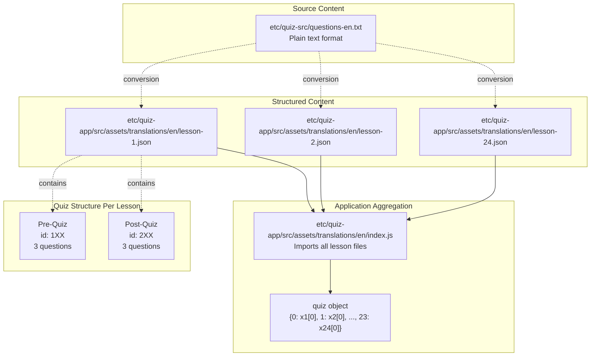
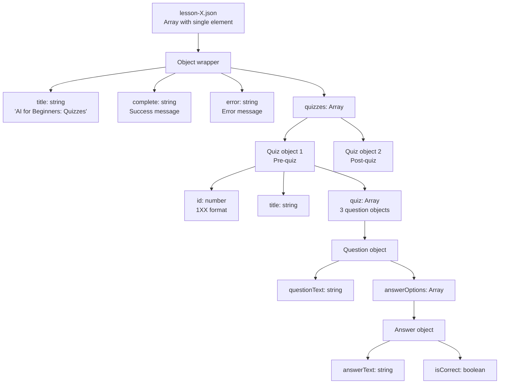
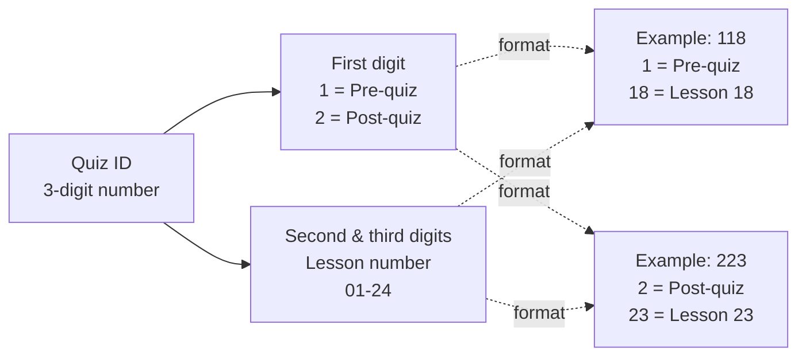
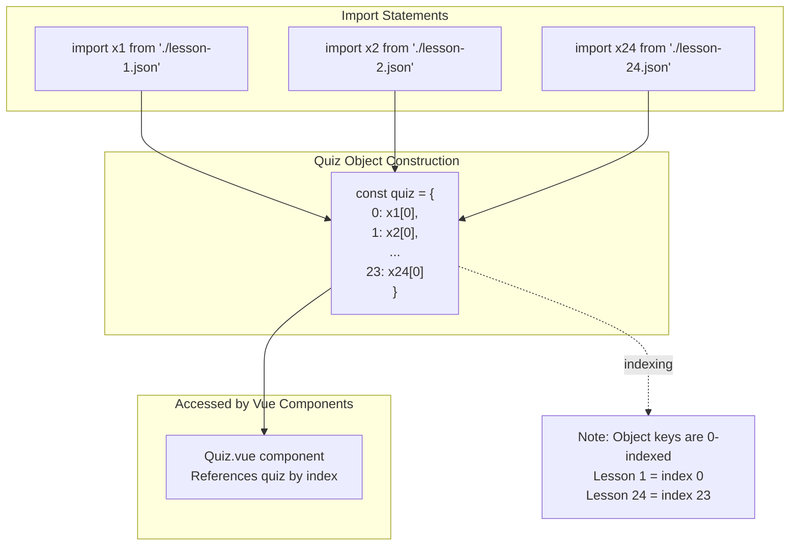
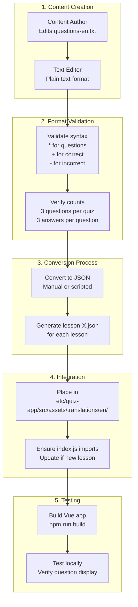
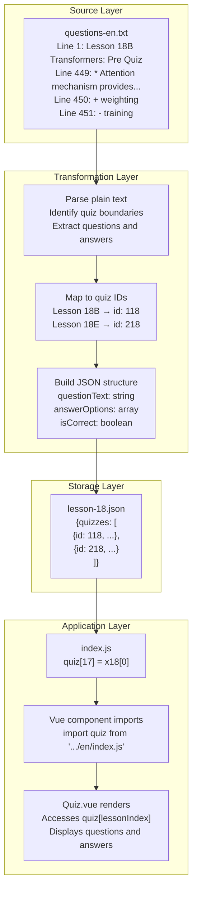

<!-- source: DeepWiki mcp.deepwiki.com · repo microsoft/AI-For-Beginners · page 4.2 Quiz Content Structure · fetched 2026-10-26 -->

# Quiz Content Structure

<details>
<summary>Relevant source files</summary>

The following files were used as context for generating this wiki page:

- [etc/quiz-app/src/assets/translations/en/index.js](etc/quiz-app/src/assets/translations/en/index.js)
- [etc/quiz-app/src/assets/translations/en/lesson-1.json](etc/quiz-app/src/assets/translations/en/lesson-1.json)
- [etc/quiz-app/src/assets/translations/en/lesson-10.json](etc/quiz-app/src/assets/translations/en/lesson-10.json)
- [etc/quiz-app/src/assets/translations/en/lesson-11.json](etc/quiz-app/src/assets/translations/en/lesson-11.json)
- [etc/quiz-app/src/assets/translations/en/lesson-12.json](etc/quiz-app/src/assets/translations/en/lesson-12.json)
- [etc/quiz-app/src/assets/translations/en/lesson-13.json](etc/quiz-app/src/assets/translations/en/lesson-13.json)
- [etc/quiz-app/src/assets/translations/en/lesson-14.json](etc/quiz-app/src/assets/translations/en/lesson-14.json)
- [etc/quiz-app/src/assets/translations/en/lesson-15.json](etc/quiz-app/src/assets/translations/en/lesson-15.json)
- [etc/quiz-app/src/assets/translations/en/lesson-16.json](etc/quiz-app/src/assets/translations/en/lesson-16.json)
- [etc/quiz-app/src/assets/translations/en/lesson-17.json](etc/quiz-app/src/assets/translations/en/lesson-17.json)
- [etc/quiz-app/src/assets/translations/en/lesson-18.json](etc/quiz-app/src/assets/translations/en/lesson-18.json)
- [etc/quiz-app/src/assets/translations/en/lesson-19.json](etc/quiz-app/src/assets/translations/en/lesson-19.json)
- [etc/quiz-app/src/assets/translations/en/lesson-2.json](etc/quiz-app/src/assets/translations/en/lesson-2.json)
- [etc/quiz-app/src/assets/translations/en/lesson-20.json](etc/quiz-app/src/assets/translations/en/lesson-20.json)
- [etc/quiz-app/src/assets/translations/en/lesson-22.json](etc/quiz-app/src/assets/translations/en/lesson-22.json)
- [etc/quiz-app/src/assets/translations/en/lesson-23.json](etc/quiz-app/src/assets/translations/en/lesson-23.json)
- [etc/quiz-app/src/assets/translations/en/lesson-3.json](etc/quiz-app/src/assets/translations/en/lesson-3.json)
- [etc/quiz-app/src/assets/translations/en/lesson-4.json](etc/quiz-app/src/assets/translations/en/lesson-4.json)
- [etc/quiz-app/src/assets/translations/en/lesson-5.json](etc/quiz-app/src/assets/translations/en/lesson-5.json)
- [etc/quiz-app/src/assets/translations/en/lesson-6.json](etc/quiz-app/src/assets/translations/en/lesson-6.json)
- [etc/quiz-app/src/assets/translations/en/lesson-7.json](etc/quiz-app/src/assets/translations/en/lesson-7.json)
- [etc/quiz-app/src/assets/translations/en/lesson-8.json](etc/quiz-app/src/assets/translations/en/lesson-8.json)
- [etc/quiz-app/src/assets/translations/en/lesson-9.json](etc/quiz-app/src/assets/translations/en/lesson-9.json)
- [etc/quiz-src/questions-en.txt](etc/quiz-src/questions-en.txt)
- [etc/quiz-src/qzmkjson.py](etc/quiz-src/qzmkjson.py)
- [etc/quiz-src/template.json](etc/quiz-src/template.json)
- [lessons/4-ComputerVision/10-GANs/GANPyTorch.ipynb](lessons/4-ComputerVision/10-GANs/GANPyTorch.ipynb)
- [lessons/4-ComputerVision/10-GANs/GANTF.ipynb](lessons/4-ComputerVision/10-GANs/GANTF.ipynb)
- [lessons/5-NLP/14-Embeddings/EmbeddingsTF.ipynb](lessons/5-NLP/14-Embeddings/EmbeddingsTF.ipynb)

</details>


## Purpose and Scope

This document describes the quiz content format, data schema, and authoring workflow for the AI-For-Beginners assessment system. It covers the plain text source format in `questions-en.txt`, the structured JSON schema used by the Vue.js application, the quiz ID naming conventions, and the content transformation pipeline. For information about the Vue.js application that consumes this content, see [Quiz Application Architecture](#4.1). For deployment details, see [Quiz Deployment Pipeline](#4.3).

## Quiz Content Architecture

The quiz content system uses a two-stage format: human-editable plain text source files that are converted into structured JSON files consumed by the Vue.js application.



Sources: [etc/quiz-src/questions-en.txt:1-639](), [etc/quiz-app/src/assets/translations/en/index.js:1-26]()

## Plain Text Source Format

The source quiz content is stored in `questions-en.txt` using a simple line-based format optimized for human editing.

### Format Specification

| Element | Syntax | Example |
|---------|--------|---------|
| Quiz Header | `Lesson {N}{B\|E} {Title}: {Pre\|Post} Quiz` | `Lesson 1B Introduction to AI: Pre Quiz` |
| Question | `* {question text}` | `* A famous 19th century proto-computer engineer was` |
| Correct Answer | `+ {answer text}` | `+ Charles Babbage` |
| Incorrect Answer | `- {answer text}` | `- Charles Darwin` |
| Quiz Separator | Empty line | |

### Structure Pattern

Each quiz follows this pattern:
1. Header line identifying lesson number, section (B for pre, E for post), title, and quiz type
2. Three questions, each with:
   - One question line starting with `*`
   - Three answer lines (one `+` correct, two `-` incorrect)
3. Empty line separator before next quiz

### Example Content

```
Lesson 1B Introduction to AI: Pre Quiz
* A famous 19th century proto-computer engineer was
- Charles Barkley
+ Charles Babbage
- Charles Darwin
* Weak AI is a system designed to solve many tasks
- True
+ False
* Chat bots are an example of truly intelligent systems
- false, they are usually designed by a series of rules.
- true, they are usually considered to be 'intelligent
+ false, but they are increasingly able to pass Turing tests as they become more sophisticated.

Lesson 1E Introduction to AI: Post-Quiz
...
```

Sources: [etc/quiz-src/questions-en.txt:1-26]()

## Structured JSON Schema

Each lesson's quiz content is stored in a JSON file following a standardized schema consumed by the Vue.js application.



Sources: [etc/quiz-app/src/assets/translations/en/lesson-18.json:1-119](), [etc/quiz-app/src/assets/translations/en/lesson-23.json:1-119]()

### Schema Definition

```json
[
  {
    "title": "AI for Beginners: Quizzes",
    "complete": "Congratulations, you completed the quiz!",
    "error": "Sorry, try again",
    "quizzes": [
      {
        "id": 118,
        "title": "Transformers: Pre Quiz",
        "quiz": [
          {
            "questionText": "Attention mechanism provides a means of...",
            "answerOptions": [
              {
                "answerText": "weighting",
                "isCorrect": true
              },
              {
                "answerText": "training",
                "isCorrect": false
              },
              {
                "answerText": "testing",
                "isCorrect": false
              }
            ]
          }
        ]
      }
    ]
  }
]
```

### Field Specifications

| Field Path | Type | Description |
|------------|------|-------------|
| `[0].title` | string | Application title (constant across all lessons) |
| `[0].complete` | string | Success message shown after quiz completion |
| `[0].error` | string | Error message for incorrect answers |
| `[0].quizzes` | array | Contains exactly 2 quiz objects (pre and post) |
| `[0].quizzes[n].id` | number | Unique quiz identifier (see ID conventions below) |
| `[0].quizzes[n].title` | string | Display title for the quiz |
| `[0].quizzes[n].quiz` | array | Contains exactly 3 question objects |
| `quiz[n].questionText` | string | The question prompt |
| `quiz[n].answerOptions` | array | Contains exactly 3 answer objects |
| `answerOptions[n].answerText` | string | The answer text |
| `answerOptions[n].isCorrect` | boolean | True for correct answer, false otherwise |

Sources: [etc/quiz-app/src/assets/translations/en/lesson-18.json:6-58](), [etc/quiz-app/src/assets/translations/en/lesson-11.json:1-119]()

## Quiz ID Conventions

Quiz IDs follow a systematic three-digit numbering scheme that encodes lesson number and quiz type.

### ID Format Structure



### ID Mapping Table

| Lesson | Pre-Quiz ID | Post-Quiz ID | Title |
|--------|-------------|--------------|-------|
| 1 | 101 | 201 | Introduction to AI |
| 4 | 104 | 204 | Neural Networks |
| 5 | 105 | 205 | Frameworks |
| 6 | 106 | 206 | Introduction to Computer Vision |
| 7 | 107 | 207 | Convolutional Neural Networks |
| 8 | 108 | 208 | Pre-trained Networks and Transfer Learning |
| 9 | 109 | 209 | Autoencoders |
| 11 | 111 | 211 | Object Detection |
| 12 | 112 | 212 | Segmentation |
| 16 | 116 | 216 | RNN |
| 17 | 117 | 217 | Generative networks |
| 18 | 118 | 218 | Transformers |
| 20 | 120 | 220 | Language Models |
| 23 | 123 | 223 | Multi-Agent Modeling |

### Implementation in Code

The quiz IDs are hardcoded in each lesson JSON file:

```json
{
  "id": 118,
  "title": "Transformers: Pre Quiz",
  ...
}
```

```json
{
  "id": 218,
  "title": "Transformers: Post Quiz",
  ...
}
```

Sources: [etc/quiz-app/src/assets/translations/en/lesson-18.json:8-9](), [etc/quiz-app/src/assets/translations/en/lesson-18.json:61-62](), [etc/quiz-app/src/assets/translations/en/lesson-23.json:8-9]()

## Content Aggregation System

The individual lesson JSON files are aggregated into a single quiz object used by the Vue.js application.



### Implementation Details

The aggregation is implemented in [etc/quiz-app/src/assets/translations/en/index.js:1-26]():

1.  **Import Phase** (lines 1-24): Each lesson JSON file is imported with a numbered variable name (`x1`, `x2`, ..., `x24`)
2.  **Object Construction** (line 25): A quiz object is created with keys 0-23, where each value is the first element (`[0]`) of the corresponding lesson array
3.  **Export** (line 26): The quiz object is exported as the default export

### Key-to-Lesson Mapping

| Object Key | Lesson Number | Variable | File |
|------------|---------------|----------|------|
| 0 | 1 | `x1[0]` | `lesson-1.json` |
| 10 | 11 | `x11[0]` | `lesson-11.json` |
| 17 | 18 | `x18[0]` | `lesson-18.json` |
| 22 | 23 | `x23[0]` | `lesson-23.json` |
| 23 | 24 | `x24[0]` | `lesson-24.json` |

Sources: [etc/quiz-app/src/assets/translations/en/index.js:1-26]()

## Content Coverage Matrix

The quiz system provides comprehensive assessment coverage across all 24 lessons with 48 total quizzes (2 per lesson).

| Lesson Range | Domain | Pre-Quizzes | Post-Quizzes | Total Questions |
|--------------|--------|-------------|--------------|-----------------|
| 1-2 | AI Introduction | 2 | 2 | 12 |
| 3-5 | Neural Networks | 3 | 3 | 18 |
| 6-12 | Computer Vision | 7 | 7 | 42 |
| 13-20 | NLP | 8 | 8 | 48 |
| 21-24 | Advanced Topics | 4 | 4 | 24 |
| **Total** | | **24** | **24** | **144** |

### Question Distribution

Each quiz contains exactly 3 questions, and each question contains exactly 3 answer options (1 correct, 2 incorrect). This standardization ensures consistent quiz duration and difficulty assessment.

Sources: [etc/quiz-src/questions-en.txt:1-639]()

## Content Authoring Workflow

The content authoring process involves creating or editing plain text source files and converting them to structured JSON.



### Authoring Guidelines

1.  **Maintain Format Consistency**
    -   Use exact header format: `Lesson {N}{B|E} {Title}: {Pre|Post} Quiz`
    -   Start questions with `*`
    -   Mark correct answers with `+`
    -   Mark incorrect answers with `-`
    -   Separate quizzes with empty lines
2.  **Content Requirements**
    -   Each lesson must have exactly 2 quizzes (pre and post)
    -   Each quiz must have exactly 3 questions
    -   Each question must have exactly 3 answer options
    -   Each question must have exactly 1 correct answer
3.  **Question Quality**
    -   Questions should test understanding of key concepts
    -   Answers should be clearly correct or incorrect
    -   Avoid ambiguous phrasing
    -   Keep questions concise
4.  **ID Assignment**
    -   Pre-quiz ID: `1` + lesson number (e.g., Lesson 18 = `118`)
    -   Post-quiz ID: `2` + lesson number (e.g., Lesson 18 = `218`)

Sources: [etc/quiz-src/questions-en.txt:1-639]()

## Data Flow: Plain Text to Application

The following diagram illustrates the complete data transformation from human-editable source to rendered quiz.



Sources: [etc/quiz-src/questions-en.txt:448-460](), [etc/quiz-app/src/assets/translations/en/lesson-18.json:1-119](), [etc/quiz-app/src/assets/translations/en/index.js:18](), [etc/quiz-app/src/assets/translations/en/index.js:25]()

## Localization Support

The content structure supports internationalization through parallel directory structures for different languages.

### Directory Structure

```
etc/quiz-app/src/assets/translations/
├── en/
│   ├── index.js
│   ├── lesson-1.json
│   ├── lesson-2.json
│   └── ...
├── {locale}/
│   ├── index.js
│   ├── lesson-1.json
│   └── ...
```

Each locale directory maintains the same file structure and schema, with translated content but identical IDs and structure.

### Localization Invariants

The following elements remain consistent across all translations:

| Element | Consistency Requirement |
|---------|------------------------|
| Quiz IDs | Must match exactly (e.g., `118` for Lesson 18 pre-quiz) |
| Number of quizzes | 2 per lesson (pre and post) |
| Number of questions | 3 per quiz |
| Number of answers | 3 per question |
| JSON schema | Identical structure |
| `isCorrect` flags | Same correct answer positions |

**Note:** See [Localized Content and Language Coverage](#5.2) for details on translation infrastructure.

Sources: [etc/quiz-app/src/assets/translations/en/index.js:1-26]()

---

