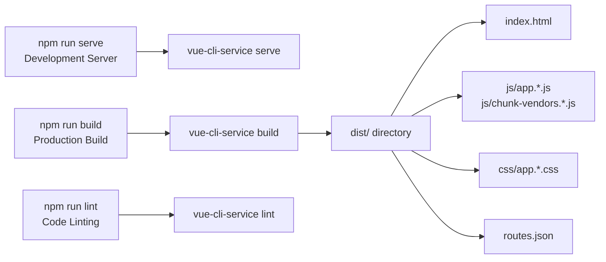
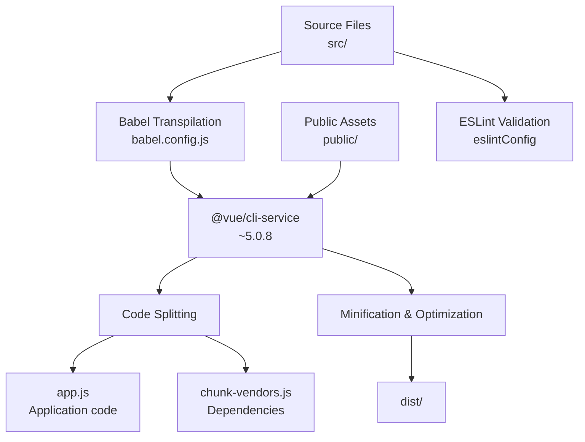
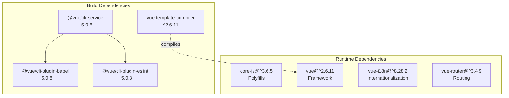
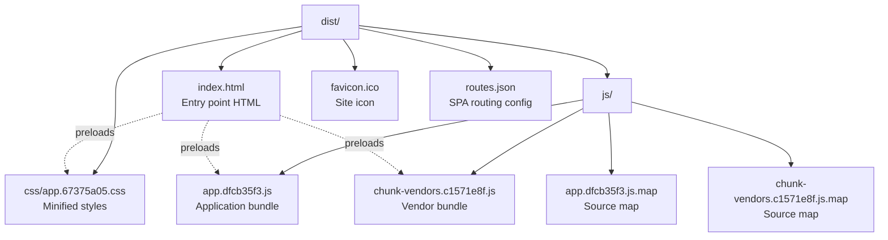
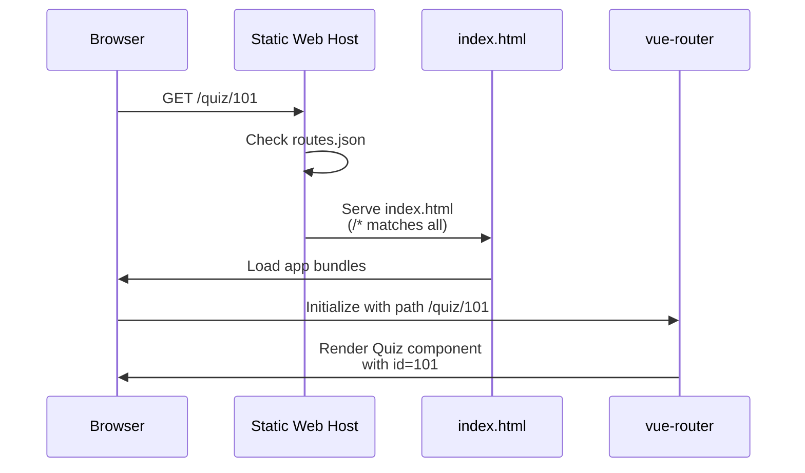
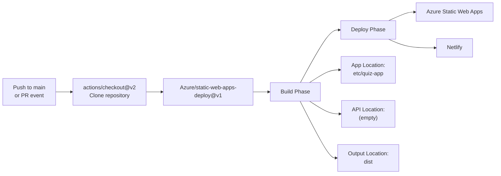
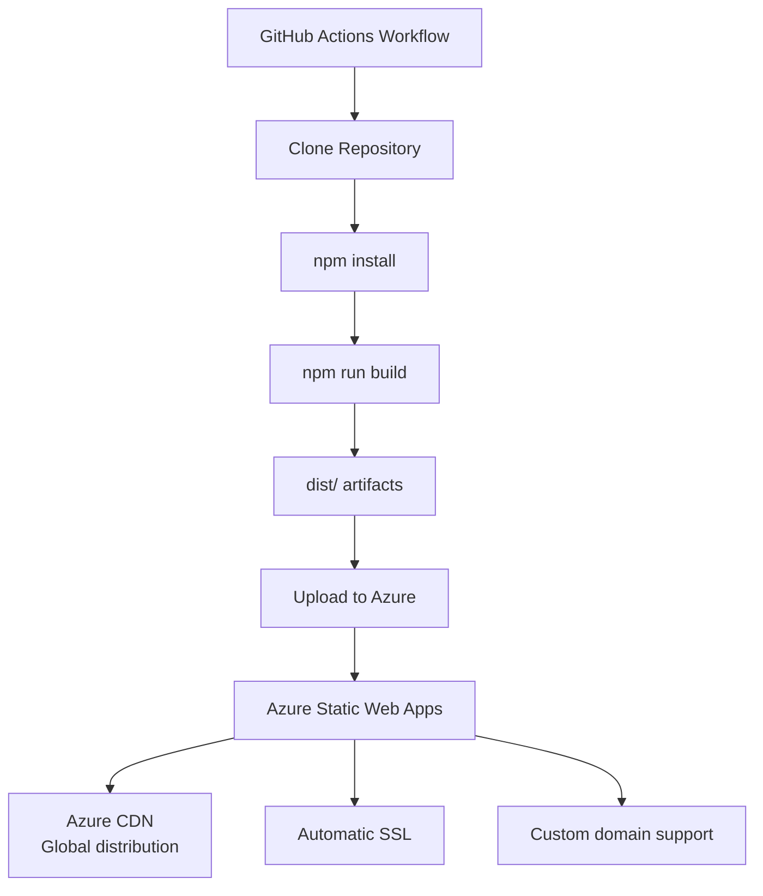
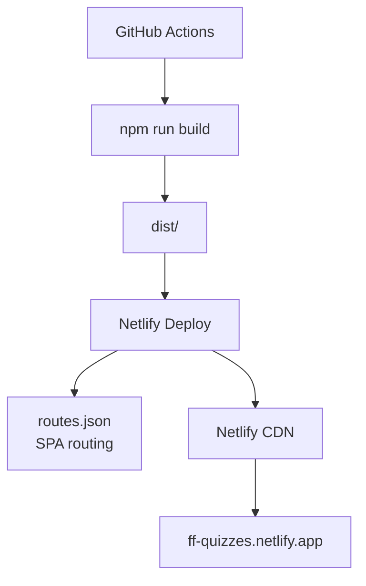
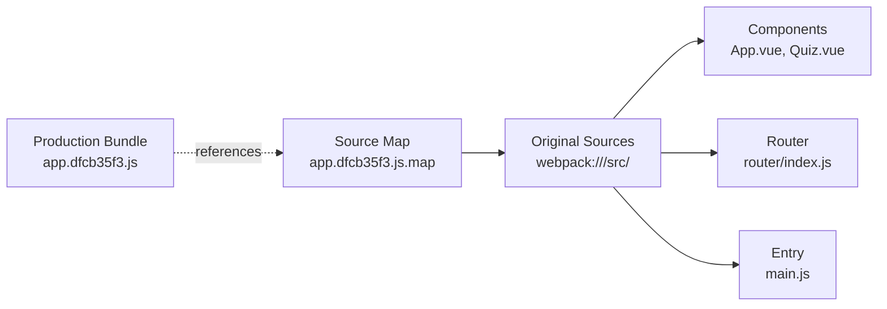

<!-- source: DeepWiki mcp.deepwiki.com · repo microsoft/AI-For-Beginners · page 4.3 Quiz Deployment Pipeline · fetched 2026-10-26 -->

# Quiz Deployment Pipeline

<details>
<summary>Relevant source files</summary>

The following files were used as context for generating this wiki page:

- [etc/quiz-app/README.md](etc/quiz-app/README.md)
- [etc/quiz-app/babel.config.js](etc/quiz-app/babel.config.js)
- [etc/quiz-app/dist/index.html](etc/quiz-app/dist/index.html)
- [etc/quiz-app/dist/js/app.dfcb35f3.js](etc/quiz-app/dist/js/app.dfcb35f3.js)
- [etc/quiz-app/dist/js/app.dfcb35f3.js.map](etc/quiz-app/dist/js/app.dfcb35f3.js.map)
- [etc/quiz-app/dist/js/chunk-vendors.c1571e8f.js](etc/quiz-app/dist/js/chunk-vendors.c1571e8f.js)
- [etc/quiz-app/dist/js/chunk-vendors.c1571e8f.js.map](etc/quiz-app/dist/js/chunk-vendors.c1571e8f.js.map)
- [etc/quiz-app/package-lock.json](etc/quiz-app/package-lock.json)
- [etc/quiz-app/package.json](etc/quiz-app/package.json)
- [etc/quiz-app/public/favicon.ico](etc/quiz-app/public/favicon.ico)
- [etc/quiz-app/public/index.html](etc/quiz-app/public/index.html)
- [etc/quiz-app/public/routes.json](etc/quiz-app/public/routes.json)

</details>


## Purpose and Scope

This document describes the build and deployment pipeline for the quiz application, covering the Vue CLI build process, output artifacts, SPA routing configuration, and automated deployment to hosting platforms via GitHub Actions. For information about the quiz application architecture and components, see [Quiz Application Architecture](#4.1). For quiz content structure and authoring, see [Quiz Content Structure](#4.2).

## Build System Overview

The quiz application uses `vue-cli-service` as its build system, configured through `package.json` scripts. The build process transforms Vue components, JavaScript modules, and static assets into optimized bundles for browser consumption.

### Build Scripts



Sources: [etc/quiz-app/package.json:5-8]()

The `package.json` defines three primary scripts:

| Script | Command | Purpose |
|--------|---------|---------|
| `serve` | `vue-cli-service serve` | Starts development server with hot-reload |
| `build` | `vue-cli-service build` | Creates production-optimized bundles |
| `lint` | `vue-cli-service lint` | Runs ESLint on source files |

Sources: [etc/quiz-app/package.json:5-8]()

## Vue CLI Build Process

### Build Configuration



Sources: [etc/quiz-app/package.json:18-20](), [etc/quiz-app/babel.config.js:1-5]()

The build configuration includes:

- **Babel Preset**: `@vue/cli-plugin-babel/preset` for JavaScript transpilation
- **ESLint Configuration**: `plugin:vue/essential` and `eslint:recommended` rules
- **Browser Targets**: `> 1%`, `last 2 versions`, `not dead`

Sources: [etc/quiz-app/babel.config.js:1-5](), [etc/quiz-app/package.json:27-43]()

### Dependency Stack



Sources: [etc/quiz-app/package.json:11-24]()

## Build Output Structure

The `vue-cli-service build` command generates the `dist/` directory with the following structure:



Sources: [etc/quiz-app/dist/index.html:1](), [etc/quiz-app/public/routes.json:1-8]()

### Generated index.html

The build process transforms `public/index.html` into an optimized entry point:

```html
<!DOCTYPE html>
<html lang="en">
  <head>
    <link rel="icon" href="/favicon.ico">
    <title>quizzes</title>
    <link href="/css/app.67375a05.css" rel="preload" as="style">
    <link href="/js/app.dfcb35f3.js" rel="preload" as="script">
    <link href="/js/chunk-vendors.c1571e8f.js" rel="preload" as="script">
  </head>
  <body>
    <div id="app"></div>
    <script src="/js/chunk-vendors.c1571e8f.js"></script>
    <script src="/js/app.dfcb35f3.js"></script>
  </body>
</html>
```

The built HTML includes:
- Resource preload hints for CSS and JavaScript
- Hashed filenames for cache busting (e.g., `app.67375a05.css`)
- Vendor bundle loaded before application bundle

Sources: [etc/quiz-app/dist/index.html:1]()

## SPA Routing Configuration

The `routes.json` file configures fallback routing for Single Page Application behavior on static web hosts:

```json
{
  "routes": [
    {
      "route": "/*",
      "serve": "/index.html"
    }
  ]
}
```

This configuration ensures that all client-side routes (e.g., `/quiz/101`, `/quiz/201`) are served by `index.html`, allowing `vue-router` to handle navigation without 404 errors.

Sources: [etc/quiz-app/public/routes.json:1-8]()

### Route Handling Flow



Sources: [etc/quiz-app/public/routes.json:1-8]()

## GitHub Actions Deployment Workflow

The deployment pipeline uses GitHub Actions to automatically build and deploy the quiz application. The workflow is triggered on push and pull request events.

### Workflow Configuration



Sources: [etc/quiz-app/README.md:93-120]()

### Workflow File Structure

The GitHub Actions workflow (`.github/workflows/azure-static-web-apps-*.yml`) includes:

```yaml
on:
  push:
    branches:
      - main
  pull_request:
    types: [opened, synchronize, reopened, closed]
    branches:
      - main

jobs:
  build_and_deploy_job:
    runs-on: ubuntu-latest
    name: Build and Deploy Job
    steps:
      - uses: actions/checkout@v2
      - name: Build And Deploy
        uses: Azure/static-web-apps-deploy@v1
        with:
          azure_static_web_apps_api_token: ${{ secrets.AZURE_STATIC_WEB_APPS_API_TOKEN }}
          repo_token: ${{ secrets.GITHUB_TOKEN }}
          action: "upload"
          app_location: "etc/quiz-app"
          output_location: "dist"
```

Sources: [etc/quiz-app/README.md:95-120]()

| Parameter | Value | Description |
|-----------|-------|-------------|
| `app_location` | `"etc/quiz-app"` | Root directory containing `package.json` |
| `api_location` | `""` | API source code path (none for this app) |
| `output_location` | `"dist"` | Build output directory |
| `action` | `"upload"` | Upload built assets to hosting |

Sources: [etc/quiz-app/README.md:117-119]()

## Azure Static Web Apps Deployment

### Deployment Process



Sources: [etc/quiz-app/README.md:47-88]()

### Azure Setup Steps

The README documents a manual setup process:

1. **Create Azure account and resource**
   - Navigate to Azure Portal
   - Create Static Web App resource

2. **Configure deployment details**
   - **Source**: GitHub
   - **Organization**: GitHub organization/user
   - **Repository**: `microsoft/AI-For-Beginners`
   - **Branch**: `main` (or target branch)

3. **Set build configuration**
   - **Build Presets**: Framework selection (Vue)
   - **App Location**: `/` or `etc/quiz-app`
   - **Output Location**: `dist`

4. **Authentication**
   - Azure creates GitHub Actions workflow automatically
   - Stores `AZURE_STATIC_WEB_APPS_API_TOKEN` in GitHub Secrets

Sources: [etc/quiz-app/README.md:54-80]()

## Netlify Deployment

The application is also deployed to Netlify at `ff-quizzes.netlify.app`, providing deployment redundancy.

### Netlify Configuration



Sources: [etc/quiz-app/README.md:1-3]()

Netlify uses the same `dist/` output and `routes.json` configuration for SPA routing. The `routes.json` wildcard route ensures all client-side navigation is handled correctly.

Sources: [etc/quiz-app/public/routes.json:1-8]()

## Build Artifacts

### JavaScript Bundle Analysis

The build process generates two primary JavaScript bundles:

**Application Bundle** (`app.dfcb35f3.js`):
- Application-specific code (Vue components, router, i18n setup)
- Quiz components: `App.vue`, `Quiz.vue`, `Home.vue`, `NotFound.vue`
- Router configuration from `src/router/index.js`
- Main entry point from `src/main.js`

**Vendor Bundle** (`chunk-vendors.c1571e8f.js`):
- Vue framework (`vue@2.6.11`)
- Vue Router (`vue-router@3.4.9`)
- Vue I18n (`vue-i18n@8.28.2`)
- Core-js polyfills
- Component normalizer utilities

Sources: [etc/quiz-app/dist/js/app.dfcb35f3.js.map:1](), [etc/quiz-app/dist/js/chunk-vendors.c1571e8f.js.map:1]()

### Source Maps

Both bundles include source maps (`.js.map` files) for debugging:



Source maps enable debugging of production code by mapping minified code back to original source files.

Sources: [etc/quiz-app/dist/js/app.dfcb35f3.js.map:1]()

### CSS Bundle

The CSS bundle (`app.67375a05.css`) contains:
- Minified styles from `App.vue` `<style>` blocks
- Global styles (navigation, cards, buttons, form elements)
- Typography and layout rules

Sources: [etc/quiz-app/dist/css/app.67375a05.css:1]()

## Deployment Monitoring

After deployment via GitHub Actions:

1. **Workflow execution** can be monitored in the GitHub repository's Actions tab
2. **Build logs** show npm install, build, and deployment steps
3. **Deployment URL** is provided by Azure Static Web Apps after successful deployment
4. **Preview deployments** are created automatically for pull requests

Sources: [etc/quiz-app/README.md:85-88]()

---

