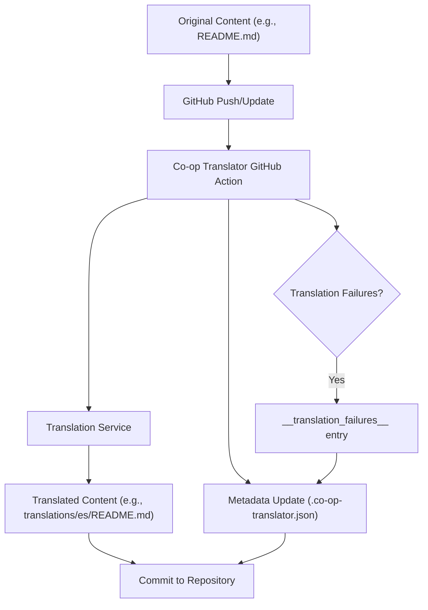
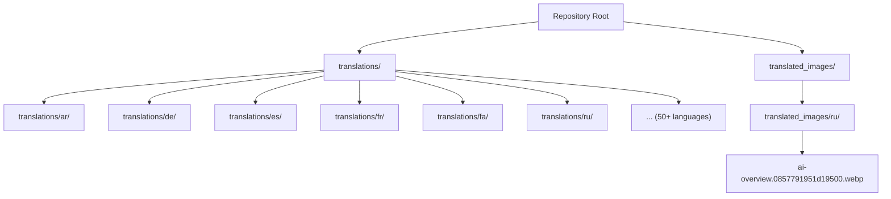

<!-- source: DeepWiki mcp.deepwiki.com · repo microsoft/AI-For-Beginners · page 5 Internationalization System · fetched 2026-10-26 -->

# Internationalization System

Relevant source files

The following files were used as context for generating this wiki page:

- [translations/ar/.co-op-translator.json](translations/ar/.co-op-translator.json)
- [translations/ar/README.md](translations/ar/README.md)
- [translations/ar/examples/README.md](translations/ar/examples/README.md)
- [translations/de/.co-op-translator.json](translations/de/.co-op-translator.json)
- [translations/de/README.md](translations/de/README.md)
- [translations/es/.co-op-translator.json](translations/es/.co-op-translator.json)
- [translations/es/README.md](translations/es/README.md)
- [translations/fa/.co-op-translator.json](translations/fa/.co-op-translator.json)
- [translations/fa/README.md](translations/fa/README.md)
- [translations/fr/.co-op-translator.json](translations/fr/.co-op-translator.json)
- [translations/fr/README.md](translations/fr/README.md)
- [translations/ru/.co-op-translator.json](translations/ru/.co-op-translator.json)
- [translations/ru/README.md](translations/ru/README.md)

The AI For Beginners curriculum is designed to be accessible to a global audience, which necessitates robust multi-language support. This Internationalization System overview details how the project achieves this through the Co-op Translator service, extensive language coverage, a dedicated pipeline for translated images, and the underlying translation infrastructure.

## Overview and Purpose

The internationalization system ensures that the curriculum content, including lessons, quizzes, and supporting materials, is available in numerous languages. This is primarily managed through an automated translation workflow powered by the Co-op Translator service, which integrates directly with the GitHub repository. The goal is to provide a localized learning experience for over 50 languages.

## Co-op Translator Service

The core of the internationalization system is the Co-op Translator service. This service automates the translation of Markdown files and other text-based content within the repository. It operates as a GitHub Action, ensuring that translations are kept up-to-date with changes in the original English content.

### Co-op Translator Workflow

Sources: [translations/es/.co-op-translator.json:1-173](), [translations/de/.co-op-translator.json:1-173](), [translations/fr/.co-op-translator.json:1-173](), [translations/fa/.co-op-translator.json:1-173](), [translations/ar/.co-op-translator.json:1-173](), [translations/ru/.co-op-translator.json:1-173]()

For detailed information on how the Co-op Translator GitHub Action functions, including metadata management and handling of translation failures, see [Translation Infrastructure](#5.1).

## Localized Content and Language Coverage

The repository supports over 50 languages, covering a wide range of Asian, European, and other languages. This extensive coverage is reflected in the directory structure, with dedicated folders for each language's translations and localized images.

### Language Coverage Example

The `README.md` file in each language directory lists the available translations. For instance, the Russian `README.md` [translations/ru/README.md:29]() and Arabic `README.md` [translations/ar/README.md:28]() files show a comprehensive table of supported languages.

Sources: [translations/ru/README.md:17](), [translations/ar/README.md:17](), [translations/fa/README.md:17](), [translations/fr/README.md:17](), [translations/de/README.md:17]()

For a complete list of supported languages, the directory layout, and guidance on sparse checkout for managing large repositories with many translations, refer to [Localized Content and Language Coverage](#5.2).

## Translated Images Pipeline

Beyond text, the system also handles the localization of images. The `translated_images/` directory stores localized versions of images, ensuring that visual content is also culturally and linguistically appropriate. For example, the Russian `README.md` references a localized sketchnote image [translations/ru/README.md:17]().

## Translation Infrastructure

The translation infrastructure is built around the `.co-op-translator.json` metadata files, which track the `original_hash` of source files to detect changes and trigger re-translations. It also records `__translation_failures__` to manage and report issues during the automated translation process. This system ensures that translations remain synchronized with the original content.

For a detailed explanation of the `.co-op-translator.json` format, drift detection, and failure handling, see [Translation Infrastructure](#5.1).

---

