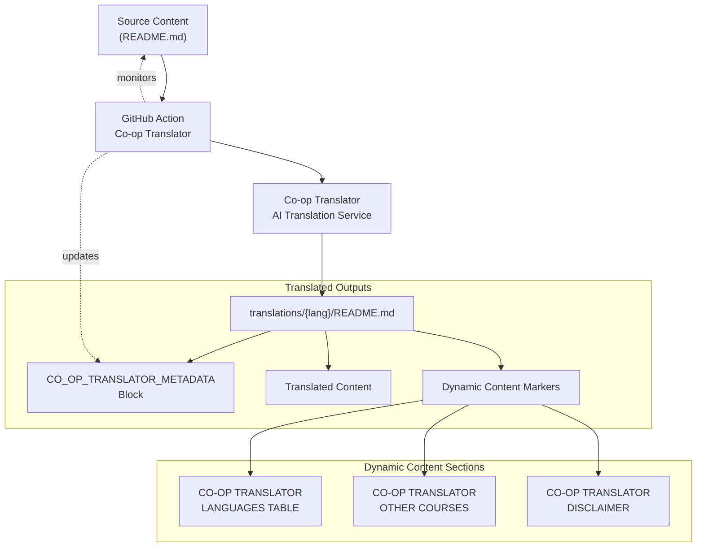
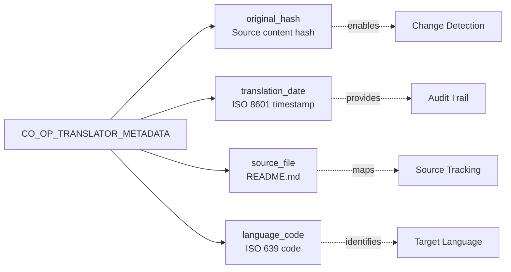
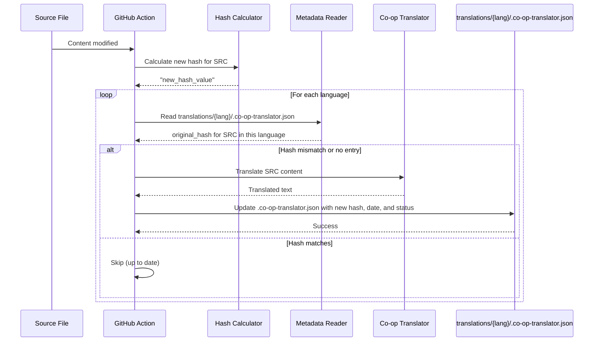
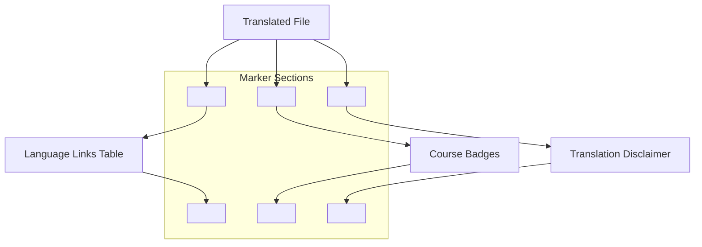
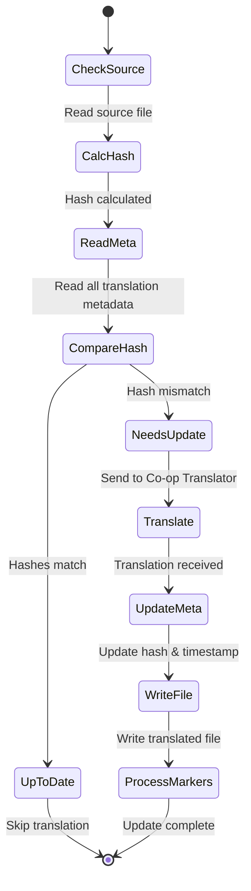
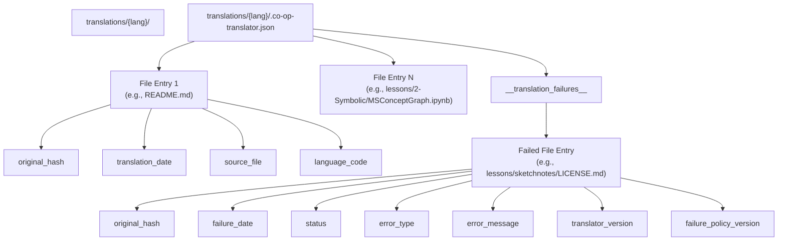

<!-- source: DeepWiki mcp.deepwiki.com · repo microsoft/AI-For-Beginners · page 5.1 Translation Infrastructure · fetched 2026-10-26 -->

# Translation Infrastructure

<details>
<summary>Relevant source files</summary>

The following files were used as context for generating this wiki page:

- [lessons/2-Symbolic/MSConceptGraph.ipynb](lessons/2-Symbolic/MSConceptGraph.ipynb)
- [translated_images/kn/.co-op-translator.json](translated_images/kn/.co-op-translator.json)
- [translated_images/ml/.co-op-translator.json](translated_images/ml/.co-op-translator.json)
- [translations/el/.co-op-translator.json](translations/el/.co-op-translator.json)
- [translations/el/README.md](translations/el/README.md)
- [translations/el/lessons/sketchnotes/LICENSE.md](translations/el/lessons/sketchnotes/LICENSE.md)
- [translations/et/.co-op-translator.json](translations/et/.co-op-translator.json)
- [translations/et/README.md](translations/et/README.md)
- [translations/et/lessons/2-Symbolic/MSConceptGraph.ipynb](translations/et/lessons/2-Symbolic/MSConceptGraph.ipynb)
- [translations/he/.co-op-translator.json](translations/he/.co-op-translator.json)
- [translations/he/README.md](translations/he/README.md)
- [translations/he/lessons/0-course-setup/how-to-run.md](translations/he/lessons/0-course-setup/how-to-run.md)
- [translations/id/.co-op-translator.json](translations/id/.co-op-translator.json)
- [translations/id/README.md](translations/id/README.md)
- [translations/kn/README.md](translations/kn/README.md)
- [translations/kn/lessons/2-Symbolic/MSConceptGraph.ipynb](translations/kn/lessons/2-Symbolic/MSConceptGraph.ipynb)
- [translations/ml/README.md](translations/ml/README.md)
- [translations/ml/lessons/2-Symbolic/MSConceptGraph.ipynb](translations/ml/lessons/2-Symbolic/MSConceptGraph.ipynb)
- [translations/pcm/.co-op-translator.json](translations/pcm/.co-op-translator.json)
- [translations/pcm/README.md](translations/pcm/README.md)
- [translations/pcm/lessons/2-Symbolic/MSConceptGraph.ipynb](translations/pcm/lessons/2-Symbolic/MSConceptGraph.ipynb)
- [translations/pl/.co-op-translator.json](translations/pl/.co-op-translator.json)
- [translations/pl/README.md](translations/pl/README.md)
- [translations/te/.co-op-translator.json](translations/te/.co-op-translator.json)
- [translations/te/README.md](translations/te/README.md)
- [translations/te/lessons/2-Symbolic/MSConceptGraph.ipynb](translations/te/lessons/2-Symbolic/MSConceptGraph.ipynb)
- [translations/tr/.co-op-translator.json](translations/tr/.co-op-translator.json)
- [translations/tr/README.md](translations/tr/README.md)
- [translations/vi/.co-op-translator.json](translations/vi/.co-op-translator.json)
- [translations/vi/README.md](translations/vi/README.md)

</details>


This document describes the automated translation infrastructure that maintains 50+ language versions of the AI-For-Beginners curriculum content. It covers the Co-op Translator GitHub Action system, metadata tracking format, content synchronization mechanisms, and update workflows. For information about the specific languages supported and content organization, see [Localized Content and Language Coverage](#5.2).

## System Overview

The translation infrastructure operates as an automated pipeline that translates source English content into multiple target languages using the Co-op Translator service, tracks translation state through metadata blocks, and maintains synchronization between source updates and translated versions.

### Translation Architecture



**Translation pipeline architecture showing automated content flow**

Sources: [translations/vi/README.md:1-73](), [translations/id/README.md:1-73](), [translations/he/README.md:1-73]()

## Metadata Tracking System

Each translated file contains a `CO_OP_TRANSLATOR_METADATA` block in HTML comment format at the beginning of the file. This metadata tracks the translation state and enables incremental updates.

### Metadata Block Structure



**Metadata block components and their purposes**

The metadata block format:

```json
{
  "AGENTS.md": {
    "original_hash": "6b11a37115944252ab3ed04e358d830d",
    "translation_date": "2025-10-11T11:12:59+00:00",
    "source_file": "AGENTS.md",
    "language_code": "et"
  },
  "CONTRIBUTING.md": {
    "original_hash": "c6fd7e781b67111a90abd166d0ce4aa0",
    "translation_date": "2026-07-08T18:24:27+00:00",
    "source_file": "CONTRIBUTING.md",
    "language_code": "et"
  },
  "__translation_failures__": {
    "lessons/sketchnotes/LICENSE.md": {
      "original_hash": "45ab63a2cd8f5faef6c9b150618837a4",
      "source_file": "lessons/sketchnotes/LICENSE.md",
      "language_code": "et",
      "failure_date": "2026-07-15T22:23:44+00:00",
      "status": "failed",
      "error_type": "TranslationIncompleteError",
      "error_message": "Markdown translation remained incomplete for chunk 1.1.1 of 'LICENSE.md', and the chunk could not be split further.",
      "translator_version": "0.20.0",
      "failure_policy_version": 1
    }
  }
}
```

Sources: [translations/et/.co-op-translator.json:1-37]()

### Metadata Field Specifications

| Field | Type | Purpose |
|-------|------|---------|
| `original_hash` | MD5 hash string | Identifies source content version for change detection |
| `translation_date` | ISO 8601 timestamp | Records when translation was generated |
| `source_file` | File path | Identifies source document being translated |
| `language_code` | ISO 639 language code | Specifies target translation language |
| `failure_date` | ISO 8601 timestamp | Records when a translation failure occurred (within `__translation_failures__`) |
| `status` | String | Indicates the status of the translation, e.g., "failed" (within `__translation_failures__`) |
| `error_type` | String | Type of error encountered during translation (within `__translation_failures__`) |
| `error_message` | String | Detailed message about the translation error (within `__translation_failures__`) |
| `translator_version` | String | Version of the Co-op Translator used (within `__translation_failures__`) |
| `failure_policy_version` | Integer | Version of the failure policy applied (within `__translation_failures__`) |

The `original_hash` field is critical for the update synchronization mechanism. When source content changes, the hash mismatch triggers re-translation of affected sections. The `__translation_failures__` block records details about files that failed translation, including the `original_hash` of the source file at the time of failure, the `failure_date`, and specific error information.

Sources: [translations/et/.co-op-translator.json:1-37](), [translations/te/.co-op-translator.json:1-37](), [translations/pcm/.co-op-translator.json:1-37]()

## GitHub Action Workflow

The translation automation runs as a GitHub Action that monitors source content changes and orchestrates translation updates.

### Workflow Trigger and Execution



**GitHub Action workflow execution sequence**

The workflow maintains efficiency by only re-translating content when the source hash changes, avoiding unnecessary translation API calls for unchanged content. It also updates the `.co-op-translator.json` file for each language to reflect the latest translation status and metadata.

Sources: [translations/et/.co-op-translator.json:1-37](), [translations/te/.co-op-translator.json:1-37](), [translations/pcm/.co-op-translator.json:1-37]()

## Dynamic Content Markers

Translated files contain special HTML comment markers that delineate sections requiring special handling during translation updates. These markers ensure certain content remains synchronized or properly formatted across all translations.

### Marker Types and Locations



**Dynamic content marker structure in translated files**

Sources: [translations/vi/README.md:28-50](), [translations/id/README.md:28-50](), [translations/he/README.md:27-49]()

### Languages Table Section

The languages table section contains a dynamically generated list of all available translations with links. This section is automatically regenerated to ensure all translations link to each other consistently.

Example from Vietnamese translation:

```html
<!-- CO-OP TRANSLATOR LANGUAGES TABLE START -->
[Tiếng Ả Rập](../ar/README.md) | [Tiếng Bengal](../bn/README.md) | [Tiếng Bulgaria](../bg/README.md) | [Tiếng Miến Điện (Myanmar)](../my/README.md) | [Tiếng Trung (Giản thể)](../zh-CN/README.md) | [Tiếng Trung (Phồn thể, Hồng Kông)](../zh-HK/README.md) | [Tiếng Trung (Phồn thể, Macau)](../zh-MO/README.md) | [Tiếng Trung (Phồn thể, Đài Loan)](../zh-TW/README.md) | [Tiếng Croatia](../hr/README.md) | [Tiếng Czech](../cs/README.md) | [Tiếng Đan Mạch](../da/README.md) | [Tiếng Hà Lan](../nl/README.md) | [Tiếng Estonia](../et/README.md) | [Tiếng Phần Lan](../fi/README.md) | [Tiếng Pháp](../fr/README.md) | [Tiếng Đức](../de/README.md) | [Tiếng Hy Lạp](../el/README.md) | [Tiếng Hebrew](../he/README.md) | [Tiếng Hindi](../hi/README.md) | [Tiếng Hungary](../hu/README.md) | [Tiếng Indonesia](../id/README.md) | [Tiếng Ý](../it/README.md) | [Tiếng Nhật](../ja/README.md) | [Tiếng Kannada](../kn/README.md) | [Tiếng Khmer](../km/README.md) | [Tiếng Hàn](../ko/README.md) | [Tiếng Litva](../lt/README.md) | [Tiếng Mã Lai](../ms/README.md) | [Tiếng Malayalam](../ml/README.md) | [Tiếng Marathi](../mr/README.md) | [Tiếng Nepal](../ne/README.md) | [Tiếng Pidgin Nigeria](../pcm/README.md) | [Tiếng Na Uy](../no/README.md) | [Tiếng Ba Tư (Farsi)](../fa/README.md) | [Tiếng Ba Lan](../pl/README.md) | [Tiếng Bồ Đào Nha (Brazil)](../pt-BR/README.md) | [Tiếng Bồ Đào Nha (Bồ Đào Nha)](../pt-PT/README.md) | [Tiếng Punjabi (Gurmukhi)](../pa/README.md) | [Tiếng Rumani](../ro/README.md) | [Tiếng Nga](../ru/README.md) | [Tiếng Serbia (Chữ Kirin)](../sr/README.md) | [Tiếng Slovak](../sk/README.md) | [Tiếng Slovenia](../sl/README.md) | [Tiếng Tây Ban Nha](../es/README.md) | [Tiếng Swahili](../sw/README.md) | [Tiếng Thụy Điển](../sv/README.md) | [Tiếng Tagalog (Philippines)](../tl/README.md) | [Tiếng Tamil](../ta/README.md) | [Tiếng Telugu](../te/README.md) | [Tiếng Thái](../th/README.md) | [Tiếng Thổ Nhĩ Kỳ](../tr/README.md) | [Tiếng Ukraina](../uk/README.md) | [Tiếng Urdu](../ur/README.md) | [Tiếng Việt](./README.md)
<!-- CO-OP TRANSLATOR LANGUAGES TABLE END -->
```

This marker pair appears at approximately line 28-50 in translated README files and is regenerated each time translations are updated.

Sources: [translations/vi/README.md:28-50](), [translations/id/README.md:28-50](), [translations/he/README.md:27-49]()

### Other Courses Section

The "Other Courses" section contains badge links to related Microsoft educational repositories. These badges are maintained consistently across all translations with automatic updates when new courses are added.

```html
<!-- CO-OP TRANSLATOR OTHER COURSES START -->
### LangChain
[]
[]
...
<!-- CO-OP TRANSLATOR OTHER COURSES END -->
```

This section typically appears near line 178-216 in translated README files.

Sources: [translations/vi/README.md:1-73](), [translations/id/README.md:1-73](), [translations/he/README.md:1-73]()

### Translation Disclaimer Section

Each translated file contains a standardized disclaimer about AI translation quality and limitations. This section is translated into each target language but maintains consistent messaging.

```html
<!-- CO-OP TRANSLATOR DISCLAIMER START -->
**Disclaimer**:  
This document was translated using AI translation service...
<!-- CO-OP TRANSLATOR DISCLAIMER END -->
```

The disclaimer appears at the end of each translated file, typically starting around line 230-233.

Sources: [translations/vi/README.md:1-73](), [translations/id/README.md:1-73](), [translations/he/README.md:1-73]()

## Update Synchronization Process

The translation infrastructure implements an incremental update strategy that minimizes re-translation work while ensuring all translations remain synchronized with source content.

### Synchronization Flow



**Translation synchronization state machine**

### Hash Comparison Logic

The synchronization process compares the source content hash with the `original_hash` stored in each translation's metadata block:

1. Calculate MD5 hash of current source `README.md` content.
2. For each language code in supported languages list:
   - Read the `.co-op-translator.json` file from `translations/{lang}/`.
   - Extract the entry for the specific source file (e.g., `README.md`).
   - Retrieve the `original_hash` field from this entry.
   - Compare with the current source hash.
3. If hashes differ:
   - Queue file for re-translation.
   - Send content to Co-op Translator API.
   - Update the corresponding entry in `.co-op-translator.json` with the new hash and current timestamp.
4. If hashes match:
   - Skip translation (content unchanged).
   - Proceed to next language.

Sources: [translations/et/.co-op-translator.json:1-37](), [translations/te/.co-op-translator.json:1-37](), [translations/pcm/.co-op-translator.json:1-37]()

## Translation Quality Management

The infrastructure includes mechanisms for managing translation quality and handling edge cases.

### Sparse Checkout Support

To address the large repository size created by 50+ language translations, the system supports sparse checkout configuration. Users are instructed to clone only the necessary content:

```bash
git clone --filter=blob:none --sparse https://github.com/microsoft/AI-For-Beginners.git
cd AI-For-Beginners
git sparse-checkout set --no-cone '/*' '!translations' '!translated_images'
```

This instruction appears in the multilingual support section of each translated README, approximately at lines 31-49.

Sources: [translations/vi/README.md:31-49](), [translations/id/README.md:31-49](), [translations/he/README.md:30-48]()

### AI Translation Disclaimer

Each translated document includes a disclaimer acknowledging the limitations of automated translation:

- Automated translations may contain errors or inaccuracies
- Original document in source language is authoritative
- Professional human translation recommended for critical information
- No liability for misunderstandings arising from translation use

The disclaimer is translated into each target language and appears at the end of translated files.

Sources: [translations/vi/README.md:1-73](), [translations/id/README.md:1-73](), [translations/he/README.md:1-73]()

## Content Preservation Patterns

### Image Path Translation

Translated image paths are rewritten to point to translated image resources. For example, an original image path like `lessons/sketchnotes/ai-overview.png` might be translated to `translated_images/vi/ai-overview.png` (simplified for illustration). The actual translated image paths include a hash for versioning, such as `../../../../translated_images/pa/ai-overview.0857791951d19500.webp`.

The infrastructure maintains a parallel `translated_images/{lang}/` directory structure for localized visual assets, and the `.co-op-translator.json` files for these images track their `original_hash` and `translation_date` similar to text files.

Sources: [translated_images/ml/.co-op-translator.json:1-6](), [translated_images/kn/.co-op-translator.json:1-6]()

### Link Relativization

Internal repository links are adjusted to maintain correct relative paths from translation directories:

- Main README links: `./lessons/...` → `../../lessons/...`
- Translation links: `../fr/README.md`, `../es/README.md`
- External links: Preserved unchanged

Sources: [translations/vi/README.md:28-50](), [translations/id/README.md:28-50](), [translations/he/README.md:27-49]()

## Infrastructure Files and Configuration

The Co-op Translator infrastructure relies on configuration that specifies supported languages and translation rules. The `.co-op-translator.json` files, located in each language's `translations/{lang}/` directory, serve as the primary configuration and state tracking mechanism for individual translated files.

These JSON files contain entries for each translated document, including `original_hash`, `translation_date`, `source_file`, and `language_code`. They also include a special `__translation_failures__` key to log any issues encountered during the translation process for specific files.



**Structure of the `.co-op-translator.json` metadata file**

The system references:

- Supported languages list: `https://github.com/Azure/co-op-translator/blob/main/getting_started/supported-languages.md`
- GitHub Action workflow files: `.github/workflows/` (referenced but not shown)
- Translation service endpoint: Co-op Translator API

The system documentation encourages users to request additional language support by referencing the supported languages list.

Sources: [translations/et/.co-op-translator.json:1-37](), [translations/te/.co-op-translator.json:1-37](), [translations/pcm/.co-op-translator.json:1-37](), [translations/vi/README.md:52](), [translations/id/README.md:51](), [translations/he/README.md:51]()

---

