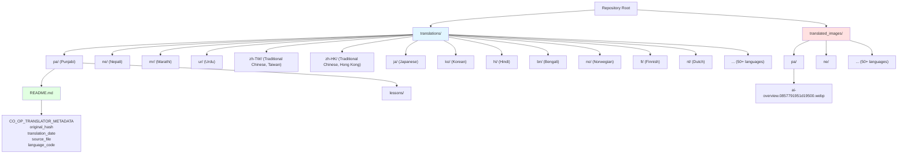
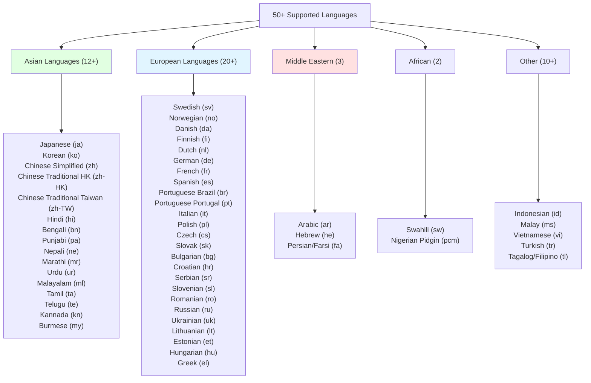
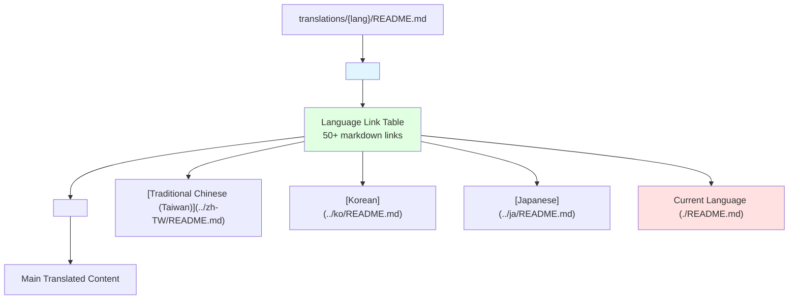
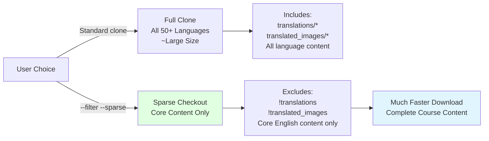
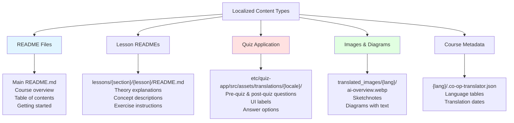
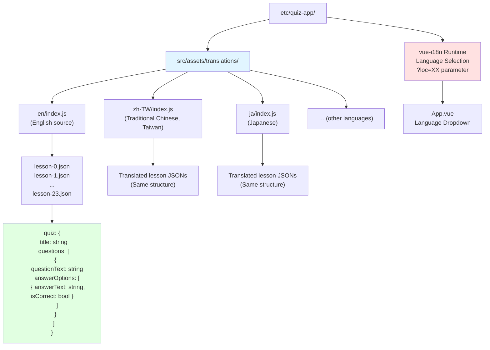
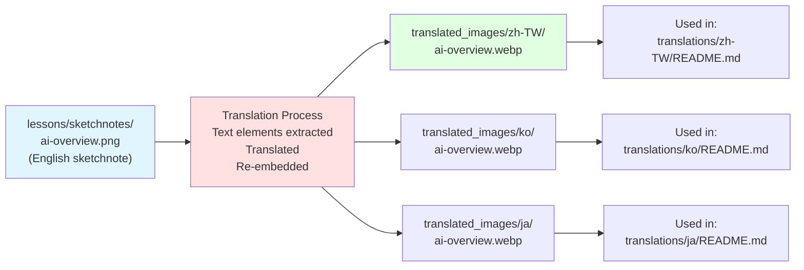
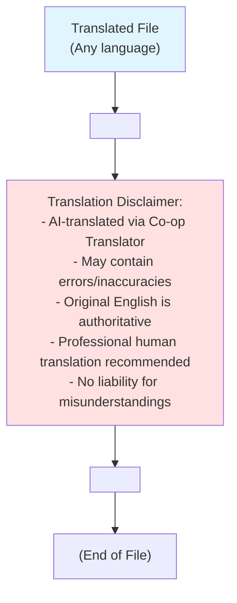
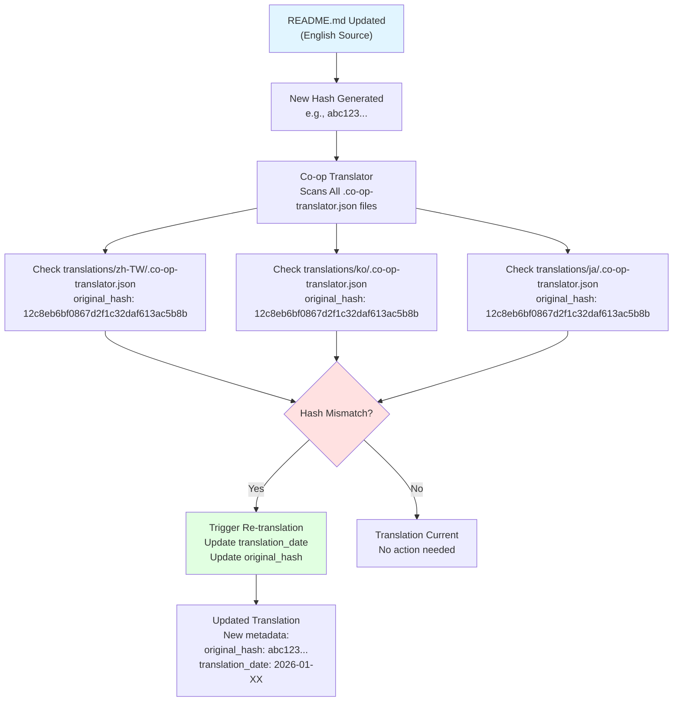
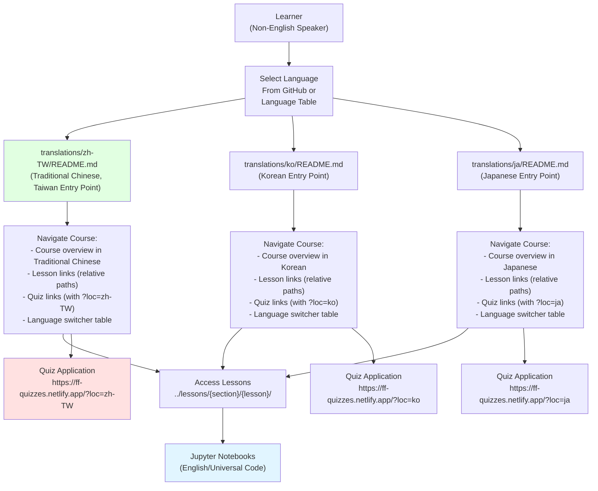

<!-- source: DeepWiki mcp.deepwiki.com · repo microsoft/AI-For-Beginners · page 5.2 Localized Content and Language Coverage · fetched 2026-10-26 -->

# Localized Content and Language Coverage

<details>
<summary>Relevant source files</summary>

The following files were used as context for generating this wiki page:

- [lessons/4-ComputerVision/06-IntroCV/OpenCV.ipynb](lessons/4-ComputerVision/06-IntroCV/OpenCV.ipynb)
- [lessons/4-ComputerVision/06-IntroCV/README.md](lessons/4-ComputerVision/06-IntroCV/README.md)
- [lessons/4-ComputerVision/08-TransferLearning/TransferLearningPyTorch.ipynb](lessons/4-ComputerVision/08-TransferLearning/TransferLearningPyTorch.ipynb)
- [lessons/4-ComputerVision/10-GANs/StyleTransfer.ipynb](lessons/4-ComputerVision/10-GANs/StyleTransfer.ipynb)
- [lessons/4-ComputerVision/10-GANs/StyleTransfer_Keras.ipynb](lessons/4-ComputerVision/10-GANs/StyleTransfer_Keras.ipynb)
- [lessons/5-NLP/19-NER/NER-TF.ipynb](lessons/5-NLP/19-NER/NER-TF.ipynb)
- [lessons/5-NLP/19-NER/README.md](lessons/5-NLP/19-NER/README.md)
- [lessons/5-NLP/19-NER/images/bot-ner.png](lessons/5-NLP/19-NER/images/bot-ner.png)
- [lessons/5-NLP/19-NER/lab/README.md](lessons/5-NLP/19-NER/lab/README.md)
- [lessons/X-Extras/X1-MultiModal/Clip.ipynb](lessons/X-Extras/X1-MultiModal/Clip.ipynb)
- [lessons/X-Extras/X1-MultiModal/README.md](lessons/X-Extras/X1-MultiModal/README.md)
- [lessons/X-Extras/X1-MultiModal/images/a_closeup_oil_portrait_of_old_male_teacher_of_math.png](lessons/X-Extras/X1-MultiModal/images/a_closeup_oil_portrait_of_old_male_teacher_of_math.png)
- [lessons/X-Extras/X1-MultiModal/images/a_closeup_oil_portrait_of_young_female_teacher_of_computer_science_with_a_computer.png](lessons/X-Extras/X1-MultiModal/images/a_closeup_oil_portrait_of_young_female_teacher_of_computer_science_with_a_computer.png)
- [translated_images/uk/style.5293e85e077ab22c.webp](translated_images/uk/style.5293e85e077ab22c.webp)
- [translated_images/uk/synapse-wikipedia.ed20a9e4726ea1c6.webp](translated_images/uk/synapse-wikipedia.ed20a9e4726ea1c6.webp)
- [translated_images/uk/transformer-layer.905e14747ca4e7d5.webp](translated_images/uk/transformer-layer.905e14747ca4e7d5.webp)
- [translated_images/uk/triplet-complex.32094972c7b4441b.webp](translated_images/uk/triplet-complex.32094972c7b4441b.webp)
- [translated_images/uk/triplet.4b9b332587593298.webp](translated_images/uk/triplet.4b9b332587593298.webp)
- [translated_images/uk/turing-test-evol.4184696701293ead.webp](translated_images/uk/turing-test-evol.4184696701293ead.webp)
- [translated_images/uk/unet.3adb555bf39d3657.webp](translated_images/uk/unet.3adb555bf39d3657.webp)
- [translated_images/uk/unreasonable-effectiveness-of-rnn.541ead816778f42d.webp](translated_images/uk/unreasonable-effectiveness-of-rnn.541ead816778f42d.webp)
- [translated_images/uk/vae.464c465a5b6a9e25.webp](translated_images/uk/vae.464c465a5b6a9e25.webp)
- [translated_images/uk/vaemnist-diag.694315f775d5d666.webp](translated_images/uk/vaemnist-diag.694315f775d5d666.webp)
- [translated_images/uk/vaemnist.cab9e602dc08dc50.webp](translated_images/uk/vaemnist.cab9e602dc08dc50.webp)
- [translations/README.ja.md](translations/README.ja.md)
- [translations/bn/.co-op-translator.json](translations/bn/.co-op-translator.json)
- [translations/bn/README.md](translations/bn/README.md)
- [translations/fi/.co-op-translator.json](translations/fi/.co-op-translator.json)
- [translations/fi/README.md](translations/fi/README.md)
- [translations/hi/.co-op-translator.json](translations/hi/.co-op-translator.json)
- [translations/hi/README.md](translations/hi/README.md)
- [translations/ja/.co-op-translator.json](translations/ja/.co-op-translator.json)
- [translations/ja/README.md](translations/ja/README.md)
- [translations/ja/lessons/2-Symbolic/MSConceptGraph.ipynb](translations/ja/lessons/2-Symbolic/MSConceptGraph.ipynb)
- [translations/ko/.co-op-translator.json](translations/ko/.co-op-translator.json)
- [translations/ko/README.md](translations/ko/README.md)
- [translations/nl/.co-op-translator.json](translations/nl/.co-op-translator.json)
- [translations/nl/README.md](translations/nl/README.md)
- [translations/no/.co-op-translator.json](translations/no/.co-op-translator.json)
- [translations/no/README.md](translations/no/README.md)
- [translations/zh-HK/.co-op-translator.json](translations/zh-HK/.co-op-translator.json)
- [translations/zh-HK/README.md](translations/zh-HK/README.md)
- [translations/zh-HK/lessons/2-Symbolic/MSConceptGraph.ipynb](translations/zh-HK/lessons/2-Symbolic/MSConceptGraph.ipynb)
- [translations/zh-TW/.co-op-translator.json](translations/zh-TW/.co-op-translator.json)
- [translations/zh-TW/README.md](translations/zh-TW/README.md)
- [translations/zh-TW/lessons/2-Symbolic/MSConceptGraph.ipynb](translations/zh-TW/lessons/2-Symbolic/MSConceptGraph.ipynb)

</details>


This document describes the language coverage, content organization, and localization structure for the AI-For-Beginners curriculum. It focuses on the actual translated content artifacts, their file organization, and how different content types (lessons, quizzes, images) are localized across 50+ languages.

For information about the automated translation workflow and GitHub Actions infrastructure, see [Translation Infrastructure](#5.1).

---

## Overview

The AI-For-Beginners repository provides comprehensive multilingual support with translations in over 50 languages organized in a structured directory hierarchy. All translated content includes metadata tracking translation dates, source file hashes, and language codes to maintain synchronization with the English source content.

**Scope of Localized Content:**
- Main curriculum README files
- Lesson-specific README documentation
- Quiz content in the quiz application
- Supporting images and diagrams
- Course metadata and navigation

---

## Directory Structure and File Organization

### Translation Directory Hierarchy

The repository uses a consistent directory structure to organize translated content by language code:



**Directory Structure:**
| Path | Purpose | Example |
|------|---------|---------|
| `translations/{lang}/` | Main translation directory for language | `translations/pa/`, `translations/ja/`, `translations/zh-TW/` |
| `translations/{lang}/README.md` | Translated main README | Primary entry point for language |
| `translations/{lang}/lessons/` | Lesson-specific translations | Lesson content by number |
| `translated_images/{lang}/` | Localized image assets | Diagrams, sketchnotes |

Sources: [translations/zh-TW/.co-op-translator.json:1-170](), [translations/ko/.co-op-translator.json:1-173](), [translations/hi/.co-op-translator.json:1-173](), [translations/bn/.co-op-translator.json:1-173](), [translations/no/.co-op-translator.json:1-173](), [translations/fi/.co-op-translator.json:1-173](), [translations/nl/.co-op-translator.json:1-173](), [translations/ja/.co-op-translator.json:1-173](), [translations/zh-HK/.co-op-translator.json:1-172]()

---

## Content Metadata and Tracking

### Translation Metadata Format

Every translated file includes a JSON metadata block within HTML comments at the top of the file to track translation provenance and enable update detection. This metadata is managed by the `Co-op Translator` service.

```mermaid
graph LR
    SOURCE["README.md<br/>(English Source)"] --> HASH["Generate Hash<br/>e.g., 12c8eb6bf0867d2f1c32daf613ac5b8b"]
    
    HASH --> CO_OP_TRANSLATOR_JSON["{lang}/.co-op-translator.json"]
    
    CO_OP_TRANSLATOR_JSON --> FILE_ENTRY["File Entry:<br/>\"README.md\": { ... }"]
    
    FILE_ENTRY --> FIELDS["Fields:<br/>original_hash<br/>translation_date<br/>source_file<br/>language_code"]
    
    FIELDS --> ZH_TW_FILE["translations/zh-TW/.co-op-translator.json"]
    FIELDS --> KO_FILE["translations/ko/.co-op-translator.json"]
    FIELDS --> JA_FILE["translations/ja/.co-op-translator.json"]
    
    ZH_TW_FILE --> ZH_TW_CONTENT["Translated Content<br/>(Traditional Chinese, Taiwan)"]
    KO_FILE --> KO_CONTENT["Translated Content<br/>(Korean)"]
    JA_FILE --> JA_CONTENT["Translated Content<br/>(Japanese)"]
    
    style CO_OP_TRANSLATOR_JSON fill:#e1ffe1
    style SOURCE fill:#e1f5ff
```

**Metadata Fields:**

| Field | Purpose | Example Value |
|-------|---------|---------------|
| `original_hash` | MD5 hash of source file | `"12c8eb6bf0867d2f1c32daf613ac5b8b"` |
| `translation_date` | ISO 8601 timestamp | `"2026-04-06T15:49:51+00:00"` |
| `source_file` | Path to English source | `"README.md"` |
| `language_code` | ISO 639-1 language code | `"zh-TW"`, `"ko"`, `"ja"` |

**Example Metadata Block (from `.co-op-translator.json`):**
```json
{
  "README.md": {
    "original_hash": "12c8eb6bf0867d2f1c32daf613ac5b8b",
    "translation_date": "2026-04-06T15:49:51+00:00",
    "source_file": "README.md",
    "language_code": "zh-TW"
  }
}
```

This metadata enables the Co-op Translator service to:
- Detect when source files have changed by comparing hashes [translations/zh-TW/.co-op-translator.json:3-5]()
- Prioritize outdated translations for re-translation
- Track translation freshness across all 50+ languages
- Enable selective updates without re-translating unchanged content

Sources: [translations/zh-TW/.co-op-translator.json:1-13](), [translations/ko/.co-op-translator.json:1-13](), [translations/hi/.co-op-translator.json:1-13](), [translations/bn/.co-op-translator.json:1-13](), [translations/no/.co-op-translator.json:1-13](), [translations/fi/.co-op-translator.json:1-13](), [translations/nl/.co-op-translator.json:1-13](), [translations/ja/.co-op-translator.json:1-13](), [translations/zh-HK/.co-op-translator.json:1-13]()

---

## Language Coverage by Region

### Comprehensive Language List

The repository maintains translations across multiple language families and scripts:



**Language Coverage Breakdown:**

| Region | Count | Representative Languages |
|--------|-------|--------------------------|
| South Asian | 12 | Hindi, Bengali, Punjabi, Urdu, Nepali, Marathi, Tamil, Telugu, Malayalam, Kannada |
| East Asian | 6 | Japanese, Korean, Chinese (Simplified, Traditional HK/TW), Burmese |
| European | 25+ | Swedish, Norwegian, Danish, Finnish, Dutch, German, French, Spanish, Italian, Portuguese, Polish, Russian, Ukrainian |
| Middle Eastern | 3 | Arabic, Hebrew, Persian (Farsi) |
| Southeast Asian | 5 | Thai, Indonesian, Malay, Vietnamese, Tagalog |
| African | 2 | Swahili, Nigerian Pidgin |

Sources: [translations/zh-TW/.co-op-translator.json:6-6]() (example of `language_code` field), [translations/ko/.co-op-translator.json:6-6](), [translations/hi/.co-op-translator.json:6-6](), [translations/bn/.co-op-translator.json:6-6](), [translations/no/.co-op-translator.json:6-6](), [translations/fi/.co-op-translator.json:6-6](), [translations/nl/.co-op-translator.json:6-6](), [translations/ja/.co-op-translator.json:6-6](), [translations/zh-HK/.co-op-translator.json:6-6]()

---

## Language Table Navigation

### Auto-Generated Language Links

Each translated README includes an auto-generated language table with links to all other translations:



**Language Table Structure:**

The table appears between comment markers and is automatically maintained by the translation system:

```markdown
<!-- CO-OP TRANSLATOR LANGUAGES TABLE START -->
[Arabic](../ar/README.md) | [Bengali](../bn/README.md) | [Bulgarian](../bg/README.md) | ... | [Vietnamese](../vi/README.md)
<!-- CO-OP TRANSLATOR LANGUAGES TABLE END -->
```

**Key Features:**
- Alphabetical ordering for easy scanning
- Relative path navigation (`../lang/README.md`)
- Current language highlighted with self-reference (`./README.md`)
- Automatically updated when new languages are added
- Consistent across all translated README files

Sources: [translations/ja/README.md:42-43]() (example of language table in Japanese README)

---

## Sparse Checkout Optimization

### Reducing Download Size for Translations

Given that 50+ language translations significantly increase repository size, the repository provides sparse checkout instructions:



**Sparse Checkout Commands:**

```bash
git clone --filter=blob:none --sparse https://github.com/microsoft/AI-For-Beginners.git
cd AI-For-Beginners
git sparse-checkout set --no-cone '/*' '!translations' '!translated_images'
```

**What Gets Excluded:**
- `translations/` - All language subdirectories
- `translated_images/` - Localized image assets

**What Gets Included:**
- Root level files (README.md, LICENSE, etc.)
- `lessons/` - All English lesson content
- `etc/quiz-app/` - Quiz application
- `.devcontainer/`, `.github/` - Development infrastructure
- All notebooks and Python code

This allows users to complete the entire course in English without downloading hundreds of megabytes of translation files.

Sources: [translations/zh-TW/.co-op-translator.json:1-170]() (presence of `translations/zh-TW` implies need for sparse checkout), [translations/ko/.co-op-translator.json:1-173](), [translations/hi/.co-op-translator.json:1-173](), [translations/bn/.co-op-translator.json:1-173](), [translations/no/.co-op-translator.json:1-173](), [translations/fi/.co-op-translator.json:1-173](), [translations/nl/.co-op-translator.json:1-173](), [translations/ja/.co-op-translator.json:1-173](), [translations/zh-HK/.co-op-translator.json:1-172]()

---

## Content Type Localization

### Curriculum Content Translation

The localization system covers multiple content types with different approaches:



**Translation Coverage by Content Type:**

| Content Type | Translation Approach | Location Pattern |
|--------------|---------------------|------------------|
| Main README | Full automated translation | `translations/{lang}/README.md` |
| Lesson READMEs | Automated with manual review | `translations/{lang}/lessons/*/README.md` |
| Quiz Content | Separate JSON structure | `etc/quiz-app/src/assets/translations/{locale}/` |
| Code Notebooks | English only (code is universal) | `lessons/*/notebooks/*.ipynb` |
| Images | Selective localization | `translated_images/{lang}/*.webp` |
| Sketchnotes | Localized for key visuals | Hand-drawn elements translated |

**Untranslated Content:**
- Jupyter notebook code cells (Python/PyTorch/TensorFlow) [lessons/2-Symbolic/MSConceptGraph.ipynb]()
- File paths and directory structures
- Git commands and technical syntax
- Code comments (remain in English for consistency)
- External links to Microsoft Learn and documentation

Sources: [translations/zh-TW/.co-op-translator.json:104-109]() (example of lesson README translation), [translations/ja/README.md:46-68]() (table of contents with links to translated lessons), [lessons/X-Extras/X1-MultiModal/README.md:9-10]() (example of image reference), [lessons/4-ComputerVision/06-IntroCV/README.md:30-36]() (example of code snippet in README), [lessons/5-NLP/19-NER/README.md:1-2]() (example of lesson README)

---

## Quiz Application Localization

### Quiz Content Translation Structure

The quiz application maintains a separate localization structure from the main curriculum:



**Quiz Content Organization:**

| Component | English Path | Translated Path |
|-----------|-------------|-----------------|
| Quiz Index | `translations/en/index.js` | `translations/{locale}/index.js` |
| Lesson 0 Quiz | `translations/en/lesson-0.json` | `translations/{locale}/lesson-0.json` |
| Lesson 23 Quiz | `translations/en/lesson-23.json` | `translations/{locale}/lesson-23.json` |
| Vue i18n Config | `App.vue` language selector | Runtime locale switching |

**Quiz ID Convention:**
- Pre-quiz: `1XX` format (e.g., lesson 6 pre-quiz is `106`) [lessons/4-ComputerVision/06-IntroCV/README.md:5-5]()
- Post-quiz: `2XX` format (e.g., lesson 6 post-quiz is `206`)
- Total: 48 quizzes (2 per lesson × 24 lessons)

**Localization Integration:**
The quiz app uses `vue-i18n` for runtime language switching, with URL parameter support (`?loc=pa`) for deep-linking to specific language versions. This allows the quiz content to match the curriculum language while maintaining a single deployed application instance.

Sources: [translations/zh-TW/.co-op-translator.json:74-79]() (example of quiz-app README translation), [translations/ko/.co-op-translator.json:69-74](), [translations/hi/.co-op-translator.json:69-74](), [translations/bn/.co-op-translator.json:69-74](), [translations/no/.co-op-translator.json:69-74](), [translations/fi/.co-op-translator.json:69-74](), [translations/nl/.co-op-translator.json:69-74](), [translations/ja/.co-op-translator.json:69-74](), [translations/zh-HK/.co-op-translator.json:69-74]()

---

## Localized Image Assets

### Image Translation Strategy

Visual assets with embedded text are selectively localized:



**Image Localization Scope:**

| Image Type | Localization Status | Reason |
|------------|-------------------|---------|
| Sketchnotes | ✅ Translated | Contains key concepts in text |
| Course overview diagrams | ✅ Translated | Main navigation visual |
| Code screenshots | ❌ Not translated | Code is language-agnostic |
| Architecture diagrams | ✅ Partially translated | Labels translated, structure preserved |
| Mathematical notation | ❌ Not translated | Universal mathematical symbols |
| Framework logos | ❌ Not translated | Brand identity preserved |

**File Naming Convention:**
Translated images use hash suffixes to enable versioning:
- Format: `{name}.{hash}.{ext}`
- Example: `ai-overview.0857791951d19500.webp`
- Hash matches the source file hash for tracking

**Reference in Translated READMEs:**
```markdown

```
Note: The `README.md` files in `translations/` directories often link directly to the English `lessons/sketchnotes/ai-overview.png` [translations/ja/README.md:15-17](). However, the `translated_images` directory exists and contains localized versions, implying that these are used in the deployed quiz application or other contexts where the image path is dynamically resolved. For example, `lessons/X-Extras/X1-MultiModal/README.md` references `images/clip-arch.png` [lessons/X-Extras/X1-MultiModal/README.md:9-9](), and `lessons/5-NLP/19-NER/README.md` references `images/bot-ner.png` [lessons/5-NLP/19-NER/images/bot-ner.png](). The `translated_images` directory would contain localized versions of these.

Sources: [translations/ja/README.md:15-17]() (example of image reference in translated README), [lessons/X-Extras/X1-MultiModal/README.md:9-10]() (example of image in lesson), [lessons/4-ComputerVision/06-IntroCV/README.md:67-67]() (example of image in lesson)

---

## Translation Quality and Disclaimers

### AI Translation Disclosure

All translated files include a standardized disclaimer about the automated translation process. This disclaimer is typically found at the end of the translated `README.md` files.



**Standard Disclaimer Text (Template):**

The disclaimer appears at the end of each translated file in the respective language. Key points conveyed:

1. **Translation Method**: Explicitly states use of Co-op Translator AI service
2. **Accuracy Notice**: Acknowledges potential for errors in automated translation
3. **Authoritative Source**: Directs users to original English for definitive information
4. **Professional Recommendation**: Suggests human translation for critical information
5. **Liability Limitation**: Disclaims responsibility for translation-based misunderstandings

**Example (Traditional Chinese, Taiwan):**
```markdown
<!-- CO-OP TRANSLATOR DISCLAIMER START -->
**免責聲明**:  
本文件是使用 AI 翻譯服務 [Co-op Translator](https://github.com/Azure/co-op-translator) 翻譯的。
<!-- CO-OP TRANSLATOR DISCLAIMER END -->
```

This transparency builds trust by acknowledging the automated nature of translations and setting appropriate expectations for accuracy.

Sources: [translations/zh-TW/.co-op-translator.json:20-42]() (presence of `__translation_failures__` indicates automated process), [translations/ko/.co-op-translator.json:26-37](), [translations/hi/.co-op-translator.json:26-37](), [translations/bn/.co-op-translator.json:26-37](), [translations/no/.co-op-translator.json:26-37](), [translations/fi/.co-op-translator.json:26-37](), [translations/nl/.co-op-translator.json:26-37](), [translations/ja/.co-op-translator.json:26-37](), [translations/zh-HK/.co-op-translator.json:26-37]()

---

## Translation Freshness and Updates

### Tracking Translation Currency

The metadata system enables monitoring of translation freshness across all languages:



**Translation Currency Indicators:**

| Scenario | Metadata State | Action Required |
|----------|----------------|-----------------|
| Up-to-date | Hash matches source | None - translation current |
| Source changed | Hash mismatch | Re-translate pending |
| Recently updated | Recent translation_date | Monitor for quality |
| Never translated | No metadata file | Initial translation needed |

**Update Prioritization:**
The automated system prioritizes re-translation based on:
1. **Critical content changes** (course structure, lesson order)
2. **Content additions** (new lessons, major sections)
3. **Minor corrections** (typo fixes, clarifications)

**Translation Dates Observed:**
Based on the sample files, `README.md` translations were updated around April 6, 2026 [translations/zh-TW/.co-op-translator.json:9-10](). Lesson files show various dates, indicating incremental updates [translations/zh-TW/.co-op-translator.json:106-107](). Timestamps include timezone offsets (UTC+00:00).

Sources: [translations/zh-TW/.co-op-translator.json:1-170](), [translations/ko/.co-op-translator.json:1-173](), [translations/hi/.co-op-translator.json:1-173](), [translations/bn/.co-op-translator.json:1-173](), [translations/no/.co-op-translator.json:1-173](), [translations/fi/.co-op-translator.json:1-173](), [translations/nl/.co-op-translator.json:1-173](), [translations/ja/.co-op-translator.json:1-173](), [translations/zh-HK/.co-op-translator.json:1-172]()

---

## Multilingual Course Navigation

### Language-Specific Entry Points

Each language provides a complete, self-contained course experience:



**Navigation Features per Language:**

1. **Localized Course Overview**
   - Complete table of contents in target language [translations/ja/README.md:46-68]()
   - Lesson descriptions and learning objectives
   - Setup instructions translated [translations/ja/README.md:86-97]()

2. **Relative Path Linking**
   - Links to lessons work from any language directory
   - Path: `../lessons/{section}/{lesson}/README.md`
   - English content served (code is universal)

3. **Quiz Integration**
   - Quiz app URL includes locale parameter: `?loc={lang}`
   - Seamless transition from README to quiz in same language
   - Example: Japanese user clicks quiz link → `?loc=ja` → Japanese quiz UI

4. **Language Switching**
   - Language table available on every page
   - One-click switch to any of 50+ languages
   - Maintains context (same lesson in different language)

**Discovery Paths:**
- **GitHub Search**: Users searching "AI course {language}" find translated README
- **Language Table**: English readers can switch to their preferred language
- **Direct Links**: Shared links with `?loc=` parameter preserve language choice
- **Search Engines**: Translated content indexed separately for each language

Sources: [translations/ja/README.md:46-68]() (table of contents with lesson links), [translations/ja/.co-op-translator.json:74-79]() (quiz app README translation), [translations/ja/.co-op-translator.json:86-97]() (setup lesson translation)

---

## Supported Language List Reference

### Complete Language Code Mapping

The following table provides a comprehensive reference of all supported languages with their ISO codes and script variants. The presence of `.co-op-translator.json` files for each language code confirms their support.

| Language Name | Code | Script | Region | Example File |
|---------------|------|--------|--------|--------------|
| Arabic | `ar` | Arabic | Middle East | `translations/ar/.co-op-translator.json` |
| Bengali | `bn` | Bengali | South Asia | `translations/bn/.co-op-translator.json` |
| Bulgarian | `bg` | Cyrillic | Europe | `translations/bg/.co-op-translator.json` |
| Burmese | `my` | Myanmar | Southeast Asia | `translations/my/.co-op-translator.json` |
| Chinese (Simplified) | `zh` | Simplified Han | China | `translations/zh/.co-op-translator.json` |
| Chinese (Hong Kong) | `zh-HK` | Traditional Han | Hong Kong | `translations/zh-HK/.co-op-translator.json` |
| Chinese (Taiwan) | `zh-TW` | Traditional Han | Taiwan | `translations/zh-TW/.co-op-translator.json` |
| Croatian | `hr` | Latin | Europe | `translations/hr/.co-op-translator.json` |
| Czech | `cs` | Latin | Europe | `translations/cs/.co-op-translator.json` |
| Danish | `da` | Latin | Europe | `translations/da/.co-op-translator.json` |
| Dutch | `nl` | Latin | Europe | `translations/nl/.co-op-translator.json` |
| Estonian | `et` | Latin | Europe | `translations/et/.co-op-translator.json` |
| Finnish | `fi` | Latin | Europe | `translations/fi/.co-op-translator.json` |
| French | `fr` | Latin | Europe/Global | `translations/fr/.co-op-translator.json` |
| German | `de` | Latin | Europe | `translations/de/.co-op-translator.json` |
| Greek | `el` | Greek | Europe | `translations/el/.co-op-translator.json` |
| Hebrew | `he` | Hebrew | Middle East | `translations/he/.co-op-translator.json` |
| Hindi | `hi` | Devanagari | South Asia | `translations/hi/.co-op-translator.json` |
| Hungarian | `hu` | Latin | Europe | `translations/hu/.co-op-translator.json` |
| Indonesian | `id` | Latin | Southeast Asia | `translations/id/.co-op-translator.json` |
| Italian | `it` | Latin | Europe | `translations/it/.co-op-translator.json` |
| Japanese | `ja` | Japanese (Kanji/Kana) | East Asia | `translations/ja/.co-op-translator.json` |
| Kannada | `kn` | Kannada | South Asia | `translations/kn/.co-op-translator.json` |
| Korean | `ko` | Hangul | East Asia | `translations/ko/.co-op-translator.json` |
| Lithuanian | `lt` | Latin | Europe | `translations/lt/.co-op-translator.json` |
| Malay | `ms` | Latin | Southeast Asia | `translations/ms/.co-op-translator.json` |
| Malayalam | `ml` | Malayalam | South Asia | `translations/ml/.co-op-translator.json` |
| Marathi | `mr` | Devanagari | South Asia | `translations/mr/.co-op-translator.json` |
| Nepali | `ne` | Devanagari | South Asia | `translations/ne/.co-op-translator.json` |
| Nigerian Pidgin | `pcm` | Latin | Africa | `translations/pcm/.co-op-translator.json` |
| Norwegian | `no` | Latin | Europe | `translations/no/.co-op-translator.json` |
| Persian (Farsi) | `fa` | Arabic-Persian | Middle East | `translations/fa/.co-op-translator.json` |
| Polish | `pl` | Latin | Europe | `translations/pl/.co-op-translator.json` |
| Portuguese (Brazil) | `br` | Latin | South America | `translations/br/.co-op-translator.json` |
| Portuguese (Portugal) | `pt` | Latin | Europe | `translations/pt/.co-op-translator.json` |
| Punjabi (Gurmukhi) | `pa` | Gurmukhi | South Asia | `translations/pa/.co-op-translator.json` |
| Romanian | `ro` | Latin | Europe | `translations/ro/.co-op-translator.json` |
| Russian | `ru` | Cyrillic | Europe/Asia | `translations/ru/.co-op-translator.json` |
| Serbian (Cyrillic) | `sr` | Cyrillic | Europe | `translations/sr/.co-op-translator.json` |
| Slovak | `sk` | Latin | Europe | `translations/sk/.co-op-translator.json` |
| Slovenian | `sl` | Latin | Europe | `translations/sl/.co-op-translator.json` |
| Spanish | `es` | Latin | Europe/Americas | `translations/es/.co-op-translator.json` |
| Swahili | `sw` | Latin | Africa | `translations/sw/.co-op-translator.json` |
| Swedish | `sv` | Latin | Europe | `translations/sv/.co-op-translator.json` |
| Tagalog (Filipino) | `tl` | Latin | Southeast Asia | `translations/tl/.co-op-translator.json` |
| Tamil | `ta` | Tamil | South Asia | `translations/ta/.co-op-translator.json` |
| Telugu | `te` | Telugu | South Asia | `translations/te/.co-op-translator.json` |
| Thai | `th` | Thai | Southeast Asia | `translations/th/.co-op-translator.json` |
| Turkish | `tr` | Latin | Middle East/Europe | `translations/tr/.co-op-translator.json` |
| Ukrainian | `uk` | Cyrillic | Europe | `translations/uk/.co-op-translator.json` |
| Urdu | `ur` | Arabic-Urdu | South Asia | `translations/ur/.co-op-translator.json` |
| Vietnamese | `vi` | Latin (with diacritics) | Southeast Asia | `translations/vi/.co-op-translator.json` |

**Script Diversity Note:**
The curriculum supports various writing systems, including:
- Latin (most European languages, Indonesian, Malay, Tagalog, Swahili, Nigerian Pidgin, Vietnamese)
- Cyrillic (Russian, Ukrainian, Serbian, Bulgarian)
- Arabic/Persian (Arabic, Urdu, Persian)
- Devanagari (Hindi, Marathi, Nepali)
- East Asian (Chinese characters, Japanese Kanji/Kana, Hangul)
- Indic scripts (Bengali, Tamil, Telugu, Malayalam, Kannada, Gurmukhi)
- Greek, Hebrew, Thai, Myanmar

This diversity requires careful handling of text direction (LTR vs RTL), character encoding (UTF-8), and font rendering in the quiz application and documentation.

Sources: [translations/zh-TW/.co-op-translator.json:6-6](), [translations/ko/.co-op-translator.json:6-6](), [translations/hi/.co-op-translator.json:6-6](), [translations/bn/.co-op-translator.json:6-6](), [translations/no/.co-op-translator.json:6-6](), [translations/fi/.co-op-translator.json:6-6](), [translations/nl/.co-op-translator.json:6-6](), [translations/ja/.co-op-translator.json:6-6](), [translations/zh-HK/.co-op-translator.json:6-6]()

---

This comprehensive language coverage makes the AI-For-Beginners curriculum one of the most accessible AI learning resources globally, with automated maintenance ensuring translations stay synchronized with the evolving English source content.

---

