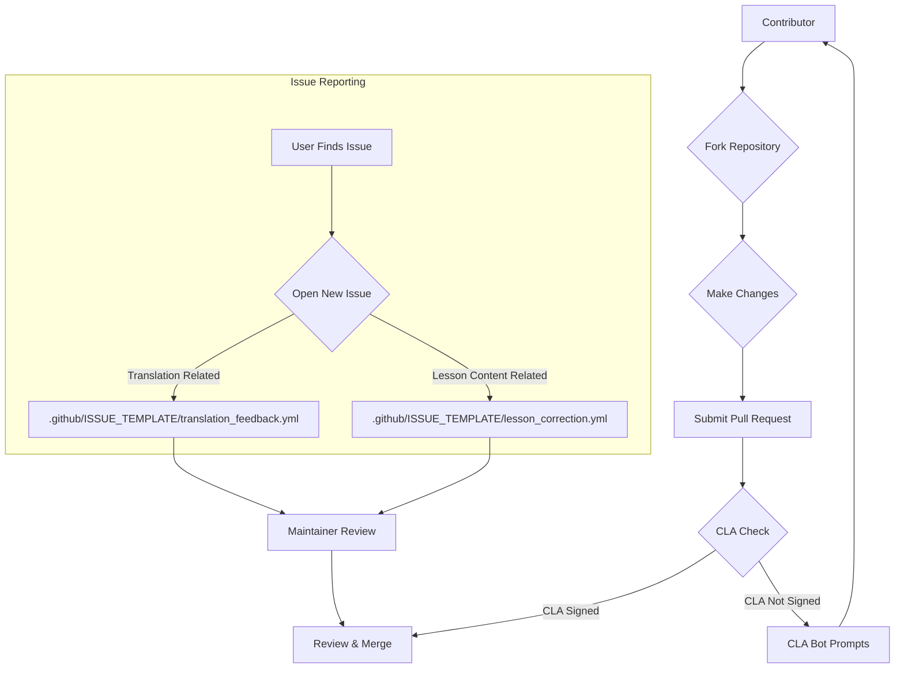
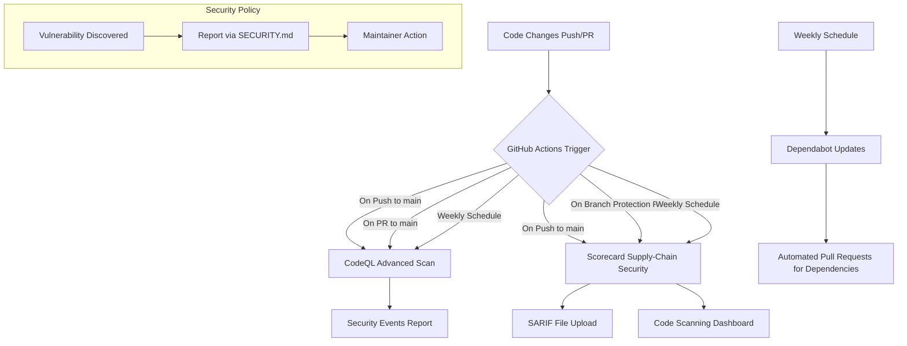

<!-- source: DeepWiki mcp.deepwiki.com · repo microsoft/AI-For-Beginners · page 6 Repository Governance and Automation · fetched 2026-10-26 -->

# Repository Governance and Automation

Relevant source files

The following files were used as context for generating this wiki page:

- [.github/ISSUE_TEMPLATE/lesson_correction.yml](.github/ISSUE_TEMPLATE/lesson_correction.yml)
- [.github/ISSUE_TEMPLATE/translation_feedback.yml](.github/ISSUE_TEMPLATE/translation_feedback.yml)
- [.github/dependabot.yml](.github/dependabot.yml)
- [.github/workflows/codeql.yml](.github/workflows/codeql.yml)
- [.github/workflows/scorecard.yml](.github/workflows/scorecard.yml)
- [CONTRIBUTING.md](CONTRIBUTING.md)

This page provides a high-level overview of the processes and automated systems that maintain the health, security, and collaborative nature of the AI-For-Beginners repository. It covers the contribution workflow, security policies, and continuous integration (CI) automation.

The repository encourages community contributions, ensures code quality and security, and streamlines maintenance tasks through a combination of clear guidelines and automated workflows.

## Contribution Workflow and Issue Management

The project welcomes contributions ranging from typo fixes and code corrections to full lesson translations. To ensure a smooth contribution process, the repository utilizes a Contributor License Agreement (CLA) and provides specific issue templates for common types of feedback.

Contributors are guided through the process of forking the repository, making changes, and submitting pull requests. The Microsoft CLA bot automatically checks for CLA compliance for all contributions [CONTRIBUTING.md:5-9]().

For details, see [Contributing and Issue Templates](#6.1).

### Contribution Types

The primary contribution types supported are:
*   **Fixing Typos / Code Errors**: Addressing inaccuracies in Jupyter notebooks or lesson markdown files [CONTRIBUTING.md:13-17]().
*   **Submitting Translations**: Providing lesson translations into other languages, which should be placed under the `translations/` directory [CONTRIBUTING.md:19-22]().

### Issue Templates

To streamline feedback and bug reporting, the repository uses specific issue templates:
*   **Translation Feedback**: The `translation_feedback.yml` template [.github/ISSUE_TEMPLATE/translation_feedback.yml:1-74]() is used for suggesting improvements or submitting new translations for specific languages.
*   **Lesson Correction / Typo**: The `lesson_correction.yml` template [.github/ISSUE_TEMPLATE/lesson_correction.yml:1-25]() is designed for reporting spelling errors, broken links, or code issues within lesson notebooks.

**Diagram: Contribution Workflow Overview**

Sources: [CONTRIBUTING.md:1-22](), [.github/ISSUE_TEMPLATE/translation_feedback.yml:1-74](), [.github/ISSUE_TEMPLATE/lesson_correction.yml:1-25]()

## CI Workflows and Security Policies

The repository leverages GitHub Actions for continuous integration (CI) to automate security checks and dependency management. This ensures that the codebase remains secure, stable, and up-to-date.

For details, see [CI Workflows and Security](#6.2).

### Security Policy

The project has a defined security policy, typically outlined in `SECURITY.md`, which guides users on how to report security vulnerabilities responsibly. This policy is crucial for maintaining the integrity and trustworthiness of the project.

### Automated Security Checks

Several GitHub Actions workflows are configured to automatically scan the codebase for potential vulnerabilities and maintain supply-chain security:
*   **CodeQL Advanced**: The `codeql.yml` workflow [.github/workflows/codeql.yml:1-102]() performs static code analysis to find security vulnerabilities and bugs in the codebase. It runs on `push` to `main`, `pull_request` to `main`, and on a weekly schedule. It analyzes `actions`, `javascript-typescript`, and `python` languages.
*   **Scorecard Supply-Chain Security**: The `scorecard.yml` workflow [.github/workflows/scorecard.yml:1-73]() uses the OpenSSF Scorecard to assess and improve the security posture of the repository's supply chain. It runs on `branch_protection_rule` events, on a weekly schedule, and on `push` to `main`.
*   **Dependabot**: The `dependabot.yml` configuration [.github/dependabot.yml:1-11]() automates dependency updates for GitHub Actions, helping to mitigate risks associated with outdated libraries and tools. It is configured to check for updates weekly.

**Diagram: Automated Security and CI Flow**

Sources: [.github/workflows/codeql.yml:1-102](), [.github/workflows/scorecard.yml:1-73](), [.github/dependabot.yml:1-11]()

---

