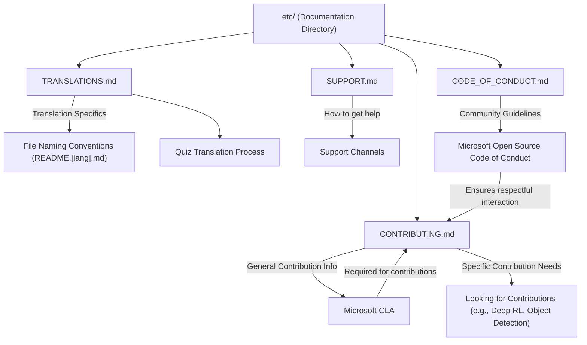

<!-- source: DeepWiki mcp.deepwiki.com · repo microsoft/AI-For-Beginners · page 6.1 Contributing and Issue Templates · fetched 2026-10-26 -->

# Contributing and Issue Templates

<details>
<summary>Relevant source files</summary>

The following files were used as context for generating this wiki page:

- [.github/ISSUE_TEMPLATE/lesson_correction.yml](.github/ISSUE_TEMPLATE/lesson_correction.yml)
- [.github/ISSUE_TEMPLATE/translation_feedback.yml](.github/ISSUE_TEMPLATE/translation_feedback.yml)
- [CONTRIBUTING.md](CONTRIBUTING.md)
- [etc/CODE_OF_CONDUCT.md](etc/CODE_OF_CONDUCT.md)
- [etc/CONTRIBUTING.md](etc/CONTRIBUTING.md)
- [etc/SUPPORT.md](etc/SUPPORT.md)
- [etc/TRANSLATIONS.md](etc/TRANSLATIONS.md)
- [lessons/1-Intro/README.md](lessons/1-Intro/README.md)
- [lessons/1-Intro/translations/README.ja.md](lessons/1-Intro/translations/README.ja.md)
- [lessons/4-ComputerVision/06-IntroCV/data/braille.jpeg](lessons/4-ComputerVision/06-IntroCV/data/braille.jpeg)
- [lessons/4-ComputerVision/06-IntroCV/data/motionvideo.mp4](lessons/4-ComputerVision/06-IntroCV/data/motionvideo.mp4)
- [lessons/4-ComputerVision/06-IntroCV/images/braille-result.png](lessons/4-ComputerVision/06-IntroCV/images/braille-result.png)
- [lessons/4-ComputerVision/06-IntroCV/images/braille-symbols.png](lessons/4-ComputerVision/06-IntroCV/images/braille-symbols.png)
- [lessons/4-ComputerVision/06-IntroCV/images/frame-difference.png](lessons/4-ComputerVision/06-IntroCV/images/frame-difference.png)
- [lessons/4-ComputerVision/06-IntroCV/images/optical.png](lessons/4-ComputerVision/06-IntroCV/images/optical.png)
- [lessons/4-ComputerVision/06-IntroCV/images/palm-movement.png](lessons/4-ComputerVision/06-IntroCV/images/palm-movement.png)

</details>


This page details the contribution guidelines and issue templates for the AI-For-Beginners repository. It covers the `CONTRIBUTING.md` file, the Microsoft Contributor License Agreement (CLA), the `translation_feedback.yml` and `lesson_correction.yml` issue templates, and the `etc/` directory's support and code of conduct documentation.

## Contribution Guidelines

The `CONTRIBUTING.md` file [CONTRIBUTING.md:1-22]() outlines the general process for contributing to the AI-For-Beginners project. Contributions are welcomed for translations, lesson fixes, and formatting corrections [CONTRIBUTING.md:3]().

### Microsoft Contributor License Agreement (CLA)

All contributions to this project require agreement to a Contributor License Agreement (CLA) [CONTRIBUTING.md:5-7](). This grants Microsoft the rights to use your contribution. A CLA-bot automatically checks if a CLA is needed for a pull request and provides instructions [CONTRIBUTING.md:9-9](). This process only needs to be completed once across all repositories using the Microsoft CLA [CONTRIBUTING.md:9-9]().

### How to Contribute

There are two primary ways to contribute:

1.  **Fixing Typos / Code Errors**: For typos or bugs in Jupyter notebooks or lesson markdown files, contributors are instructed to fork the repository, fix the issue, and then submit a Pull Request with a clear description [CONTRIBUTING.md:13-17]().
2.  **Submitting Translations**: Translations of lessons should be placed under the `translations/` directory, following existing language folder names (e.g., `translations/es/`, `translations/pt-BR/`, `translations/zh-CN/`) [CONTRIBUTING.md:19-20](). More detailed guidelines for translations are available in `etc/CONTRIBUTING.md` [CONTRIBUTING.md:22]() and `etc/TRANSLATIONS.md`.

Sources:
- [CONTRIBUTING.md:1-22]()

## Issue Templates

The repository utilizes GitHub Issue Templates to streamline the reporting of issues and feedback. These templates are defined in the `.github/ISSUE_TEMPLATE/` directory.

### Translation Feedback Template

The `translation_feedback.yml` template [.github/ISSUE_TEMPLATE/translation_feedback.yml:1-74]() is used for suggesting improvements or submitting translations for a language.

**Template Fields:**
*   **Name**: "🌐 Translation Feedback" [.github/ISSUE_TEMPLATE/translation_feedback.yml:1]()
*   **Description**: "Suggest improvements or submit translations for a language" [.github/ISSUE_TEMPLATE/translation_feedback.yml:2]()
*   **Title**: Automatically prefixed with "[Translation]: " [.github/ISSUE_TEMPLATE/translation_feedback.yml:3]()
*   **Labels**: Automatically assigned "translations" [.github/ISSUE_TEMPLATE/translation_feedback.yml:4]()
*   **Target Language**: A dropdown menu offering a comprehensive list of languages, including Arabic, Bengali, Bulgarian, Croatian, Czech, Danish, Dutch, Estonian, Finnish, French, German, Greek, Hebrew, Hindi, Hungarian, Indonesian, Italian, Japanese, Kannada, Khmer, Korean, Lithuanian, Malay, Malayalam, Marathi, Burmese, Nepali, Nigerian Pidgin, Norwegian, Persian, Polish, Portuguese (Brazil and Portugal), Punjabi, Romanian, Russian, Serbian, Slovak, Slovenian, Spanish, Swahili, Swedish, Tamil, Telugu, Thai, Tagalog, Turkish, Ukrainian, Urdu, Vietnamese, and various Chinese dialects [.github/ISSUE_TEMPLATE/translation_feedback.yml:7-64](). This field is required [.github/ISSUE_TEMPLATE/translation_feedback.yml:66-67]().
*   **Details**: A textarea for specifying the feedback, grammatical fixes, or new translation files [.github/ISSUE_TEMPLATE/translation_feedback.yml:69-73](). This field is also required [.github/ISSUE_TEMPLATE/translation_feedback.yml:74]().

### Lesson Correction / Typo Template

The `lesson_correction.yml` template [.github/ISSUE_TEMPLATE/lesson_correction.yml:1-25]() is designed for reporting corrections to spelling, broken links, or code errors within a lesson.

**Template Fields:**
*   **Name**: "✍️ Lesson Correction / Typo" [.github/ISSUE_TEMPLATE/lesson_correction.yml:1]()
*   **Description**: "Suggest corrections to spelling, broken links, or code errors in a lesson notebook" [.github/ISSUE_TEMPLATE/lesson_correction.yml:2]()
*   **Title**: Automatically prefixed with "[Correction]: " [.github/ISSUE_TEMPLATE/lesson_correction.yml:3]()
*   **Labels**: Automatically assigned "bug" and "documentation" [.github/ISSUE_TEMPLATE/lesson_correction.yml:4]()
*   **Lesson Name or File Path**: An input field to specify which lesson, week, or notebook file contains the error, with an example provided (e.g., `lessons/3-NeuralNetworks/03-Perceptron/README.md`) [.github/ISSUE_TEMPLATE/lesson_correction.yml:10-15](). This field is required [.github/ISSUE_TEMPLATE/lesson_correction.yml:16-17]().
*   **Correction Details**: A textarea to describe the incorrect element and what the correct spelling or code should be, with an example [.github/ISSUE_TEMPLATE/lesson_correction.yml:19-24](). This field is required [.github/ISSUE_TEMPLATE/lesson_correction.yml:25]().

#### Issue Template Workflow
```mermaid
graph TD
    A[User identifies issue] --> B{Is it a translation issue?};
    B -- Yes --> C[Select "🌐 Translation Feedback" template];
    B -- No --> D[Select "✍️ Lesson Correction / Typo" template];
    C --> E[Fill "Target Language" dropdown];
    C --> F[Describe "Details" of translation feedback];
    D --> G[Specify "Lesson Name or File Path"];
    D --> H[Describe "Correction Details"];
    E & F & G & H --> I[Submit Issue];
    I --> J[Issue created with appropriate labels and title];
```
Title: Issue Template Workflow
Sources:
- [.github/ISSUE_TEMPLATE/translation_feedback.yml:1-74]()
- [.github/ISSUE_TEMPLATE/lesson_correction.yml:1-25]()

Sources:
- [.github/ISSUE_TEMPLATE/translation_feedback.yml:1-74]()
- [.github/ISSUE_TEMPLATE/lesson_correction.yml:1-25]()

## `etc/` Documentation

The `etc/` directory contains additional documentation relevant to contributions and project governance.

### `etc/CONTRIBUTING.md`

This file provides more detailed contribution guidelines, particularly for translations. It reiterates the CLA requirement [etc/CONTRIBUTING.md:3-6]() and refers to the Microsoft Open Source Code of Conduct [etc/CONTRIBUTING.md:12](). It also lists specific areas where contributions are actively sought, such as Deep Reinforcement Learning, Object Detection improvements, PyTorch Lightning integration, Named Entity Recognition samples, and training custom embeddings [etc/CONTRIBUTING.md:18-24]().

### `etc/TRANSLATIONS.md`

This document provides specific guidelines for contributing translations. It specifies that only `README`, `assignments`, and quizzes should be translated, not code samples [etc/TRANSLATIONS.md:9](). Translated files should follow a naming convention like `README.[language].md` or `assignment.[language].md`, using ISO 639-1 two-letter language abbreviations (e.g., `README.es.md` for Spanish) [etc/TRANSLATIONS.md:12-15]().

For quizzes, the process involves:
1.  Adding translations to the quiz-app's `src/assets/translations` directory with proper naming (e.g., `en.json`, `fr.json`), while explicitly not localizing 'true' or 'false' [etc/TRANSLATIONS.md:21-23]().
2.  Adding the language code to the dropdown in the quiz-app's `App.vue` file [etc/TRANSLATIONS.md:25]().
3.  Editing the quiz-app's `translations/index.js` file to include the new language [etc/TRANSLATIONS.md:27]().
4.  Updating all quiz links in translated `README.md` files to point to the localized quiz URL (e.g., `https://red-field-0a6ddfd03.1.azurestaticapps.net/quiz/1?loc=id`) [etc/TRANSLATIONS.md:29-30]().

### `etc/SUPPORT.md`

This file typically contains information on how to get support for the project, including reporting bugs, asking questions, or seeking help. (Content not provided, but its purpose is inferred from the filename).

### `etc/CODE_OF_CONDUCT.md`

This document outlines the Microsoft Open Source Code of Conduct, which governs behavior within the project's community. It ensures an inclusive and respectful environment for all contributors. (Content not provided, but its purpose is inferred from the filename and reference in `etc/CONTRIBUTING.md` [etc/CONTRIBUTING.md:12]()).

#### `etc/` Documentation Structure

Title: `etc/` Documentation Structure
Sources:
- [etc/CONTRIBUTING.md:1-24]()
- [etc/TRANSLATIONS.md:1-33]()
- [etc/SUPPORT.md]()
- [etc/CODE_OF_CONDUCT.md]()

Sources:
- [CONTRIBUTING.md:1-22]()
- [etc/CONTRIBUTING.md:1-24]()
- [etc/TRANSLATIONS.md:1-33]()
- [etc/SUPPORT.md]()
- [etc/CODE_OF_CONDUCT.md]()

---

