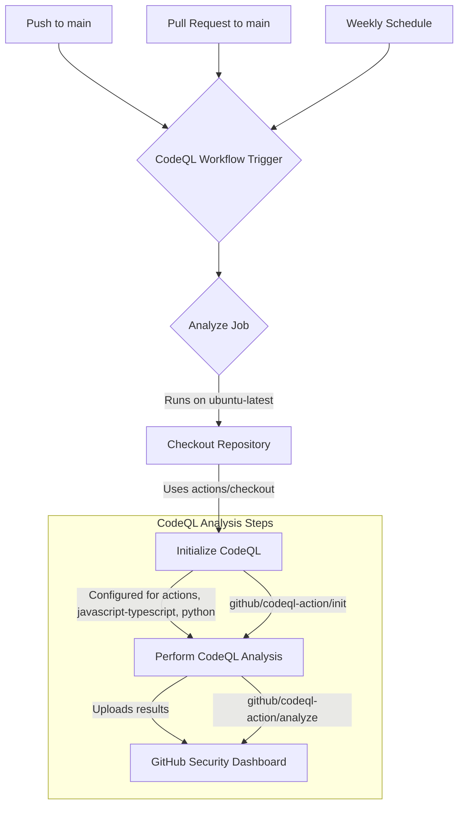
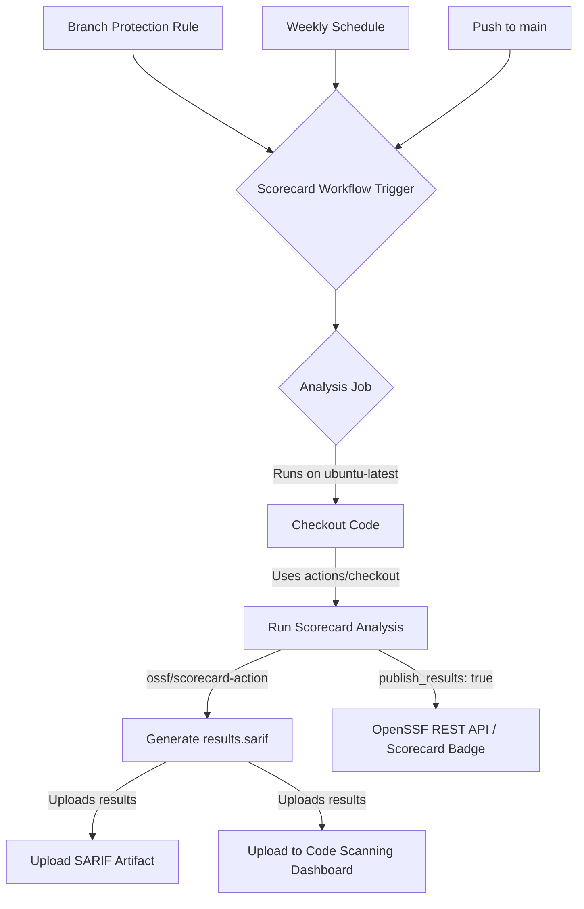
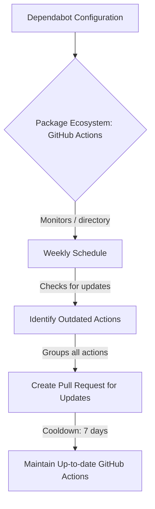

<!-- source: DeepWiki mcp.deepwiki.com · repo microsoft/AI-For-Beginners · page 6.2 CI Workflows and Security · fetched 2026-10-26 -->

# CI Workflows and Security

<details>
<summary>Relevant source files</summary>

The following files were used as context for generating this wiki page:

- [.github/dependabot.yml](.github/dependabot.yml)
- [.github/workflows/codeql.yml](.github/workflows/codeql.yml)
- [.github/workflows/scorecard.yml](.github/workflows/scorecard.yml)
- [SECURITY.md](SECURITY.md)

</details>


This page details the Continuous Integration (CI) workflows and security practices implemented in the AI-For-Beginners repository. It covers the configuration and purpose of `.github/workflows/codeql.yml`, `.github/workflows/scorecard.yml`, `.github/dependabot.yml`, and the security reporting policy outlined in `SECURITY.md`. These components collectively ensure code quality, identify potential vulnerabilities, manage dependencies, and provide a clear process for reporting security issues.

## CodeQL Advanced Security Analysis

The `codeql.yml` workflow [.github/workflows/codeql.yml:1-102]() is responsible for performing advanced security analysis on the codebase using GitHub's CodeQL. This workflow scans the repository for potential vulnerabilities and coding errors.

### Workflow Trigger and Schedule

The CodeQL analysis is triggered on several events:
*   **`push` to `main` branch**: Ensures that every change merged into the main branch is scanned [.github/workflows/codeql.yml:15-16]().
*   **`pull_request` to `main` branch**: Scans proposed changes before they are merged, helping to prevent new vulnerabilities from being introduced [.github/workflows/codeql.yml:17-18]().
*   **`schedule`**: A weekly cron job runs the analysis every Monday at 17:37 UTC [.github/workflows/codeql.yml:19-21](). This provides regular security checks even if there are no recent code changes.

### Analysis Job (`analyze`)

The `analyze` job [.github/workflows/codeql.yml:23-102]() is configured to run on `ubuntu-latest` runners, except for Swift which would use `macos-latest` [.github/workflows/codeql.yml:30](). It requires `security-events: write` permission to upload the analysis results to the GitHub security dashboard [.github/workflows/codeql.yml:33-34]().

#### Language Matrix

The workflow uses a strategy matrix to analyze multiple languages present in the repository [.github/workflows/codeql.yml:43-51](). The `include` section specifies the languages to be analyzed:
*   `actions` [.github/workflows/codeql.yml:46]()
*   `javascript-typescript` [.github/workflows/codeql.yml:48]()
*   `python` [.github/workflows/codeql.yml:50]()

For all specified languages, the `build-mode` is set to `none` [.github/workflows/codeql.yml:47, .github/workflows/codeql.yml:49, .github/workflows/codeql.yml:51](), indicating that CodeQL does not need to compile the code for these interpreted languages.

#### Steps

1.  **Checkout repository**: Uses `actions/checkout@v7.0.1` to fetch the repository content [.github/workflows/codeql.yml:61-62]().
2.  **Initialize CodeQL**: The `github/codeql-action/init@v4.37.9` action [.github/workflows/codeql.yml:71-74]() sets up the CodeQL environment. It takes the `language` and `build-mode` from the matrix as inputs.
3.  **Perform CodeQL Analysis**: The `github/codeql-action/analyze@v4.37.9` action [.github/workflows/codeql.yml:99-101]() executes the CodeQL analysis and uploads the results. The `category` is set to `/language:${{matrix.language}}` to categorize the findings by language.

### CodeQL Workflow Diagram


Sources: [.github/workflows/codeql.yml:12-102]()

## Scorecard Supply-Chain Security

The `scorecard.yml` workflow [.github/workflows/scorecard.yml:1-73]() integrates the OpenSSF Scorecard tool to assess the supply-chain security posture of the repository.

### Workflow Trigger and Schedule

The Scorecard analysis is triggered by:
*   **`branch_protection_rule`**: This trigger is used for the Branch-Protection check [.github/workflows/scorecard.yml:9]().
*   **`schedule`**: A weekly cron job runs every Friday at 15:44 UTC [.github/workflows/scorecard.yml:12-13](). This ensures the `Maintained` check is regularly updated.
*   **`push` to `main` branch**: Triggers analysis on direct pushes to the main branch [.github/workflows/scorecard.yml:14-15]().

### Permissions

The workflow declares `read-all` as default permissions [.github/workflows/scorecard.yml:18](). The `analysis` job specifically requests `security-events: write` to upload results to the code-scanning dashboard and `id-token: write` to publish results and obtain a badge [.github/workflows/scorecard.yml:26-28]().

### Analysis Job (`analysis`)

The `analysis` job [.github/workflows/scorecard.yml:21-73]() runs on `ubuntu-latest`.

#### Steps

1.  **Checkout code**: Uses `actions/checkout@v7.0.1` to fetch the repository content [.github/workflows/scorecard.yml:34-38](). `persist-credentials` is set to `false`.
2.  **Run analysis**: The `ossf/scorecard-action@v2.4.4` action [.github/workflows/scorecard.yml:40-42]() executes the Scorecard analysis.
    *   It outputs results to `results.sarif` in SARIF format [.github/workflows/scorecard.yml:43-44]().
    *   `publish_results` is set to `true` for public repositories, allowing results to be published to the OpenSSF REST API and enabling the Scorecard badge [.github/workflows/scorecard.yml:57]().
3.  **Upload artifact**: Optionally uploads the `results.sarif` file as an artifact named "SARIF file" with a retention of 5 days [.github/workflows/scorecard.yml:61-66]().
4.  **Upload to code-scanning**: Optionally uploads the `results.sarif` to GitHub's code scanning dashboard using `github/codeql-action/upload-sarif@v4.37.9` [.github/workflows/scorecard.yml:69-73]().

### Scorecard Workflow Diagram


Sources: [.github/workflows/scorecard.yml:5-73]()

## Dependabot Configuration

The `dependabot.yml` file [.github/dependabot.yml:1-11]() configures Dependabot to automatically check for and update dependencies.

### Updates Configuration

The configuration specifies one update group:
*   **`package-ecosystem: "github-actions"`**: Dependabot monitors GitHub Actions dependencies [.github/dependabot.yml:3]().
*   **`directory: "/"`**: It checks for dependencies in the root directory of the repository [.github/dependabot.yml:4]().
*   **`groups.github-actions`**: All GitHub Actions dependencies are grouped together [.github/dependabot.yml:6-7]().
*   **`schedule.interval: "weekly"`**: Dependabot checks for updates weekly [.github/dependabot.yml:8-9]().
*   **`cooldown.default-days: 7`**: After an update, Dependabot will wait 7 days before suggesting another update for the same dependency [.github/dependabot.yml:10-11]().

This setup ensures that the GitHub Actions used in the repository are kept up-to-date, reducing the risk of using outdated or vulnerable action versions.

### Dependabot Workflow Diagram


Sources: [.github/dependabot.yml:1-11]()

## Security Reporting Policy

The `SECURITY.md` file [SECURITY.md:1-41]() outlines the official policy for reporting security vulnerabilities in Microsoft-owned repositories, including AI-For-Beginners.

### Reporting Security Issues

The policy explicitly states that security vulnerabilities should **not** be reported through public GitHub issues [SECURITY.md:11](). Instead, reporters are directed to:
*   **Microsoft Security Response Center (MSRC)**: Use the MSRC portal at `https://msrc.microsoft.com/create-report` [SECURITY.md:13-14]().
*   **Email**: Send an email to `secure@microsoft.com` [SECURITY.md:15](). Encryption with the MSRC PGP key is encouraged [SECURITY.md:15-16]().

Reporters should expect a response within 24 hours [SECURITY.md:18]().

### Required Information for Reports

To facilitate quick triage, reporters are asked to include as much of the following information as possible [SECURITY.md:19-28]():
*   Type of issue (e.g., buffer overflow, SQL injection, XSS).
*   Full paths of affected source files.
*   Location of affected source code (tag/branch/commit or direct URL).
*   Any special configuration needed to reproduce.
*   Step-by-step reproduction instructions.
*   Proof-of-concept or exploit code (if available).
*   Impact of the issue and how an attacker might exploit it.

More complete reports can contribute to a higher bounty award under the Microsoft Bug Bounty Program [SECURITY.md:31-32]().

### Preferred Language and Policy

All communications are preferred in English [SECURITY.md:35](). Microsoft follows the principle of Coordinated Vulnerability Disclosure (CVD) [SECURITY.md:39]().

### Security Reporting Policy Diagram

```mermaid
graph TD
    A[Discover Security Vulnerability] --> B{DO NOT use Public GitHub Issues};
    B --> C[Report to Microsoft Security Response Center (MSRC)];
    C -- "Via Web Portal" --> D[https://msrc.microsoft.com/create-report];
    C -- "Via Email" --> E[secure@microsoft.com];
    E -- "Encrypt with PGP Key (Optional)" --> F[MSRC PGP Key Page];

    D & E --> G[Provide Detailed Information];
    G -- "Type of issue" --> H1[Issue Type];
    G -- "Affected files" --> H2[Source Paths];
    G -- "Code location" --> H3[Commit/Branch/URL];
    G -- "Reproduction steps" --> H4[Repro Steps];
    G -- "Proof-of-concept" --> H5[PoC Code];
    G -- "Impact" --> H6[Impact Assessment];

    G --> I[Receive Response within 24 hours];
    I --> J[Coordinated Vulnerability Disclosure (CVD)];
    J --> K[Potential Bug Bounty Award];
```
Sources: [SECURITY.md:3-40]()

---

