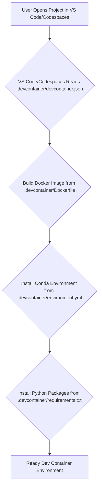

<!-- source: DeepWiki mcp.deepwiki.com · repo microsoft/AI-For-Beginners · page 7 Glossary · fetched 2026-10-26 -->

# Glossary

<details>
<summary>Relevant source files</summary>

The following files were used as context for generating this wiki page:

- [.devcontainer/Dockerfile](.devcontainer/Dockerfile)
- [.devcontainer/add-notice.sh](.devcontainer/add-notice.sh)
- [.devcontainer/devcontainer.json](.devcontainer/devcontainer.json)
- [.devcontainer/environment.yml](.devcontainer/environment.yml)
- [.devcontainer/requirements.txt](.devcontainer/requirements.txt)
- [.gitignore](.gitignore)
- [README.md](README.md)
- [binder/environment.yml](binder/environment.yml)
- [binder/requirements.txt](binder/requirements.txt)
- [environment.yml](environment.yml)
- [etc/Mindmap.html](etc/Mindmap.html)
- [etc/Mindmap.md](etc/Mindmap.md)
- [etc/Mindmap.svg](etc/Mindmap.svg)
- [etc/quiz-app/README.md](etc/quiz-app/README.md)
- [etc/quiz-app/babel.config.js](etc/quiz-app/babel.config.js)
- [etc/quiz-app/dist/index.html](etc/quiz-app/dist/index.html)
- [etc/quiz-app/dist/js/app.dfcb35f3.js](etc/quiz-app/dist/js/app.dfcb35f3.js)
- [etc/quiz-app/dist/js/app.dfcb35f3.js.map](etc/quiz-app/dist/js/app.dfcb35f3.js.map)
- [etc/quiz-app/dist/js/chunk-vendors.c1571e8f.js](etc/quiz-app/dist/js/chunk-vendors.c1571e8f.js)
- [etc/quiz-app/dist/js/chunk-vendors.c1571e8f.js.map](etc/quiz-app/dist/js/chunk-vendors.c1571e8f.js.map)
- [etc/quiz-app/package-lock.json](etc/quiz-app/package-lock.json)
- [etc/quiz-app/package.json](etc/quiz-app/package.json)
- [etc/quiz-app/public/favicon.ico](etc/quiz-app/public/favicon.ico)
- [etc/quiz-app/public/index.html](etc/quiz-app/public/index.html)
- [etc/quiz-app/public/routes.json](etc/quiz-app/public/routes.json)
- [lessons/4-ComputerVision/11-ObjectDetection/README.md](lessons/4-ComputerVision/11-ObjectDetection/README.md)
- [lessons/4-ComputerVision/11-ObjectDetection/lab/README.md](lessons/4-ComputerVision/11-ObjectDetection/lab/README.md)
- [lessons/4-ComputerVision/12-Segmentation/README.md](lessons/4-ComputerVision/12-Segmentation/README.md)
- [lessons/4-ComputerVision/12-Segmentation/SemanticSegmentationPytorch.ipynb](lessons/4-ComputerVision/12-Segmentation/SemanticSegmentationPytorch.ipynb)
- [lessons/4-ComputerVision/12-Segmentation/SemanticSegmentationTF.ipynb](lessons/4-ComputerVision/12-Segmentation/SemanticSegmentationTF.ipynb)
- [lessons/4-ComputerVision/12-Segmentation/lab/BodySegmentation.ipynb](lessons/4-ComputerVision/12-Segmentation/lab/BodySegmentation.ipynb)
- [lessons/4-ComputerVision/README.md](lessons/4-ComputerVision/README.md)
- [lessons/5-NLP/13-TextRep/README.md](lessons/5-NLP/13-TextRep/README.md)
- [lessons/5-NLP/13-TextRep/TextRepresentationPyTorch.ipynb](lessons/5-NLP/13-TextRep/TextRepresentationPyTorch.ipynb)
- [lessons/5-NLP/13-TextRep/assignment.md](lessons/5-NLP/13-TextRep/assignment.md)
- [lessons/5-NLP/14-Embeddings/EmbeddingsPyTorch.ipynb](lessons/5-NLP/14-Embeddings/EmbeddingsPyTorch.ipynb)
- [lessons/5-NLP/14-Embeddings/README.md](lessons/5-NLP/14-Embeddings/README.md)
- [lessons/5-NLP/14-Embeddings/assignment.md](lessons/5-NLP/14-Embeddings/assignment.md)
- [lessons/5-NLP/14-Embeddings/torchnlp.py](lessons/5-NLP/14-Embeddings/torchnlp.py)
- [lessons/5-NLP/15-LanguageModeling/CBoW-TF.ipynb](lessons/5-NLP/15-LanguageModeling/CBoW-TF.ipynb)
- [lessons/5-NLP/15-LanguageModeling/README.md](lessons/5-NLP/15-LanguageModeling/README.md)
- [lessons/5-NLP/15-LanguageModeling/lab/README.md](lessons/5-NLP/15-LanguageModeling/lab/README.md)
- [lessons/5-NLP/16-RNN/RNNPyTorch.ipynb](lessons/5-NLP/16-RNN/RNNPyTorch.ipynb)
- [lessons/5-NLP/16-RNN/RNNTF.ipynb](lessons/5-NLP/16-RNN/RNNTF.ipynb)
- [lessons/5-NLP/16-RNN/assignment.md](lessons/5-NLP/16-RNN/assignment.md)
- [lessons/5-NLP/16-RNN/torchnlp.py](lessons/5-NLP/16-RNN/torchnlp.py)
- [lessons/5-NLP/17-GenerativeNetworks/GenerativePyTorch.ipynb](lessons/5-NLP/17-GenerativeNetworks/GenerativePyTorch.ipynb)
- [lessons/5-NLP/17-GenerativeNetworks/GenerativeTF.ipynb](lessons/5-NLP/17-GenerativeNetworks/GenerativeTF.ipynb)
- [lessons/5-NLP/17-GenerativeNetworks/README.md](lessons/5-NLP/17-GenerativeNetworks/README.md)
- [lessons/5-NLP/17-GenerativeNetworks/lab/README.md](lessons/5-NLP/17-GenerativeNetworks/lab/README.md)
- [lessons/5-NLP/17-GenerativeNetworks/torchnlp.py](lessons/5-NLP/17-GenerativeNetworks/torchnlp.py)
- [lessons/5-NLP/18-Transformers/torchnlp.py](lessons/5-NLP/18-Transformers/torchnlp.py)
- [lessons/5-NLP/20-LangModels/GPT-PyTorch.ipynb](lessons/5-NLP/20-LangModels/GPT-PyTorch.ipynb)
- [lessons/5-NLP/20-LangModels/README.md](lessons/5-NLP/20-LangModels/README.md)
- [lessons/5-NLP/README.md](lessons/5-NLP/README.md)
- [lessons/5-NLP/requirements-pytorch.txt](lessons/5-NLP/requirements-pytorch.txt)
- [lessons/5-NLP/requirements-tf.txt](lessons/5-NLP/requirements-tf.txt)
- [lessons/6-Other/22-DeepRL/README.md](lessons/6-Other/22-DeepRL/README.md)
- [lessons/7-Ethics/README.md](lessons/7-Ethics/README.md)
- [requirements.txt](requirements.txt)
- [translations/ar/.co-op-translator.json](translations/ar/.co-op-translator.json)
- [translations/ar/README.md](translations/ar/README.md)
- [translations/ar/examples/README.md](translations/ar/examples/README.md)
- [translations/fa/.co-op-translator.json](translations/fa/.co-op-translator.json)
- [translations/fa/README.md](translations/fa/README.md)
- [translations/ru/.co-op-translator.json](translations/ru/.co-op-translator.json)
- [translations/ru/README.md](translations/ru/README.md)

</details>


This page defines key terms and AI jargon used throughout the AI-For-Beginners curriculum, providing context and pointers to relevant code implementations.

## AI Concepts

### GOFAI
**GOFAI** stands for "Good Old-Fashioned Artificial Intelligence." It refers to the early approaches to AI that primarily relied on symbolic methods, logic, and explicit knowledge representation, rather than statistical or learning-based methods. The curriculum introduces GOFAI in the context of knowledge representation and reasoning.
Sources: [README.md:67-67]()

### DIKW
The **DIKW** pyramid (Data, Information, Knowledge, Wisdom) is a hierarchy that illustrates how raw data can be transformed into more meaningful forms. It's often used in symbolic AI to describe the process of building knowledge systems.
Sources:

### CBoW (Continuous Bag-of-Words)
**CBoW** is a neural network architecture used in Word2Vec to learn word embeddings. It predicts a target word based on its surrounding context words. In the curriculum, CBoW is discussed as a method for text representation and embeddings.
Sources: [lessons/5-NLP/14-Embeddings/README.md]()

### Skip-gram
**Skip-gram** is another neural network architecture used in Word2Vec, contrasting with CBoW. Instead of predicting a target word from its context, Skip-gram predicts the surrounding context words given a target word. This method is also covered in the text representation and embeddings lessons.
Sources: [lessons/5-NLP/14-Embeddings/README.md]()

### Perplexity
**Perplexity** is a measure of how well a probability distribution or probability model predicts a sample. In natural language processing, it's commonly used to evaluate language models; a lower perplexity score indicates a better model. It's often discussed in the context of language modeling.
Sources: [lessons/5-NLP/15-LanguageModeling/README.md]()

### IoU (Intersection over Union)
**IoU** is a metric used to evaluate the accuracy of object detection systems. It measures the overlap between a predicted bounding box and a ground-truth bounding box. A higher IoU indicates a better match. This concept is relevant in the object detection lessons.
Sources: [lessons/4-ComputerVision/11-ObjectDetection/README.md]()

### mAP (mean Average Precision)
**mAP** is a common metric for evaluating the performance of object detection and segmentation models. It is the mean of the Average Precision (AP) values calculated for each class. AP itself is the area under the precision-recall curve. This metric is used in the object detection labs.
Sources: [lessons/4-ComputerVision/11-ObjectDetection/lab/README.md]()

### YOLO (You Only Look Once)
**YOLO** is a popular real-time object detection system. It frames object detection as a single regression problem, directly predicting bounding box coordinates and class probabilities from full images in one pass. This is covered in the object detection section.
Sources: [lessons/4-ComputerVision/11-ObjectDetection/README.md]()

### SegNet
**SegNet** is a deep convolutional neural network architecture designed for semantic segmentation. It consists of an encoder network and a corresponding decoder network, followed by a pixel-wise classification layer. It's used in the semantic segmentation lessons.
Sources: [lessons/4-ComputerVision/12-Segmentation/README.md](), [lessons/4-ComputerVision/12-Segmentation/lab/BodySegmentation.ipynb]()

### Actor-Critic
**Actor-Critic** methods are a class of reinforcement learning algorithms that combine value-based (critic) and policy-based (actor) approaches. The actor learns a policy that takes actions, while the critic estimates the value function to guide the actor's learning. This is introduced in the Deep Reinforcement Learning lesson.
Sources: [lessons/6-Other/22-DeepRL/README.md]()

### Sketchnotes
**Sketchnotes** are visual notes that combine drawings, handwriting, and visual elements to capture information. In this curriculum, sketchnotes are used to provide a visual summary of key AI concepts and lessons, making complex topics more accessible.
Sources: [README.md:17-19]()

## Codebase-Specific Terms

### EmbeddingBag
`EmbeddingBag` is a PyTorch module that computes sums or means of embeddings for sequences of variable length. It's particularly useful for NLP tasks where input sequences might have different lengths, as it efficiently handles padding and aggregation.
Sources: [lessons/5-NLP/14-Embeddings/EmbeddingsPyTorch.ipynb]()

### padify/offsetify
The `padify` and `offsetify` functions are utility functions found in the `torchnlp.py` module.
- `padify`: This function takes a list of sequences and pads them to a uniform length, typically with a special padding token, to create a batch of tensors suitable for neural network input.
- `offsetify`: This function generates offsets for `EmbeddingBag` layers, indicating the starting position of each sequence within a flattened batch of padded sequences.
These functions are crucial for preparing variable-length text data for batch processing in PyTorch NLP models.
Sources: [lessons/5-NLP/14-Embeddings/torchnlp.py](), [lessons/5-NLP/16-RNN/torchnlp.py](), [lessons/5-NLP/17-GenerativeNetworks/torchnlp.py](), [lessons/5-NLP/18-Transformers/torchnlp.py]()

#### `padify` and `offsetify` Data Flow
```mermaid
graph TD
    A[Input: List of Sequences] --> B{padify(sequences)};
    B --> C[Output: Padded Tensor];
    B --> D[Output: Offsets Tensor];
    D --> E{EmbeddingBag Layer};
    C --> E;
    E --> F[Output: Aggregated Embeddings];
```
Sources: [lessons/5-NLP/14-Embeddings/torchnlp.py](), [lessons/5-NLP/16-RNN/torchnlp.py](), [lessons/5-NLP/17-GenerativeNetworks/torchnlp.py](), [lessons/5-NLP/18-Transformers/torchnlp.py]()

### Co-op Translator
The **Co-op Translator** refers to the GitHub Action and associated infrastructure used to automate the translation of the curriculum content into multiple languages. It ensures that the translated content remains synchronized with the original English content.
Sources: [README.md:24-29]()

### original_hash
The `original_hash` field, found within the `.co-op-translator.json` files (e.g., [translations/fa/.co-op-translator.json:3-3](), [translations/ar/.co-op-translator.json:3-3](), [translations/ru/.co-op-translator.json:3-3]()), stores an MD5 hash of the original English file content at the time of its last successful translation. This hash is used by the Co-op Translator GitHub Action to detect if the original file has changed, indicating that the translation might be out of date and needs to be re-translated or updated.
Sources: [translations/fa/.co-op-translator.json:3-3](), [translations/ar/.co-op-translator.json:3-3](), [translations/ru/.co-op-translator.json:3-3]()

### sparse checkout
**Sparse checkout** is a Git feature that allows users to selectively clone only specific directories or files from a repository, rather than the entire repository. This is particularly useful for large repositories with many files, such as this curriculum with its numerous language translations and translated images, to reduce download size and speed up cloning.
Sources: [README.md:31-49]()

### pre/post-quiz IDs
**Pre-quiz IDs** and **Post-quiz IDs** are numerical identifiers used in the quiz system to distinguish between quizzes taken before a lesson (pre-quiz) and after a lesson (post-quiz). These IDs follow a convention, typically `1XX` for pre-quizzes and `2XX` for post-quizzes, where `XX` corresponds to the lesson number. This system helps organize and track quiz content.
Sources:

### devcontainer
A **devcontainer** (development container) is a Docker-based environment configured for development. It provides a consistent and isolated development environment with all necessary tools, dependencies, and configurations pre-installed. The `.devcontainer` directory in this repository contains the `Dockerfile` and `devcontainer.json` files that define this environment, allowing developers to quickly set up a consistent workspace using tools like VS Code Dev Containers or GitHub Codespaces.
Sources: [.devcontainer/Dockerfile](), [.devcontainer/devcontainer.json](), [.devcontainer/requirements.txt](), [.devcontainer/environment.yml]()

#### Devcontainer Configuration Flow

Sources: [.devcontainer/Dockerfile](), [.devcontainer/devcontainer.json](), [.devcontainer/requirements.txt](), [.devcontainer/environment.yml]()

### torchnlp.py
`torchnlp.py` is a utility module specifically designed for PyTorch-based Natural Language Processing (NLP) examples within the curriculum. It contains common functions and classes that are reused across various NLP lessons, such as `padify` and `offsetify` for data preparation, and potentially other helpers for loading datasets or training loops.
Sources: [lessons/5-NLP/14-Embeddings/torchnlp.py](), [lessons/5-NLP/16-RNN/torchnlp.py](), [lessons/5-NLP/17-GenerativeNetworks/torchnlp.py](), [lessons/5-NLP/18-Transformers/torchnlp.py]()

#### `torchnlp.py` Module Usage
```mermaid
graph TD
    A[NLP Lesson Notebook (PyTorch)] --> B{Import torchnlp.py};
    B --> C[Call padify() for data preparation];
    B --> D[Call offsetify() for EmbeddingBag];
    B --> E[Utilize other shared NLP helpers];
    C & D & E --> F[PyTorch Model Training/Inference];
```
Sources: [lessons/5-NLP/14-Embeddings/torchnlp.py](), [lessons/5-NLP/16-RNN/torchnlp.py](), [lessons/5-NLP/17-GenerativeNetworks/torchnlp.py](), [lessons/5-NLP/18-Transformers/torchnlp.py]()

### tfcv.py/pytorchcv.py
`tfcv.py` and `pytorchcv.py` are helper modules for Computer Vision (CV) examples, providing common functionalities for TensorFlow and PyTorch implementations, respectively. These modules likely contain utilities for image loading, preprocessing, model building blocks, or training loops that are shared across different computer vision lessons to maintain consistency and reduce code duplication.
Sources: [lessons/4-ComputerVision/README.md]()