# Page: Overview

# Overview

<details>
<summary>Relevant source files</summary>

The following files were used as context for generating this wiki page:

- [.gitignore](.gitignore)
- [README.md](README.md)
- [etc/CODE_OF_CONDUCT.md](etc/CODE_OF_CONDUCT.md)
- [etc/Mindmap.html](etc/Mindmap.html)
- [etc/Mindmap.md](etc/Mindmap.md)
- [etc/Mindmap.svg](etc/Mindmap.svg)
- [etc/SUPPORT.md](etc/SUPPORT.md)
- [etc/TRANSLATIONS.md](etc/TRANSLATIONS.md)
- [index.html](index.html)
- [lessons/1-Intro/README.md](lessons/1-Intro/README.md)
- [lessons/1-Intro/translations/README.ja.md](lessons/1-Intro/translations/README.ja.md)
- [lessons/4-ComputerVision/11-ObjectDetection/README.md](lessons/4-ComputerVision/11-ObjectDetection/README.md)
- [lessons/4-ComputerVision/11-ObjectDetection/lab/README.md](lessons/4-ComputerVision/11-ObjectDetection/lab/README.md)
- [lessons/5-NLP/15-LanguageModeling/CBoW-TF.ipynb](lessons/5-NLP/15-LanguageModeling/CBoW-TF.ipynb)
- [lessons/5-NLP/15-LanguageModeling/README.md](lessons/5-NLP/15-LanguageModeling/README.md)
- [lessons/5-NLP/15-LanguageModeling/lab/README.md](lessons/5-NLP/15-LanguageModeling/lab/README.md)
- [lessons/5-NLP/20-LangModels/GPT-PyTorch.ipynb](lessons/5-NLP/20-LangModels/GPT-PyTorch.ipynb)
- [lessons/5-NLP/20-LangModels/README.md](lessons/5-NLP/20-LangModels/README.md)
- [lessons/6-Other/22-DeepRL/README.md](lessons/6-Other/22-DeepRL/README.md)

</details>


The AI-For-Beginners repository (`https://github.com/microsoft/AI-For-Beginners`) is a comprehensive, open-source educational curriculum designed to teach artificial intelligence fundamentals through a structured 12-week, 24-lesson program [README.md:15-21](). The repository combines theoretical content with hands-on implementation exercises using industry-standard frameworks (`PyTorch` and `TensorFlow`), assessment tools, and extensive internationalization support [README.md:15-21]().

This overview covers the high-level architecture, core components, and organizational structure of the repository. For detailed information about the curriculum breakdown, see [Curriculum Structure](#1.1). For details on quizzes, labs, and pedagogical delivery, see [Learning Approach](#1.2).

**Sources:** [README.md:15-21]()

## Purpose and Target Audience

The curriculum targets beginners with no prior AI experience, guiding them from foundational concepts through advanced topics. The repository emphasizes practical implementation with executable Jupyter notebooks and progressive skill-building through labs and quizzes [README.md:15-21]().

The content excludes business-focused AI education, classic machine learning (covered separately in `ML-For-Beginners`), cloud-specific frameworks, and advanced mathematical foundations—instead focusing on conceptual understanding and hands-on coding [README.md:61-75]().

**Sources:** [README.md:15-21](), [README.md:61-75]()

## Repository Architecture

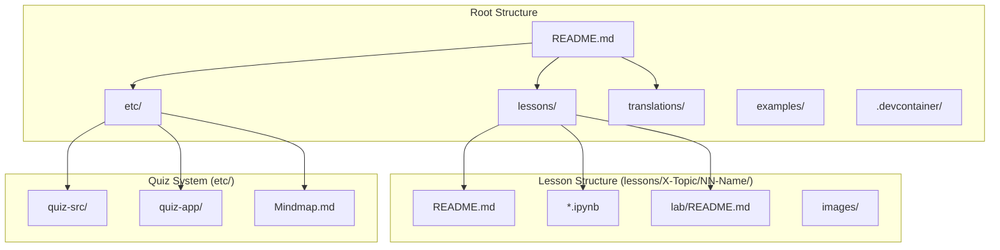

The repository follows a hierarchical structure organized by topic domains (`1-Intro`, `2-Symbolic`, `3-NeuralNetworks`, `4-ComputerVision`, `5-NLP`, `6-Other`, `7-Ethics`, `X-Extras`). Each lesson directory contains Markdown content, dual-framework Jupyter notebooks, supporting images, and optional lab assignments [README.md:15-75](), [etc/Mindmap.md:1-68]().

**Sources:** [README.md:15-75](), [etc/Mindmap.md:1-68]()

## Core Content Organization

### Lesson Taxonomy

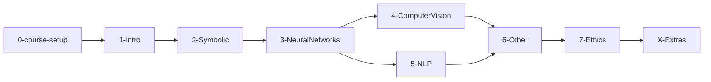

For a comprehensive week-by-week breakdown and topic progression, see [Curriculum Structure](#1.1).

**Sources:** [README.md:61-75](), [etc/Mindmap.md:1-68]()

### Dual-Framework Implementation

Each technical lesson provides parallel implementations in both frameworks:

| Framework | Notebook Patterns | Example Files |
|-----------|------------------|---------------|
| **PyTorch** | `*PyTorch.ipynb` | `lessons/3-NeuralNetworks/05-Frameworks/IntroPyTorch.ipynb` [etc/Mindmap.md:23-23]() |
| **TensorFlow/Keras** | `*TF.ipynb`, `*Keras.ipynb` | `lessons/3-NeuralNetworks/05-Frameworks/IntroKerasTF.md` [etc/Mindmap.md:24-24]() |

For details on how frameworks are utilized across lessons, see [Curriculum Structure](#1.1) and [Learning Approach](#1.2).

**Sources:** [README.md:61-75](), [etc/Mindmap.md:19-25]()

## Technology Stack

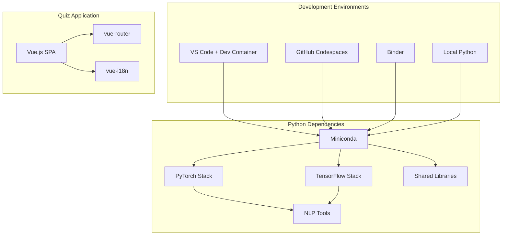

The development environment supports four entry points (VS Code Dev Containers, GitHub Codespaces, Binder, local setup) converging on standardized configurations. The Python stack maintains parallel PyTorch and TensorFlow ecosystems with a shared foundation (`numpy`, `scikit-learn`, `opencv`, etc.) [README.md:10-10]().

**Sources:** [README.md:10-10](), [index.html:1-29]()

## Lesson Structure Pattern

For details on the pedagogical approach involving pre/post quizzes, Jupyter notebooks, hands-on labs, and Microsoft Learn integration, see [Learning Approach](#1.2).

**Sources:** [README.md:15-75]()

## Quiz Assessment System

The quiz system is a standalone Vue.js single-page application deployed independently from the main curriculum:

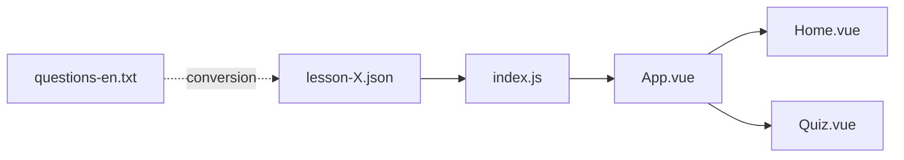

Quizzes are identified by numeric IDs: pre-lecture quizzes use IDs 1-24, post-lecture quizzes use IDs 25-48 [lessons/1-Intro/README.md:7-7](), [lessons/5-NLP/15-LanguageModeling/README.md:5-33]().

**Sources:** [lessons/1-Intro/README.md:7-7](), [lessons/5-NLP/15-LanguageModeling/README.md:5-33]()

## Internationalization Architecture

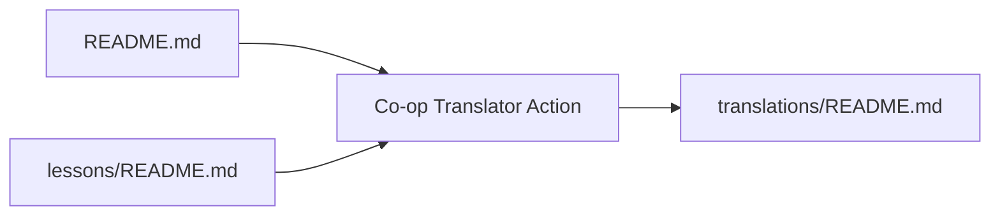

The Co-op Translator service automatically generates and maintains translations across 50+ languages [README.md:24-52]().

**Sources:** [README.md:24-52]()

## Key Design Patterns

### Pedagogical Code Duplication
The repository intentionally duplicates utility code across lessons to maintain lesson independence. For example, `torchnlp.py` appears identically across multiple NLP lessons rather than being centralized, prioritizing lesson portability and self-containment [lessons/5-NLP/15-LanguageModeling/README.md:1-43]().

### Framework Parity
Most lessons maintain strict parity between PyTorch and TensorFlow implementations, covering identical concepts with framework-specific syntax [README.md:61-75]().

**Sources:** [README.md:61-75](), [lessons/5-NLP/15-LanguageModeling/README.md:1-43]()

## Community and Support Resources

| Resource | Purpose | Link Pattern |
|----------|---------|--------------|
| **Microsoft Foundry Discord** | Learner community, Q&A | `discord.gg/nTYy5BXMWG` [README.md:13-13]() |
| **Microsoft Learn Collections** | Supplementary learning paths | `learn.microsoft.com/en-us/collections/...` [README.md:74-74]() |

**Sources:** [README.md:13-13](), [README.md:74-74]()

## Repository Statistics
- **Total Lessons:** 24 lessons across 12 weeks [README.md:15-21]()
- **Languages:** 50+ translations via automated GitHub Actions [README.md:24-52]()
- **License:** MIT [README.md:1-1]()

**Sources:** [README.md:1-1](), [README.md:15-21](), [README.md:24-52]()

---

# Page: Curriculum Structure

# Curriculum Structure

<details>
<summary>Relevant source files</summary>

The following files were used as context for generating this wiki page:

- [.gitignore](.gitignore)
- [README.md](README.md)
- [etc/Mindmap.html](etc/Mindmap.html)
- [etc/Mindmap.md](etc/Mindmap.md)
- [etc/Mindmap.svg](etc/Mindmap.svg)
- [lessons/3-NeuralNetworks/README.md](lessons/3-NeuralNetworks/README.md)
- [lessons/4-ComputerVision/11-ObjectDetection/README.md](lessons/4-ComputerVision/11-ObjectDetection/README.md)
- [lessons/4-ComputerVision/11-ObjectDetection/lab/README.md](lessons/4-ComputerVision/11-ObjectDetection/lab/README.md)
- [lessons/5-NLP/15-LanguageModeling/CBoW-TF.ipynb](lessons/5-NLP/15-LanguageModeling/CBoW-TF.ipynb)
- [lessons/5-NLP/15-LanguageModeling/README.md](lessons/5-NLP/15-LanguageModeling/README.md)
- [lessons/5-NLP/15-LanguageModeling/lab/README.md](lessons/5-NLP/15-LanguageModeling/lab/README.md)
- [lessons/5-NLP/20-LangModels/GPT-PyTorch.ipynb](lessons/5-NLP/20-LangModels/GPT-PyTorch.ipynb)
- [lessons/5-NLP/20-LangModels/README.md](lessons/5-NLP/20-LangModels/README.md)
- [lessons/6-Other/22-DeepRL/README.md](lessons/6-Other/22-DeepRL/README.md)

</details>


This document explains the organization of the 24-lesson AI curriculum, its mapping to a 12-week learning timeline, the progression of topics from foundational symbolic reasoning to modern deep learning, and the dual-framework implementation strategy using PyTorch and TensorFlow. For details on pedagogical methods and learning resources, see [Learning Approach](#1.2).

Sources: [README.md:21-23]()

## Overview

The AI-For-Beginners curriculum consists of 24 core lessons plus extra topics, organized into major sections covering the full spectrum of AI approaches from symbolic reasoning to neural networks, computer vision, natural language processing, reinforcement learning, and AI ethics [README.md:21-71](). 

Sources: [README.md:21-71]()

## Curriculum Organization

The curriculum follows a hierarchical structure with numbered sections containing thematically related lessons:

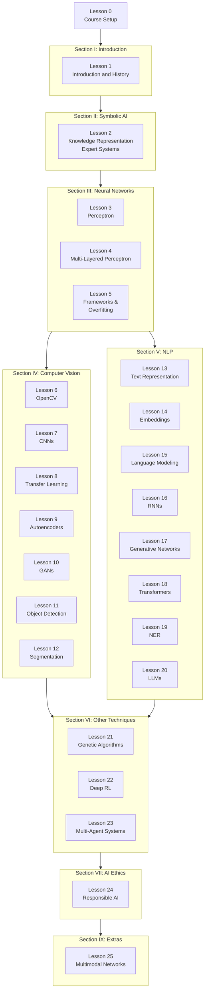

**Lesson Distribution by Section**

Sources: [README.md:65-74]()

## Directory Structure and Lesson Mapping

The curriculum's physical organization maps lessons to directories under `lessons/`:

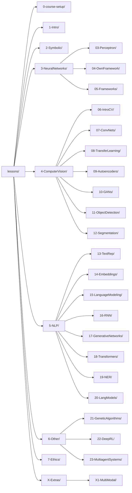

**Directory-to-Lesson Mapping**

Each lesson directory contains a `README.md` file introducing theory, Jupyter notebooks (`.ipynb`) for hands-on execution, and a `lab/` subdirectory for assignments where applicable [lessons/3-NeuralNetworks/README.md:42-48](), [lessons/5-NLP/15-LanguageModeling/README.md:41-43]().

Sources: [lessons/1-Intro/README.md:1](), [lessons/2-Symbolic/README.md:1](), [lessons/3-NeuralNetworks/03-Perceptron/README.md:1](), [lessons/4-ComputerVision/07-ConvNets/README.md:1](), [lessons/5-NLP/15-LanguageModeling/README.md:1]()

## Weekly Schedule

The 12-week curriculum maps lessons to specific weeks, averaging two lessons per week:

| Week | Lessons | Topics |
|------|---------|--------|
| 0 | Lesson 0 | Environment Setup |
| 1 | Lessons 1-2 | AI Introduction, History, Symbolic AI |
| 2 | Lessons 3-4 | Perceptron, Multi-Layered Networks |
| 3 | Lesson 5 | Neural Network Frameworks (PyTorch/TensorFlow) |
| 4 | Lessons 6-7 | OpenCV, Convolutional Networks |
| 5 | Lessons 8-9 | Transfer Learning, Autoencoders |
| 6 | Lessons 10-11 | GANs, Object Detection |
| 7 | Lesson 12, 13 | Segmentation, Text Representation |
| 8 | Lessons 14-15 | Embeddings, Language Modeling |
| 9 | Lessons 16-17 | RNNs, Generative Networks |
| 10 | Lessons 18-19 | Transformers, Named Entity Recognition |
| 11 | Lessons 20-21 | Large Language Models, Genetic Algorithms |
| 12 | Lessons 22-24 | Deep RL, Multi-Agent Systems, AI Ethics |

Sources: [README.md:21-23]()

## Topic Progression Architecture

The curriculum follows a deliberate progression from simple to complex concepts, building prerequisite knowledge for each subsequent domain:

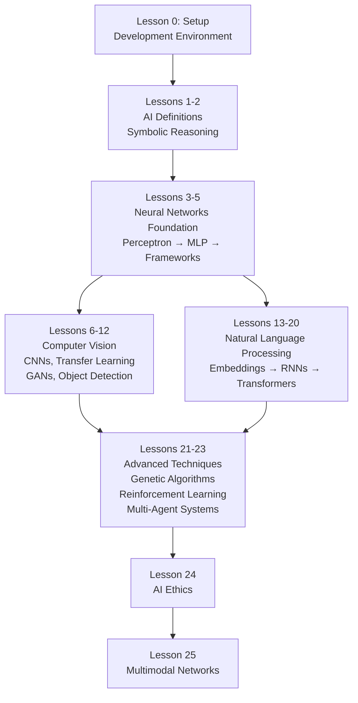

**Conceptual Progression Flow**

Sources: [README.md:65-74]()

## Dual-Framework Implementation Strategy

Every hands-on lesson from Lesson 3 onwards provides parallel implementations in both PyTorch and TensorFlow, letting learners select their framework:

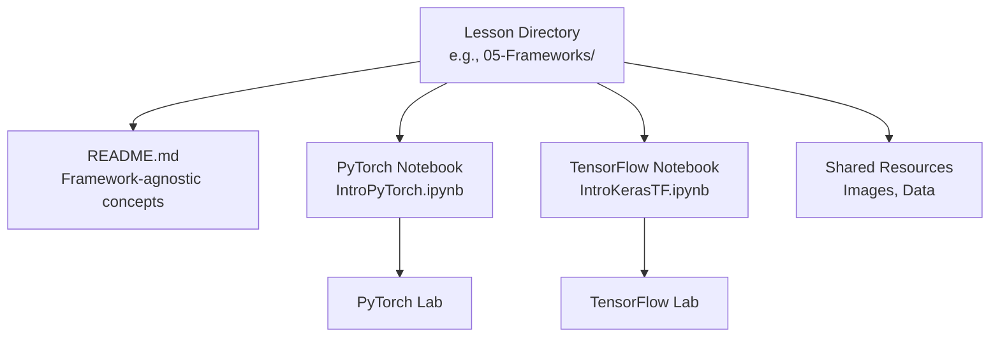

**Dual-Framework Lesson Structure**

Sources: [lessons/3-NeuralNetworks/README.md:46-47]()

### Framework Selection Pattern

Notebook naming follows a consistent convention:

| Framework | Naming Convention | Example |
|-----------|------------------|---------|
| PyTorch | `*PyTorch.ipynb` | `CBoW-PyTorch.ipynb` [lessons/5-NLP/15-LanguageModeling/README.md:26](), `CartPole-RL-PyTorch.ipynb` [lessons/6-Other/22-DeepRL/README.md:86]() |
| TensorFlow/Keras | `*TF.ipynb` or `*Keras.ipynb` | `CBoW-TF.ipynb` [lessons/5-NLP/15-LanguageModeling/README.md:25](), `CartPole-RL-TF.ipynb` [lessons/6-Other/22-DeepRL/README.md:85]() |

Sources: [lessons/5-NLP/15-LanguageModeling/README.md:25-26](), [lessons/6-Other/22-DeepRL/README.md:85-86]()

### API Level Coverage

Frameworks are taught at both low-level custom implementations and high-level abstractions (`torch.nn`, `tf.keras.layers`, `pipeline`) [lessons/3-NeuralNetworks/README.md:46-47](), [lessons/5-NLP/20-LangModels/GPT-PyTorch.ipynb:58-64]().

Sources: [lessons/3-NeuralNetworks/README.md:46-47](), [lessons/5-NLP/20-LangModels/GPT-PyTorch.ipynb:58-64]()

## Natural Language Space to Code Entity Space Mappings

To bridge conceptual curriculum topics with underlying code implementations, the following architecture diagrams map system concepts to explicit code entities, classes, and file paths.

### Diagram 1: Natural Language to Code Mapping for NLP and LLMs

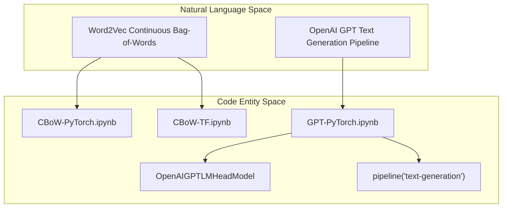

**NLP & LLM Domain Code Mapping**

Sources: [lessons/5-NLP/15-LanguageModeling/README.md:25-26](), [lessons/5-NLP/20-LangModels/README.md:43-47](), [lessons/5-NLP/20-LangModels/GPT-PyTorch.ipynb:32-64]()

### Diagram 2: Natural Language to Code Mapping for Reinforcement Learning and Computer Vision

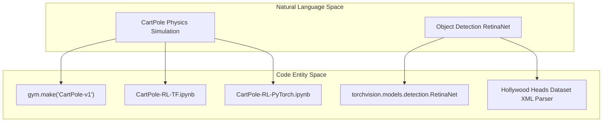

**Reinforcement Learning & Vision Domain Code Mapping**

Sources: [lessons/6-Other/22-DeepRL/README.md:34-86](), [lessons/4-ComputerVision/11-ObjectDetection/lab/README.md:11-59]()

## Lesson Component Structure

Each lesson follows a standard structure with consistent components:

| Component | Location | Purpose |
|-----------|----------|---------|
| Pre-lecture quiz | Quiz app | Assess prior knowledge [lessons/5-NLP/15-LanguageModeling/README.md:5]() |
| Conceptual content | `README.md` | Introduce theory and concepts [lessons/3-NeuralNetworks/README.md:1-25]() |
| Executable notebooks | `*.ipynb` files | Hands-on implementation [lessons/5-NLP/15-LanguageModeling/README.md:25-26]() |
| Lab assignments | `lab/README.md` | Apply concepts to new problems [lessons/5-NLP/15-LanguageModeling/README.md:41-43]() |
| Post-lecture quiz | Quiz app | Verify understanding [lessons/5-NLP/15-LanguageModeling/README.md:33]() |

Sources: [lessons/5-NLP/15-LanguageModeling/README.md:5-43]()

### Quiz Integration

Quizzes follow a numbering convention where lesson N has pre-quiz ID `1XX` and post-quiz ID `2XX` hosted via the quiz application [README.md:149-151]().

Sources: [README.md:149-151]()

## Cross-Cutting Content Structure

### Microsoft Learn Integration

Lessons integrate with external Microsoft Learn modules for supplementary paths in AI fundamentals, computer vision, natural language processing, and responsible AI [README.md:74]().

Sources: [README.md:74]()

### Lab Assignments

Lab assignments located in `lab/` subdirectories extend lesson concepts to real-world datasets, such as training RetinaNet on the Hollywood Heads dataset [lessons/4-ComputerVision/11-ObjectDetection/lab/README.md:1-11]().

Sources: [lessons/4-ComputerVision/11-ObjectDetection/lab/README.md:1-11]()

Sources: [README.md:21-74](), [lessons/3-NeuralNetworks/README.md:1-48](), [lessons/5-NLP/15-LanguageModeling/README.md:1-43](), [lessons/5-NLP/20-LangModels/README.md:1-53](), [lessons/6-Other/22-DeepRL/README.md:1-87](), [lessons/4-ComputerVision/11-ObjectDetection/lab/README.md:1-62]()

---

# Page: Learning Approach

# Learning Approach

<details>
<summary>Relevant source files</summary>

The following files were used as context for generating this wiki page:

- [.gitignore](.gitignore)
- [README.md](README.md)
- [etc/Mindmap.html](etc/Mindmap.html)
- [etc/Mindmap.md](etc/Mindmap.md)
- [etc/Mindmap.svg](etc/Mindmap.svg)
- [etc/quiz-app/src/assets/translations/en/index.js](etc/quiz-app/src/assets/translations/en/index.js)
- [etc/quiz-app/src/assets/translations/en/lesson-11.json](etc/quiz-app/src/assets/translations/en/lesson-11.json)
- [etc/quiz-app/src/assets/translations/en/lesson-12.json](etc/quiz-app/src/assets/translations/en/lesson-12.json)
- [etc/quiz-app/src/assets/translations/en/lesson-13.json](etc/quiz-app/src/assets/translations/en/lesson-13.json)
- [etc/quiz-app/src/assets/translations/en/lesson-14.json](etc/quiz-app/src/assets/translations/en/lesson-14.json)
- [etc/quiz-app/src/assets/translations/en/lesson-15.json](etc/quiz-app/src/assets/translations/en/lesson-15.json)
- [etc/quiz-app/src/assets/translations/en/lesson-16.json](etc/quiz-app/src/assets/translations/en/lesson-16.json)
- [etc/quiz-app/src/assets/translations/en/lesson-17.json](etc/quiz-app/src/assets/translations/en/lesson-17.json)
- [etc/quiz-app/src/assets/translations/en/lesson-18.json](etc/quiz-app/src/assets/translations/en/lesson-18.json)
- [etc/quiz-app/src/assets/translations/en/lesson-19.json](etc/quiz-app/src/assets/translations/en/lesson-19.json)
- [etc/quiz-app/src/assets/translations/en/lesson-20.json](etc/quiz-app/src/assets/translations/en/lesson-20.json)
- [etc/quiz-app/src/assets/translations/en/lesson-22.json](etc/quiz-app/src/assets/translations/en/lesson-22.json)
- [etc/quiz-app/src/assets/translations/en/lesson-23.json](etc/quiz-app/src/assets/translations/en/lesson-23.json)
- [etc/quiz-src/questions-en.txt](etc/quiz-src/questions-en.txt)
- [lessons/4-ComputerVision/11-ObjectDetection/README.md](lessons/4-ComputerVision/11-ObjectDetection/README.md)
- [lessons/4-ComputerVision/11-ObjectDetection/lab/README.md](lessons/4-ComputerVision/11-ObjectDetection/lab/README.md)
- [lessons/5-NLP/14-Embeddings/EmbeddingsTF.ipynb](lessons/5-NLP/14-Embeddings/EmbeddingsTF.ipynb)
- [lessons/5-NLP/15-LanguageModeling/CBoW-TF.ipynb](lessons/5-NLP/15-LanguageModeling/CBoW-TF.ipynb)
- [lessons/5-NLP/15-LanguageModeling/README.md](lessons/5-NLP/15-LanguageModeling/README.md)
- [lessons/5-NLP/15-LanguageModeling/lab/README.md](lessons/5-NLP/15-LanguageModeling/lab/README.md)
- [lessons/5-NLP/20-LangModels/GPT-PyTorch.ipynb](lessons/5-NLP/20-LangModels/GPT-PyTorch.ipynb)
- [lessons/5-NLP/20-LangModels/README.md](lessons/5-NLP/20-LangModels/README.md)
- [lessons/6-Other/22-DeepRL/README.md](lessons/6-Other/22-DeepRL/README.md)

</details>


This document details the pedagogical approach and learning methodology used in the AI-For-Beginners curriculum. It explains the project-based learning philosophy, framework options, assessment components, and integration with external platforms like Microsoft Learn. For information about the overall curriculum structure, see [Curriculum Structure](#1.1).

## Project-Based Learning Philosophy

The AI-For-Beginners curriculum embraces a hands-on, project-based learning approach designed to maximize engagement and retention. Rather than focusing solely on abstract theoretical concepts, learners engage directly with executable examples and real-world scenarios. The lessons start small and progressively increase in complexity over the 12-week schedule [README.md:21-21]().

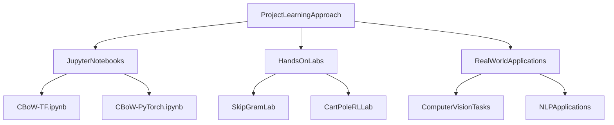

Sources: [README.md:21-21](), [lessons/5-NLP/15-LanguageModeling/README.md:21-26]()

## Learning Components and Lesson Architecture

Each lesson in the 24-lesson curriculum integrates multiple learning modalities to reinforce core AI principles through different channels. 

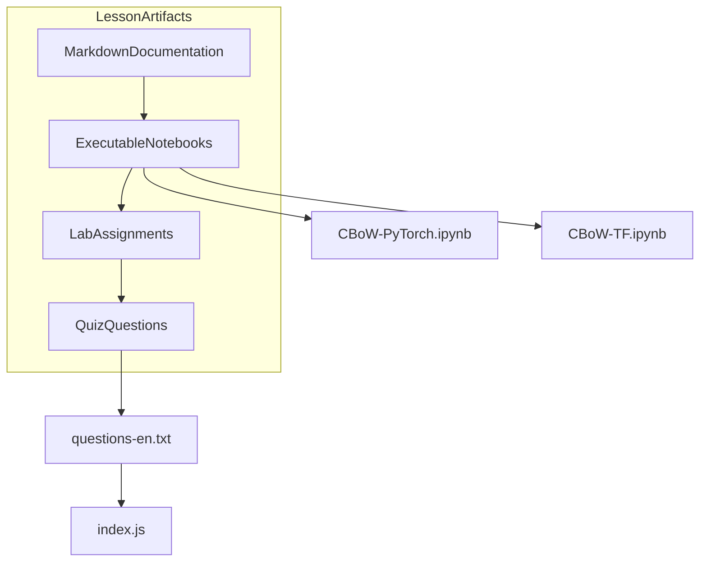

Each lesson follows a structured execution path:
1. **Pre-reading Material & Pre-Quiz**: Sets learning intentions and reviews foundational concepts (`[etc/quiz-src/questions-en.txt:1-53]()`).
2. **Jupyter Notebooks**: Dual-framework interactive code implementations in both PyTorch and TensorFlow (`[lessons/5-NLP/15-LanguageModeling/README.md:21-26]()`).
3. **Labs and Assignments**: Practical coding extensions challenging learners to modify and apply models (`[lessons/5-NLP/15-LanguageModeling/README.md:41-43]()`).
4. **Post-Quiz**: Verifies technical comprehension and concept retention (`[etc/quiz-src/questions-en.txt:1-53]()`).
5. **Microsoft Learn References**: Curated external learning modules for broader context (`[README.md:72-74]()`).

Sources: [README.md:21-21](), [etc/quiz-src/questions-en.txt:1-53](), [lessons/5-NLP/15-LanguageModeling/README.md:21-43]()

## Dual Framework Implementation Strategy

A distinctive technical feature of the curriculum is its dual-framework implementation strategy. For nearly every deep learning concept, parallel notebooks are provided for both PyTorch and TensorFlow/Keras.

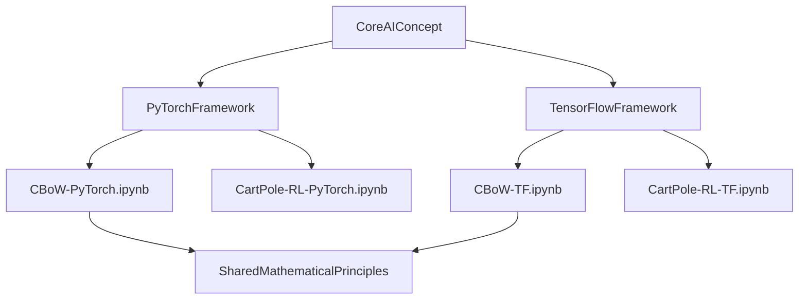

This dual approach ensures that learners understand underlying mathematical principles independently of framework-specific abstractions or syntax differences.

Sources: [README.md:65-68](), [lessons/5-NLP/15-LanguageModeling/README.md:21-26](), [lessons/6-Other/22-DeepRL/README.md:81-86]()

## Assessment System Architecture

The assessment system combines formative quizzes and practical lab evaluations. Quizzes are authored in plain text format (`[etc/quiz-src/questions-en.txt:1-53]()`) and compiled into JSON structures consumed by the Vue.js quiz single-page application (`[etc/quiz-app/src/assets/translations/en/index.js:1-26]()`).

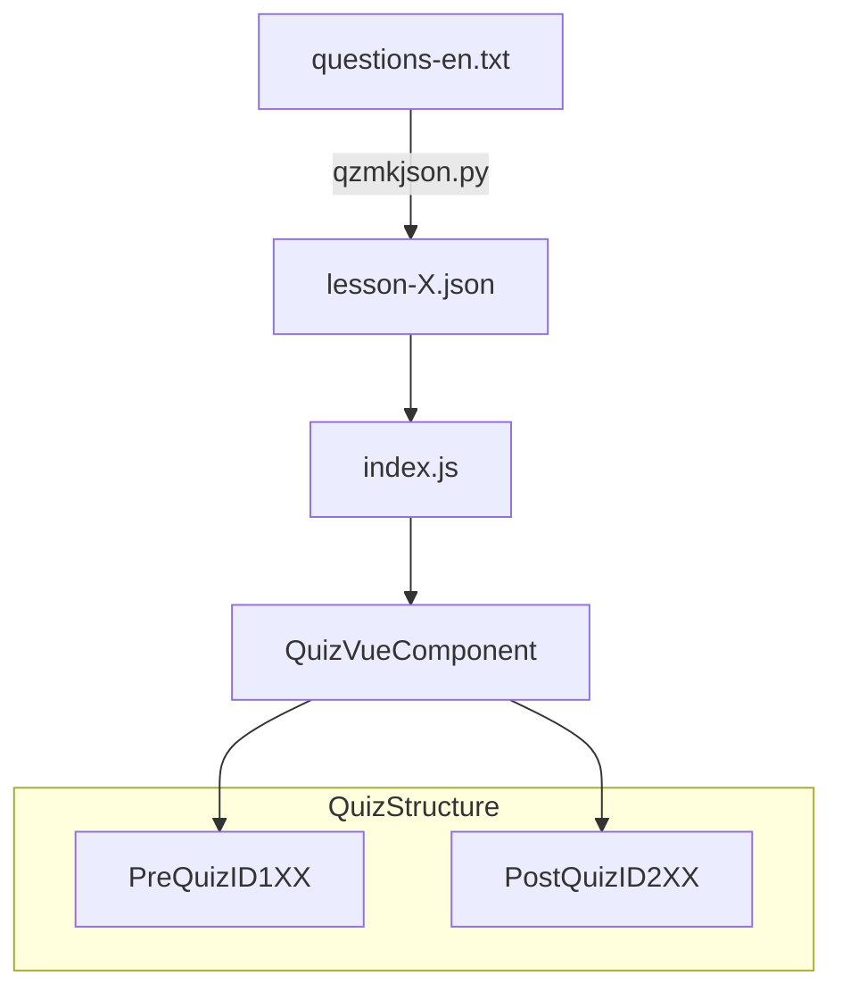

- **Pre-Quiz**: Identifies baseline knowledge before tackling lesson materials (`[etc/quiz-src/questions-en.txt:1-53]()`).
- **Post-Quiz**: Evaluates mastery after completing notebooks and labs (`[etc/quiz-src/questions-en.txt:1-53]()`).
- **Vue Integration**: Managed centrally via JavaScript index mapping (`[etc/quiz-app/src/assets/translations/en/index.js:1-26]()`).

Sources: [etc/quiz-src/questions-en.txt:1-53](), [etc/quiz-app/src/assets/translations/en/index.js:1-26]()

## Hands-On Labs and Assignments

Labs provide practical engineering challenges that build upon lesson notebooks. For example, the Natural Language Processing module shifts from Continuous Bag-of-Words implementations to skip-gram training tasks via lab assignments (`[lessons/5-NLP/15-LanguageModeling/README.md:41-43]()`).

Sources: [lessons/5-NLP/15-LanguageModeling/README.md:41-43]()

## Microsoft Learn Integration

The curriculum links directly to Microsoft Learn collections to complement repository notebooks with structured documentation and tutorials.

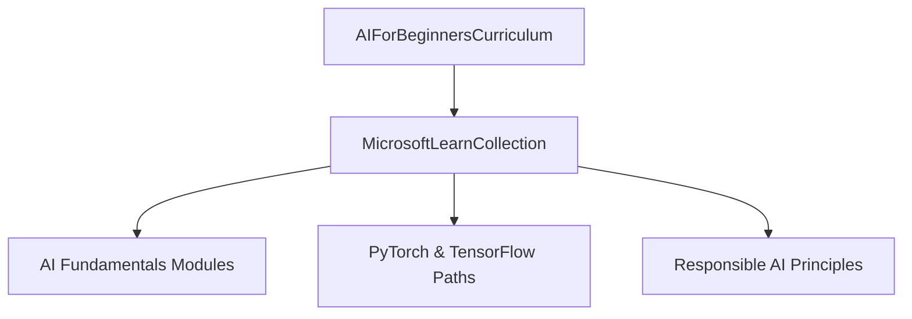

Sources: [README.md:72-74](), [etc/Mindmap.md:28-31]()

---

# Page: Development Environment

# Development Environment

<details>
<summary>Relevant source files</summary>

The following files were used as context for generating this wiki page:

- [.devcontainer/Dockerfile](.devcontainer/Dockerfile)
- [.devcontainer/add-notice.sh](.devcontainer/add-notice.sh)
- [.devcontainer/devcontainer.json](.devcontainer/devcontainer.json)
- [.devcontainer/environment.yml](.devcontainer/environment.yml)
- [.devcontainer/requirements.txt](.devcontainer/requirements.txt)
- [binder/environment.yml](binder/environment.yml)
- [binder/requirements.txt](binder/requirements.txt)
- [environment.yml](environment.yml)
- [lessons/0-course-setup/for-teachers.md](lessons/0-course-setup/for-teachers.md)
- [lessons/0-course-setup/how-to-run.md](lessons/0-course-setup/how-to-run.md)
- [lessons/0-course-setup/setup.md](lessons/0-course-setup/setup.md)
- [lessons/4-ComputerVision/12-Segmentation/lab/BodySegmentation.ipynb](lessons/4-ComputerVision/12-Segmentation/lab/BodySegmentation.ipynb)
- [lessons/5-NLP/14-Embeddings/torchnlp.py](lessons/5-NLP/14-Embeddings/torchnlp.py)
- [lessons/5-NLP/16-RNN/RNNPyTorch.ipynb](lessons/5-NLP/16-RNN/RNNPyTorch.ipynb)
- [lessons/5-NLP/16-RNN/torchnlp.py](lessons/5-NLP/16-RNN/torchnlp.py)
- [lessons/5-NLP/17-GenerativeNetworks/torchnlp.py](lessons/5-NLP/17-GenerativeNetworks/torchnlp.py)
- [lessons/5-NLP/18-Transformers/torchnlp.py](lessons/5-NLP/18-Transformers/torchnlp.py)
- [lessons/5-NLP/requirements-pytorch.txt](lessons/5-NLP/requirements-pytorch.txt)
- [lessons/5-NLP/requirements-tf.txt](lessons/5-NLP/requirements-tf.txt)
- [requirements.txt](requirements.txt)
- [translations/ur/CONTRIBUTING.md](translations/ur/CONTRIBUTING.md)
- [translations/ur/examples/README.md](translations/ur/examples/README.md)
- [translations/ur/lessons/0-course-setup/how-to-run.md](translations/ur/lessons/0-course-setup/how-to-run.md)
- [translations/ur/lessons/4-ComputerVision/08-TransferLearning/TransferLearningTF.ipynb](translations/ur/lessons/4-ComputerVision/08-TransferLearning/TransferLearningTF.ipynb)
- [translations/ur/lessons/5-NLP/README.md](translations/ur/lessons/5-NLP/README.md)
- [translations/zh-CN/CONTRIBUTING.md](translations/zh-CN/CONTRIBUTING.md)
- [translations/zh-CN/examples/README.md](translations/zh-CN/examples/README.md)
- [translations/zh-CN/lessons/0-course-setup/how-to-run.md](translations/zh-CN/lessons/0-course-setup/how-to-run.md)
- [translations/zh-CN/lessons/4-ComputerVision/08-TransferLearning/TransferLearningTF.ipynb](translations/zh-CN/lessons/4-ComputerVision/08-TransferLearning/TransferLearningTF.ipynb)
- [translations/zh-CN/lessons/5-NLP/README.md](translations/zh-CN/lessons/5-NLP/README.md)
- [translations/zh-MO/examples/README.md](translations/zh-MO/examples/README.md)
- [translations/zh-MO/lessons/0-course-setup/how-to-run.md](translations/zh-MO/lessons/0-course-setup/how-to-run.md)
- [translations/zh-MO/lessons/5-NLP/README.md](translations/zh-MO/lessons/5-NLP/README.md)

</details>


## Purpose and Scope

This document provides a high-level overview of the development environment setup options for the AI-For-Beginners repository. It explains the multi-environment strategy supporting local Python installations, Visual Studio Code Dev Containers, GitHub Codespaces, and Binder, as well as the core dependency stack and introductory standalone examples. 

For deep technical details, configuration files, and step-by-step guides, please refer to the following child pages:
- [Local Development Setup](#2.1) — Detailed Conda configuration, `environment.yml`, `Dockerfile`, and `devcontainer.json`.
- [Cloud Development Options](#2.2) — GitHub Codespaces and Binder setup and comparisons.
- [Dependencies and Framework Stack](#2.3) — PyTorch vs. TensorFlow stacks, shared libraries (`numpy`, `opencv-python`, `scikit-learn`), and NLP requirements.
- [Standalone Beginner Examples](#2.4) — The `examples/` directory scripts and notebooks establishing the beginner difficulty ladder.

Sources: [lessons/0-course-setup/how-to-run.md:1-94](), [.devcontainer/devcontainer.json:1-32]()

## Multi-Environment Strategy Overview

The AI-For-Beginners repository is designed to accommodate diverse learner setups and infrastructure constraints. By decoupling the curriculum content from execution runtimes, students can execute code locally or in cloud-hosted containers without manual dependency resolution.

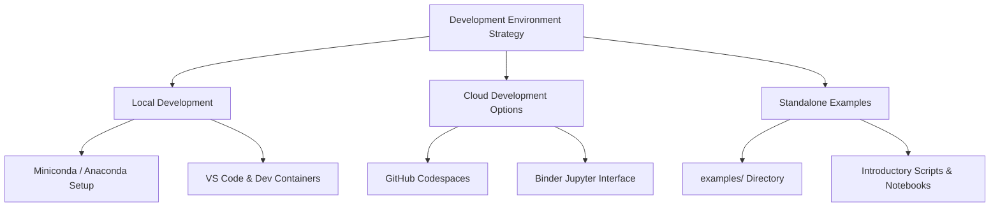
Sources: [lessons/0-course-setup/how-to-run.md:5-94](), [.devcontainer/devcontainer.json:1-32]()

## Local Development Setup

Local development relies on **Miniconda** or **Anaconda** to establish a standardized virtual environment named `ai4beg` [lessons/0-course-setup/how-to-run.md:5-16](). Configuration is driven by `.devcontainer/environment.yml` and the root `requirements.txt` [lessons/0-course-setup/how-to-run.md:14](). Visual Studio Code integrates natively with this environment via Python extensions and workspace settings.

For detailed instructions on setting up Conda, handling Windows-specific `UnicodeDecodeError` scenarios using `PYTHONUTF8`, and configuring Docker-based Dev Containers, see [Local Development Setup](#2.1).

Sources: [lessons/0-course-setup/how-to-run.md:5-47](), [.devcontainer/environment.yml:1-24]()

## Cloud Development Options

For users who wish to bypass local installation, the repository supports cloud-based execution. **GitHub Codespaces** automatically provisions a fully configured VS Code browser environment using the repository's container definition [lessons/0-course-setup/how-to-run.md:75-79](). Alternatively, **Binder** builds lightweight Jupyter environments directly from the repository's binder configuration files [lessons/0-course-setup/how-to-run.md:80-82]().

For a comprehensive comparison of cloud resource limits, GPU access considerations, and configuration differences, see [Cloud Development Options](#2.2).

Sources: [lessons/0-course-setup/how-to-run.md:75-84](), [.devcontainer/devcontainer.json:1-32](), [binder/environment.yml:1-25]()

## Dependencies and Framework Stack

The curriculum utilizes a dual-framework approach, incorporating both **PyTorch** and **TensorFlow/Keras** across deep learning modules. Shared scientific libraries such as `numpy`, `scikit-learn`, `scipy`, and `opencv-python` support core data manipulation and computer vision lessons, while specialized requirements files manage Natural Language Processing dependencies.

For a complete breakdown of framework version pins, shared libraries, and NLP-specific toolsets, see [Dependencies and Framework Stack](#2.3).

Sources: [.devcontainer/requirements.txt:1-21](), [lessons/5-NLP/requirements-pytorch.txt:1-15](), [lessons/5-NLP/requirements-tf.txt:1-13]()

## Standalone Beginner Examples

Before engaging with the full 24-lesson curriculum, learners can explore standalone examples located in the `examples/` directory. These include foundational scripts and notebooks such as `01-hello-ai-world.py`, `02-simple-neural-network.py`, `03-image-classifier.ipynb`, and `04-text-sentiment.py`, which provide a gentle introduction to AI concepts before scaling up to framework-specific lessons.

For prerequisites, code walkthroughs, and curriculum mapping, see [Standalone Beginner Examples](#2.4).

Sources: [lessons/0-course-setup/setup.md:1-42]()

---

# Page: Local Development Setup

# Local Development Setup

<details>
<summary>Relevant source files</summary>

The following files were used as context for generating this wiki page:

- [.devcontainer/Dockerfile](.devcontainer/Dockerfile)
- [.devcontainer/add-notice.sh](.devcontainer/add-notice.sh)
- [.devcontainer/devcontainer.json](.devcontainer/devcontainer.json)
- [.devcontainer/environment.yml](.devcontainer/environment.yml)
- [.devcontainer/requirements.txt](.devcontainer/requirements.txt)
- [binder/environment.yml](binder/environment.yml)
- [binder/requirements.txt](binder/requirements.txt)
- [environment.yml](environment.yml)
- [lessons/4-ComputerVision/12-Segmentation/lab/BodySegmentation.ipynb](lessons/4-ComputerVision/12-Segmentation/lab/BodySegmentation.ipynb)
- [lessons/5-NLP/14-Embeddings/torchnlp.py](lessons/5-NLP/14-Embeddings/torchnlp.py)
- [lessons/5-NLP/16-RNN/RNNPyTorch.ipynb](lessons/5-NLP/16-RNN/RNNPyTorch.ipynb)
- [lessons/5-NLP/16-RNN/torchnlp.py](lessons/5-NLP/16-RNN/torchnlp.py)
- [lessons/5-NLP/17-GenerativeNetworks/torchnlp.py](lessons/5-NLP/17-GenerativeNetworks/torchnlp.py)
- [lessons/5-NLP/18-Transformers/torchnlp.py](lessons/5-NLP/18-Transformers/torchnlp.py)
- [lessons/5-NLP/requirements-pytorch.txt](lessons/5-NLP/requirements-pytorch.txt)
- [lessons/5-NLP/requirements-tf.txt](lessons/5-NLP/requirements-tf.txt)
- [requirements.txt](requirements.txt)

</details>


This document details the Dev Container configuration, Dockerfile, `environment.yml`, and `conda` environment setup required for local development in the AI-For-Beginners repository. For cloud-based alternatives, see [Cloud Development Options](#2.2).

## System Requirements

Running the curriculum code locally requires the following minimum and recommended hardware and software specifications:

| Component | Minimum Requirement | Recommended |
|-----------|---------------------|-------------|
| CPU       | 2 cores             | 4+ cores [.devcontainer/devcontainer.json:4-6]() |
| RAM       | 4GB                 | 8GB+        |
| Storage   | 10GB free space     | 50GB+ free space |
| GPU       | Not required        | CUDA-compatible (for accelerated training) |
| OS        | Windows 10/11, macOS 10.15+, or Linux | Latest versions |

Sources: [.devcontainer/devcontainer.json:4-6]()

## Development Setup Architecture

The repository supports two local environment setup patterns: a standard `conda` environment setup and a containerized approach using VS Code Dev Containers.

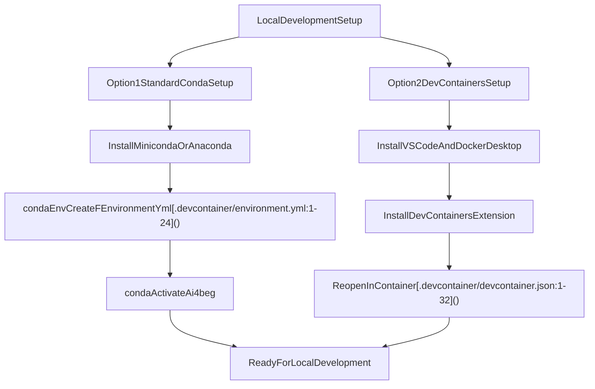

Sources: [.devcontainer/devcontainer.json:1-32](), [.devcontainer/environment.yml:1-24](), [requirements.txt:1-21]()

## Option 1: Standard Conda Setup

To set up the `ai4beg` environment manually on a host machine:

1. Clone the repository and navigate to its root directory:
   ```bash
   git clone https://github.com/microsoft/AI-For-Beginners.git
   cd AI-For-Beginners
   ```

2. Create the conda environment using `.devcontainer/environment.yml` [.devcontainer/environment.yml:1-24]():
   ```bash
   conda env create -f .devcontainer/environment.yml
   ```

3. Activate the environment [.devcontainer/environment.yml:1]():
   ```bash
   conda activate ai4beg
   ```

Sources: [.devcontainer/environment.yml:1-24]()

## Option 2: VS Code Dev Containers

The repository provides a complete containerized development setup under `.devcontainer/` containing a `devcontainer.json` configuration [,.devcontainer/devcontainer.json:1-32]() and a custom `Dockerfile` [.devcontainer/Dockerfile:1-20]().

### Configuration Breakdown

- **Base Image:** Built on `mcr.microsoft.com/vscode/devcontainers/miniconda:0-3` [.devcontainer/Dockerfile:1]().
- **Host Requirements:** Configured to allocate a minimum of 2 CPU cores [.devcontainer/devcontainer.json:4-6]().
- **Post-Creation Command:** Automatically updates `conda` and creates the environment using `conda update conda -y && conda env create -f environment.yml` [.devcontainer/devcontainer.json:30]().
- **Python Interpreter:** Defaults to `/opt/conda/bin/python` [.devcontainer/devcontainer.json:10]().
- **VS Code Extensions:** Automatically installs `ms-python.python` and `ms-python.vscode-pylance` [.devcontainer/devcontainer.json:23-26]().

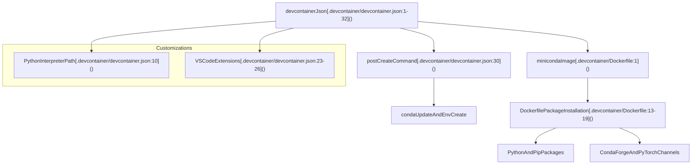

Sources: [.devcontainer/devcontainer.json:1-32](), [.devcontainer/Dockerfile:1-20]()

## Dependency Management and Framework Stack

The environment relies on a layered dependency stack combining `conda` channels (`defaults`, `conda-forge`, `pytorch`) with pip requirements.

### Core Environment Specification (`environment.yml`)

The main conda environment configuration specifies key scientific and deep learning packages:
- **Python & Core Tools:** `python`, `pip`, `ipykernel`, `ipython`, `ipywidgets`, `jupyter` [.devcontainer/environment.yml:6-12]()
- **Scientific Computing:** `matplotlib=3.9`, `numpy=1.26`, `scipy=1.13`, `scikit-learn`, `requests=2.32` [.devcontainer/environment.yml:10-15]()
- **Computer Vision & Frameworks:** `conda-forge::opencv`, `pytorch::pytorch`, `pytorch::torchtext`, `pytorch::torchvision`, `pytorch::torchdata` [.devcontainer/environment.yml:17-22]()
- **Pip Requirements:** Extends environment packages using `.devcontainer/requirements.txt` [.devcontainer/environment.yml:23-24]()

Sources: [.devcontainer/environment.yml:1-24]()

### Python Pip Dependencies (`requirements.txt`)

Additional machine learning, NLP, and utility packages are installed via `.devcontainer/requirements.txt`:
```
gensim==4.3.3
gym==0.26.2
huggingface==0.0.1
imageio==2.35.0
keras==3.15.0
nltk==3.10.3
pandas==2.2.2
pillow==12.3.0
pygame==2.6.0
scikit-image==0.24.0
seaborn==0.13.2
smart-open==7.0.4
tensorboard-data-server==0.7.2
tensorflow-datasets==4.9.6
tensorflow-hub==0.16.1
tensorflow==2.17.0
tensorboard==2.17.1
tokenizers==0.20.0
torchinfo==1.8.0
tqdm==4.66.5
```
Sources: [.devcontainer/requirements.txt:1-21](), [requirements.txt:1-21]()

### Framework-Specific NLP Dependencies

For lessons focusing specifically on Natural Language Processing, dual-framework requirements are provided:

- **PyTorch Stack (`lessons/5-NLP/requirements-pytorch.txt`):**
  ```
  gensim>=4.3.0,<5
  huggingface==0.0.1
  matplotlib
  nltk==3.10.3
  numpy==1.22.0
  opencv-python==4.5.1.48
  Pillow==12.3.0
  scikit-learn
  scipy
  torch==2.13.0
  torchaudio==0.8.1
  torchinfo==0.0.8
  torchtext==0.9.1
  torchvision==0.9.1
  transformers==5.10.1
  ```
  Sources: [lessons/5-NLP/requirements-pytorch.txt:1-15]()

- **TensorFlow Stack (`lessons/5-NLP/requirements-tf.txt`):**
  ```
  gensim==3.8.3
  huggingface==0.0.1
  matplotlib
  nltk==3.10.3
  numpy==1.22.0
  opencv-python==4.5.1.48
  Pillow==12.3.0
  scikit-learn
  scipy
  TensorFlow
  TensorFlow_datasets
  TensorFlow_text
  transformers==5.10.1
  ```
  Sources: [lessons/5-NLP/requirements-tf.txt:1-13]()

## Troubleshooting

- **Conda Environment Creation Hangs/Failures:** If environment resolution hangs, update conda prior to creating the environment [.devcontainer/devcontainer.json:30]():
  ```bash
  conda update conda -y
  conda env create -f .devcontainer/environment.yml
  ```
- **GPU Acceleration:** Ensure NVIDIA CUDA toolkit and compatible drivers are installed on the host if training deep neural networks locally.

Sources: [.devcontainer/devcontainer.json:30]()

---

# Page: Cloud Development Options

# Cloud Development Options

<details>
<summary>Relevant source files</summary>

The following files were used as context for generating this wiki page:

- [.devcontainer/Dockerfile](.devcontainer/Dockerfile)
- [.devcontainer/add-notice.sh](.devcontainer/add-notice.sh)
- [.devcontainer/devcontainer.json](.devcontainer/devcontainer.json)
- [.devcontainer/environment.yml](.devcontainer/environment.yml)
- [.devcontainer/requirements.txt](.devcontainer/requirements.txt)
- [binder/environment.yml](binder/environment.yml)
- [binder/requirements.txt](binder/requirements.txt)
- [environment.yml](environment.yml)
- [lessons/0-course-setup/for-teachers.md](lessons/0-course-setup/for-teachers.md)
- [lessons/0-course-setup/how-to-run.md](lessons/0-course-setup/how-to-run.md)
- [lessons/0-course-setup/setup.md](lessons/0-course-setup/setup.md)
- [lessons/4-ComputerVision/12-Segmentation/lab/BodySegmentation.ipynb](lessons/4-ComputerVision/12-Segmentation/lab/BodySegmentation.ipynb)
- [lessons/5-NLP/14-Embeddings/torchnlp.py](lessons/5-NLP/14-Embeddings/torchnlp.py)
- [lessons/5-NLP/16-RNN/RNNPyTorch.ipynb](lessons/5-NLP/16-RNN/RNNPyTorch.ipynb)
- [lessons/5-NLP/16-RNN/torchnlp.py](lessons/5-NLP/16-RNN/torchnlp.py)
- [lessons/5-NLP/17-GenerativeNetworks/torchnlp.py](lessons/5-NLP/17-GenerativeNetworks/torchnlp.py)
- [lessons/5-NLP/18-Transformers/torchnlp.py](lessons/5-NLP/18-Transformers/torchnlp.py)
- [lessons/5-NLP/requirements-pytorch.txt](lessons/5-NLP/requirements-pytorch.txt)
- [lessons/5-NLP/requirements-tf.txt](lessons/5-NLP/requirements-tf.txt)
- [requirements.txt](requirements.txt)
- [translations/ur/CONTRIBUTING.md](translations/ur/CONTRIBUTING.md)
- [translations/ur/examples/README.md](translations/ur/examples/README.md)
- [translations/ur/lessons/0-course-setup/how-to-run.md](translations/ur/lessons/0-course-setup/how-to-run.md)
- [translations/ur/lessons/4-ComputerVision/08-TransferLearning/TransferLearningTF.ipynb](translations/ur/lessons/4-ComputerVision/08-TransferLearning/TransferLearningTF.ipynb)
- [translations/ur/lessons/5-NLP/README.md](translations/ur/lessons/5-NLP/README.md)
- [translations/zh-CN/CONTRIBUTING.md](translations/zh-CN/CONTRIBUTING.md)
- [translations/zh-CN/examples/README.md](translations/zh-CN/examples/README.md)
- [translations/zh-CN/lessons/0-course-setup/how-to-run.md](translations/zh-CN/lessons/0-course-setup/how-to-run.md)
- [translations/zh-CN/lessons/4-ComputerVision/08-TransferLearning/TransferLearningTF.ipynb](translations/zh-CN/lessons/4-ComputerVision/08-TransferLearning/TransferLearningTF.ipynb)
- [translations/zh-CN/lessons/5-NLP/README.md](translations/zh-CN/lessons/5-NLP/README.md)
- [translations/zh-MO/examples/README.md](translations/zh-MO/examples/README.md)
- [translations/zh-MO/lessons/0-course-setup/how-to-run.md](translations/zh-MO/lessons/0-course-setup/how-to-run.md)
- [translations/zh-MO/lessons/5-NLP/README.md](translations/zh-MO/lessons/5-NLP/README.md)

</details>


This page details the various cloud-based options for running the code examples in the AI-For-Beginners curriculum without requiring a local setup. These cloud environments provide ready-to-use configurations with all necessary dependencies pre-installed, making them ideal for beginners who want to start quickly without configuring a local development environment.

For information about setting up a local environment with required dependencies, see [Local Development Setup](#2.1).

Sources: [lessons/0-course-setup/how-to-run.md:75-81]()

## Available Cloud Options

Several cloud-based options are available for running the curriculum code, each with different advantages and use cases:

### Cloud Environment Types and Code Mapping

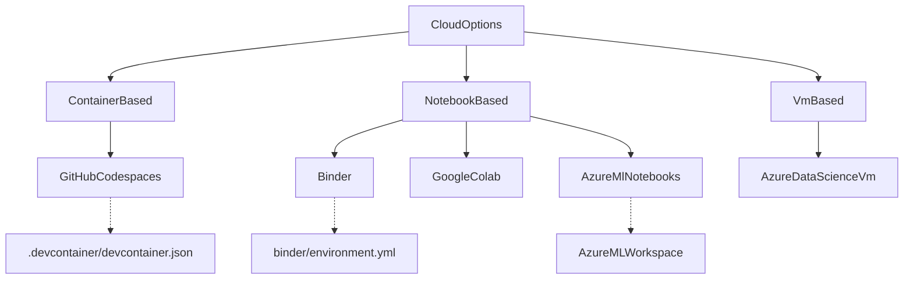
Sources: [lessons/0-course-setup/how-to-run.md:75-94](), [.devcontainer/devcontainer.json:1-32](), [binder/environment.yml:1-25]()

### GitHub Codespaces

GitHub Codespaces provides a fully configured development environment in the cloud, accessible through a browser-based VS Code interface.

**Setup:**
1. Navigate to the repository on GitHub
2. Click the "Code" button
3. Select "Open with Codespaces"
4. Create a new codespace

The environment is automatically configured using the `.devcontainer` settings in the repository (`[.devcontainer/devcontainer.json]()`), providing all necessary dependencies for the curriculum.

Sources: [lessons/0-course-setup/how-to-run.md:79-80](), [.devcontainer/devcontainer.json:1-32]()

### Binder

Binder is a free service that allows you to run Jupyter notebooks from GitHub repositories without any installation.

**Setup:**
1. Visit the Binder link for the repository: `https://mybinder.org/v2/gh/microsoft/ai-for-beginners/HEAD`
2. Wait for the environment to build using `binder/environment.yml` and `binder/requirements.txt`
3. Access the notebooks through the Jupyter interface

**Limitations:**
- Limited computing resources
- Some web resources may be blocked
- Sessions are not persistent

Sources: [lessons/0-course-setup/how-to-run.md:80-82](), [binder/environment.yml:1-25](), [binder/requirements.txt:1-22]()

### Azure Machine Learning

Azure Machine Learning provides cloud-based notebook environments with scalable computing resources.

**Setup:**
1. Create an Azure Machine Learning workspace
2. Use the Notebook feature to clone the repository
3. Run the notebooks in the Azure ML environment

This option is particularly useful for lessons that benefit from GPU acceleration.

Sources: [lessons/0-course-setup/how-to-run.md:92-93]()

### Azure Data Science Virtual Machine

Azure Data Science Virtual Machine (DSVM) provides a pre-configured VM with data science tools.

**Setup:**
1. Create a DSVM in Azure (NC-series for GPU support)
2. Connect to the VM via Jupyter
3. Clone the repository to the VM

Sources: [lessons/0-course-setup/how-to-run.md:88-90]()

### Google Colab

Google Colab offers free Jupyter notebooks with some GPU support.

**Setup:**
1. Upload individual notebooks to Google Colab
2. Configure the runtime to use GPU if needed

Sources: [lessons/0-course-setup/how-to-run.md:94]()

## Environment Configuration Files

Different cloud environments use specific configuration files from the repository to provision Python environments and package stacks:

### Configuration Mapping to Code Entities

```mermaid
graph TD
    CloudConfig["CloudConfiguration"] --> DevContainer["DevContainerConfig"]
    CloudConfig --> BinderConfig["BinderConfig"]
    
    DevContainer --> EnvYml[".devcontainer/environment.yml"]
    DevContainer --> ReqTxt[".devcontainer/requirements.txt"]
    
    BinderConfig --> BinderEnvYml["binder/environment.yml"]
    BinderConfig --> BinderReqTxt["binder/requirements.txt"]
    
    EnvYml --> CondaEnvSetup["conda env create -f environment.yml"]
    ReqTxt --> PipInstallReq["pip install -r requirements.txt"]
    
    BinderEnvYml --> BinderConda["CondaEnvSetupBinder"]
    BinderReqTxt --> BinderPip["PipInstallReqBinder"]
```
Sources: [.devcontainer/environment.yml:1-24](), [.devcontainer/requirements.txt:1-21](), [binder/environment.yml:1-25](), [binder/requirements.txt:1-22]()

### Codespaces Configuration

GitHub Codespaces uses the following files defined in the `.devcontainer` directory:
- `.devcontainer/environment.yml`: Conda environment definition (`ai4beg`)
- `.devcontainer/requirements.txt`: Additional pip packages (including `tensorflow==2.17.0`, `keras==3.15.0`, `gensim==4.3.3`)
- `.devcontainer/devcontainer.json`: Container orchestration and VS Code settings

Sources: [.devcontainer/devcontainer.json:1-32](), [.devcontainer/environment.yml:1-24](), [.devcontainer/requirements.txt:1-21]()

### Binder Configuration

Binder uses separate configuration files optimized for its build system:
- `binder/environment.yml`: Conda environment definition with specific version pins (`python=3.8.12`, `numpy=1.22.3`)
- `binder/requirements.txt`: Pip dependencies including `transformers==5.10.1` and `tensorflow==2.13.1`

Sources: [binder/environment.yml:1-25](), [binder/requirements.txt:1-22]()

## GPU Support in Cloud Environments

Some lessons, especially in Computer Vision and NLP sections, benefit significantly from GPU acceleration. The code automatically detects and uses GPU when available through standard PyTorch/TensorFlow device handles.

### Enabling GPU in Different Environments

| Environment | GPU Setup |
|-------------|-----------|
| GitHub Codespaces | Limited GPU availability, may require paid tier |
| Azure ML | Select GPU compute instance when configuring notebook |
| Azure DSVM | Choose NC-series VM with NVIDIA GPU |
| Google Colab | Runtime > Change runtime type > GPU |

**Note**: Some Azure subscriptions, including Azure for Students, may require additional support requests to enable GPU cores.

Sources: [lessons/0-course-setup/how-to-run.md:84-94]()

## Cloud Development Workflow

```mermaid
sequenceDiagram
    participant User
    participant GitHub as "GitHubRepository"
    participant Cloud as "CloudEnvironment"
    participant DevContainer as "devcontainer.json"
    participant BinderEnv as "binder/environment.yml"
    participant Notebook as "JupyterNotebook"
    
    User->>GitHub: "AccessRepository"
    
    alt GitHub Codespaces
        User->>GitHub: "StartCodespace"
        GitHub->>DevContainer: "ReadSettings"
        DevContainer->>Cloud: "BuildContainer"
    else Binder
        User->>GitHub: "ClickBinderLink"
        GitHub->>BinderEnv: "ReadBinderConfig"
        BinderEnv->>Cloud: "BuildBinderEnvironment"
    end
    
    Cloud->>Notebook: "InitializeJupyter"
    User->>Notebook: "OpenLessonNotebook"
    Notebook->>Cloud: "ExecutePythonCode"
    Cloud->>User: "DisplayResults"
```
Sources: [lessons/0-course-setup/how-to-run.md:75-81](), [.devcontainer/devcontainer.json:1-32](), [binder/environment.yml:1-25]()

## Comparison of Cloud Options

| Feature | GitHub Codespaces | Binder | Azure ML | DSVM | Google Colab |
|---------|-------------------|--------|----------|------|--------------|
| Cost | Free tier available | Free | Paid (Azure subscription) | Paid (Azure subscription) | Free tier available |
| Setup complexity | Low | Very low | Medium | Medium-High | Low |
| Persistence | Yes | No | Yes | Yes | Limited |
| GPU support | Limited | No | Yes | Yes | Limited |
| Environment | Full VS Code | Jupyter | Notebooks & compute | Full VM | Jupyter |
| Required account | GitHub | None | Azure | Azure | Google |

Sources: [lessons/0-course-setup/how-to-run.md:75-94]()

## Recommendations for Different Curriculum Sections

| Curriculum Section | Recommended Environment | GPU Beneficial? |
|-------------------|-------------------------|-----------------|
| Introduction to AI | Any cloud option | No |
| Symbolic AI | Any cloud option | No |
| Neural Networks | Any cloud option | No |
| Computer Vision | GPU-enabled option | Yes |
| NLP | GPU-enabled option | Yes |
| Other AI Techniques | Depends on specific lesson | Varies |

Note that while GPU acceleration makes training significantly faster, all examples can still run on CPU-only environments, just with longer training times.

Sources: [lessons/0-course-setup/how-to-run.md:75-94]()

## Troubleshooting Common Issues

### Binder Issues
- **Long build times**: Initial environment setup via `binder/environment.yml` can take several minutes.
- **Resource limitations**: Memory constraints may affect complex models (`binder/requirements.txt`).
- **Network restrictions**: Some external data sources might be blocked.

### GPU-related Issues
- **CUDA errors**: Ensure code is using correct device detection logic.
- **Memory errors**: Large models may exceed GPU memory limits.
- **Azure GPU allocation**: Some subscriptions require support requests to enable GPU resources.

Sources: [lessons/0-course-setup/how-to-run.md:82](), [binder/environment.yml:1-25]()

## Conclusion

Cloud development options provide flexibility and accessibility for working with the AI-For-Beginners curriculum. For beginners or quick exploration, Binder or Google Colab offer simplicity and free access. For more computation-intensive lessons, Azure ML or DSVM with GPU support provide better performance.

All code examples are designed to run in any Python environment configured via `.devcontainer/environment.yml` or `binder/environment.yml`, allowing you to switch between different cloud options or local development as needed.

Sources: [lessons/0-course-setup/how-to-run.md:75-94](), [.devcontainer/environment.yml:1-24](), [binder/environment.yml:1-25]()

---

# Page: Dependencies and Framework Stack

# Dependencies and Framework Stack

<details>
<summary>Relevant source files</summary>

The following files were used as context for generating this wiki page:

- [.devcontainer/Dockerfile](.devcontainer/Dockerfile)
- [.devcontainer/add-notice.sh](.devcontainer/add-notice.sh)
- [.devcontainer/devcontainer.json](.devcontainer/devcontainer.json)
- [.devcontainer/environment.yml](.devcontainer/environment.yml)
- [.devcontainer/requirements.txt](.devcontainer/requirements.txt)
- [binder/environment.yml](binder/environment.yml)
- [binder/requirements.txt](binder/requirements.txt)
- [environment.yml](environment.yml)
- [lessons/4-ComputerVision/12-Segmentation/lab/BodySegmentation.ipynb](lessons/4-ComputerVision/12-Segmentation/lab/BodySegmentation.ipynb)
- [lessons/5-NLP/14-Embeddings/torchnlp.py](lessons/5-NLP/14-Embeddings/torchnlp.py)
- [lessons/5-NLP/16-RNN/RNNPyTorch.ipynb](lessons/5-NLP/16-RNN/RNNPyTorch.ipynb)
- [lessons/5-NLP/16-RNN/torchnlp.py](lessons/5-NLP/16-RNN/torchnlp.py)
- [lessons/5-NLP/17-GenerativeNetworks/torchnlp.py](lessons/5-NLP/17-GenerativeNetworks/torchnlp.py)
- [lessons/5-NLP/18-Transformers/torchnlp.py](lessons/5-NLP/18-Transformers/torchnlp.py)
- [lessons/5-NLP/requirements-pytorch.txt](lessons/5-NLP/requirements-pytorch.txt)
- [lessons/5-NLP/requirements-tf.txt](lessons/5-NLP/requirements-tf.txt)
- [requirements.txt](requirements.txt)

</details>


This page documents the dependency management strategy and framework stack organization across the AI-For-Beginners curriculum. It covers the dual-framework architecture supporting both PyTorch and TensorFlow implementations, shared computational libraries, environment-specific dependency configurations, and NLP-specific utility modules.

For development environment setup procedures, see [Local Development Setup](#2.1) and [Cloud Development Options](#2.2). For implementation patterns using these dependencies, see [NLP Utilities and Implementation Patterns](#3.5.4).

## Overview of Dependency Architecture

The repository employs a layered dependency strategy managing multiple target environments, core scientific libraries, framework stacks, and domain-specific packages.

Title: Dependency Layer Architecture and Configuration Mapping
```mermaid
graph TB
    subgraph "Environment Configurations"
        DEVCONTAINER[".devcontainer/requirements.txt"]
        BINDER["binder/requirements.txt"]
        LESSON_NLP["lessons/5-NLP/requirements-pytorch.txt"]
        ROOT["requirements.txt"]
    end
    
    subgraph "Dependency Layers"
        BASE["Base Scientific Stack<br/>numpy, scipy, matplotlib<br/>scikit-learn, opencv, pandas"]
        PYTORCH["PyTorch Ecosystem<br/>torch, torchvision<br/>torchtext, torchdata, torchaudio"]
        TENSORFLOW["TensorFlow Ecosystem<br/>tensorflow, keras<br/>tensorflow-datasets<br/>tensorflow-hub, tensorflow-text"]
        SHARED_ML["Shared ML Libraries<br/>gensim, nltk, transformers<br/>huggingface, tokenizers"]
        DOMAIN["Domain-Specific<br/>gym, pygame, pillow<br/>imageio, seaborn"]
    end
    
    DEVCONTAINER --> BASE
    DEVCONTAINER --> PYTORCH
    DEVCONTAINER --> TENSORFLOW
    DEVCONTAINER --> SHARED_ML
    DEVCONTAINER --> DOMAIN
    
    BINDER --> BASE
    BINDER --> PYTORCH
    BINDER --> TENSORFLOW
    
    LESSON_NLP --> BASE
    LESSON_NLP -.PyTorch variant.-> PYTORCH
    LESSON_NLP -.TensorFlow variant.-> TENSORFLOW
    
    ROOT --> BASE
    ROOT --> PYTORCH
    ROOT --> TENSORFLOW
    ROOT --> SHARED_ML
    ROOT --> DOMAIN
```

**Dependency Management Strategy**

Sources: [.devcontainer/requirements.txt:1-21](), [.devcontainer/environment.yml:1-24](), [binder/requirements.txt:1-22](), [lessons/5-NLP/requirements-pytorch.txt:1-15](), [lessons/5-NLP/requirements-tf.txt:1-13]()

## Core Shared Dependencies

All curriculum implementations depend on a common scientific computing foundation installed via conda channels `defaults` and `conda-forge` [.devcontainer/environment.yml:1-5]():

| Package | Version (devcontainer) | Version (binder) | Purpose |
|---------|------------------------|------------------|---------|
| `numpy` | 1.26 [.devcontainer/environment.yml:11-11]() | 1.22.3 [binder/environment.yml:11-11]() | Array operations, numerical computation |
| `scipy` | 1.13 [.devcontainer/environment.yml:15-15]() | 1.6.2 [binder/environment.yml:15-15]() | Scientific algorithms, optimization |
| `matplotlib` | 3.9 [.devcontainer/environment.yml:10-10]() | 3.4.2 [binder/environment.yml:10-10]() | Visualization, plotting |
| `scikit-learn` | latest [.devcontainer/environment.yml:14-14]() | 0.24.2 [binder/environment.yml:14-14]() | Classical ML algorithms, preprocessing |
| `opencv` | conda-forge channel [.devcontainer/environment.yml:17-17]() | 4.5 [binder/environment.yml:17-17]() | Computer vision operations |
| `pandas` | 2.2.2 [.devcontainer/requirements.txt:7-7]() | 2.0.3 [binder/requirements.txt:7-7]() | Data manipulation, tabular data |
| `requests` | 2.32 [.devcontainer/environment.yml:13-13]() | 2.26.0 [binder/environment.yml:13-13]() | HTTP requests, dataset downloads |

**Installation Flow**

Title: Conda and Pip Installation Pipeline
```mermaid
graph LR
    CONDA["conda install<br/>base packages"] --> PIP["pip install<br/>-r requirements.txt"]
    
    subgraph "Conda Packages"
        BASE_CONDA["numpy, scipy<br/>matplotlib, scikit-learn<br/>opencv, pandas, requests"]
        JUPYTER["ipykernel, ipython<br/>ipywidgets, jupyter"]
    end
    
    subgraph "Pip Packages"
        FRAMEWORK["PyTorch/TensorFlow<br/>ecosystem packages"]
        SPECIALIZED["gensim, gym, nltk<br/>transformers, etc."]
    end
    
    CONDA --> BASE_CONDA
    CONDA --> JUPYTER
    PIP --> FRAMEWORK
    PIP --> SPECIALIZED
```

**Conda Environment Configuration**

The `environment.yml` defines the base conda environment named `ai4beg` [.devcontainer/environment.yml:1-5]():

```yaml
name: ai4beg
channels:
  - defaults
  - conda-forge
dependencies:
  - ipykernel, ipython, ipywidgets, jupyter
  - matplotlib, numpy, scipy, pandas, scikit-learn
  - requests, opencv, setuptools, pip
  - pytorch::pytorch, pytorch::torchtext, pytorch::torchvision, pytorch::torchdata
  - pip:
    - -r requirements.txt
```

Sources: [.devcontainer/environment.yml:1-24](), [binder/environment.yml:1-25]()

## PyTorch Framework Stack

PyTorch packages are installed via the `pytorch` conda channel and supplemented by pip requirements:

**Core PyTorch Packages**

| Package | Channel | Purpose |
|---------|---------|---------|
| `pytorch` | pytorch [.devcontainer/environment.yml:19-19]() | Core tensor operations, autograd, neural network modules |
| `torchvision` | pytorch [.devcontainer/environment.yml:21-21]() | Computer vision models, datasets, transformations |
| `torchtext` | pytorch [.devcontainer/environment.yml:20-20]() | NLP datasets, tokenization, vocabulary management |
| `torchdata` | pytorch [.devcontainer/environment.yml:22-22]() | Data loading utilities, iterators |
| `torchaudio` | pip [lessons/5-NLP/requirements-pytorch.txt:11-11]() | Audio processing, models (lesson-specific) |

**PyTorch Ecosystem Extensions**

Additional packages installed via pip complement the core stack:
- `torch==2.13.0` [lessons/5-NLP/requirements-pytorch.txt:10-10]() - Explicit version pinning in NLP lessons
- `torchvision==0.9.1` [lessons/5-NLP/requirements-pytorch.txt:14-14]() - Vision utilities
- `torchtext==0.9.1` [lessons/5-NLP/requirements-pytorch.txt:13-13]() - Text processing
- `torchaudio==0.8.1` [lessons/5-NLP/requirements-pytorch.txt:11-11]() - Audio processing
- `torchinfo==1.8.0` [.devcontainer/requirements.txt:19-19]() / `0.0.8` [lessons/5-NLP/requirements-pytorch.txt:12-12]() - Model architecture summaries

Sources: [.devcontainer/environment.yml:19-22](), [lessons/5-NLP/requirements-pytorch.txt:1-15]()

## TensorFlow Framework Stack

The TensorFlow stack provides parallel functionality to PyTorch with Google's framework and associated tools:

**Core TensorFlow Packages**

| Package | Version (devcontainer) | Version (binder) | Purpose |
|---------|------------------------|------------------|---------|
| `tensorflow` | 2.17.0 [.devcontainer/requirements.txt:16-16]() | 2.13.1 [binder/requirements.txt:17-17]() | Core framework, Keras API |
| `keras` | 3.15.0 [.devcontainer/requirements.txt:5-5]() | 3.15.0 [binder/requirements.txt:5-5]() | High-level neural network API |
| `tensorflow-datasets` | 4.9.6 [.devcontainer/requirements.txt:14-14]() | 4.9.2 [binder/requirements.txt:14-14]() | Standard datasets, data loading |
| `tensorflow-hub` | 0.16.1 [.devcontainer/requirements.txt:15-15]() | 0.16.1 [binder/requirements.txt:15-15]() | Pre-trained model repository |
| `tensorflow-text` | Not in devcontainer | 2.13.0 [binder/requirements.txt:16-16]() | Text processing operations |
| `tensorboard` | 2.17.1 [.devcontainer/requirements.txt:17-17]() | 2.13.0 [binder/requirements.txt:18-18]() | Visualization, experiment tracking |
| `tensorboard-data-server` | 0.7.2 [.devcontainer/requirements.txt:13-13]() | 0.7.2 [binder/requirements.txt:13-13]() | TensorBoard backend service |

Sources: [.devcontainer/requirements.txt:13-18](), [binder/requirements.txt:13-19]()

## NLP-Specific Dependencies and Implementation Patterns

Natural language processing lessons require specialized libraries that work with text data representation, tokenization, and vectorization.

**Text Processing and Embeddings**

| Package | Version | Framework Compatibility | Purpose |
|---------|---------|------------------------|---------|
| `gensim` | 4.3.3 [.devcontainer/requirements.txt:1-1]() (main), 3.8.3 [lessons/5-NLP/requirements-tf.txt:1-1]() (NLP tf) | Framework-agnostic | Word2Vec, GloVe, Doc2Vec embeddings |
| `nltk` | 3.10.3 [.devcontainer/requirements.txt:6-6]() | Framework-agnostic | Tokenization, corpora, linguistic data |
| `transformers` | 5.10.1 [binder/requirements.txt:22-22]() | PyTorch & TensorFlow | Hugging Face transformer models |
| `tokenizers` | 0.20.0 [.devcontainer/requirements.txt:18-18]() | Framework-agnostic | Fast tokenization library |
| `huggingface` | 0.0.1 [.devcontainer/requirements.txt:3-3]() | Framework-agnostic | Hugging Face Hub integration |
| `smart-open` | 7.0.4 [.devcontainer/requirements.txt:12-12]() | Framework-agnostic | Stream processing for large files |

Sources: [.devcontainer/requirements.txt:1-21](), [binder/requirements.txt:1-22](), [lessons/5-NLP/requirements-tf.txt:1-13]()

### NLP Utility Module Pattern (`torchnlp.py`)

The curriculum includes a shared utility module `torchnlp.py` duplicated across four NLP lessons. This modulebridges natural language requirements to specific python code functions.

Title: Bridging Natural Language Space to Code Entity Space (`torchnlp.py`)
```mermaid
graph TB
    subgraph "NaturalLanguageSpace"
        NL_LOAD["Dataset Loading & Vocabulary Building"]
        NL_ENCODE["Token-to-Index Conversion"]
        NL_TRAIN["Mini-batch Training Loops"]
        NL_PADDING["Sequence Padding & Offsetting"]
    end

    subgraph "CodeEntitySpace"
        LOAD_FN["load_dataset(ngrams, min_freq)<br/>lessons/5-NLP/14-Embeddings/torchnlp.py:12-24"]
        ENCODE_FN["encode(x, voc, unk, tokenizer)<br/>lessons/5-NLP/14-Embeddings/torchnlp.py:27-39"]
        TRAIN_FN["train_epoch() / train_epoch_emb()<br/>lessons/5-NLP/14-Embeddings/torchnlp.py:41-62,89-114"]
        PAD_FN["padify() / offsetify()<br/>lessons/5-NLP/14-Embeddings/torchnlp.py:64-87"]
    end

    NL_LOAD --> LOAD_FN
    NL_ENCODE --> ENCODE_FN
    NL_TRAIN --> TRAIN_FN
    NL_PADDING --> PAD_FN
```

**Key Functions in `torchnlp.py`**
- `load_dataset(ngrams=1, min_freq=1)` [lessons/5-NLP/14-Embeddings/torchnlp.py:12-24](): Loads `AG_NEWS` dataset via `torchtext.datasets.AG_NEWS` and builds vocabulary counters.
- `encode(x, voc=None, unk=0, tokenizer=tokenizer)` [lessons/5-NLP/14-Embeddings/torchnlp.py:27-39](): Converts raw text strings into token indices using string-to-index mappings (`stoi`).
- `train_epoch(net, dataloader, lr=0.01, ...)` [lessons/5-NLP/14-Embeddings/torchnlp.py:41-62]() / `train_epoch_emb()` [lessons/5-NLP/14-Embeddings/torchnlp.py:89-114](): Executes mini-batch gradient descent steps, forward passes, loss computation, and backpropagation.
- `padify(b, voc=None, tokenizer=tokenizer)` [lessons/5-NLP/14-Embeddings/torchnlp.py:64-75]() / `offsetify(b, voc=None)` [lessons/5-NLP/14-Embeddings/torchnlp.py:77-87](): Handles batch collation, dynamic padding to maximum sequence length within minibatches, and offset generation for embedding bags.

Sources: [lessons/5-NLP/14-Embeddings/torchnlp.py:1-115](), [lessons/5-NLP/16-RNN/torchnlp.py:1-115](), [lessons/5-NLP/17-GenerativeNetworks/torchnlp.py:1-115](), [lessons/5-NLP/18-Transformers/torchnlp.py:1-115]()

## Domain-Specific Dependencies

Additional packages support specific AI application domains beyond core ML functionality:

**Computer Vision Utilities**

| Package | Version | Purpose |
|---------|---------|---------|
| `pillow` | 12.3.0 [.devcontainer/requirements.txt:8-8]() | Image loading, manipulation |
| `imageio` | 2.35.0 [.devcontainer/requirements.txt:4-4]() | Image/video I/O, animation creation |
| `scikit-image` | 0.24.0 [.devcontainer/requirements.txt:10-10]() (main), 0.21.0 [binder/environment.yml:14-14]() (binder) | Image processing algorithms |
| `seaborn` | 0.13.2 [.devcontainer/requirements.txt:11-11]() | Statistical data visualization |

**Reinforcement Learning and Utilities**

| Package | Version | Purpose |
|---------|---------|---------|
| `gym` | 0.26.2 [.devcontainer/requirements.txt:2-2]() | OpenAI Gym environments for RL |
| `pygame` | 2.6.0 [.devcontainer/requirements.txt:9-9]() | Game environment rendering |
| `tqdm` | 4.66.5 [.devcontainer/requirements.txt:20-20]() | Progress bars for training loops |

Sources: [.devcontainer/requirements.txt:1-21]()

## Development Environment Installation

The Docker-based development container orchestrates dependency installation through a multi-stage process [.devcontainer/Dockerfile:1-19]():

Title: Dockerfile Installation Sequence and Code Mapping
```mermaid
graph LR
    BASE["mcr.microsoft.com/vscode/devcontainers/miniconda:0-3"] --> COPY["COPY .devcontainer/requirements.txt /tmp/conda-tmp/"]
    
    COPY --> CONDA_INSTALL["conda install -y -c conda-forge -c pytorch -c defaults"]
    
    subgraph "CodeEntitySpace"
        DOCKER_FILE[".devcontainer/Dockerfile:13-19"]
        ENV_FILE[".devcontainer/environment.yml:1-25"]
    end
    
    CONDA_INSTALL --> DOCKER_FILE
    DOCKER_FILE --> PIP_INSTALL["pip install --no-cache-dir -r /tmp/conda-tmp/requirements.txt"]
    PIP_INSTALL --> CLEANUP["rm -rf /tmp/conda-tmp"]
```

Sources: [.devcontainer/Dockerfile:1-25](), [.devcontainer/environment.yml:1-24]()

The Dockerfile explicitly installs packages directly to avoid conda environment solving bottlenecks [.devcontainer/Dockerfile:12-19]():

```dockerfile
RUN umask 0002 \
    && /opt/conda/bin/conda install -y -c conda-forge -c pytorch -c defaults \
        python pip ipykernel ipython ipywidgets jupyter matplotlib=3.9 numpy=1.26 \
        requests=2.32 scikit-learn scipy=1.13 opencv setuptools \
        pytorch torchtext torchvision torchdata \
    && /opt/conda/bin/pip install --no-cache-dir -r /tmp/conda-tmp/requirements.txt \
    && rm -rf /tmp/conda-tmp
```

Sources: [.devcontainer/Dockerfile:13-19]()

---

# Page: Standalone Beginner Examples

# Standalone Beginner Examples

<details>
<summary>Relevant source files</summary>

The following files were used as context for generating this wiki page:

- [examples/01-hello-ai-world.py](examples/01-hello-ai-world.py)
- [examples/02-simple-neural-network.py](examples/02-simple-neural-network.py)
- [examples/03-image-classifier.ipynb](examples/03-image-classifier.ipynb)
- [examples/04-text-sentiment.py](examples/04-text-sentiment.py)
- [examples/README.md](examples/README.md)

</details>


This document serves as technical documentation for the `examples/` directory within the AI-For-Beginners repository. The purpose of this page is to detail the four standalone beginner examples (`01-hello-ai-world.py`, `02-simple-neural-network.py`, `03-image-classifier.ipynb`, and `04-text-sentiment.py`), their execution prerequisites, difficulty progression, data flow, key code entities, and structural integration with the main 12-week curriculum.

Sources: `examples/README.md:1-4`

---

## 1. Examples Directory Overview and Difficulty Ladder

The `examples/` directory provides lightweight, self-contained artifacts designed to introduce foundational machine learning concepts before users engage with the full 24-lesson curriculum. The difficulty ladder spans from basic pure-Python mathematical pattern matching to deep learning model inference using standard frameworks.

| Example File | Description | Difficulty | Prerequisites |
|---|---|---|---|
| `01-hello-ai-world.py` | Simple linear pattern recognition ($y = 2x$) | Beginner ($\star$) | Python basics |
| `02-simple-neural-network.py` | Single-neuron implementation from scratch | Beginner+ ($\star\star$) | Python, basic math |
| `03-image-classifier.ipynb` | Pre-trained image classification via MobileNetV2 | Beginner+ ($\star\star$) | Python, `numpy`, `tensorflow` |
| `04-text-sentiment.py` | Text sentiment classification (positive/negative) | Beginner+ ($\star\star$) | Python, regular expressions |

Sources: `examples/README.md:5-13`

---

## 2. Prerequisites and Environment Setup

Execution of the examples requires Python 3.8 or higher. Dependencies can be installed using either a targeted `pip` installation or the project-wide `conda` environment configuration (`environment.yml`).

```bash
# Targeted pip installation for scripts and notebooks
pip install numpy jupyter pillow tensorflow
```

Alternatively, developers can provision the environment via Conda using the repository root configuration:

```bash
conda env create --name ai4beg --file ../environment.yml
conda activate ai4beg
```

Sources: `examples/README.md:16-34`

---

## 3. Core Implementation Deep Dive

### 3.1. Linear Pattern Recognition (`01-hello-ai-world.py`)

This script implements `SimpleAILearner`, which demonstrates foundational machine learning workflows: data ingestion, iterative weight adjustments via error minimization, and forward prediction.

*   **Key Classes and Methods**:
    *   `SimpleAILearner.__init__()`: Initializes weight to a random value using `random.uniform(0, 5)` and sets `learning_rate = 0.01` (`[examples/01-hello-ai-world.py:20-30]()`).
    *   `SimpleAILearner.predict(x)`: Evaluates input `x` against the internal weight (`[examples/01-hello-ai-world.py:32-42]()`).
    *   `SimpleAILearner.train(training_data, epochs)`: Iterates through epochs, calculates total error, and updates `self.weight` using the gradient approximation rule `self.weight += self.learning_rate * error * x` (`[examples/01-hello-ai-world.py:44-76]()`).

```mermaid
title "Data Flow: Hello AI World Training Loop"

graph TD
    A["TrainingDataInput"] -->|"(x, y_actual)"| B["SimpleAILearner.predict"]
    B -->|"y_predicted"| C["ErrorCalculation"]
    C -->|"error = y_actual - y_predicted"| D["WeightUpdate"]
    D -->|"self.weight += lr * error * x"| B
    
    sub: "Code Entities"
    classDef codeStyle fill:#f9f,stroke:#333,stroke-width:2px;
    class B,C,D codeStyle
```
Sources: `examples/01-hello-ai-world.py:18-76`, `examples/README.md:9`

### 3.2. Simple Neural Network from Scratch (`02-simple-neural-network.py`)

This script constructs a single-layer artificial neuron without relying on external machine learning frameworks, utilizing pure Python and `math`. It classifies 2D coordinate points relative to the line $y = x$.

*   **Key Functions and Classes**:
    *   `sigmoid(x)`: Implements the activation function with numerical stability bounds (`[examples/02-simple-neural-network.py:20-40]()`).
    *   `sigmoid_derivative(x)`: Calculates the derivative of the sigmoid output for backpropagation (`[examples/02-simple-neural-network.py:43-54]()`).
    *   `SimpleNeuron.__init__(num_inputs)`: Assigns random weights and bias (`[examples/02-simple-neural-network.py:57-81]()`).
    *   `SimpleNeuron.feedforward(inputs)`: Performs dot product summation, adds bias, and applies `sigmoid` (`[examples/02-simple-neural-network.py:83-103]()`).
    *   `SimpleNeuron.train(inputs, target, learning_rate)`: Executes backpropagation by computing error deltas and updating weights/bias (`[examples/02-simple-neural-network.py:105-128]()`).

```mermaid
title "Bridge: Natural Language Concept to Code Entities in Neural Network"

graph TD
    NL_Concept["Forward Propagation Calculation"] -->|Implemented by| Code_Feedforward["SimpleNeuron.feedforward"]
    NL_Activation["Squashing Output to 0-1"] -->|Implemented by| Code_Sigmoid["sigmoid"]
    NL_Learning["Backpropagation Weight Delta"] -->|Implemented by| Code_Train["SimpleNeuron.train"]
    NL_Derivative["Gradient Factor"] -->|Implemented by| Code_Deriv["sigmoid_derivative"]

    classDef default stroke:#333,stroke-width:1px;
```
Sources: `examples/02-simple-neural-network.py:20-128`, `examples/README.md:10`

### 3.3. Image Classification (`03-image-classifier.ipynb`)

This Jupyter notebook demonstrates transfer learning by downloading and executing inference using TensorFlow's pre-trained `MobileNetV2` model trained on the ImageNet dataset.

*   **Key Functions and Operations**:
    *   Model Initialization: Loads `MobileNetV2` with `weights='imagenet'` and `include_top=True` (`[examples/03-image-classifier.ipynb:74-77]()`).
    *   `load_image_from_url(url)`: Fetches image binary content via `requests.get` and wraps it in a PIL Image (`[examples/03-image-classifier.ipynb:98-110]()`).
    *   `prepare_image(img)`: Resizes images to `224x224`, converts them to a numpy array, expands dimensions for batching, and applies `preprocess_input` (`[examples/03-image-classifier.ipynb:113-141]()`).
    *   `classify_image(img)`: Predicts class probabilities and decodes top-5 categories using `decode_predictions` (`[examples/03-image-classifier.ipynb:144-167]()`).

Sources: `examples/03-image-classifier.ipynb:43-167`, `examples/README.md:11`

### 3.4. Text Sentiment Analysis (`04-text-sentiment.py`)

This script implements a lexicon-based sentiment analyzer that computes polarity scores for words based on labeled text corpora.

*   **Key Classes and Methods**:
    *   `SimpleSentimentAnalyzer.__init__()`: Initializes an empty `self.word_scores` dictionary (`[examples/04-text-sentiment.py:19-34]()`).
    *   `SimpleSentimentAnalyzer.preprocess_text(text)`: Lowercases text, strips non-alphabetical characters using regular expressions (`re.sub`), tokenizes words, and filters out words shorter than 3 characters (`[examples/04-text-sentiment.py:35-62]()`).
    *   `SimpleSentimentAnalyzer.train(training_data)`: Counts token frequencies across positive and negative review classes and computes smoothed word sentiment polarity scores (`[examples/04-text-sentiment.py:64-111]()`).
    *   `SimpleSentimentAnalyzer.analyze(text)`: Computes average sentiment scores across tokens to classify input strings into positive or negative categories with a confidence percentage (`[examples/04-text-sentiment.py:112-147]()`).

```mermaid
title "Bridge: Natural Language Sentiment Space to Code Entities"

graph TD
    NL_Cleaning["Text Tokenization and Cleaning"] -->|Executed by| Code_Preprocess["SimpleSentimentAnalyzer.preprocess_text"]
    NL_Frequency["Corpus Word Counting"] -->|Executed by| Code_Train["SimpleSentimentAnalyzer.train"]
    NL_Scoring["Polarity Score Calculation"] -->|Executed by| Code_WordScores["self.word_scores"]
    NL_Inference["Sentiment Prediction"] -->|Executed by| Code_Analyze["SimpleSentimentAnalyzer.analyze"]

    classDef default stroke:#333,stroke-width:1px;
```
Sources: `examples/04-text-sentiment.py:19-147`, `examples/README.md:12`

---

## 4. Curriculum Integration and Learning Path

The standalone examples bridge the gap between absolute beginner concepts and the modular multi-week curriculum:

1.  **Introduction to AI (`lessons/1-Intro/`)**: Aligns with `01-hello-ai-world.py`, introducing basic input-output mapping and numeric prediction.
2.  **Neural Networks Foundations (`lessons/3-NeuralNetworks/`)**: Direct conceptual precursor to `02-simple-neural-network.py`, exploring activation functions and backpropagation from scratch.
3.  **Computer Vision (`lessons/4-ComputerVision/`)**: Direct foundation for `03-image-classifier.ipynb`, introducing transfer learning and image preprocessing pipelines.
4.  **Natural Language Processing (`lessons/5-NLP/`)**: Precursor to `04-text-sentiment.py`, establishing tokenization and feature extraction fundamentals.

Sources: `examples/README.md:47-70`

---

# Page: Curriculum Content

# Curriculum Content

<details>
<summary>Relevant source files</summary>

The following files were used as context for generating this wiki page:

- [.gitignore](.gitignore)
- [README.md](README.md)
- [etc/Mindmap.html](etc/Mindmap.html)
- [etc/Mindmap.md](etc/Mindmap.md)
- [etc/Mindmap.svg](etc/Mindmap.svg)
- [lessons/4-ComputerVision/11-ObjectDetection/README.md](lessons/4-ComputerVision/11-ObjectDetection/README.md)
- [lessons/4-ComputerVision/11-ObjectDetection/lab/README.md](lessons/4-ComputerVision/11-ObjectDetection/lab/README.md)
- [lessons/4-ComputerVision/12-Segmentation/README.md](lessons/4-ComputerVision/12-Segmentation/README.md)
- [lessons/4-ComputerVision/12-Segmentation/SemanticSegmentationPytorch.ipynb](lessons/4-ComputerVision/12-Segmentation/SemanticSegmentationPytorch.ipynb)
- [lessons/4-ComputerVision/12-Segmentation/SemanticSegmentationTF.ipynb](lessons/4-ComputerVision/12-Segmentation/SemanticSegmentationTF.ipynb)
- [lessons/4-ComputerVision/README.md](lessons/4-ComputerVision/README.md)
- [lessons/5-NLP/13-TextRep/README.md](lessons/5-NLP/13-TextRep/README.md)
- [lessons/5-NLP/13-TextRep/TextRepresentationPyTorch.ipynb](lessons/5-NLP/13-TextRep/TextRepresentationPyTorch.ipynb)
- [lessons/5-NLP/13-TextRep/assignment.md](lessons/5-NLP/13-TextRep/assignment.md)
- [lessons/5-NLP/14-Embeddings/EmbeddingsPyTorch.ipynb](lessons/5-NLP/14-Embeddings/EmbeddingsPyTorch.ipynb)
- [lessons/5-NLP/14-Embeddings/README.md](lessons/5-NLP/14-Embeddings/README.md)
- [lessons/5-NLP/14-Embeddings/assignment.md](lessons/5-NLP/14-Embeddings/assignment.md)
- [lessons/5-NLP/15-LanguageModeling/CBoW-TF.ipynb](lessons/5-NLP/15-LanguageModeling/CBoW-TF.ipynb)
- [lessons/5-NLP/15-LanguageModeling/README.md](lessons/5-NLP/15-LanguageModeling/README.md)
- [lessons/5-NLP/15-LanguageModeling/lab/README.md](lessons/5-NLP/15-LanguageModeling/lab/README.md)
- [lessons/5-NLP/16-RNN/RNNTF.ipynb](lessons/5-NLP/16-RNN/RNNTF.ipynb)
- [lessons/5-NLP/16-RNN/assignment.md](lessons/5-NLP/16-RNN/assignment.md)
- [lessons/5-NLP/17-GenerativeNetworks/GenerativePyTorch.ipynb](lessons/5-NLP/17-GenerativeNetworks/GenerativePyTorch.ipynb)
- [lessons/5-NLP/17-GenerativeNetworks/GenerativeTF.ipynb](lessons/5-NLP/17-GenerativeNetworks/GenerativeTF.ipynb)
- [lessons/5-NLP/17-GenerativeNetworks/README.md](lessons/5-NLP/17-GenerativeNetworks/README.md)
- [lessons/5-NLP/17-GenerativeNetworks/lab/README.md](lessons/5-NLP/17-GenerativeNetworks/lab/README.md)
- [lessons/5-NLP/20-LangModels/GPT-PyTorch.ipynb](lessons/5-NLP/20-LangModels/GPT-PyTorch.ipynb)
- [lessons/5-NLP/20-LangModels/README.md](lessons/5-NLP/20-LangModels/README.md)
- [lessons/5-NLP/README.md](lessons/5-NLP/README.md)
- [lessons/6-Other/22-DeepRL/README.md](lessons/6-Other/22-DeepRL/README.md)
- [lessons/7-Ethics/README.md](lessons/7-Ethics/README.md)

</details>


## Purpose and Scope

This document provides an overview of the main learning content areas in the `https://github.com/microsoft/AI-For-Beginners` curriculum. It describes how the 24 lessons are organized across knowledge domains, the progression from fundamentals to advanced topics, and links to the detailed child pages.

Sources: [README.md:15-21](), [README.md:61-71]()

---

## 3.1. Introduction to AI

The curriculum begins with foundational concepts in artificial intelligence, covering its history, core definitions, the Turing Test, and contrasting philosophical approaches (symbolic, neural, evolutionary, and emergent). For details, see [Introduction to AI](#3.1).

Sources: [README.md:61-69](), [etc/Mindmap.md:3-12]()

---

## 3.2. Symbolic AI

Symbolic AI (GOFAI) covers early approaches to artificial intelligence based on explicit knowledge representation, expert systems (`lessons/2-Symbolic/Animals.ipynb`), ontologies (`lessons/2-Symbolic/FamilyOntology.ipynb`), semantic web, and production rules. For details, see [Symbolic AI](#3.2).

Sources: [README.md:65-67](), [etc/Mindmap.md:13-18]()

---

## 3.3. Neural Networks Foundations

Lessons 3 through 5 introduce neural network fundamentals, including perceptron implementation, custom frameworks, backpropagation, gradient descent, and introduction to `PyTorch` and `TensorFlow` frameworks (`lessons/3-NeuralNetworks/05-Frameworks/IntroPyTorch.ipynb`).

```mermaid
graph TB
    subgraph "Natural Language Space: Neural Networks"
        NS1["Perceptron Model"] --> NS2["Multi-Layer Framework"] --> NS3["Deep Learning Frameworks"]
    end
    
    subgraph "Code Entity Space: Implementation Classes"
        CE1["Perceptron.ipynb<br/>lessons/3-NeuralNetworks/03-Perceptron/"] --> CE2["OwnFramework.ipynb<br/>lessons/3-NeuralNetworks/04-OwnFramework/"]
        CE2 --> CE3["IntroPyTorch.ipynb<br/>IntroKerasTF.ipynb<br/>lessons/3-NeuralNetworks/05-Frameworks/"]
    end
    
    NS1 -.-> CE1
    NS2 -.-> CE2
    NS3 -.-> CE3
```
Sources: [README.md:67-68](), [etc/Mindmap.md:19-25]()

For details, see [Neural Networks Foundations](#3.3).

Sources: [README.md:67-68](), [etc/Mindmap.md:19-25]()

---

## 3.4. Computer Vision

Lessons 6 through 12 cover computer vision techniques using OpenCV, convolutional neural networks (CNNs), transfer learning (`lessons/4-ComputerVision/08-TransferLearning/README.md`), adversarial examples, autoencoders, GANs, object detection, and semantic segmentation (`lessons/4-ComputerVision/12-Segmentation/SemanticSegmentationTF.ipynb`). For details, see [Computer Vision](#3.4).

Sources: [README.md:68-69](), [etc/Mindmap.md:27-41]()

---

## 3.5. Natural Language Processing

Lessons 13 through 20 cover the full NLP pipeline from traditional text representation to modern transformer architectures and large language models (`lessons/5-NLP/20-LangModels/GPT-PyTorch.ipynb`).

```mermaid
graph TB
    subgraph "Natural Language Space: NLP Pipeline"
        NLP1["Text Representation"] --> NLP2["Word Embeddings"] --> NLP3["Language Modeling"] --> NLP4["Recurrent Networks"] --> NLP5["Transformers"]
    end
    
    subgraph "Code Entity Space: Python Modules & Notebooks"
        CE_NLP1["TextRepresentationPyTorch.ipynb<br/>TextRepresentationTF.ipynb"] --> CE_NLP2["EmbeddingsPyTorch.ipynb<br/>torchnlp.py load_dataset()"]
        CE_NLP2 --> CE_NLP3["CBoW-PyTorch.ipynb<br/>CBoW-TF.ipynb"]
        CE_NLP3 --> CE_NLP4["RNNPyTorch.ipynb<br/>RNNTF.ipynb"]
        CE_NLP4 --> CE_NLP5["TransformersPyTorch.ipynb<br/>GPT-PyTorch.ipynb"]
    end
    
    NLP1 -.-> CE_NLP1
    NLP2 -.-> CE_NLP2
    NLP3 -.-> CE_NLP3
    NLP4 -.-> CE_NLP4
    NLP5 -.-> CE_NLP5
```
Sources: [lessons/5-NLP/README.md:58-66](), [lessons/5-NLP/14-Embeddings/EmbeddingsPyTorch.ipynb:44-51]()

For details, see [Natural Language Processing](#3.5).

Sources: [README.md:68-69](), [lessons/5-NLP/README.md:5-23]()

---

## 3.6. Multimodal AI

Multimodal AI explores systems that bridge vision and language, such as the `CLIP` architecture (`lessons/X-Extras/X1-MultiModal/Clip.ipynb`), zero-shot classification, VQGAN+CLIP for text-to-image generation, and multimodal learning approaches. For details, see [Multimodal AI](#3.6).

Sources: [README.md:68-69](), [etc/Mindmap.md:69-73]()

---

## 3.7. Reinforcement Learning

Lesson 22 introduces Deep Reinforcement Learning using OpenAI Gym (`lessons/6-Other/22-DeepRL/README.md`), CartPole environments, policy gradients, Q-learning, state discretization, and actor-critic architectures. For details, see [Reinforcement Learning](#3.7).

Sources: [README.md:68-70](), [lessons/6-Other/22-DeepRL/README.md:1-77]()

---

## 3.8. Other AI Techniques

Lessons 21 and 23 cover alternative paradigms such as genetic algorithms (crossover, mutation, fitness) and multi-agent systems (NetLogo, emergent behavior, evolutionary optimization). For details, see [Other AI Techniques](#3.8).

Sources: [README.md:70-71](), [etc/Mindmap.md:62-65]()

---

## 3.9. AI Ethics

Lesson 24 addresses responsible AI principles, fairness, bias mitigation, transparency, accountability, privacy, and the Responsible AI Toolbox (`lessons/7-Ethics/README.md`). For details, see [AI Ethics](#3.9).

Sources: [README.md:21-21](), [lessons/7-Ethics/README.md:11-34]()

---

# Page: Introduction to AI

# Introduction to AI

<details>
<summary>Relevant source files</summary>

The following files were used as context for generating this wiki page:

- [etc/CODE_OF_CONDUCT.md](etc/CODE_OF_CONDUCT.md)
- [etc/SUPPORT.md](etc/SUPPORT.md)
- [etc/TRANSLATIONS.md](etc/TRANSLATIONS.md)
- [lessons/1-Intro/README.md](lessons/1-Intro/README.md)
- [lessons/1-Intro/translations/README.ja.md](lessons/1-Intro/translations/README.ja.md)

</details>


## Purpose and Scope

This document covers the foundational concepts of Artificial Intelligence presented in Lessons 1-2 of the curriculum, including:

- Core AI definitions and the distinction between tasks that can and cannot be explicitly programmed
- Classification of AI systems (Weak AI vs Strong AI)
- The Turing Test as a measure of machine intelligence
- Different approaches to building intelligent systems (symbolic reasoning, neural networks, evolutionary, emergent)
- Historical evolution of AI from symbolic systems to modern deep learning
- Recent achievements in neural network-based AI

For implementation details of neural network foundations, see [Neural Networks Foundations](#3.3). For symbolic AI implementation patterns including knowledge representation and expert systems, see [Symbolic AI](#3.2).

**Sources**: [lessons/1-Intro/README.md:1-10](), [lessons/2-Symbolic/README.md:1-20]()

## What is Artificial Intelligence

AI is defined as making computers exhibit intelligent behavior—performing tasks that humans are naturally good at but which cannot be explicitly programmed through algorithmic steps. The fundamental challenge is that some cognitive tasks lack clear procedural descriptions.

```mermaid
graph TB
    ProgrammableTasks["Programmable Tasks<br/>(Algorithmic)"]
    NonProgrammable["Non-Programmable Tasks<br/>(AI Domain)"]
    
    ProgrammableTasks --> Example1["Mathematical calculations<br/>Following explicit rules"]
    NonProgrammable --> Example2["Age determination from photo<br/>Natural language understanding<br/>Image classification"]
    
    Example2 --> AIApproach["AI Approach Required:<br/>Learn from data rather than<br/>explicit programming"]
```

The classic example: determining a person's age from a photograph is a task humans perform intuitively, but we cannot write explicit algorithmic steps for a computer to follow. This represents the core domain where AI techniques are necessary.

**Sources**: [lessons/1-Intro/README.md:9-22]()

## AI Classification: Weak vs Strong

```mermaid
graph LR
    AI["Artificial Intelligence"]
    
    AI --> WeakAI["Weak AI<br/>(Narrow AI)"]
    AI --> StrongAI["Strong AI<br/>(AGI)"]
    
    WeakAI --> WeakChar["- Task-specific<br/>- No consciousness<br/>- Current systems"]
    WeakAI --> WeakEx["Examples:<br/>Siri, Alexa<br/>Recommendation systems<br/>Chatbots"]
    
    StrongAI --> StrongChar["- Human-level intelligence<br/>- General problem solving<br/>- Self-awareness<br/>- Theoretical concept"]
    StrongAI --> StrongGoal["Long-term research goal<br/>Not yet achieved"]
```

| Aspect | Weak AI | Strong AI (AGI) |
|--------|---------|----------------|
| **Scope** | Specific tasks or narrow domains | Any intellectual task humans can do |
| **Intelligence** | Specialized, not generally intelligent | Human-level understanding across domains |
| **Consciousness** | No understanding or self-awareness | Possesses consciousness/self-awareness |
| **Current Status** | Widely deployed (assistants, recommendations) | Theoretical concept, not achieved |
| **Examples** | Virtual assistants, streaming recommendations, specialized chatbots | Future AI with reasoning and adaptation across unlimited contexts |

**Sources**: [lessons/1-Intro/README.md:25-34]()

## Intelligence Definition and Turing Test

The concept of intelligence itself lacks a clear definition, making "intelligent machines" a philosophically ambiguous goal. Alan Turing proposed an operational test: if a human interrogator cannot distinguish a machine from a human in text-based dialogue, the machine demonstrates intelligence.

```mermaid
graph TB
    TuringTest["Turing Test"]
    
    TuringTest --> Setup["Setup:<br/>Human interrogator<br/>Text-based dialogue<br/>Hidden participants"]
    
    Setup --> Participant1["Participant A:<br/>Real human"]
    Setup --> Participant2["Participant B:<br/>Computer system"]
    
    Participant1 --> Interrogator["Human Interrogator"]
    Participant2 --> Interrogator
    
    Interrogator --> Decision{"Can interrogator<br/>distinguish machine<br/>from human?"}
    
    Decision -->|No| PassTest["System passes<br/>Turing Test<br/>(demonstrates intelligence)"]
    Decision -->|Yes| FailTest["System fails test"]
    
    PassTest --> EugeneExample["Eugene Goostman (2014):<br/>30% of judges fooled<br/>5-minute dialogue<br/>Claimed to be 13-year-old<br/>Ukrainian boy"]
```

The Eugene Goostman chatbot came close to passing in 2014 by convincing 30% of judges it was a 13-year-old Ukrainian boy (explaining knowledge gaps and language discrepancies). However, this demonstrates clever personality engineering rather than true intelligence.

**Sources**: [lessons/1-Intro/README.md:35-54]()

## AI Approaches: Top-Down vs Bottom-Up

```mermaid
graph TB
    HumanIntelligence["Human Intelligence<br/>Decision Making"]
    
    HumanIntelligence --> TopDown["Top-Down Approach<br/>(Symbolic Reasoning)"]
    HumanIntelligence --> BottomUp["Bottom-Up Approach<br/>(Neural Networks)"]
    
    TopDown --> TopDownChar["Model reasoning process<br/>Extract knowledge from experts<br/>Represent as computer-readable rules<br/>Implement reasoning engine"]
    TopDown --> TopDownImpl["Knowledge Representation<br/>Expert Systems<br/>Production rules<br/>Ontologies"]
    TopDown --> TopDownFile["lessons/2-Symbolic/README.md<br/>Animals.ipynb<br/>FamilyOntology.ipynb"]
    
    BottomUp --> BottomUpChar["Model brain structure<br/>Large number of simple units (neurons)<br/>Learn from training data<br/>Weighted connections"]
    BottomUp --> BottomUpImpl["Perceptrons<br/>Multi-layer networks<br/>CNNs, RNNs<br/>Deep Learning"]
    BottomUp --> BottomUpFile["lessons/3-NeuralNetworks/<br/>lessons/4-ComputerVision/<br/>lessons/5-NLP/"]
```

### Top-Down (Symbolic Reasoning)

The symbolic approach models human reasoning by extracting knowledge and representing it in computer-readable form. Example: a doctor diagnosing based on rules:
- **IF** patient has high fever **OR** high C-reactive protein **THEN** inflammation present

Challenges:
- Knowledge extraction from experts is difficult
- Maintaining knowledge bases is expensive
- Limited scalability led to "AI Winter" in 1970s

Implementation examples: [lessons/2-Symbolic/Animals.ipynb](), [lessons/2-Symbolic/FamilyOntology.ipynb]()

**Sources**: [lessons/1-Intro/README.md:55-82](), [lessons/2-Symbolic/README.md:11-156]()

### Bottom-Up (Neural Networks)

Models the structure of biological brains using artificial neurons. Networks learn by processing training data rather than explicit programming. Like newborn learning from observations.

This approach dominates modern AI and is covered extensively in [Neural Networks Foundations](#3.3), [Computer Vision](#3.4), and [Natural Language Processing](#3.5).

**Sources**: [lessons/1-Intro/README.md:83-91]()

### Alternative Approaches

```mermaid
graph LR
    OtherApproaches["Other AI Approaches"]
    
    OtherApproaches --> Emergent["Emergent/Multi-Agent<br/>Complex behavior from<br/>simple agent interactions"]
    OtherApproaches --> Evolutionary["Evolutionary/Genetic<br/>Optimization based on<br/>evolution principles"]
    
    Emergent --> EmergentImpl["Covered in Lesson 23:<br/>Multi-Agent Systems<br/>NetLogo simulations"]
    Evolutionary --> EvolutionImpl["Covered in Lesson 21:<br/>Genetic Algorithms<br/>Crossover, mutation,<br/>fitness functions"]
```

- **Emergent/Synergetic/Multi-Agent**: Complex intelligent behavior emerges from interactions of simple agents. Based on evolutionary cybernetics where intelligence emerges through metasystem transitions.
- **Evolutionary/Genetic Algorithms**: Optimization using evolution principles (selection, crossover, mutation)

**Sources**: [lessons/1-Intro/README.md:67-72]()

## Historical Evolution of AI

```mermaid
graph TB
    Era1950["1950s-1970s:<br/>Symbolic AI Dominance"]
    AIWinter["1970s-1980s:<br/>AI Winter"]
    Era1990["1990s-2000s:<br/>Specialized Systems"]
    Era2010["2010s-Present:<br/>Deep Learning Revolution"]
    
    Era1950 --> Era1950Achieve["Expert systems<br/>Chess programs<br/>Alpha-beta pruning<br/>Case-based reasoning"]
    
    Era1950 --> AIWinter
    AIWinter --> AIWinterCause["Knowledge extraction<br/>too expensive<br/>Limited scalability"]
    
    AIWinter --> Era1990
    Era1990 --> Era1990Tech["More data available<br/>Cheaper compute<br/>Neural networks viable"]
    
    Era1990 --> Era2010
    Era2010 --> Era2010Trigger["ImageNet dataset (2012)<br/>14M annotated images<br/>ImageNet Challenge"]
    
    Era2010 --> Era2010Achieve["2012: CNNs for classification<br/>2015: Human-level accuracy<br/>2016: Speech recognition parity<br/>2018: Machine translation parity<br/>2020: Image captioning parity"]
    
    Era2010 --> Era2010Tech["BERT, GPT-3<br/>Large language models<br/>Pre-training + fine-tuning"]
```

### Chess as Evolution Example

The evolution of chess-playing programs illustrates the shift from symbolic to neural approaches:

1. **Early programs**: Alpha-beta pruning search—explicitly estimate opponent moves and select optimal position
2. **Intermediate**: Case-based reasoning—learn from human player matches, apply similar strategies
3. **Modern** (e.g., AlphaGo): Neural networks + reinforcement learning—self-play millions of games, learn from own mistakes

**Sources**: [lessons/1-Intro/README.md:93-108]()

### Natural Language Processing Evolution

```mermaid
graph LR
    NLP["NLP System Evolution"]
    
    NLP --> Early["Early: ELIZA<br/>Grammatical rules<br/>Sentence reformulation"]
    
    NLP --> Modern["Modern: Cortana, Siri,<br/>Google Assistant<br/>Hybrid systems"]
    
    NLP --> Future["Future: GPT, Turing-NLG<br/>End-to-end neural<br/>17B+ parameters"]
    
    Modern --> ModernArch["Speech → Text (Neural)<br/>Intent recognition (Neural)<br/>Action (Reasoning/Explicit)"]
```

- **Early systems**: Rule-based like ELIZA, using grammatical pattern matching
- **Current assistants**: Hybrid approach—neural networks for speech-to-text and intent recognition, combined with explicit algorithms for actions
- **Future direction**: End-to-end neural models like GPT family and Turing-NLG (17 billion parameters)

**Sources**: [lessons/1-Intro/README.md:111-116]()

## Recent Neural Network Achievements

| Year | Achievement | Reference |
|------|-------------|-----------|
| 2012 | CNNs reduce ImageNet classification error from 30% to 16.4% | First major breakthrough |
| 2015 | **Human-level image classification** (ResNet, Microsoft Research) | [lessons/1-Intro/README.md:129]() |
| 2016 | **Human parity: Conversational speech recognition** | [lessons/1-Intro/README.md:138]() |
| 2018 | **Human parity: Machine translation** (Chinese-English) | [lessons/1-Intro/README.md:139]() |
| 2020 | **Human parity: Image captioning** | [lessons/1-Intro/README.md:140]() |

### Key Enablers

The neural network revolution starting ~2010 was enabled by:

1. **Large public datasets**: ImageNet (14M annotated images) launched ImageNet Large Scale Visual Recognition Challenge
2. **Increased computational resources**: GPU availability for parallel processing
3. **Pre-training strategies**: Large language models trained on general text, then specialized for specific tasks

```mermaid
graph TB
    Revolution["Deep Learning Revolution<br/>(2010s)"]
    
    Revolution --> Data["Large Datasets<br/>ImageNet: 14M images<br/>Public text corpora"]
    Revolution --> Compute["GPU Computing<br/>Parallel processing<br/>Specialized hardware (TPU)"]
    Revolution --> Methods["Architectural Innovations<br/>CNNs, RNNs, Transformers<br/>Pre-training + fine-tuning"]
    
    Data --> Result["Human-level performance<br/>on specific tasks"]
    Compute --> Result
    Methods --> Result
    
    Result --> Applications["Image classification<br/>Speech recognition<br/>Machine translation<br/>Language understanding"]
```

**Sources**: [lessons/1-Intro/README.md:122-142]()

## Curriculum Structure and Materials

The introduction material consists of two lessons with hands-on exercises:

```mermaid
graph TB
    Lesson1["Lesson 1: Introduction to AI<br/>lessons/1-Intro/README.md"]
    Lesson2["Lesson 2: Symbolic AI<br/>lessons/2-Symbolic/README.md"]
    
    Lesson1 --> L1Quiz["Pre-quiz: quiz/101<br/>Post-quiz: quiz/102"]
    Lesson1 --> L1Assignment["Game Jam Assignment<br/>assignment.md"]
    
    Lesson2 --> L2Quiz["Pre-quiz: quiz/103<br/>Post-quiz: quiz/104"]
    Lesson2 --> L2Notebooks["Animals.ipynb<br/>FamilyOntology.ipynb<br/>MSConceptGraph.ipynb"]
    Lesson2 --> L2Assignment["Build Ontology<br/>assignment.md"]
    
    L2Notebooks --> AnimalInference["Expert system:<br/>Forward/backward inference<br/>AND-OR trees"]
    L2Notebooks --> FamilyOnt["Semantic web:<br/>GEDCOM family trees<br/>Relationship reasoning"]
    L2Notebooks --> ConceptGraph["Microsoft Concept Graph:<br/>is-a relationships<br/>News categorization"]
```

### Assessment System

Both lessons include pre- and post-lecture quizzes deployed as a Vue.js application:

- Quiz IDs follow pattern: `1XX` for pre-quiz, `2XX` for post-quiz where XX is lesson number
- Lesson 1: Quiz 101 (pre), Quiz 102 (post)
- Lesson 2: Quiz 103 (pre), Quiz 104 (post)
- Deployed at: `ff-quizzes.netlify.app`

For details on the quiz architecture, see [Assessment System](#4).

**Sources**: [lessons/1-Intro/README.md:7-9,148](), [lessons/2-Symbolic/README.md:9,235](), [etc/quiz-src/]()

### Key Exercises

**Lesson 2 Notebooks**:

1. **Animals.ipynb**: Implements forward and backward inference for an animal classification expert system using production rules and AND-OR trees
2. **FamilyOntology.ipynb**: Uses semantic web techniques (GEDCOM format + ontologies) to reason about family relationships
3. **MSConceptGraph.ipynb**: Demonstrates using Microsoft Concept Graph for entity categorization in news articles

These notebooks demonstrate the symbolic AI approach covered in Lesson 2, contrasting with the neural network approach that dominates later lessons.

**Sources**: [lessons/2-Symbolic/README.md:151-226]()

## Key Concepts Summary

| Concept | Description | Location |
|---------|-------------|----------|
| **Weak AI** | Task-specific systems without consciousness (current AI) | [lessons/1-Intro/README.md:27-32]() |
| **Strong AI (AGI)** | Human-level general intelligence (theoretical) | [lessons/1-Intro/README.md:29-34]() |
| **Turing Test** | Operational definition of machine intelligence via human indistinguishability | [lessons/1-Intro/README.md:49]() |
| **Symbolic Reasoning** | Top-down approach: extract knowledge, represent as rules | [lessons/1-Intro/README.md:63-82]() |
| **Neural Networks** | Bottom-up approach: model brain structure, learn from data | [lessons/1-Intro/README.md:83-91]() |
| **AI Winter** | Period (1970s) when symbolic AI limitations caused funding decline | [lessons/1-Intro/README.md:95]() |
| **Deep Learning** | Modern neural network approach enabled by large datasets and compute | [lessons/1-Intro/README.md:101-142]() |

**Sources**: [lessons/1-Intro/README.md:1-154]()

---

# Page: Symbolic AI

# Symbolic AI

<details>
<summary>Relevant source files</summary>

The following files were used as context for generating this wiki page:

- [lessons/2-Symbolic/Animals.ipynb](lessons/2-Symbolic/Animals.ipynb)
- [lessons/2-Symbolic/FamilyOntology.ipynb](lessons/2-Symbolic/FamilyOntology.ipynb)
- [lessons/2-Symbolic/MSConceptGraph.ipynb](lessons/2-Symbolic/MSConceptGraph.ipynb)
- [lessons/2-Symbolic/README.md](lessons/2-Symbolic/README.md)
- [lessons/3-NeuralNetworks/03-Perceptron/README.md](lessons/3-NeuralNetworks/03-Perceptron/README.md)
- [lessons/3-NeuralNetworks/04-OwnFramework/README.md](lessons/3-NeuralNetworks/04-OwnFramework/README.md)
- [lessons/3-NeuralNetworks/05-Frameworks/README.md](lessons/3-NeuralNetworks/05-Frameworks/README.md)
- [lessons/4-ComputerVision/07-ConvNets/CNN_Architectures.md](lessons/4-ComputerVision/07-ConvNets/CNN_Architectures.md)
- [lessons/4-ComputerVision/07-ConvNets/README.md](lessons/4-ComputerVision/07-ConvNets/README.md)
- [lessons/4-ComputerVision/08-TransferLearning/README.md](lessons/4-ComputerVision/08-TransferLearning/README.md)
- [lessons/4-ComputerVision/08-TransferLearning/TransferLearningTF.ipynb](lessons/4-ComputerVision/08-TransferLearning/TransferLearningTF.ipynb)
- [lessons/4-ComputerVision/09-Autoencoders/AutoEncodersPyTorch.ipynb](lessons/4-ComputerVision/09-Autoencoders/AutoEncodersPyTorch.ipynb)
- [lessons/4-ComputerVision/09-Autoencoders/AutoencodersTF.ipynb](lessons/4-ComputerVision/09-Autoencoders/AutoencodersTF.ipynb)
- [lessons/4-ComputerVision/09-Autoencoders/README.md](lessons/4-ComputerVision/09-Autoencoders/README.md)
- [lessons/4-ComputerVision/10-GANs/README.md](lessons/4-ComputerVision/10-GANs/README.md)
- [translations/et/.co-op-translator.json](translations/et/.co-op-translator.json)
- [translations/et/README.md](translations/et/README.md)
- [translations/et/lessons/2-Symbolic/MSConceptGraph.ipynb](translations/et/lessons/2-Symbolic/MSConceptGraph.ipynb)
- [translations/kn/README.md](translations/kn/README.md)
- [translations/kn/lessons/2-Symbolic/MSConceptGraph.ipynb](translations/kn/lessons/2-Symbolic/MSConceptGraph.ipynb)
- [translations/ml/README.md](translations/ml/README.md)
- [translations/ml/lessons/2-Symbolic/MSConceptGraph.ipynb](translations/ml/lessons/2-Symbolic/MSConceptGraph.ipynb)
- [translations/pcm/.co-op-translator.json](translations/pcm/.co-op-translator.json)
- [translations/pcm/README.md](translations/pcm/README.md)
- [translations/pcm/lessons/2-Symbolic/MSConceptGraph.ipynb](translations/pcm/lessons/2-Symbolic/MSConceptGraph.ipynb)
- [translations/te/.co-op-translator.json](translations/te/.co-op-translator.json)
- [translations/te/README.md](translations/te/README.md)
- [translations/te/lessons/2-Symbolic/MSConceptGraph.ipynb](translations/te/lessons/2-Symbolic/MSConceptGraph.ipynb)

</details>


This document provides a technical overview of the Symbolic AI approach in the AI-For-Beginners curriculum. While modern AI is often associated with neural networks and machine learning, symbolic AI represents an important historical and practical approach that focuses on explicit knowledge representation and reasoning. For information about neural network approaches, see [Neural Networks Foundations](#3.3).

## Purpose and Scope

This page explains Symbolic AI concepts and techniques, which represent a top-down approach to artificial intelligence based on explicit knowledge representation and logical reasoning. The core topics covered include:

- **DIKW Pyramid**: Framework for understanding data, information, knowledge, and wisdom
- **Knowledge Representation**: Techniques for encoding human knowledge in machine-readable formats
- **Production Rules**: If-then rule systems for automated reasoning
- **Expert Systems**: Computer systems that emulate human expert decision-making
- **Ontologies**: Formal specifications of domain knowledge and relationships
- **Semantic Web**: Internet-scale knowledge representation using RDF, RDFS, and OWL
- **Curriculum Notebooks**: Practical implementations in `Animals.ipynb`, `FamilyOntology.ipynb`, and `MSConceptGraph.ipynb`

Sources: [lessons/2-Symbolic/README.md:1-15]()

## The DIKW Pyramid

The DIKW (Data-Information-Knowledge-Wisdom) Pyramid provides a foundational framework for understanding how raw data transforms into actionable knowledge:

**DIKW Hierarchy**

```mermaid
graph TB
    Data["Data<br/>Physical representation<br/>Example: written text, spoken words"] 
    Info["Information<br/>Interpreted meaning<br/>Example: understanding what 'computer' means"]
    Knowledge["Knowledge<br/>Integrated world model<br/>Example: how computers work, cost, usage"]
    Wisdom["Wisdom<br/>Meta-knowledge<br/>Example: when and how to apply knowledge"]
    
    Data --> Info
    Info --> Knowledge
    Knowledge --> Wisdom
```

| Level | Definition | Example |
|-------|-----------|---------|
| **Data** | Something represented in physical media, exists independently of humans | Text "computer" in a book |
| **Information** | Interpretation of data in human mind | Understanding the concept of a computer |
| **Knowledge** | Information integrated into world model | Network of concepts: how computers work, their cost, applications |
| **Wisdom** | Meta-knowledge about when and how to use knowledge | Knowing when computer automation is appropriate |

Sources: [lessons/2-Symbolic/README.md:16-31]()

## Knowledge Representation Spectrum

Knowledge can be represented along a spectrum from computer-friendly to human-friendly formats:

**Knowledge Representation Complexity Spectrum**

```mermaid
flowchart LR
    Simple["Computer-Friendly<br/>Algorithmic"] --> Rules["Production<br/>Rules"]
    Rules --> Frames["Frame-Based<br/>Representations"]
    Frames --> Networks["Semantic<br/>Networks"]
    Networks --> Logic["Predicate<br/>Logic"]
    Logic --> NL["Natural<br/>Language"]
    NL --> Complex["Human-Friendly<br/>Flexible"]
```

The goal of knowledge representation is to find effective ways to represent knowledge in computer-readable form while maintaining sufficient expressiveness for the problem domain.

Sources: [lessons/2-Symbolic/README.md:32-42]()

## Knowledge Representation Methods

Symbolic AI systems use several distinct approaches to represent knowledge:

**Knowledge Representation Taxonomy**

```mermaid
graph TB
    KR["Knowledge Representation<br/>Methods"]
    
    KR --> Network["1. Network Representations<br/>Graph-based knowledge"]
    KR --> Hierarchical["2. Hierarchical Representations<br/>Structured object hierarchies"]
    KR --> Procedural["3. Procedural Representations<br/>Executable knowledge"]
    KR --> Logic["4. Logic-Based Representations<br/>Formal logical systems"]
    
    Network --> Triplets["Object-Attribute-Value<br/>Triplets"]
    Network --> Semantic["Semantic Networks<br/>Concept graphs"]
    
    Hierarchical --> Frames["Frames with Slots<br/>Default values & procedures"]
    Hierarchical --> Scenarios["Scenarios<br/>Temporal frame sequences"]
    
    Procedural --> Rules["Production Rules<br/>IF-THEN statements"]
    Procedural --> Algorithms["Algorithms<br/>Step-by-step procedures"]
    
    Logic --> Predicate["Predicate Logic<br/>Horn clauses (Prolog)"]
    Logic --> Description["Description Logic<br/>Semantic web (RDF/OWL)"]
```

Sources: [lessons/2-Symbolic/README.md:44-83]()

### Object-Attribute-Value Triplets

The simplest network representation uses triplets to express relationships. Example for programming languages:

| Object | Attribute | Value |
|--------|-----------|-------|
| Python | is | Untyped-Language |
| Python | invented-by | Guido van Rossum |
| Python | block-syntax | indentation |
| Untyped-Language | doesn't have | type definitions |

Sources: [lessons/2-Symbolic/README.md:50-58]()

### Frame Representations

Frames represent objects or classes as structured entities with slots. Example frame for Python:

| Slot | Value | Default Value | Interval |
|------|-------|---------------|----------|
| Name | Python | | |
| Is-A | Untyped-Language | | |
| Variable Case | | CamelCase | |
| Program Length | | | 5-5000 lines |
| Block Syntax | Indent | | |

Sources: [lessons/2-Symbolic/README.md:62-75]()

### Production Rules

Production rules are if-then statements that enable automated reasoning. They form the basis of expert systems. Example:

```
IF the animal eats meat
OR (animal has sharp teeth
    AND animal has claws
    AND animal has forward-looking eyes) 
THEN the animal is a carnivore
```

The working memory contains Object-Attribute-Value triplets representing the current problem state. A rules engine identifies applicable rules and applies them to derive new knowledge.

Sources: [lessons/2-Symbolic/README.md:76-83]()

## Expert Systems

Expert systems were one of the early successes of symbolic AI. They consist of a knowledge base extracted from human experts and an inference engine that performs reasoning based on this knowledge.

### Architecture

```mermaid
flowchart LR
    subgraph "Problem State"
        PM["Problem Memory (Static Knowledge)"]
    end
    
    subgraph "Expert System Components"
        IE["Inference Engine"] --> KB["Knowledge Base (Dynamic Knowledge)"]
        IE --> PM
    end
    
    subgraph "User Interface"
        UI["User Interface"] --> IE
    end
```

The architecture parallels human reasoning:

```mermaid
flowchart LR
    subgraph "Human System"
        STM["Short-Term Memory"] --> LTM["Long-Term Memory"]
        RP["Reasoning Process"] --> STM
        RP --> LTM
    end
    
    subgraph "Expert System"
        PM["Problem Memory"] --> KB["Knowledge Base"]
        IE["Inference Engine"] --> PM
        IE --> KB
    end
```

Sources: [lessons/2-Symbolic/README.md:84-97]()

### Inference Mechanisms

Expert systems employ two fundamental reasoning strategies:

**Forward Inference (Data-Driven Reasoning)**

Forward inference begins with known facts and applies rules to derive conclusions:

```mermaid
flowchart TD
    Start["1. Initialize working memory<br/>with known facts"] 
    --> CheckGoal["2. Is target attribute<br/>in working memory?"]
    
    CheckGoal -->|"Yes"| Done["Stop: Return result"]
    CheckGoal -->|"No"| FindRules["3. Find applicable rules<br/>(conflict set)"]
    
    FindRules --> Resolve["4. Conflict Resolution:<br/>- First applicable rule<br/>- Random selection<br/>- Most specific rule"]
    
    Resolve --> Apply["5. Apply selected rule"]
    Apply --> AddKnowledge["6. Insert new OAV triplet<br/>into working memory"]
    AddKnowledge --> CheckGoal
```

**Backward Inference (Goal-Driven Reasoning)**

Backward inference starts with a goal and works backward to determine required facts:

```mermaid
flowchart TD
    StartGoal["1. Define goal attribute<br/>to determine"]
    --> FindGoalRules["2. Select rules with goal<br/>in RHS (conflict set)"]
    
    FindGoalRules --> CheckRule["3. No rules exist OR<br/>rule asks user?"]
    CheckRule -->|"Yes"| AskUser["Ask user for value"]
    
    CheckRule -->|"No"| SelectHypothesis["4. Select rule as hypothesis<br/>(conflict resolution)"]
    
    SelectHypothesis --> RecursiveGoals["5. Recursively prove<br/>LHS attributes as subgoals"]
    
    RecursiveGoals --> Success{"All subgoals<br/>proven?"}
    Success -->|"Yes"| ApplyRule["6. Apply rule"]
    Success -->|"No"| FindGoalRules
    
    AskUser --> Done["Goal determined"]
    ApplyRule --> Done
```

The `Animals.ipynb` notebook implements both inference methods, demonstrating how the same rule base can be used for both data-driven and goal-driven reasoning via the `KnowledgeBase.get()` and `KnowledgeBase.eval()` classes [lessons/2-Symbolic/Animals.ipynb:119-151]().

Sources: [lessons/2-Symbolic/README.md:119-142](), [lessons/2-Symbolic/Animals.ipynb:119-151]()

### AND-OR Tree Example: Animal Classification

The repository demonstrates production rules through an expert system that identifies animals based on physical characteristics. The knowledge is represented as an AND-OR tree:

**Animal Classification AND-OR Tree (`Animals.ipynb`)**

```mermaid
graph TB
    Animal["Determine Animal Type"] --> Carnivore["Carnivore Branch"]
    Animal --> Ungulate["Ungulate Branch"]
    Animal --> Bird["Bird Branch"]
    
    Carnivore --> EatsMeat["Eats meat?"]
    Carnivore --> OrCondition["OR"]
    OrCondition --> AndGroup["AND Group"]
    AndGroup --> SharpTeeth["Has sharp teeth?"]
    AndGroup --> Claws["Has claws?"]
    AndGroup --> ForwardEyes["Forward-looking eyes?"]
    
    Carnivore --> Tiger["Conclusion: Tiger"]
    Carnivore --> Cheetah["Conclusion: Cheetah"]
    
    Ungulate --> Hooves["Has hooves?"]
    Ungulate --> Ruminate["Ruminates?"]
    Ungulate --> Zebra["Conclusion: Zebra"]
    Ungulate --> Giraffe["Conclusion: Giraffe"]
    
    Bird --> CanFly["Can fly?"]
    Bird --> HasFeathers["Has feathers?"]
    Bird --> Penguin["Conclusion: Penguin"]
    Bird --> Albatross["Conclusion: Albatross"]
```

The `Animals.ipynb` notebook implements this using a Python rules engine that supports both forward inference (data-driven) and backward inference (goal-driven) reasoning [lessons/2-Symbolic/Animals.ipynb:38-151]().

Sources: [lessons/2-Symbolic/README.md:98-116](), [lessons/2-Symbolic/Animals.ipynb:38-151]()

## Ontologies and the Semantic Web

An **ontology** is an explicit specification of a conceptualization—a formal definition of concepts, relationships, and rules within a domain. The Semantic Web applies ontological principles to enable machine-readable knowledge representation across the internet.

### Core Technologies

The Semantic Web relies on three key technologies:

1. **Description Logics (DL)**: A family of formal knowledge representation systems based on logical semantics. Similar to frame representations but with formal inference capabilities. Different DL variants balance expressiveness against computational complexity.

2. **Distributed Knowledge**: All concepts identified by global URIs (Uniform Resource Identifiers), enabling knowledge hierarchies that span the internet.

3. **XML-Based Languages**:
   - **RDF** (Resource Description Framework): Basic triplet format
   - **RDFS** (RDF Schema): Adds class hierarchies and property definitions
   - **OWL** (Ontology Web Language): Full ontological reasoning capabilities

Sources: [lessons/2-Symbolic/README.md:158-164]()

### RDF Triplet Representation

The fundamental unit of Semantic Web knowledge is the RDF triplet (Subject-Predicate-Object):

**RDF Triplet Structure**

```mermaid
graph LR
    Subject["Subject<br/>(Resource URI)"] 
    -->|"Predicate<br/>(Property URI)"| 
    Object["Object<br/>(Resource URI or Literal)"]
```

**Example: AI-For-Beginners Curriculum Metadata**

```mermaid
graph LR
    Repo["http://github.com/microsoft/<br/>ai-for-beginners"]
    
    Repo -->|"http://www.example.com/<br/>terms/creation-date"| Date["'Jan 1, 2022'"]
    
    Repo -->|"http://purl.org/dc/elements/<br/>1.1/creator"| Author["http://soshnikov.com"]
```

RDF triplets can represent complex structures using blank nodes and collections to express lists and nested relationships.

Sources: [lessons/2-Symbolic/README.md:167-182]()

### Querying with SPARQL

Ontologies can be queried using SPARQL, a query language for RDF data. Example query from WikiData:

```sparql
#defaultView:BubbleChart
SELECT ?eyeColorLabel (COUNT(?human) AS ?count)
WHERE
{
  ?human wdt:P31 wd:Q5.       # human instance-of homo sapiens
  ?human wdt:P1340 ?eyeColor. # human eye-color ?eyeColor
  SERVICE wikibase:label { bd:serviceParam wikibase:language "en". }
}
GROUP BY ?eyeColorLabel
```

This query finds the distribution of eye colors among humans in the WikiData knowledge base.

Sources: [lessons/2-Symbolic/README.md:186-198]()

### Ontology Development Tools

The curriculum recommends **Protégé**, a visual ontology editor available at [https://protege.stanford.edu/](https://protege.stanford.edu/). Protégé enables:
- Visual creation and editing of ontologies
- Class hierarchy management
- Property definition and constraints
- Reasoning and consistency checking
- Export to OWL/RDF formats

Sources: [lessons/2-Symbolic/README.md:202-206]()

### Implementation: Family Ontology

The `FamilyOntology.ipynb` notebook demonstrates Semantic Web reasoning applied to family relationships:

**Family Ontology Processing Pipeline (`FamilyOntology.ipynb`)**

```mermaid
graph TB
    Input["GEDCOM Family Tree<br/>Input File"]
    --> Parser["GEDCOM Parser<br/>(Python library)"]
    
    Parser --> BasicRels["Basic Relationships<br/>parent-of, spouse-of"]
    Parser --> Individuals["Individual Records<br/>names, dates, gender"]
    
    Ontology["Family Relationship<br/>Ontology<br/>(OWL/RDF rules)"]
    --> InferenceEngine["RDF Inference Engine<br/>(rdflib)"]
    
    BasicRels --> InferenceEngine
    Individuals --> InferenceEngine
    
    InferenceEngine --> DerivedRels["Derived Relationships<br/>grandparent-of, uncle-of,<br/>cousin-of, etc."]
    
    DerivedRels --> Output["Complete Family<br/>Relationship Graph"]
```

The system uses RDF inference to automatically derive extended family relationships (grandparents, aunts, uncles, cousins) from basic parent and spouse relationships defined in the GEDCOM file.

Sources: [lessons/2-Symbolic/README.md:208-212]()

## Microsoft Concept Graph

Unlike manually-created ontologies, the **Microsoft Concept Graph** is mined from unstructured natural language text. It provides a large-scale knowledge base of entities with probabilistic "is-a" relationships.

### Concept Graph Structure

**Microsoft Concept Graph Query System (`MSConceptGraph.ipynb`)**

```mermaid
graph TB
    Query["Entity Query<br/>'What is Microsoft?'"]
    --> API["Concept Graph API<br/>or downloadable file"]
    
    API --> IsARelations["is-a Relationships<br/>with probabilities"]
    
    IsARelations --> Concepts["Concept: 'company' (p=0.87)<br/>Concept: 'brand' (p=0.75)<br/>Concept: 'technology' (p=0.68)"]
    
    subgraph "News Article Categorization"
        Articles["Input News Articles"]
        --> EntityExtraction["Extract Entities<br/>from article text"]
        
        EntityExtraction --> ConceptLookup["Query Concept Graph<br/>for each entity"]
        
        ConceptLookup --> CategoryScores["Aggregate Concept Scores<br/>by category"]
        
        CategoryScores --> Classification["Assign Article<br/>to Category"]
    end
```

### API Access

The Microsoft Concept Graph is available through:
- **REST API**: Real-time queries for entity concepts
- **Downloadable Dataset**: Complete entity-concept pairs for offline processing

The `MSConceptGraph.ipynb` notebook demonstrates using the Concept Graph to automatically categorize news articles based on the entities mentioned within them.

Sources: [lessons/2-Symbolic/README.md:214-226]()

## Implementation Examples & Code Entity Mappings

The curriculum provides three Jupyter notebooks demonstrating Symbolic AI techniques:

**Symbolic AI Notebook Implementations**

| Notebook | Technique | Key Concepts | Code Entities |
|----------|-----------|--------------|---------------|
| `Animals.ipynb` | Expert System | Production rules, forward/backward inference, AND-OR trees | `Ask`, `Content`, `If`, `AND`, `OR`, `KnowledgeBase` |
| `FamilyOntology.ipynb` | Semantic Web | RDF triplets, OWL ontology, inference reasoning | `rdflib`, GEDCOM parser, graph reasoner |
| `MSConceptGraph.ipynb` | Mined Ontology | Entity extraction, probabilistic concepts, classification | Concept Graph API, entity-concept mappings |

Below are two diagrams bridging **Natural Language Space** to **Code Entity Space**, mapping high-level symbolic concepts and user-facing notebooks to actual implementation classes and functions across the codebase.

### Diagram 1: Expert Systems Natural Language to Code Entity Mapping (`Animals.ipynb`)

```mermaid
graph TB
    subgraph "Natural Language Space"
        NL_Rule["Production Rules<br/>IF-THEN statements"]
        NL_Mem["Working Memory<br/>Attributes and Values"]
        NL_Inf["Forward & Backward Inference<br/>Goal-driven reasoning"]
    end

    subgraph "Code Entity Space"
        AskClass["Ask class<br/>lessons/2-Symbolic/Animals.ipynb:38"]
        ContentClass["Content class<br/>lessons/2-Symbolic/Animals.ipynb:51"]
        IfClass["If class<br/>lessons/2-Symbolic/Animals.ipynb:55"]
        AndClass["AND class<br/>lessons/2-Symbolic/Animals.ipynb:58"]
        OrClass["OR class<br/>lessons/2-Symbolic/Animals.ipynb:61"]
        KBClass["KnowledgeBase class<br/>lessons/2-Symbolic/Animals.ipynb:119"]
        GetMethod["KnowledgeBase.get()<br/>lessons/2-Symbolic/Animals.ipynb:124"]
        EvalMethod["KnowledgeBase.eval()<br/>lessons/2-Symbolic/Animals.ipynb:147"]
    end

    NL_Rule --> IfClass
    NL_Rule --> AndClass
    NL_Rule --> OrClass
    NL_Mem --> KBClass
    NL_Mem --> GetMethod
    NL_Inf --> EvalMethod
    AskClass --> GetMethod
    ContentClass --> IfClass
```

Sources: [lessons/2-Symbolic/Animals.ipynb:38-151]()

### Diagram 2: Semantic Web & Mined Ontology Natural Language to Code Entity Mapping (`FamilyOntology.ipynb` & `MSConceptGraph.ipynb`)

```mermaid
graph TB
    subgraph "Natural Language Space"
        NL_Family["Family Relationships<br/>Parent, Spouse, Cousin"]
        NL_Ont["Semantic Web OWL/RDF<br/>Ontology Reasoning"]
        NL_Concepts["Mined Probabilistic Concepts<br/>Microsoft Concept Graph API"]
    end

    subgraph "Code Entity Space"
        FamilyNotebook["FamilyOntology.ipynb<br/>lessons/2-Symbolic/FamilyOntology.ipynb"]
        ConceptNotebook["MSConceptGraph.ipynb<br/>lessons/2-Symbolic/MSConceptGraph.ipynb"]
        RDFLibGraph["rdflib.Graph<br/>RDF Triplet Store"]
        ConceptAPI["Concept Graph REST API<br/>Entity-Concept Lookup"]
    end

    NL_Family --> FamilyNotebook
    NL_Ont --> RDFLibGraph
    FamilyNotebook --> RDFLibGraph
    NL_Concepts --> ConceptNotebook
    ConceptNotebook --> ConceptAPI
```

Sources: [lessons/2-Symbolic/FamilyOntology.ipynb:1-50](), [lessons/2-Symbolic/MSConceptGraph.ipynb:1-50]()

## Conclusion and Modern Relevance

While modern AI often focuses on neural networks and machine learning, symbolic AI continues to be valuable in scenarios requiring:

1. Explicit reasoning with explanations
2. Controlled system behavior modification
3. Integration with rule-based systems
4. Human-readable knowledge representation

The approaches described in this document provide foundations for knowledge representation and reasoning that complement statistical and neural approaches in hybrid systems.

Sources: [lessons/2-Symbolic/README.md:227-229]()

---

# Page: Neural Networks Foundations

# Neural Networks Foundations

<details>
<summary>Relevant source files</summary>

The following files were used as context for generating this wiki page:

- [lessons/3-NeuralNetworks/03-Perceptron/Perceptron.ipynb](lessons/3-NeuralNetworks/03-Perceptron/Perceptron.ipynb)
- [lessons/3-NeuralNetworks/04-OwnFramework/OwnFramework.ipynb](lessons/3-NeuralNetworks/04-OwnFramework/OwnFramework.ipynb)
- [lessons/3-NeuralNetworks/05-Frameworks/IntroPyTorch.ipynb](lessons/3-NeuralNetworks/05-Frameworks/IntroPyTorch.ipynb)
- [lessons/3-NeuralNetworks/05-Frameworks/lab/README.md](lessons/3-NeuralNetworks/05-Frameworks/lab/README.md)
- [lessons/3-NeuralNetworks/README.md](lessons/3-NeuralNetworks/README.md)
- [lessons/4-ComputerVision/07-ConvNets/ConvNetsTF.ipynb](lessons/4-ComputerVision/07-ConvNets/ConvNetsTF.ipynb)

</details>


This document covers the foundational concepts of neural networks as taught in Lessons 3-5 of the AI-For-Beginners curriculum. These lessons introduce the perceptron model, multi-layered perceptrons, backpropagation algorithms, gradient descent optimization, and practical implementations using PyTorch and TensorFlow frameworks.

For computer vision applications of neural networks, see [Computer Vision](#3.4). For natural language processing applications, see [Natural Language Processing](#3.5).

## Purpose and Scope

This section bridges the gap between symbolic AI approaches (covered in [Symbolic AI](#3.2)) and modern deep learning techniques. The content progresses from single-layer perceptrons through multi-layer architectures, providing both theoretical understanding and practical implementation skills using industry-standard frameworks.

Sources: [lessons/3-NeuralNetworks/README.md:1-48]()

## The Perceptron Model

The perceptron, first implemented by Frank Rosenblatt in 1957, represents the earliest neural network architecture. It performs **binary classification** by computing a weighted sum of inputs and applying a threshold function.

### Mathematical Foundation

For N input features, a perceptron computes:

```
y(x) = f(w^T * x)
```

where:
- `w` is the weight vector
- `x` is the input feature vector
- `f` is a step activation function that outputs +1 or -1

**Activation Function:**

| Input | Output |
|-------|--------|
| x ≥ 0 | +1 |
| x < 0 | -1 |

The model includes a bias term by adding an extra dimension to the input vector that always equals 1, simplifying the formula to avoid separate bias handling.

Sources: [lessons/3-NeuralNetworks/03-Perceptron/README.md:1-70]()

### Training Algorithm

The perceptron learns through **gradient descent** optimization, minimizing the **perceptron criterion**:

```
E(w) = -Σ w^T * x_i * t_i
```

where the sum is taken over misclassified training samples.

**Update Rule:**

```
w^(t+1) = w^(t) + η * Σ x_i * t_i
```

where `η` is the learning rate.

Title: Perceptron Training Process
```mermaid
graph TB
    subgraph "Perceptron Training Loop"
        Init["Initialize weights w=0"]
        Sample["Select random positive and negative examples"]
        Forward["Compute z = w^T * x"]
        Check{"z < 0 for positive<br/>OR<br/>z ≥ 0 for negative?"}
        Update["Update weights:<br/>w = w + η*x (positive)<br/>w = w - η*x (negative)"]
        Report["Report accuracy<br/>every 10 iterations"]
        Continue{"More<br/>iterations?"}
        
        Init --> Sample
        Sample --> Forward
        Forward --> Check
        Check -->|"Misclassified"| Update
        Check -->|"Correct"| Report
        Update --> Report
        Report --> Continue
        Continue -->|"Yes"| Sample
        Continue -->|"No"| Done["Training Complete"]
    end
```

Sources: [lessons/3-NeuralNetworks/03-Perceptron/README.md:32-70](), [lessons/3-NeuralNetworks/03-Perceptron/Perceptron.ipynb:206-270]()

### Implementation Structure and Code Mapping

To bridge natural language concepts to concrete codebase entities, the following diagram maps functional requirements to Python functions and libraries found in `lessons/3-NeuralNetworks/03-Perceptron/Perceptron.ipynb`.

Title: Natural Language to Code Entity Space - Perceptron Pipeline
```mermaid
graph TB
    subgraph "Natural Language Space"
        DataGen["Dataset Generation"]
        TrainLoop["Perceptron Training Loop"]
        Visualization["Decision Boundary Visualization"]
    end

    subgraph "Code Entity Space"
        MakeClass["make_classification()"]
        TrainFunc["train()"]
        PlotBound["plot_boundary()"]
        PlotData["plot_dataset()"]
    end

    DataGen --> MakeClass
    TrainLoop --> TrainFunc
    Visualization --> PlotBound
    Visualization --> PlotData
```

The perceptron implementation in the curriculum uses the following key components:

| Component | Purpose | Location |
|-----------|---------|----------|
| `make_classification()` | Generate synthetic 2D dataset | From sklearn [lessons/3-NeuralNetworks/03-Perceptron/Perceptron.ipynb:29-84]() |
| `train()` | Main training loop implementation | [lessons/3-NeuralNetworks/03-Perceptron/Perceptron.ipynb:235-268]() |
| `plot_dataset()` | Visualize training data | [lessons/3-NeuralNetworks/03-Perceptron/Perceptron.ipynb:132-144]() |
| `plot_boundary()` | Visualize decision boundary | [lessons/3-NeuralNetworks/03-Perceptron/Perceptron.ipynb:342-359]() |

**Key Parameters in `train()` function:**
- `num_iterations`: Default 100 training iterations
- `learning_rate`: Default 0.01 (η parameter)
- `weights`: Initialized to zeros for simplicity

Sources: [lessons/3-NeuralNetworks/03-Perceptron/Perceptron.ipynb:1-400]()

## Multi-Layered Perceptrons

Single-layer perceptrons can only classify linearly separable data. Multi-layered perceptrons (MLPs) extend this by stacking multiple layers with non-linear activation functions, enabling them to solve complex classification and regression problems.

### Architecture Components

Title: Multi-Layer Perceptron Architecture
```mermaid
graph LR
    subgraph "Input Layer"
        X["Input Vector x"]
    end
    
    subgraph "Hidden Layer"
        Z1["z1 = w1*x + b1"]
        A1["α(z1)"]
        Z1 --> A1
    end
    
    subgraph "Output Layer"
        Z2["z2 = w2*α(z1) + b2"]
        Output["σ(z2)"]
        Z2 --> Output
    end
    
    X --> Z1
    A1 --> Z2
```

**Mathematical Formulation:**

For a two-layer network:
- Layer 1: `z1 = w1*x + b1`
- Activation: `a1 = α(z1)` where α is non-linear (e.g., ReLU, sigmoid)
- Layer 2: `z2 = w2*a1 + b2`
- Output: `f = σ(z2)` where σ is softmax for classification

**Parameters:** θ = ⟨w1, b1, w2, b2⟩

Sources: [lessons/3-NeuralNetworks/04-OwnFramework/README.md:1-64]()

### Loss Functions

Different tasks require different loss functions:

| Task Type | Loss Function | Formula |
|-----------|---------------|---------|
| Regression | Absolute Error | Σ\|f(x^(i)) - y^(i)\| |
| Regression | Squared Error | Σ(f(x^(i)) - y^(i))^2 |
| Classification | 0-1 Loss | Accuracy-based |
| Classification | Logistic Loss | Cross-entropy based |

Sources: [lessons/3-NeuralNetworks/04-OwnFramework/README.md:14-22]()

## Backpropagation Algorithm

Backpropagation enables efficient computation of gradients in multi-layer networks by applying the chain rule of calculus backwards through the network.

### Gradient Computation

For a two-layer network, gradients are computed as:

**For Layer 2 (closer to output):**
```
∂L/∂w2 = (∂L/∂σ) * (∂σ/∂z2) * (∂z2/∂w2)
```

**For Layer 1 (earlier layer):**
```
∂L/∂w1 = (∂L/∂σ) * (∂σ/∂z2) * (∂z2/∂α) * (∂α/∂z1) * (∂z1/∂w1)
```

The key insight: the left-most part `(∂L/∂σ)` is shared across all gradient calculations, so we can reuse it by computing backwards.

Title: Backpropagation Gradient Flow
```mermaid
graph RL
    Loss["Loss L"]
    Sigma["Softmax σ"]
    Z2["z2 = w2*α + b2"]
    Alpha["Activation α"]
    Z1["z1 = w1*x + b1"]
    
    Loss -->|"∂L/∂σ"| Sigma
    Sigma -->|"∂σ/∂z2"| Z2
    Z2 -->|"∂z2/∂α"| Alpha
    Alpha -->|"∂α/∂z1"| Z1
    
    Z2 -.->|"∂z2/∂w2<br/>(compute gradient)"| W2["Update w2"]
    Z1 -.->|"∂z1/∂w1<br/>(compute gradient)"| W1["Update w1"]
```

Sources: [lessons/3-NeuralNetworks/04-OwnFramework/README.md:41-64]()

### Stochastic Gradient Descent

In practice, computing gradients over the entire dataset is expensive. **Stochastic Gradient Descent (SGD)** uses random **minibatches**:

1. Initialize parameters θ^(0) randomly
2. For each minibatch:
   - Compute loss L on minibatch
   - Compute gradients ∇L
   - Update: θ^(i+1) = θ^(i) - η∇L

This approach trades exact gradients for faster iterations and often better generalization.

Sources: [lessons/3-NeuralNetworks/04-OwnFramework/README.md:32-40]()

## Neural Network Frameworks

Modern neural network development relies on frameworks that automate gradient computation and GPU acceleration. The curriculum covers two primary frameworks: **TensorFlow** and **PyTorch**.

### Framework Architecture Comparison and Code Mapping

Title: Natural Language to Code Entity Space - Framework Operations
```mermaid
graph TB
    subgraph "Natural Language Space"
        TensorCreation["Tensor Creation & Manipulation"]
        AutoDiff["Automatic Differentiation"]
        DatasetLoad["Dataset Loading"]
    end

    subgraph "Code Entity Space"
        TorchTensor["torch.tensor()"]
        TorchRand["torch.randn()"]
        BackwardMethod[".backward()"]
        LoadMnist["keras.datasets.mnist.load_data()"]
    end

    TensorCreation --> TorchTensor
    TensorCreation --> TorchRand
    AutoDiff --> BackwardMethod
    DatasetLoad --> LoadMnist
```

Title: Framework Stack Architecture
```mermaid
graph TB
    subgraph "TensorFlow Stack"
        TF_Low["TensorFlow Core<br/>(Low-Level API)"]
        Keras["Keras<br/>(High-Level API)"]
        TF_Low --> Keras
    end
    
    subgraph "PyTorch Stack"
        PT_Low["PyTorch Core<br/>(Low-Level API)"]
        Lightning["PyTorch Lightning<br/>(High-Level API)"]
        PT_Low --> Lightning
    end
    
    subgraph "Common Features"
        Tensors["Tensor Operations"]
        AutoGrad["Automatic Differentiation"]
        GPU["GPU Acceleration"]
    end
    
    TF_Low -.implements.-> Tensors
    TF_Low -.implements.-> AutoGrad
    TF_Low -.implements.-> GPU
    
    PT_Low -.implements.-> Tensors
    PT_Low -.implements.-> AutoGrad
    PT_Low -.implements.-> GPU
```

Sources: [lessons/3-NeuralNetworks/05-Frameworks/README.md:1-43](), [lessons/3-NeuralNetworks/05-Frameworks/IntroPyTorch.ipynb:1-150]()

### API Levels

| API Level | TensorFlow | PyTorch | Use Case |
|-----------|------------|---------|----------|
| Low-Level | TensorFlow Core | PyTorch Core | Custom architectures, research |
| High-Level | Keras | PyTorch Lightning | Rapid prototyping, standard models |

**Low-Level APIs:**
- Build computational graphs explicitly
- Full control over training loops
- Direct GPU memory management
- Required for novel architectures

**High-Level APIs:**
- Models as sequences of layers
- Single `fit()` call for training
- Automatic device management
- Faster development for standard tasks

Both APIs can be mixed: define custom layers with low-level API, then use high-level training loops.

Sources: [lessons/3-NeuralNetworks/05-Frameworks/README.md:16-30]()

### Key Framework Capabilities

**Automatic Differentiation:**

Both frameworks provide automatic gradient computation for any expression:

```python
# PyTorch example (conceptual)
x = torch.tensor([1.0, 2.0], requires_grad=True)
y = x ** 2 + 3*x
loss = y.sum()
loss.backward()  # Automatically computes gradients
# x.grad now contains ∂loss/∂x
```

**GPU Acceleration:**

Frameworks transparently move computations to GPU:
- PyTorch: `.to('cuda')`
- TensorFlow: Automatic device placement

**Computational Graphs:**

Both frameworks build graphs defining how to compute outputs from inputs, then:
1. Execute forward pass
2. Compute gradients via backpropagation
3. Update parameters

Sources: [lessons/3-NeuralNetworks/05-Frameworks/README.md:1-30]()

## Overfitting and Regularization

A critical challenge in neural network training is **overfitting**: when a model memorizes training data rather than learning generalizable patterns.

### Detection and Symptoms

Title: Overfitting Detection Pattern
```mermaid
graph TB
    subgraph "Training Progress"
        Start["Start Training"]
        Train_Dec["Training Error<br/>Decreases"]
        Val_Dec["Validation Error<br/>Decreases"]
        Diverge["Validation Error<br/>Starts Increasing"]
        Over["Overfitting Detected"]
        
        Start --> Train_Dec
        Train_Dec --> Val_Dec
        Val_Dec --> Diverge
        Diverge --> Over
    end
    
    subgraph "Indicators"
        LowTrain["Very Low<br/>Training Error"]
        HighVal["High<br/>Validation Error"]
        Gap["Large Gap Between<br/>Training and Validation"]
        
        Over --> LowTrain
        Over --> HighVal
        Over --> Gap
    end
```

Sources: [lessons/3-NeuralNetworks/05-Frameworks/README.md:46-91]()

### Causes and Solutions

| Cause | Solution | Implementation |
|-------|----------|----------------|
| Insufficient training data | Collect more data | Data augmentation |
| Model too powerful | Reduce complexity | Fewer layers/neurons |
| Too many training epochs | Early stopping | Monitor validation loss |
| No regularization | Add regularization | Dropout, weight decay |

**Example: Underfitting vs. Overfitting**

Consider approximating 5 data points:
- **Linear model (2 parameters):** Training error = 5.3, Validation error = 5.1 ✓
- **Non-linear model (7 parameters):** Training error = 0, Validation error = 20 ✗

The non-linear model passes through all training points but fails to generalize.

Sources: [lessons/3-NeuralNetworks/05-Frameworks/README.md:46-91]()

### Bias-Variance Tradeoff

Overfitting relates to the statistical concept of bias-variance tradeoff:

- **Bias errors:** Model unable to capture data relationship (underfitting)
- **Variance errors:** Model approximates noise instead of signal (overfitting)

During training:
- Bias decreases (model learns patterns)
- Variance increases (model learns specifics)

Optimal performance occurs at the balance point before variance dominates.

Sources: [lessons/3-NeuralNetworks/05-Frameworks/README.md:84-91]()

## Practical Implementation

The curriculum provides hands-on implementations across multiple frameworks:

### Notebook Structure

| Lesson | Framework | Notebook Location | Key Concepts |
|--------|-----------|-------------------|--------------|
| Lesson 3 | NumPy | [lessons/3-NeuralNetworks/03-Perceptron/Perceptron.ipynb]() | Basic perceptron, gradient descent |
| Lesson 4 | Custom | [lessons/3-NeuralNetworks/04-OwnFramework/OwnFramework.ipynb]() | Backpropagation, multi-layer networks |
| Lesson 5 | PyTorch | [lessons/3-NeuralNetworks/05-Frameworks/IntroPyTorch.ipynb]() | Tensors, autograd, modules |
| Lesson 5 | TensorFlow | [lessons/3-NeuralNetworks/05-Frameworks/IntroKerasTF.ipynb]() | Tensors, GradientTape, layers |
| Lesson 5 | Keras | [lessons/3-NeuralNetworks/05-Frameworks/IntroKeras.ipynb]() | Sequential models, fit() API |

### Example: Perceptron Training Loop

The basic training pattern established in Lesson 3:

```python
# From lessons/3-NeuralNetworks/03-Perceptron/Perceptron.ipynb:235-268
def train(positive_examples, negative_examples, num_iterations=100, learning_rate=0.01):
    num_dims = positive_examples.shape[1]
    weights = np.zeros((num_dims, 1))
    
    for i in range(num_iterations):
        # Sample examples
        pos = random.choice(positive_examples)
        neg = random.choice(negative_examples)
        
        # Update on misclassification
        z = np.dot(pos, weights)
        if z < 0:  # False negative
            weights = weights + learning_rate * pos.reshape(weights.shape)
        
        z = np.dot(neg, weights)
        if z >= 0:  # False positive
            weights = weights - learning_rate * neg.reshape(weights.shape)
```

This pattern scales to multi-layer networks with framework support for automatic differentiation.

Sources: [lessons/3-NeuralNetworks/03-Perceptron/Perceptron.ipynb:235-268]()

## Dataset Usage

The foundational lessons primarily use:

1. **MNIST Handwritten Digits:**
   - 28×28 grayscale images
   - 10 classes (digits 0-9)
   - Standard benchmark for classification
   - Used in all three lessons

2. **Synthetic 2D Data:**
   - Generated via `sklearn.datasets.make_classification`
   - Visualizable decision boundaries
   - Demonstrates linear vs. non-linear separability

Sources: [lessons/3-NeuralNetworks/03-Perceptron/Perceptron.ipynb:54-92](), [lessons/3-NeuralNetworks/03-Perceptron/README.md:86-91]()

## Learning Progression

Title: Curriculum Learning Path Through Neural Network Foundations
```mermaid
graph LR
    Perc["Lesson 3:<br/>Perceptron"]
    MLP["Lesson 4:<br/>Multi-Layer<br/>Perceptron"]
    Frame["Lesson 5:<br/>Frameworks"]
    CV["Computer Vision<br/>(Lesson 6+)"]
    
    Perc -->|"Add layers +<br/>backprop"| MLP
    MLP -->|"Use libraries +<br/>GPU"| Frame
    Frame -->|"Apply to<br/>CNNs"| CV
    
    Perc -.->|"Binary classification<br/>Linear boundaries"| P_Cap["Capabilities"]
    MLP -.->|"Multi-class<br/>Non-linear boundaries<br/>Regression"| M_Cap["Capabilities"]
    Frame -.->|"Efficient training<br/>Complex architectures"| F_Cap["Capabilities"]
```

This progression builds from mathematical foundations to practical implementation, preparing students for advanced topics like convolutional neural networks (see [Computer Vision](#3.4)) and recurrent networks (see [Recurrent Networks and Language Modeling](#3.5.2)).

Sources: [lessons/3-NeuralNetworks/03-Perceptron/README.md](), [lessons/3-NeuralNetworks/04-OwnFramework/README.md](), [lessons/3-NeuralNetworks/05-Frameworks/README.md]()

---

# Page: Computer Vision

# Computer Vision

<details>
<summary>Relevant source files</summary>

The following files were used as context for generating this wiki page:

- [lessons/2-Symbolic/README.md](lessons/2-Symbolic/README.md)
- [lessons/3-NeuralNetworks/03-Perceptron/README.md](lessons/3-NeuralNetworks/03-Perceptron/README.md)
- [lessons/3-NeuralNetworks/04-OwnFramework/README.md](lessons/3-NeuralNetworks/04-OwnFramework/README.md)
- [lessons/3-NeuralNetworks/05-Frameworks/README.md](lessons/3-NeuralNetworks/05-Frameworks/README.md)
- [lessons/4-ComputerVision/07-ConvNets/CNN_Architectures.md](lessons/4-ComputerVision/07-ConvNets/CNN_Architectures.md)
- [lessons/4-ComputerVision/07-ConvNets/README.md](lessons/4-ComputerVision/07-ConvNets/README.md)
- [lessons/4-ComputerVision/07-ConvNets/pytorchcv.py](lessons/4-ComputerVision/07-ConvNets/pytorchcv.py)
- [lessons/4-ComputerVision/07-ConvNets/tfcv.py](lessons/4-ComputerVision/07-ConvNets/tfcv.py)
- [lessons/4-ComputerVision/08-TransferLearning/README.md](lessons/4-ComputerVision/08-TransferLearning/README.md)
- [lessons/4-ComputerVision/08-TransferLearning/TrainingTricks.md](lessons/4-ComputerVision/08-TransferLearning/TrainingTricks.md)
- [lessons/4-ComputerVision/08-TransferLearning/TransferLearningTF.ipynb](lessons/4-ComputerVision/08-TransferLearning/TransferLearningTF.ipynb)
- [lessons/4-ComputerVision/08-TransferLearning/lab/OxfordPets.ipynb](lessons/4-ComputerVision/08-TransferLearning/lab/OxfordPets.ipynb)
- [lessons/4-ComputerVision/08-TransferLearning/lab/README.md](lessons/4-ComputerVision/08-TransferLearning/lab/README.md)
- [lessons/4-ComputerVision/08-TransferLearning/pytorchcv.py](lessons/4-ComputerVision/08-TransferLearning/pytorchcv.py)
- [lessons/4-ComputerVision/08-TransferLearning/tfcv.py](lessons/4-ComputerVision/08-TransferLearning/tfcv.py)
- [lessons/4-ComputerVision/09-Autoencoders/AutoEncodersPyTorch.ipynb](lessons/4-ComputerVision/09-Autoencoders/AutoEncodersPyTorch.ipynb)
- [lessons/4-ComputerVision/09-Autoencoders/AutoencodersTF.ipynb](lessons/4-ComputerVision/09-Autoencoders/AutoencodersTF.ipynb)
- [lessons/4-ComputerVision/09-Autoencoders/README.md](lessons/4-ComputerVision/09-Autoencoders/README.md)
- [lessons/4-ComputerVision/10-GANs/README.md](lessons/4-ComputerVision/10-GANs/README.md)
- [lessons/4-ComputerVision/11-ObjectDetection/ObjectDetection.ipynb](lessons/4-ComputerVision/11-ObjectDetection/ObjectDetection.ipynb)
- [lessons/4-ComputerVision/11-ObjectDetection/images/1200px-Girl_and_cat.jpg](lessons/4-ComputerVision/11-ObjectDetection/images/1200px-Girl_and_cat.jpg)
- [lessons/4-ComputerVision/11-ObjectDetection/images/ObjDetectionPrecisionRecall.png](lessons/4-ComputerVision/11-ObjectDetection/images/ObjDetectionPrecisionRecall.png)
- [lessons/4-ComputerVision/11-ObjectDetection/images/ObjDetectionPrecisionRecallIoU.png](lessons/4-ComputerVision/11-ObjectDetection/images/ObjDetectionPrecisionRecallIoU.png)
- [lessons/4-ComputerVision/11-ObjectDetection/images/Screen_Shot_2016-11-17_at_11.14.54_AM.png](lessons/4-ComputerVision/11-ObjectDetection/images/Screen_Shot_2016-11-17_at_11.14.54_AM.png)
- [lessons/4-ComputerVision/11-ObjectDetection/images/coco-examples.jpg](lessons/4-ComputerVision/11-ObjectDetection/images/coco-examples.jpg)
- [lessons/4-ComputerVision/11-ObjectDetection/images/f-rcnn.png](lessons/4-ComputerVision/11-ObjectDetection/images/f-rcnn.png)
- [lessons/4-ComputerVision/11-ObjectDetection/images/faster-rcnn.png](lessons/4-ComputerVision/11-ObjectDetection/images/faster-rcnn.png)
- [lessons/4-ComputerVision/11-ObjectDetection/images/iou_equation.png](lessons/4-ComputerVision/11-ObjectDetection/images/iou_equation.png)
- [lessons/4-ComputerVision/12-Segmentation/README.md](lessons/4-ComputerVision/12-Segmentation/README.md)
- [lessons/4-ComputerVision/12-Segmentation/SemanticSegmentationPytorch.ipynb](lessons/4-ComputerVision/12-Segmentation/SemanticSegmentationPytorch.ipynb)
- [lessons/4-ComputerVision/12-Segmentation/SemanticSegmentationTF.ipynb](lessons/4-ComputerVision/12-Segmentation/SemanticSegmentationTF.ipynb)
- [lessons/4-ComputerVision/README.md](lessons/4-ComputerVision/README.md)
- [lessons/5-NLP/13-TextRep/README.md](lessons/5-NLP/13-TextRep/README.md)
- [lessons/5-NLP/13-TextRep/TextRepresentationPyTorch.ipynb](lessons/5-NLP/13-TextRep/TextRepresentationPyTorch.ipynb)
- [lessons/5-NLP/13-TextRep/assignment.md](lessons/5-NLP/13-TextRep/assignment.md)
- [lessons/5-NLP/14-Embeddings/EmbeddingsPyTorch.ipynb](lessons/5-NLP/14-Embeddings/EmbeddingsPyTorch.ipynb)
- [lessons/5-NLP/14-Embeddings/README.md](lessons/5-NLP/14-Embeddings/README.md)
- [lessons/5-NLP/14-Embeddings/assignment.md](lessons/5-NLP/14-Embeddings/assignment.md)
- [lessons/5-NLP/16-RNN/RNNTF.ipynb](lessons/5-NLP/16-RNN/RNNTF.ipynb)
- [lessons/5-NLP/16-RNN/assignment.md](lessons/5-NLP/16-RNN/assignment.md)
- [lessons/5-NLP/17-GenerativeNetworks/GenerativePyTorch.ipynb](lessons/5-NLP/17-GenerativeNetworks/GenerativePyTorch.ipynb)
- [lessons/5-NLP/17-GenerativeNetworks/GenerativeTF.ipynb](lessons/5-NLP/17-GenerativeNetworks/GenerativeTF.ipynb)
- [lessons/5-NLP/17-GenerativeNetworks/README.md](lessons/5-NLP/17-GenerativeNetworks/README.md)
- [lessons/5-NLP/17-GenerativeNetworks/lab/README.md](lessons/5-NLP/17-GenerativeNetworks/lab/README.md)
- [lessons/5-NLP/README.md](lessons/5-NLP/README.md)
- [lessons/7-Ethics/README.md](lessons/7-Ethics/README.md)

</details>


This document provides a comprehensive technical overview of computer vision systems and techniques covered in Lessons 6 through 12 of the AI-For-Beginners curriculum (`lessons/4-ComputerVision/README.md`). It explores fundamental image processing with OpenCV, convolutional neural networks (CNNs), standard and custom network architectures, transfer learning helper utilities (`tfcv.py` / `pytorchcv.py`), adversarial examples, autoencoders, generative adversarial networks (GANs), object detection, and semantic segmentation. For multimodal AI approaches combining vision and language, see [Multimodal AI](#3.6).

## Computer Vision Architecture Overview

The following diagram illustrates the architectural hierarchy of computer vision modules and pipelines within the curriculum:

```mermaid
flowchart TD
    A["ComputerVisionModule"] --> B["Lesson6_OpenCV"]
    A --> C["Lesson7_ConvNets"]
    A --> D["Lesson8_TransferLearning"]
    A --> E["Lesson9_Autoencoders"]
    A --> F["Lesson10_GANs"]
    A --> G["Lesson11_ObjectDetection"]
    A --> H["Lesson12_Segmentation"]
    
    B --> B1["cv2.imread / cv2.cvtColor"]
    B --> B2["FrameDifferencing"]
    
    C --> C1["Conv2d / ReLU / MaxPool2d"]
    C --> C2["CNN_Architectures"]
    
    D --> D1["pytorchcv.py / tfcv.py"]
    D --> D2["Adversarial Attack Optimization"]
    
    E --> E1["AutoEncodersPyTorch.ipynb"]
    F --> F1["StyleTransfer.ipynb"]
    G --> G1["ObjectDetection.ipynb"]
    H --> H1["SemanticSegmentationPytorch.ipynb"]
```

Sources:
- [lessons/4-ComputerVision/README.md]()
- [lessons/4-ComputerVision/08-TransferLearning/pytorchcv.py]()
- [lessons/4-ComputerVision/08-TransferLearning/tfcv.py]()

---

## Introduction to Computer Vision with OpenCV (Lesson 6)

OpenCV (`cv2`) serves as the core library for traditional image processing operations, operating primarily over multi-dimensional NumPy ndarrays where color images are structured as `(height, width, channels)` in BGR format by default.

### Key Capabilities and Data Flow

```mermaid
flowchart LR
    A["ImageFile or VideoStream"] --> B["cv2.imread / cv2.VideoCapture"]
    B --> C["NumPy ndarray (H x W x C)"]
    C --> D["cv2.cvtColor / Filtering"]
    D --> E["Feature Extraction or Display"]
    
    subgraph "OpenCV Operations"
    F["cv2.resize"]
    G["cv2.GaussianBlur"]
    H["cv2.threshold"]
    I["cv2.absdiff (Frame Differencing)"]
    end
    
    C --- F
    C --- G
    C --- H
    C --- I
```

1. **Image Loading & Color Conversion**: Images are loaded into memory as NumPy arrays. Color conversions (e.g., `cv2.cvtColor(img, cv2.COLOR_BGR2GRAY)`) map multi-channel representations to single-channel grayscale arrays.
2. **Motion Detection via Frame Differencing**: Consecutive frames $F_t$ and $F_{t+1}$ are subtracted using absolute difference operations (`cv2.absdiff`) followed by thresholding (`cv2.threshold`) to produce a binary motion mask highlighting dynamic regions.

Sources:
- [lessons/4-ComputerVision/06-IntroCV/README.md]()
- [lessons/4-ComputerVision/06-IntroCV/OpenCV.ipynb]()

---

## Convolutional Neural Networks for Computer Vision (Lesson 7)

Convolutional Neural Networks replace standard fully connected matrix multiplications with localized sliding-window filter operations (convolutions) to preserve spatial hierarchies.

### Core CNN Layers and Data Flow

```mermaid
flowchart LR
    A["Input Tensor (B x C x H x W)"] --> B["Conv2d Kernel Weights"]
    B --> C["ReLU Activation"]
    C --> D["MaxPool2d Reduction"]
    D --> E["Flatten Layer"]
    E --> F["Linear Classifier"]
    
    subgraph "Convolutional Feature Extraction"
    G["Feature Maps"]
    H["Padding & Stride"]
    end
    
    B --- G
    B --- H
```

### Popular CNN Architectures
- **VGG-16 / VGG-19**: Characterized by uniform $3\times 3$ convolutional stacks and max pooling layers (`lessons/4-ComputerVision/07-ConvNets/CNN_Architectures.md`).
- **ResNet**: Introduces skip connections (residual blocks) that mitigate the vanishing gradient problem in deep networks.
- **MobileNet**: Employs depthwise separable convolutions to drastically reduce parameter counts for embedded environments.

Sources:
- [lessons/4-ComputerVision/07-ConvNets/README.md]()
- [lessons/4-ComputerVision/07-ConvNets/CNN_Architectures.md]()

---

## Transfer Learning, Adversarial Examples, and Training Tricks (Lesson 8)

Transfer learning bypasses full training cycles by initializing networks with weights pre-trained on large-scale datasets such as ImageNet. The curriculum encapsulates utility functions and model loaders inside helper modules (`pytorchcv.py` and `tfcv.py`).

### Code Entity Space: Transfer Learning and Helper Modules

The following diagram bridges the high-level concepts of transfer learning and helper utilities to their concrete code entities:

```mermaid
flowchart TD
    subgraph "Natural Language Space"
        A["Load Pre-trained ResNet"]
        B["Freeze Feature Extractors"]
        C["Adversarial Image Perturbation"]
    end

    subgraph "Code Entity Space"
        D["pytorchcv.py: train_epoch()"]
        E["pytorchcv.py: display_dataset()"]
        F["tfcv.py: check_image()"]
        G["TransferLearningPyTorch.ipynb: torchvision.models.resnet50"]
        H["AdversarialCat_TF.ipynb: gradient_descent_optimization()"]
    end

    A --> G
    B --> G
    C --> H
    A --> D
    A --> E
    F --> G
```

Sources:
- [lessons/4-ComputerVision/08-TransferLearning/pytorchcv.py]()
- [lessons/4-ComputerVision/08-TransferLearning/tfcv.py]()
- [lessons/4-ComputerVision/08-TransferLearning/TransferLearningPyTorch.ipynb]()
- [lessons/4-ComputerVision/08-TransferLearning/AdversarialCat_TF.ipynb]()

### Helper Utilities (`pytorchcv.py` / `tfcv.py`)
- **Dataset Verification**: Helper modules include dataset sanitization checks to filter out corrupt or incorrectly formatted image files (e.g., zero-byte JPEGs) before feeding them into minibatches (`lessons/4-ComputerVision/08-TransferLearning/tfcv.py`).
- **Training Loops**: Standardized training loops (`train_epoch`) handle forward passes, loss calculation via cross-entropy, backpropagation, and optimizer steps across PyTorch and TensorFlow implementations.

### Adversarial Examples and Variation Loss
Pre-trained models contain internal representations of concept classes (e.g., "ideal cat"). By starting from random noise or an existing image (like a dog) and performing gradient descent optimization on the *input pixels* to maximize the target class probability, adversarial images are generated (`lessons/4-ComputerVision/08-TransferLearning/AdversarialCat_TF.ipynb`). To eliminate high-frequency noise and maintain visual coherence, a **variation loss** metric measuring neighboring pixel similarity is added to the optimization objective.

### Training Tricks (`TrainingTricks.md`)
- **Data Augmentation**: Random crops, horizontal flips, and color jittering to expand training set variance.
- **Dropout**: Randomly zeroing out activation units during training to prevent co-adaptation.
- **Learning Rate Scheduling**: Decreasing learning rates dynamically as training plateaus.

Sources:
- [lessons/4-ComputerVision/08-TransferLearning/README.md]()
- [lessons/4-ComputerVision/08-TransferLearning/TrainingTricks.md]()
- [lessons/4-ComputerVision/08-TransferLearning/AdversarialCat_TF.ipynb]()

---

## Autoencoders and Feature Learning (Lesson 9)

Autoencoders perform unsupervised feature learning by mapping high-dimensional inputs to a compressed bottleneck latent space and reconstructing the original input.

```mermaid
flowchart LR
    A["Input Image (H x W x C)"] --> B["Encoder (Conv2d / ReLU)"]
    B --> C["Latent Bottleneck Vector"]
    C --> D["Decoder (ConvTranspose2d)"]
    D --> E["Reconstructed Image"]
    
    subgraph "Loss Function"
    F["Mean Squared Error (MSE)"]
    end
    
    E --- F
    A --- F
```

- **Variational Autoencoders (VAEs)** extend standard autoencoders by parameterizing probability distributions (mean and variance vectors) in the latent space, enabling robust generative sampling.

Sources:
- [lessons/4-ComputerVision/09-Autoencoders/README.md]()
- [lessons/4-ComputerVision/09-Autoencoders/AutoEncodersPyTorch.ipynb]()

---

## Generative Adversarial Networks & Style Transfer (Lesson 10)

GANs pit a **Generator** network (which maps random noise vectors to synthetic images) against a **Discriminator** network (which classifies inputs as real or synthetic).

```mermaid
flowchart TD
    A["Latent Noise Vector z"] --> B["Generator Network"]
    B --> C["Generated Image (Fake)"]
    C --> D["Discriminator Network"]
    E["Real Dataset Image"] --> D
    D --> F["Binary Classification Loss"]
    F -->|Gradient Update| D
    F -->|Backprop through Discriminator| B
```

### Style Transfer
Style transfer separates an image into content and style representations using pre-trained feature extractors. The optimization minimizes a combined loss function comprising:
1. **Content Loss**: Feature map distance between generated image and content reference.
2. **Style Loss**: Gram matrix differences capturing texture and color correlations.
3. **Total Variation Loss**: Spatial smoothness regularization.

Sources:
- [lessons/4-ComputerVision/10-GANs/README.md]()
- [lessons/4-ComputerVision/10-GANs/StyleTransfer.ipynb]()

---

## Object Detection (Lesson 11)

Object detection combines image classification with bounding box regression to locate and identify multiple entities within a single scene.

```mermaid
flowchart LR
    A["Input Image"] --> B["Feature Extractor Backbone"]
    B --> C["Region Proposal / Anchor Boxes"]
    C --> D["Classification Head"]
    C --> E["Bounding Box Regression Head"]
    D & E --> F["Non-Maximum Suppression (NMS)"]
    F --> G["Final Bounding Box Detections"]
```

- **Evaluation Metrics**: Models are evaluated using **Intersection over Union (IoU)** to measure bounding box overlap, alongside Precision-Recall curves and **mAP (Mean Average Precision)**.

Sources:
- [lessons/4-ComputerVision/11-ObjectDetection/README.md]()
- [lessons/4-ComputerVision/11-ObjectDetection/ObjectDetection.ipynb]()

---

## Semantic Segmentation (Lesson 12)

Semantic segmentation performs pixel-wise classification, assigning every pixel in an image to a specific class label without distinguishing separate instances of the same class.

### Code Entity Space: Semantic Segmentation Pipeline

The following diagram associates the functional stages of semantic segmentation with their underlying PyTorch and TensorFlow code implementations:

```mermaid
flowchart TD
    subgraph "Natural Language Space"
        A["Encoder Feature Extraction"]
        B["Decoder Upsampling"]
        C["Pixel-wise Cross-Entropy Loss"]
    end

    subgraph "Code Entity Space"
        D["SemanticSegmentationPytorch.ipynb: torch.nn.Conv2d"]
        E["SemanticSegmentationPytorch.ipynb: torch.nn.ConvTranspose2d"]
        F["SemanticSegmentationPytorch.ipynb: torch.nn.CrossEntropyLoss"]
        G["SemanticSegmentationTF.ipynb: keras.layers.Conv2DTranspose"]
        H["SemanticSegmentationTF.ipynb: tf.keras.losses.BinaryCrossentropy"]
    end

    A --> D
    B --> E
    C --> F
    B --> G
    C --> H
```

Sources:
- [lessons/4-ComputerVision/12-Segmentation/SemanticSegmentationPytorch.ipynb]()
- [lessons/4-ComputerVision/12-Segmentation/SemanticSegmentationTF.ipynb]()
- [lessons/4-ComputerVision/12-Segmentation/README.md]()

### U-Net Architecture and Data Flow
U-Net architectures utilize an encoder-decoder structure linked by skip connections that concatenate high-resolution encoder feature maps with upsampled decoder layers, ensuring precise spatial boundary localization for tasks like medical lesion segmentation (`lessons/4-ComputerVision/12-Segmentation/SemanticSegmentationPytorch.ipynb`).

Sources:
- [lessons/4-ComputerVision/12-Segmentation/README.md]()
- [lessons/4-ComputerVision/12-Segmentation/SemanticSegmentationPytorch.ipynb]()
- [lessons/4-ComputerVision/12-Segmentation/SemanticSegmentationTF.ipynb]()

---

# Page: Natural Language Processing

# Natural Language Processing

<details>
<summary>Relevant source files</summary>

The following files were used as context for generating this wiki page:

- [.gitignore](.gitignore)
- [README.md](README.md)
- [etc/Mindmap.html](etc/Mindmap.html)
- [etc/Mindmap.md](etc/Mindmap.md)
- [etc/Mindmap.svg](etc/Mindmap.svg)
- [lessons/4-ComputerVision/11-ObjectDetection/README.md](lessons/4-ComputerVision/11-ObjectDetection/README.md)
- [lessons/4-ComputerVision/11-ObjectDetection/lab/README.md](lessons/4-ComputerVision/11-ObjectDetection/lab/README.md)
- [lessons/4-ComputerVision/12-Segmentation/README.md](lessons/4-ComputerVision/12-Segmentation/README.md)
- [lessons/4-ComputerVision/12-Segmentation/SemanticSegmentationPytorch.ipynb](lessons/4-ComputerVision/12-Segmentation/SemanticSegmentationPytorch.ipynb)
- [lessons/4-ComputerVision/12-Segmentation/SemanticSegmentationTF.ipynb](lessons/4-ComputerVision/12-Segmentation/SemanticSegmentationTF.ipynb)
- [lessons/4-ComputerVision/README.md](lessons/4-ComputerVision/README.md)
- [lessons/5-NLP/13-TextRep/README.md](lessons/5-NLP/13-TextRep/README.md)
- [lessons/5-NLP/13-TextRep/TextRepresentationPyTorch.ipynb](lessons/5-NLP/13-TextRep/TextRepresentationPyTorch.ipynb)
- [lessons/5-NLP/13-TextRep/assignment.md](lessons/5-NLP/13-TextRep/assignment.md)
- [lessons/5-NLP/14-Embeddings/EmbeddingsPyTorch.ipynb](lessons/5-NLP/14-Embeddings/EmbeddingsPyTorch.ipynb)
- [lessons/5-NLP/14-Embeddings/README.md](lessons/5-NLP/14-Embeddings/README.md)
- [lessons/5-NLP/14-Embeddings/assignment.md](lessons/5-NLP/14-Embeddings/assignment.md)
- [lessons/5-NLP/15-LanguageModeling/CBoW-TF.ipynb](lessons/5-NLP/15-LanguageModeling/CBoW-TF.ipynb)
- [lessons/5-NLP/15-LanguageModeling/README.md](lessons/5-NLP/15-LanguageModeling/README.md)
- [lessons/5-NLP/15-LanguageModeling/lab/README.md](lessons/5-NLP/15-LanguageModeling/lab/README.md)
- [lessons/5-NLP/16-RNN/RNNTF.ipynb](lessons/5-NLP/16-RNN/RNNTF.ipynb)
- [lessons/5-NLP/16-RNN/assignment.md](lessons/5-NLP/16-RNN/assignment.md)
- [lessons/5-NLP/17-GenerativeNetworks/GenerativePyTorch.ipynb](lessons/5-NLP/17-GenerativeNetworks/GenerativePyTorch.ipynb)
- [lessons/5-NLP/17-GenerativeNetworks/GenerativeTF.ipynb](lessons/5-NLP/17-GenerativeNetworks/GenerativeTF.ipynb)
- [lessons/5-NLP/17-GenerativeNetworks/README.md](lessons/5-NLP/17-GenerativeNetworks/README.md)
- [lessons/5-NLP/17-GenerativeNetworks/lab/README.md](lessons/5-NLP/17-GenerativeNetworks/lab/README.md)
- [lessons/5-NLP/20-LangModels/GPT-PyTorch.ipynb](lessons/5-NLP/20-LangModels/GPT-PyTorch.ipynb)
- [lessons/5-NLP/20-LangModels/README.md](lessons/5-NLP/20-LangModels/README.md)
- [lessons/5-NLP/README.md](lessons/5-NLP/README.md)
- [lessons/6-Other/22-DeepRL/README.md](lessons/6-Other/22-DeepRL/README.md)
- [lessons/7-Ethics/README.md](lessons/7-Ethics/README.md)

</details>


## Purpose and Scope

This section covers Lessons 13-20 of the curriculum, providing a high-level overview of Natural Language Processing techniques. The material spans from fundamental text representation methods through semantic embeddings, recurrent networks, and modern transformers. All lessons provide dual-framework implementations using PyTorch and TensorFlow.

As a parent page, this overview introduces the core concepts and links to detailed child pages:
- **3.5.1 Text Representation and Embeddings**: For tokenization, BoW, TF-IDF, Word2Vec, GloVe, and embedding training, see [Text Representation and Embeddings](#3.5.1).
- **3.5.2 Recurrent Networks and Language Modeling**: For language modeling, RNNs, LSTMs, GRUs, and text generation, see [Recurrent Networks and Language Modeling](#3.5.2).
- **3.5.3 Transformers and Modern NLP**: For attention mechanisms, transformers, BERT, NER, and large language models, see [Transformers and Modern NLP](#3.5.3).
- **3.5.4 NLP Utilities and Implementation Patterns**: For shared utility functions in `torchnlp.py` and pipeline patterns, see [NLP Utilities and Implementation Patterns](#3.5.4).

For classical machine learning approaches to NLP, refer to the [ML-For-Beginners curriculum](https://github.com/microsoft/ML-For-Beginners/tree/main/6-NLP).

Sources: [lessons/5-NLP/README.md:1-24](), [README.md:73-100]()

## NLP Task Categories

The curriculum addresses multiple categories of NLP problems, spanning classification, regression, extraction, and generation tasks:

| Task | Description | Lessons |
|------|-------------|---------|
| **Text Classification** | Categorizing text into predefined classes (e.g., news categorization, spam detection) | 13-16 |
| **Sentiment Analysis** | Determining sentiment polarity or intensity of text | 13-16 |
| **Named Entity Recognition** | Extracting entities (people, locations, dates) from text | 19 |
| **Text Generation** | Generating coherent text from prompts or contexts | 17, 20 |
| **Language Modeling** | Predicting next words/characters in sequences | 15-17 |
| **Machine Translation** | Translating text between languages (conceptual coverage) | 18 |

Sources: [lessons/5-NLP/README.md:1-24]()

## NLP Learning Progression

```mermaid
graph TB
    subgraph "Lessons_13_14"
        L13["Lesson_13:Text_Representation"]
        L14["Lesson_14:Semantic_Embeddings"]
    end
    
    subgraph "Lessons_15_17"
        L15["Lesson_15:Language_Modeling"]
        L16["Lesson_16:RNNs_LSTMs_GRUs"]
        L17["Lesson_17:Generative_Networks"]
    end
    
    subgraph "Lessons_18_20"
        L18["Lesson_18:Transformers"]
        L19["Lesson_19:NER"]
        L20["Lesson_20:GPT_Models"]
    end
    
    L13 --> L14
    L14 --> L15
    L15 --> L16
    L16 --> L17
    L17 --> L18
    L18 --> L19
    L18 --> L20
```
Sources: [README.md:73-100](), [lessons/5-NLP/README.md:1-66]()

## Natural Language Space to Code Entity Mapping

The following diagram bridges abstract NLP concepts and datasets to concrete code entities, functions, and classes defined across the curriculum implementation files.

```mermaid
graph TB
    subgraph "Natural Language Space"
        TEXT_CORPUS["AG_NEWS Corpus"]
        TOKENS["Token Sequence"]
        EMBED["Semantic Vector"]
    end

    subgraph "Code Entity Space"
        DS["torchtext.datasets.AG_NEWS"]
        LOAD["load_dataset()"]
        ENC["encode(text)"]
        PAD["padify(batch)"]
        OFF["offsetify(batch)"]
        CLS["EmbedClassifier"]
        RNN["RNNClassifier"]
        TRN["train_epoch()"]
    end

    TEXT_CORPUS --> DS
    DS --> LOAD
    LOAD --> ENC
    ENC --> PAD
    ENC --> OFF
    PAD --> CLS
    OFF --> RNN
    CLS --> TRN
    RNN --> TRN
```
Sources: [lessons/5-NLP/13-TextRep/TextRepresentationPyTorch.ipynb:13-58](), [lessons/5-NLP/14-Embeddings/EmbeddingsPyTorch.ipynb:44-120]()

## Child Page Summaries

### 3.5.1 Text Representation and Embeddings
Covers Lessons 13-14. Introduces sparse representations (Bag-of-Words, TF-IDF) and transitions to dense semantic embeddings (Word2Vec CBoW and Skip-gram models, GloVe). Explains how to implement embedding layers and handle variable-length text sequences using PyTorch and TensorFlow.
For details, see [Text Representation and Embeddings](#3.5.1).
Sources: [lessons/5-NLP/13-TextRep/README.md:1-73](), [lessons/5-NLP/14-Embeddings/README.md:1-65]()

### 3.5.2 Recurrent Networks and Language Modeling
Covers Lessons 15-17. Focuses on sequence modeling, unsupervised language modeling, and recurrent neural network architectures including standard RNNs, LSTMs, and GRUs. Explores vanishing gradient challenges and text generation techniques using temperature sampling.
For details, see [Recurrent Networks and Language Modeling](#3.5.2).
Sources: [lessons/5-NLP/15-LanguageModeling/README.md:1-43](), [lessons/5-NLP/16-RNN/README.md:1-50](), [lessons/5-NLP/17-GenerativeNetworks/README.md:1-76]()

### 3.5.3 Transformers and Modern NLP
Covers Lessons 18-20. Explores the self-attention mechanism, transformer architecture, positional encoding, multi-head attention, and BERT fine-tuning for Named Entity Recognition. Concludes with Large Language Models and prompt engineering strategies using GPT architectures.
For details, see [Transformers and Modern NLP](#3.5.3).
Sources: [lessons/5-NLP/18-Transformers/README.md:1-20](), [lessons/5-NLP/19-NER/README.md:1-20](), [lessons/5-NLP/20-LangModels/README.md:1-53]()

### 3.5.4 NLP Utilities and Implementation Patterns
Documents shared utility modules like `torchnlp.py`, common data-loading and preprocessing functions (`load_dataset`, `encode`, `train_epoch`, `padify`, `offsetify`), and the duplicated module pattern across lessons.
For details, see [NLP Utilities and Implementation Patterns](#3.5.4).
Sources: [lessons/5-NLP/14-Embeddings/EmbeddingsPyTorch.ipynb:44-120]()

---

# Page: Text Representation and Embeddings

# Text Representation and Embeddings

<details>
<summary>Relevant source files</summary>

The following files were used as context for generating this wiki page:

- [etc/quiz-app/src/assets/translations/en/index.js](etc/quiz-app/src/assets/translations/en/index.js)
- [etc/quiz-app/src/assets/translations/en/lesson-11.json](etc/quiz-app/src/assets/translations/en/lesson-11.json)
- [etc/quiz-app/src/assets/translations/en/lesson-12.json](etc/quiz-app/src/assets/translations/en/lesson-12.json)
- [etc/quiz-app/src/assets/translations/en/lesson-13.json](etc/quiz-app/src/assets/translations/en/lesson-13.json)
- [etc/quiz-app/src/assets/translations/en/lesson-14.json](etc/quiz-app/src/assets/translations/en/lesson-14.json)
- [etc/quiz-app/src/assets/translations/en/lesson-15.json](etc/quiz-app/src/assets/translations/en/lesson-15.json)
- [etc/quiz-app/src/assets/translations/en/lesson-16.json](etc/quiz-app/src/assets/translations/en/lesson-16.json)
- [etc/quiz-app/src/assets/translations/en/lesson-17.json](etc/quiz-app/src/assets/translations/en/lesson-17.json)
- [etc/quiz-app/src/assets/translations/en/lesson-18.json](etc/quiz-app/src/assets/translations/en/lesson-18.json)
- [etc/quiz-app/src/assets/translations/en/lesson-19.json](etc/quiz-app/src/assets/translations/en/lesson-19.json)
- [etc/quiz-app/src/assets/translations/en/lesson-20.json](etc/quiz-app/src/assets/translations/en/lesson-20.json)
- [etc/quiz-app/src/assets/translations/en/lesson-22.json](etc/quiz-app/src/assets/translations/en/lesson-22.json)
- [etc/quiz-app/src/assets/translations/en/lesson-23.json](etc/quiz-app/src/assets/translations/en/lesson-23.json)
- [etc/quiz-src/questions-en.txt](etc/quiz-src/questions-en.txt)
- [lessons/4-ComputerVision/12-Segmentation/README.md](lessons/4-ComputerVision/12-Segmentation/README.md)
- [lessons/4-ComputerVision/12-Segmentation/SemanticSegmentationPytorch.ipynb](lessons/4-ComputerVision/12-Segmentation/SemanticSegmentationPytorch.ipynb)
- [lessons/4-ComputerVision/12-Segmentation/SemanticSegmentationTF.ipynb](lessons/4-ComputerVision/12-Segmentation/SemanticSegmentationTF.ipynb)
- [lessons/4-ComputerVision/README.md](lessons/4-ComputerVision/README.md)
- [lessons/5-NLP/13-TextRep/README.md](lessons/5-NLP/13-TextRep/README.md)
- [lessons/5-NLP/13-TextRep/TextRepresentationPyTorch.ipynb](lessons/5-NLP/13-TextRep/TextRepresentationPyTorch.ipynb)
- [lessons/5-NLP/13-TextRep/assignment.md](lessons/5-NLP/13-TextRep/assignment.md)
- [lessons/5-NLP/14-Embeddings/EmbeddingsPyTorch.ipynb](lessons/5-NLP/14-Embeddings/EmbeddingsPyTorch.ipynb)
- [lessons/5-NLP/14-Embeddings/EmbeddingsTF.ipynb](lessons/5-NLP/14-Embeddings/EmbeddingsTF.ipynb)
- [lessons/5-NLP/14-Embeddings/README.md](lessons/5-NLP/14-Embeddings/README.md)
- [lessons/5-NLP/14-Embeddings/assignment.md](lessons/5-NLP/14-Embeddings/assignment.md)
- [lessons/5-NLP/16-RNN/RNNTF.ipynb](lessons/5-NLP/16-RNN/RNNTF.ipynb)
- [lessons/5-NLP/16-RNN/assignment.md](lessons/5-NLP/16-RNN/assignment.md)
- [lessons/5-NLP/17-GenerativeNetworks/GenerativePyTorch.ipynb](lessons/5-NLP/17-GenerativeNetworks/GenerativePyTorch.ipynb)
- [lessons/5-NLP/17-GenerativeNetworks/GenerativeTF.ipynb](lessons/5-NLP/17-GenerativeNetworks/GenerativeTF.ipynb)
- [lessons/5-NLP/17-GenerativeNetworks/README.md](lessons/5-NLP/17-GenerativeNetworks/README.md)
- [lessons/5-NLP/17-GenerativeNetworks/lab/README.md](lessons/5-NLP/17-GenerativeNetworks/lab/README.md)
- [lessons/5-NLP/README.md](lessons/5-NLP/README.md)
- [lessons/7-Ethics/README.md](lessons/7-Ethics/README.md)

</details>


## Purpose and Scope

This document covers the techniques for converting text into numerical representations that can be processed by neural networks, specifically focusing on Lessons 13-14 of the AI-For-Beginners curriculum. The content progresses from simple frequency-based representations (Bag of Words, TF-IDF) to learned distributed representations (embeddings) and pre-trained semantic embeddings (Word2Vec, GloVe).

For information about how these representations are used in language modeling and sequence-to-sequence tasks, see [Recurrent Networks and Language Modeling](#3.5.2). For advanced contextual embeddings from transformers, see [Transformers and Modern NLP](#3.5.3).

## Dataset and Task

The examples use the **AG News dataset** for text classification, which contains news articles categorized into four classes: World, Sports, Business, and Sci/Tech. The dataset is available through `torchtext.datasets.AG_NEWS` and `tfds.load('ag_news_subset')` for PyTorch and TensorFlow respectively.

Sources: [lessons/5-NLP/13-TextRep/README.md:5-15](), [lessons/5-NLP/14-Embeddings/EmbeddingsPyTorch.ipynb:10-11](), [lessons/5-NLP/14-Embeddings/EmbeddingsTF.ipynb:11-12]()

## Text Tokenization

### Tokenization Levels

Text can be tokenized at two primary levels:

| Level | Representation | Use Case | Vocabulary Size |
|-------|---------------|----------|-----------------|
| **Character-level** | Each letter as a number | Language generation, small vocabulary needs | ~50-100 characters |
| **Word-level** | Each word as a number | Classification, most NLP tasks | ~10,000-100,000 words |

Sources: [lessons/5-NLP/13-TextRep/README.md:26-29]()

### Tokenization Implementation

```mermaid
graph TB
    RawText["Raw Text String"]
    Tokenizer["get_tokenizer('basic_english')"]
    TokenList["Token List"]
    Vocab["torchtext.vocab.vocab(counter)"]
    Encoded["Encoded Integer Sequence"]
    
    RawText --> Tokenizer
    Tokenizer --> TokenList
    TokenList --> Vocab
    Vocab --> Encoded
    
    Counter["collections.Counter()"] --> Vocab
```

**PyTorch Tokenization Pipeline**

The tokenization process involves:
1. **Tokenizer creation**: `torchtext.data.utils.get_tokenizer('basic_english')`
2. **Building vocabulary**: Iterate through dataset, count token frequencies
3. **Vocabulary object**: `torchtext.vocab.vocab(counter, min_freq=1)`
4. **Encoding**: `vocab.get_stoi()[token]` converts tokens to indices

Sources: [lessons/5-NLP/14-Embeddings/EmbeddingsPyTorch.ipynb:44-50]()

**TensorFlow Tokenization Pipeline**

TensorFlow uses `TextVectorization` layer or `Tokenizer` class:
- `keras.layers.experimental.preprocessing.TextVectorization(max_tokens=vocab_size)` [lessons/5-NLP/14-Embeddings/EmbeddingsTF.ipynb:85-86]()
- `keras.preprocessing.text.Tokenizer(char_level=True)` for character-level [lessons/5-NLP/17-GenerativeNetworks/GenerativeTF.ipynb:58-59]()

Sources: [lessons/5-NLP/14-Embeddings/EmbeddingsTF.ipynb:85-86](), [lessons/5-NLP/17-GenerativeNetworks/GenerativeTF.ipynb:58-59]()

## Bag of Words (BoW) Representation

### Concept

Bag of Words creates a fixed-size vector where each position corresponds to a vocabulary word, and the value represents the word's frequency in the document.

```mermaid
graph LR
    subgraph "Document"
        Text["'I like hot dogs'"]
    end
    
    subgraph "Vocabulary Index"
        V1["0: I"]
        V2["1: like"]
        V3["2: hot"]
        V4["3: dogs"]
        V5["4: the"]
        V6["5: ..."]
    end
    
    subgraph "BoW Vector"
        BV["[1, 1, 1, 1, 0, 0, ...]"]
    end
    
    Text --> BV
    V1 & V2 & V3 & V4 & V5 & V6 -.-> BV
```
Sources: [lessons/5-NLP/13-TextRep/README.md:42-44]()

### Implementation

**BoW Function Implementation**
```python
def to_bow(text, bow_vocab_size=vocab_size):
    res = torch.zeros(bow_vocab_size, dtype=torch.float32)
    for i in encode(text):
        if i < bow_vocab_size:
            res[i] += 1
    return res
```
Sources: [lessons/5-NLP/13-TextRep/TextRepresentationPyTorch.ipynb:246-251]()

**BoW Classifier Architecture**
```mermaid
graph TB
    Input["Input Text Sequence"]
    BoW["to_bow() Function"]
    BowVector["BoW Vector (vocab_size,)"]
    Linear["torch.nn.Linear(vocab_size, 4)"]
    LogSoftmax["torch.nn.LogSoftmax(dim=1)"]
    Output["Class Probabilities"]
    
    Input --> BoW
    BoW --> BowVector
    BowVector --> Linear
    Linear --> LogSoftmax
    LogSoftmax --> Output
```
Sources: [lessons/5-NLP/13-TextRep/TextRepresentationPyTorch.ipynb:253-268]()

**DataLoader Integration**

The `bowify()` collate function converts minibatches to BoW representation:
- Input: List of `(label, text)` tuples
- Output: `(labels_tensor, bow_vectors_tensor)` tuple
- Used with: `DataLoader(dataset, batch_size=16, collate_fn=bowify, shuffle=True)`

Sources: [lessons/5-NLP/13-TextRep/TextRepresentationPyTorch.ipynb:287-305]()

### Limitations

- No word order information
- High dimensionality (sparse vectors)
- Common words dominate representation
- No semantic similarity captured

Sources: [lessons/5-NLP/13-TextRep/README.md:38-50]()

## TF-IDF Weighting

**TF-IDF** (Term Frequency-Inverse Document Frequency) addresses the issue of common words by downweighting terms that appear frequently across documents. While not implemented in detail in the notebooks, it's used to improve BoW by considering:

- **Term Frequency (TF)**: Frequency of word in document
- **Inverse Document Frequency (IDF)**: Logarithm of total documents divided by documents containing the word

The implementation typically uses `sklearn.feature_extraction.text.TfidfVectorizer`.

Sources: [lessons/5-NLP/13-TextRep/README.md:47-48]()

## N-Grams

### Concept

N-grams capture local word order by treating word sequences as single tokens:
- **Unigrams**: Single words ("hot", "dog")
- **Bigrams**: Word pairs ("hot dog", "dog ran")
- **Trigrams**: Word triples ("I like hot")

```mermaid
graph LR
    subgraph "Input Text"
        T["'I like hot dogs'"]
    end
    
    subgraph "Unigrams"
        U1["I"]
        U2["like"]
        U3["hot"]
        U4["dogs"]
    end
    
    subgraph "Bigrams"
        B1["I like"]
        B2["like hot"]
        B3["hot dogs"]
    end
    
    T --> U1 & U2 & U3 & U4
    T --> B1 & B2 & B3
```
Sources: [lessons/5-NLP/13-TextRep/README.md:33-36]()

### Implementation

Using scikit-learn:
```python
bigram_vectorizer = CountVectorizer(ngram_range=(1, 2), 
                                    token_pattern=r'\b\w+\b', 
                                    min_df=1)
```
Sources: [lessons/5-NLP/13-TextRep/TextRepresentationPyTorch.ipynb:399-401]()

**Vocabulary Growth**

| N-gram Order | Vocabulary Size |
|--------------|-----------------|
| Unigrams | V |
| Bigrams | ~V² |
| Trigrams | ~V³ |

The main drawback is exponential vocabulary growth, requiring dimensionality reduction techniques.

Sources: [lessons/5-NLP/13-TextRep/TextRepresentationPyTorch.ipynb:403-436]()

## Word Embeddings

### Embedding Layer Architecture

Embeddings map words to dense, low-dimensional vectors, replacing sparse one-hot encodings:

```mermaid
graph TB
    subgraph "Input Processing"
        WordIndex["Word Index (integer)"]
        OneHot["One-Hot Vector<br/>(vocab_size,)"]
    end
    
    subgraph "Embedding Layer"
        EmbMatrix["Embedding Matrix<br/>(vocab_size × embed_dim)"]
        Lookup["Matrix Lookup"]
    end
    
    subgraph "Output"
        DenseVec["Dense Embedding Vector<br/>(embed_dim,)"]
    end
    
    WordIndex --> Lookup
    EmbMatrix --> Lookup
    Lookup --> DenseVec
    
    WordIndex -.alternative.-> OneHot
    OneHot -.matrix multiply.-> EmbMatrix
```
Sources: [lessons/5-NLP/14-Embeddings/README.md:7-9]()

### PyTorch Embedding Classifier

**EmbedClassifier Architecture**
```mermaid
graph TB
    Input["Input Word Indices<br/>(batch_size, seq_len)"]
    Embedding["torch.nn.Embedding<br/>(vocab_size, embed_dim)"]
    EmbSeq["Embedded Sequence<br/>(batch_size, seq_len, embed_dim)"]
    Mean["torch.mean(dim=1)"]
    AvgEmb["Average Embedding<br/>(batch_size, embed_dim)"]
    FC["torch.nn.Linear<br/>(embed_dim, num_class)"]
    Output["Class Logits"]
    
    Input --> Embedding
    Embedding --> EmbSeq
    EmbSeq --> Mean
    Mean --> AvgEmb
    AvgEmb --> FC
    FC --> Output
```
Sources: [lessons/5-NLP/14-Embeddings/EmbeddingsPyTorch.ipynb:66-68]()

**Implementation**
```python
class EmbedClassifier(torch.nn.Module):
    def __init__(self, vocab_size, embed_dim, num_class):
        super().__init__()
        self.embedding = torch.nn.Embedding(vocab_size, embed_dim)
        self.fc = torch.nn.Linear(embed_dim, num_class)

    def forward(self, x):
        x = self.embedding(x)
        x = torch.mean(x, dim=1)
        return self.fc(x)
```
Sources: [lessons/5-NLP/14-Embeddings/EmbeddingsPyTorch.ipynb:77-87]()

### Variable-Length Sequence Handling

**Padding Approach**

The `padify()` collate function pads sequences to maximum length in minibatch:
```python
def padify(b):
    v = [encode(x[1]) for x in b]
    l = max(map(len, v))
    return (
        torch.LongTensor([t[0]-1 for t in b]),
        torch.stack([torch.nn.functional.pad(torch.tensor(t), (0, l-len(t)), 
                                             mode='constant', value=0) for t in v])
    )
```
Sources: [lessons/5-NLP/14-Embeddings/EmbeddingsPyTorch.ipynb:106-117]()

**Offset Representation with EmbeddingBag**

```mermaid
graph LR
    subgraph "Sequences"
        S1["'hello world'"]
        S2["'AI is great'"]
    end
    
    subgraph "Concatenated Vector"
        CV["[h,e,l,l,o,w,o,r,l,d,A,I,i,s,g,r,e,a,t]"]
    end
    
    subgraph "Offset Vector"
        OV["[0, 10]<br/>Sequence start indices"]
    end
    
    S1 & S2 --> CV
    S1 & S2 --> OV
```
Sources: [lessons/5-NLP/14-Embeddings/EmbeddingsPyTorch.ipynb:176-177]()

The `EmbeddingBag` layer combines embedding lookup with aggregation (mean/sum/max):
- Input: Concatenated token indices + offset vector
- Output: Aggregated embedding per sequence
- Benefits: More memory-efficient than padding

**Implementation**
```python
class EmbedClassifier(torch.nn.Module):
    def __init__(self, vocab_size, embed_dim, num_class):
        super().__init__()
        self.embedding = torch.nn.EmbeddingBag(vocab_size, embed_dim)
        self.fc = torch.nn.Linear(embed_dim, num_class)

    def forward(self, text, off):
        x = self.embedding(text, off)
        return self.fc(x)
```
Sources: [lessons/5-NLP/14-Embeddings/EmbeddingsPyTorch.ipynb:189-197]()

The `offsetify()` collate function:
```python
def offsetify(b):
    x = [torch.tensor(encode(t[1])) for t in b]
    o = [0] + [len(t) for t in x]
    o = torch.tensor(o[:-1]).cumsum(dim=0)
    return (
        torch.LongTensor([t[0]-1 for t in b]),
        torch.cat(x),
        o
    )
```
Sources: [lessons/5-NLP/14-Embeddings/EmbeddingsPyTorch.ipynb:210-217]()

## Semantic Embeddings: Word2Vec

### Training Architectures

Word2Vec learns embeddings where semantically similar words have similar vector representations:

```mermaid
graph TB
    subgraph "CBoW (Continuous Bag of Words)"
        CContext["Context Words<br/>W-2, W-1, W+1, W+2"]
        CEmbed["Embedding Layer"]
        CAvg["Average Embeddings"]
        CPredict["Predict Target Word W0"]
        
        CContext --> CEmbed
        CEmbed --> CAvg
        CAvg --> CPredict
    end
    
    subgraph "Skip-gram"
        STarget["Target Word W0"]
        SEmbed["Embedding Layer"]
        SPredict["Predict Context Words<br/>W-2, W-1, W+1, W+2"]
        
        STarget --> SEmbed
        SEmbed --> SPredict
    end
```
Sources: [lessons/5-NLP/14-Embeddings/README.md:28-31](), [lessons/5-NLP/14-Embeddings/README.md:34-36]()

**Characteristics**

| Architecture | Speed | Infrequent Words | Use Case |
|--------------|-------|------------------|----------|
| **CBoW** | Faster | Poor | Large corpora, common words |
| **Skip-gram** | Slower | Better | Smaller corpora, rare words |

Sources: [lessons/5-NLP/14-Embeddings/README.md:32]()

### Using Pre-trained Word2Vec

**Loading Word2Vec Embeddings**

```python
import gensim.downloader as api
w2v = api.load('word2vec-google-news-300')
```
Sources: [lessons/5-NLP/14-Embeddings/EmbeddingsPyTorch.ipynb:324-325]()

**Semantic Operations**

Word2Vec embeddings support vector arithmetic for semantic relationships:

```python
# Finding similar words
w2v.most_similar('neural')
# Returns: [('neuronal', 0.78), ('neurons', 0.73), ...]

# Vector arithmetic
w2v.most_similar(positive=['king', 'woman'], negative=['man'])
# Returns: ('queen', 0.71)
```
Sources: [lessons/5-NLP/14-Embeddings/EmbeddingsPyTorch.ipynb:330-331](), [lessons/5-NLP/14-Embeddings/EmbeddingsPyTorch.ipynb:340-341]()

The underlying operation:
```python
qvec = w2v['king'] - 1.7*w2v['man'] + 1.7*w2v['woman']
d = np.sum((w2v.vectors - qvec)**2, axis=1)
min_idx = np.argmin(d)
result = w2v.index_to_key[min_idx]  # 'queen'
```
Sources: [lessons/5-NLP/14-Embeddings/EmbeddingsPyTorch.ipynb:360-363]()

### Integration with Neural Networks

**Pre-populating Embedding Weights**

```mermaid
graph TB
    subgraph "Vocabulary Alignment"
        TaskVocab["Task Vocabulary<br/>(from tokenizer)"]
        W2VVocab["Word2Vec Vocabulary<br/>(pre-trained)"]
        Match{"Word in<br/>both?"}
    end
    
    subgraph "Weight Matrix"
        Matrix["Embedding Matrix<br/>(vocab_size × 300)"]
        W2VWeight["Copy Word2Vec vector"]
        RandomWeight["Random initialization"]
    end
    
    TaskVocab --> Match
    Match -->|Yes| W2VWeight
    Match -->|No| RandomWeight
    W2VWeight --> Matrix
    RandomWeight --> Matrix
```
Sources: [lessons/5-NLP/14-Embeddings/README.md:37-38]()

**PyTorch Implementation**
```python
embed_size = len(w2v.get_vector('hello'))  # 300
net = EmbedClassifier(vocab_size, embed_size, len(classes))

for i, w in enumerate(vocab.get_itos()):
    try:
        net.embedding.weight[i].data = torch.tensor(w2v.get_vector(w))
    except:
        net.embedding.weight[i].data = torch.normal(0.0, 1.0, (embed_size,))
```
Sources: [lessons/5-NLP/14-Embeddings/EmbeddingsPyTorch.ipynb:440-447]()

**TensorFlow Implementation**

Option 1: Using task vocabulary
```python
W = np.zeros((vocab_size, embed_size))
for i, w in enumerate(vocab):
    try:
        W[i] = w2v.get_vector(w)
    except:
        pass  # Keep zero or use random

emb = keras.layers.Embedding(vocab_size, embed_size, 
                             weights=[W], trainable=False)
```
Sources: [lessons/5-NLP/14-Embeddings/EmbeddingsTF.ipynb:462-470]()

Option 2: Using Word2Vec vocabulary
```python
vocab = list(w2v.vocab.keys())
vectorizer.set_vocabulary(vocab)
embedding = w2v.get_keras_embedding(train_embeddings=False)
```
Sources: [lessons/5-NLP/14-Embeddings/EmbeddingsTF.ipynb:558-562]()

## Alternative Embedding Methods

### FastText

FastText extends Word2Vec by incorporating character n-grams:
- **Approach**: Learns vectors for character n-grams (e.g., "play" → "pl", "la", "ay", "pla", "lay", "play")
- **Averaging**: Final word embedding is average of its n-gram embeddings
- **Advantage**: Encodes sub-word information, handles out-of-vocabulary words
- **Disadvantage**: Higher computational cost during pre-training

### GloVe

GloVe (Global Vectors) uses matrix factorization:
- **Input**: Word co-occurrence matrix from large corpus
- **Method**: Factorize matrix to minimize reconstruction loss
- **Advantage**: Leverages global corpus statistics
- **Usage**: Available through `gensim.downloader.load('glove-*')`

Sources: [lessons/5-NLP/14-Embeddings/README.md:37-38](), [lessons/5-NLP/14-Embeddings/EmbeddingsPyTorch.ipynb:422-429](), [lessons/5-NLP/14-Embeddings/EmbeddingsTF.ipynb:438-447]()

## Contextual vs. Static Embeddings

### Limitations of Static Embeddings

Traditional embeddings (Word2Vec, GloVe, FastText) assign one vector per word type, failing to distinguish different word senses:

```mermaid
graph LR
    subgraph "Different Contexts"
        S1["'I went to a play at the theatre'<br/>(noun: theatrical performance)"]
        S2["'John wants to play with friends'<br/>(verb: engage in activity)"]
    end
    
    subgraph "Static Embedding"
        Vec["'play' → [0.012, 0.062, ..., -0.259]<br/>Same vector for both meanings"]
    end
    
    S1 --> Vec
    S2 --> Vec
```
Sources: [lessons/5-NLP/14-Embeddings/README.md:40-48]()

### Contextual Embeddings

Contextual embeddings from language models (covered in [Transformers and Modern NLP](#3.5.3)) generate different vectors based on context:
- **Approach**: Embeddings depend on surrounding words
- **Models**: BERT, GPT, ELMo
- **Advantage**: Handles polysemy and word sense disambiguation

Sources: [lessons/5-NLP/14-Embeddings/README.md:40-49](), [lessons/5-NLP/14-Embeddings/EmbeddingsTF.ipynb:644-653]()

## Training Considerations

### Memory and Padding

**TensorFlow GPU Memory Management**
```python
physical_devices = tf.config.list_physical_devices('GPU')
if len(physical_devices) > 0:
    tf.config.experimental.set_memory_growth(physical_devices[0], True)
```
This prevents TensorFlow from pre-allocating all GPU memory when training multiple models in one session.

Sources: [lessons/5-NLP/README.md:50-54](), [lessons/5-NLP/16-RNN/RNNTF.ipynb:52-57]()

### Embedding Parameters

| Parameter | Typical Range | Trade-off |
|-----------|---------------|-----------|
| `vocab_size` | 10,000-100,000 | Coverage vs. sparsity |
| `embed_dim` | 50-300 | Expressiveness vs. overfitting |
| `trainable` | True/False | Adaptation vs. regularization |

**Trainability Decision**
- `trainable=False`: Faster training, prevents overfitting, uses pre-trained knowledge
- `trainable=True`: Adapts to task, requires more data, higher accuracy potential

Sources: [lessons/5-NLP/14-Embeddings/EmbeddingsTF.ipynb:561-562]()

## Complete Pipeline Example

**PyTorch Text Classification with Pre-trained Embeddings**

```mermaid
graph TB
    subgraph "Data Preparation"
        Dataset["AG_NEWS Dataset"]
        Tokenizer["get_tokenizer()"]
        VocabBuild["Build vocab from corpus"]
        Encode["encode() function"]
    end
    
    subgraph "Embedding Setup"
        LoadW2V["api.load('word2vec-google-news-300')"]
        AlignVocab["Align vocabularies"]
        InitWeights["Initialize embedding.weight"]
    end
    
    subgraph "Model"
        EmbLayer["torch.nn.Embedding(vocab_size, 300)"]
        Aggregate["torch.mean(dim=1)"]
        Classifier["torch.nn.Linear(300, 4)"]
    end
    
    subgraph "Training"
        DataLoader["DataLoader with padify/offsetify"]
        TrainLoop["train_epoch()"]
        Optimizer["torch.optim.Adam"]
    end
    
    Dataset --> Tokenizer
    Tokenizer --> VocabBuild
    VocabBuild --> Encode
    
    LoadW2V --> AlignVocab
    VocabBuild --> AlignVocab
    AlignVocab --> InitWeights
    
    InitWeights --> EmbLayer
    EmbLayer --> Aggregate
    Aggregate --> Classifier
    
    Encode --> DataLoader
    DataLoader --> TrainLoop
    EmbLayer --> TrainLoop
    Optimizer --> TrainLoop
```

**Key Functions and Classes**
- Data: `torchtext.datasets.AG_NEWS`, `torchtext.vocab.vocab`
- Tokenization: `torchtext.data.utils.get_tokenizer`
- Embeddings: `torch.nn.Embedding`, `torch.nn.EmbeddingBag` [lessons/5-NLP/14-Embeddings/EmbeddingsPyTorch.ipynb:79](), [lessons/5-NLP/14-Embeddings/EmbeddingsPyTorch.ipynb:192]()
- Pre-trained: `gensim.downloader.load`
- Training: `train_epoch()` [lessons/5-NLP/14-Embeddings/EmbeddingsPyTorch.ipynb:161]()
- Collate functions: `padify()`, `offsetify()`, `bowify()` [lessons/5-NLP/14-Embeddings/EmbeddingsPyTorch.ipynb:106-117](), [lessons/5-NLP/14-Embeddings/EmbeddingsPyTorch.ipynb:210-217]()

Sources: [lessons/5-NLP/14-Embeddings/EmbeddingsPyTorch.ipynb:1-50](), [lessons/5-NLP/13-TextRep/TextRepresentationPyTorch.ipynb:1-148]()

## Assessment

Pre- and post-lesson quizzes are available to test understanding:

**Lesson 13 (Text Representation)**
- Quiz IDs: 113 (pre), 213 (post)
- Topics: BoW, character vs. word-level, N-grams

**Lesson 14 (Embeddings)**
- Quiz IDs: 114 (pre), 214 (post)
- Topics: Embedding dimensionality, Word2Vec architectures, semantic properties

Sources: [etc/quiz-app/src/assets/translations/en/lesson-13.json:1-115](), [etc/quiz-app/src/assets/translations/en/lesson-14.json:1-111]()

---

# Page: Recurrent Networks and Language Modeling

# Recurrent Networks and Language Modeling

<details>
<summary>Relevant source files</summary>

The following files were used as context for generating this wiki page:

- [.gitignore](.gitignore)
- [README.md](README.md)
- [etc/Mindmap.html](etc/Mindmap.html)
- [etc/Mindmap.md](etc/Mindmap.md)
- [etc/Mindmap.svg](etc/Mindmap.svg)
- [lessons/4-ComputerVision/11-ObjectDetection/README.md](lessons/4-ComputerVision/11-ObjectDetection/README.md)
- [lessons/4-ComputerVision/11-ObjectDetection/lab/README.md](lessons/4-ComputerVision/11-ObjectDetection/lab/README.md)
- [lessons/4-ComputerVision/12-Segmentation/README.md](lessons/4-ComputerVision/12-Segmentation/README.md)
- [lessons/4-ComputerVision/12-Segmentation/SemanticSegmentationPytorch.ipynb](lessons/4-ComputerVision/12-Segmentation/SemanticSegmentationPytorch.ipynb)
- [lessons/4-ComputerVision/12-Segmentation/SemanticSegmentationTF.ipynb](lessons/4-ComputerVision/12-Segmentation/SemanticSegmentationTF.ipynb)
- [lessons/4-ComputerVision/README.md](lessons/4-ComputerVision/README.md)
- [lessons/5-NLP/13-TextRep/README.md](lessons/5-NLP/13-TextRep/README.md)
- [lessons/5-NLP/13-TextRep/TextRepresentationPyTorch.ipynb](lessons/5-NLP/13-TextRep/TextRepresentationPyTorch.ipynb)
- [lessons/5-NLP/13-TextRep/assignment.md](lessons/5-NLP/13-TextRep/assignment.md)
- [lessons/5-NLP/14-Embeddings/EmbeddingsPyTorch.ipynb](lessons/5-NLP/14-Embeddings/EmbeddingsPyTorch.ipynb)
- [lessons/5-NLP/14-Embeddings/README.md](lessons/5-NLP/14-Embeddings/README.md)
- [lessons/5-NLP/14-Embeddings/assignment.md](lessons/5-NLP/14-Embeddings/assignment.md)
- [lessons/5-NLP/15-LanguageModeling/CBoW-TF.ipynb](lessons/5-NLP/15-LanguageModeling/CBoW-TF.ipynb)
- [lessons/5-NLP/15-LanguageModeling/README.md](lessons/5-NLP/15-LanguageModeling/README.md)
- [lessons/5-NLP/15-LanguageModeling/lab/README.md](lessons/5-NLP/15-LanguageModeling/lab/README.md)
- [lessons/5-NLP/16-RNN/RNNTF.ipynb](lessons/5-NLP/16-RNN/RNNTF.ipynb)
- [lessons/5-NLP/16-RNN/assignment.md](lessons/5-NLP/16-RNN/assignment.md)
- [lessons/5-NLP/17-GenerativeNetworks/GenerativePyTorch.ipynb](lessons/5-NLP/17-GenerativeNetworks/GenerativePyTorch.ipynb)
- [lessons/5-NLP/17-GenerativeNetworks/GenerativeTF.ipynb](lessons/5-NLP/17-GenerativeNetworks/GenerativeTF.ipynb)
- [lessons/5-NLP/17-GenerativeNetworks/README.md](lessons/5-NLP/17-GenerativeNetworks/README.md)
- [lessons/5-NLP/17-GenerativeNetworks/lab/README.md](lessons/5-NLP/17-GenerativeNetworks/lab/README.md)
- [lessons/5-NLP/20-LangModels/GPT-PyTorch.ipynb](lessons/5-NLP/20-LangModels/GPT-PyTorch.ipynb)
- [lessons/5-NLP/20-LangModels/README.md](lessons/5-NLP/20-LangModels/README.md)
- [lessons/5-NLP/README.md](lessons/5-NLP/README.md)
- [lessons/6-Other/22-DeepRL/README.md](lessons/6-Other/22-DeepRL/README.md)
- [lessons/7-Ethics/README.md](lessons/7-Ethics/README.md)

</details>


## Purpose and Scope

This page documents Lessons 15-17 of the AI-For-Beginners curriculum (`lessons/5-NLP/15-LanguageModeling/`, `lessons/5-NLP/16-RNN/`, and `lessons/5-NLP/17-GenerativeNetworks/`), covering language modeling fundamentals, recurrent neural network architectures, and generative text models. These lessons bridge static text representations ([3.5.1]()) and modern transformer architectures ([3.5.3]()).

Topics covered:
- Unsupervised language modeling and training embeddings (CBoW, Skip-gram, N-Gram) via `lessons/5-NLP/15-LanguageModeling/CBoW-PyTorch.ipynb` and `lessons/5-NLP/15-LanguageModeling/CBoW-TF.ipynb`
- Recurrent Neural Network (RNN) architectures, vanishing gradients, LSTMs, and GRUs implemented in `lessons/5-NLP/16-RNN/RNNPyTorch.ipynb` and `lessons/5-NLP/16-RNN/RNNTF.ipynb`
- Generative recurrent text networks and temperature sampling in `lessons/5-NLP/17-GenerativeNetworks/GenerativePyTorch.ipynb` and `lessons/5-NLP/17-GenerativeNetworks/GenerativeTF.ipynb`

Sources: `[lessons/5-NLP/README.md:58-66]()`, `[lessons/5-NLP/15-LanguageModeling/README.md:1-43]()`

---

## Language Modeling Fundamentals

Language modeling trains networks on unlabeled datasets in an unsupervised manner to predict missing or next tokens. Because collecting labeled text requires extensive manual effort, language models leverage massive corpora of unlabeled text to learn structural and semantic properties of language.

### Prediction Strategies

The curriculum explores three foundational approaches to language modeling and word vector training:

| Approach | Input Context | Target Output | Description |
|----------|---------------|---------------|-------------|
| **N-Gram** | Previous $N$ tokens | Next token $W_n$ | Predicts token from fixed history window |
| **CBoW** | Surrounding window $W_{-N},\dots,W_N$ | Middle token $W_0$ | Predicts center word from context vector aggregation |
| **Skip-gram** | Center token $W_0$ | Neighborhood $\{W_{-N},\dots,W_N\}$ | Predicts surrounding context words from center token |

```mermaid
graph TD
    subgraph "CBoWCodeSpace"
        WNeg2["W_minus2_Token"] --> EmbedLayer["torch.nn.Embedding"]
        WNeg1["W_minus1_Token"] --> EmbedLayer
        WPos1["W_plus1_Token"] --> EmbedLayer
        WPos2["W_plus2_Token"] --> EmbedLayer
        EmbedLayer --> MeanOp["torch.mean_dim1"]
        MeanOp --> LinClass["torch.nn.Linear_CBoW"]
        LinClass --> TargetWord["Predict_W0"]
    end
```
*Diagram 1: Continuous Bag-of-Words code entity mapping for `CBoW-PyTorch.ipynb`.*

Sources: `[lessons/5-NLP/15-LanguageModeling/README.md:7-19]()`, `[lessons/5-NLP/15-LanguageModeling/CBoW-PyTorch.ipynb]()`

---

## Training Embeddings: CBoW Implementation

Lesson 15 implements Continuous Bag-of-Words (CBoW) training using PyTorch and TensorFlow.

### Training Pipeline Data Flow

```mermaid
graph TB
    subgraph "LanguageModelingPipeline"
        Corpus["AG_News_Dataset"] --> Tokenizer["torchnlp.encode"]
        Tokenizer --> VocabBuilder["torchtext.vocab"]
        VocabBuilder --> WindowGen["SlideWindow_CBoW"]
        WindowGen --> BatchLoader["torch.utils.data.DataLoader"]
        BatchLoader --> CBoWModel["EmbedClassifier_Module"]
        CBoWModel --> LossFn["CrossEntropyLoss"]
        LossFn --> Optimizer["torch.optim.SGD"]
    end
```
*Diagram 2: Data flow for CBoW training in `CBoW-PyTorch.ipynb` and `torchnlp.py`.*

Sources: `[lessons/5-NLP/15-LanguageModeling/CBoW-PyTorch.ipynb]()`, `[lessons/5-NLP/14-Embeddings/EmbeddingsPyTorch.ipynb:44-51]()`

---

## Recurrent Neural Networks (RNN)

Lesson 16 introduces Recurrent Neural Networks to account for token ordering and sequential dependencies, which are discarded by simple aggregation operations.

### RNN Variant Architectures

```mermaid
graph TB
    subgraph "RNNArchitectureSpace"
        SimpleRNN["keras.layers.SimpleRNN / torch.nn.RNN"] --> StateEq1["S_t = tanh(W_h * S_{t-1} + W_i * X_t + b)"]
        LSTMCell["keras.layers.LSTM / torch.nn.LSTM"] --> StateEq2["Gates: Input, Forget, Output, CellState"]
        GRUCell["keras.layers.GRU / torch.nn.GRU"] --> StateEq3["Gates: Reset, Update"]
    end
```
*Diagram 3: RNN cell variants mapped to framework layers in `RNNPyTorch.ipynb` and `RNNTF.ipynb`.*

### Vanishing Gradient Mitigation

During Backpropagation Through Time (BPTT), standard RNNs suffer from vanishing or exploding gradients over long sequences. 
- **LSTM (Long Short-Term Memory)** introduces a dedicated cell state $C_t$ controlled by multiplicative forget ($f_t$), input ($i_t$), and output ($o_t$) gates.
- **GRU (Gated Recurrent Unit)** merges cell and hidden states while employing reset ($r_t$) and update ($z_t$) gates to streamline parameter counts.

Sources: `[lessons/5-NLP/16-RNN/RNNTF.ipynb:7-23]()`, `[lessons/5-NLP/README.md:23]()`

---

## Generative Recurrent Networks

Lesson 17 builds generative text models capable of autoregressive sequence generation.

### Character-Level Generation Flow

```mermaid
graph LR
    subgraph "GenerativeCodeSpace"
        PromptInput["Prompt_String"] --> CharEncode["char_tokenizer"]
        CharEncode --> LSTMGen["LSTMGenerator_Forward"]
        LSTMGen --> SoftmaxOut["torch.softmax"]
        SoftmaxOut --> TempScale["apply_temperature"]
        TempScale --> MultinomialSample["torch.multinomial"]
        MultinomialSample --> AppendBuffer["Generated_Sequence"]
    end
```
*Diagram 4: Autoregressive text generation pipeline in `GenerativePyTorch.ipynb`.*

Sources: `[lessons/5-NLP/17-GenerativeNetworks/GenerativePyTorch.ipynb:46-222]()`, `[lessons/5-NLP/17-GenerativeNetworks/README.md:9-32]()`

---

## Text Generation Techniques and Temperature Sampling

To prevent repetitive loops common in greedy argmax decoding, generative models apply temperature sampling to the output probability distribution.

### Temperature Scaling Mechanics

```mermaid
graph TB
    subgraph "SamplingSpace"
        Logits["Model_Logits_Z"] --> ScaleDiv["Logits / Temperature_T"]
        ScaleDiv --> SoftmaxTransform["Softmax_Calculation"]
        SoftmaxTransform --> ProbDist["Probability_Distribution_P"]
        ProbDist --> SampleCall["torch.multinomial_sample"]
    end
```
*Diagram 5: Temperature scaling transformation before token sampling.*

| Temperature Setting | Mathematical Effect | Generative Behavior |
|---------------------|---------------------|---------------------|
| $T \to 0$ | Sharpens peaks (argmax approximation) | Deterministic, repetitive, highly predictable |
| $T = 1.0$ | Standard logits distribution | Balanced creativity and structure |
| $T > 1.0$ | Flattens probabilities toward uniform | Diverse, creative, potentially incoherent |

Sources: `[lessons/5-NLP/17-GenerativeNetworks/README.md:42-53]()`, `[lessons/5-NLP/17-GenerativeNetworks/GenerativePyTorch.ipynb:177-222]()`

---

## Minibatch Construction and Data Handling

Processing variable-length text sequences requires specialized collation functions in data loaders.

### Sequence Padify and Offsetify Data Flow

```mermaid
graph TB
    subgraph "DataLoaderUtilities"
        RawDataset["Dataset_Tuple_Iterator"] --> PadifyFn["padify_collate_function"]
        PadifyFn --> MaxLenCalc["Compute_Max_Sequence_Length"]
        MaxLenCalc --> ZeroPad["torch.nn.functional.pad"]
        ZeroPad --> TensorStack["torch.stack_batch"]
        RawDataset --> OffsetifyFn["offsetify_EmbeddingBag"]
        OffsetifyFn --> FlatSeq["Flattened_Content_Tensor"]
        OffsetifyFn --> OffsetVec["Offset_Index_Vector"]
    end
```
*Diagram 6: Data collation utilities defined in `torchnlp.py` and utilized in embeddings notebooks.*

Sources: `[lessons/5-NLP/14-Embeddings/EmbeddingsPyTorch.ipynb:93-119]()`, `[lessons/5-NLP/14-Embeddings/EmbeddingsPyTorch.ipynb:173-185]()`

---

## Perplexity Metric

Language model evaluation often relies on **perplexity**, measuring how surprised a model is by an evaluation text corpus.

$$\mathrm{Perplexity}(W) = \sqrt[N]{\frac{1}{P(W_1, \dots, W_N)}}$$

- Lower perplexity indicates higher assigned probability to real text sequences.
- Computed intrinsically without requiring downstream task labels.

Sources: `[lessons/5-NLP/20-LangModels/README.md:17-20]()`

---

# Page: Transformers and Modern NLP

# Transformers and Modern NLP

<details>
<summary>Relevant source files</summary>

The following files were used as context for generating this wiki page:

- [etc/quiz-app/src/assets/translations/en/lesson-21.json](etc/quiz-app/src/assets/translations/en/lesson-21.json)
- [lessons/4-ComputerVision/06-IntroCV/OpenCV.ipynb](lessons/4-ComputerVision/06-IntroCV/OpenCV.ipynb)
- [lessons/4-ComputerVision/06-IntroCV/README.md](lessons/4-ComputerVision/06-IntroCV/README.md)
- [lessons/4-ComputerVision/08-TransferLearning/TransferLearningPyTorch.ipynb](lessons/4-ComputerVision/08-TransferLearning/TransferLearningPyTorch.ipynb)
- [lessons/4-ComputerVision/10-GANs/StyleTransfer.ipynb](lessons/4-ComputerVision/10-GANs/StyleTransfer.ipynb)
- [lessons/4-ComputerVision/10-GANs/StyleTransfer_Keras.ipynb](lessons/4-ComputerVision/10-GANs/StyleTransfer_Keras.ipynb)
- [lessons/5-NLP/16-RNN/README.md](lessons/5-NLP/16-RNN/README.md)
- [lessons/5-NLP/18-Transformers/README.md](lessons/5-NLP/18-Transformers/README.md)
- [lessons/5-NLP/18-Transformers/assignment.md](lessons/5-NLP/18-Transformers/assignment.md)
- [lessons/5-NLP/19-NER/NER-TF.ipynb](lessons/5-NLP/19-NER/NER-TF.ipynb)
- [lessons/5-NLP/19-NER/README.md](lessons/5-NLP/19-NER/README.md)
- [lessons/5-NLP/19-NER/images/bot-ner.png](lessons/5-NLP/19-NER/images/bot-ner.png)
- [lessons/5-NLP/19-NER/lab/README.md](lessons/5-NLP/19-NER/lab/README.md)
- [lessons/6-Other/21-GeneticAlgorithms/README.md](lessons/6-Other/21-GeneticAlgorithms/README.md)
- [lessons/6-Other/23-MultiagentSystems/README.md](lessons/6-Other/23-MultiagentSystems/README.md)
- [lessons/6-Other/23-MultiagentSystems/assignment.md](lessons/6-Other/23-MultiagentSystems/assignment.md)
- [lessons/X-Extras/X1-MultiModal/Clip.ipynb](lessons/X-Extras/X1-MultiModal/Clip.ipynb)
- [lessons/X-Extras/X1-MultiModal/README.md](lessons/X-Extras/X1-MultiModal/README.md)
- [lessons/X-Extras/X1-MultiModal/images/a_closeup_oil_portrait_of_old_male_teacher_of_math.png](lessons/X-Extras/X1-MultiModal/images/a_closeup_oil_portrait_of_old_male_teacher_of_math.png)
- [lessons/X-Extras/X1-MultiModal/images/a_closeup_oil_portrait_of_young_female_teacher_of_computer_science_with_a_computer.png](lessons/X-Extras/X1-MultiModal/images/a_closeup_oil_portrait_of_young_female_teacher_of_computer_science_with_a_computer.png)
- [translations/README.ja.md](translations/README.ja.md)

</details>


This page covers Lessons 18-20 of the AI-For-Beginners curriculum, focusing on attention mechanisms, transformer architectures, positional encoding, multi-head attention, BERT, named entity recognition (NER), and large language models (LLMs). We examine the transition from recurrent architectures to attention-based models, internal mathematical and structural representations, and code-level patterns used for inference and fine-tuning.

Sources:
- [lessons/5-NLP/18-Transformers/README.md:1-88]()
- [lessons/5-NLP/19-NER/README.md:1-82]()

---

## Language Modeling Fundamentals

Language modeling computes the probability distribution of sequences of words or predicts subsequent tokens given historical context `P(w_N | w_{n-1}, ..., w_0)`. Evaluation relies on **perplexity**, quantifying how well a probability model predicts a sample:

$$\mathrm{Perplexity}(W) = \sqrt[N]{1\over P(W_1,...,W_N)}$$

Word embeddings capture continuous semantic representations. Approaches include N-gram modeling, Continuous Bag-of-Words (CBoW), and Skip-gram.

```mermaid
flowchart TD
    LM["Language Modeling Approaches"] --> WordEmb["Word Embeddings"]
    LM --> NGram["N-Gram Models"]
    LM --> NeuralLM["Neural Language Models"]
    
    WordEmb --> CBOW["Continuous Bag-of-Words (CBoW)"]
    WordEmb --> SkipGram["Skip-gram"]
    
    NeuralLM --> RNN["Recurrent Neural Networks"]
    NeuralLM --> Transformer["Transformer Models"]
    
    RNN --> SimpleRNN["Simple RNN"]
    RNN --> LSTM["Long Short-Term Memory (LSTM)"]
    
    Transformer --> Encoder["Encoder-Only (BERT)"]
    Transformer --> Decoder["Decoder-Only (GPT)"]
    Transformer --> EncDec["Encoder-Decoder"]
```

Sources:
- [lessons/5-NLP/15-LanguageModeling/README.md]()

The bridge between natural language concepts and code execution for vector representation and CBoW is mapped below:

```mermaid
flowchart LR
    subgraph "Natural Language Space"
        WordEmb["Word Embeddings"]
        CBoW["Continuous Bag-of-Words (CBoW)"]
        Window["Context Window"]
        Vocab["Vocabulary"]
    end
    
    subgraph "Code Entity Space"
        EmbedderClass["embedder = keras.layers.Embedding(vocab_size, 30)"]
        ToCBowFunc["to_cbow(sent, window_size=2)"]
        WindowSizeParam["window_size parameter in to_cbow()"]
        VectorizerClass["vectorizer = TextVectorization(max_tokens=vocab_size)"]
    end
    
    WordEmb --> EmbedderClass
    CBoW --> ToCBowFunc
    Window --> WindowSizeParam
    Vocab --> VectorizerClass
```

Sources:
- [lessons/5-NLP/15-LanguageModeling/CBoW-TF.ipynb:30-70]()

---

## Recurrent Neural Networks and Their Limitations

Recurrent Neural Networks process text sequences sequentially, passing hidden state vectors $S_i$ alongside input tokens $X_i$ through shared weights.

```mermaid
flowchart LR
    X0["X₀"] --> RNN0["RNN Cell"]
    RNN0 --> S0["S₀"]
    S0 --> RNN1["RNN Cell"]
    X1["X₁"] --> RNN1
    RNN1 --> S1["S₁"]
    S1 --> RNNn["..."]
    Xn["..."] --> RNNn
    RNNn --> Sn["Sₙ"]
    Sn --> Output["Output"]
```

### Limitations of RNNs and Introduction of LSTMs
1. **Vanishing Gradients**: Long sequences struggle to backpropagate gradients across distant timesteps.
2. **Sequential Bottleneck**: Computations cannot be parallelized across sequence elements during training.

Long Short-Term Memory (LSTM) networks mitigate vanishing gradients by introducing explicit state gates:
- **Forget Gate**: Discards irrelevant information from state $C$.
- **Input Gate**: Injects new token information into state $C$.
- **Output Gate**: Controls what is exposed via hidden state $H_i$.

Sources:
- [lessons/5-NLP/16-RNN/README.md:1-47]()

---

## Attention Mechanisms and Transformer Architecture

Attention mechanisms calculate dynamic weights $\alpha_{t,i}$ between input hidden states $h_i$ and output predictions $y_t$, eliminating the compression bottleneck of encoder-decoder RNNs [lessons/5-NLP/18-Transformers/README.md:12-16]().

### Core Transformer Components

Transformers replace recurrence entirely with self-attention and positional encodings, enabling complete training parallelization [lessons/5-NLP/18-Transformers/README.md:32-38]().

```mermaid
flowchart TD
    Input["Input Tokens"] --> Emb["Embedding Layer"]
    Emb --> PosEnc["Positional Encoding"]
    
    subgraph "Encoder Block (x N)"
        MHA["Multi-Head Self-Attention"]
        AddNorm1["Add & Normalize"]
        FF["Feed Forward Network"]
        AddNorm2["Add & Normalize"]
        
        MHA --> AddNorm1
        AddNorm1 --> FF
        FF --> AddNorm2
    end
    
    PosEnc --> "Encoder Block (x N)"
    "Encoder Block (x N)" --> Output["Encoder Output"]
```

Sources:
- [lessons/5-NLP/18-Transformers/README.md:1-88]()

1. **Positional Encoding**: Adds explicit position vectors (either trainable or fixed sinusoidal functions) to token embeddings since parallel processing removes native sequence order [lessons/5-NLP/18-Transformers/README.md:39-54]().
2. **Multi-Head Self-Attention**: Projects queries, keys, and values into multiple subspaces to capture different relational dependencies (e.g., coreferences, syntax) simultaneously [lessons/5-NLP/18-Transformers/README.md:56-64]().
3. **Encoder-Decoder Attention**: Facilitates cross-attention between decoder layers and encoder outputs during sequence transduction tasks [lessons/5-NLP/18-Transformers/README.md:68-79]().

Sources:
- [lessons/5-NLP/18-Transformers/README.md:1-88]()

---

## BERT and Named Entity Recognition (NER)

### BERT (Bidirectional Encoder Representations from Transformers)
BERT is a multi-layer bidirectional transformer (12 layers for `BERT-base`, 24 for `BERT-large`) pre-trained via unsupervised masked language modeling. It leverages transfer learning for downstream fine-tuning [lessons/5-NLP/18-Transformers/README.md:81-88]().

### Named Entity Recognition as Token Classification
Named Entity Recognition (NER) identifies entities like names, locations, and medical terms within text. It is structured as a **token classification** problem using BIO tagging (`B-` for beginning, `I-` for inner tokens, `O` for others) [lessons/5-NLP/19-NER/README.md:1-49]().

Sources:
- [lessons/5-NLP/19-NER/README.md:1-49]()

---

## Large Language Models and Text Generation Strategies

Large language models like GPT apply autoregressive decoder-only transformer architectures to generate coherent text.

| Model | Parameters | Key Features |
|-------|------------|--------------|
| GPT-2 | 1.5 billion | Unsupervised text generation |
| GPT-3 | 175 billion | Few-shot in-context learning |
| GPT-4 | 100T+ | Multimodal integration |

Sources:
- [lessons/5-NLP/20-LangModels/README.md:1-50]()

The bridge between natural language text generation concepts and their HuggingFace / PyTorch code implementation is mapped below:

```mermaid
flowchart LR
    subgraph "Natural Language Space"
        GPT["GPT Model"]
        TextGen["Text Generation"]
        BeamSearch["Beam Search"]
        Temperature["Temperature Sampling"]
    end
    
    subgraph "Code Entity Space"
        ModelName["model_name = 'openai-gpt'"]
        Pipeline["generator = pipeline('text-generation', model=model_name)"]
        BeamParam["num_beams=10, no_repeat_ngram_size=2"]
        TempParam["do_sample=True, temperature=0.8"]
    end
    
    GPT --> ModelName
    GPT --> Pipeline
    TextGen --> Pipeline
    BeamSearch --> BeamParam
    Temperature --> TempParam
```

Sources:
- [lessons/5-NLP/20-LangModels/README.md:1-50]()
- [lessons/5-NLP/20-LangModels/GPT-PyTorch.ipynb:1-70]()

### Decoding Strategies
- **Greedy Decoding**: Selects the highest probability token at each step.
- **Beam Search**: Maintains top-$K$ candidate sequences (`num_beams=10`) [lessons/5-NLP/20-LangModels/GPT-PyTorch.ipynb:172-275]().
- **Sampling & Temperature**: Controls generation randomness (`temperature=0.8`, `top_k=50`, `top_p=0.9`) [lessons/5-NLP/20-LangModels/GPT-PyTorch.ipynb:172-275]().

Sources:
- [lessons/5-NLP/20-LangModels/GPT-PyTorch.ipynb:172-275]()

---

# Page: NLP Utilities and Implementation Patterns

# NLP Utilities and Implementation Patterns

<details>
<summary>Relevant source files</summary>

The following files were used as context for generating this wiki page:

- [.devcontainer/Dockerfile](.devcontainer/Dockerfile)
- [.devcontainer/add-notice.sh](.devcontainer/add-notice.sh)
- [.devcontainer/devcontainer.json](.devcontainer/devcontainer.json)
- [.devcontainer/environment.yml](.devcontainer/environment.yml)
- [.devcontainer/requirements.txt](.devcontainer/requirements.txt)
- [binder/environment.yml](binder/environment.yml)
- [binder/requirements.txt](binder/requirements.txt)
- [environment.yml](environment.yml)
- [lessons/4-ComputerVision/12-Segmentation/lab/BodySegmentation.ipynb](lessons/4-ComputerVision/12-Segmentation/lab/BodySegmentation.ipynb)
- [lessons/5-NLP/14-Embeddings/torchnlp.py](lessons/5-NLP/14-Embeddings/torchnlp.py)
- [lessons/5-NLP/16-RNN/RNNPyTorch.ipynb](lessons/5-NLP/16-RNN/RNNPyTorch.ipynb)
- [lessons/5-NLP/16-RNN/torchnlp.py](lessons/5-NLP/16-RNN/torchnlp.py)
- [lessons/5-NLP/17-GenerativeNetworks/torchnlp.py](lessons/5-NLP/17-GenerativeNetworks/torchnlp.py)
- [lessons/5-NLP/18-Transformers/torchnlp.py](lessons/5-NLP/18-Transformers/torchnlp.py)
- [lessons/5-NLP/requirements-pytorch.txt](lessons/5-NLP/requirements-pytorch.txt)
- [lessons/5-NLP/requirements-tf.txt](lessons/5-NLP/requirements-tf.txt)
- [requirements.txt](requirements.txt)

</details>


## Purpose and Scope

This page documents the shared utility module `torchnlp.py` and its implementation patterns across Natural Language Processing lessons 14 through 18. The module provides reusable functions for dataset loading, text encoding, training loops, and sequence collation specific to PyTorch-based NLP tasks. This page focuses on the utility infrastructure; for conceptual coverage, see text representation, recurrent networks, and transformers.

Sources: [lessons/5-NLP/14-Embeddings/torchnlp.py:1-115]()

## Module Architecture and Duplication Pattern

The `torchnlp.py` utility module is duplicated across multiple lesson directories rather than being centralized in a global package. This is a deliberate pedagogical choice to ensure lesson independence.

```mermaid
graph TB
    subgraph "NaturalLanguageSpace"
        SubEmbeddings["Embeddings Lesson"]
        SubRNN["RNN Lesson"]
        SubGen["Generative Networks Lesson"]
        SubTrans["Transformers Lesson"]
    end

    subgraph "CodeEntitySpace"
        Module1["lessons/5-NLP/14-Embeddings/torchnlp.py"]
        Module2["lessons/5-NLP/16-RNN/torchnlp.py"]
        Module3["lessons/5-NLP/17-GenerativeNetworks/torchnlp.py"]
        Module4["lessons/5-NLP/18-Transformers/torchnlp.py"]
        
        FuncLoad["load_dataset()"]
        FuncEncode["encode()"]
        FuncTrain["train_epoch()"]
        FuncPad["padify()"]
        FuncOffset["offsetify()"]
    end

    SubEmbeddings --> Module1
    SubRNN --> Module2
    SubGen --> Module3
    SubTrans --> Module4

    Module1 --> FuncLoad
    Module1 --> FuncEncode
    Module1 --> FuncTrain
    Module1 --> FuncPad
    Module1 --> FuncOffset
```

**Duplication Rationale**: Each lesson folder functions as a self-contained unit, allowing learners to run notebooks without configuring complex relative imports or path variables.

Sources: [lessons/5-NLP/14-Embeddings/torchnlp.py:1-115](), [lessons/5-NLP/16-RNN/torchnlp.py:1-115](), [lessons/5-NLP/17-GenerativeNetworks/torchnlp.py:1-115]()

## Core Utility Functions

The module exports several core functions to handle text pipelines and model training epochs.

| Function Name | Code Entity Role | Input Parameters | Output Return Type |
|---------------|------------------|------------------|--------------------|
| `load_dataset` | Dataset loader and vocabulary constructor | `ngrams=1`, `min_freq=1` | `(train_dataset, test_dataset, classes, vocab)` |
| `encode` | Text tokenizer and index mapper | `x`, `voc=None`, `unk=0`, `tokenizer=tokenizer` | `List[int]` |
| `train_epoch` | Standard training epoch iteration | `net`, `dataloader`, `lr`, `optimizer`, `loss_fn`, `epoch_size`, `report_freq` | `(avg_loss, accuracy)` |
| `train_epoch_emb` | Offset-aware training epoch iteration | `net`, `dataloader`, `lr`, `optimizer`, `loss_fn`, `epoch_size`, `report_freq`, `use_pack_sequence` | `(avg_loss, accuracy)` |
| `padify` | Batch collation with sequence padding | `b`, `voc=None`, `tokenizer=tokenizer` | `(labels_tensor, padded_features_tensor)` |
| `offsetify` | Batch collation with offset accumulation | `b`, `voc=None` | `(labels_tensor, concatenated_text_tensor, offsets_tensor)` |

Sources: [lessons/5-NLP/14-Embeddings/torchnlp.py:12-114]()

## Dataset Loading and Preprocessing

### Dataset Initialization via load_dataset

The `load_dataset()` function retrieves the AG_NEWS classification corpus via TorchText, builds a vocabulary using unigrams or n-grams, and exposes module-level globals.

```mermaid
graph LR
    subgraph "CodeEntitySpace"
        LoadFunc["load_dataset()"]
        DatasetAPI["torchtext.datasets.AG_NEWS()"]
        TokenizerAPI["torchtext.data.utils.get_tokenizer()"]
        CounterAPI["collections.Counter()"]
        VocabAPI["torchtext.vocab.vocab()"]
    end

    LoadFunc --> DatasetAPI
    LoadFunc --> TokenizerAPI
    TokenizerAPI --> CounterAPI
    CounterAPI --> VocabAPI
```

**Implementation Details**:
- Initializes `tokenizer = torchtext.data.utils.get_tokenizer('basic_english')` [lessons/5-NLP/14-Embeddings/torchnlp.py:10]()
- Returns classes mapped to `['World', 'Sports', 'Business', 'Sci/Tech']` [lessons/5-NLP/14-Embeddings/torchnlp.py:18]()

Sources: [lessons/5-NLP/14-Embeddings/torchnlp.py:12-24]()

### Text Encoding via encode

The `encode()` function transforms raw strings into integer token arrays using a caching mechanism (`stoi_hash`) to optimize repeated lookups across large corpora.

```mermaid
graph TB
    subgraph "CodeEntitySpace"
        EncodeFunc["encode(x, voc, unk, tokenizer)"]
        CacheLookup{"stoi_hash check"}
        VocabMethod["voc.get_stoi() or voc.stoi"]
        TokenMap["tokenizer(x) mapped via stoi"]
    end

    EncodeFunc --> CacheLookup
    CacheLookup -->|Miss| VocabMethod
    VocabMethod --> TokenMap
    CacheLookup -->|Hit| TokenMap
```

Sources: [lessons/5-NLP/14-Embeddings/torchnlp.py:26-39]()

## Training Utilities

### Training Loops: train_epoch and train_epoch_emb

The training functions automate forward passes, gradient zeroing, backpropagation, and metric aggregation.

```mermaid
graph TB
    subgraph "CodeEntitySpace"
        TrainFunc["train_epoch(net, dataloader, ...)"]
        ZeroGrad["optimizer.zero_grad()"]
        Forward["out = net(features)"]
        LossCalc["loss = loss_fn(out, labels)"]
        Backward["loss.backward()"]
        Step["optimizer.step()"]
    end

    TrainFunc --> ZeroGrad
    ZeroGrad --> Forward
    Forward --> LossCalc
    LossCalc --> Backward
    Backward --> Step
```

**Key Parameters**:
- `train_epoch_emb()` handles three-element batches `(labels, text, offsets)` required by `EmbeddingBag` architectures [lessons/5-NLP/14-Embeddings/torchnlp.py:89-94]().
- Includes `use_pack_sequence` handling to shift offsets to the CPU when required by recurrent packing routines [lessons/5-NLP/16-RNN/torchnlp.py:97-100]().

Sources: [lessons/5-NLP/14-Embeddings/torchnlp.py:41-114](), [lessons/5-NLP/16-RNN/torchnlp.py:89-115]()

## Collation Functions

### Sequence Padding and Offsetting

Batch collation functions convert lists of tuples into batched tensors.

```mermaid
graph TB
    subgraph "CodeEntitySpace"
        CollatePad["padify(b, voc, tokenizer)"]
        CollateOffset["offsetify(b, voc)"]
        PadFunc["torch.nn.functional.pad()"]
        CatFunc["torch.cat()"]
        CumSum["tensor.cumsum(dim=0)"]
    end

    CollatePad --> PadFunc
    CollateOffset --> CatFunc
    CollateOffset --> CumSum
```

**Collation Mechanics**:
- `padify`: Pads sequences within a batch to match the maximum sequence length `l = max(map(len, v))` [lessons/5-NLP/14-Embeddings/torchnlp.py:64-75]().
- `offsetify`: Computes cumulative sequence lengths to provide boundary indicators for `nn.EmbeddingBag` [lessons/5-NLP/14-Embeddings/torchnlp.py:77-87]().
- Both functions decrement classification labels by 1 (`t[0]-1`) to convert 1-indexed dataset categories to PyTorch's 0-indexed expectation [lessons/5-NLP/14-Embeddings/torchnlp.py:73]().

Sources: [lessons/5-NLP/14-Embeddings/torchnlp.py:64-87]()

## Integration with PyTorch Ecosystem

### Ecosystem Dependencies

The utility module binds native PyTorch modules with TorchText data pipelines.

```mermaid
graph TB
    subgraph "CodeEntitySpace"
        ModuleTorchnlp["torchnlp.py"]
        TorchCore["torch (device, tensor, optim, nn)"]
        TorchTextCore["torchtext (datasets, vocab, data.utils)"]
    end

    ModuleTorchnlp --> TorchCore
    ModuleTorchnlp --> TorchTextCore
```

Sources: [lessons/5-NLP/14-Embeddings/torchnlp.py:1-5]()

## Implementation Patterns and Best Practices

- **Device Management**: Automatically configures `device = torch.device("cuda" if torch.cuda.is_available() else "cpu")` [lessons/5-NLP/14-Embeddings/torchnlp.py:7]() and moves tensors within training routines [lessons/5-NLP/14-Embeddings/torchnlp.py:48]().
- **Optimizer Defaults**: Instantiates `torch.optim.Adam` when no optimizer argument is passed [lessons/5-NLP/14-Embeddings/torchnlp.py:42]().
- **Progress Reporting**: Employs modulo checks (`if i % report_freq == 0`) to log accuracy metrics during long execution loops [lessons/5-NLP/14-Embeddings/torchnlp.py:58-59]().

Sources: [lessons/5-NLP/14-Embeddings/torchnlp.py:7-59]()

## Module Dependencies in Development Environments

| Environment Configuration | PyTorch Version Reference | TorchText Version Reference | Numpy Version Reference |
|---------------------------|---------------------------|----------------------------|-------------------------|
| `.devcontainer/environment.yml` | `pytorch::pytorch` | `pytorch::torchtext` | `numpy=1.26` |
| `binder/environment.yml` | `pytorch::pytorch=1.11.0` | `pytorch::torchtext=0.12.0` | `numpy=1.22.3` |
| `lessons/5-NLP/requirements-pytorch.txt` | `torch==2.13.0` | `torchtext==0.9.1` | `numpy==1.22.0` |

Sources: [.devcontainer/environment.yml:19-22](), [binder/environment.yml:19-20](), [lessons/5-NLP/requirements-pytorch.txt:5-13]()

---

# Page: Multimodal AI

# Multimodal AI

<details>
<summary>Relevant source files</summary>

The following files were used as context for generating this wiki page:

- [lessons/4-ComputerVision/06-IntroCV/OpenCV.ipynb](lessons/4-ComputerVision/06-IntroCV/OpenCV.ipynb)
- [lessons/4-ComputerVision/06-IntroCV/README.md](lessons/4-ComputerVision/06-IntroCV/README.md)
- [lessons/4-ComputerVision/08-TransferLearning/TransferLearningPyTorch.ipynb](lessons/4-ComputerVision/08-TransferLearning/TransferLearningPyTorch.ipynb)
- [lessons/4-ComputerVision/10-GANs/StyleTransfer.ipynb](lessons/4-ComputerVision/10-GANs/StyleTransfer.ipynb)
- [lessons/4-ComputerVision/10-GANs/StyleTransfer_Keras.ipynb](lessons/4-ComputerVision/10-GANs/StyleTransfer_Keras.ipynb)
- [lessons/5-NLP/19-NER/NER-TF.ipynb](lessons/5-NLP/19-NER/NER-TF.ipynb)
- [lessons/5-NLP/19-NER/README.md](lessons/5-NLP/19-NER/README.md)
- [lessons/5-NLP/19-NER/images/bot-ner.png](lessons/5-NLP/19-NER/images/bot-ner.png)
- [lessons/5-NLP/19-NER/lab/README.md](lessons/5-NLP/19-NER/lab/README.md)
- [lessons/X-Extras/X1-MultiModal/Clip.ipynb](lessons/X-Extras/X1-MultiModal/Clip.ipynb)
- [lessons/X-Extras/X1-MultiModal/README.md](lessons/X-Extras/X1-MultiModal/README.md)
- [lessons/X-Extras/X1-MultiModal/images/a_closeup_oil_portrait_of_old_male_teacher_of_math.png](lessons/X-Extras/X1-MultiModal/images/a_closeup_oil_portrait_of_old_male_teacher_of_math.png)
- [lessons/X-Extras/X1-MultiModal/images/a_closeup_oil_portrait_of_young_female_teacher_of_computer_science_with_a_computer.png](lessons/X-Extras/X1-MultiModal/images/a_closeup_oil_portrait_of_young_female_teacher_of_computer_science_with_a_computer.png)
- [translations/README.ja.md](translations/README.ja.md)

</details>


## Overview

This page documents multimodal AI approaches that combine computer vision and natural language processing capabilities. The material focuses on models that can understand relationships between images and text, enabling tasks like zero-shot image classification, text-based image search, and text-to-image generation.

For fundamentals of computer vision, see [Computer Vision](#3.4). For NLP techniques including transformers, see [Natural Language Processing](#3.5).

**Sources:** [lessons/X-Extras/X1-MultiModal/README.md:1-76]()

## CLIP (Contrastive Image Pre-Training)

OpenAI's CLIP model learns a shared embedding space that relates images and their textual descriptions. It does so using **contrastive learning** to maximize similarity between correct image-text pairs and minimize similarity between incorrect pairs.

### Architecture Overview

```mermaid
graph TB
    subgraph "Training Data"
        IMG["Image Batch<br/>(I₁, I₂, ..., Iₙ)"]
        TXT["Text Batch<br/>(T₁, T₂, ..., Tₙ)"]
    end
    
    subgraph "Encoders"
        IMGENC["Image Encoder<br/>Vision Transformer"]
        TXTENC["Text Encoder<br/>Text Transformer"]
    end
    
    subgraph "Embedding Space"
        IMGVEC["Image Vectors<br/>(I₁, I₂, ..., Iₙ)"]
        TXTVEC["Text Vectors<br/>(T₁, T₂, ..., Tₙ)"]
    end
    
    LOSS["Contrastive Loss<br/>Maximize cosine similarity<br/>for matched pairs<br/>Minimize for unmatched"]
    
    IMG --> IMGENC
    TXT --> TXTENC
    IMGENC --> IMGVEC
    TXTENC --> TXTVEC
    IMGVEC --> LOSS
    TXTVEC --> LOSS
```

CLIP is trained on large internet datasets of (image, caption) pairs. During training, each batch contains N pairs. CLIP computes embeddings for images and texts, then applies a loss function that encourages:

- Maximum cosine similarity for matching pairs (Iᵢ, Tᵢ)
- Minimum cosine similarity for mismatched pairs (Iᵢ, Tⱼ), where i ≠ j

This enables efficient cross-modal semantic matching.

**Sources:** [lessons/X-Extras/X1-MultiModal/README.md:5-15]()

### Model Loading and Inference Flow

```mermaid
graph LR
    MODEL["clip.load()<br/>ViT-B/32"]
    PREPROCESS["preprocess<br/>function"]
    IMAGE["Input Image"]
    TEXT["Text Prompts"]
    
    IMGPROC["Preprocessed<br/>Image Tensor"]
    TXTPROC["Tokenized<br/>Text"]
    
    ENCODE["model.encode_image()<br/>model.encode_text()"]
    
    FEATURES["Image Features<br/>Text Features"]
    
    LOGITS["logits_per_image<br/>logits_per_text"]
    
    PROBS["Softmax<br/>Probabilities"]
    
    MODEL --> PREPROCESS
    IMAGE --> PREPROCESS
    PREPROCESS --> IMGPROC
    TEXT --> TXTPROC
    IMGPROC --> ENCODE
    TXTPROC --> ENCODE
    ENCODE --> FEATURES
    FEATURES --> LOGITS
    LOGITS --> PROBS
```

This workflow illustrates how an input image is preprocessed and encoded, similarly text prompts are tokenized and encoded, then logits are computed representing similarity scores. Softmax probabilities allow interpretation as classification probabilities over categories.

**Sources:** [lessons/X-Extras/X1-MultiModal/Clip.ipynb:37-53]()

## Zero-Shot Image Classification Using CLIP

CLIP can perform **zero-shot classification** by directly computing similarity between images and arbitrary text labels without further training.

| Step | Operation                              | Code Reference                 |
|-------|-------------------------------------|-------------------------------|
| 1.    | Load pre-trained CLIP model         | [Clip.ipynb:44-52]()          |
| 2.    | Preprocess input image               | [Clip.ipynb:100]()            |
| 3.    | Tokenize candidate text labels       | [Clip.ipynb:101]()            |
| 4.    | Encode image and texts               | [Clip.ipynb:104-105]()        |
| 5.    | Compute similarity logits            | [Clip.ipynb:107]()            |
| 6.    | Calculate softmax probabilities      | [Clip.ipynb:108]()            |

Example: Classify an image of a cat against labels `["a penguin", "a bear", "a cat"]`. The probability output strongly favors `"a cat"`.

**Sources:** [lessons/X-Extras/X1-MultiModal/README.md:17-25](), [lessons/X-Extras/X1-MultiModal/Clip.ipynb:86-111]()

## Text-Based Image Search with CLIP

CLIP also supports ranking images in a collection according to a natural language query.

```mermaid
graph TB
    QUERY["Text Query:<br/>'a cat playing'"]
    IMAGES["Image Collection<br/>oxcats/*.jpg"]
    
    TXTENC["Text Encoder"]
    IMGENC["Image Encoder<br/>(batch processed)"]
    
    TXTVEC["Query Vector"]
    IMGVECS["Image Vectors"]
    
    SIMILARITY["Compute Cosine Similarities"]
    RANK["Rank Images by Similarity"]
    BEST["Select Best Match<br/>Image Index"]
    
    QUERY --> TXTENC
    IMAGES --> IMGENC
    TXTENC --> TXTVEC
    IMGENC --> IMGVECS
    TXTVEC --> SIMILARITY
    IMGVECS --> SIMILARITY
    SIMILARITY --> RANK
    RANK --> BEST
```

The model encodes the text query and all images, then computes cosine similarities to rank images according to relevance. The image with the highest similarity score is selected.

**Sources:** [lessons/X-Extras/X1-MultiModal/README.md:27-29](), [lessons/X-Extras/X1-MultiModal/Clip.ipynb:113-149]()

## VQGAN+CLIP for Text-to-Image Generation

CLIP by itself does not generate images. To synthesize images from text prompts, CLIP is combined with a **generator model**, most notably **VQGAN (Vector Quantized GAN)**.

### VQGAN Architecture

| Feature                     | Traditional GAN                  | VQGAN                                    |
|-----------------------------|--------------------------------|------------------------------------------|
| Generation method           | Direct noise vector → image     | Transformer generates sequence of visual tokens |
| Visual representation       | Continuous latent vectors       | Discrete codebook learned by CNN          |
| Discriminator approach      | Binary label real/fake          | Patch-based discriminator on image parts  |

VQGAN uses a Transformer-based autoregressive model to generate a sequence of visual tokens, learned via a vector quantization CNN. Its discriminator evaluates individual patches rather than the entire image.

**Sources:** [lessons/X-Extras/X1-MultiModal/README.md:37-42]()

### Image Generation Pipeline

```mermaid
graph TB
    INIT["Initialize Random Latent Vector Z"]
    
    VQGAN["VQGAN Generator<br/>Z → Image"]
    
    IMG["Generated Image"]
    
    CLIP["CLIP Model for Matching"]
    
    PROMPT["Input Text Prompt"]
    
    LOSS["Loss = 1 - cosine_similarity<br/>(image_features, text_features)"]
    
    BACKPROP["Backpropagate Loss Gradient ∂Loss/∂Z"]
    
    UPDATE["Update Vector Z to Minimize Loss"]
    
    INIT --> VQGAN
    VQGAN --> IMG
    IMG --> CLIP
    PROMPT --> CLIP
    CLIP --> LOSS
    LOSS --> BACKPROP
    BACKPROP --> UPDATE
    UPDATE --> VQGAN
```

- Start with random latent vector `Z`.
- VQGAN generates `IMG = VQGAN(Z)`.
- CLIP computes similarity between `IMG` and `PROMPT`.
- Loss is set to `1 - similarity`.
- Backpropagation adjusts `Z` to minimize loss.
- Repeat until convergence.

Unlike typical GAN training updating model weights, here only the input vector `Z` is optimized.

**Sources:** [lessons/X-Extras/X1-MultiModal/README.md:43-49]()

### Implementation: Pixray

The [Pixray](https://github.com/pixray/pixray) library provides an effective implementation of VQGAN+CLIP with:

- Support for various VQGAN architectures
- Prompt engineering
- Output quality and iteration control

Examples of images generated using Pixray showcase impressive artistic styles corresponding to prompts like:

- "a closeup watercolor portrait of young male teacher of literature with a book"
- "a closeup oil portrait of old male teacher of mathematics in front of blackboard"

**Sources:** [lessons/X-Extras/X1-MultiModal/README.md:51-57]()

## DALL-E: Transformer-Based Text-to-Image Generation

DALL-E is another notable text-to-image model developed by OpenAI. Unlike VQGAN+CLIP, DALL-E models use transformer architectures to directly generate images from text prompts.

### DALL-E 1 and DALL-E 2 Architectures

```mermaid
graph TB
    subgraph "DALL-E 1"
        D1INPUT["Input: Text + Image tokens as single stream"]
        D1MODEL["GPT-3 Transformer variant<br/>~12B parameters"]
        D1OUTPUT["Output: Image Tokens"]
        
        D1INPUT --> D1MODEL
        D1MODEL --> D1OUTPUT
    end
    
    subgraph "DALL-E 2"
        D2INPUT["Input: Text Prompt"]
        D2PRIOR["CLIP Prior Network"]
        D2DECODER["Diffusion Decoder"]
        D2OUTPUT["High-resolution Realistic Image"]
        
        D2INPUT --> D2PRIOR
        D2PRIOR --> D2DECODER
        D2DECODER --> D2OUTPUT
    end
```

| Feature                         | DALL-E 1                                 | DALL-E 2                                   |
|---------------------------------|-----------------------------------------|--------------------------------------------|
| Architecture                   | Autoregressive GPT-3 variant transformer | Two-stage: CLIP prior + diffusion decoder |
| Input                         | Unified text and image token stream      | Text prompt encoded separately             |
| Parameters                    | ~12 billion                              | Undisclosed; likely larger                  |
| Output quality               | Good-resolution images                    | More photorealistic, higher resolution     |
| Training paradigm            | Next token prediction                     | CLIP-guided diffusion process               |

DALL-E 1 generates images by autoregressively modeling a sequence interleaving text and image tokens. DALL-E 2 improves by first creating an embedding conditioned on text, then synthesizing images with a diffusion-based decoder.

**Sources:** [lessons/X-Extras/X1-MultiModal/README.md:59-71]()

### Comparison: VQGAN+CLIP vs DALL-E 2

| Aspect                   | VQGAN+CLIP                          | DALL-E 2                      |
|--------------------------|-----------------------------------|-------------------------------|
| Generation method        | Optimization over latent input    | Learned decoder network        |
| Speed                     | Slow (iterative optimization)     | Faster (single forward pass)   |
| Control                   | High control via loss and prompts | Limited control post-training  |
| Consistency               | Variable image quality             | More consistent outputs        |
| Accessibility             | Open-source (e.g. Pixray)          | Proprietary API                |

**Sources:** [lessons/X-Extras/X1-MultiModal/README.md:51-71]()

## Summary

Multimodal AI leverages combined NLP and vision architectures to understand and generate content across images and text. CLIP demonstrates powerful zero-shot matching and retrieval. VQGAN+CLIP enables text-to-image synthesis via optimization. DALL-E models employ transformer and diffusion architectures for realistic image generation from textual descriptions.

In the curriculum, students interact with these models through demonstrations and notebooks such as `Clip.ipynb` showcasing CLIP usage. Exploring VQGAN+CLIP and DALL-E concepts deepens understanding of advanced generative multimodal AI.

---

## References and Further Reading

- CLIP Paper: [Learning Transferable Visual Models From Natural Language Supervision](https://arxiv.org/pdf/2103.00020.pdf)
- VQGAN Paper: [Taming Transformers for High-Resolution Image Synthesis](https://compvis.github.io/taming-transformers/paper/paper.pdf)
- OpenAI CLIP GitHub: [https://github.com/openai/CLIP]()
- Pixray (VQGAN+CLIP) Library: [https://github.com/pixray/pixray]()
- DALL-E Blog Posts: [DALL-E](https://openai.com/research/dall-e), [DALL-E 2](https://openai.com/dall-e-2)

Related curriculum pages:
- [Computer Vision](#3.4) - CNNs and GANs
- [Transformers and Modern NLP](#3.5.3) - Attention and BERT
- [GANs #4.4](#10) - Generative adversarial networks fundamentals

**Sources:** [lessons/X-Extras/X1-MultiModal/README.md:73-76]()

---

# Bridge Diagrams: From Natural Language Concepts to Code Entities

### Diagram 1: CLIP Text-Image Matching to Code

```mermaid
graph LR
    NAT_LANG["Natural Language Concept:<br/>CLIP Zero-Shot Classification"]
    CLIP_MODEL["Code: clip.load(\"ViT-B/32\")<br/>lessons/X-Extras/X1-MultiModal/Clip.ipynb (lines 44-52)"]
    PREPROCESS["Code: preprocess() Function<br/>lessons/X-Extras/X1-MultiModal/Clip.ipynb (53)"]
    TOKENIZE["Code: clip.tokenize() Text Tokenizer<br/>lessons/X-Extras/X1-MultiModal/Clip.ipynb (101)"]
    ENCODE_IMG["Code: model.encode_image() Method<br/>lessons/X-Extras/X1-MultiModal/Clip.ipynb (104)"]
    ENCODE_TEXT["Code: model.encode_text() Method<br/>lessons/X-Extras/X1-MultiModal/Clip.ipynb (105)"]
    INFER["Code: model(image, text) Produces Similarity Logits<br/>lessons/X-Extras/X1-MultiModal/Clip.ipynb (107)"]

    NAT_LANG --> CLIP_MODEL
    CLIP_MODEL --> PREPROCESS
    CLIP_MODEL --> TOKENIZE
    PREPROCESS --> ENCODE_IMG
    TOKENIZE --> ENCODE_TEXT
    ENCODE_IMG --> INFER
    ENCODE_TEXT --> INFER
```

### Diagram 2: VQGAN+CLIP Text-to-Image Generation to Code

```mermaid
graph LR
    NAT_LANG["Natural Language Concept:<br/>VQGAN+CLIP Text-to-Image Generation"]
    VQGAN_MODEL["VQGAN Model (Generator)<br/>See external Pixray library (not in repo)"]
    CLIP_MODEL["CLIP Model for Guidance<br/>lessons/X-Extras/X1-MultiModal/Clip.ipynb and README.md"]
    OPTIMIZE["Optimization Loop:<br/>Backprop on Input Latent Vector"]
    PIXRAY_LIB["Pixray Library<br/>https://github.com/pixray/pixray"]

    NAT_LANG --> VQGAN_MODEL
    NAT_LANG --> CLIP_MODEL
    VQGAN_MODEL --> OPTIMIZE
    CLIP_MODEL --> OPTIMIZE
    OPTIMIZE --> PIXRAY_LIB
```

These diagrams map the AI concepts discussed in the multimodal section directly to concrete code entities and implementations in the curriculum and external resources.

---

# End of Page 3.6 - Multimodal AI

---

# Page: Reinforcement Learning

# Reinforcement Learning

<details>
<summary>Relevant source files</summary>

The following files were used as context for generating this wiki page:

- [.gitignore](.gitignore)
- [README.md](README.md)
- [etc/Mindmap.html](etc/Mindmap.html)
- [etc/Mindmap.md](etc/Mindmap.md)
- [etc/Mindmap.svg](etc/Mindmap.svg)
- [lessons/4-ComputerVision/11-ObjectDetection/README.md](lessons/4-ComputerVision/11-ObjectDetection/README.md)
- [lessons/4-ComputerVision/11-ObjectDetection/lab/README.md](lessons/4-ComputerVision/11-ObjectDetection/lab/README.md)
- [lessons/5-NLP/15-LanguageModeling/CBoW-TF.ipynb](lessons/5-NLP/15-LanguageModeling/CBoW-TF.ipynb)
- [lessons/5-NLP/15-LanguageModeling/README.md](lessons/5-NLP/15-LanguageModeling/README.md)
- [lessons/5-NLP/15-LanguageModeling/lab/README.md](lessons/5-NLP/15-LanguageModeling/lab/README.md)
- [lessons/5-NLP/20-LangModels/GPT-PyTorch.ipynb](lessons/5-NLP/20-LangModels/GPT-PyTorch.ipynb)
- [lessons/5-NLP/20-LangModels/README.md](lessons/5-NLP/20-LangModels/README.md)
- [lessons/6-Other/22-DeepRL/CartPole-RL-PyTorch.ipynb](lessons/6-Other/22-DeepRL/CartPole-RL-PyTorch.ipynb)
- [lessons/6-Other/22-DeepRL/CartPole-RL-TF.ipynb](lessons/6-Other/22-DeepRL/CartPole-RL-TF.ipynb)
- [lessons/6-Other/22-DeepRL/README.md](lessons/6-Other/22-DeepRL/README.md)
- [lessons/6-Other/22-DeepRL/images/cartpole-balance.gif](lessons/6-Other/22-DeepRL/images/cartpole-balance.gif)
- [lessons/6-Other/22-DeepRL/images/cartpole-nobalance.gif](lessons/6-Other/22-DeepRL/images/cartpole-nobalance.gif)
- [lessons/6-Other/22-DeepRL/images/cartpole.png](lessons/6-Other/22-DeepRL/images/cartpole.png)
- [lessons/6-Other/22-DeepRL/lab/MountainCar.ipynb](lessons/6-Other/22-DeepRL/lab/MountainCar.ipynb)
- [lessons/6-Other/22-DeepRL/lab/README.md](lessons/6-Other/22-DeepRL/lab/README.md)
- [lessons/6-Other/22-DeepRL/lab/images/mountaincar.png](lessons/6-Other/22-DeepRL/lab/images/mountaincar.png)
- [lessons/6-Other/22-DeepRL/notebook.ipynb](lessons/6-Other/22-DeepRL/notebook.ipynb)

</details>


This page documents Lesson 22 of the curriculum, focusing on Deep Reinforcement Learning (RL) fundamentals, simulation environments via OpenAI Gym, the CartPole balancing problem, policy gradients, state discretization, the MountainCar lab, and the actor-critic architecture.

Sources: [lessons/6-Other/22-DeepRL/README.md:1-97]()

---

## 1. Introduction to Reinforcement Learning and OpenAI Gym

Reinforcement Learning (RL) is a machine learning paradigm where an agent learns to make decisions by **learning by doing** (interacting with an environment through trial and error) rather than learning from a static labeled dataset.

### Core Concepts

* **Environment / Simulator**: Sets the rules of the world and exposes states, actions, and rewards.
* **Reward Function**: Provides numerical feedback indicating how successful an action or sequence of actions was.
* **Policy ($\pi$)**: A mapping from states to actions, denoted as $a = \pi(s)$ or probabilistically as $\pi(a|s)$.
* **Exploration vs. Exploitation**: Balancing the execution of known optimal strategies (**exploitation**) against trying new actions to discover better states (**exploration**).

### OpenAI Gym Integration

The curriculum utilizes [OpenAI Gym](https://gym.openai.com/) to standardize simulation interfaces across classical control and game environments.

```mermaid
flowchart TD
    subgraph "NaturalLanguageSpace"
        A["Agent Policy"]
        B["Gym Simulation Environment"]
        C["Reward Signal"]
    end
    
    subgraph "CodeEntitySpace"
        D["model = torch.nn.Sequential(...)"]
        E["env = gym.make('CartPole-v1')"]
        F["obs, rew, done, info = env.step(action)"]
    end

    A --> D
    B --> E
    C --> F
```

Sources: [lessons/6-Other/22-DeepRL/README.md:1-52](), [lessons/6-Other/22-DeepRL/CartPole-RL-PyTorch.ipynb:44-51]()

---

## 2. CartPole Balancing and Policy Gradients

The **CartPole** environment simulates a vertical pole balanced on a horizontal slider. The objective is to keep the pole upright for as many timesteps as possible.

### CartPole Specifications

* **Observation Space**: 4-dimensional continuous box (cart position, cart velocity, pole angle, pole angular velocity).
* **Action Space**: Discrete(2) — `0` (push cart left) or `1` (push cart right).
* **Reward**: `+1` for every timestep the pole remains balanced.

### Policy Gradient Implementation

The Policy Gradient method models the policy $\pi$ using a neural network that takes the state observation vector and outputs action probabilities via a softmax layer.

```mermaid
flowchart TD
    subgraph "Code Execution Flow"
        S1["state = env.reset()"] --> S2["action_probs = model(torch.from_numpy(state))"]
        S2 --> S3["action = np.random.choice(num_actions, p=action_probs)"]
        S3 --> S4["nstate, reward, done, info = env.step(action)"]
        S4 --> S5["states.append(state), rewards.append(reward)"]
    end
```

Sources: [lessons/6-Other/22-DeepRL/README.md:22-64](), [lessons/6-Other/22-DeepRL/CartPole-RL-PyTorch.ipynb:106-151]()

---

## 3. Actor-Critic Algorithm

The **Actor-Critic** architecture combines policy gradients and value iteration into a dual-network setup:

1. **Actor**: Proposes which action to take (policy optimization).
2. **Critic**: Evaluates the state and estimates total expected cumulative rewards (value function approximation).

```mermaid
flowchart TD
    subgraph "Actor-Critic Code Architecture"
        Input["State Input tensor"] --> Actor["Actor Network (Policy Probabilities)"]
        Input --> Critic["Critic Network (State Value Estimation)"]
        Actor --> Action["Selected Action a"]
        Critic --> Value["Expected Reward V(s)"]
    end
```

Sources: [lessons/6-Other/22-DeepRL/README.md:66-77]()

---

## 4. MountainCar Lab and State Discretization

In addition to CartPole, the curriculum explores the **MountainCar** lab environment where an underpowered car must build momentum by rocking back and forth between a valley to reach a flag at the top of a hill.

### Environment Dynamics

* **State Space**: 2-dimensional continuous space (position $[-1.2, 0.6]$ and velocity $[-0.07, 0.07]$).
* **Action Space**: Discrete(3) — push left (`0`), no push (`1`), push right (`2`).
* **Reward Structure**: Negative reward given at every step until the goal is reached, incentivizing fast completion.

Sources: [lessons/6-Other/22-DeepRL/lab/MountainCar.ipynb]()

---

## 5. Summary and Curriculum Placement

Lesson 22 bridges neural network foundations with interactive decision-making systems. It prepares students for advanced multi-agent and evolutionary tasks covered later in the curriculum.

Sources: [lessons/6-Other/22-DeepRL/README.md:96-98]()

---

# Page: Other AI Techniques

# Other AI Techniques

<details>
<summary>Relevant source files</summary>

The following files were used as context for generating this wiki page:

- [etc/quiz-app/src/assets/translations/en/lesson-21.json](etc/quiz-app/src/assets/translations/en/lesson-21.json)
- [lessons/5-NLP/16-RNN/README.md](lessons/5-NLP/16-RNN/README.md)
- [lessons/5-NLP/18-Transformers/README.md](lessons/5-NLP/18-Transformers/README.md)
- [lessons/5-NLP/18-Transformers/assignment.md](lessons/5-NLP/18-Transformers/assignment.md)
- [lessons/6-Other/21-GeneticAlgorithms/README.md](lessons/6-Other/21-GeneticAlgorithms/README.md)
- [lessons/6-Other/23-MultiagentSystems/README.md](lessons/6-Other/23-MultiagentSystems/README.md)
- [lessons/6-Other/23-MultiagentSystems/assignment.md](lessons/6-Other/23-MultiagentSystems/assignment.md)

</details>


This page explores alternative AI approaches beyond the main neural network techniques covered elsewhere in the curriculum. Here we focus on evolutionary computation methods like genetic algorithms, reinforcement learning approaches, and multi-agent systems that enable emergent intelligence. These techniques often solve problems that are less suited to traditional neural network approaches.

For neural network techniques, see [Neural Networks Foundations](#3.3). For computer vision approaches, see [Computer Vision](#3.4), and for natural language processing, see [Natural Language Processing](#3.5).

## Overview of Alternative AI Techniques

The field of artificial intelligence extends beyond just neural networks and deep learning approaches. This section examines three important alternative paradigms that offer unique capabilities for solving complex problems:

```mermaid
flowchart TD
    A["Alternative AI Techniques"] --> B["Genetic Algorithms"]
    A --> C["Deep Reinforcement Learning"]
    A --> D["Multi-Agent Systems"]
    
    B --> B1["Evolutionary optimization"]
    B --> B2["Crossover & mutation"]
    B --> B3["Fitness-based selection"]
    
    C --> C1["Environment interaction"]
    C --> C2["Reward-based learning"]
    C --> C3["Policy optimization"]
    
    D --> D1["Emergent intelligence"]
    D --> D2["Agent communication"]
    D --> D3["Collective behavior"]
```

Sources: [lessons/6-Other/21-GeneticAlgorithms/README.md:1-13](), [lessons/6-Other/23-MultiagentSystems/README.md:1-3]()

## Genetic Algorithms

Genetic algorithms (GAs) represent an **evolutionary approach** to AI, simulating natural selection to find optimal solutions for problems [lessons/6-Other/21-GeneticAlgorithms/README.md:1-5](). They were proposed in 1975 by John Henry Holland [lessons/6-Other/21-GeneticAlgorithms/README.md:5]().

### Key Concepts

Genetic algorithms operate based on several fundamental principles borrowed from biological evolution [lessons/6-Other/21-GeneticAlgorithms/README.md:7-13]():

| Concept | Description | Implementation |
|---------|-------------|----------------|
| Genes | Valid solutions to the problem represented as `g` in `Γ` [lessons/6-Other/21-GeneticAlgorithms/README.md:9]() | Bit strings, vectors, or other data structures |
| Fitness Function | Evaluates how good a solution is, `fit: Γ → R`. Smaller values correspond to better solutions [lessons/6-Other/21-GeneticAlgorithms/README.md:11,17]() | Problem-specific evaluation metric |
| Selection | Used to select more optimal solutions using the fitness function [lessons/6-Other/21-GeneticAlgorithms/README.md:11]() | Tournament, roulette wheel, or rank-based selection |
| Crossover | Combines two solutions (`g1`, `g2`) to obtain a new valid solution (`crossover(g1, g2)`) [lessons/6-Other/21-GeneticAlgorithms/README.md:10,18]() | Single-point, multi-point, or uniform crossover |
| Mutation | Introduces random changes (`mutate(g)`) to destabilize optimization and escape local minima [lessons/6-Other/21-GeneticAlgorithms/README.md:12,19]() | Bit flips, random value adjustments |
| Population | Collection of candidate solutions, `G ⊂ Γ` [lessons/6-Other/21-GeneticAlgorithms/README.md:25]() | Typically 50-1000 individuals |

### Algorithm Flow

```mermaid
flowchart TD
    A["Initialize Population G"] --> B["Evaluate Fitness for all g ∈ G"]
    B --> C{"Termination\nCondition Met?"}
    C -->|"Yes"| D["Return Best Solution"]
    C -->|"No"| E["Randomly select operation:\nCrossover or Mutation"]
    E --> F_C{{"Crossover"}}
    E --> F_M{{"Mutation"}}

    F_C --> G_C["Randomly select g1, g2 ∈ G"]
    G_C --> H_C["Compute g = crossover(g1, g2)"]
    H_C --> I_C{"If fit(g) < fit(g1) or fit(g) < fit(g2)"}
    I_C -->|"True"| J_C["Replace corresponding gene in G by g"]
    J_C --> B
    I_C -->|"False"| B

    F_M --> G_M["Select random g ∈ G"]
    G_M --> H_M["Replace g by mutate(g)"]
    H_M --> B
```
Sources: [lessons/6-Other/21-GeneticAlgorithms/README.md:24-33]()

### Implementation Process

To implement a genetic algorithm, you need to:

1. Find a method of coding problem solutions using **genes** [lessons/6-Other/21-GeneticAlgorithms/README.md:16]().
2. Define a **fitness function** `fit: Γ → R` where smaller values correspond to better solutions [lessons/6-Other/21-GeneticAlgorithms/README.md:17]().
3. Define a **crossover** mechanism `crossover: Γ² → Γ` to combine two genes [lessons/6-Other/21-GeneticAlgorithms/README.md:18]().
4. Define a **mutation** mechanism `mutate: Γ → Γ` [lessons/6-Other/21-GeneticAlgorithms/README.md:19]().

### Sample Applications

Genetic algorithms are used to solve many problems, including logistics and search problems [lessons/6-Other/21-GeneticAlgorithms/README.md:53](). Typical tasks include:

1.  Schedule optimization [lessons/6-Other/21-GeneticAlgorithms/README.md:38]()
2.  Optimal packing [lessons/6-Other/21-GeneticAlgorithms/README.md:39]()
3.  Optimal cutting [lessons/6-Other/21-GeneticAlgorithms/README.md:40]()
4.  Speeding up exhaustive search [lessons/6-Other/21-GeneticAlgorithms/README.md:41]()

### Code Example

The repository provides examples of using Genetic Algorithms in the `Genetic.ipynb` notebook [lessons/6-Other/21-GeneticAlgorithms/README.md:47]():

1.  Fair division of treasure [lessons/6-Other/21-GeneticAlgorithms/README.md:49]()
2.  8 Queens Problem [lessons/6-Other/21-GeneticAlgorithms/README.md:50]()

Additionally, an assignment involves solving a **Diophantine equation** using genetic algorithms [lessons/6-Other/21-GeneticAlgorithms/README.md:66-68]().

Sources: [lessons/6-Other/21-GeneticAlgorithms/README.md:1-53](), [etc/quiz-app/src/assets/translations/en/lesson-21.json:9-110]()

## Deep Reinforcement Learning

Deep Reinforcement Learning (Deep RL) combines reinforcement learning with deep neural networks to create agents that can learn to make decisions through interaction with an environment. This topic is covered in Lesson 22 [lessons/6-Other/21-GeneticAlgorithms/README.md:64]().

### Core Components

```mermaid
flowchart LR
    A["Agent"] -->|"Takes action"| B["Environment"]
    B -->|"Provides state"| A
    B -->|"Gives reward"| A
    C["Neural Network"] -->|"Determines policy"| A
    A -->|"Updates"| C
```

### Key RL Concepts

| Component | Description |
|-----------|-------------|
| Agent | The entity making decisions (e.g., game character, robot) |
| Environment | The world the agent interacts with |
| State | The current situation the agent observes |
| Action | A choice the agent can make |
| Reward | Feedback signal indicating action quality |
| Policy | Strategy for selecting actions in states |
| Value Function | Estimate of future reward from a state |

### Deep RL Frameworks

Deep reinforcement learning implementations typically leverage existing neural network frameworks:

- PyTorch-based implementations
- TensorFlow-based implementations

The CartPole example in the curriculum demonstrates how to implement deep reinforcement learning using both frameworks.

### Applications

Deep reinforcement learning has been successfully applied to:

- Game playing (Chess, Go, Atari games)
- Robotics and control systems
- Recommendation systems
- Resource management
- Autonomous vehicles
- Financial trading

Sources: [lessons/6-Other/21-GeneticAlgorithms/README.md:64]()

## Multi-Agent Systems

**Multi-Agent Systems** (MAS) represent an **emergent** (or **synergetic**) approach to AI, where the combined behavior of many relatively simple agents can result in overall more complex (or intelligent) behavior of the system as a whole [lessons/6-Other/23-MultiagentSystems/README.md:1-3](). This approach is based on principles of Collective Intelligence, Emergentism, and Evolutionary Cybernetics [lessons/6-Other/23-MultiagentSystems/README.md:3]().

### Core Principles

```mermaid
flowchart LR
    subgraph "Environment"
        A1["Agent 1"] <-->|"Interact"| A2["Agent 2"]
        A2 <-->|"Interact"| A3["Agent 3"]
        A3 <-->|"Interact"| A4["Agent 4"]
        A4 <-->|"Interact"| A1
        A1 <-->|"Perceive/Act"| E["Environment State"]
        A2 <-->|"Perceive/Act"| E
        A3 <-->|"Perceive/Act"| E
        A4 <-->|"Perceive/Act"| E
    end
```

Central to the multi-agent approach is the notion of an **Agent** – an entity that lives in an **environment**, which it can perceive and act upon [lessons/6-Other/23-MultiagentSystems/README.md:9]().

### Agent Types

Agents can be classified in various ways [lessons/6-Other/23-MultiagentSystems/README.md:10-21]():

| Classification | Agent Types | Description |
|----------------|-------------|-------------|
| By reasoning ability | **Reactive** | Simple request-response behavior [lessons/6-Other/23-MultiagentSystems/README.md:12]() |
| | **Deliberative** | Employ logical reasoning and/or planning capabilities [lessons/6-Other/23-MultiagentSystems/README.md:13]() |
| By execution location | **Static** | Work on a dedicated network node [lessons/6-Other/23-MultiagentSystems/README.md:15]() |
| | **Mobile** | Can move their code between network nodes [lessons/6-Other/23-MultiagentSystems/README.md:16]() |
| By behavior | **Passive agents** | Do not have specific goals; react to external stimuli but do not initiate actions [lessons/6-Other/23-MultiagentSystems/README.md:18]() |
| | **Active agents** | Have specific goals they pursue [lessons/6-Other/23-MultiagentSystems/README.md:19]() |
| | **Cognitive agents** | Involve complex planning and reasoning [lessons/6-Other/23-MultiagentSystems/README.md:20]() |

### NetLogo

**NetLogo** is a multi-agent modeling environment based on a modified version of the Logo programming language [lessons/6-Other/23-MultiagentSystems/README.md:32-33](). It allows controlling agents called **turtles** that can move and leave traces, enabling the creation of complex geometric figures [lessons/6-Other/23-MultiagentSystems/README.md:33-34]().

In NetLogo, you can create multiple turtles using `create-turtles` and command them using `ask turtles [...]` [lessons/6-Other/23-MultiagentSystems/README.md:38-42](). Different *breeds* of turtles can also be created using `breed [cats cat]` [lessons/6-Other/23-MultiagentSystems/README.md:44]().

The NetLogo world consists of:
*   **Agents** (turtles): Can move and perform actions. Code in `ask turtles [...]` is executed by all agents in *turtle mode* [lessons/6-Other/23-MultiagentSystems/README.md:86-87]().
*   **Patches**: Square areas of the field where agents live. You can `ask patches` to do something [lessons/6-Other/23-MultiagentSystems/README.md:88-89]().
*   **Observer**: A unique agent that controls the world; all button handlers are executed in *observer mode* [lessons/6-Other/23-MultiagentSystems/README.md:90]().

The beauty of NetLogo is that code running in turtle or patch mode is executed simultaneously by all agents in parallel, allowing complex simulation behavior from simple individual agent rules [lessons/6-Other/23-MultiagentSystems/README.md:92-94]().

### Flocking Behavior Example

**Flocking** is a complex pattern similar to how birds fly, emerging from simple rules followed by individual agents [lessons/6-Other/23-MultiagentSystems/README.md:93-95](). This complex behavior arises when each individual agent (a "bird") observes other agents nearby and follows three simple rules [lessons/6-Other/23-MultiagentSystems/README.md:95-96]():

1.  **Alignment**: Steers towards the average heading of neighboring agents [lessons/6-Other/23-MultiagentSystems/README.md:96]()
2.  **Cohesion**: Moves toward the average position of neighbors (long-range attraction)
3.  **Separation**: Moves away when too close to others (short-range repulsion)

```mermaid
flowchart TD
    A["Bird Agent"] --> B["Perceive nearby birds"]
    B --> C1["Calculate alignment\nwith neighbors"]
    B --> C2["Calculate cohesion\ntoward neighbors"]
    B --> C3["Calculate separation\nfrom too-close neighbors"]
    C1 --> D["Combine forces"]
    C2 --> D
    C3 --> D
    D --> E["Adjust velocity/heading"]
    E --> F["Move"]
    F --> B
```

### Applications

Multi-agent systems are used in a number of applications [lessons/6-Other/23-MultiagentSystems/README.md:22-28]():

*   In games, non-player characters (NPCs) can be considered intelligent agents [lessons/6-Other/23-MultiagentSystems/README.md:24]().
*   In video production, rendering complex 3D scenes with crowds is typically done using multi-agent simulation [lessons/6-Other/23-MultiagentSystems/README.md:25]().
*   In systems modeling, multi-agent approaches simulate complex models, such as the spread of COVID-19 or city traffic [lessons/6-Other/23-MultiagentSystems/README.md:26]().
*   In complex automation systems, devices can act as independent agents, making the system more robust [lessons/6-Other/23-MultiagentSystems/README.md:27]().

Sources: [lessons/6-Other/23-MultiagentSystems/README.md:1-141]()

## Integration with Other AI Techniques

These alternative techniques don't exist in isolation - they often complement or integrate with other AI approaches covered in this curriculum:

```mermaid
flowchart TD
    A["AI Techniques Integration"] --> B["Neural Networks\nwith Genetic Algorithms"]
    A --> C["Reinforcement Learning\nwith Neural Networks"]
    A --> D["Multi-Agent Systems\nwith Symbolic AI"]
    
    B --> B1["Evolving network\narchitectures"]
    B --> B2["Optimizing\nnetwork weights"]
    
    C --> C1["Deep Q-Networks"]
    C --> C2["Policy gradient\nmethods"]
    
    D --> D1["Agent communication\nusing ontologies"]
    D --> D2["Reasoning with\nknowledge bases"]
```

### Cross-Technique Applications

| Combination | Applications |
|-------------|--------------|
| RL + Genetic Algorithms | Evolving game-playing agents, robot control policies |
| Neural Networks + Genetic Algorithms | Architecture search, hyperparameter optimization |
| Multi-Agent + Neural Networks | Swarm intelligence with learning capabilities |
| Multi-Agent + Reinforcement Learning | Cooperative or competitive agent training |

These hybrid approaches often unlock capabilities beyond what any single technique can achieve, allowing AI systems to solve increasingly complex problems.

Sources: [lessons/6-Other/21-GeneticAlgorithms/README.md:64](), [lessons/5-NLP/16-RNN/README.md](), [lessons/5-NLP/18-Transformers/README.md]()

## Comparison with Neural Approaches

While neural networks have dominated AI research in recent years, the techniques covered in this section offer important alternatives or complements:

| Aspect | Neural Networks | Alternative Techniques |
|--------|----------------|------------------------|
| Training data requirements | Often need large labeled datasets | May require less or no labeled data |
| Explainability | Often "black box" | Some approaches more transparent |
| Problem types | Pattern recognition, prediction | Optimization, simulation, planning |
| Strengths | Learning complex patterns | Exploring solution spaces, emergent behavior |
| Weaknesses | Data hungry, hard to interpret | May be computationally expensive |

Understanding when to apply each of these approaches is a key skill for AI practitioners. The most powerful AI systems often combine multiple techniques to leverage their complementary strengths.

Sources: [lessons/5-NLP/18-Transformers/README.md:24-25](), [lessons/5-NLP/16-RNN/README.md:5-6]()

## Conclusion

The alternative AI techniques covered in this section - genetic algorithms, deep reinforcement learning, and multi-agent systems - represent important approaches that can solve problems differently than traditional neural network methods. These techniques draw inspiration from biological evolution, behavioral psychology, and social systems to create AI solutions with unique capabilities.

As the field of AI continues to advance, the integration of these diverse approaches will likely play an increasingly important role in developing more capable, robust, and versatile AI systems.

---

# Page: AI Ethics

# AI Ethics

<details>
<summary>Relevant source files</summary>

The following files were used as context for generating this wiki page:

- [lessons/4-ComputerVision/12-Segmentation/README.md](lessons/4-ComputerVision/12-Segmentation/README.md)
- [lessons/4-ComputerVision/12-Segmentation/SemanticSegmentationPytorch.ipynb](lessons/4-ComputerVision/12-Segmentation/SemanticSegmentationPytorch.ipynb)
- [lessons/4-ComputerVision/12-Segmentation/SemanticSegmentationTF.ipynb](lessons/4-ComputerVision/12-Segmentation/SemanticSegmentationTF.ipynb)
- [lessons/4-ComputerVision/README.md](lessons/4-ComputerVision/README.md)
- [lessons/5-NLP/13-TextRep/README.md](lessons/5-NLP/13-TextRep/README.md)
- [lessons/5-NLP/13-TextRep/TextRepresentationPyTorch.ipynb](lessons/5-NLP/13-TextRep/TextRepresentationPyTorch.ipynb)
- [lessons/5-NLP/13-TextRep/assignment.md](lessons/5-NLP/13-TextRep/assignment.md)
- [lessons/5-NLP/14-Embeddings/EmbeddingsPyTorch.ipynb](lessons/5-NLP/14-Embeddings/EmbeddingsPyTorch.ipynb)
- [lessons/5-NLP/14-Embeddings/README.md](lessons/5-NLP/14-Embeddings/README.md)
- [lessons/5-NLP/14-Embeddings/assignment.md](lessons/5-NLP/14-Embeddings/assignment.md)
- [lessons/5-NLP/16-RNN/RNNTF.ipynb](lessons/5-NLP/16-RNN/RNNTF.ipynb)
- [lessons/5-NLP/16-RNN/assignment.md](lessons/5-NLP/16-RNN/assignment.md)
- [lessons/5-NLP/17-GenerativeNetworks/GenerativePyTorch.ipynb](lessons/5-NLP/17-GenerativeNetworks/GenerativePyTorch.ipynb)
- [lessons/5-NLP/17-GenerativeNetworks/GenerativeTF.ipynb](lessons/5-NLP/17-GenerativeNetworks/GenerativeTF.ipynb)
- [lessons/5-NLP/17-GenerativeNetworks/README.md](lessons/5-NLP/17-GenerativeNetworks/README.md)
- [lessons/5-NLP/17-GenerativeNetworks/lab/README.md](lessons/5-NLP/17-GenerativeNetworks/lab/README.md)
- [lessons/5-NLP/README.md](lessons/5-NLP/README.md)
- [lessons/7-Ethics/README.md](lessons/7-Ethics/README.md)

</details>


## Purpose and Scope

This document covers Lesson 24 (the final lesson) of the AI-For-Beginners curriculum, which addresses responsible and ethical AI development. The lesson focuses on understanding potential misuse of AI technologies, applying principles of responsible AI, and utilizing tools to identify and mitigate issues such as bias, unfairness, and privacy concerns in AI systems.

For technical implementation of specific AI techniques covered earlier in the curriculum, see [Natural Language Processing](#3.5), [Computer Vision](#3.4), or [Neural Networks Foundations](#3.3). For practical AI applications, see [Reinforcement Learning](#3.7) or [Other AI Techniques](#3.8).

**Sources:** [lessons/7-Ethics/README.md:1-40]()

## Curriculum Position

Lesson 24 on AI Ethics serves as the capstone lesson of the 12-week, 24-lesson curriculum. It is positioned after all technical content including:
- Neural network fundamentals (Lessons 3-5)
- Computer vision techniques (Lessons 6-12)
- Natural language processing (Lessons 13-20)
- Advanced topics: genetic algorithms, reinforcement learning, multi-agent systems (Lessons 21-23)

This placement reflects the pedagogical approach that ethical considerations should be understood in the context of specific AI capabilities and their potential applications.

```mermaid
graph TB
    Foundation["Lessons 1-5<br/>AI Foundations"]
    CV["Lessons 6-12<br/>Computer Vision"]
    NLP["Lessons 13-20<br/>NLP"]
    Advanced["Lessons 21-23<br/>Advanced Techniques"]
    Ethics["Lesson 24<br/>AI Ethics"]
    
    Foundation --> CV
    Foundation --> NLP
    CV --> Advanced
    NLP --> Advanced
    Advanced --> Ethics
    
    Ethics -.informs.-> Foundation
    Ethics -.informs.-> CV
    Ethics -.informs.-> NLP
    Ethics -.informs.-> Advanced
```

**Lesson 24: AI Ethics and Responsible AI**
- Positioned as final integrative lesson
- Applies ethical framework to previously learned technical content
- Provides retrospective analysis of potential misuse scenarios

**Sources:** [lessons/7-Ethics/README.md:1-7]()

## Responsible AI Principles

Microsoft's Responsible AI framework defines six core principles that guide ethical AI development. These principles address different aspects of AI system design, deployment, and governance.

```mermaid
graph LR
    subgraph "Responsible AI Principles"
        Fairness["Fairness<br/>Mitigate bias"]
        Reliability["Reliability & Safety<br/>Handle uncertainty"]
        Privacy["Privacy & Security<br/>Protect data"]
        Inclusiveness["Inclusiveness<br/>Augment humans"]
        Transparency["Transparency<br/>Interpretability"]
        Accountability["Accountability<br/>Human oversight"]
    end
    
    subgraph "Technical Concerns"
        Bias["Model Biases"]
        Errors["Prediction Errors"]
        DataLeakage["Data Integration"]
        Representation["Underrepresented Groups"]
        Explainability["Model Decisions"]
        Responsibility["Decision Ownership"]
    end
    
    Fairness --> Bias
    Reliability --> Errors
    Privacy --> DataLeakage
    Inclusiveness --> Representation
    Transparency --> Explainability
    Accountability --> Responsibility
```

### Fairness

**Definition:** Ensuring AI systems do not exhibit bias against individuals or groups.

**Technical Manifestation:**
- **Model biases** arise from biased training data
- Example: Gender bias in job prediction models due to historically male-dominated datasets

**Mitigation Strategies:**
- Balance training data across demographic groups
- Analyze feature importance to identify discriminatory features
- Test model performance across different demographic segments

**Sources:** [lessons/7-Ethics/README.md:15]()

### Reliability and Safety

**Definition:** AI models should acknowledge uncertainty and handle errors gracefully.

**Technical Considerations:**
- Neural networks output probabilities, not certainties
- Models have measurable precision and recall metrics
- Understanding these metrics prevents harmful decisions based on incorrect predictions

**Key Insight:** Every model has inherent limitations in precision and recall that must be communicated to users and decision-makers.

**Sources:** [lessons/7-Ethics/README.md:16]()

### Privacy and Security

**Definition:** Protecting user data while training and deploying AI models.

**Technical Aspects:**
- Training data becomes "integrated" into model parameters
- Models may inadvertently memorize sensitive information
- Need to track data provenance and usage

**Implications:**
- Maintain records of training data sources
- Implement data anonymization techniques
- Consider differential privacy approaches

**Sources:** [lessons/7-Ethics/README.md:17]()

### Inclusiveness

**Definition:** AI should augment human capabilities rather than replace people entirely.

**Relationship to Fairness:**
- Closely tied to ensuring underrepresented communities are included
- Datasets for underrepresented groups often contain bias
- Requires deliberate effort to collect representative data

**Goal:** AI as a collaborative tool that enhances human decision-making while ensuring equitable access and representation.

**Sources:** [lessons/7-Ethics/README.md:18]()

### Transparency

**Definition:** Clear communication about AI usage and interpretable system behavior.

**Requirements:**
- Explicit disclosure when AI is being used
- Preference for interpretable models where possible
- Clear documentation of model capabilities and limitations

**Trade-offs:** Balance between model performance and interpretability must be carefully considered based on application context.

**Sources:** [lessons/7-Ethics/README.md:19]()

### Accountability

**Definition:** Establishing clear responsibility for AI-driven decisions.

**Challenge:** Determining who is responsible when AI makes decisions is non-trivial.

**Approach:**
- Include human oversight in critical decision loops
- Ensure actual people are accountable for outcomes
- Maintain audit trails for AI decisions

**Sources:** [lessons/7-Ethics/README.md:20]()

## Responsible AI Toolbox

Microsoft provides a comprehensive toolkit for implementing responsible AI principles in practice. The toolbox consists of multiple specialized tools addressing different aspects of responsible AI.

```mermaid
graph TB
    Toolbox["Responsible AI Toolbox"]
    
    InterpretML["InterpretML<br/>Interpretability Dashboard"]
    FairLearn["FairLearn<br/>Fairness Dashboard"]
    ErrorAnalysis["Error Analysis Dashboard"]
    RAIDashboard["Responsible AI Dashboard"]
    
    EconML["EconML<br/>Causal Analysis"]
    DiCE["DiCE<br/>Counterfactual Analysis"]
    
    Toolbox --> InterpretML
    Toolbox --> FairLearn
    Toolbox --> ErrorAnalysis
    Toolbox --> RAIDashboard
    
    RAIDashboard --> EconML
    RAIDashboard --> DiCE
    
    InterpretML -.addresses.-> Transparency["Transparency"]
    FairLearn -.addresses.-> Fairness["Fairness"]
    ErrorAnalysis -.addresses.-> Reliability["Reliability"]
    EconML -.supports.-> WhatIf["What-if Questions"]
    DiCE -.supports.-> Features["Feature Impact"]
```

### Tool Components

| Tool | Purpose | Principle Addressed |
|------|---------|-------------------|
| **Interpretability Dashboard (InterpretML)** | Understand model predictions and feature importance | Transparency |
| **Fairness Dashboard (FairLearn)** | Detect and mitigate unfairness across demographic groups | Fairness |
| **Error Analysis Dashboard** | Identify error patterns and model weaknesses | Reliability and Safety |
| **EconML** | Causal analysis for what-if scenarios | Accountability |
| **DiCE** | Counterfactual analysis showing required feature changes for different outcomes | Transparency |

### Integration with Development Workflow

The Responsible AI Dashboard integrates multiple tools into a unified interface, allowing practitioners to:
1. Analyze model interpretability
2. Assess fairness metrics
3. Identify systematic errors
4. Perform causal and counterfactual analyses

**Repository Location:** `https://github.com/microsoft/responsible-ai-toolbox`

**Sources:** [lessons/7-Ethics/README.md:24-33]()

## Relationship to Technical Content

The lesson emphasizes that AI ethics must be understood in the context of actual AI capabilities and limitations. The curriculum structure deliberately teaches technical skills first, then applies ethical analysis.

```mermaid
graph TB
    subgraph "Technical Foundation"
        NN["Neural Networks<br/>Matrix arithmetic"]
        Data["Training Data<br/>Pattern extraction"]
        Predictions["Model Outputs<br/>Probabilities"]
    end
    
    subgraph "Ethical Concerns"
        Misuse["Potential Misuse"]
        Bias["Biased Data → Biased Models"]
        Uncertainty["Probabilistic Nature"]
    end
    
    subgraph "Mitigation"
        DataBalance["Balanced Datasets"]
        Metrics["Precision/Recall Analysis"]
        Tools["Responsible AI Toolbox"]
    end
    
    NN --> Predictions
    Data --> NN
    
    NN --> Misuse
    Data --> Bias
    Predictions --> Uncertainty
    
    Bias --> DataBalance
    Uncertainty --> Metrics
    Misuse --> Tools
```

### Key Insights from the Lesson

**AI as a Tool:**
- Current AI is "nothing more than large matrix arithmetic" [lessons/7-Ethics/README.md:8]()
- Powerful tool that can be used for good or bad purposes [lessons/7-Ethics/README.md:9]()
- Importantly, it can be **misused** either accidentally or purposefully [lessons/7-Ethics/README.md:9]()

**Matrix Arithmetic Foundation:** The lesson emphasizes that despite the power of AI systems covered in previous lessons (neural networks, CNNs, RNNs, transformers, etc.), they fundamentally perform mathematical operations without inherent understanding or intention. For example, Recurrent Neural Networks (RNNs) learn sequential dependencies by passing state vectors through network blocks with shared weights [lessons/5-NLP/16-RNN/RNNTF.ipynb:15-17](), and generative networks produce text by sampling from probability distributions [lessons/5-NLP/17-GenerativeNetworks/README.md:51](). Similarly, embeddings represent words as lower-dimensional dense vectors, reflecting semantic meaning through mathematical relationships [lessons/5-NLP/14-Embeddings/README.md:7]().

**Distinction from Science Fiction:** The lesson explicitly addresses the gap between current AI capabilities and science fiction scenarios involving AI "rebellion" or autonomous decision-making with emotions [lessons/7-Ethics/README.md:7-8]().

**Sources:** [lessons/7-Ethics/README.md:3-9](), [lessons/5-NLP/16-RNN/RNNTF.ipynb:15-17](), [lessons/5-NLP/17-GenerativeNetworks/README.md:51](), [lessons/5-NLP/14-Embeddings/README.md:7]()

## Assessment and Learning Resources

### Pre/Post-Lecture Quizzes

The lesson includes assessment through the quiz system:
- **Pre-lecture quiz:** `https://white-water-09ec41f0f.azurestaticapps.net/quiz/5/` [lessons/7-Ethics/README.md:5]()
- **Post-lecture quiz:** `https://white-water-09ec41f0f.azurestaticapps.net/quiz/6/` [lessons/7-Ethics/README.md:40]()

These quizzes test understanding of responsible AI principles and their practical application.

**Sources:** [lessons/7-Ethics/README.md:5,40]()

### External Learning Paths

The lesson references additional resources for deeper exploration:

1. **Microsoft Learn Module:** Responsible AI Principles
   - URL: `https://docs.microsoft.com/learn/modules/responsible-ai-principles/?WT.mc_id=academic-77998-cacaste` [lessons/7-Ethics/README.md:38]()
   - Provides structured learning path on responsible AI concepts

2. **ML-For-Beginners Curriculum:** Fairness Lesson
   - Path: `https://github.com/microsoft/ML-For-Beginners/tree/main/1-Introduction/3-fairness?WT.mc_id=academic-77998-cacaste` [lessons/7-Ethics/README.md:34]()
   - Includes practical assignments on fairness in machine learning
   - Complementary curriculum focusing on traditional ML approaches

**Sources:** [lessons/7-Ethics/README.md:34,38]()

## Integration with Quiz System

The AI Ethics lesson is supported by the quiz application infrastructure, which provides interactive assessment.

```mermaid
graph LR
    Lesson["lessons/7-Ethics/<br/>README.md"]
    PreQuiz["Quiz 5<br/>Pre-lecture"]
    PostQuiz["Quiz 6<br/>Post-lecture"]
    QuizApp["Vue.js Quiz App<br/>ff-quizzes.netlify.app"]
    
    Lesson -.links to.-> PreQuiz
    Lesson -.links to.-> PostQuiz
    
    PreQuiz --> QuizApp
    PostQuiz --> QuizApp
    
    QuizApp --> Deployment["Azure Static Web Apps<br/>Netlify"]
```

**Quiz IDs:**
- Pre-lecture: Quiz ID 105 (Lesson 24, pre-quiz)
- Post-lecture: Quiz ID 206 (Lesson 24, post-quiz)

Note: The quiz ID convention uses format `[1|2]XX` where:
- First digit: 1 for pre-quiz, 2 for post-quiz
- XX: Lesson number (5 and 6 map to lesson 24 in this case)

**Sources:** [lessons/7-Ethics/README.md:5,40](), based on quiz system architecture described in high-level diagrams

## Content Structure

The lesson is structured as a conceptual overview rather than a hands-on coding exercise, reflecting its role as an integrative capstone.

**File:** [lessons/7-Ethics/README.md:1-40]()
**Length:** 41 lines (shortest lesson in curriculum)
**Format:** Markdown with external links

**Content Breakdown:**
1. Introduction (lines 1-9): Contextualizes AI ethics relative to technical capabilities
2. Principles of Responsible AI (lines 11-20): Defines six core principles
3. Tools for Responsible AI (lines 22-33): Introduces Microsoft's toolbox
4. External Resources (lines 34-38): Links to additional learning materials
5. Assessment Links (lines 5, 40): Pre/post-lecture quizzes

**Notable Absence:** Unlike other lessons, there are no accompanying Jupyter notebooks or code implementations. The focus is entirely conceptual and framework-oriented.

**Sources:** [lessons/7-Ethics/README.md:1-40]()

---

# Page: Assessment System

# Assessment System

<details>
<summary>Relevant source files</summary>

The following files were used as context for generating this wiki page:

- [etc/quiz-app/README.md](etc/quiz-app/README.md)
- [etc/quiz-app/babel.config.js](etc/quiz-app/babel.config.js)
- [etc/quiz-app/dist/index.html](etc/quiz-app/dist/index.html)
- [etc/quiz-app/dist/js/app.dfcb35f3.js](etc/quiz-app/dist/js/app.dfcb35f3.js)
- [etc/quiz-app/dist/js/app.dfcb35f3.js.map](etc/quiz-app/dist/js/app.dfcb35f3.js.map)
- [etc/quiz-app/dist/js/chunk-vendors.c1571e8f.js](etc/quiz-app/dist/js/chunk-vendors.c1571e8f.js)
- [etc/quiz-app/dist/js/chunk-vendors.c1571e8f.js.map](etc/quiz-app/dist/js/chunk-vendors.c1571e8f.js.map)
- [etc/quiz-app/package-lock.json](etc/quiz-app/package-lock.json)
- [etc/quiz-app/package.json](etc/quiz-app/package.json)
- [etc/quiz-app/public/favicon.ico](etc/quiz-app/public/favicon.ico)
- [etc/quiz-app/public/index.html](etc/quiz-app/public/index.html)
- [etc/quiz-app/public/routes.json](etc/quiz-app/public/routes.json)
- [etc/quiz-app/src/assets/translations/en/index.js](etc/quiz-app/src/assets/translations/en/index.js)
- [etc/quiz-app/src/assets/translations/en/lesson-11.json](etc/quiz-app/src/assets/translations/en/lesson-11.json)
- [etc/quiz-app/src/assets/translations/en/lesson-12.json](etc/quiz-app/src/assets/translations/en/lesson-12.json)
- [etc/quiz-app/src/assets/translations/en/lesson-13.json](etc/quiz-app/src/assets/translations/en/lesson-13.json)
- [etc/quiz-app/src/assets/translations/en/lesson-14.json](etc/quiz-app/src/assets/translations/en/lesson-14.json)
- [etc/quiz-app/src/assets/translations/en/lesson-15.json](etc/quiz-app/src/assets/translations/en/lesson-15.json)
- [etc/quiz-app/src/assets/translations/en/lesson-16.json](etc/quiz-app/src/assets/translations/en/lesson-16.json)
- [etc/quiz-app/src/assets/translations/en/lesson-17.json](etc/quiz-app/src/assets/translations/en/lesson-17.json)
- [etc/quiz-app/src/assets/translations/en/lesson-18.json](etc/quiz-app/src/assets/translations/en/lesson-18.json)
- [etc/quiz-app/src/assets/translations/en/lesson-19.json](etc/quiz-app/src/assets/translations/en/lesson-19.json)
- [etc/quiz-app/src/assets/translations/en/lesson-20.json](etc/quiz-app/src/assets/translations/en/lesson-20.json)
- [etc/quiz-app/src/assets/translations/en/lesson-22.json](etc/quiz-app/src/assets/translations/en/lesson-22.json)
- [etc/quiz-app/src/assets/translations/en/lesson-23.json](etc/quiz-app/src/assets/translations/en/lesson-23.json)
- [etc/quiz-src/questions-en.txt](etc/quiz-src/questions-en.txt)
- [lessons/5-NLP/14-Embeddings/EmbeddingsTF.ipynb](lessons/5-NLP/14-Embeddings/EmbeddingsTF.ipynb)

</details>


This document provides a technical overview of the Assessment System used in the AI-For-Beginners curriculum. The assessment system consists of interactive quizzes for each lesson to evaluate student understanding of AI concepts. It documents the quiz content format, transformation process, and the technical implementation of the quiz application.

## Purpose and Scope

The Assessment System serves the following purposes:

1. Provide pre-quizzes to introduce key concepts before lessons
2. Provide post-quizzes to evaluate learning after lessons
3. Deliver immediate feedback to students on their understanding
4. Support multiple languages through internationalization

## System Architecture Overview

The Assessment System follows a data transformation pipeline that converts plain text quiz questions into an interactive web application. This pipeline involves generating structured JSON data from plain text, which is then consumed by a Vue.js Single Page Application (SPA).

### Quiz System High-Level Architecture

```mermaid
flowchart TD
    A[etc/quiz-src/questions-en.txt] --> B{qzmkjson.py};
    B --> C[etc/quiz-app/src/assets/translations/en/lesson-X.json];
    C --> D[etc/quiz-app/src/assets/translations/en/index.js];
    D --> E[Vue.js SPA];
    E -- "Deployed via" --> F[Azure Static Web Apps / Netlify];
    F -- "Accessed by" --> G[User];

    subgraph Content Pipeline
        A -- "Plain Text" --> B
        B -- "JSON Generation" --> C
        C -- "Module Import" --> D
    end

    subgraph Quiz Application
        D -- "Data Source" --> E
        E -- "Build Process" --> F
    end
```
Sources: [etc/quiz-src/questions-en.txt:1-639](), [etc/quiz-app/src/assets/translations/en/index.js:1-26]()

For a detailed breakdown of the Vue.js application structure, component architecture, `vue-router` configuration, and `vue-i18n` internationalization setup, see [Quiz Application Architecture](#4.1).

## Quiz Content Structure

The quiz content originates from plain text files and is transformed into a structured JSON format for the Vue.js application.

### Source Question Format

Quiz questions are authored in plain text in the file `etc/quiz-src/questions-en.txt` [etc/quiz-src/questions-en.txt:1-639](). Each lesson has a pre-quiz and post-quiz section, typically with three multiple-choice questions per quiz.

The format follows these conventions:
- Lesson title and quiz type on the first line (e.g., `Lesson 1B Introduction to AI: Pre Quiz` [etc/quiz-src/questions-en.txt:1]())
- Questions marked with an asterisk (`*`)
- Incorrect answers marked with a dash (`-`)
- Correct answers marked with a plus sign (`+`)

**Example source format:**

```
Lesson 1B Introduction to AI: Pre Quiz
* A famous 19th century proto-computer engineer was
- Charles Barkley
+ Charles Babbage
- Charles Darwin
* Weak AI is a system designed to solve many tasks
- True
+ False
```
Sources: [etc/quiz-src/questions-en.txt:1-8]()

### JSON Format

The source questions are transformed into JSON files, such as `etc/quiz-app/src/assets/translations/en/lesson-18.json` [etc/quiz-app/src/assets/translations/en/lesson-18.json:1-119](), stored in the `translations` directory. Each lesson has its own JSON file containing both pre-quiz and post-quiz content. This transformation is handled by the `qzmkjson.py` script (not provided in the current context, but implied by the pipeline).

**Example JSON structure (from `lesson-18.json`):**

```json
[
  {
    "title": "AI for Beginners: Quizzes",
    "complete": "Congratulations, you completed the quiz!",
    "error": "Sorry, try again",
    "quizzes": [
      {
        "id": 118,
        "title": "Transformers: Pre Quiz",
        "quiz": [
          {
            "questionText": "Attention mechanism provides a means of _____ the impact of an inout vector on an output prediction of RNN",
            "answerOptions": [
              {
                "answerText": "weighting",
                "isCorrect": true
              },
              {
                "answerText": "training",
                "isCorrect": false
              }
            ]
          }
        ]
      }
    ]
  }
]
```
Sources: [etc/quiz-app/src/assets/translations/en/lesson-18.json:1-26]()

For a detailed explanation of the quiz content format, the `qzmkjson.py` generator, `template.json`, `lesson-X.json` schema, and quiz ID conventions, see [Quiz Content Structure](#4.2).

### Quiz ID System

Each quiz has a unique numeric ID used for routing in the application. This ID system helps categorize quizzes as either "pre-quiz" or "post-quiz" for a given lesson.

| Quiz Type | ID Format | Example |
|-----------|-----------|---------|
| Pre-Quiz  | 1XX       | 101 = Lesson 1 Pre-Quiz [etc/quiz-app/src/assets/translations/en/lesson-1.json:8]() |
| Post-Quiz | 2XX       | 201 = Lesson 1 Post-Quiz [etc/quiz-app/src/assets/translations/en/lesson-1.json:65]() |

This consistent pattern allows the `vue-router` to load the correct quiz based on the URL parameter.

## Technical Implementation

The quiz application is a Vue.js Single Page Application (SPA) that leverages `vue-router` for navigation and `vue-i18n` for internationalization.

### Quiz Application Structure

The application is built with Vue.js 2.6 [etc/quiz-app/package.json:13]() and its dependencies are managed via `package.json` [etc/quiz-app/package.json:1-45]() and `package-lock.json` [etc/quiz-app/package-lock.json:1-183](). Key components include `App.vue`, `Home.vue`, and `Quiz.vue`.

### Quiz Application Component Diagram

```mermaid
classDiagram
    direction LR
    class "App.vue" {
        +components: {Quiz}
        +data(): {locale}
        +computed: {questions()}
        +watch: {locale}
    }
    
    class "Home.vue" {
        +data(): {locale}
        +computed: {questions(), currLocale()}
    }
    
    class "Quiz.vue" {
        +data(): {currentQuestion, complete, error, route}
        +computed: {questions(), currLocale()}
        +methods: {handleAnswerClick()}
    }
    
    class "vue-router" {
        +routes: Home, Quiz, NotFound
        +beforeEach()
    }
    
    class "translations/index.js" {
        +en: englishQuizzes
        +es: spanishQuizzes
    }
    
    "App.vue" --|> "Quiz.vue" : uses
    "vue-router" --|> "Home.vue" : routes to
    "vue-router" --|> "Quiz.vue" : routes to
    "translations/index.js" --|> "App.vue" : provides data
    "translations/index.js" --|> "Quiz.vue" : provides data
    "translations/index.js" --|> "Home.vue" : provides data
```
Sources: [etc/quiz-app/package.json:13-15](), [etc/quiz-app/src/assets/translations/en/index.js:1-26]()

For a detailed look at the Vue.js application structure, component architecture, `vue-router` configuration, and `vue-i18n` internationalization setup, see [Quiz Application Architecture](#4.1).

## Building and Deployment

The quiz application is built using Vue CLI [etc/quiz-app/package.json:8]() and webpack. The build process compiles Vue components, bundles JavaScript modules, minifies assets, and generates static HTML, CSS, and JavaScript files. The resulting static site can be deployed to various hosting services.

For a comprehensive overview of the GitHub Actions workflow, Azure Static Web Apps deployment, Netlify hosting, Vue CLI build process, and `routes.json` SPA routing, see [Quiz Deployment Pipeline](#4.3).

## Integration with Curriculum

The quizzes are typically accessed through links embedded within the lesson materials.
- Pre-quizzes are linked at the beginning of each lesson.
- Post-quizzes are linked at the end of each lesson.

Links follow the pattern: `/quiz/[id]?loc=[language]`.

For example:
- `/quiz/101?loc=en` - Lesson 1 Pre-Quiz in English
- `/quiz/207?loc=es` - Lesson 7 Post-Quiz in Spanish

## Summary

The Assessment System provides a simple but effective way to evaluate student understanding throughout the AI-For-Beginners curriculum. The architecture separates content from presentation, making it easy to:

1. Add new quiz questions
2. Support additional languages
3. Extend the application functionality

For information about specific quiz content, see the relevant lesson documentation in the [Curriculum Content](#3) section of the wiki.

---

# Page: Quiz Application Architecture

# Quiz Application Architecture

<details>
<summary>Relevant source files</summary>

The following files were used as context for generating this wiki page:

- [etc/quiz-app/README.md](etc/quiz-app/README.md)
- [etc/quiz-app/babel.config.js](etc/quiz-app/babel.config.js)
- [etc/quiz-app/dist/index.html](etc/quiz-app/dist/index.html)
- [etc/quiz-app/dist/js/app.dfcb35f3.js](etc/quiz-app/dist/js/app.dfcb35f3.js)
- [etc/quiz-app/dist/js/app.dfcb35f3.js.map](etc/quiz-app/dist/js/app.dfcb35f3.js.map)
- [etc/quiz-app/dist/js/chunk-vendors.c1571e8f.js](etc/quiz-app/dist/js/chunk-vendors.c1571e8f.js)
- [etc/quiz-app/dist/js/chunk-vendors.c1571e8f.js.map](etc/quiz-app/dist/js/chunk-vendors.c1571e8f.js.map)
- [etc/quiz-app/package-lock.json](etc/quiz-app/package-lock.json)
- [etc/quiz-app/package.json](etc/quiz-app/package.json)
- [etc/quiz-app/public/favicon.ico](etc/quiz-app/public/favicon.ico)
- [etc/quiz-app/public/index.html](etc/quiz-app/public/index.html)
- [etc/quiz-app/public/routes.json](etc/quiz-app/public/routes.json)
- [etc/quiz-app/src/components/Quiz.vue](etc/quiz-app/src/components/Quiz.vue)

</details>


## Purpose and Scope

This document describes the technical architecture of the Vue.js quiz application, including its component hierarchy, routing system, state management, and internationalization infrastructure. The application serves as an interactive assessment tool for the AI-For-Beginners curriculum, providing pre- and post-lesson quizzes with multilingual support.

For information about quiz content structure and authoring, see [Quiz Content Structure](#4.2). For deployment pipeline details, see [Quiz Deployment Pipeline](#4.3). For translation infrastructure, see [Translation Infrastructure](#5.1).

---

## Application Stack and Entry Point

The quiz application is a Vue 2.6 single-page application (SPA) using the following core dependencies:

| Dependency | Version | Purpose |
|------------|---------|---------|
| `vue` | ^2.6.11 | Core framework |
| `vue-router` | ^3.4.9 | Client-side routing |
| `vue-i18n` | ^8.28.2 | Internationalization |
| `core-js` | ^3.6.5 | Polyfills for browser compatibility |

The application entry point is [`src/main.js`](etc/quiz-app/src/main.js:1-24), which initializes the Vue instance, configures the i18n system, and mounts the application:

```javascript
// Simplified structure
Vue.config.productionTip = false
Vue.use(VueI18n)

const i18n = new VueI18n({
  locale: 'en',
  fallbackLocale: 'en'
})

new Vue({ i18n, router, render: h => h(App) }).$mount('#app')
```

**Sources:** [etc/quiz-app/src/main.js:1-14](), [etc/quiz-app/package.json:10-14]()

---

## Component Hierarchy

### Component Tree Structure

```mermaid
graph TB
    Main["main.js<br/>Application Entry"]
    App["App.vue<br/>Root Component"]
    RouterView["<router-view>"]
    Home["Home.vue<br/>Quiz List View"]
    Quiz["Quiz.vue<br/>Quiz Engine"]
    NotFound["NotFound.vue<br/>404 Page"]
    
    Main -->|"mounts"| App
    App -->|"contains"| RouterView
    RouterView -->|"route: /"| Home
    RouterView -->|"route: /quiz/:id"| Quiz
    RouterView -->|"route: /:pathMatch(.*)*"| NotFound
    
    App -->|"imports"| Quiz
    Home -->|"links to"| Quiz
```

**Sources:** [etc/quiz-app/src/main.js:1-14](), [etc/quiz-app/src/router/index.js:1-34]()

### App.vue: Root Component

The root component at [`src/App.vue`](etc/quiz-app/src/App.vue:1-135) provides the application shell with navigation, language selection, and routing container:

**Key Responsibilities:**
- Global navigation bar with Home link
- Language dropdown selector (English/Spanish)
- Display of current quiz title from i18n messages
- Container for routed views via `<router-view>`

**Data Structure:**
```javascript
data() {
  return {
    locale: ""  // Current language code ('en' or 'es')
  }
}
```

**Computed Properties:**
- `questions()`: Returns the full messages object from translations

**Watchers:**
- `locale(val)`: Updates `$root.$i18n.locale` when language changes

**Lifecycle:**
- `created()`: Initializes locale from query parameter `?loc=XX` or defaults to 'en'

**Sources:** [etc/quiz-app/src/App.vue:1-135]()

---

## View Components

### Home.vue: Quiz Browser

The Home view at [`src/views/Home.vue`](etc/quiz-app/src/views/Home.vue:1-53) displays a list of all available quizzes for the current language:

```mermaid
graph LR
    Home["Home.vue"]
    Questions["questions[currLocale]<br/>Quiz Data Array"]
    Links["<router-link><br/>to: /quiz/ID"]
    
    Home -->|"computes"| Questions
    Questions -->|"v-for q in"| Quizzes["q.quizzes[]"]
    Quizzes -->|"v-for quiz in"| Links
```

**Template Structure:**
- Outer loop: `v-for="q in questions[currLocale]"` (iterates lesson groups)
- Inner loop: `v-for="quiz in q.quizzes"` (iterates individual quizzes)
- Generates `<router-link>` elements with `:to="quiz/${quiz.id}"`

**Computed Properties:**
- `questions()`: Returns messages from translations
- `currLocale()`: Returns `$root.$i18n.locale`

**Sources:** [etc/quiz-app/src/views/Home.vue:1-51]()

### Quiz.vue: Quiz Engine

The Quiz component at [`src/components/Quiz.vue`](etc/quiz-app/src/components/Quiz.vue:1-90) implements the interactive quiz logic:

```mermaid
stateDiagram-v2
    [*] --> Initial
    Initial --> DisplayQuestion: created()
    DisplayQuestion --> CheckAnswer: User clicks answer
    CheckAnswer --> Error: isCorrect = false
    CheckAnswer --> NextQuestion: isCorrect = true AND currentQuestion < questionCount
    CheckAnswer --> Complete: isCorrect = true AND currentQuestion = questionCount - 1
    Error --> DisplayQuestion: User tries again
    NextQuestion --> DisplayQuestion: currentQuestion++
    Complete --> [*]
```

**Data Properties:**

| Property | Type | Default | Purpose |
|----------|------|---------|---------|
| `currentQuestion` | Number | 0 | Index of current question |
| `complete` | Boolean | false | Quiz completion flag |
| `error` | Boolean | false | Incorrect answer flag |
| `route` | String | "" | Quiz ID from URL params |
| `locale` | String | "" | Language code |

**Methods:**

`handleAnswerClick(isCorrect, questionCount)`:
- Resets `error` flag [etc/quiz-app/src/components/Quiz.vue:66]()
- If `isCorrect` is true:
    - If `nextQuestion < questionCount`: increments `currentQuestion` [etc/quiz-app/src/components/Quiz.vue:69-70]()
    - Else (`nextQuestion` is `questionCount`): sets `complete = true` [etc/quiz-app/src/components/Quiz.vue:71-73]()
- If `isCorrect` is false: sets `error = true` [etc/quiz-app/src/components/Quiz.vue:75-76]()

**Lifecycle:**
- `created()`: Extracts quiz ID from `$route.params.id` [etc/quiz-app/src/components/Quiz.vue:80](), initializes locale from query parameter `?loc=XX` or 'en' [etc/quiz-app/src/components/Quiz.vue:81-85]()

**Template Logic:**
- Displays completion message if `complete = true` [etc/quiz-app/src/components/Quiz.vue:8]()
- Displays error message if `error = true` [etc/quiz-app/src/components/Quiz.vue:10]()
- Renders question text: `quiz.quiz[currentQuestion].questionText` [etc/quiz-app/src/components/Quiz.vue:17]()
- Renders answer buttons from `quiz.quiz[currentQuestion].answerOptions` [etc/quiz-app/src/components/Quiz.vue:21-28]()

**Sources:** [etc/quiz-app/src/components/Quiz.vue:1-88]()

---

## Routing System

### Router Configuration

The router is configured in [`src/router/index.js`](etc/quiz-app/src/router/index.js:1-43) using `history` mode:

```mermaid
graph TB
    subgraph "Route Definitions"
        Root["path: '/'<br/>name: 'home'<br/>component: Home"]
        QuizRoute["path: '/quiz/:id'<br/>name: 'Quiz'<br/>component: Quiz"]
        NotFoundRoute["path: '/:pathMatch(.*)*'<br/>name: 'NotFound'<br/>component: NotFound<br/>meta: { title: 'Not Found' }"]
    end
    
    Router["VueRouter<br/>mode: 'history'<br/>base: '/'"]
    
    Router --> Root
    Router --> QuizRoute
    Router --> NotFoundRoute
```

**Configuration Details:**

```javascript
const router = new VueRouter({
  mode: 'history',
  base: process.env.BASE_URL,  // Defaults to '/'
  routes: [
    { path: '/', name: 'home', component: Home },
    { path: '/quiz/:id', name: 'Quiz', component: Quiz },
    { path: '/:pathMatch(.*)*', name: 'NotFound', component: NotFound, meta: { title: 'Not Found' } }
  ]
})
```

**beforeEach Guard:**
The router includes a navigation guard at [src/router/index.js:38-40]() that currently performs no validation (simply calls `next()`).

**History Mode Implications:**
- Requires server-side configuration to redirect all routes to `/index.html`
- Handled by [`public/routes.json`](etc/quiz-app/public/routes.json:1-8) for local development and by the deployment environment (e.g., Azure Static Web Apps) for production.

**Sources:** [etc/quiz-app/src/router/index.js:1-34](), [etc/quiz-app/public/routes.json:1-8]()

---

## Internationalization System

### VueI18n Integration

The i18n system bridges quiz content (JSON files) with Vue component localization:

```mermaid
graph TB
    subgraph "Translation Sources"
        EnIndex["en/index.js<br/>24 lesson imports"]
        EsIndex["es/index.js<br/>1 lesson import"]
        LessonJSON["lesson-X.json<br/>Quiz Content"]
    end
    
    subgraph "Aggregation Layer"
        TransIndex["translations/index.js<br/>messages = { en, es }"]
    end
    
    subgraph "Vue Integration"
        MainJS["main.js<br/>VueI18n({ locale, fallbackLocale })"]
        Components["Components<br/>$root.$i18n.locale<br/>questions[currLocale]"]
    end
    
    LessonJSON --> EnIndex
    LessonJSON --> EsIndex
    EnIndex --> TransIndex
    EsIndex --> TransIndex
    TransIndex --> MainJS
    TransIndex --> Components
```

### Messages Structure

The translations are organized in [`src/assets/translations/index.js`](etc/quiz-app/src/assets/translations/index.js:1-8):

```javascript
import englishQuizzes from './en'
import spanishQuizzes from './es'

const messages = {
  en: englishQuizzes,
  es: spanishQuizzes
}
export default messages
```

**English Quiz Index** ([src/assets/translations/en/index.js]()):
- Imports 24 lesson JSON files (`lesson-1.json` through `lesson-24.json`)
- Creates quiz object with numeric keys 0-23
- Each key maps to the first element of the lesson array: `quiz = { 0: x1[0], 1: x2[0], ... }`

**Spanish Quiz Index** ([src/assets/translations/es/index.js]()):
- Currently imports only 1 lesson (`lesson-1.json`)
- Maps to key 0: `quiz = { 0: es1[0] }`

### Locale Switching Mechanism

**Language Selection Flow:**

1. User selects language from dropdown in `App.vue`
2. Dropdown uses `v-model="locale"` binding
3. Watcher triggers: `locale(val) { this.$root.$i18n.locale = val }`
4. All child components access via computed property: `currLocale() { return this.$root.$i18n.locale }`
5. Components render content from `questions[currLocale]`

**URL-Based Locale:**
- Components check `$route.query.loc` on creation
- If present, sets `locale` to query value (e.g., `?loc=es`)
- Otherwise defaults to `'en'`
- Enables deep-linking to specific language versions

**Sources:** [etc/quiz-app/src/assets/translations/index.js:1-8](), [etc/quiz-app/src/assets/translations/en/index.js:1-24](), [etc/quiz-app/src/assets/translations/es/index.js:1-7](), [etc/quiz-app/src/App.vue:1-135]()

---

## Data Flow Architecture

### Quiz Data Flow Diagram

```mermaid
graph TB
    subgraph "Source Layer"
        JSON1["lesson-1.json<br/>{ title, complete, error, quizzes[] }"]
        JSON2["lesson-2.json"]
        JSONN["lesson-24.json"]
    end
    
    subgraph "Aggregation Layer"
        EnIndex["en/index.js<br/>quiz = { 0: lesson1[0], 1: lesson2[0], ... }"]
        Messages["translations/index.js<br/>messages = { en, es }"]
    end
    
    subgraph "Application Layer"
        I18n["VueI18n Instance<br/>locale: 'en'<br/>messages"]
        RootI18n["$root.$i18n"]
    end
    
    subgraph "Component Layer"
        AppVue["App.vue<br/>questions[locale][0].title"]
        HomeVue["Home.vue<br/>questions[currLocale]<br/>v-for loops"]
        QuizVue["Quiz.vue<br/>quiz.quiz[currentQuestion]"]
    end
    
    JSON1 --> EnIndex
    JSON2 --> EnIndex
    JSONN --> EnIndex
    EnIndex --> Messages
    Messages --> I18n
    I18n --> RootI18n
    RootI18n --> AppVue
    RootI18n --> HomeVue
    RootI18n --> QuizVue
```

### State Management

The application uses **local component state** rather than Vuex or Pinia:

**App.vue State:**
- `locale`: String - Selected language code

**Quiz.vue State:**
- `currentQuestion`: Number - Question index
- `complete`: Boolean - Completion flag
- `error`: Boolean - Error state
- `route`: String - Quiz ID
- `locale`: String - Language code

**Home.vue State:**
- `locale`: String - Language code (unused in render)

**Shared State:**
- `$root.$i18n.locale`: Global i18n locale accessed by all components

**Sources:** [etc/quiz-app/src/App.vue:1-135](), [etc/quiz-app/src/components/Quiz.vue:1-88](), [etc/quiz-app/src/views/Home.vue:1-51]()

---

## Component Communication

### Communication Patterns

```mermaid
graph TB
    subgraph "Global State"
        I18nRoot["$root.$i18n.locale<br/>(read/write by all)"]
        RouterInstance["$route<br/>(read by all)"]
    end
    
    subgraph "Components"
        App["App.vue<br/>Writes $root.$i18n.locale<br/>via watcher"]
        Home["Home.vue<br/>Reads $root.$i18n.locale<br/>via computed"]
        Quiz["Quiz.vue<br/>Reads $root.$i18n.locale<br/>via computed"]
    end
    
    App -->|"watch: locale"| I18nRoot
    Home -->|"computed: currLocale"| I18nRoot
    Quiz -->|"computed: currLocale"| I18nRoot
    
    Home -->|"reads params"| RouterInstance
    Quiz -->|"reads params"| RouterInstance
```

**Communication Methods:**

1. **Global i18n Locale:**
   - App.vue: Write access via `this.$root.$i18n.locale = val`
   - Home.vue/Quiz.vue: Read access via computed property

2. **Route Parameters:**
   - Router provides quiz ID via `$route.params.id`
   - Router provides locale query via `$route.query.loc`

3. **Router Navigation:**
   - Home.vue generates `<router-link to="/quiz/123">` elements
   - Vue Router handles navigation without parent-child props

4. **No Props or Events:**
   - Components are decoupled via router
   - No direct parent-child prop passing
   - No custom event emission

**Sources:** [etc/quiz-app/src/App.vue:1-135](), [etc/quiz-app/src/components/Quiz.vue:1-88](), [etc/quiz-app/src/views/Home.vue:1-51]()

---

## Build Configuration

### Build Process

The application uses Vue CLI 5.0 with the following configuration:

**Build Scripts** ([package.json:5-8]()):
- `serve`: Development server with hot reload
- `build`: Production build to `dist/` directory
- `lint`: ESLint with auto-fix

**Build Plugins:**
- `@vue/cli-plugin-babel`: ES6+ transpilation
- `@vue/cli-plugin-eslint`: Code linting
- `@vue/cli-service`: Core build toolchain

**Output Structure:**
```
dist/
├── index.html           # SPA shell
├── favicon.ico          # Site icon
├── routes.json          # SPA routing config
├── css/
│   └── app.67375a05.css
└── js/
    ├── app.dfcb35f3.js
    ├── app.dfcb35f3.js.map
    ├── chunk-vendors.c1571e8f.js
    └── chunk-vendors.c1571e8f.js.map
```

**Code Splitting:**
- Main application code: `app.*.js` ([etc/quiz-app/dist/js/app.dfcb35f3.js:1-1]())
- Vendor dependencies (Vue, Vue Router, Vue-i18n): `chunk-vendors.*.js` ([etc/quiz-app/dist/js/chunk-vendors.c1571e8f.js:1-6]())

**Sources:** [etc/quiz-app/package.json:1-44](), [etc/quiz-app/dist/index.html:1-1](), [etc/quiz-app/dist/js/app.dfcb35f3.js:1-1](), [etc/quiz-app/dist/js/chunk-vendors.c1571e8f.js:1-6]()

---

## Key Architectural Patterns

### 1. Convention-Based Quiz ID Mapping

Quiz IDs follow a numeric convention where:
- Pre-quiz IDs: `1XX` (lesson X pre-quiz, e.g., 101, 102, 103)
- Post-quiz IDs: `2XX` (lesson X post-quiz, e.g., 201, 202, 203)

This pattern is reflected in the JSON files (e.g., `lesson-1.json` contains quizzes with `id: 101` and `id: 201`).

### 2. Dynamic Question Count

The `Quiz.vue` component now dynamically determines the number of questions using `questionCount` passed to `handleAnswerClick` [etc/quiz-app/src/components/Quiz.vue:65](). This replaces the previous hardcoded 3-question limit, making the quiz engine more flexible.

### 3. Locale Query Parameter Pattern

All components check for `?loc=XX` query parameter on creation, enabling:
- Deep-linking to specific language versions
- Consistent locale across navigation
- SEO-friendly multilingual URLs

### 4. Translation Module Duplication

Each language's `index.js` duplicates the import pattern, prioritizing:
- Clear, explicit imports over DRY principles
- Easy content verification
- Pedagogical transparency

**Sources:** [etc/quiz-app/src/components/Quiz.vue:1-88](), [etc/quiz-app/src/assets/translations/en/index.js:1-24]()

---

## Browser Compatibility

**Target Browsers** ([package.json:39-42]()):
```json
{
  "browserslist": [
    "> 1%",
    "last 2 versions",
    "not dead"
  ]
}
```

This targets browsers with >1% market share, their last 2 versions, excluding unmaintained browsers.

**Polyfills:**
- `core-js@^3.6.5` provides ES6+ feature support for older browsers
- Babel transpiles modern JavaScript to ES5-compatible code

**Sources:** [etc/quiz-app/package.json:39-42](), [etc/quiz-app/babel.config.js:1-5]()

---

# Page: Quiz Content Structure

# Quiz Content Structure

<details>
<summary>Relevant source files</summary>

The following files were used as context for generating this wiki page:

- [etc/quiz-app/src/assets/translations/en/index.js](etc/quiz-app/src/assets/translations/en/index.js)
- [etc/quiz-app/src/assets/translations/en/lesson-1.json](etc/quiz-app/src/assets/translations/en/lesson-1.json)
- [etc/quiz-app/src/assets/translations/en/lesson-10.json](etc/quiz-app/src/assets/translations/en/lesson-10.json)
- [etc/quiz-app/src/assets/translations/en/lesson-11.json](etc/quiz-app/src/assets/translations/en/lesson-11.json)
- [etc/quiz-app/src/assets/translations/en/lesson-12.json](etc/quiz-app/src/assets/translations/en/lesson-12.json)
- [etc/quiz-app/src/assets/translations/en/lesson-13.json](etc/quiz-app/src/assets/translations/en/lesson-13.json)
- [etc/quiz-app/src/assets/translations/en/lesson-14.json](etc/quiz-app/src/assets/translations/en/lesson-14.json)
- [etc/quiz-app/src/assets/translations/en/lesson-15.json](etc/quiz-app/src/assets/translations/en/lesson-15.json)
- [etc/quiz-app/src/assets/translations/en/lesson-16.json](etc/quiz-app/src/assets/translations/en/lesson-16.json)
- [etc/quiz-app/src/assets/translations/en/lesson-17.json](etc/quiz-app/src/assets/translations/en/lesson-17.json)
- [etc/quiz-app/src/assets/translations/en/lesson-18.json](etc/quiz-app/src/assets/translations/en/lesson-18.json)
- [etc/quiz-app/src/assets/translations/en/lesson-19.json](etc/quiz-app/src/assets/translations/en/lesson-19.json)
- [etc/quiz-app/src/assets/translations/en/lesson-2.json](etc/quiz-app/src/assets/translations/en/lesson-2.json)
- [etc/quiz-app/src/assets/translations/en/lesson-20.json](etc/quiz-app/src/assets/translations/en/lesson-20.json)
- [etc/quiz-app/src/assets/translations/en/lesson-22.json](etc/quiz-app/src/assets/translations/en/lesson-22.json)
- [etc/quiz-app/src/assets/translations/en/lesson-23.json](etc/quiz-app/src/assets/translations/en/lesson-23.json)
- [etc/quiz-app/src/assets/translations/en/lesson-3.json](etc/quiz-app/src/assets/translations/en/lesson-3.json)
- [etc/quiz-app/src/assets/translations/en/lesson-4.json](etc/quiz-app/src/assets/translations/en/lesson-4.json)
- [etc/quiz-app/src/assets/translations/en/lesson-5.json](etc/quiz-app/src/assets/translations/en/lesson-5.json)
- [etc/quiz-app/src/assets/translations/en/lesson-6.json](etc/quiz-app/src/assets/translations/en/lesson-6.json)
- [etc/quiz-app/src/assets/translations/en/lesson-7.json](etc/quiz-app/src/assets/translations/en/lesson-7.json)
- [etc/quiz-app/src/assets/translations/en/lesson-8.json](etc/quiz-app/src/assets/translations/en/lesson-8.json)
- [etc/quiz-app/src/assets/translations/en/lesson-9.json](etc/quiz-app/src/assets/translations/en/lesson-9.json)
- [etc/quiz-src/questions-en.txt](etc/quiz-src/questions-en.txt)
- [etc/quiz-src/qzmkjson.py](etc/quiz-src/qzmkjson.py)
- [etc/quiz-src/template.json](etc/quiz-src/template.json)
- [lessons/4-ComputerVision/10-GANs/GANPyTorch.ipynb](lessons/4-ComputerVision/10-GANs/GANPyTorch.ipynb)
- [lessons/4-ComputerVision/10-GANs/GANTF.ipynb](lessons/4-ComputerVision/10-GANs/GANTF.ipynb)
- [lessons/5-NLP/14-Embeddings/EmbeddingsTF.ipynb](lessons/5-NLP/14-Embeddings/EmbeddingsTF.ipynb)

</details>


## Purpose and Scope

This document describes the quiz content format, data schema, and authoring workflow for the AI-For-Beginners assessment system. It covers the plain text source format in `questions-en.txt`, the structured JSON schema used by the Vue.js application, the quiz ID naming conventions, and the content transformation pipeline. For information about the Vue.js application that consumes this content, see [Quiz Application Architecture](#4.1). For deployment details, see [Quiz Deployment Pipeline](#4.3).

## Quiz Content Architecture

The quiz content system uses a two-stage format: human-editable plain text source files that are converted into structured JSON files consumed by the Vue.js application.

```mermaid
graph TB
    subgraph "Source Content"
        QUESTIONS_TXT["etc/quiz-src/questions-en.txt<br/>Plain text format"]
    end
    
    subgraph "Structured Content"
        LESSON_JSON_1["etc/quiz-app/src/assets/translations/en/lesson-1.json"]
        LESSON_JSON_2["etc/quiz-app/src/assets/translations/en/lesson-2.json"]
        LESSON_JSON_N["etc/quiz-app/src/assets/translations/en/lesson-24.json"]
    end
    
    subgraph "Application Aggregation"
        INDEX_JS["etc/quiz-app/src/assets/translations/en/index.js<br/>Imports all lesson files"]
        QUIZ_OBJ["quiz object<br/>{0: x1[0], 1: x2[0], ..., 23: x24[0]}"]
    end
    
    subgraph "Quiz Structure Per Lesson"
        PRE_QUIZ["Pre-Quiz<br/>id: 1XX<br/>3 questions"]
        POST_QUIZ["Post-Quiz<br/>id: 2XX<br/>3 questions"]
    end
    
    QUESTIONS_TXT -.conversion.-> LESSON_JSON_1
    QUESTIONS_TXT -.conversion.-> LESSON_JSON_2
    QUESTIONS_TXT -.conversion.-> LESSON_JSON_N
    
    LESSON_JSON_1 --> INDEX_JS
    LESSON_JSON_2 --> INDEX_JS
    LESSON_JSON_N --> INDEX_JS
    
    INDEX_JS --> QUIZ_OBJ
    
    LESSON_JSON_1 -.contains.-> PRE_QUIZ
    LESSON_JSON_1 -.contains.-> POST_QUIZ
```

Sources: [etc/quiz-src/questions-en.txt:1-639](), [etc/quiz-app/src/assets/translations/en/index.js:1-26]()

## Plain Text Source Format

The source quiz content is stored in `questions-en.txt` using a simple line-based format optimized for human editing.

### Format Specification

| Element | Syntax | Example |
|---------|--------|---------|
| Quiz Header | `Lesson {N}{B\|E} {Title}: {Pre\|Post} Quiz` | `Lesson 1B Introduction to AI: Pre Quiz` |
| Question | `* {question text}` | `* A famous 19th century proto-computer engineer was` |
| Correct Answer | `+ {answer text}` | `+ Charles Babbage` |
| Incorrect Answer | `- {answer text}` | `- Charles Darwin` |
| Quiz Separator | Empty line | |

### Structure Pattern

Each quiz follows this pattern:
1. Header line identifying lesson number, section (B for pre, E for post), title, and quiz type
2. Three questions, each with:
   - One question line starting with `*`
   - Three answer lines (one `+` correct, two `-` incorrect)
3. Empty line separator before next quiz

### Example Content

```
Lesson 1B Introduction to AI: Pre Quiz
* A famous 19th century proto-computer engineer was
- Charles Barkley
+ Charles Babbage
- Charles Darwin
* Weak AI is a system designed to solve many tasks
- True
+ False
* Chat bots are an example of truly intelligent systems
- false, they are usually designed by a series of rules.
- true, they are usually considered to be 'intelligent
+ false, but they are increasingly able to pass Turing tests as they become more sophisticated.

Lesson 1E Introduction to AI: Post-Quiz
...
```

Sources: [etc/quiz-src/questions-en.txt:1-26]()

## Structured JSON Schema

Each lesson's quiz content is stored in a JSON file following a standardized schema consumed by the Vue.js application.

```mermaid
graph TB
    ROOT["lesson-X.json<br/>Array with single element"]
    
    WRAPPER["Object wrapper"]
    
    ROOT --> WRAPPER
    
    WRAPPER --> TITLE["title: string<br/>'AI for Beginners: Quizzes'"]
    WRAPPER --> COMPLETE["complete: string<br/>Success message"]
    WRAPPER --> ERROR["error: string<br/>Error message"]
    WRAPPER --> QUIZZES["quizzes: Array"]
    
    QUIZZES --> QUIZ1["Quiz object 1<br/>Pre-quiz"]
    QUIZZES --> QUIZ2["Quiz object 2<br/>Post-quiz"]
    
    QUIZ1 --> Q1_ID["id: number<br/>1XX format"]
    QUIZ1 --> Q1_TITLE["title: string"]
    QUIZ1 --> Q1_QUIZ["quiz: Array<br/>3 question objects"]
    
    Q1_QUIZ --> QUESTION["Question object"]
    
    QUESTION --> Q_TEXT["questionText: string"]
    QUESTION --> Q_ANSWERS["answerOptions: Array"]
    
    Q_ANSWERS --> ANS_OBJ["Answer object"]
    
    ANS_OBJ --> ANS_TEXT["answerText: string"]
    ANS_OBJ --> ANS_CORRECT["isCorrect: boolean"]
```

Sources: [etc/quiz-app/src/assets/translations/en/lesson-18.json:1-119](), [etc/quiz-app/src/assets/translations/en/lesson-23.json:1-119]()

### Schema Definition

```json
[
  {
    "title": "AI for Beginners: Quizzes",
    "complete": "Congratulations, you completed the quiz!",
    "error": "Sorry, try again",
    "quizzes": [
      {
        "id": 118,
        "title": "Transformers: Pre Quiz",
        "quiz": [
          {
            "questionText": "Attention mechanism provides a means of...",
            "answerOptions": [
              {
                "answerText": "weighting",
                "isCorrect": true
              },
              {
                "answerText": "training",
                "isCorrect": false
              },
              {
                "answerText": "testing",
                "isCorrect": false
              }
            ]
          }
        ]
      }
    ]
  }
]
```

### Field Specifications

| Field Path | Type | Description |
|------------|------|-------------|
| `[0].title` | string | Application title (constant across all lessons) |
| `[0].complete` | string | Success message shown after quiz completion |
| `[0].error` | string | Error message for incorrect answers |
| `[0].quizzes` | array | Contains exactly 2 quiz objects (pre and post) |
| `[0].quizzes[n].id` | number | Unique quiz identifier (see ID conventions below) |
| `[0].quizzes[n].title` | string | Display title for the quiz |
| `[0].quizzes[n].quiz` | array | Contains exactly 3 question objects |
| `quiz[n].questionText` | string | The question prompt |
| `quiz[n].answerOptions` | array | Contains exactly 3 answer objects |
| `answerOptions[n].answerText` | string | The answer text |
| `answerOptions[n].isCorrect` | boolean | True for correct answer, false otherwise |

Sources: [etc/quiz-app/src/assets/translations/en/lesson-18.json:6-58](), [etc/quiz-app/src/assets/translations/en/lesson-11.json:1-119]()

## Quiz ID Conventions

Quiz IDs follow a systematic three-digit numbering scheme that encodes lesson number and quiz type.

### ID Format Structure

```mermaid
graph LR
    ID["Quiz ID<br/>3-digit number"]
    
    FIRST["First digit<br/>1 = Pre-quiz<br/>2 = Post-quiz"]
    SECOND["Second & third digits<br/>Lesson number<br/>01-24"]
    
    ID --> FIRST
    ID --> SECOND
    
    EX1["Example: 118<br/>1 = Pre-quiz<br/>18 = Lesson 18"]
    EX2["Example: 223<br/>2 = Post-quiz<br/>23 = Lesson 23"]
    
    FIRST -.format.-> EX1
    SECOND -.format.-> EX1
    FIRST -.format.-> EX2
    SECOND -.format.-> EX2
```

### ID Mapping Table

| Lesson | Pre-Quiz ID | Post-Quiz ID | Title |
|--------|-------------|--------------|-------|
| 1 | 101 | 201 | Introduction to AI |
| 4 | 104 | 204 | Neural Networks |
| 5 | 105 | 205 | Frameworks |
| 6 | 106 | 206 | Introduction to Computer Vision |
| 7 | 107 | 207 | Convolutional Neural Networks |
| 8 | 108 | 208 | Pre-trained Networks and Transfer Learning |
| 9 | 109 | 209 | Autoencoders |
| 11 | 111 | 211 | Object Detection |
| 12 | 112 | 212 | Segmentation |
| 16 | 116 | 216 | RNN |
| 17 | 117 | 217 | Generative networks |
| 18 | 118 | 218 | Transformers |
| 20 | 120 | 220 | Language Models |
| 23 | 123 | 223 | Multi-Agent Modeling |

### Implementation in Code

The quiz IDs are hardcoded in each lesson JSON file:

```json
{
  "id": 118,
  "title": "Transformers: Pre Quiz",
  ...
}
```

```json
{
  "id": 218,
  "title": "Transformers: Post Quiz",
  ...
}
```

Sources: [etc/quiz-app/src/assets/translations/en/lesson-18.json:8-9](), [etc/quiz-app/src/assets/translations/en/lesson-18.json:61-62](), [etc/quiz-app/src/assets/translations/en/lesson-23.json:8-9]()

## Content Aggregation System

The individual lesson JSON files are aggregated into a single quiz object used by the Vue.js application.

```mermaid
graph TB
    subgraph "Import Statements"
        IMPORT1["import x1 from './lesson-1.json'"]
        IMPORT2["import x2 from './lesson-2.json'"]
        IMPORT24["import x24 from './lesson-24.json'"]
    end
    
    subgraph "Quiz Object Construction"
        QUIZ_OBJ["const quiz = {<br/>0: x1[0],<br/>1: x2[0],<br/>...<br/>23: x24[0]<br/>}"]
    end
    
    subgraph "Accessed by Vue Components"
        QUIZ_VUE["Quiz.vue component<br/>References quiz by index"]
    end
    
    IMPORT1 --> QUIZ_OBJ
    IMPORT2 --> QUIZ_OBJ
    IMPORT24 --> QUIZ_OBJ
    
    QUIZ_OBJ --> QUIZ_VUE
    
    NOTE["Note: Object keys are 0-indexed<br/>Lesson 1 = index 0<br/>Lesson 24 = index 23"]
    
    QUIZ_OBJ -.indexing.-> NOTE
```

### Implementation Details

The aggregation is implemented in [etc/quiz-app/src/assets/translations/en/index.js:1-26]():

1.  **Import Phase** (lines 1-24): Each lesson JSON file is imported with a numbered variable name (`x1`, `x2`, ..., `x24`)
2.  **Object Construction** (line 25): A quiz object is created with keys 0-23, where each value is the first element (`[0]`) of the corresponding lesson array
3.  **Export** (line 26): The quiz object is exported as the default export

### Key-to-Lesson Mapping

| Object Key | Lesson Number | Variable | File |
|------------|---------------|----------|------|
| 0 | 1 | `x1[0]` | `lesson-1.json` |
| 10 | 11 | `x11[0]` | `lesson-11.json` |
| 17 | 18 | `x18[0]` | `lesson-18.json` |
| 22 | 23 | `x23[0]` | `lesson-23.json` |
| 23 | 24 | `x24[0]` | `lesson-24.json` |

Sources: [etc/quiz-app/src/assets/translations/en/index.js:1-26]()

## Content Coverage Matrix

The quiz system provides comprehensive assessment coverage across all 24 lessons with 48 total quizzes (2 per lesson).

| Lesson Range | Domain | Pre-Quizzes | Post-Quizzes | Total Questions |
|--------------|--------|-------------|--------------|-----------------|
| 1-2 | AI Introduction | 2 | 2 | 12 |
| 3-5 | Neural Networks | 3 | 3 | 18 |
| 6-12 | Computer Vision | 7 | 7 | 42 |
| 13-20 | NLP | 8 | 8 | 48 |
| 21-24 | Advanced Topics | 4 | 4 | 24 |
| **Total** | | **24** | **24** | **144** |

### Question Distribution

Each quiz contains exactly 3 questions, and each question contains exactly 3 answer options (1 correct, 2 incorrect). This standardization ensures consistent quiz duration and difficulty assessment.

Sources: [etc/quiz-src/questions-en.txt:1-639]()

## Content Authoring Workflow

The content authoring process involves creating or editing plain text source files and converting them to structured JSON.

```mermaid
graph TB
    subgraph "1. Content Creation"
        AUTHOR["Content Author<br/>Edits questions-en.txt"]
        EDITOR["Text Editor<br/>Plain text format"]
        
        AUTHOR --> EDITOR
    end
    
    subgraph "2. Format Validation"
        VALIDATE["Validate syntax<br/>* for questions<br/>+ for correct<br/>- for incorrect"]
        CHECK_COUNT["Verify counts<br/>3 questions per quiz<br/>3 answers per question"]
        
        EDITOR --> VALIDATE
        VALIDATE --> CHECK_COUNT
    end
    
    subgraph "3. Conversion Process"
        CONVERT["Convert to JSON<br/>Manual or scripted"]
        GENERATE["Generate lesson-X.json<br/>for each lesson"]
        
        CHECK_COUNT --> CONVERT
        CONVERT --> GENERATE
    end
    
    subgraph "4. Integration"
        PLACE_FILE["Place in<br/>etc/quiz-app/src/assets/translations/en/"]
        UPDATE_INDEX["Ensure index.js imports<br/>Update if new lesson"]
        
        GENERATE --> PLACE_FILE
        PLACE_FILE --> UPDATE_INDEX
    end
    
    subgraph "5. Testing"
        BUILD["Build Vue app<br/>npm run build"]
        TEST_LOCAL["Test locally<br/>Verify question display"]
        
        UPDATE_INDEX --> BUILD
        BUILD --> TEST_LOCAL
    end
```

### Authoring Guidelines

1.  **Maintain Format Consistency**
    -   Use exact header format: `Lesson {N}{B|E} {Title}: {Pre|Post} Quiz`
    -   Start questions with `*`
    -   Mark correct answers with `+`
    -   Mark incorrect answers with `-`
    -   Separate quizzes with empty lines
2.  **Content Requirements**
    -   Each lesson must have exactly 2 quizzes (pre and post)
    -   Each quiz must have exactly 3 questions
    -   Each question must have exactly 3 answer options
    -   Each question must have exactly 1 correct answer
3.  **Question Quality**
    -   Questions should test understanding of key concepts
    -   Answers should be clearly correct or incorrect
    -   Avoid ambiguous phrasing
    -   Keep questions concise
4.  **ID Assignment**
    -   Pre-quiz ID: `1` + lesson number (e.g., Lesson 18 = `118`)
    -   Post-quiz ID: `2` + lesson number (e.g., Lesson 18 = `218`)

Sources: [etc/quiz-src/questions-en.txt:1-639]()

## Data Flow: Plain Text to Application

The following diagram illustrates the complete data transformation from human-editable source to rendered quiz.

```mermaid
graph TB
    subgraph "Source Layer"
        TXT["questions-en.txt<br/>Line 1: Lesson 18B Transformers: Pre Quiz<br/>Line 449: * Attention mechanism provides...<br/>Line 450: + weighting<br/>Line 451: - training"]
    end
    
    subgraph "Transformation Layer"
        PARSE["Parse plain text<br/>Identify quiz boundaries<br/>Extract questions and answers"]
        
        MAP_ID["Map to quiz IDs<br/>Lesson 18B → id: 118<br/>Lesson 18E → id: 218"]
        
        BUILD_JSON["Build JSON structure<br/>questionText: string<br/>answerOptions: array<br/>isCorrect: boolean"]
    end
    
    subgraph "Storage Layer"
        JSON_FILE["lesson-18.json<br/>{quizzes: [<br/>  {id: 118, ...},<br/>  {id: 218, ...}<br/>]}"]
    end
    
    subgraph "Application Layer"
        INDEX["index.js<br/>quiz[17] = x18[0]"]
        
        VUE_IMPORT["Vue component imports<br/>import quiz from '.../en/index.js'"]
        
        RENDER["Quiz.vue renders<br/>Accesses quiz[lessonIndex]<br/>Displays questions and answers"]
    end
    
    TXT --> PARSE
    PARSE --> MAP_ID
    MAP_ID --> BUILD_JSON
    BUILD_JSON --> JSON_FILE
    
    JSON_FILE --> INDEX
    INDEX --> VUE_IMPORT
    VUE_IMPORT --> RENDER
```

Sources: [etc/quiz-src/questions-en.txt:448-460](), [etc/quiz-app/src/assets/translations/en/lesson-18.json:1-119](), [etc/quiz-app/src/assets/translations/en/index.js:18](), [etc/quiz-app/src/assets/translations/en/index.js:25]()

## Localization Support

The content structure supports internationalization through parallel directory structures for different languages.

### Directory Structure

```
etc/quiz-app/src/assets/translations/
├── en/
│   ├── index.js
│   ├── lesson-1.json
│   ├── lesson-2.json
│   └── ...
├── {locale}/
│   ├── index.js
│   ├── lesson-1.json
│   └── ...
```

Each locale directory maintains the same file structure and schema, with translated content but identical IDs and structure.

### Localization Invariants

The following elements remain consistent across all translations:

| Element | Consistency Requirement |
|---------|------------------------|
| Quiz IDs | Must match exactly (e.g., `118` for Lesson 18 pre-quiz) |
| Number of quizzes | 2 per lesson (pre and post) |
| Number of questions | 3 per quiz |
| Number of answers | 3 per question |
| JSON schema | Identical structure |
| `isCorrect` flags | Same correct answer positions |

**Note:** See [Localized Content and Language Coverage](#5.2) for details on translation infrastructure.

Sources: [etc/quiz-app/src/assets/translations/en/index.js:1-26]()

---

# Page: Quiz Deployment Pipeline

# Quiz Deployment Pipeline

<details>
<summary>Relevant source files</summary>

The following files were used as context for generating this wiki page:

- [etc/quiz-app/README.md](etc/quiz-app/README.md)
- [etc/quiz-app/babel.config.js](etc/quiz-app/babel.config.js)
- [etc/quiz-app/dist/index.html](etc/quiz-app/dist/index.html)
- [etc/quiz-app/dist/js/app.dfcb35f3.js](etc/quiz-app/dist/js/app.dfcb35f3.js)
- [etc/quiz-app/dist/js/app.dfcb35f3.js.map](etc/quiz-app/dist/js/app.dfcb35f3.js.map)
- [etc/quiz-app/dist/js/chunk-vendors.c1571e8f.js](etc/quiz-app/dist/js/chunk-vendors.c1571e8f.js)
- [etc/quiz-app/dist/js/chunk-vendors.c1571e8f.js.map](etc/quiz-app/dist/js/chunk-vendors.c1571e8f.js.map)
- [etc/quiz-app/package-lock.json](etc/quiz-app/package-lock.json)
- [etc/quiz-app/package.json](etc/quiz-app/package.json)
- [etc/quiz-app/public/favicon.ico](etc/quiz-app/public/favicon.ico)
- [etc/quiz-app/public/index.html](etc/quiz-app/public/index.html)
- [etc/quiz-app/public/routes.json](etc/quiz-app/public/routes.json)

</details>


## Purpose and Scope

This document describes the build and deployment pipeline for the quiz application, covering the Vue CLI build process, output artifacts, SPA routing configuration, and automated deployment to hosting platforms via GitHub Actions. For information about the quiz application architecture and components, see [Quiz Application Architecture](#4.1). For quiz content structure and authoring, see [Quiz Content Structure](#4.2).

## Build System Overview

The quiz application uses `vue-cli-service` as its build system, configured through `package.json` scripts. The build process transforms Vue components, JavaScript modules, and static assets into optimized bundles for browser consumption.

### Build Scripts

```mermaid
graph LR
    DEV["npm run serve<br/>Development Server"]
    BUILD["npm run build<br/>Production Build"]
    LINT["npm run lint<br/>Code Linting"]
    
    DEV --> VUESERVE["vue-cli-service serve"]
    BUILD --> VUEBUILD["vue-cli-service build"]
    LINT --> VUELINT["vue-cli-service lint"]
    
    VUEBUILD --> DIST["dist/ directory"]
    
    DIST --> INDEX["index.html"]
    DIST --> JS["js/app.*.js<br/>js/chunk-vendors.*.js"]
    DIST --> CSS["css/app.*.css"]
    DIST --> ROUTES["routes.json"]
```

Sources: [etc/quiz-app/package.json:5-8]()

The `package.json` defines three primary scripts:

| Script | Command | Purpose |
|--------|---------|---------|
| `serve` | `vue-cli-service serve` | Starts development server with hot-reload |
| `build` | `vue-cli-service build` | Creates production-optimized bundles |
| `lint` | `vue-cli-service lint` | Runs ESLint on source files |

Sources: [etc/quiz-app/package.json:5-8]()

## Vue CLI Build Process

### Build Configuration

```mermaid
graph TD
    SOURCE["Source Files<br/>src/"]
    PUBLIC["Public Assets<br/>public/"]
    
    BABEL["Babel Transpilation<br/>babel.config.js"]
    ESLINT["ESLint Validation<br/>eslintConfig"]
    VUECLI["@vue/cli-service<br/>~5.0.8"]
    
    SOURCE --> BABEL
    BABEL --> VUECLI
    SOURCE --> ESLINT
    PUBLIC --> VUECLI
    
    VUECLI --> BUNDLE["Code Splitting"]
    BUNDLE --> APP["app.js<br/>Application code"]
    BUNDLE --> VENDOR["chunk-vendors.js<br/>Dependencies"]
    
    VUECLI --> MINIFY["Minification & Optimization"]
    MINIFY --> OUTPUT["dist/"]
```

Sources: [etc/quiz-app/package.json:18-20](), [etc/quiz-app/babel.config.js:1-5]()

The build configuration includes:

- **Babel Preset**: `@vue/cli-plugin-babel/preset` for JavaScript transpilation
- **ESLint Configuration**: `plugin:vue/essential` and `eslint:recommended` rules
- **Browser Targets**: `> 1%`, `last 2 versions`, `not dead`

Sources: [etc/quiz-app/babel.config.js:1-5](), [etc/quiz-app/package.json:27-43]()

### Dependency Stack

```mermaid
graph TB
    subgraph "Runtime Dependencies"
        COREJS["core-js@^3.6.5<br/>Polyfills"]
        VUE["vue@^2.6.11<br/>Framework"]
        I18N["vue-i18n@^8.28.2<br/>Internationalization"]
        ROUTER["vue-router@^3.4.9<br/>Routing"]
    end
    
    subgraph "Build Dependencies"
        BABEL["@vue/cli-plugin-babel<br/>~5.0.8"]
        ESLINTP["@vue/cli-plugin-eslint<br/>~5.0.8"]
        SERVICE["@vue/cli-service<br/>~5.0.8"]
        COMPILER["vue-template-compiler<br/>^2.6.11"]
    end
    
    SERVICE --> BABEL
    SERVICE --> ESLINTP
    COMPILER -.compiles.-> VUE
```

Sources: [etc/quiz-app/package.json:11-24]()

## Build Output Structure

The `vue-cli-service build` command generates the `dist/` directory with the following structure:

```mermaid
graph TD
    DIST["dist/"]
    
    DIST --> INDEX["index.html<br/>Entry point HTML"]
    DIST --> CSS["css/app.67375a05.css<br/>Minified styles"]
    DIST --> JSDIR["js/"]
    DIST --> FAVICON["favicon.ico<br/>Site icon"]
    DIST --> ROUTES["routes.json<br/>SPA routing config"]
    
    JSDIR --> APP["app.dfcb35f3.js<br/>Application bundle"]
    JSDIR --> APPMAP["app.dfcb35f3.js.map<br/>Source map"]
    JSDIR --> VENDOR["chunk-vendors.c1571e8f.js<br/>Vendor bundle"]
    JSDIR --> VENDORMAP["chunk-vendors.c1571e8f.js.map<br/>Source map"]
    
    INDEX -.preloads.-> CSS
    INDEX -.preloads.-> APP
    INDEX -.preloads.-> VENDOR
```

Sources: [etc/quiz-app/dist/index.html:1](), [etc/quiz-app/public/routes.json:1-8]()

### Generated index.html

The build process transforms `public/index.html` into an optimized entry point:

```html
<!DOCTYPE html>
<html lang="en">
  <head>
    <link rel="icon" href="/favicon.ico">
    <title>quizzes</title>
    <link href="/css/app.67375a05.css" rel="preload" as="style">
    <link href="/js/app.dfcb35f3.js" rel="preload" as="script">
    <link href="/js/chunk-vendors.c1571e8f.js" rel="preload" as="script">
  </head>
  <body>
    <div id="app"></div>
    <script src="/js/chunk-vendors.c1571e8f.js"></script>
    <script src="/js/app.dfcb35f3.js"></script>
  </body>
</html>
```

The built HTML includes:
- Resource preload hints for CSS and JavaScript
- Hashed filenames for cache busting (e.g., `app.67375a05.css`)
- Vendor bundle loaded before application bundle

Sources: [etc/quiz-app/dist/index.html:1]()

## SPA Routing Configuration

The `routes.json` file configures fallback routing for Single Page Application behavior on static web hosts:

```json
{
  "routes": [
    {
      "route": "/*",
      "serve": "/index.html"
    }
  ]
}
```

This configuration ensures that all client-side routes (e.g., `/quiz/101`, `/quiz/201`) are served by `index.html`, allowing `vue-router` to handle navigation without 404 errors.

Sources: [etc/quiz-app/public/routes.json:1-8]()

### Route Handling Flow

```mermaid
sequenceDiagram
    participant Browser
    participant Host as Static Web Host
    participant HTML as index.html
    participant Router as vue-router
    
    Browser->>Host: GET /quiz/101
    Host->>Host: Check routes.json
    Host->>HTML: Serve index.html<br/>(/* matches all)
    HTML->>Browser: Load app bundles
    Browser->>Router: Initialize with path /quiz/101
    Router->>Browser: Render Quiz component<br/>with id=101
```

Sources: [etc/quiz-app/public/routes.json:1-8]()

## GitHub Actions Deployment Workflow

The deployment pipeline uses GitHub Actions to automatically build and deploy the quiz application. The workflow is triggered on push and pull request events.

### Workflow Configuration

```mermaid
graph LR
    TRIGGER["Push to main<br/>or PR event"]
    
    TRIGGER --> CHECKOUT["actions/checkout@v2<br/>Clone repository"]
    CHECKOUT --> BUILDDEPLOY["Azure/static-web-apps-deploy@v1"]
    
    BUILDDEPLOY --> BUILD["Build Phase"]
    BUILD --> DEPLOY["Deploy Phase"]
    
    BUILD --> APPBUILD["App Location:<br/>etc/quiz-app"]
    BUILD --> APIBUILD["API Location:<br/>(empty)"]
    BUILD --> OUTPUTBUILD["Output Location:<br/>dist"]
    
    DEPLOY --> AZURE["Azure Static Web Apps"]
    DEPLOY --> NETLIFY["Netlify"]
```

Sources: [etc/quiz-app/README.md:93-120]()

### Workflow File Structure

The GitHub Actions workflow (`.github/workflows/azure-static-web-apps-*.yml`) includes:

```yaml
on:
  push:
    branches:
      - main
  pull_request:
    types: [opened, synchronize, reopened, closed]
    branches:
      - main

jobs:
  build_and_deploy_job:
    runs-on: ubuntu-latest
    name: Build and Deploy Job
    steps:
      - uses: actions/checkout@v2
      - name: Build And Deploy
        uses: Azure/static-web-apps-deploy@v1
        with:
          azure_static_web_apps_api_token: ${{ secrets.AZURE_STATIC_WEB_APPS_API_TOKEN }}
          repo_token: ${{ secrets.GITHUB_TOKEN }}
          action: "upload"
          app_location: "etc/quiz-app"
          output_location: "dist"
```

Sources: [etc/quiz-app/README.md:95-120]()

| Parameter | Value | Description |
|-----------|-------|-------------|
| `app_location` | `"etc/quiz-app"` | Root directory containing `package.json` |
| `api_location` | `""` | API source code path (none for this app) |
| `output_location` | `"dist"` | Build output directory |
| `action` | `"upload"` | Upload built assets to hosting |

Sources: [etc/quiz-app/README.md:117-119]()

## Azure Static Web Apps Deployment

### Deployment Process

```mermaid
graph TD
    GHACTION["GitHub Actions Workflow"]
    
    GHACTION --> CLONE["Clone Repository"]
    CLONE --> INSTALL["npm install"]
    INSTALL --> BUILD["npm run build"]
    BUILD --> DIST["dist/ artifacts"]
    
    DIST --> UPLOAD["Upload to Azure"]
    UPLOAD --> AZURE["Azure Static Web Apps"]
    
    AZURE --> CDN["Azure CDN<br/>Global distribution"]
    AZURE --> SSL["Automatic SSL"]
    AZURE --> CUSTOM["Custom domain support"]
```

Sources: [etc/quiz-app/README.md:47-88]()

### Azure Setup Steps

The README documents a manual setup process:

1. **Create Azure account and resource**
   - Navigate to Azure Portal
   - Create Static Web App resource

2. **Configure deployment details**
   - **Source**: GitHub
   - **Organization**: GitHub organization/user
   - **Repository**: `microsoft/AI-For-Beginners`
   - **Branch**: `main` (or target branch)

3. **Set build configuration**
   - **Build Presets**: Framework selection (Vue)
   - **App Location**: `/` or `etc/quiz-app`
   - **Output Location**: `dist`

4. **Authentication**
   - Azure creates GitHub Actions workflow automatically
   - Stores `AZURE_STATIC_WEB_APPS_API_TOKEN` in GitHub Secrets

Sources: [etc/quiz-app/README.md:54-80]()

## Netlify Deployment

The application is also deployed to Netlify at `ff-quizzes.netlify.app`, providing deployment redundancy.

### Netlify Configuration

```mermaid
graph TD
    GHACTION["GitHub Actions"]
    
    GHACTION --> BUILDSTEP["npm run build"]
    BUILDSTEP --> DIST["dist/"]
    
    DIST --> NETLIFY["Netlify Deploy"]
    NETLIFY --> ROUTE["routes.json<br/>SPA routing"]
    NETLIFY --> CDN["Netlify CDN"]
    
    CDN --> URL["ff-quizzes.netlify.app"]
```

Sources: [etc/quiz-app/README.md:1-3]()

Netlify uses the same `dist/` output and `routes.json` configuration for SPA routing. The `routes.json` wildcard route ensures all client-side navigation is handled correctly.

Sources: [etc/quiz-app/public/routes.json:1-8]()

## Build Artifacts

### JavaScript Bundle Analysis

The build process generates two primary JavaScript bundles:

**Application Bundle** (`app.dfcb35f3.js`):
- Application-specific code (Vue components, router, i18n setup)
- Quiz components: `App.vue`, `Quiz.vue`, `Home.vue`, `NotFound.vue`
- Router configuration from `src/router/index.js`
- Main entry point from `src/main.js`

**Vendor Bundle** (`chunk-vendors.c1571e8f.js`):
- Vue framework (`vue@2.6.11`)
- Vue Router (`vue-router@3.4.9`)
- Vue I18n (`vue-i18n@8.28.2`)
- Core-js polyfills
- Component normalizer utilities

Sources: [etc/quiz-app/dist/js/app.dfcb35f3.js.map:1](), [etc/quiz-app/dist/js/chunk-vendors.c1571e8f.js.map:1]()

### Source Maps

Both bundles include source maps (`.js.map` files) for debugging:

```mermaid
graph LR
    PROD["Production Bundle<br/>app.dfcb35f3.js"]
    MAP["Source Map<br/>app.dfcb35f3.js.map"]
    
    PROD -.references.-> MAP
    
    MAP --> ORIG["Original Sources<br/>webpack:///src/"]
    ORIG --> COMPONENTS["Components<br/>App.vue, Quiz.vue"]
    ORIG --> ROUTER["Router<br/>router/index.js"]
    ORIG --> MAIN["Entry<br/>main.js"]
```

Source maps enable debugging of production code by mapping minified code back to original source files.

Sources: [etc/quiz-app/dist/js/app.dfcb35f3.js.map:1]()

### CSS Bundle

The CSS bundle (`app.67375a05.css`) contains:
- Minified styles from `App.vue` `<style>` blocks
- Global styles (navigation, cards, buttons, form elements)
- Typography and layout rules

Sources: [etc/quiz-app/dist/css/app.67375a05.css:1]()

## Deployment Monitoring

After deployment via GitHub Actions:

1. **Workflow execution** can be monitored in the GitHub repository's Actions tab
2. **Build logs** show npm install, build, and deployment steps
3. **Deployment URL** is provided by Azure Static Web Apps after successful deployment
4. **Preview deployments** are created automatically for pull requests

Sources: [etc/quiz-app/README.md:85-88]()

---

# Page: Internationalization System

# Internationalization System

<details>
<summary>Relevant source files</summary>

The following files were used as context for generating this wiki page:

- [translations/ar/.co-op-translator.json](translations/ar/.co-op-translator.json)
- [translations/ar/README.md](translations/ar/README.md)
- [translations/ar/examples/README.md](translations/ar/examples/README.md)
- [translations/de/.co-op-translator.json](translations/de/.co-op-translator.json)
- [translations/de/README.md](translations/de/README.md)
- [translations/es/.co-op-translator.json](translations/es/.co-op-translator.json)
- [translations/es/README.md](translations/es/README.md)
- [translations/fa/.co-op-translator.json](translations/fa/.co-op-translator.json)
- [translations/fa/README.md](translations/fa/README.md)
- [translations/fr/.co-op-translator.json](translations/fr/.co-op-translator.json)
- [translations/fr/README.md](translations/fr/README.md)
- [translations/ru/.co-op-translator.json](translations/ru/.co-op-translator.json)
- [translations/ru/README.md](translations/ru/README.md)

</details>


The AI For Beginners curriculum is designed to be accessible to a global audience, which necessitates robust multi-language support. This Internationalization System overview details how the project achieves this through the Co-op Translator service, extensive language coverage, a dedicated pipeline for translated images, and the underlying translation infrastructure.

## Overview and Purpose

The internationalization system ensures that the curriculum content, including lessons, quizzes, and supporting materials, is available in numerous languages. This is primarily managed through an automated translation workflow powered by the Co-op Translator service, which integrates directly with the GitHub repository. The goal is to provide a localized learning experience for over 50 languages.

## Co-op Translator Service

The core of the internationalization system is the Co-op Translator service. This service automates the translation of Markdown files and other text-based content within the repository. It operates as a GitHub Action, ensuring that translations are kept up-to-date with changes in the original English content.

### Co-op Translator Workflow

```mermaid
graph TD
    A["Original Content (e.g., README.md)"] --> B["GitHub Push/Update"]
    B --> C["Co-op Translator GitHub Action"]
    C --> D["Translation Service"]
    D --> E["Translated Content (e.g., translations/es/README.md)"]
    E --> F["Commit to Repository"]
    C --> G["Metadata Update (.co-op-translator.json)"]
    G --> F
    C --> H{"Translation Failures?"}
    H -- "Yes" --> I["__translation_failures__ entry"]
    I --> G
```
Sources: [translations/es/.co-op-translator.json:1-173](), [translations/de/.co-op-translator.json:1-173](), [translations/fr/.co-op-translator.json:1-173](), [translations/fa/.co-op-translator.json:1-173](), [translations/ar/.co-op-translator.json:1-173](), [translations/ru/.co-op-translator.json:1-173]()

For detailed information on how the Co-op Translator GitHub Action functions, including metadata management and handling of translation failures, see [Translation Infrastructure](#5.1).

## Localized Content and Language Coverage

The repository supports over 50 languages, covering a wide range of Asian, European, and other languages. This extensive coverage is reflected in the directory structure, with dedicated folders for each language's translations and localized images.

### Language Coverage Example

The `README.md` file in each language directory lists the available translations. For instance, the Russian `README.md` [translations/ru/README.md:29]() and Arabic `README.md` [translations/ar/README.md:28]() files show a comprehensive table of supported languages.

```mermaid
graph TD
    A["Repository Root"] --> B["translations/"]
    B --> C["translations/ar/"]
    B --> D["translations/de/"]
    B --> E["translations/es/"]
    B --> F["translations/fr/"]
    B --> G["translations/fa/"]
    B --> H["translations/ru/"]
    B --> I["... (50+ languages)"]

    A --> J["translated_images/"]
    J --> K["translated_images/ru/"]
    K --> L["ai-overview.0857791951d19500.webp"]
```
Sources: [translations/ru/README.md:17](), [translations/ar/README.md:17](), [translations/fa/README.md:17](), [translations/fr/README.md:17](), [translations/de/README.md:17]()

For a complete list of supported languages, the directory layout, and guidance on sparse checkout for managing large repositories with many translations, refer to [Localized Content and Language Coverage](#5.2).

## Translated Images Pipeline

Beyond text, the system also handles the localization of images. The `translated_images/` directory stores localized versions of images, ensuring that visual content is also culturally and linguistically appropriate. For example, the Russian `README.md` references a localized sketchnote image [translations/ru/README.md:17]().

## Translation Infrastructure

The translation infrastructure is built around the `.co-op-translator.json` metadata files, which track the `original_hash` of source files to detect changes and trigger re-translations. It also records `__translation_failures__` to manage and report issues during the automated translation process. This system ensures that translations remain synchronized with the original content.

For a detailed explanation of the `.co-op-translator.json` format, drift detection, and failure handling, see [Translation Infrastructure](#5.1).

---

# Page: Translation Infrastructure

# Translation Infrastructure

<details>
<summary>Relevant source files</summary>

The following files were used as context for generating this wiki page:

- [lessons/2-Symbolic/MSConceptGraph.ipynb](lessons/2-Symbolic/MSConceptGraph.ipynb)
- [translated_images/kn/.co-op-translator.json](translated_images/kn/.co-op-translator.json)
- [translated_images/ml/.co-op-translator.json](translated_images/ml/.co-op-translator.json)
- [translations/el/.co-op-translator.json](translations/el/.co-op-translator.json)
- [translations/el/README.md](translations/el/README.md)
- [translations/el/lessons/sketchnotes/LICENSE.md](translations/el/lessons/sketchnotes/LICENSE.md)
- [translations/et/.co-op-translator.json](translations/et/.co-op-translator.json)
- [translations/et/README.md](translations/et/README.md)
- [translations/et/lessons/2-Symbolic/MSConceptGraph.ipynb](translations/et/lessons/2-Symbolic/MSConceptGraph.ipynb)
- [translations/he/.co-op-translator.json](translations/he/.co-op-translator.json)
- [translations/he/README.md](translations/he/README.md)
- [translations/he/lessons/0-course-setup/how-to-run.md](translations/he/lessons/0-course-setup/how-to-run.md)
- [translations/id/.co-op-translator.json](translations/id/.co-op-translator.json)
- [translations/id/README.md](translations/id/README.md)
- [translations/kn/README.md](translations/kn/README.md)
- [translations/kn/lessons/2-Symbolic/MSConceptGraph.ipynb](translations/kn/lessons/2-Symbolic/MSConceptGraph.ipynb)
- [translations/ml/README.md](translations/ml/README.md)
- [translations/ml/lessons/2-Symbolic/MSConceptGraph.ipynb](translations/ml/lessons/2-Symbolic/MSConceptGraph.ipynb)
- [translations/pcm/.co-op-translator.json](translations/pcm/.co-op-translator.json)
- [translations/pcm/README.md](translations/pcm/README.md)
- [translations/pcm/lessons/2-Symbolic/MSConceptGraph.ipynb](translations/pcm/lessons/2-Symbolic/MSConceptGraph.ipynb)
- [translations/pl/.co-op-translator.json](translations/pl/.co-op-translator.json)
- [translations/pl/README.md](translations/pl/README.md)
- [translations/te/.co-op-translator.json](translations/te/.co-op-translator.json)
- [translations/te/README.md](translations/te/README.md)
- [translations/te/lessons/2-Symbolic/MSConceptGraph.ipynb](translations/te/lessons/2-Symbolic/MSConceptGraph.ipynb)
- [translations/tr/.co-op-translator.json](translations/tr/.co-op-translator.json)
- [translations/tr/README.md](translations/tr/README.md)
- [translations/vi/.co-op-translator.json](translations/vi/.co-op-translator.json)
- [translations/vi/README.md](translations/vi/README.md)

</details>


This document describes the automated translation infrastructure that maintains 50+ language versions of the AI-For-Beginners curriculum content. It covers the Co-op Translator GitHub Action system, metadata tracking format, content synchronization mechanisms, and update workflows. For information about the specific languages supported and content organization, see [Localized Content and Language Coverage](#5.2).

## System Overview

The translation infrastructure operates as an automated pipeline that translates source English content into multiple target languages using the Co-op Translator service, tracks translation state through metadata blocks, and maintains synchronization between source updates and translated versions.

### Translation Architecture

```mermaid
graph TB
    SOURCE["Source Content<br/>(README.md)"]
    GH_ACTION["GitHub Action<br/>Co-op Translator"]
    TRANSLATOR_SERVICE["Co-op Translator<br/>AI Translation Service"]
    
    subgraph "Translated Outputs"
        TRANS_FILE["translations/{lang}/README.md"]
        METADATA["CO_OP_TRANSLATOR_METADATA<br/>Block"]
        CONTENT["Translated Content"]
        MARKERS["Dynamic Content Markers"]
    end
    
    subgraph "Dynamic Content Sections"
        LANG_TABLE["CO-OP TRANSLATOR<br/>LANGUAGES TABLE"]
        OTHER_COURSES["CO-OP TRANSLATOR<br/>OTHER COURSES"]
        DISCLAIMER["CO-OP TRANSLATOR<br/>DISCLAIMER"]
    end
    
    SOURCE --> GH_ACTION
    GH_ACTION --> TRANSLATOR_SERVICE
    TRANSLATOR_SERVICE --> TRANS_FILE
    
    TRANS_FILE --> METADATA
    TRANS_FILE --> CONTENT
    TRANS_FILE --> MARKERS
    
    MARKERS --> LANG_TABLE
    MARKERS --> OTHER_COURSES
    MARKERS --> DISCLAIMER
    
    GH_ACTION -.monitors.-> SOURCE
    GH_ACTION -.updates.-> METADATA
```

**Translation pipeline architecture showing automated content flow**

Sources: [translations/vi/README.md:1-73](), [translations/id/README.md:1-73](), [translations/he/README.md:1-73]()

## Metadata Tracking System

Each translated file contains a `CO_OP_TRANSLATOR_METADATA` block in HTML comment format at the beginning of the file. This metadata tracks the translation state and enables incremental updates.

### Metadata Block Structure

```mermaid
graph LR
    METADATA["CO_OP_TRANSLATOR_METADATA"]
    
    METADATA --> ORIGINAL_HASH["original_hash<br/>Source content hash"]
    METADATA --> TRANS_DATE["translation_date<br/>ISO 8601 timestamp"]
    METADATA --> SOURCE_FILE["source_file<br/>README.md"]
    METADATA --> LANG_CODE["language_code<br/>ISO 639 code"]
    
    ORIGINAL_HASH -.enables.-> CHANGE_DETECT["Change Detection"]
    TRANS_DATE -.provides.-> AUDIT_TRAIL["Audit Trail"]
    SOURCE_FILE -.maps.-> SOURCE_TRACKING["Source Tracking"]
    LANG_CODE -.identifies.-> TARGET_LANG["Target Language"]
```

**Metadata block components and their purposes**

The metadata block format:

```json
{
  "AGENTS.md": {
    "original_hash": "6b11a37115944252ab3ed04e358d830d",
    "translation_date": "2025-10-11T11:12:59+00:00",
    "source_file": "AGENTS.md",
    "language_code": "et"
  },
  "CONTRIBUTING.md": {
    "original_hash": "c6fd7e781b67111a90abd166d0ce4aa0",
    "translation_date": "2026-07-08T18:24:27+00:00",
    "source_file": "CONTRIBUTING.md",
    "language_code": "et"
  },
  "__translation_failures__": {
    "lessons/sketchnotes/LICENSE.md": {
      "original_hash": "45ab63a2cd8f5faef6c9b150618837a4",
      "source_file": "lessons/sketchnotes/LICENSE.md",
      "language_code": "et",
      "failure_date": "2026-07-15T22:23:44+00:00",
      "status": "failed",
      "error_type": "TranslationIncompleteError",
      "error_message": "Markdown translation remained incomplete for chunk 1.1.1 of 'LICENSE.md', and the chunk could not be split further.",
      "translator_version": "0.20.0",
      "failure_policy_version": 1
    }
  }
}
```

Sources: [translations/et/.co-op-translator.json:1-37]()

### Metadata Field Specifications

| Field | Type | Purpose |
|-------|------|---------|
| `original_hash` | MD5 hash string | Identifies source content version for change detection |
| `translation_date` | ISO 8601 timestamp | Records when translation was generated |
| `source_file` | File path | Identifies source document being translated |
| `language_code` | ISO 639 language code | Specifies target translation language |
| `failure_date` | ISO 8601 timestamp | Records when a translation failure occurred (within `__translation_failures__`) |
| `status` | String | Indicates the status of the translation, e.g., "failed" (within `__translation_failures__`) |
| `error_type` | String | Type of error encountered during translation (within `__translation_failures__`) |
| `error_message` | String | Detailed message about the translation error (within `__translation_failures__`) |
| `translator_version` | String | Version of the Co-op Translator used (within `__translation_failures__`) |
| `failure_policy_version` | Integer | Version of the failure policy applied (within `__translation_failures__`) |

The `original_hash` field is critical for the update synchronization mechanism. When source content changes, the hash mismatch triggers re-translation of affected sections. The `__translation_failures__` block records details about files that failed translation, including the `original_hash` of the source file at the time of failure, the `failure_date`, and specific error information.

Sources: [translations/et/.co-op-translator.json:1-37](), [translations/te/.co-op-translator.json:1-37](), [translations/pcm/.co-op-translator.json:1-37]()

## GitHub Action Workflow

The translation automation runs as a GitHub Action that monitors source content changes and orchestrates translation updates.

### Workflow Trigger and Execution

```mermaid
sequenceDiagram
    participant SRC as Source File
    participant GHA as GitHub Action
    participant HASH as Hash Calculator
    participant META as Metadata Reader
    participant TRANS as Co-op Translator
    participant OUT as translations/{lang}/.co-op-translator.json
    
    SRC->>GHA: Content modified
    GHA->>HASH: Calculate new hash for SRC
    HASH-->>GHA: "new_hash_value"
    
    loop For each language
        GHA->>META: Read translations/{lang}/.co-op-translator.json
        META-->>GHA: original_hash for SRC in this language
        
        alt Hash mismatch or no entry
            GHA->>TRANS: Translate SRC content
            TRANS-->>GHA: Translated text
            GHA->>OUT: Update .co-op-translator.json with new hash, date, and status
            OUT-->>GHA: Success
        else Hash matches
            GHA->>GHA: Skip (up to date)
        end
    end
```

**GitHub Action workflow execution sequence**

The workflow maintains efficiency by only re-translating content when the source hash changes, avoiding unnecessary translation API calls for unchanged content. It also updates the `.co-op-translator.json` file for each language to reflect the latest translation status and metadata.

Sources: [translations/et/.co-op-translator.json:1-37](), [translations/te/.co-op-translator.json:1-37](), [translations/pcm/.co-op-translator.json:1-37]()

## Dynamic Content Markers

Translated files contain special HTML comment markers that delineate sections requiring special handling during translation updates. These markers ensure certain content remains synchronized or properly formatted across all translations.

### Marker Types and Locations

```mermaid
graph TB
    TRANS_FILE["Translated File"]
    
    subgraph "Marker Sections"
        LANG_START["<!-- CO-OP TRANSLATOR<br/>LANGUAGES TABLE START -->"]
        LANG_END["<!-- CO-OP TRANSLATOR<br/>LANGUAGES TABLE END -->"]
        
        COURSES_START["<!-- CO-OP TRANSLATOR<br/>OTHER COURSES START -->"]
        COURSES_END["<!-- CO-OP TRANSLATOR<br/>OTHER COURSES END -->"]
        
        DISC_START["<!-- CO-OP TRANSLATOR<br/>DISCLAIMER START -->"]
        DISC_END["<!-- CO-OP TRANSLATOR<br/>DISCLAIMER END -->"]
    end
    
    TRANS_FILE --> LANG_START
    LANG_START --> LANG_CONTENT["Language Links Table"]
    LANG_CONTENT --> LANG_END
    
    TRANS_FILE --> COURSES_START
    COURSES_START --> COURSES_CONTENT["Course Badges"]
    COURSES_CONTENT --> COURSES_END
    
    TRANS_FILE --> DISC_START
    DISC_START --> DISC_CONTENT["Translation Disclaimer"]
    DISC_CONTENT --> DISC_END
```

**Dynamic content marker structure in translated files**

Sources: [translations/vi/README.md:28-50](), [translations/id/README.md:28-50](), [translations/he/README.md:27-49]()

### Languages Table Section

The languages table section contains a dynamically generated list of all available translations with links. This section is automatically regenerated to ensure all translations link to each other consistently.

Example from Vietnamese translation:

```html
<!-- CO-OP TRANSLATOR LANGUAGES TABLE START -->
[Tiếng Ả Rập](../ar/README.md) | [Tiếng Bengal](../bn/README.md) | [Tiếng Bulgaria](../bg/README.md) | [Tiếng Miến Điện (Myanmar)](../my/README.md) | [Tiếng Trung (Giản thể)](../zh-CN/README.md) | [Tiếng Trung (Phồn thể, Hồng Kông)](../zh-HK/README.md) | [Tiếng Trung (Phồn thể, Macau)](../zh-MO/README.md) | [Tiếng Trung (Phồn thể, Đài Loan)](../zh-TW/README.md) | [Tiếng Croatia](../hr/README.md) | [Tiếng Czech](../cs/README.md) | [Tiếng Đan Mạch](../da/README.md) | [Tiếng Hà Lan](../nl/README.md) | [Tiếng Estonia](../et/README.md) | [Tiếng Phần Lan](../fi/README.md) | [Tiếng Pháp](../fr/README.md) | [Tiếng Đức](../de/README.md) | [Tiếng Hy Lạp](../el/README.md) | [Tiếng Hebrew](../he/README.md) | [Tiếng Hindi](../hi/README.md) | [Tiếng Hungary](../hu/README.md) | [Tiếng Indonesia](../id/README.md) | [Tiếng Ý](../it/README.md) | [Tiếng Nhật](../ja/README.md) | [Tiếng Kannada](../kn/README.md) | [Tiếng Khmer](../km/README.md) | [Tiếng Hàn](../ko/README.md) | [Tiếng Litva](../lt/README.md) | [Tiếng Mã Lai](../ms/README.md) | [Tiếng Malayalam](../ml/README.md) | [Tiếng Marathi](../mr/README.md) | [Tiếng Nepal](../ne/README.md) | [Tiếng Pidgin Nigeria](../pcm/README.md) | [Tiếng Na Uy](../no/README.md) | [Tiếng Ba Tư (Farsi)](../fa/README.md) | [Tiếng Ba Lan](../pl/README.md) | [Tiếng Bồ Đào Nha (Brazil)](../pt-BR/README.md) | [Tiếng Bồ Đào Nha (Bồ Đào Nha)](../pt-PT/README.md) | [Tiếng Punjabi (Gurmukhi)](../pa/README.md) | [Tiếng Rumani](../ro/README.md) | [Tiếng Nga](../ru/README.md) | [Tiếng Serbia (Chữ Kirin)](../sr/README.md) | [Tiếng Slovak](../sk/README.md) | [Tiếng Slovenia](../sl/README.md) | [Tiếng Tây Ban Nha](../es/README.md) | [Tiếng Swahili](../sw/README.md) | [Tiếng Thụy Điển](../sv/README.md) | [Tiếng Tagalog (Philippines)](../tl/README.md) | [Tiếng Tamil](../ta/README.md) | [Tiếng Telugu](../te/README.md) | [Tiếng Thái](../th/README.md) | [Tiếng Thổ Nhĩ Kỳ](../tr/README.md) | [Tiếng Ukraina](../uk/README.md) | [Tiếng Urdu](../ur/README.md) | [Tiếng Việt](./README.md)
<!-- CO-OP TRANSLATOR LANGUAGES TABLE END -->
```

This marker pair appears at approximately line 28-50 in translated README files and is regenerated each time translations are updated.

Sources: [translations/vi/README.md:28-50](), [translations/id/README.md:28-50](), [translations/he/README.md:27-49]()

### Other Courses Section

The "Other Courses" section contains badge links to related Microsoft educational repositories. These badges are maintained consistently across all translations with automatic updates when new courses are added.

```html
<!-- CO-OP TRANSLATOR OTHER COURSES START -->
### LangChain
[]
[]
...
<!-- CO-OP TRANSLATOR OTHER COURSES END -->
```

This section typically appears near line 178-216 in translated README files.

Sources: [translations/vi/README.md:1-73](), [translations/id/README.md:1-73](), [translations/he/README.md:1-73]()

### Translation Disclaimer Section

Each translated file contains a standardized disclaimer about AI translation quality and limitations. This section is translated into each target language but maintains consistent messaging.

```html
<!-- CO-OP TRANSLATOR DISCLAIMER START -->
**Disclaimer**:  
This document was translated using AI translation service...
<!-- CO-OP TRANSLATOR DISCLAIMER END -->
```

The disclaimer appears at the end of each translated file, typically starting around line 230-233.

Sources: [translations/vi/README.md:1-73](), [translations/id/README.md:1-73](), [translations/he/README.md:1-73]()

## Update Synchronization Process

The translation infrastructure implements an incremental update strategy that minimizes re-translation work while ensuring all translations remain synchronized with source content.

### Synchronization Flow

```mermaid
stateDiagram-v2
    [*] --> CheckSource
    CheckSource --> CalcHash: Read source file
    CalcHash --> ReadMeta: Hash calculated
    ReadMeta --> CompareHash: Read all translation metadata
    
    CompareHash --> UpToDate: Hashes match
    CompareHash --> NeedsUpdate: Hash mismatch
    
    UpToDate --> [*]: Skip translation
    
    NeedsUpdate --> Translate: Send to Co-op Translator
    Translate --> UpdateMeta: Translation received
    UpdateMeta --> WriteFile: Update hash & timestamp
    WriteFile --> ProcessMarkers: Write translated file
    ProcessMarkers --> [*]: Update complete
```

**Translation synchronization state machine**

### Hash Comparison Logic

The synchronization process compares the source content hash with the `original_hash` stored in each translation's metadata block:

1. Calculate MD5 hash of current source `README.md` content.
2. For each language code in supported languages list:
   - Read the `.co-op-translator.json` file from `translations/{lang}/`.
   - Extract the entry for the specific source file (e.g., `README.md`).
   - Retrieve the `original_hash` field from this entry.
   - Compare with the current source hash.
3. If hashes differ:
   - Queue file for re-translation.
   - Send content to Co-op Translator API.
   - Update the corresponding entry in `.co-op-translator.json` with the new hash and current timestamp.
4. If hashes match:
   - Skip translation (content unchanged).
   - Proceed to next language.

Sources: [translations/et/.co-op-translator.json:1-37](), [translations/te/.co-op-translator.json:1-37](), [translations/pcm/.co-op-translator.json:1-37]()

## Translation Quality Management

The infrastructure includes mechanisms for managing translation quality and handling edge cases.

### Sparse Checkout Support

To address the large repository size created by 50+ language translations, the system supports sparse checkout configuration. Users are instructed to clone only the necessary content:

```bash
git clone --filter=blob:none --sparse https://github.com/microsoft/AI-For-Beginners.git
cd AI-For-Beginners
git sparse-checkout set --no-cone '/*' '!translations' '!translated_images'
```

This instruction appears in the multilingual support section of each translated README, approximately at lines 31-49.

Sources: [translations/vi/README.md:31-49](), [translations/id/README.md:31-49](), [translations/he/README.md:30-48]()

### AI Translation Disclaimer

Each translated document includes a disclaimer acknowledging the limitations of automated translation:

- Automated translations may contain errors or inaccuracies
- Original document in source language is authoritative
- Professional human translation recommended for critical information
- No liability for misunderstandings arising from translation use

The disclaimer is translated into each target language and appears at the end of translated files.

Sources: [translations/vi/README.md:1-73](), [translations/id/README.md:1-73](), [translations/he/README.md:1-73]()

## Content Preservation Patterns

### Image Path Translation

Translated image paths are rewritten to point to translated image resources. For example, an original image path like `lessons/sketchnotes/ai-overview.png` might be translated to `translated_images/vi/ai-overview.png` (simplified for illustration). The actual translated image paths include a hash for versioning, such as `../../../../translated_images/pa/ai-overview.0857791951d19500.webp`.

The infrastructure maintains a parallel `translated_images/{lang}/` directory structure for localized visual assets, and the `.co-op-translator.json` files for these images track their `original_hash` and `translation_date` similar to text files.

Sources: [translated_images/ml/.co-op-translator.json:1-6](), [translated_images/kn/.co-op-translator.json:1-6]()

### Link Relativization

Internal repository links are adjusted to maintain correct relative paths from translation directories:

- Main README links: `./lessons/...` → `../../lessons/...`
- Translation links: `../fr/README.md`, `../es/README.md`
- External links: Preserved unchanged

Sources: [translations/vi/README.md:28-50](), [translations/id/README.md:28-50](), [translations/he/README.md:27-49]()

## Infrastructure Files and Configuration

The Co-op Translator infrastructure relies on configuration that specifies supported languages and translation rules. The `.co-op-translator.json` files, located in each language's `translations/{lang}/` directory, serve as the primary configuration and state tracking mechanism for individual translated files.

These JSON files contain entries for each translated document, including `original_hash`, `translation_date`, `source_file`, and `language_code`. They also include a special `__translation_failures__` key to log any issues encountered during the translation process for specific files.

```mermaid
graph TD
    LANG_DIR["translations/{lang}/"]
    COOP_JSON["translations/{lang}/.co-op-translator.json"]
    
    COOP_JSON --> FILE_ENTRY_1["File Entry 1<br/>(e.g., README.md)"]
    COOP_JSON --> FILE_ENTRY_N["File Entry N<br/>(e.g., lessons/2-Symbolic/MSConceptGraph.ipynb)"]
    COOP_JSON --> FAILURE_LOG["__translation_failures__"]
    
    FILE_ENTRY_1 --> ORIGINAL_HASH_F1["original_hash"]
    FILE_ENTRY_1 --> TRANSLATION_DATE_F1["translation_date"]
    FILE_ENTRY_1 --> SOURCE_FILE_F1["source_file"]
    FILE_ENTRY_1 --> LANGUAGE_CODE_F1["language_code"]
    
    FAILURE_LOG --> FAILED_FILE_ENTRY["Failed File Entry<br/>(e.g., lessons/sketchnotes/LICENSE.md)"]
    FAILED_FILE_ENTRY --> ORIGINAL_HASH_FAIL["original_hash"]
    FAILED_FILE_ENTRY --> FAILURE_DATE["failure_date"]
    FAILED_FILE_ENTRY --> STATUS["status"]
    FAILED_FILE_ENTRY --> ERROR_TYPE["error_type"]
    FAILED_FILE_ENTRY --> ERROR_MESSAGE["error_message"]
    FAILED_FILE_ENTRY --> TRANSLATOR_VERSION["translator_version"]
    FAILED_FILE_ENTRY --> FAILURE_POLICY_VERSION["failure_policy_version"]
```

**Structure of the `.co-op-translator.json` metadata file**

The system references:

- Supported languages list: `https://github.com/Azure/co-op-translator/blob/main/getting_started/supported-languages.md`
- GitHub Action workflow files: `.github/workflows/` (referenced but not shown)
- Translation service endpoint: Co-op Translator API

The system documentation encourages users to request additional language support by referencing the supported languages list.

Sources: [translations/et/.co-op-translator.json:1-37](), [translations/te/.co-op-translator.json:1-37](), [translations/pcm/.co-op-translator.json:1-37](), [translations/vi/README.md:52](), [translations/id/README.md:51](), [translations/he/README.md:51]()

---

# Page: Localized Content and Language Coverage

# Localized Content and Language Coverage

<details>
<summary>Relevant source files</summary>

The following files were used as context for generating this wiki page:

- [lessons/4-ComputerVision/06-IntroCV/OpenCV.ipynb](lessons/4-ComputerVision/06-IntroCV/OpenCV.ipynb)
- [lessons/4-ComputerVision/06-IntroCV/README.md](lessons/4-ComputerVision/06-IntroCV/README.md)
- [lessons/4-ComputerVision/08-TransferLearning/TransferLearningPyTorch.ipynb](lessons/4-ComputerVision/08-TransferLearning/TransferLearningPyTorch.ipynb)
- [lessons/4-ComputerVision/10-GANs/StyleTransfer.ipynb](lessons/4-ComputerVision/10-GANs/StyleTransfer.ipynb)
- [lessons/4-ComputerVision/10-GANs/StyleTransfer_Keras.ipynb](lessons/4-ComputerVision/10-GANs/StyleTransfer_Keras.ipynb)
- [lessons/5-NLP/19-NER/NER-TF.ipynb](lessons/5-NLP/19-NER/NER-TF.ipynb)
- [lessons/5-NLP/19-NER/README.md](lessons/5-NLP/19-NER/README.md)
- [lessons/5-NLP/19-NER/images/bot-ner.png](lessons/5-NLP/19-NER/images/bot-ner.png)
- [lessons/5-NLP/19-NER/lab/README.md](lessons/5-NLP/19-NER/lab/README.md)
- [lessons/X-Extras/X1-MultiModal/Clip.ipynb](lessons/X-Extras/X1-MultiModal/Clip.ipynb)
- [lessons/X-Extras/X1-MultiModal/README.md](lessons/X-Extras/X1-MultiModal/README.md)
- [lessons/X-Extras/X1-MultiModal/images/a_closeup_oil_portrait_of_old_male_teacher_of_math.png](lessons/X-Extras/X1-MultiModal/images/a_closeup_oil_portrait_of_old_male_teacher_of_math.png)
- [lessons/X-Extras/X1-MultiModal/images/a_closeup_oil_portrait_of_young_female_teacher_of_computer_science_with_a_computer.png](lessons/X-Extras/X1-MultiModal/images/a_closeup_oil_portrait_of_young_female_teacher_of_computer_science_with_a_computer.png)
- [translated_images/uk/style.5293e85e077ab22c.webp](translated_images/uk/style.5293e85e077ab22c.webp)
- [translated_images/uk/synapse-wikipedia.ed20a9e4726ea1c6.webp](translated_images/uk/synapse-wikipedia.ed20a9e4726ea1c6.webp)
- [translated_images/uk/transformer-layer.905e14747ca4e7d5.webp](translated_images/uk/transformer-layer.905e14747ca4e7d5.webp)
- [translated_images/uk/triplet-complex.32094972c7b4441b.webp](translated_images/uk/triplet-complex.32094972c7b4441b.webp)
- [translated_images/uk/triplet.4b9b332587593298.webp](translated_images/uk/triplet.4b9b332587593298.webp)
- [translated_images/uk/turing-test-evol.4184696701293ead.webp](translated_images/uk/turing-test-evol.4184696701293ead.webp)
- [translated_images/uk/unet.3adb555bf39d3657.webp](translated_images/uk/unet.3adb555bf39d3657.webp)
- [translated_images/uk/unreasonable-effectiveness-of-rnn.541ead816778f42d.webp](translated_images/uk/unreasonable-effectiveness-of-rnn.541ead816778f42d.webp)
- [translated_images/uk/vae.464c465a5b6a9e25.webp](translated_images/uk/vae.464c465a5b6a9e25.webp)
- [translated_images/uk/vaemnist-diag.694315f775d5d666.webp](translated_images/uk/vaemnist-diag.694315f775d5d666.webp)
- [translated_images/uk/vaemnist.cab9e602dc08dc50.webp](translated_images/uk/vaemnist.cab9e602dc08dc50.webp)
- [translations/README.ja.md](translations/README.ja.md)
- [translations/bn/.co-op-translator.json](translations/bn/.co-op-translator.json)
- [translations/bn/README.md](translations/bn/README.md)
- [translations/fi/.co-op-translator.json](translations/fi/.co-op-translator.json)
- [translations/fi/README.md](translations/fi/README.md)
- [translations/hi/.co-op-translator.json](translations/hi/.co-op-translator.json)
- [translations/hi/README.md](translations/hi/README.md)
- [translations/ja/.co-op-translator.json](translations/ja/.co-op-translator.json)
- [translations/ja/README.md](translations/ja/README.md)
- [translations/ja/lessons/2-Symbolic/MSConceptGraph.ipynb](translations/ja/lessons/2-Symbolic/MSConceptGraph.ipynb)
- [translations/ko/.co-op-translator.json](translations/ko/.co-op-translator.json)
- [translations/ko/README.md](translations/ko/README.md)
- [translations/nl/.co-op-translator.json](translations/nl/.co-op-translator.json)
- [translations/nl/README.md](translations/nl/README.md)
- [translations/no/.co-op-translator.json](translations/no/.co-op-translator.json)
- [translations/no/README.md](translations/no/README.md)
- [translations/zh-HK/.co-op-translator.json](translations/zh-HK/.co-op-translator.json)
- [translations/zh-HK/README.md](translations/zh-HK/README.md)
- [translations/zh-HK/lessons/2-Symbolic/MSConceptGraph.ipynb](translations/zh-HK/lessons/2-Symbolic/MSConceptGraph.ipynb)
- [translations/zh-TW/.co-op-translator.json](translations/zh-TW/.co-op-translator.json)
- [translations/zh-TW/README.md](translations/zh-TW/README.md)
- [translations/zh-TW/lessons/2-Symbolic/MSConceptGraph.ipynb](translations/zh-TW/lessons/2-Symbolic/MSConceptGraph.ipynb)

</details>


This document describes the language coverage, content organization, and localization structure for the AI-For-Beginners curriculum. It focuses on the actual translated content artifacts, their file organization, and how different content types (lessons, quizzes, images) are localized across 50+ languages.

For information about the automated translation workflow and GitHub Actions infrastructure, see [Translation Infrastructure](#5.1).

---

## Overview

The AI-For-Beginners repository provides comprehensive multilingual support with translations in over 50 languages organized in a structured directory hierarchy. All translated content includes metadata tracking translation dates, source file hashes, and language codes to maintain synchronization with the English source content.

**Scope of Localized Content:**
- Main curriculum README files
- Lesson-specific README documentation
- Quiz content in the quiz application
- Supporting images and diagrams
- Course metadata and navigation

---

## Directory Structure and File Organization

### Translation Directory Hierarchy

The repository uses a consistent directory structure to organize translated content by language code:

```mermaid
graph TB
    ROOT["Repository Root"] --> TRANS["translations/"]
    ROOT --> TRANS_IMG["translated_images/"]
    
    TRANS --> PA["pa/ (Punjabi)"]
    TRANS --> NE["ne/ (Nepali)"]
    TRANS --> MR["mr/ (Marathi)"]
    TRANS --> UR["ur/ (Urdu)"]
    TRANS --> ZH_TW["zh-TW/ (Traditional Chinese, Taiwan)"]
    TRANS --> ZH_HK["zh-HK/ (Traditional Chinese, Hong Kong)"]
    TRANS --> JA["ja/ (Japanese)"]
    TRANS --> KO["ko/ (Korean)"]
    TRANS --> HI["hi/ (Hindi)"]
    TRANS --> BN["bn/ (Bengali)"]
    TRANS --> NO["no/ (Norwegian)"]
    TRANS --> FI["fi/ (Finnish)"]
    TRANS --> NL["nl/ (Dutch)"]
    TRANS --> OTHERS["... (50+ languages)"]
    
    PA --> PA_README["README.md"]
    PA --> PA_LESSONS["lessons/"]
    
    TRANS_IMG --> PA_IMG["pa/"]
    TRANS_IMG --> NE_IMG["ne/"]
    TRANS_IMG --> OTHERS_IMG["... (50+ languages)"]
    
    PA_IMG --> PA_AI_IMG["ai-overview.0857791951d19500.webp"]
    
    PA_README --> PA_META["CO_OP_TRANSLATOR_METADATA<br/>original_hash<br/>translation_date<br/>source_file<br/>language_code"]
    
    style TRANS fill:#e1f5ff
    style TRANS_IMG fill:#ffe1e1
    style PA_README fill:#e1ffe1
```

**Directory Structure:**
| Path | Purpose | Example |
|------|---------|---------|
| `translations/{lang}/` | Main translation directory for language | `translations/pa/`, `translations/ja/`, `translations/zh-TW/` |
| `translations/{lang}/README.md` | Translated main README | Primary entry point for language |
| `translations/{lang}/lessons/` | Lesson-specific translations | Lesson content by number |
| `translated_images/{lang}/` | Localized image assets | Diagrams, sketchnotes |

Sources: [translations/zh-TW/.co-op-translator.json:1-170](), [translations/ko/.co-op-translator.json:1-173](), [translations/hi/.co-op-translator.json:1-173](), [translations/bn/.co-op-translator.json:1-173](), [translations/no/.co-op-translator.json:1-173](), [translations/fi/.co-op-translator.json:1-173](), [translations/nl/.co-op-translator.json:1-173](), [translations/ja/.co-op-translator.json:1-173](), [translations/zh-HK/.co-op-translator.json:1-172]()

---

## Content Metadata and Tracking

### Translation Metadata Format

Every translated file includes a JSON metadata block within HTML comments at the top of the file to track translation provenance and enable update detection. This metadata is managed by the `Co-op Translator` service.

```mermaid
graph LR
    SOURCE["README.md<br/>(English Source)"] --> HASH["Generate Hash<br/>e.g., 12c8eb6bf0867d2f1c32daf613ac5b8b"]
    
    HASH --> CO_OP_TRANSLATOR_JSON["{lang}/.co-op-translator.json"]
    
    CO_OP_TRANSLATOR_JSON --> FILE_ENTRY["File Entry:<br/>\"README.md\": { ... }"]
    
    FILE_ENTRY --> FIELDS["Fields:<br/>original_hash<br/>translation_date<br/>source_file<br/>language_code"]
    
    FIELDS --> ZH_TW_FILE["translations/zh-TW/.co-op-translator.json"]
    FIELDS --> KO_FILE["translations/ko/.co-op-translator.json"]
    FIELDS --> JA_FILE["translations/ja/.co-op-translator.json"]
    
    ZH_TW_FILE --> ZH_TW_CONTENT["Translated Content<br/>(Traditional Chinese, Taiwan)"]
    KO_FILE --> KO_CONTENT["Translated Content<br/>(Korean)"]
    JA_FILE --> JA_CONTENT["Translated Content<br/>(Japanese)"]
    
    style CO_OP_TRANSLATOR_JSON fill:#e1ffe1
    style SOURCE fill:#e1f5ff
```

**Metadata Fields:**

| Field | Purpose | Example Value |
|-------|---------|---------------|
| `original_hash` | MD5 hash of source file | `"12c8eb6bf0867d2f1c32daf613ac5b8b"` |
| `translation_date` | ISO 8601 timestamp | `"2026-04-06T15:49:51+00:00"` |
| `source_file` | Path to English source | `"README.md"` |
| `language_code` | ISO 639-1 language code | `"zh-TW"`, `"ko"`, `"ja"` |

**Example Metadata Block (from `.co-op-translator.json`):**
```json
{
  "README.md": {
    "original_hash": "12c8eb6bf0867d2f1c32daf613ac5b8b",
    "translation_date": "2026-04-06T15:49:51+00:00",
    "source_file": "README.md",
    "language_code": "zh-TW"
  }
}
```

This metadata enables the Co-op Translator service to:
- Detect when source files have changed by comparing hashes [translations/zh-TW/.co-op-translator.json:3-5]()
- Prioritize outdated translations for re-translation
- Track translation freshness across all 50+ languages
- Enable selective updates without re-translating unchanged content

Sources: [translations/zh-TW/.co-op-translator.json:1-13](), [translations/ko/.co-op-translator.json:1-13](), [translations/hi/.co-op-translator.json:1-13](), [translations/bn/.co-op-translator.json:1-13](), [translations/no/.co-op-translator.json:1-13](), [translations/fi/.co-op-translator.json:1-13](), [translations/nl/.co-op-translator.json:1-13](), [translations/ja/.co-op-translator.json:1-13](), [translations/zh-HK/.co-op-translator.json:1-13]()

---

## Language Coverage by Region

### Comprehensive Language List

The repository maintains translations across multiple language families and scripts:

```mermaid
graph TB
    LANGS["50+ Supported Languages"]
    
    LANGS --> ASIAN["Asian Languages (12+)"]
    LANGS --> EUROPEAN["European Languages (20+)"]
    LANGS --> MIDDLE_EAST["Middle Eastern (3)"]
    LANGS --> AFRICAN["African (2)"]
    LANGS --> OTHER["Other (10+)"]
    
    ASIAN --> ASIAN_LIST["Japanese (ja)<br/>Korean (ko)<br/>Chinese Simplified (zh)<br/>Chinese Traditional HK (zh-HK)<br/>Chinese Traditional Taiwan (zh-TW)<br/>Hindi (hi)<br/>Bengali (bn)<br/>Punjabi (pa)<br/>Nepali (ne)<br/>Marathi (mr)<br/>Urdu (ur)<br/>Malayalam (ml)<br/>Tamil (ta)<br/>Telugu (te)<br/>Kannada (kn)<br/>Burmese (my)"]
    
    EUROPEAN --> EUROPEAN_LIST["Swedish (sv)<br/>Norwegian (no)<br/>Danish (da)<br/>Finnish (fi)<br/>Dutch (nl)<br/>German (de)<br/>French (fr)<br/>Spanish (es)<br/>Portuguese Brazil (br)<br/>Portuguese Portugal (pt)<br/>Italian (it)<br/>Polish (pl)<br/>Czech (cs)<br/>Slovak (sk)<br/>Bulgarian (bg)<br/>Croatian (hr)<br/>Serbian (sr)<br/>Slovenian (sl)<br/>Romanian (ro)<br/>Russian (ru)<br/>Ukrainian (uk)<br/>Lithuanian (lt)<br/>Estonian (et)<br/>Hungarian (hu)<br/>Greek (el)"]
    
    MIDDLE_EAST --> ME_LIST["Arabic (ar)<br/>Hebrew (he)<br/>Persian/Farsi (fa)"]
    
    AFRICAN --> AF_LIST["Swahili (sw)<br/>Nigerian Pidgin (pcm)"]
    
    OTHER --> OTHER_LIST["Indonesian (id)<br/>Malay (ms)<br/>Vietnamese (vi)<br/>Turkish (tr)<br/>Tagalog/Filipino (tl)"]
    
    style ASIAN fill:#e1ffe1
    style EUROPEAN fill:#e1f5ff
    style MIDDLE_EAST fill:#ffe1e1
```

**Language Coverage Breakdown:**

| Region | Count | Representative Languages |
|--------|-------|--------------------------|
| South Asian | 12 | Hindi, Bengali, Punjabi, Urdu, Nepali, Marathi, Tamil, Telugu, Malayalam, Kannada |
| East Asian | 6 | Japanese, Korean, Chinese (Simplified, Traditional HK/TW), Burmese |
| European | 25+ | Swedish, Norwegian, Danish, Finnish, Dutch, German, French, Spanish, Italian, Portuguese, Polish, Russian, Ukrainian |
| Middle Eastern | 3 | Arabic, Hebrew, Persian (Farsi) |
| Southeast Asian | 5 | Thai, Indonesian, Malay, Vietnamese, Tagalog |
| African | 2 | Swahili, Nigerian Pidgin |

Sources: [translations/zh-TW/.co-op-translator.json:6-6]() (example of `language_code` field), [translations/ko/.co-op-translator.json:6-6](), [translations/hi/.co-op-translator.json:6-6](), [translations/bn/.co-op-translator.json:6-6](), [translations/no/.co-op-translator.json:6-6](), [translations/fi/.co-op-translator.json:6-6](), [translations/nl/.co-op-translator.json:6-6](), [translations/ja/.co-op-translator.json:6-6](), [translations/zh-HK/.co-op-translator.json:6-6]()

---

## Language Table Navigation

### Auto-Generated Language Links

Each translated README includes an auto-generated language table with links to all other translations:

```mermaid
graph TB
    README["translations/{lang}/README.md"]
    
    README --> TABLE_MARKER["<!-- CO-OP TRANSLATOR LANGUAGES TABLE START -->"]
    TABLE_MARKER --> LANG_LINKS["Language Link Table<br/>50+ markdown links"]
    LANG_LINKS --> TABLE_END["<!-- CO-OP TRANSLATOR LANGUAGES TABLE END -->"]
    
    LANG_LINKS --> ZH_TW_LINK["[Traditional Chinese (Taiwan)](../zh-TW/README.md)"]
    LANG_LINKS --> KO_LINK["[Korean](../ko/README.md)"]
    LANG_LINKS --> JA_LINK["[Japanese](../ja/README.md)"]
    LANG_LINKS --> CURRENT["Current Language (./README.md)"]
    
    TABLE_END --> CONTENT["Main Translated Content"]
    
    style TABLE_MARKER fill:#e1f5ff
    style LANG_LINKS fill:#e1ffe1
    style CURRENT fill:#ffe1e1
```

**Language Table Structure:**

The table appears between comment markers and is automatically maintained by the translation system:

```markdown
<!-- CO-OP TRANSLATOR LANGUAGES TABLE START -->
[Arabic](../ar/README.md) | [Bengali](../bn/README.md) | [Bulgarian](../bg/README.md) | ... | [Vietnamese](../vi/README.md)
<!-- CO-OP TRANSLATOR LANGUAGES TABLE END -->
```

**Key Features:**
- Alphabetical ordering for easy scanning
- Relative path navigation (`../lang/README.md`)
- Current language highlighted with self-reference (`./README.md`)
- Automatically updated when new languages are added
- Consistent across all translated README files

Sources: [translations/ja/README.md:42-43]() (example of language table in Japanese README)

---

## Sparse Checkout Optimization

### Reducing Download Size for Translations

Given that 50+ language translations significantly increase repository size, the repository provides sparse checkout instructions:

```mermaid
graph LR
    FULL["Full Clone<br/>All 50+ Languages<br/>~Large Size"]
    
    SPARSE["Sparse Checkout<br/>Core Content Only"]
    
    USER["User Choice"]
    
    USER -->|"Standard clone"| FULL
    USER -->|"--filter --sparse"| SPARSE
    
    FULL --> FULL_DIRS["Includes:<br/>translations/*<br/>translated_images/*<br/>All language content"]
    
    SPARSE --> SPARSE_DIRS["Excludes:<br/>!translations<br/>!translated_images<br/>Core English content only"]
    
    SPARSE_DIRS --> FAST["Much Faster Download<br/>Complete Course Content"]
    
    style SPARSE fill:#e1ffe1
    style FAST fill:#e1f5ff
```

**Sparse Checkout Commands:**

```bash
git clone --filter=blob:none --sparse https://github.com/microsoft/AI-For-Beginners.git
cd AI-For-Beginners
git sparse-checkout set --no-cone '/*' '!translations' '!translated_images'
```

**What Gets Excluded:**
- `translations/` - All language subdirectories
- `translated_images/` - Localized image assets

**What Gets Included:**
- Root level files (README.md, LICENSE, etc.)
- `lessons/` - All English lesson content
- `etc/quiz-app/` - Quiz application
- `.devcontainer/`, `.github/` - Development infrastructure
- All notebooks and Python code

This allows users to complete the entire course in English without downloading hundreds of megabytes of translation files.

Sources: [translations/zh-TW/.co-op-translator.json:1-170]() (presence of `translations/zh-TW` implies need for sparse checkout), [translations/ko/.co-op-translator.json:1-173](), [translations/hi/.co-op-translator.json:1-173](), [translations/bn/.co-op-translator.json:1-173](), [translations/no/.co-op-translator.json:1-173](), [translations/fi/.co-op-translator.json:1-173](), [translations/nl/.co-op-translator.json:1-173](), [translations/ja/.co-op-translator.json:1-173](), [translations/zh-HK/.co-op-translator.json:1-172]()

---

## Content Type Localization

### Curriculum Content Translation

The localization system covers multiple content types with different approaches:

```mermaid
graph TB
    CONTENT_TYPES["Localized Content Types"]
    
    CONTENT_TYPES --> README["README Files"]
    CONTENT_TYPES --> LESSONS["Lesson READMEs"]
    CONTENT_TYPES --> QUIZ_APP["Quiz Application"]
    CONTENT_TYPES --> IMAGES["Images & Diagrams"]
    CONTENT_TYPES --> METADATA["Course Metadata"]
    
    README --> README_MAIN["Main README.md<br/>Course overview<br/>Table of contents<br/>Getting started"]
    
    LESSONS --> LESSON_STRUCT["lessons/{section}/{lesson}/README.md<br/>Theory explanations<br/>Concept descriptions<br/>Exercise instructions"]
    
    QUIZ_APP --> QUIZ_TRANS["etc/quiz-app/src/assets/translations/{locale}/<br/>Pre-quiz & post-quiz questions<br/>UI labels<br/>Answer options"]
    
    IMAGES --> IMG_LOCALIZED["translated_images/{lang}/<br/>ai-overview.webp<br/>Sketchnotes<br/>Diagrams with text"]
    
    METADATA --> META_FILES["{lang}/.co-op-translator.json<br/>Language tables<br/>Translation dates"]
    
    style README fill:#e1f5ff
    style QUIZ_APP fill:#ffe1e1
    style IMAGES fill:#e1ffe1
```

**Translation Coverage by Content Type:**

| Content Type | Translation Approach | Location Pattern |
|--------------|---------------------|------------------|
| Main README | Full automated translation | `translations/{lang}/README.md` |
| Lesson READMEs | Automated with manual review | `translations/{lang}/lessons/*/README.md` |
| Quiz Content | Separate JSON structure | `etc/quiz-app/src/assets/translations/{locale}/` |
| Code Notebooks | English only (code is universal) | `lessons/*/notebooks/*.ipynb` |
| Images | Selective localization | `translated_images/{lang}/*.webp` |
| Sketchnotes | Localized for key visuals | Hand-drawn elements translated |

**Untranslated Content:**
- Jupyter notebook code cells (Python/PyTorch/TensorFlow) [lessons/2-Symbolic/MSConceptGraph.ipynb]()
- File paths and directory structures
- Git commands and technical syntax
- Code comments (remain in English for consistency)
- External links to Microsoft Learn and documentation

Sources: [translations/zh-TW/.co-op-translator.json:104-109]() (example of lesson README translation), [translations/ja/README.md:46-68]() (table of contents with links to translated lessons), [lessons/X-Extras/X1-MultiModal/README.md:9-10]() (example of image reference), [lessons/4-ComputerVision/06-IntroCV/README.md:30-36]() (example of code snippet in README), [lessons/5-NLP/19-NER/README.md:1-2]() (example of lesson README)

---

## Quiz Application Localization

### Quiz Content Translation Structure

The quiz application maintains a separate localization structure from the main curriculum:

```mermaid
graph TB
    QUIZ_ROOT["etc/quiz-app/"]
    
    QUIZ_ROOT --> TRANS_DIR["src/assets/translations/"]
    
    TRANS_DIR --> EN["en/index.js<br/>(English source)"]
    TRANS_DIR --> ZH_TW["zh-TW/index.js<br/>(Traditional Chinese, Taiwan)"]
    TRANS_DIR --> JA["ja/index.js<br/>(Japanese)"]
    TRANS_DIR --> OTHERS["... (other languages)"]
    
    EN --> LESSON_JSON["lesson-0.json<br/>lesson-1.json<br/>...<br/>lesson-23.json"]
    
    LESSON_JSON --> QUIZ_STRUCTURE["quiz: {<br/>  title: string<br/>  questions: [<br/>    {<br/>      questionText: string<br/>      answerOptions: [<br/>        { answerText: string, isCorrect: bool }<br/>      ]<br/>    }<br/>  ]<br/>}"]
    
    ZH_TW --> ZH_TW_LESSONS["Translated lesson JSONs<br/>(Same structure)"]
    JA --> JA_LESSONS["Translated lesson JSONs<br/>(Same structure)"]
    
    QUIZ_ROOT --> VUE_I18N["vue-i18n Runtime<br/>Language Selection<br/>?loc=XX parameter"]
    
    VUE_I18N --> APP_VUE["App.vue<br/>Language Dropdown"]
    
    style TRANS_DIR fill:#e1f5ff
    style QUIZ_STRUCTURE fill:#e1ffe1
    style VUE_I18N fill:#ffe1e1
```

**Quiz Content Organization:**

| Component | English Path | Translated Path |
|-----------|-------------|-----------------|
| Quiz Index | `translations/en/index.js` | `translations/{locale}/index.js` |
| Lesson 0 Quiz | `translations/en/lesson-0.json` | `translations/{locale}/lesson-0.json` |
| Lesson 23 Quiz | `translations/en/lesson-23.json` | `translations/{locale}/lesson-23.json` |
| Vue i18n Config | `App.vue` language selector | Runtime locale switching |

**Quiz ID Convention:**
- Pre-quiz: `1XX` format (e.g., lesson 6 pre-quiz is `106`) [lessons/4-ComputerVision/06-IntroCV/README.md:5-5]()
- Post-quiz: `2XX` format (e.g., lesson 6 post-quiz is `206`)
- Total: 48 quizzes (2 per lesson × 24 lessons)

**Localization Integration:**
The quiz app uses `vue-i18n` for runtime language switching, with URL parameter support (`?loc=pa`) for deep-linking to specific language versions. This allows the quiz content to match the curriculum language while maintaining a single deployed application instance.

Sources: [translations/zh-TW/.co-op-translator.json:74-79]() (example of quiz-app README translation), [translations/ko/.co-op-translator.json:69-74](), [translations/hi/.co-op-translator.json:69-74](), [translations/bn/.co-op-translator.json:69-74](), [translations/no/.co-op-translator.json:69-74](), [translations/fi/.co-op-translator.json:69-74](), [translations/nl/.co-op-translator.json:69-74](), [translations/ja/.co-op-translator.json:69-74](), [translations/zh-HK/.co-op-translator.json:69-74]()

---

## Localized Image Assets

### Image Translation Strategy

Visual assets with embedded text are selectively localized:

```mermaid
graph LR
    SOURCE_IMG["lessons/sketchnotes/<br/>ai-overview.png<br/>(English sketchnote)"]
    
    SOURCE_IMG --> TRANSLATE["Translation Process<br/>Text elements extracted<br/>Translated<br/>Re-embedded"]
    
    TRANSLATE --> ZH_TW_IMG["translated_images/zh-TW/<br/>ai-overview.webp"]
    TRANSLATE --> KO_IMG["translated_images/ko/<br/>ai-overview.webp"]
    TRANSLATE --> JA_IMG["translated_images/ja/<br/>ai-overview.webp"]
    
    ZH_TW_IMG --> ZH_TW_README["Used in:<br/>translations/zh-TW/README.md"]
    KO_IMG --> KO_README["Used in:<br/>translations/ko/README.md"]
    JA_IMG --> JA_README["Used in:<br/>translations/ja/README.md"]
    
    style SOURCE_IMG fill:#e1f5ff
    style TRANSLATE fill:#ffe1e1
    style ZH_TW_IMG fill:#e1ffe1
```

**Image Localization Scope:**

| Image Type | Localization Status | Reason |
|------------|-------------------|---------|
| Sketchnotes | ✅ Translated | Contains key concepts in text |
| Course overview diagrams | ✅ Translated | Main navigation visual |
| Code screenshots | ❌ Not translated | Code is language-agnostic |
| Architecture diagrams | ✅ Partially translated | Labels translated, structure preserved |
| Mathematical notation | ❌ Not translated | Universal mathematical symbols |
| Framework logos | ❌ Not translated | Brand identity preserved |

**File Naming Convention:**
Translated images use hash suffixes to enable versioning:
- Format: `{name}.{hash}.{ext}`
- Example: `ai-overview.0857791951d19500.webp`
- Hash matches the source file hash for tracking

**Reference in Translated READMEs:**
```markdown

```
Note: The `README.md` files in `translations/` directories often link directly to the English `lessons/sketchnotes/ai-overview.png` [translations/ja/README.md:15-17](). However, the `translated_images` directory exists and contains localized versions, implying that these are used in the deployed quiz application or other contexts where the image path is dynamically resolved. For example, `lessons/X-Extras/X1-MultiModal/README.md` references `images/clip-arch.png` [lessons/X-Extras/X1-MultiModal/README.md:9-9](), and `lessons/5-NLP/19-NER/README.md` references `images/bot-ner.png` [lessons/5-NLP/19-NER/images/bot-ner.png](). The `translated_images` directory would contain localized versions of these.

Sources: [translations/ja/README.md:15-17]() (example of image reference in translated README), [lessons/X-Extras/X1-MultiModal/README.md:9-10]() (example of image in lesson), [lessons/4-ComputerVision/06-IntroCV/README.md:67-67]() (example of image in lesson)

---

## Translation Quality and Disclaimers

### AI Translation Disclosure

All translated files include a standardized disclaimer about the automated translation process. This disclaimer is typically found at the end of the translated `README.md` files.

```mermaid
graph TB
    TRANS_FILE["Translated File<br/>(Any language)"]
    
    TRANS_FILE --> DISCLAIMER_MARKER["<!-- CO-OP TRANSLATOR DISCLAIMER START -->"]
    
    DISCLAIMER_MARKER --> DISCLAIMER_TEXT["Translation Disclaimer:<br/>- AI-translated via Co-op Translator<br/>- May contain errors/inaccuracies<br/>- Original English is authoritative<br/>- Professional human translation recommended<br/>- No liability for misunderstandings"]
    
    DISCLAIMER_TEXT --> DISCLAIMER_END["<!-- CO-OP TRANSLATOR DISCLAIMER END -->"]
    
    DISCLAIMER_END --> END_OF_FILE["(End of File)"]
    
    style DISCLAIMER_TEXT fill:#ffe1e1
    style TRANS_FILE fill:#e1f5ff
```

**Standard Disclaimer Text (Template):**

The disclaimer appears at the end of each translated file in the respective language. Key points conveyed:

1. **Translation Method**: Explicitly states use of Co-op Translator AI service
2. **Accuracy Notice**: Acknowledges potential for errors in automated translation
3. **Authoritative Source**: Directs users to original English for definitive information
4. **Professional Recommendation**: Suggests human translation for critical information
5. **Liability Limitation**: Disclaims responsibility for translation-based misunderstandings

**Example (Traditional Chinese, Taiwan):**
```markdown
<!-- CO-OP TRANSLATOR DISCLAIMER START -->
**免責聲明**:  
本文件是使用 AI 翻譯服務 [Co-op Translator](https://github.com/Azure/co-op-translator) 翻譯的。
<!-- CO-OP TRANSLATOR DISCLAIMER END -->
```

This transparency builds trust by acknowledging the automated nature of translations and setting appropriate expectations for accuracy.

Sources: [translations/zh-TW/.co-op-translator.json:20-42]() (presence of `__translation_failures__` indicates automated process), [translations/ko/.co-op-translator.json:26-37](), [translations/hi/.co-op-translator.json:26-37](), [translations/bn/.co-op-translator.json:26-37](), [translations/no/.co-op-translator.json:26-37](), [translations/fi/.co-op-translator.json:26-37](), [translations/nl/.co-op-translator.json:26-37](), [translations/ja/.co-op-translator.json:26-37](), [translations/zh-HK/.co-op-translator.json:26-37]()

---

## Translation Freshness and Updates

### Tracking Translation Currency

The metadata system enables monitoring of translation freshness across all languages:

```mermaid
graph TB
    SOURCE_CHANGE["README.md Updated<br/>(English Source)"]
    
    SOURCE_CHANGE --> NEW_HASH["New Hash Generated<br/>e.g., abc123..."]
    
    NEW_HASH --> CHECK["Co-op Translator<br/>Scans All .co-op-translator.json files"]
    
    CHECK --> ZH_TW_CHECK["Check translations/zh-TW/.co-op-translator.json<br/>original_hash: 12c8eb6bf0867d2f1c32daf613ac5b8b"]
    CHECK --> KO_CHECK["Check translations/ko/.co-op-translator.json<br/>original_hash: 12c8eb6bf0867d2f1c32daf613ac5b8b"]
    CHECK --> JA_CHECK["Check translations/ja/.co-op-translator.json<br/>original_hash: 12c8eb6bf0867d2f1c32daf613ac5b8b"]
    
    ZH_TW_CHECK --> OUTDATED{"Hash Mismatch?"}
    KO_CHECK --> OUTDATED
    JA_CHECK --> OUTDATED
    
    OUTDATED -->|"Yes"| RETRANSLATE["Trigger Re-translation<br/>Update translation_date<br/>Update original_hash"]
    OUTDATED -->|"No"| CURRENT["Translation Current<br/>No action needed"]
    
    RETRANSLATE --> UPDATED["Updated Translation<br/>New metadata:<br/>original_hash: abc123...<br/>translation_date: 2026-01-XX"]
    
    style SOURCE_CHANGE fill:#e1f5ff
    style OUTDATED fill:#ffe1e1
    style RETRANSLATE fill:#e1ffe1
```

**Translation Currency Indicators:**

| Scenario | Metadata State | Action Required |
|----------|----------------|-----------------|
| Up-to-date | Hash matches source | None - translation current |
| Source changed | Hash mismatch | Re-translate pending |
| Recently updated | Recent translation_date | Monitor for quality |
| Never translated | No metadata file | Initial translation needed |

**Update Prioritization:**
The automated system prioritizes re-translation based on:
1. **Critical content changes** (course structure, lesson order)
2. **Content additions** (new lessons, major sections)
3. **Minor corrections** (typo fixes, clarifications)

**Translation Dates Observed:**
Based on the sample files, `README.md` translations were updated around April 6, 2026 [translations/zh-TW/.co-op-translator.json:9-10](). Lesson files show various dates, indicating incremental updates [translations/zh-TW/.co-op-translator.json:106-107](). Timestamps include timezone offsets (UTC+00:00).

Sources: [translations/zh-TW/.co-op-translator.json:1-170](), [translations/ko/.co-op-translator.json:1-173](), [translations/hi/.co-op-translator.json:1-173](), [translations/bn/.co-op-translator.json:1-173](), [translations/no/.co-op-translator.json:1-173](), [translations/fi/.co-op-translator.json:1-173](), [translations/nl/.co-op-translator.json:1-173](), [translations/ja/.co-op-translator.json:1-173](), [translations/zh-HK/.co-op-translator.json:1-172]()

---

## Multilingual Course Navigation

### Language-Specific Entry Points

Each language provides a complete, self-contained course experience:

```mermaid
graph TB
    LEARNER["Learner<br/>(Non-English Speaker)"]
    
    LEARNER --> LANG_SELECT["Select Language<br/>From GitHub or<br/>Language Table"]
    
    LANG_SELECT --> ZH_TW_ENTRY["translations/zh-TW/README.md<br/>(Traditional Chinese, Taiwan Entry Point)"]
    LANG_SELECT --> KO_ENTRY["translations/ko/README.md<br/>(Korean Entry Point)"]
    LANG_SELECT --> JA_ENTRY["translations/ja/README.md<br/>(Japanese Entry Point)"]
    
    ZH_TW_ENTRY --> ZH_TW_NAV["Navigate Course:<br/>- Course overview in Traditional Chinese<br/>- Lesson links (relative paths)<br/>- Quiz links (with ?loc=zh-TW)<br/>- Language switcher table"]
    
    KO_ENTRY --> KO_NAV["Navigate Course:<br/>- Course overview in Korean<br/>- Lesson links (relative paths)<br/>- Quiz links (with ?loc=ko)<br/>- Language switcher table"]
    
    JA_ENTRY --> JA_NAV["Navigate Course:<br/>- Course overview in Japanese<br/>- Lesson links (relative paths)<br/>- Quiz links (with ?loc=ja)<br/>- Language switcher table"]
    
    ZH_TW_NAV --> LESSONS["Access Lessons<br/>../lessons/{section}/{lesson}/"]
    KO_NAV --> LESSONS
    JA_NAV --> LESSONS
    
    LESSONS --> CODE["Jupyter Notebooks<br/>(English/Universal Code)"]
    
    ZH_TW_NAV --> QUIZZES["Quiz Application<br/>https://ff-quizzes.netlify.app/?loc=zh-TW"]
    KO_NAV --> QUIZZES_KO["Quiz Application<br/>https://ff-quizzes.netlify.app/?loc=ko"]
    JA_NAV --> QUIZZES_JA["Quiz Application<br/>https://ff-quizzes.netlify.app/?loc=ja"]
    
    style ZH_TW_ENTRY fill:#e1ffe1
    style QUIZZES fill:#ffe1e1
    style CODE fill:#e1f5ff
```

**Navigation Features per Language:**

1. **Localized Course Overview**
   - Complete table of contents in target language [translations/ja/README.md:46-68]()
   - Lesson descriptions and learning objectives
   - Setup instructions translated [translations/ja/README.md:86-97]()

2. **Relative Path Linking**
   - Links to lessons work from any language directory
   - Path: `../lessons/{section}/{lesson}/README.md`
   - English content served (code is universal)

3. **Quiz Integration**
   - Quiz app URL includes locale parameter: `?loc={lang}`
   - Seamless transition from README to quiz in same language
   - Example: Japanese user clicks quiz link → `?loc=ja` → Japanese quiz UI

4. **Language Switching**
   - Language table available on every page
   - One-click switch to any of 50+ languages
   - Maintains context (same lesson in different language)

**Discovery Paths:**
- **GitHub Search**: Users searching "AI course {language}" find translated README
- **Language Table**: English readers can switch to their preferred language
- **Direct Links**: Shared links with `?loc=` parameter preserve language choice
- **Search Engines**: Translated content indexed separately for each language

Sources: [translations/ja/README.md:46-68]() (table of contents with lesson links), [translations/ja/.co-op-translator.json:74-79]() (quiz app README translation), [translations/ja/.co-op-translator.json:86-97]() (setup lesson translation)

---

## Supported Language List Reference

### Complete Language Code Mapping

The following table provides a comprehensive reference of all supported languages with their ISO codes and script variants. The presence of `.co-op-translator.json` files for each language code confirms their support.

| Language Name | Code | Script | Region | Example File |
|---------------|------|--------|--------|--------------|
| Arabic | `ar` | Arabic | Middle East | `translations/ar/.co-op-translator.json` |
| Bengali | `bn` | Bengali | South Asia | `translations/bn/.co-op-translator.json` |
| Bulgarian | `bg` | Cyrillic | Europe | `translations/bg/.co-op-translator.json` |
| Burmese | `my` | Myanmar | Southeast Asia | `translations/my/.co-op-translator.json` |
| Chinese (Simplified) | `zh` | Simplified Han | China | `translations/zh/.co-op-translator.json` |
| Chinese (Hong Kong) | `zh-HK` | Traditional Han | Hong Kong | `translations/zh-HK/.co-op-translator.json` |
| Chinese (Taiwan) | `zh-TW` | Traditional Han | Taiwan | `translations/zh-TW/.co-op-translator.json` |
| Croatian | `hr` | Latin | Europe | `translations/hr/.co-op-translator.json` |
| Czech | `cs` | Latin | Europe | `translations/cs/.co-op-translator.json` |
| Danish | `da` | Latin | Europe | `translations/da/.co-op-translator.json` |
| Dutch | `nl` | Latin | Europe | `translations/nl/.co-op-translator.json` |
| Estonian | `et` | Latin | Europe | `translations/et/.co-op-translator.json` |
| Finnish | `fi` | Latin | Europe | `translations/fi/.co-op-translator.json` |
| French | `fr` | Latin | Europe/Global | `translations/fr/.co-op-translator.json` |
| German | `de` | Latin | Europe | `translations/de/.co-op-translator.json` |
| Greek | `el` | Greek | Europe | `translations/el/.co-op-translator.json` |
| Hebrew | `he` | Hebrew | Middle East | `translations/he/.co-op-translator.json` |
| Hindi | `hi` | Devanagari | South Asia | `translations/hi/.co-op-translator.json` |
| Hungarian | `hu` | Latin | Europe | `translations/hu/.co-op-translator.json` |
| Indonesian | `id` | Latin | Southeast Asia | `translations/id/.co-op-translator.json` |
| Italian | `it` | Latin | Europe | `translations/it/.co-op-translator.json` |
| Japanese | `ja` | Japanese (Kanji/Kana) | East Asia | `translations/ja/.co-op-translator.json` |
| Kannada | `kn` | Kannada | South Asia | `translations/kn/.co-op-translator.json` |
| Korean | `ko` | Hangul | East Asia | `translations/ko/.co-op-translator.json` |
| Lithuanian | `lt` | Latin | Europe | `translations/lt/.co-op-translator.json` |
| Malay | `ms` | Latin | Southeast Asia | `translations/ms/.co-op-translator.json` |
| Malayalam | `ml` | Malayalam | South Asia | `translations/ml/.co-op-translator.json` |
| Marathi | `mr` | Devanagari | South Asia | `translations/mr/.co-op-translator.json` |
| Nepali | `ne` | Devanagari | South Asia | `translations/ne/.co-op-translator.json` |
| Nigerian Pidgin | `pcm` | Latin | Africa | `translations/pcm/.co-op-translator.json` |
| Norwegian | `no` | Latin | Europe | `translations/no/.co-op-translator.json` |
| Persian (Farsi) | `fa` | Arabic-Persian | Middle East | `translations/fa/.co-op-translator.json` |
| Polish | `pl` | Latin | Europe | `translations/pl/.co-op-translator.json` |
| Portuguese (Brazil) | `br` | Latin | South America | `translations/br/.co-op-translator.json` |
| Portuguese (Portugal) | `pt` | Latin | Europe | `translations/pt/.co-op-translator.json` |
| Punjabi (Gurmukhi) | `pa` | Gurmukhi | South Asia | `translations/pa/.co-op-translator.json` |
| Romanian | `ro` | Latin | Europe | `translations/ro/.co-op-translator.json` |
| Russian | `ru` | Cyrillic | Europe/Asia | `translations/ru/.co-op-translator.json` |
| Serbian (Cyrillic) | `sr` | Cyrillic | Europe | `translations/sr/.co-op-translator.json` |
| Slovak | `sk` | Latin | Europe | `translations/sk/.co-op-translator.json` |
| Slovenian | `sl` | Latin | Europe | `translations/sl/.co-op-translator.json` |
| Spanish | `es` | Latin | Europe/Americas | `translations/es/.co-op-translator.json` |
| Swahili | `sw` | Latin | Africa | `translations/sw/.co-op-translator.json` |
| Swedish | `sv` | Latin | Europe | `translations/sv/.co-op-translator.json` |
| Tagalog (Filipino) | `tl` | Latin | Southeast Asia | `translations/tl/.co-op-translator.json` |
| Tamil | `ta` | Tamil | South Asia | `translations/ta/.co-op-translator.json` |
| Telugu | `te` | Telugu | South Asia | `translations/te/.co-op-translator.json` |
| Thai | `th` | Thai | Southeast Asia | `translations/th/.co-op-translator.json` |
| Turkish | `tr` | Latin | Middle East/Europe | `translations/tr/.co-op-translator.json` |
| Ukrainian | `uk` | Cyrillic | Europe | `translations/uk/.co-op-translator.json` |
| Urdu | `ur` | Arabic-Urdu | South Asia | `translations/ur/.co-op-translator.json` |
| Vietnamese | `vi` | Latin (with diacritics) | Southeast Asia | `translations/vi/.co-op-translator.json` |

**Script Diversity Note:**
The curriculum supports various writing systems, including:
- Latin (most European languages, Indonesian, Malay, Tagalog, Swahili, Nigerian Pidgin, Vietnamese)
- Cyrillic (Russian, Ukrainian, Serbian, Bulgarian)
- Arabic/Persian (Arabic, Urdu, Persian)
- Devanagari (Hindi, Marathi, Nepali)
- East Asian (Chinese characters, Japanese Kanji/Kana, Hangul)
- Indic scripts (Bengali, Tamil, Telugu, Malayalam, Kannada, Gurmukhi)
- Greek, Hebrew, Thai, Myanmar

This diversity requires careful handling of text direction (LTR vs RTL), character encoding (UTF-8), and font rendering in the quiz application and documentation.

Sources: [translations/zh-TW/.co-op-translator.json:6-6](), [translations/ko/.co-op-translator.json:6-6](), [translations/hi/.co-op-translator.json:6-6](), [translations/bn/.co-op-translator.json:6-6](), [translations/no/.co-op-translator.json:6-6](), [translations/fi/.co-op-translator.json:6-6](), [translations/nl/.co-op-translator.json:6-6](), [translations/ja/.co-op-translator.json:6-6](), [translations/zh-HK/.co-op-translator.json:6-6]()

---

This comprehensive language coverage makes the AI-For-Beginners curriculum one of the most accessible AI learning resources globally, with automated maintenance ensuring translations stay synchronized with the evolving English source content.

---

# Page: Repository Governance and Automation

# Repository Governance and Automation

<details>
<summary>Relevant source files</summary>

The following files were used as context for generating this wiki page:

- [.github/ISSUE_TEMPLATE/lesson_correction.yml](.github/ISSUE_TEMPLATE/lesson_correction.yml)
- [.github/ISSUE_TEMPLATE/translation_feedback.yml](.github/ISSUE_TEMPLATE/translation_feedback.yml)
- [.github/dependabot.yml](.github/dependabot.yml)
- [.github/workflows/codeql.yml](.github/workflows/codeql.yml)
- [.github/workflows/scorecard.yml](.github/workflows/scorecard.yml)
- [CONTRIBUTING.md](CONTRIBUTING.md)

</details>


This page provides a high-level overview of the processes and automated systems that maintain the health, security, and collaborative nature of the AI-For-Beginners repository. It covers the contribution workflow, security policies, and continuous integration (CI) automation.

The repository encourages community contributions, ensures code quality and security, and streamlines maintenance tasks through a combination of clear guidelines and automated workflows.

## Contribution Workflow and Issue Management

The project welcomes contributions ranging from typo fixes and code corrections to full lesson translations. To ensure a smooth contribution process, the repository utilizes a Contributor License Agreement (CLA) and provides specific issue templates for common types of feedback.

Contributors are guided through the process of forking the repository, making changes, and submitting pull requests. The Microsoft CLA bot automatically checks for CLA compliance for all contributions [CONTRIBUTING.md:5-9]().

For details, see [Contributing and Issue Templates](#6.1).

### Contribution Types

The primary contribution types supported are:
*   **Fixing Typos / Code Errors**: Addressing inaccuracies in Jupyter notebooks or lesson markdown files [CONTRIBUTING.md:13-17]().
*   **Submitting Translations**: Providing lesson translations into other languages, which should be placed under the `translations/` directory [CONTRIBUTING.md:19-22]().

### Issue Templates

To streamline feedback and bug reporting, the repository uses specific issue templates:
*   **Translation Feedback**: The `translation_feedback.yml` template [.github/ISSUE_TEMPLATE/translation_feedback.yml:1-74]() is used for suggesting improvements or submitting new translations for specific languages.
*   **Lesson Correction / Typo**: The `lesson_correction.yml` template [.github/ISSUE_TEMPLATE/lesson_correction.yml:1-25]() is designed for reporting spelling errors, broken links, or code issues within lesson notebooks.

**Diagram: Contribution Workflow Overview**
```mermaid
graph TD
    A[Contributor] --> B{Fork Repository};
    B --> C{Make Changes};
    C --> D[Submit Pull Request];
    D --> E{CLA Check};
    E -- "CLA Signed" --> F[Review & Merge];
    E -- "CLA Not Signed" --> G[CLA Bot Prompts];
    G --> A;
    subgraph Issue Reporting
        H[User Finds Issue] --> I{Open New Issue};
        I -- "Translation Related" --> J[.github/ISSUE_TEMPLATE/translation_feedback.yml];
        I -- "Lesson Content Related" --> K[.github/ISSUE_TEMPLATE/lesson_correction.yml];
    end
    J --> L[Maintainer Review];
    K --> L;
    L --> F;
```
Sources: [CONTRIBUTING.md:1-22](), [.github/ISSUE_TEMPLATE/translation_feedback.yml:1-74](), [.github/ISSUE_TEMPLATE/lesson_correction.yml:1-25]()

## CI Workflows and Security Policies

The repository leverages GitHub Actions for continuous integration (CI) to automate security checks and dependency management. This ensures that the codebase remains secure, stable, and up-to-date.

For details, see [CI Workflows and Security](#6.2).

### Security Policy

The project has a defined security policy, typically outlined in `SECURITY.md`, which guides users on how to report security vulnerabilities responsibly. This policy is crucial for maintaining the integrity and trustworthiness of the project.

### Automated Security Checks

Several GitHub Actions workflows are configured to automatically scan the codebase for potential vulnerabilities and maintain supply-chain security:
*   **CodeQL Advanced**: The `codeql.yml` workflow [.github/workflows/codeql.yml:1-102]() performs static code analysis to find security vulnerabilities and bugs in the codebase. It runs on `push` to `main`, `pull_request` to `main`, and on a weekly schedule. It analyzes `actions`, `javascript-typescript`, and `python` languages.
*   **Scorecard Supply-Chain Security**: The `scorecard.yml` workflow [.github/workflows/scorecard.yml:1-73]() uses the OpenSSF Scorecard to assess and improve the security posture of the repository's supply chain. It runs on `branch_protection_rule` events, on a weekly schedule, and on `push` to `main`.
*   **Dependabot**: The `dependabot.yml` configuration [.github/dependabot.yml:1-11]() automates dependency updates for GitHub Actions, helping to mitigate risks associated with outdated libraries and tools. It is configured to check for updates weekly.

**Diagram: Automated Security and CI Flow**
```mermaid
graph TD
    A[Code Changes Push/PR] --> B{GitHub Actions Trigger};
    B -- "On Push to main" --> C[CodeQL Advanced Scan];
    B -- "On PR to main" --> C;
    B -- "Weekly Schedule" --> C;
    C --> C_Report[Security Events Report];

    B -- "On Push to main" --> D[Scorecard Supply-Chain Security];
    B -- "On Branch Protection Rule" --> D;
    B -- "Weekly Schedule" --> D;
    D --> D_Report[SARIF File Upload];
    D --> D_Dashboard[Code Scanning Dashboard];

    E[Weekly Schedule] --> F[Dependabot Updates];
    F --> F_PR[Automated Pull Requests for Dependencies];

    subgraph Security Policy
        G[Vulnerability Discovered] --> H[Report via SECURITY.md];
        H --> I[Maintainer Action];
    end
```
Sources: [.github/workflows/codeql.yml:1-102](), [.github/workflows/scorecard.yml:1-73](), [.github/dependabot.yml:1-11]()

---

# Page: Contributing and Issue Templates

# Contributing and Issue Templates

<details>
<summary>Relevant source files</summary>

The following files were used as context for generating this wiki page:

- [.github/ISSUE_TEMPLATE/lesson_correction.yml](.github/ISSUE_TEMPLATE/lesson_correction.yml)
- [.github/ISSUE_TEMPLATE/translation_feedback.yml](.github/ISSUE_TEMPLATE/translation_feedback.yml)
- [CONTRIBUTING.md](CONTRIBUTING.md)
- [etc/CODE_OF_CONDUCT.md](etc/CODE_OF_CONDUCT.md)
- [etc/CONTRIBUTING.md](etc/CONTRIBUTING.md)
- [etc/SUPPORT.md](etc/SUPPORT.md)
- [etc/TRANSLATIONS.md](etc/TRANSLATIONS.md)
- [lessons/1-Intro/README.md](lessons/1-Intro/README.md)
- [lessons/1-Intro/translations/README.ja.md](lessons/1-Intro/translations/README.ja.md)
- [lessons/4-ComputerVision/06-IntroCV/data/braille.jpeg](lessons/4-ComputerVision/06-IntroCV/data/braille.jpeg)
- [lessons/4-ComputerVision/06-IntroCV/data/motionvideo.mp4](lessons/4-ComputerVision/06-IntroCV/data/motionvideo.mp4)
- [lessons/4-ComputerVision/06-IntroCV/images/braille-result.png](lessons/4-ComputerVision/06-IntroCV/images/braille-result.png)
- [lessons/4-ComputerVision/06-IntroCV/images/braille-symbols.png](lessons/4-ComputerVision/06-IntroCV/images/braille-symbols.png)
- [lessons/4-ComputerVision/06-IntroCV/images/frame-difference.png](lessons/4-ComputerVision/06-IntroCV/images/frame-difference.png)
- [lessons/4-ComputerVision/06-IntroCV/images/optical.png](lessons/4-ComputerVision/06-IntroCV/images/optical.png)
- [lessons/4-ComputerVision/06-IntroCV/images/palm-movement.png](lessons/4-ComputerVision/06-IntroCV/images/palm-movement.png)

</details>


This page details the contribution guidelines and issue templates for the AI-For-Beginners repository. It covers the `CONTRIBUTING.md` file, the Microsoft Contributor License Agreement (CLA), the `translation_feedback.yml` and `lesson_correction.yml` issue templates, and the `etc/` directory's support and code of conduct documentation.

## Contribution Guidelines

The `CONTRIBUTING.md` file [CONTRIBUTING.md:1-22]() outlines the general process for contributing to the AI-For-Beginners project. Contributions are welcomed for translations, lesson fixes, and formatting corrections [CONTRIBUTING.md:3]().

### Microsoft Contributor License Agreement (CLA)

All contributions to this project require agreement to a Contributor License Agreement (CLA) [CONTRIBUTING.md:5-7](). This grants Microsoft the rights to use your contribution. A CLA-bot automatically checks if a CLA is needed for a pull request and provides instructions [CONTRIBUTING.md:9-9](). This process only needs to be completed once across all repositories using the Microsoft CLA [CONTRIBUTING.md:9-9]().

### How to Contribute

There are two primary ways to contribute:

1.  **Fixing Typos / Code Errors**: For typos or bugs in Jupyter notebooks or lesson markdown files, contributors are instructed to fork the repository, fix the issue, and then submit a Pull Request with a clear description [CONTRIBUTING.md:13-17]().
2.  **Submitting Translations**: Translations of lessons should be placed under the `translations/` directory, following existing language folder names (e.g., `translations/es/`, `translations/pt-BR/`, `translations/zh-CN/`) [CONTRIBUTING.md:19-20](). More detailed guidelines for translations are available in `etc/CONTRIBUTING.md` [CONTRIBUTING.md:22]() and `etc/TRANSLATIONS.md`.

Sources:
- [CONTRIBUTING.md:1-22]()

## Issue Templates

The repository utilizes GitHub Issue Templates to streamline the reporting of issues and feedback. These templates are defined in the `.github/ISSUE_TEMPLATE/` directory.

### Translation Feedback Template

The `translation_feedback.yml` template [.github/ISSUE_TEMPLATE/translation_feedback.yml:1-74]() is used for suggesting improvements or submitting translations for a language.

**Template Fields:**
*   **Name**: "🌐 Translation Feedback" [.github/ISSUE_TEMPLATE/translation_feedback.yml:1]()
*   **Description**: "Suggest improvements or submit translations for a language" [.github/ISSUE_TEMPLATE/translation_feedback.yml:2]()
*   **Title**: Automatically prefixed with "[Translation]: " [.github/ISSUE_TEMPLATE/translation_feedback.yml:3]()
*   **Labels**: Automatically assigned "translations" [.github/ISSUE_TEMPLATE/translation_feedback.yml:4]()
*   **Target Language**: A dropdown menu offering a comprehensive list of languages, including Arabic, Bengali, Bulgarian, Croatian, Czech, Danish, Dutch, Estonian, Finnish, French, German, Greek, Hebrew, Hindi, Hungarian, Indonesian, Italian, Japanese, Kannada, Khmer, Korean, Lithuanian, Malay, Malayalam, Marathi, Burmese, Nepali, Nigerian Pidgin, Norwegian, Persian, Polish, Portuguese (Brazil and Portugal), Punjabi, Romanian, Russian, Serbian, Slovak, Slovenian, Spanish, Swahili, Swedish, Tamil, Telugu, Thai, Tagalog, Turkish, Ukrainian, Urdu, Vietnamese, and various Chinese dialects [.github/ISSUE_TEMPLATE/translation_feedback.yml:7-64](). This field is required [.github/ISSUE_TEMPLATE/translation_feedback.yml:66-67]().
*   **Details**: A textarea for specifying the feedback, grammatical fixes, or new translation files [.github/ISSUE_TEMPLATE/translation_feedback.yml:69-73](). This field is also required [.github/ISSUE_TEMPLATE/translation_feedback.yml:74]().

### Lesson Correction / Typo Template

The `lesson_correction.yml` template [.github/ISSUE_TEMPLATE/lesson_correction.yml:1-25]() is designed for reporting corrections to spelling, broken links, or code errors within a lesson.

**Template Fields:**
*   **Name**: "✍️ Lesson Correction / Typo" [.github/ISSUE_TEMPLATE/lesson_correction.yml:1]()
*   **Description**: "Suggest corrections to spelling, broken links, or code errors in a lesson notebook" [.github/ISSUE_TEMPLATE/lesson_correction.yml:2]()
*   **Title**: Automatically prefixed with "[Correction]: " [.github/ISSUE_TEMPLATE/lesson_correction.yml:3]()
*   **Labels**: Automatically assigned "bug" and "documentation" [.github/ISSUE_TEMPLATE/lesson_correction.yml:4]()
*   **Lesson Name or File Path**: An input field to specify which lesson, week, or notebook file contains the error, with an example provided (e.g., `lessons/3-NeuralNetworks/03-Perceptron/README.md`) [.github/ISSUE_TEMPLATE/lesson_correction.yml:10-15](). This field is required [.github/ISSUE_TEMPLATE/lesson_correction.yml:16-17]().
*   **Correction Details**: A textarea to describe the incorrect element and what the correct spelling or code should be, with an example [.github/ISSUE_TEMPLATE/lesson_correction.yml:19-24](). This field is required [.github/ISSUE_TEMPLATE/lesson_correction.yml:25]().

#### Issue Template Workflow
```mermaid
graph TD
    A[User identifies issue] --> B{Is it a translation issue?};
    B -- Yes --> C[Select "🌐 Translation Feedback" template];
    B -- No --> D[Select "✍️ Lesson Correction / Typo" template];
    C --> E[Fill "Target Language" dropdown];
    C --> F[Describe "Details" of translation feedback];
    D --> G[Specify "Lesson Name or File Path"];
    D --> H[Describe "Correction Details"];
    E & F & G & H --> I[Submit Issue];
    I --> J[Issue created with appropriate labels and title];
```
Title: Issue Template Workflow
Sources:
- [.github/ISSUE_TEMPLATE/translation_feedback.yml:1-74]()
- [.github/ISSUE_TEMPLATE/lesson_correction.yml:1-25]()

Sources:
- [.github/ISSUE_TEMPLATE/translation_feedback.yml:1-74]()
- [.github/ISSUE_TEMPLATE/lesson_correction.yml:1-25]()

## `etc/` Documentation

The `etc/` directory contains additional documentation relevant to contributions and project governance.

### `etc/CONTRIBUTING.md`

This file provides more detailed contribution guidelines, particularly for translations. It reiterates the CLA requirement [etc/CONTRIBUTING.md:3-6]() and refers to the Microsoft Open Source Code of Conduct [etc/CONTRIBUTING.md:12](). It also lists specific areas where contributions are actively sought, such as Deep Reinforcement Learning, Object Detection improvements, PyTorch Lightning integration, Named Entity Recognition samples, and training custom embeddings [etc/CONTRIBUTING.md:18-24]().

### `etc/TRANSLATIONS.md`

This document provides specific guidelines for contributing translations. It specifies that only `README`, `assignments`, and quizzes should be translated, not code samples [etc/TRANSLATIONS.md:9](). Translated files should follow a naming convention like `README.[language].md` or `assignment.[language].md`, using ISO 639-1 two-letter language abbreviations (e.g., `README.es.md` for Spanish) [etc/TRANSLATIONS.md:12-15]().

For quizzes, the process involves:
1.  Adding translations to the quiz-app's `src/assets/translations` directory with proper naming (e.g., `en.json`, `fr.json`), while explicitly not localizing 'true' or 'false' [etc/TRANSLATIONS.md:21-23]().
2.  Adding the language code to the dropdown in the quiz-app's `App.vue` file [etc/TRANSLATIONS.md:25]().
3.  Editing the quiz-app's `translations/index.js` file to include the new language [etc/TRANSLATIONS.md:27]().
4.  Updating all quiz links in translated `README.md` files to point to the localized quiz URL (e.g., `https://red-field-0a6ddfd03.1.azurestaticapps.net/quiz/1?loc=id`) [etc/TRANSLATIONS.md:29-30]().

### `etc/SUPPORT.md`

This file typically contains information on how to get support for the project, including reporting bugs, asking questions, or seeking help. (Content not provided, but its purpose is inferred from the filename).

### `etc/CODE_OF_CONDUCT.md`

This document outlines the Microsoft Open Source Code of Conduct, which governs behavior within the project's community. It ensures an inclusive and respectful environment for all contributors. (Content not provided, but its purpose is inferred from the filename and reference in `etc/CONTRIBUTING.md` [etc/CONTRIBUTING.md:12]()).

#### `etc/` Documentation Structure
```mermaid
graph TD
    A["etc/ (Documentation Directory)"] --> B["CONTRIBUTING.md"];
    A --> C["TRANSLATIONS.md"];
    A --> D["SUPPORT.md"];
    A --> E["CODE_OF_CONDUCT.md"];

    B -- "General Contribution Info" --> F["Microsoft CLA"];
    B -- "Specific Contribution Needs" --> G["Looking for Contributions (e.g., Deep RL, Object Detection)"];
    C -- "Translation Specifics" --> H["File Naming Conventions (README.[lang].md)"];
    C --> I["Quiz Translation Process"];
    D -- "How to get help" --> J["Support Channels"];
    E -- "Community Guidelines" --> K["Microsoft Open Source Code of Conduct"];

    F -- "Required for contributions" --> B;
    K -- "Ensures respectful interaction" --> B;
```
Title: `etc/` Documentation Structure
Sources:
- [etc/CONTRIBUTING.md:1-24]()
- [etc/TRANSLATIONS.md:1-33]()
- [etc/SUPPORT.md]()
- [etc/CODE_OF_CONDUCT.md]()

Sources:
- [CONTRIBUTING.md:1-22]()
- [etc/CONTRIBUTING.md:1-24]()
- [etc/TRANSLATIONS.md:1-33]()
- [etc/SUPPORT.md]()
- [etc/CODE_OF_CONDUCT.md]()

---

# Page: CI Workflows and Security

# CI Workflows and Security

<details>
<summary>Relevant source files</summary>

The following files were used as context for generating this wiki page:

- [.github/dependabot.yml](.github/dependabot.yml)
- [.github/workflows/codeql.yml](.github/workflows/codeql.yml)
- [.github/workflows/scorecard.yml](.github/workflows/scorecard.yml)
- [SECURITY.md](SECURITY.md)

</details>


This page details the Continuous Integration (CI) workflows and security practices implemented in the AI-For-Beginners repository. It covers the configuration and purpose of `.github/workflows/codeql.yml`, `.github/workflows/scorecard.yml`, `.github/dependabot.yml`, and the security reporting policy outlined in `SECURITY.md`. These components collectively ensure code quality, identify potential vulnerabilities, manage dependencies, and provide a clear process for reporting security issues.

## CodeQL Advanced Security Analysis

The `codeql.yml` workflow [.github/workflows/codeql.yml:1-102]() is responsible for performing advanced security analysis on the codebase using GitHub's CodeQL. This workflow scans the repository for potential vulnerabilities and coding errors.

### Workflow Trigger and Schedule

The CodeQL analysis is triggered on several events:
*   **`push` to `main` branch**: Ensures that every change merged into the main branch is scanned [.github/workflows/codeql.yml:15-16]().
*   **`pull_request` to `main` branch**: Scans proposed changes before they are merged, helping to prevent new vulnerabilities from being introduced [.github/workflows/codeql.yml:17-18]().
*   **`schedule`**: A weekly cron job runs the analysis every Monday at 17:37 UTC [.github/workflows/codeql.yml:19-21](). This provides regular security checks even if there are no recent code changes.

### Analysis Job (`analyze`)

The `analyze` job [.github/workflows/codeql.yml:23-102]() is configured to run on `ubuntu-latest` runners, except for Swift which would use `macos-latest` [.github/workflows/codeql.yml:30](). It requires `security-events: write` permission to upload the analysis results to the GitHub security dashboard [.github/workflows/codeql.yml:33-34]().

#### Language Matrix

The workflow uses a strategy matrix to analyze multiple languages present in the repository [.github/workflows/codeql.yml:43-51](). The `include` section specifies the languages to be analyzed:
*   `actions` [.github/workflows/codeql.yml:46]()
*   `javascript-typescript` [.github/workflows/codeql.yml:48]()
*   `python` [.github/workflows/codeql.yml:50]()

For all specified languages, the `build-mode` is set to `none` [.github/workflows/codeql.yml:47, .github/workflows/codeql.yml:49, .github/workflows/codeql.yml:51](), indicating that CodeQL does not need to compile the code for these interpreted languages.

#### Steps

1.  **Checkout repository**: Uses `actions/checkout@v7.0.1` to fetch the repository content [.github/workflows/codeql.yml:61-62]().
2.  **Initialize CodeQL**: The `github/codeql-action/init@v4.37.9` action [.github/workflows/codeql.yml:71-74]() sets up the CodeQL environment. It takes the `language` and `build-mode` from the matrix as inputs.
3.  **Perform CodeQL Analysis**: The `github/codeql-action/analyze@v4.37.9` action [.github/workflows/codeql.yml:99-101]() executes the CodeQL analysis and uploads the results. The `category` is set to `/language:${{matrix.language}}` to categorize the findings by language.

### CodeQL Workflow Diagram

```mermaid
graph TD
    A[Push to main] --> B{CodeQL Workflow Trigger};
    PR[Pull Request to main] --> B;
    S[Weekly Schedule] --> B;

    B --> C{Analyze Job};

    C -- "Runs on ubuntu-latest" --> D[Checkout Repository];
    D -- "Uses actions/checkout" --> E[Initialize CodeQL];
    E -- "Configured for actions, javascript-typescript, python" --> F[Perform CodeQL Analysis];
    F -- "Uploads results" --> G[GitHub Security Dashboard];

    subgraph "CodeQL Analysis Steps"
        E -- "github/codeql-action/init" --> F;
        F -- "github/codeql-action/analyze" --> G;
    end
```
Sources: [.github/workflows/codeql.yml:12-102]()

## Scorecard Supply-Chain Security

The `scorecard.yml` workflow [.github/workflows/scorecard.yml:1-73]() integrates the OpenSSF Scorecard tool to assess the supply-chain security posture of the repository.

### Workflow Trigger and Schedule

The Scorecard analysis is triggered by:
*   **`branch_protection_rule`**: This trigger is used for the Branch-Protection check [.github/workflows/scorecard.yml:9]().
*   **`schedule`**: A weekly cron job runs every Friday at 15:44 UTC [.github/workflows/scorecard.yml:12-13](). This ensures the `Maintained` check is regularly updated.
*   **`push` to `main` branch**: Triggers analysis on direct pushes to the main branch [.github/workflows/scorecard.yml:14-15]().

### Permissions

The workflow declares `read-all` as default permissions [.github/workflows/scorecard.yml:18](). The `analysis` job specifically requests `security-events: write` to upload results to the code-scanning dashboard and `id-token: write` to publish results and obtain a badge [.github/workflows/scorecard.yml:26-28]().

### Analysis Job (`analysis`)

The `analysis` job [.github/workflows/scorecard.yml:21-73]() runs on `ubuntu-latest`.

#### Steps

1.  **Checkout code**: Uses `actions/checkout@v7.0.1` to fetch the repository content [.github/workflows/scorecard.yml:34-38](). `persist-credentials` is set to `false`.
2.  **Run analysis**: The `ossf/scorecard-action@v2.4.4` action [.github/workflows/scorecard.yml:40-42]() executes the Scorecard analysis.
    *   It outputs results to `results.sarif` in SARIF format [.github/workflows/scorecard.yml:43-44]().
    *   `publish_results` is set to `true` for public repositories, allowing results to be published to the OpenSSF REST API and enabling the Scorecard badge [.github/workflows/scorecard.yml:57]().
3.  **Upload artifact**: Optionally uploads the `results.sarif` file as an artifact named "SARIF file" with a retention of 5 days [.github/workflows/scorecard.yml:61-66]().
4.  **Upload to code-scanning**: Optionally uploads the `results.sarif` to GitHub's code scanning dashboard using `github/codeql-action/upload-sarif@v4.37.9` [.github/workflows/scorecard.yml:69-73]().

### Scorecard Workflow Diagram

```mermaid
graph TD
    A[Branch Protection Rule] --> B{Scorecard Workflow Trigger};
    S[Weekly Schedule] --> B;
    P[Push to main] --> B;

    B --> C{Analysis Job};

    C -- "Runs on ubuntu-latest" --> D[Checkout Code];
    D -- "Uses actions/checkout" --> E[Run Scorecard Analysis];
    E -- "ossf/scorecard-action" --> F[Generate results.sarif];
    F -- "Uploads results" --> G[Upload SARIF Artifact];
    F -- "Uploads results" --> H[Upload to Code Scanning Dashboard];
    E -- "publish_results: true" --> I[OpenSSF REST API / Scorecard Badge];
```
Sources: [.github/workflows/scorecard.yml:5-73]()

## Dependabot Configuration

The `dependabot.yml` file [.github/dependabot.yml:1-11]() configures Dependabot to automatically check for and update dependencies.

### Updates Configuration

The configuration specifies one update group:
*   **`package-ecosystem: "github-actions"`**: Dependabot monitors GitHub Actions dependencies [.github/dependabot.yml:3]().
*   **`directory: "/"`**: It checks for dependencies in the root directory of the repository [.github/dependabot.yml:4]().
*   **`groups.github-actions`**: All GitHub Actions dependencies are grouped together [.github/dependabot.yml:6-7]().
*   **`schedule.interval: "weekly"`**: Dependabot checks for updates weekly [.github/dependabot.yml:8-9]().
*   **`cooldown.default-days: 7`**: After an update, Dependabot will wait 7 days before suggesting another update for the same dependency [.github/dependabot.yml:10-11]().

This setup ensures that the GitHub Actions used in the repository are kept up-to-date, reducing the risk of using outdated or vulnerable action versions.

### Dependabot Workflow Diagram

```mermaid
graph TD
    A[Dependabot Configuration] --> B{Package Ecosystem: GitHub Actions};
    B -- "Monitors / directory" --> C[Weekly Schedule];
    C -- "Checks for updates" --> D[Identify Outdated Actions];
    D -- "Groups all actions" --> E[Create Pull Request for Updates];
    E -- "Cooldown: 7 days" --> F[Maintain Up-to-date GitHub Actions];
```
Sources: [.github/dependabot.yml:1-11]()

## Security Reporting Policy

The `SECURITY.md` file [SECURITY.md:1-41]() outlines the official policy for reporting security vulnerabilities in Microsoft-owned repositories, including AI-For-Beginners.

### Reporting Security Issues

The policy explicitly states that security vulnerabilities should **not** be reported through public GitHub issues [SECURITY.md:11](). Instead, reporters are directed to:
*   **Microsoft Security Response Center (MSRC)**: Use the MSRC portal at `https://msrc.microsoft.com/create-report` [SECURITY.md:13-14]().
*   **Email**: Send an email to `secure@microsoft.com` [SECURITY.md:15](). Encryption with the MSRC PGP key is encouraged [SECURITY.md:15-16]().

Reporters should expect a response within 24 hours [SECURITY.md:18]().

### Required Information for Reports

To facilitate quick triage, reporters are asked to include as much of the following information as possible [SECURITY.md:19-28]():
*   Type of issue (e.g., buffer overflow, SQL injection, XSS).
*   Full paths of affected source files.
*   Location of affected source code (tag/branch/commit or direct URL).
*   Any special configuration needed to reproduce.
*   Step-by-step reproduction instructions.
*   Proof-of-concept or exploit code (if available).
*   Impact of the issue and how an attacker might exploit it.

More complete reports can contribute to a higher bounty award under the Microsoft Bug Bounty Program [SECURITY.md:31-32]().

### Preferred Language and Policy

All communications are preferred in English [SECURITY.md:35](). Microsoft follows the principle of Coordinated Vulnerability Disclosure (CVD) [SECURITY.md:39]().

### Security Reporting Policy Diagram

```mermaid
graph TD
    A[Discover Security Vulnerability] --> B{DO NOT use Public GitHub Issues};
    B --> C[Report to Microsoft Security Response Center (MSRC)];
    C -- "Via Web Portal" --> D[https://msrc.microsoft.com/create-report];
    C -- "Via Email" --> E[secure@microsoft.com];
    E -- "Encrypt with PGP Key (Optional)" --> F[MSRC PGP Key Page];

    D & E --> G[Provide Detailed Information];
    G -- "Type of issue" --> H1[Issue Type];
    G -- "Affected files" --> H2[Source Paths];
    G -- "Code location" --> H3[Commit/Branch/URL];
    G -- "Reproduction steps" --> H4[Repro Steps];
    G -- "Proof-of-concept" --> H5[PoC Code];
    G -- "Impact" --> H6[Impact Assessment];

    G --> I[Receive Response within 24 hours];
    I --> J[Coordinated Vulnerability Disclosure (CVD)];
    J --> K[Potential Bug Bounty Award];
```
Sources: [SECURITY.md:3-40]()

---

# Page: Glossary

# Glossary

<details>
<summary>Relevant source files</summary>

The following files were used as context for generating this wiki page:

- [.devcontainer/Dockerfile](.devcontainer/Dockerfile)
- [.devcontainer/add-notice.sh](.devcontainer/add-notice.sh)
- [.devcontainer/devcontainer.json](.devcontainer/devcontainer.json)
- [.devcontainer/environment.yml](.devcontainer/environment.yml)
- [.devcontainer/requirements.txt](.devcontainer/requirements.txt)
- [.gitignore](.gitignore)
- [README.md](README.md)
- [binder/environment.yml](binder/environment.yml)
- [binder/requirements.txt](binder/requirements.txt)
- [environment.yml](environment.yml)
- [etc/Mindmap.html](etc/Mindmap.html)
- [etc/Mindmap.md](etc/Mindmap.md)
- [etc/Mindmap.svg](etc/Mindmap.svg)
- [etc/quiz-app/README.md](etc/quiz-app/README.md)
- [etc/quiz-app/babel.config.js](etc/quiz-app/babel.config.js)
- [etc/quiz-app/dist/index.html](etc/quiz-app/dist/index.html)
- [etc/quiz-app/dist/js/app.dfcb35f3.js](etc/quiz-app/dist/js/app.dfcb35f3.js)
- [etc/quiz-app/dist/js/app.dfcb35f3.js.map](etc/quiz-app/dist/js/app.dfcb35f3.js.map)
- [etc/quiz-app/dist/js/chunk-vendors.c1571e8f.js](etc/quiz-app/dist/js/chunk-vendors.c1571e8f.js)
- [etc/quiz-app/dist/js/chunk-vendors.c1571e8f.js.map](etc/quiz-app/dist/js/chunk-vendors.c1571e8f.js.map)
- [etc/quiz-app/package-lock.json](etc/quiz-app/package-lock.json)
- [etc/quiz-app/package.json](etc/quiz-app/package.json)
- [etc/quiz-app/public/favicon.ico](etc/quiz-app/public/favicon.ico)
- [etc/quiz-app/public/index.html](etc/quiz-app/public/index.html)
- [etc/quiz-app/public/routes.json](etc/quiz-app/public/routes.json)
- [lessons/4-ComputerVision/11-ObjectDetection/README.md](lessons/4-ComputerVision/11-ObjectDetection/README.md)
- [lessons/4-ComputerVision/11-ObjectDetection/lab/README.md](lessons/4-ComputerVision/11-ObjectDetection/lab/README.md)
- [lessons/4-ComputerVision/12-Segmentation/README.md](lessons/4-ComputerVision/12-Segmentation/README.md)
- [lessons/4-ComputerVision/12-Segmentation/SemanticSegmentationPytorch.ipynb](lessons/4-ComputerVision/12-Segmentation/SemanticSegmentationPytorch.ipynb)
- [lessons/4-ComputerVision/12-Segmentation/SemanticSegmentationTF.ipynb](lessons/4-ComputerVision/12-Segmentation/SemanticSegmentationTF.ipynb)
- [lessons/4-ComputerVision/12-Segmentation/lab/BodySegmentation.ipynb](lessons/4-ComputerVision/12-Segmentation/lab/BodySegmentation.ipynb)
- [lessons/4-ComputerVision/README.md](lessons/4-ComputerVision/README.md)
- [lessons/5-NLP/13-TextRep/README.md](lessons/5-NLP/13-TextRep/README.md)
- [lessons/5-NLP/13-TextRep/TextRepresentationPyTorch.ipynb](lessons/5-NLP/13-TextRep/TextRepresentationPyTorch.ipynb)
- [lessons/5-NLP/13-TextRep/assignment.md](lessons/5-NLP/13-TextRep/assignment.md)
- [lessons/5-NLP/14-Embeddings/EmbeddingsPyTorch.ipynb](lessons/5-NLP/14-Embeddings/EmbeddingsPyTorch.ipynb)
- [lessons/5-NLP/14-Embeddings/README.md](lessons/5-NLP/14-Embeddings/README.md)
- [lessons/5-NLP/14-Embeddings/assignment.md](lessons/5-NLP/14-Embeddings/assignment.md)
- [lessons/5-NLP/14-Embeddings/torchnlp.py](lessons/5-NLP/14-Embeddings/torchnlp.py)
- [lessons/5-NLP/15-LanguageModeling/CBoW-TF.ipynb](lessons/5-NLP/15-LanguageModeling/CBoW-TF.ipynb)
- [lessons/5-NLP/15-LanguageModeling/README.md](lessons/5-NLP/15-LanguageModeling/README.md)
- [lessons/5-NLP/15-LanguageModeling/lab/README.md](lessons/5-NLP/15-LanguageModeling/lab/README.md)
- [lessons/5-NLP/16-RNN/RNNPyTorch.ipynb](lessons/5-NLP/16-RNN/RNNPyTorch.ipynb)
- [lessons/5-NLP/16-RNN/RNNTF.ipynb](lessons/5-NLP/16-RNN/RNNTF.ipynb)
- [lessons/5-NLP/16-RNN/assignment.md](lessons/5-NLP/16-RNN/assignment.md)
- [lessons/5-NLP/16-RNN/torchnlp.py](lessons/5-NLP/16-RNN/torchnlp.py)
- [lessons/5-NLP/17-GenerativeNetworks/GenerativePyTorch.ipynb](lessons/5-NLP/17-GenerativeNetworks/GenerativePyTorch.ipynb)
- [lessons/5-NLP/17-GenerativeNetworks/GenerativeTF.ipynb](lessons/5-NLP/17-GenerativeNetworks/GenerativeTF.ipynb)
- [lessons/5-NLP/17-GenerativeNetworks/README.md](lessons/5-NLP/17-GenerativeNetworks/README.md)
- [lessons/5-NLP/17-GenerativeNetworks/lab/README.md](lessons/5-NLP/17-GenerativeNetworks/lab/README.md)
- [lessons/5-NLP/17-GenerativeNetworks/torchnlp.py](lessons/5-NLP/17-GenerativeNetworks/torchnlp.py)
- [lessons/5-NLP/18-Transformers/torchnlp.py](lessons/5-NLP/18-Transformers/torchnlp.py)
- [lessons/5-NLP/20-LangModels/GPT-PyTorch.ipynb](lessons/5-NLP/20-LangModels/GPT-PyTorch.ipynb)
- [lessons/5-NLP/20-LangModels/README.md](lessons/5-NLP/20-LangModels/README.md)
- [lessons/5-NLP/README.md](lessons/5-NLP/README.md)
- [lessons/5-NLP/requirements-pytorch.txt](lessons/5-NLP/requirements-pytorch.txt)
- [lessons/5-NLP/requirements-tf.txt](lessons/5-NLP/requirements-tf.txt)
- [lessons/6-Other/22-DeepRL/README.md](lessons/6-Other/22-DeepRL/README.md)
- [lessons/7-Ethics/README.md](lessons/7-Ethics/README.md)
- [requirements.txt](requirements.txt)
- [translations/ar/.co-op-translator.json](translations/ar/.co-op-translator.json)
- [translations/ar/README.md](translations/ar/README.md)
- [translations/ar/examples/README.md](translations/ar/examples/README.md)
- [translations/fa/.co-op-translator.json](translations/fa/.co-op-translator.json)
- [translations/fa/README.md](translations/fa/README.md)
- [translations/ru/.co-op-translator.json](translations/ru/.co-op-translator.json)
- [translations/ru/README.md](translations/ru/README.md)

</details>


This page defines key terms and AI jargon used throughout the AI-For-Beginners curriculum, providing context and pointers to relevant code implementations.

## AI Concepts

### GOFAI
**GOFAI** stands for "Good Old-Fashioned Artificial Intelligence." It refers to the early approaches to AI that primarily relied on symbolic methods, logic, and explicit knowledge representation, rather than statistical or learning-based methods. The curriculum introduces GOFAI in the context of knowledge representation and reasoning.
Sources: [README.md:67-67]()

### DIKW
The **DIKW** pyramid (Data, Information, Knowledge, Wisdom) is a hierarchy that illustrates how raw data can be transformed into more meaningful forms. It's often used in symbolic AI to describe the process of building knowledge systems.
Sources:

### CBoW (Continuous Bag-of-Words)
**CBoW** is a neural network architecture used in Word2Vec to learn word embeddings. It predicts a target word based on its surrounding context words. In the curriculum, CBoW is discussed as a method for text representation and embeddings.
Sources: [lessons/5-NLP/14-Embeddings/README.md]()

### Skip-gram
**Skip-gram** is another neural network architecture used in Word2Vec, contrasting with CBoW. Instead of predicting a target word from its context, Skip-gram predicts the surrounding context words given a target word. This method is also covered in the text representation and embeddings lessons.
Sources: [lessons/5-NLP/14-Embeddings/README.md]()

### Perplexity
**Perplexity** is a measure of how well a probability distribution or probability model predicts a sample. In natural language processing, it's commonly used to evaluate language models; a lower perplexity score indicates a better model. It's often discussed in the context of language modeling.
Sources: [lessons/5-NLP/15-LanguageModeling/README.md]()

### IoU (Intersection over Union)
**IoU** is a metric used to evaluate the accuracy of object detection systems. It measures the overlap between a predicted bounding box and a ground-truth bounding box. A higher IoU indicates a better match. This concept is relevant in the object detection lessons.
Sources: [lessons/4-ComputerVision/11-ObjectDetection/README.md]()

### mAP (mean Average Precision)
**mAP** is a common metric for evaluating the performance of object detection and segmentation models. It is the mean of the Average Precision (AP) values calculated for each class. AP itself is the area under the precision-recall curve. This metric is used in the object detection labs.
Sources: [lessons/4-ComputerVision/11-ObjectDetection/lab/README.md]()

### YOLO (You Only Look Once)
**YOLO** is a popular real-time object detection system. It frames object detection as a single regression problem, directly predicting bounding box coordinates and class probabilities from full images in one pass. This is covered in the object detection section.
Sources: [lessons/4-ComputerVision/11-ObjectDetection/README.md]()

### SegNet
**SegNet** is a deep convolutional neural network architecture designed for semantic segmentation. It consists of an encoder network and a corresponding decoder network, followed by a pixel-wise classification layer. It's used in the semantic segmentation lessons.
Sources: [lessons/4-ComputerVision/12-Segmentation/README.md](), [lessons/4-ComputerVision/12-Segmentation/lab/BodySegmentation.ipynb]()

### Actor-Critic
**Actor-Critic** methods are a class of reinforcement learning algorithms that combine value-based (critic) and policy-based (actor) approaches. The actor learns a policy that takes actions, while the critic estimates the value function to guide the actor's learning. This is introduced in the Deep Reinforcement Learning lesson.
Sources: [lessons/6-Other/22-DeepRL/README.md]()

### Sketchnotes
**Sketchnotes** are visual notes that combine drawings, handwriting, and visual elements to capture information. In this curriculum, sketchnotes are used to provide a visual summary of key AI concepts and lessons, making complex topics more accessible.
Sources: [README.md:17-19]()

## Codebase-Specific Terms

### EmbeddingBag
`EmbeddingBag` is a PyTorch module that computes sums or means of embeddings for sequences of variable length. It's particularly useful for NLP tasks where input sequences might have different lengths, as it efficiently handles padding and aggregation.
Sources: [lessons/5-NLP/14-Embeddings/EmbeddingsPyTorch.ipynb]()

### padify/offsetify
The `padify` and `offsetify` functions are utility functions found in the `torchnlp.py` module.
- `padify`: This function takes a list of sequences and pads them to a uniform length, typically with a special padding token, to create a batch of tensors suitable for neural network input.
- `offsetify`: This function generates offsets for `EmbeddingBag` layers, indicating the starting position of each sequence within a flattened batch of padded sequences.
These functions are crucial for preparing variable-length text data for batch processing in PyTorch NLP models.
Sources: [lessons/5-NLP/14-Embeddings/torchnlp.py](), [lessons/5-NLP/16-RNN/torchnlp.py](), [lessons/5-NLP/17-GenerativeNetworks/torchnlp.py](), [lessons/5-NLP/18-Transformers/torchnlp.py]()

#### `padify` and `offsetify` Data Flow
```mermaid
graph TD
    A[Input: List of Sequences] --> B{padify(sequences)};
    B --> C[Output: Padded Tensor];
    B --> D[Output: Offsets Tensor];
    D --> E{EmbeddingBag Layer};
    C --> E;
    E --> F[Output: Aggregated Embeddings];
```
Sources: [lessons/5-NLP/14-Embeddings/torchnlp.py](), [lessons/5-NLP/16-RNN/torchnlp.py](), [lessons/5-NLP/17-GenerativeNetworks/torchnlp.py](), [lessons/5-NLP/18-Transformers/torchnlp.py]()

### Co-op Translator
The **Co-op Translator** refers to the GitHub Action and associated infrastructure used to automate the translation of the curriculum content into multiple languages. It ensures that the translated content remains synchronized with the original English content.
Sources: [README.md:24-29]()

### original_hash
The `original_hash` field, found within the `.co-op-translator.json` files (e.g., [translations/fa/.co-op-translator.json:3-3](), [translations/ar/.co-op-translator.json:3-3](), [translations/ru/.co-op-translator.json:3-3]()), stores an MD5 hash of the original English file content at the time of its last successful translation. This hash is used by the Co-op Translator GitHub Action to detect if the original file has changed, indicating that the translation might be out of date and needs to be re-translated or updated.
Sources: [translations/fa/.co-op-translator.json:3-3](), [translations/ar/.co-op-translator.json:3-3](), [translations/ru/.co-op-translator.json:3-3]()

### sparse checkout
**Sparse checkout** is a Git feature that allows users to selectively clone only specific directories or files from a repository, rather than the entire repository. This is particularly useful for large repositories with many files, such as this curriculum with its numerous language translations and translated images, to reduce download size and speed up cloning.
Sources: [README.md:31-49]()

### pre/post-quiz IDs
**Pre-quiz IDs** and **Post-quiz IDs** are numerical identifiers used in the quiz system to distinguish between quizzes taken before a lesson (pre-quiz) and after a lesson (post-quiz). These IDs follow a convention, typically `1XX` for pre-quizzes and `2XX` for post-quizzes, where `XX` corresponds to the lesson number. This system helps organize and track quiz content.
Sources:

### devcontainer
A **devcontainer** (development container) is a Docker-based environment configured for development. It provides a consistent and isolated development environment with all necessary tools, dependencies, and configurations pre-installed. The `.devcontainer` directory in this repository contains the `Dockerfile` and `devcontainer.json` files that define this environment, allowing developers to quickly set up a consistent workspace using tools like VS Code Dev Containers or GitHub Codespaces.
Sources: [.devcontainer/Dockerfile](), [.devcontainer/devcontainer.json](), [.devcontainer/requirements.txt](), [.devcontainer/environment.yml]()

#### Devcontainer Configuration Flow
```mermaid
graph TD
    A[User Opens Project in VS Code/Codespaces] --> B{VS Code/Codespaces Reads .devcontainer/devcontainer.json};
    B --> C{Build Docker Image from .devcontainer/Dockerfile};
    C --> D{Install Conda Environment from .devcontainer/environment.yml};
    D --> E{Install Python Packages from .devcontainer/requirements.txt};
    E --> F[Ready Dev Container Environment];
```
Sources: [.devcontainer/Dockerfile](), [.devcontainer/devcontainer.json](), [.devcontainer/requirements.txt](), [.devcontainer/environment.yml]()

### torchnlp.py
`torchnlp.py` is a utility module specifically designed for PyTorch-based Natural Language Processing (NLP) examples within the curriculum. It contains common functions and classes that are reused across various NLP lessons, such as `padify` and `offsetify` for data preparation, and potentially other helpers for loading datasets or training loops.
Sources: [lessons/5-NLP/14-Embeddings/torchnlp.py](), [lessons/5-NLP/16-RNN/torchnlp.py](), [lessons/5-NLP/17-GenerativeNetworks/torchnlp.py](), [lessons/5-NLP/18-Transformers/torchnlp.py]()

#### `torchnlp.py` Module Usage
```mermaid
graph TD
    A[NLP Lesson Notebook (PyTorch)] --> B{Import torchnlp.py};
    B --> C[Call padify() for data preparation];
    B --> D[Call offsetify() for EmbeddingBag];
    B --> E[Utilize other shared NLP helpers];
    C & D & E --> F[PyTorch Model Training/Inference];
```
Sources: [lessons/5-NLP/14-Embeddings/torchnlp.py](), [lessons/5-NLP/16-RNN/torchnlp.py](), [lessons/5-NLP/17-GenerativeNetworks/torchnlp.py](), [lessons/5-NLP/18-Transformers/torchnlp.py]()

### tfcv.py/pytorchcv.py
`tfcv.py` and `pytorchcv.py` are helper modules for Computer Vision (CV) examples, providing common functionalities for TensorFlow and PyTorch implementations, respectively. These modules likely contain utilities for image loading, preprocessing, model building blocks, or training loops that are shared across different computer vision lessons to maintain consistency and reduce code duplication.
Sources: [lessons/4-ComputerVision/README.md]()