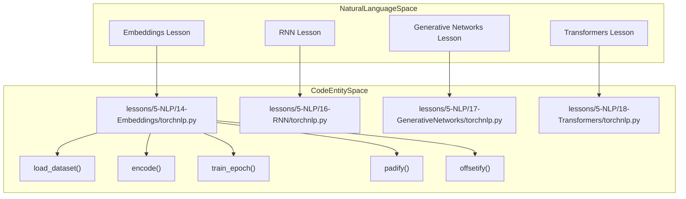
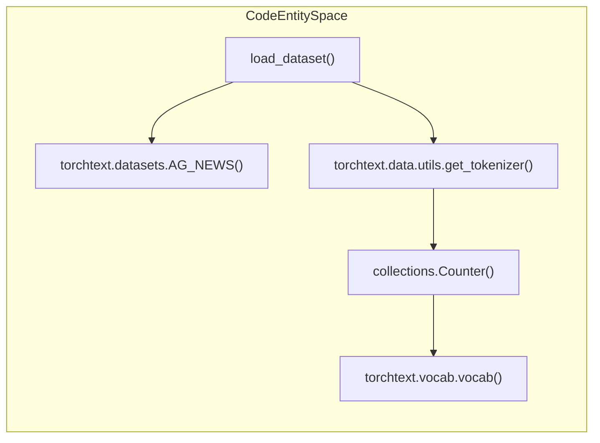
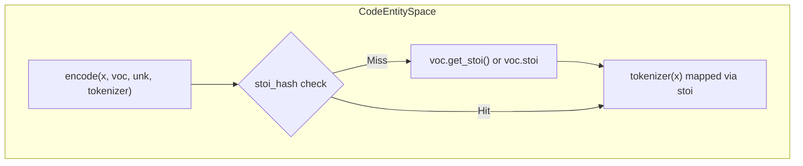
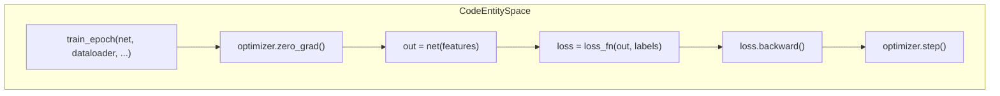
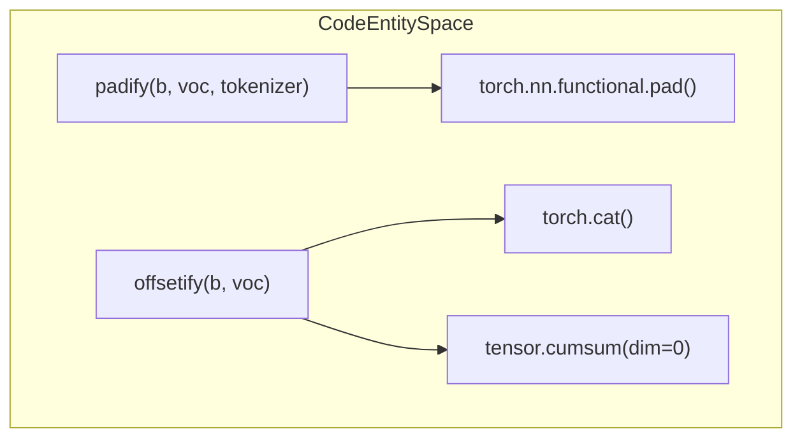
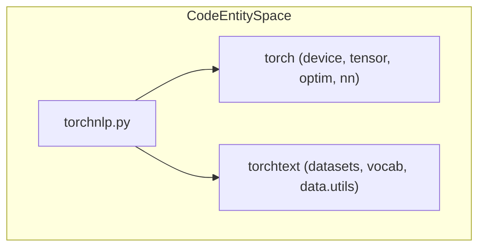

<!-- source: DeepWiki mcp.deepwiki.com · repo microsoft/AI-For-Beginners · extra page NLP Utilities and Implementation Patterns · fetched 2026-10-26 -->

# NLP Utilities and Implementation Patterns

Relevant source files

The following files were used as context for generating this wiki page:

- [.devcontainer/Dockerfile](.devcontainer/Dockerfile)
- [.devcontainer/add-notice.sh](.devcontainer/add-notice.sh)
- [.devcontainer/devcontainer.json](.devcontainer/devcontainer.json)
- [.devcontainer/environment.yml](.devcontainer/environment.yml)
- [.devcontainer/requirements.txt](.devcontainer/requirements.txt)
- [binder/environment.yml](binder/environment.yml)
- [binder/requirements.txt](binder/requirements.txt)
- [environment.yml](environment.yml)
- [lessons/4-ComputerVision/12-Segmentation/lab/BodySegmentation.ipynb](lessons/4-ComputerVision/12-Segmentation/lab/BodySegmentation.ipynb)
- [lessons/5-NLP/14-Embeddings/torchnlp.py](lessons/5-NLP/14-Embeddings/torchnlp.py)
- [lessons/5-NLP/16-RNN/RNNPyTorch.ipynb](lessons/5-NLP/16-RNN/RNNPyTorch.ipynb)
- [lessons/5-NLP/16-RNN/torchnlp.py](lessons/5-NLP/16-RNN/torchnlp.py)
- [lessons/5-NLP/17-GenerativeNetworks/torchnlp.py](lessons/5-NLP/17-GenerativeNetworks/torchnlp.py)
- [lessons/5-NLP/18-Transformers/torchnlp.py](lessons/5-NLP/18-Transformers/torchnlp.py)
- [lessons/5-NLP/requirements-pytorch.txt](lessons/5-NLP/requirements-pytorch.txt)
- [lessons/5-NLP/requirements-tf.txt](lessons/5-NLP/requirements-tf.txt)
- [requirements.txt](requirements.txt)

## Purpose and Scope

This page documents the shared utility module `torchnlp.py` and its implementation patterns across Natural Language Processing lessons 14 through 18. The module provides reusable functions for dataset loading, text encoding, training loops, and sequence collation specific to PyTorch-based NLP tasks. This page focuses on the utility infrastructure; for conceptual coverage, see text representation, recurrent networks, and transformers.

Sources: [lessons/5-NLP/14-Embeddings/torchnlp.py:1-115]()

## Module Architecture and Duplication Pattern

The `torchnlp.py` utility module is duplicated across multiple lesson directories rather than being centralized in a global package. This is a deliberate pedagogical choice to ensure lesson independence.

**Duplication Rationale**: Each lesson folder functions as a self-contained unit, allowing learners to run notebooks without configuring complex relative imports or path variables.

Sources: [lessons/5-NLP/14-Embeddings/torchnlp.py:1-115](), [lessons/5-NLP/16-RNN/torchnlp.py:1-115](), [lessons/5-NLP/17-GenerativeNetworks/torchnlp.py:1-115]()

## Core Utility Functions

The module exports several core functions to handle text pipelines and model training epochs.

| Function Name | Code Entity Role | Input Parameters | Output Return Type |
|---------------|------------------|------------------|--------------------|
| `load_dataset` | Dataset loader and vocabulary constructor | `ngrams=1`, `min_freq=1` | `(train_dataset, test_dataset, classes, vocab)` |
| `encode` | Text tokenizer and index mapper | `x`, `voc=None`, `unk=0`, `tokenizer=tokenizer` | `List[int]` |
| `train_epoch` | Standard training epoch iteration | `net`, `dataloader`, `lr`, `optimizer`, `loss_fn`, `epoch_size`, `report_freq` | `(avg_loss, accuracy)` |
| `train_epoch_emb` | Offset-aware training epoch iteration | `net`, `dataloader`, `lr`, `optimizer`, `loss_fn`, `epoch_size`, `report_freq`, `use_pack_sequence` | `(avg_loss, accuracy)` |
| `padify` | Batch collation with sequence padding | `b`, `voc=None`, `tokenizer=tokenizer` | `(labels_tensor, padded_features_tensor)` |
| `offsetify` | Batch collation with offset accumulation | `b`, `voc=None` | `(labels_tensor, concatenated_text_tensor, offsets_tensor)` |

Sources: [lessons/5-NLP/14-Embeddings/torchnlp.py:12-114]()

## Dataset Loading and Preprocessing

### Dataset Initialization via load_dataset

The `load_dataset()` function retrieves the AG_NEWS classification corpus via TorchText, builds a vocabulary using unigrams or n-grams, and exposes module-level globals.

**Implementation Details**:
- Initializes `tokenizer = torchtext.data.utils.get_tokenizer('basic_english')` [lessons/5-NLP/14-Embeddings/torchnlp.py:10]()
- Returns classes mapped to `['World', 'Sports', 'Business', 'Sci/Tech']` [lessons/5-NLP/14-Embeddings/torchnlp.py:18]()

Sources: [lessons/5-NLP/14-Embeddings/torchnlp.py:12-24]()

### Text Encoding via encode

The `encode()` function transforms raw strings into integer token arrays using a caching mechanism (`stoi_hash`) to optimize repeated lookups across large corpora.

Sources: [lessons/5-NLP/14-Embeddings/torchnlp.py:26-39]()

## Training Utilities

### Training Loops: train_epoch and train_epoch_emb

The training functions automate forward passes, gradient zeroing, backpropagation, and metric aggregation.

**Key Parameters**:
- `train_epoch_emb()` handles three-element batches `(labels, text, offsets)` required by `EmbeddingBag` architectures [lessons/5-NLP/14-Embeddings/torchnlp.py:89-94]().
- Includes `use_pack_sequence` handling to shift offsets to the CPU when required by recurrent packing routines [lessons/5-NLP/16-RNN/torchnlp.py:97-100]().

Sources: [lessons/5-NLP/14-Embeddings/torchnlp.py:41-114](), [lessons/5-NLP/16-RNN/torchnlp.py:89-115]()

## Collation Functions

### Sequence Padding and Offsetting

Batch collation functions convert lists of tuples into batched tensors.

**Collation Mechanics**:
- `padify`: Pads sequences within a batch to match the maximum sequence length `l = max(map(len, v))` [lessons/5-NLP/14-Embeddings/torchnlp.py:64-75]().
- `offsetify`: Computes cumulative sequence lengths to provide boundary indicators for `nn.EmbeddingBag` [lessons/5-NLP/14-Embeddings/torchnlp.py:77-87]().
- Both functions decrement classification labels by 1 (`t[0]-1`) to convert 1-indexed dataset categories to PyTorch's 0-indexed expectation [lessons/5-NLP/14-Embeddings/torchnlp.py:73]().

Sources: [lessons/5-NLP/14-Embeddings/torchnlp.py:64-87]()

## Integration with PyTorch Ecosystem

### Ecosystem Dependencies

The utility module binds native PyTorch modules with TorchText data pipelines.

Sources: [lessons/5-NLP/14-Embeddings/torchnlp.py:1-5]()

## Implementation Patterns and Best Practices

- **Device Management**: Automatically configures `device = torch.device("cuda" if torch.cuda.is_available() else "cpu")` [lessons/5-NLP/14-Embeddings/torchnlp.py:7]() and moves tensors within training routines [lessons/5-NLP/14-Embeddings/torchnlp.py:48]().
- **Optimizer Defaults**: Instantiates `torch.optim.Adam` when no optimizer argument is passed [lessons/5-NLP/14-Embeddings/torchnlp.py:42]().
- **Progress Reporting**: Employs modulo checks (`if i % report_freq == 0`) to log accuracy metrics during long execution loops [lessons/5-NLP/14-Embeddings/torchnlp.py:58-59]().

Sources: [lessons/5-NLP/14-Embeddings/torchnlp.py:7-59]()

## Module Dependencies in Development Environments

| Environment Configuration | PyTorch Version Reference | TorchText Version Reference | Numpy Version Reference |
|---------------------------|---------------------------|----------------------------|-------------------------|
| `.devcontainer/environment.yml` | `pytorch::pytorch` | `pytorch::torchtext` | `numpy=1.26` |
| `binder/environment.yml` | `pytorch::pytorch=1.11.0` | `pytorch::torchtext=0.12.0` | `numpy=1.22.3` |
| `lessons/5-NLP/requirements-pytorch.txt` | `torch==2.13.0` | `torchtext==0.9.1` | `numpy==1.22.0` |

Sources: [.devcontainer/environment.yml:19-22](), [binder/environment.yml:19-20](), [lessons/5-NLP/requirements-pytorch.txt:5-13]()

---

