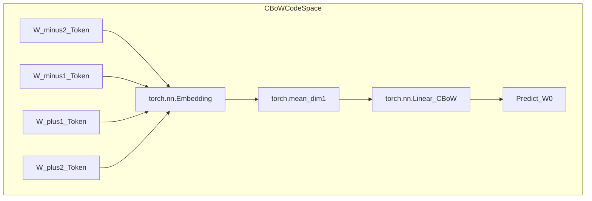
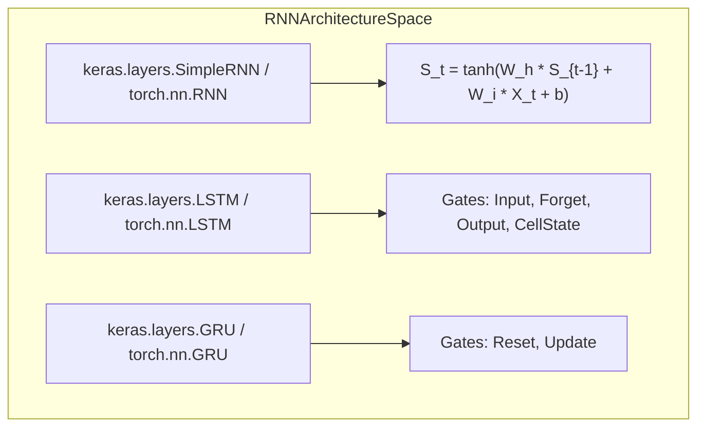
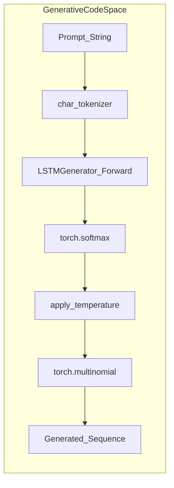
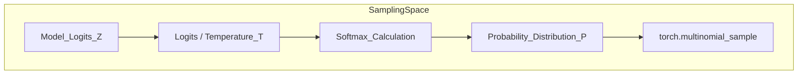
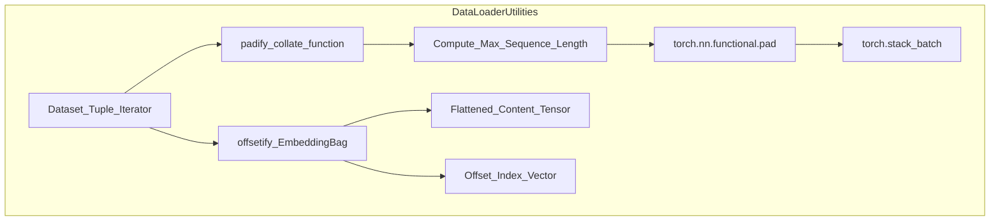

<!-- source: DeepWiki mcp.deepwiki.com · repo microsoft/AI-For-Beginners · extra page Recurrent Networks and Language Modeling · fetched 2026-10-26 -->

# Recurrent Networks and Language Modeling

Relevant source files

The following files were used as context for generating this wiki page:

- [.gitignore](.gitignore)
- [README.md](README.md)
- [etc/Mindmap.html](etc/Mindmap.html)
- [etc/Mindmap.md](etc/Mindmap.md)
- [etc/Mindmap.svg](etc/Mindmap.svg)
- [lessons/4-ComputerVision/11-ObjectDetection/README.md](lessons/4-ComputerVision/11-ObjectDetection/README.md)
- [lessons/4-ComputerVision/11-ObjectDetection/lab/README.md](lessons/4-ComputerVision/11-ObjectDetection/lab/README.md)
- [lessons/4-ComputerVision/12-Segmentation/README.md](lessons/4-ComputerVision/12-Segmentation/README.md)
- [lessons/4-ComputerVision/12-Segmentation/SemanticSegmentationPytorch.ipynb](lessons/4-ComputerVision/12-Segmentation/SemanticSegmentationPytorch.ipynb)
- [lessons/4-ComputerVision/12-Segmentation/SemanticSegmentationTF.ipynb](lessons/4-ComputerVision/12-Segmentation/SemanticSegmentationTF.ipynb)
- [lessons/4-ComputerVision/README.md](lessons/4-ComputerVision/README.md)
- [lessons/5-NLP/13-TextRep/README.md](lessons/5-NLP/13-TextRep/README.md)
- [lessons/5-NLP/13-TextRep/TextRepresentationPyTorch.ipynb](lessons/5-NLP/13-TextRep/TextRepresentationPyTorch.ipynb)
- [lessons/5-NLP/13-TextRep/assignment.md](lessons/5-NLP/13-TextRep/assignment.md)
- [lessons/5-NLP/14-Embeddings/EmbeddingsPyTorch.ipynb](lessons/5-NLP/14-Embeddings/EmbeddingsPyTorch.ipynb)
- [lessons/5-NLP/14-Embeddings/README.md](lessons/5-NLP/14-Embeddings/README.md)
- [lessons/5-NLP/14-Embeddings/assignment.md](lessons/5-NLP/14-Embeddings/assignment.md)
- [lessons/5-NLP/15-LanguageModeling/CBoW-TF.ipynb](lessons/5-NLP/15-LanguageModeling/CBoW-TF.ipynb)
- [lessons/5-NLP/15-LanguageModeling/README.md](lessons/5-NLP/15-LanguageModeling/README.md)
- [lessons/5-NLP/15-LanguageModeling/lab/README.md](lessons/5-NLP/15-LanguageModeling/lab/README.md)
- [lessons/5-NLP/16-RNN/RNNTF.ipynb](lessons/5-NLP/16-RNN/RNNTF.ipynb)
- [lessons/5-NLP/16-RNN/assignment.md](lessons/5-NLP/16-RNN/assignment.md)
- [lessons/5-NLP/17-GenerativeNetworks/GenerativePyTorch.ipynb](lessons/5-NLP/17-GenerativeNetworks/GenerativePyTorch.ipynb)
- [lessons/5-NLP/17-GenerativeNetworks/GenerativeTF.ipynb](lessons/5-NLP/17-GenerativeNetworks/GenerativeTF.ipynb)
- [lessons/5-NLP/17-GenerativeNetworks/README.md](lessons/5-NLP/17-GenerativeNetworks/README.md)
- [lessons/5-NLP/17-GenerativeNetworks/lab/README.md](lessons/5-NLP/17-GenerativeNetworks/lab/README.md)
- [lessons/5-NLP/20-LangModels/GPT-PyTorch.ipynb](lessons/5-NLP/20-LangModels/GPT-PyTorch.ipynb)
- [lessons/5-NLP/20-LangModels/README.md](lessons/5-NLP/20-LangModels/README.md)
- [lessons/5-NLP/README.md](lessons/5-NLP/README.md)
- [lessons/6-Other/22-DeepRL/README.md](lessons/6-Other/22-DeepRL/README.md)
- [lessons/7-Ethics/README.md](lessons/7-Ethics/README.md)

## Purpose and Scope

This page documents Lessons 15-17 of the AI-For-Beginners curriculum (`lessons/5-NLP/15-LanguageModeling/`, `lessons/5-NLP/16-RNN/`, and `lessons/5-NLP/17-GenerativeNetworks/`), covering language modeling fundamentals, recurrent neural network architectures, and generative text models. These lessons bridge static text representations ([3.5.1]()) and modern transformer architectures ([3.5.3]()).

Topics covered:
- Unsupervised language modeling and training embeddings (CBoW, Skip-gram, N-Gram) via `lessons/5-NLP/15-LanguageModeling/CBoW-PyTorch.ipynb` and `lessons/5-NLP/15-LanguageModeling/CBoW-TF.ipynb`
- Recurrent Neural Network (RNN) architectures, vanishing gradients, LSTMs, and GRUs implemented in `lessons/5-NLP/16-RNN/RNNPyTorch.ipynb` and `lessons/5-NLP/16-RNN/RNNTF.ipynb`
- Generative recurrent text networks and temperature sampling in `lessons/5-NLP/17-GenerativeNetworks/GenerativePyTorch.ipynb` and `lessons/5-NLP/17-GenerativeNetworks/GenerativeTF.ipynb`

Sources: `[lessons/5-NLP/README.md:58-66]()`, `[lessons/5-NLP/15-LanguageModeling/README.md:1-43]()`

---

## Language Modeling Fundamentals

Language modeling trains networks on unlabeled datasets in an unsupervised manner to predict missing or next tokens. Because collecting labeled text requires extensive manual effort, language models leverage massive corpora of unlabeled text to learn structural and semantic properties of language.

### Prediction Strategies

The curriculum explores three foundational approaches to language modeling and word vector training:

| Approach | Input Context | Target Output | Description |
|----------|---------------|---------------|-------------|
| **N-Gram** | Previous $N$ tokens | Next token $W_n$ | Predicts token from fixed history window |
| **CBoW** | Surrounding window $W_{-N},\dots,W_N$ | Middle token $W_0$ | Predicts center word from context vector aggregation |
| **Skip-gram** | Center token $W_0$ | Neighborhood $\{W_{-N},\dots,W_N\}$ | Predicts surrounding context words from center token |

*Diagram 1: Continuous Bag-of-Words code entity mapping for `CBoW-PyTorch.ipynb`.*

Sources: `[lessons/5-NLP/15-LanguageModeling/README.md:7-19]()`, `[lessons/5-NLP/15-LanguageModeling/CBoW-PyTorch.ipynb]()`

---

## Training Embeddings: CBoW Implementation

Lesson 15 implements Continuous Bag-of-Words (CBoW) training using PyTorch and TensorFlow.

### Training Pipeline Data Flow

*Diagram 2: Data flow for CBoW training in `CBoW-PyTorch.ipynb` and `torchnlp.py`.*

Sources: `[lessons/5-NLP/15-LanguageModeling/CBoW-PyTorch.ipynb]()`, `[lessons/5-NLP/14-Embeddings/EmbeddingsPyTorch.ipynb:44-51]()`

---

## Recurrent Neural Networks (RNN)

Lesson 16 introduces Recurrent Neural Networks to account for token ordering and sequential dependencies, which are discarded by simple aggregation operations.

### RNN Variant Architectures

*Diagram 3: RNN cell variants mapped to framework layers in `RNNPyTorch.ipynb` and `RNNTF.ipynb`.*

### Vanishing Gradient Mitigation

During Backpropagation Through Time (BPTT), standard RNNs suffer from vanishing or exploding gradients over long sequences. 
- **LSTM (Long Short-Term Memory)** introduces a dedicated cell state $C_t$ controlled by multiplicative forget ($f_t$), input ($i_t$), and output ($o_t$) gates.
- **GRU (Gated Recurrent Unit)** merges cell and hidden states while employing reset ($r_t$) and update ($z_t$) gates to streamline parameter counts.

Sources: `[lessons/5-NLP/16-RNN/RNNTF.ipynb:7-23]()`, `[lessons/5-NLP/README.md:23]()`

---

## Generative Recurrent Networks

Lesson 17 builds generative text models capable of autoregressive sequence generation.

### Character-Level Generation Flow

*Diagram 4: Autoregressive text generation pipeline in `GenerativePyTorch.ipynb`.*

Sources: `[lessons/5-NLP/17-GenerativeNetworks/GenerativePyTorch.ipynb:46-222]()`, `[lessons/5-NLP/17-GenerativeNetworks/README.md:9-32]()`

---

## Text Generation Techniques and Temperature Sampling

To prevent repetitive loops common in greedy argmax decoding, generative models apply temperature sampling to the output probability distribution.

### Temperature Scaling Mechanics

*Diagram 5: Temperature scaling transformation before token sampling.*

| Temperature Setting | Mathematical Effect | Generative Behavior |
|---------------------|---------------------|---------------------|
| $T \to 0$ | Sharpens peaks (argmax approximation) | Deterministic, repetitive, highly predictable |
| $T = 1.0$ | Standard logits distribution | Balanced creativity and structure |
| $T > 1.0$ | Flattens probabilities toward uniform | Diverse, creative, potentially incoherent |

Sources: `[lessons/5-NLP/17-GenerativeNetworks/README.md:42-53]()`, `[lessons/5-NLP/17-GenerativeNetworks/GenerativePyTorch.ipynb:177-222]()`

---

## Minibatch Construction and Data Handling

Processing variable-length text sequences requires specialized collation functions in data loaders.

### Sequence Padify and Offsetify Data Flow

*Diagram 6: Data collation utilities defined in `torchnlp.py` and utilized in embeddings notebooks.*

Sources: `[lessons/5-NLP/14-Embeddings/EmbeddingsPyTorch.ipynb:93-119]()`, `[lessons/5-NLP/14-Embeddings/EmbeddingsPyTorch.ipynb:173-185]()`

---

## Perplexity Metric

Language model evaluation often relies on **perplexity**, measuring how surprised a model is by an evaluation text corpus.

$$\mathrm{Perplexity}(W) = \sqrt[N]{\frac{1}{P(W_1, \dots, W_N)}}$$

- Lower perplexity indicates higher assigned probability to real text sequences.
- Computed intrinsically without requiring downstream task labels.

Sources: `[lessons/5-NLP/20-LangModels/README.md:17-20]()`

---

