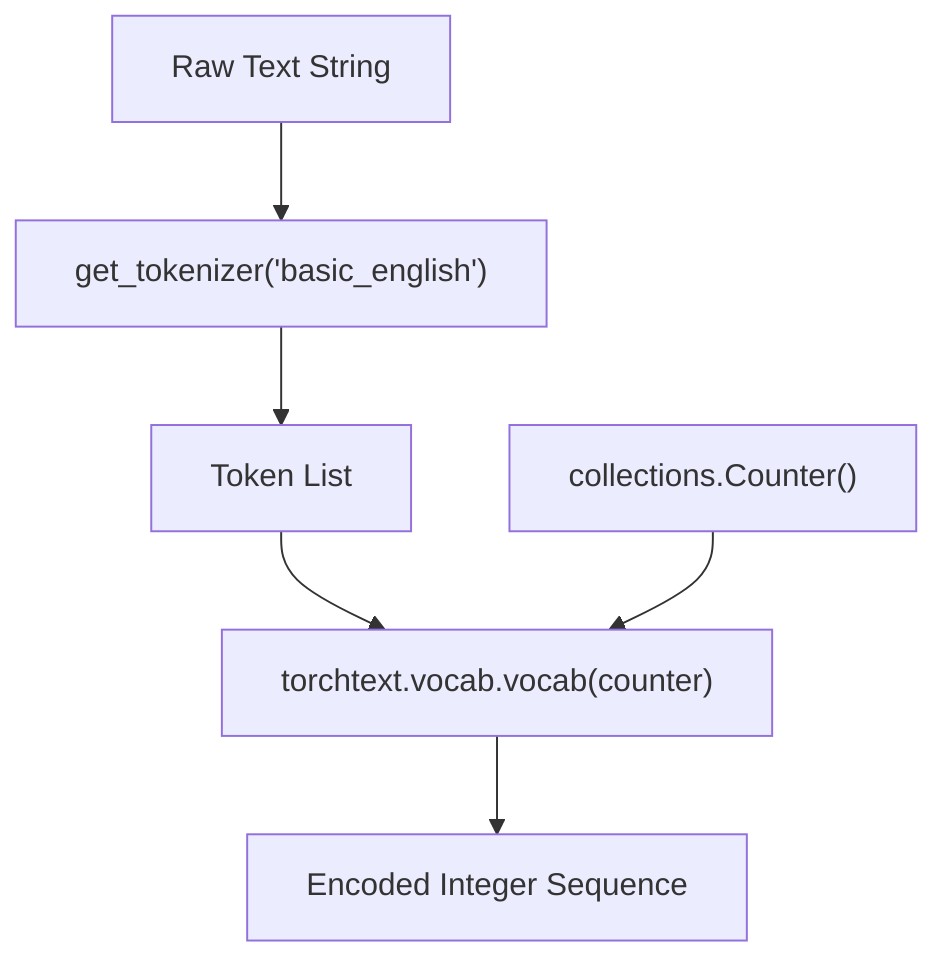
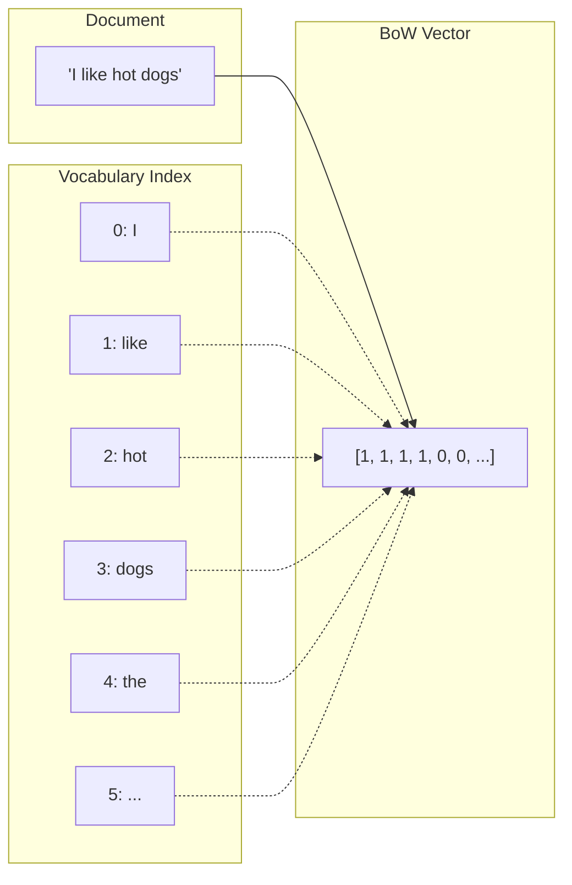
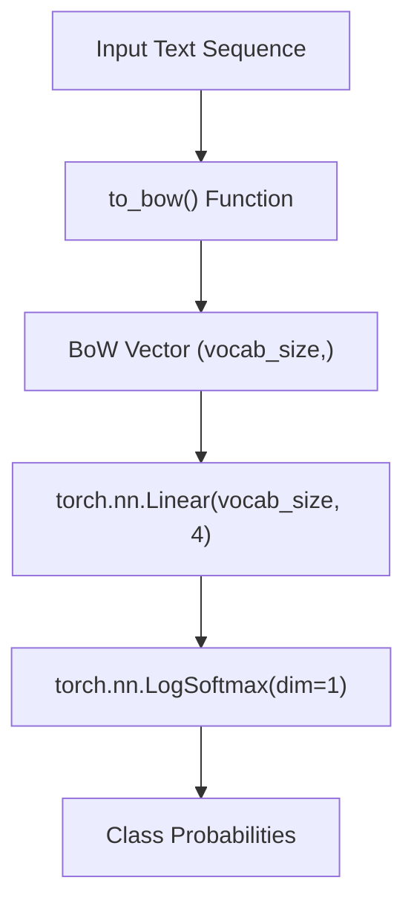
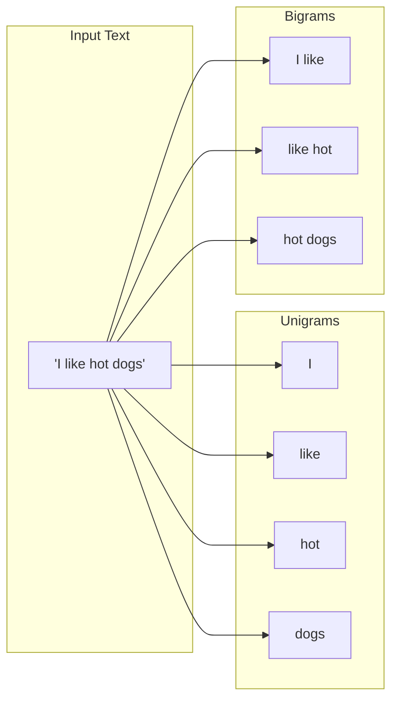
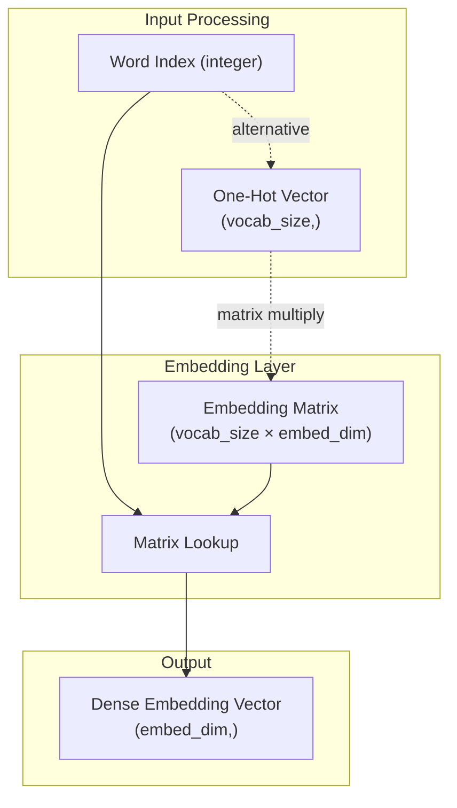
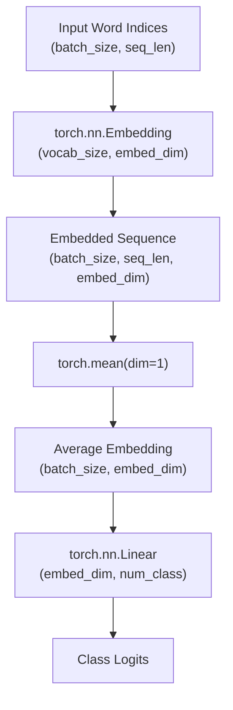
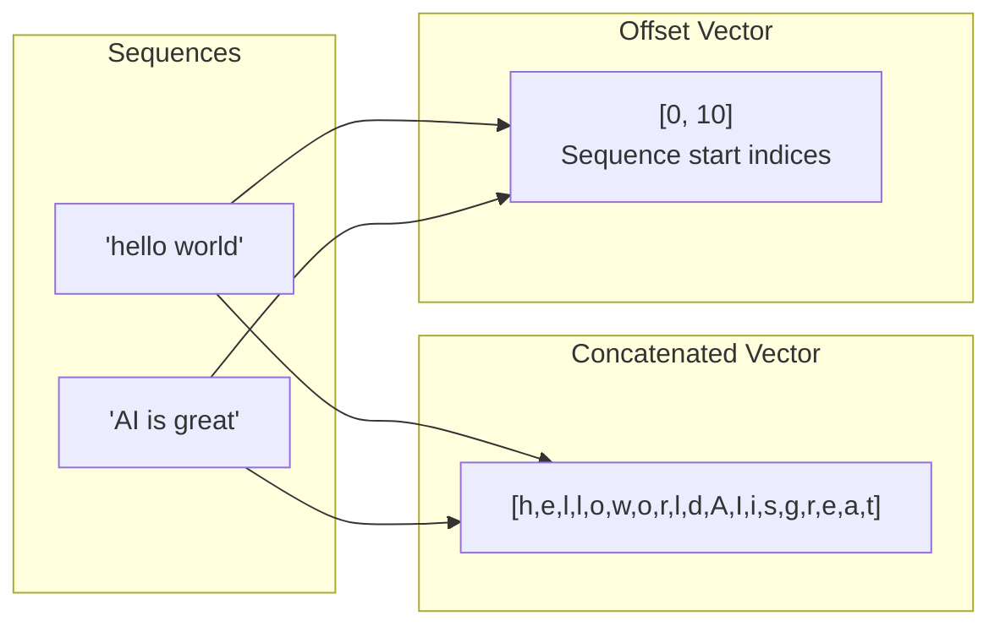
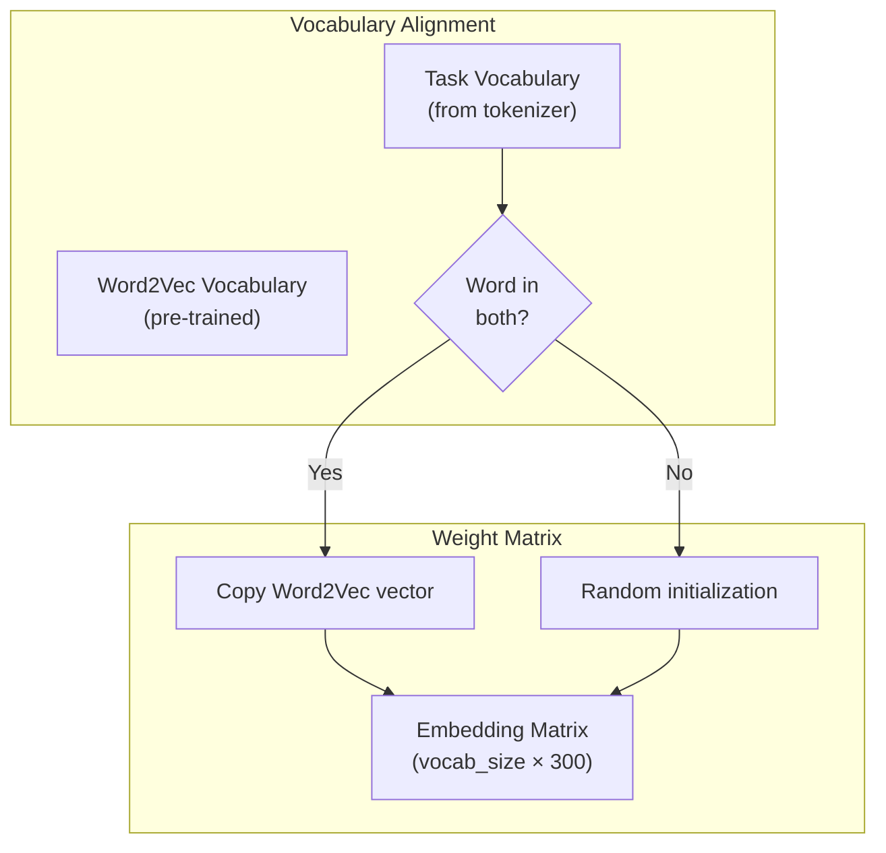
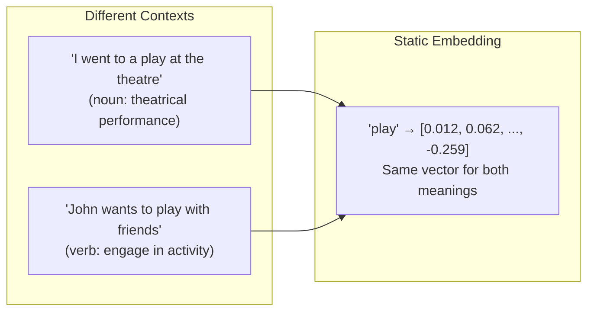
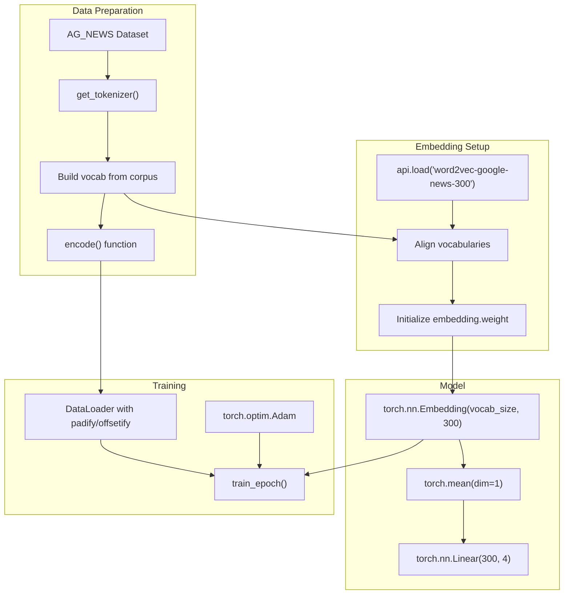

<!-- source: DeepWiki mcp.deepwiki.com · repo microsoft/AI-For-Beginners · extra page Text Representation and Embeddings · fetched 2026-10-26 -->

# Text Representation and Embeddings

<details>
<summary>Relevant source files</summary>

The following files were used as context for generating this wiki page:

- [etc/quiz-app/src/assets/translations/en/index.js](etc/quiz-app/src/assets/translations/en/index.js)
- [etc/quiz-app/src/assets/translations/en/lesson-11.json](etc/quiz-app/src/assets/translations/en/lesson-11.json)
- [etc/quiz-app/src/assets/translations/en/lesson-12.json](etc/quiz-app/src/assets/translations/en/lesson-12.json)
- [etc/quiz-app/src/assets/translations/en/lesson-13.json](etc/quiz-app/src/assets/translations/en/lesson-13.json)
- [etc/quiz-app/src/assets/translations/en/lesson-14.json](etc/quiz-app/src/assets/translations/en/lesson-14.json)
- [etc/quiz-app/src/assets/translations/en/lesson-15.json](etc/quiz-app/src/assets/translations/en/lesson-15.json)
- [etc/quiz-app/src/assets/translations/en/lesson-16.json](etc/quiz-app/src/assets/translations/en/lesson-16.json)
- [etc/quiz-app/src/assets/translations/en/lesson-17.json](etc/quiz-app/src/assets/translations/en/lesson-17.json)
- [etc/quiz-app/src/assets/translations/en/lesson-18.json](etc/quiz-app/src/assets/translations/en/lesson-18.json)
- [etc/quiz-app/src/assets/translations/en/lesson-19.json](etc/quiz-app/src/assets/translations/en/lesson-19.json)
- [etc/quiz-app/src/assets/translations/en/lesson-20.json](etc/quiz-app/src/assets/translations/en/lesson-20.json)
- [etc/quiz-app/src/assets/translations/en/lesson-22.json](etc/quiz-app/src/assets/translations/en/lesson-22.json)
- [etc/quiz-app/src/assets/translations/en/lesson-23.json](etc/quiz-app/src/assets/translations/en/lesson-23.json)
- [etc/quiz-src/questions-en.txt](etc/quiz-src/questions-en.txt)
- [lessons/4-ComputerVision/12-Segmentation/README.md](lessons/4-ComputerVision/12-Segmentation/README.md)
- [lessons/4-ComputerVision/12-Segmentation/SemanticSegmentationPytorch.ipynb](lessons/4-ComputerVision/12-Segmentation/SemanticSegmentationPytorch.ipynb)
- [lessons/4-ComputerVision/12-Segmentation/SemanticSegmentationTF.ipynb](lessons/4-ComputerVision/12-Segmentation/SemanticSegmentationTF.ipynb)
- [lessons/4-ComputerVision/README.md](lessons/4-ComputerVision/README.md)
- [lessons/5-NLP/13-TextRep/README.md](lessons/5-NLP/13-TextRep/README.md)
- [lessons/5-NLP/13-TextRep/TextRepresentationPyTorch.ipynb](lessons/5-NLP/13-TextRep/TextRepresentationPyTorch.ipynb)
- [lessons/5-NLP/13-TextRep/assignment.md](lessons/5-NLP/13-TextRep/assignment.md)
- [lessons/5-NLP/14-Embeddings/EmbeddingsPyTorch.ipynb](lessons/5-NLP/14-Embeddings/EmbeddingsPyTorch.ipynb)
- [lessons/5-NLP/14-Embeddings/EmbeddingsTF.ipynb](lessons/5-NLP/14-Embeddings/EmbeddingsTF.ipynb)
- [lessons/5-NLP/14-Embeddings/README.md](lessons/5-NLP/14-Embeddings/README.md)
- [lessons/5-NLP/14-Embeddings/assignment.md](lessons/5-NLP/14-Embeddings/assignment.md)
- [lessons/5-NLP/16-RNN/RNNTF.ipynb](lessons/5-NLP/16-RNN/RNNTF.ipynb)
- [lessons/5-NLP/16-RNN/assignment.md](lessons/5-NLP/16-RNN/assignment.md)
- [lessons/5-NLP/17-GenerativeNetworks/GenerativePyTorch.ipynb](lessons/5-NLP/17-GenerativeNetworks/GenerativePyTorch.ipynb)
- [lessons/5-NLP/17-GenerativeNetworks/GenerativeTF.ipynb](lessons/5-NLP/17-GenerativeNetworks/GenerativeTF.ipynb)
- [lessons/5-NLP/17-GenerativeNetworks/README.md](lessons/5-NLP/17-GenerativeNetworks/README.md)
- [lessons/5-NLP/17-GenerativeNetworks/lab/README.md](lessons/5-NLP/17-GenerativeNetworks/lab/README.md)
- [lessons/5-NLP/README.md](lessons/5-NLP/README.md)
- [lessons/7-Ethics/README.md](lessons/7-Ethics/README.md)

</details>


## Purpose and Scope

This document covers the techniques for converting text into numerical representations that can be processed by neural networks, specifically focusing on Lessons 13-14 of the AI-For-Beginners curriculum. The content progresses from simple frequency-based representations (Bag of Words, TF-IDF) to learned distributed representations (embeddings) and pre-trained semantic embeddings (Word2Vec, GloVe).

For information about how these representations are used in language modeling and sequence-to-sequence tasks, see [Recurrent Networks and Language Modeling](#3.5.2). For advanced contextual embeddings from transformers, see [Transformers and Modern NLP](#3.5.3).

## Dataset and Task

The examples use the **AG News dataset** for text classification, which contains news articles categorized into four classes: World, Sports, Business, and Sci/Tech. The dataset is available through `torchtext.datasets.AG_NEWS` and `tfds.load('ag_news_subset')` for PyTorch and TensorFlow respectively.

Sources: [lessons/5-NLP/13-TextRep/README.md:5-15](), [lessons/5-NLP/14-Embeddings/EmbeddingsPyTorch.ipynb:10-11](), [lessons/5-NLP/14-Embeddings/EmbeddingsTF.ipynb:11-12]()

## Text Tokenization

### Tokenization Levels

Text can be tokenized at two primary levels:

| Level | Representation | Use Case | Vocabulary Size |
|-------|---------------|----------|-----------------|
| **Character-level** | Each letter as a number | Language generation, small vocabulary needs | ~50-100 characters |
| **Word-level** | Each word as a number | Classification, most NLP tasks | ~10,000-100,000 words |

Sources: [lessons/5-NLP/13-TextRep/README.md:26-29]()

### Tokenization Implementation



**PyTorch Tokenization Pipeline**

The tokenization process involves:
1. **Tokenizer creation**: `torchtext.data.utils.get_tokenizer('basic_english')`
2. **Building vocabulary**: Iterate through dataset, count token frequencies
3. **Vocabulary object**: `torchtext.vocab.vocab(counter, min_freq=1)`
4. **Encoding**: `vocab.get_stoi()[token]` converts tokens to indices

Sources: [lessons/5-NLP/14-Embeddings/EmbeddingsPyTorch.ipynb:44-50]()

**TensorFlow Tokenization Pipeline**

TensorFlow uses `TextVectorization` layer or `Tokenizer` class:
- `keras.layers.experimental.preprocessing.TextVectorization(max_tokens=vocab_size)` [lessons/5-NLP/14-Embeddings/EmbeddingsTF.ipynb:85-86]()
- `keras.preprocessing.text.Tokenizer(char_level=True)` for character-level [lessons/5-NLP/17-GenerativeNetworks/GenerativeTF.ipynb:58-59]()

Sources: [lessons/5-NLP/14-Embeddings/EmbeddingsTF.ipynb:85-86](), [lessons/5-NLP/17-GenerativeNetworks/GenerativeTF.ipynb:58-59]()

## Bag of Words (BoW) Representation

### Concept

Bag of Words creates a fixed-size vector where each position corresponds to a vocabulary word, and the value represents the word's frequency in the document.


Sources: [lessons/5-NLP/13-TextRep/README.md:42-44]()

### Implementation

**BoW Function Implementation**
```python
def to_bow(text, bow_vocab_size=vocab_size):
    res = torch.zeros(bow_vocab_size, dtype=torch.float32)
    for i in encode(text):
        if i < bow_vocab_size:
            res[i] += 1
    return res
```
Sources: [lessons/5-NLP/13-TextRep/TextRepresentationPyTorch.ipynb:246-251]()

**BoW Classifier Architecture**

Sources: [lessons/5-NLP/13-TextRep/TextRepresentationPyTorch.ipynb:253-268]()

**DataLoader Integration**

The `bowify()` collate function converts minibatches to BoW representation:
- Input: List of `(label, text)` tuples
- Output: `(labels_tensor, bow_vectors_tensor)` tuple
- Used with: `DataLoader(dataset, batch_size=16, collate_fn=bowify, shuffle=True)`

Sources: [lessons/5-NLP/13-TextRep/TextRepresentationPyTorch.ipynb:287-305]()

### Limitations

- No word order information
- High dimensionality (sparse vectors)
- Common words dominate representation
- No semantic similarity captured

Sources: [lessons/5-NLP/13-TextRep/README.md:38-50]()

## TF-IDF Weighting

**TF-IDF** (Term Frequency-Inverse Document Frequency) addresses the issue of common words by downweighting terms that appear frequently across documents. While not implemented in detail in the notebooks, it's used to improve BoW by considering:

- **Term Frequency (TF)**: Frequency of word in document
- **Inverse Document Frequency (IDF)**: Logarithm of total documents divided by documents containing the word

The implementation typically uses `sklearn.feature_extraction.text.TfidfVectorizer`.

Sources: [lessons/5-NLP/13-TextRep/README.md:47-48]()

## N-Grams

### Concept

N-grams capture local word order by treating word sequences as single tokens:
- **Unigrams**: Single words ("hot", "dog")
- **Bigrams**: Word pairs ("hot dog", "dog ran")
- **Trigrams**: Word triples ("I like hot")


Sources: [lessons/5-NLP/13-TextRep/README.md:33-36]()

### Implementation

Using scikit-learn:
```python
bigram_vectorizer = CountVectorizer(ngram_range=(1, 2), 
                                    token_pattern=r'\b\w+\b', 
                                    min_df=1)
```
Sources: [lessons/5-NLP/13-TextRep/TextRepresentationPyTorch.ipynb:399-401]()

**Vocabulary Growth**

| N-gram Order | Vocabulary Size |
|--------------|-----------------|
| Unigrams | V |
| Bigrams | ~V² |
| Trigrams | ~V³ |

The main drawback is exponential vocabulary growth, requiring dimensionality reduction techniques.

Sources: [lessons/5-NLP/13-TextRep/TextRepresentationPyTorch.ipynb:403-436]()

## Word Embeddings

### Embedding Layer Architecture

Embeddings map words to dense, low-dimensional vectors, replacing sparse one-hot encodings:


Sources: [lessons/5-NLP/14-Embeddings/README.md:7-9]()

### PyTorch Embedding Classifier

**EmbedClassifier Architecture**

Sources: [lessons/5-NLP/14-Embeddings/EmbeddingsPyTorch.ipynb:66-68]()

**Implementation**
```python
class EmbedClassifier(torch.nn.Module):
    def __init__(self, vocab_size, embed_dim, num_class):
        super().__init__()
        self.embedding = torch.nn.Embedding(vocab_size, embed_dim)
        self.fc = torch.nn.Linear(embed_dim, num_class)

    def forward(self, x):
        x = self.embedding(x)
        x = torch.mean(x, dim=1)
        return self.fc(x)
```
Sources: [lessons/5-NLP/14-Embeddings/EmbeddingsPyTorch.ipynb:77-87]()

### Variable-Length Sequence Handling

**Padding Approach**

The `padify()` collate function pads sequences to maximum length in minibatch:
```python
def padify(b):
    v = [encode(x[1]) for x in b]
    l = max(map(len, v))
    return (
        torch.LongTensor([t[0]-1 for t in b]),
        torch.stack([torch.nn.functional.pad(torch.tensor(t), (0, l-len(t)), 
                                             mode='constant', value=0) for t in v])
    )
```
Sources: [lessons/5-NLP/14-Embeddings/EmbeddingsPyTorch.ipynb:106-117]()

**Offset Representation with EmbeddingBag**


Sources: [lessons/5-NLP/14-Embeddings/EmbeddingsPyTorch.ipynb:176-177]()

The `EmbeddingBag` layer combines embedding lookup with aggregation (mean/sum/max):
- Input: Concatenated token indices + offset vector
- Output: Aggregated embedding per sequence
- Benefits: More memory-efficient than padding

**Implementation**
```python
class EmbedClassifier(torch.nn.Module):
    def __init__(self, vocab_size, embed_dim, num_class):
        super().__init__()
        self.embedding = torch.nn.EmbeddingBag(vocab_size, embed_dim)
        self.fc = torch.nn.Linear(embed_dim, num_class)

    def forward(self, text, off):
        x = self.embedding(text, off)
        return self.fc(x)
```
Sources: [lessons/5-NLP/14-Embeddings/EmbeddingsPyTorch.ipynb:189-197]()

The `offsetify()` collate function:
```python
def offsetify(b):
    x = [torch.tensor(encode(t[1])) for t in b]
    o = [0] + [len(t) for t in x]
    o = torch.tensor(o[:-1]).cumsum(dim=0)
    return (
        torch.LongTensor([t[0]-1 for t in b]),
        torch.cat(x),
        o
    )
```
Sources: [lessons/5-NLP/14-Embeddings/EmbeddingsPyTorch.ipynb:210-217]()

## Semantic Embeddings: Word2Vec

### Training Architectures

Word2Vec learns embeddings where semantically similar words have similar vector representations:


Sources: [lessons/5-NLP/14-Embeddings/README.md:28-31](), [lessons/5-NLP/14-Embeddings/README.md:34-36]()

**Characteristics**

| Architecture | Speed | Infrequent Words | Use Case |
|--------------|-------|------------------|----------|
| **CBoW** | Faster | Poor | Large corpora, common words |
| **Skip-gram** | Slower | Better | Smaller corpora, rare words |

Sources: [lessons/5-NLP/14-Embeddings/README.md:32]()

### Using Pre-trained Word2Vec

**Loading Word2Vec Embeddings**

```python
import gensim.downloader as api
w2v = api.load('word2vec-google-news-300')
```
Sources: [lessons/5-NLP/14-Embeddings/EmbeddingsPyTorch.ipynb:324-325]()

**Semantic Operations**

Word2Vec embeddings support vector arithmetic for semantic relationships:

```python
# Finding similar words
w2v.most_similar('neural')
# Returns: [('neuronal', 0.78), ('neurons', 0.73), ...]

# Vector arithmetic
w2v.most_similar(positive=['king', 'woman'], negative=['man'])
# Returns: ('queen', 0.71)
```
Sources: [lessons/5-NLP/14-Embeddings/EmbeddingsPyTorch.ipynb:330-331](), [lessons/5-NLP/14-Embeddings/EmbeddingsPyTorch.ipynb:340-341]()

The underlying operation:
```python
qvec = w2v['king'] - 1.7*w2v['man'] + 1.7*w2v['woman']
d = np.sum((w2v.vectors - qvec)**2, axis=1)
min_idx = np.argmin(d)
result = w2v.index_to_key[min_idx]  # 'queen'
```
Sources: [lessons/5-NLP/14-Embeddings/EmbeddingsPyTorch.ipynb:360-363]()

### Integration with Neural Networks

**Pre-populating Embedding Weights**


Sources: [lessons/5-NLP/14-Embeddings/README.md:37-38]()

**PyTorch Implementation**
```python
embed_size = len(w2v.get_vector('hello'))  # 300
net = EmbedClassifier(vocab_size, embed_size, len(classes))

for i, w in enumerate(vocab.get_itos()):
    try:
        net.embedding.weight[i].data = torch.tensor(w2v.get_vector(w))
    except:
        net.embedding.weight[i].data = torch.normal(0.0, 1.0, (embed_size,))
```
Sources: [lessons/5-NLP/14-Embeddings/EmbeddingsPyTorch.ipynb:440-447]()

**TensorFlow Implementation**

Option 1: Using task vocabulary
```python
W = np.zeros((vocab_size, embed_size))
for i, w in enumerate(vocab):
    try:
        W[i] = w2v.get_vector(w)
    except:
        pass  # Keep zero or use random

emb = keras.layers.Embedding(vocab_size, embed_size, 
                             weights=[W], trainable=False)
```
Sources: [lessons/5-NLP/14-Embeddings/EmbeddingsTF.ipynb:462-470]()

Option 2: Using Word2Vec vocabulary
```python
vocab = list(w2v.vocab.keys())
vectorizer.set_vocabulary(vocab)
embedding = w2v.get_keras_embedding(train_embeddings=False)
```
Sources: [lessons/5-NLP/14-Embeddings/EmbeddingsTF.ipynb:558-562]()

## Alternative Embedding Methods

### FastText

FastText extends Word2Vec by incorporating character n-grams:
- **Approach**: Learns vectors for character n-grams (e.g., "play" → "pl", "la", "ay", "pla", "lay", "play")
- **Averaging**: Final word embedding is average of its n-gram embeddings
- **Advantage**: Encodes sub-word information, handles out-of-vocabulary words
- **Disadvantage**: Higher computational cost during pre-training

### GloVe

GloVe (Global Vectors) uses matrix factorization:
- **Input**: Word co-occurrence matrix from large corpus
- **Method**: Factorize matrix to minimize reconstruction loss
- **Advantage**: Leverages global corpus statistics
- **Usage**: Available through `gensim.downloader.load('glove-*')`

Sources: [lessons/5-NLP/14-Embeddings/README.md:37-38](), [lessons/5-NLP/14-Embeddings/EmbeddingsPyTorch.ipynb:422-429](), [lessons/5-NLP/14-Embeddings/EmbeddingsTF.ipynb:438-447]()

## Contextual vs. Static Embeddings

### Limitations of Static Embeddings

Traditional embeddings (Word2Vec, GloVe, FastText) assign one vector per word type, failing to distinguish different word senses:


Sources: [lessons/5-NLP/14-Embeddings/README.md:40-48]()

### Contextual Embeddings

Contextual embeddings from language models (covered in [Transformers and Modern NLP](#3.5.3)) generate different vectors based on context:
- **Approach**: Embeddings depend on surrounding words
- **Models**: BERT, GPT, ELMo
- **Advantage**: Handles polysemy and word sense disambiguation

Sources: [lessons/5-NLP/14-Embeddings/README.md:40-49](), [lessons/5-NLP/14-Embeddings/EmbeddingsTF.ipynb:644-653]()

## Training Considerations

### Memory and Padding

**TensorFlow GPU Memory Management**
```python
physical_devices = tf.config.list_physical_devices('GPU')
if len(physical_devices) > 0:
    tf.config.experimental.set_memory_growth(physical_devices[0], True)
```
This prevents TensorFlow from pre-allocating all GPU memory when training multiple models in one session.

Sources: [lessons/5-NLP/README.md:50-54](), [lessons/5-NLP/16-RNN/RNNTF.ipynb:52-57]()

### Embedding Parameters

| Parameter | Typical Range | Trade-off |
|-----------|---------------|-----------|
| `vocab_size` | 10,000-100,000 | Coverage vs. sparsity |
| `embed_dim` | 50-300 | Expressiveness vs. overfitting |
| `trainable` | True/False | Adaptation vs. regularization |

**Trainability Decision**
- `trainable=False`: Faster training, prevents overfitting, uses pre-trained knowledge
- `trainable=True`: Adapts to task, requires more data, higher accuracy potential

Sources: [lessons/5-NLP/14-Embeddings/EmbeddingsTF.ipynb:561-562]()

## Complete Pipeline Example

**PyTorch Text Classification with Pre-trained Embeddings**



**Key Functions and Classes**
- Data: `torchtext.datasets.AG_NEWS`, `torchtext.vocab.vocab`
- Tokenization: `torchtext.data.utils.get_tokenizer`
- Embeddings: `torch.nn.Embedding`, `torch.nn.EmbeddingBag` [lessons/5-NLP/14-Embeddings/EmbeddingsPyTorch.ipynb:79](), [lessons/5-NLP/14-Embeddings/EmbeddingsPyTorch.ipynb:192]()
- Pre-trained: `gensim.downloader.load`
- Training: `train_epoch()` [lessons/5-NLP/14-Embeddings/EmbeddingsPyTorch.ipynb:161]()
- Collate functions: `padify()`, `offsetify()`, `bowify()` [lessons/5-NLP/14-Embeddings/EmbeddingsPyTorch.ipynb:106-117](), [lessons/5-NLP/14-Embeddings/EmbeddingsPyTorch.ipynb:210-217]()

Sources: [lessons/5-NLP/14-Embeddings/EmbeddingsPyTorch.ipynb:1-50](), [lessons/5-NLP/13-TextRep/TextRepresentationPyTorch.ipynb:1-148]()

## Assessment

Pre- and post-lesson quizzes are available to test understanding:

**Lesson 13 (Text Representation)**
- Quiz IDs: 113 (pre), 213 (post)
- Topics: BoW, character vs. word-level, N-grams

**Lesson 14 (Embeddings)**
- Quiz IDs: 114 (pre), 214 (post)
- Topics: Embedding dimensionality, Word2Vec architectures, semantic properties

Sources: [etc/quiz-app/src/assets/translations/en/lesson-13.json:1-115](), [etc/quiz-app/src/assets/translations/en/lesson-14.json:1-111]()

---

