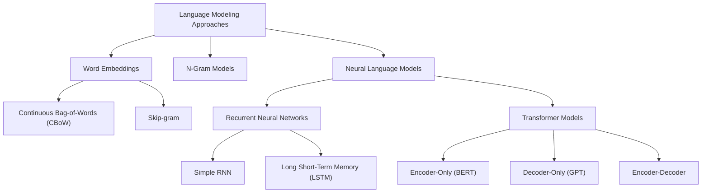
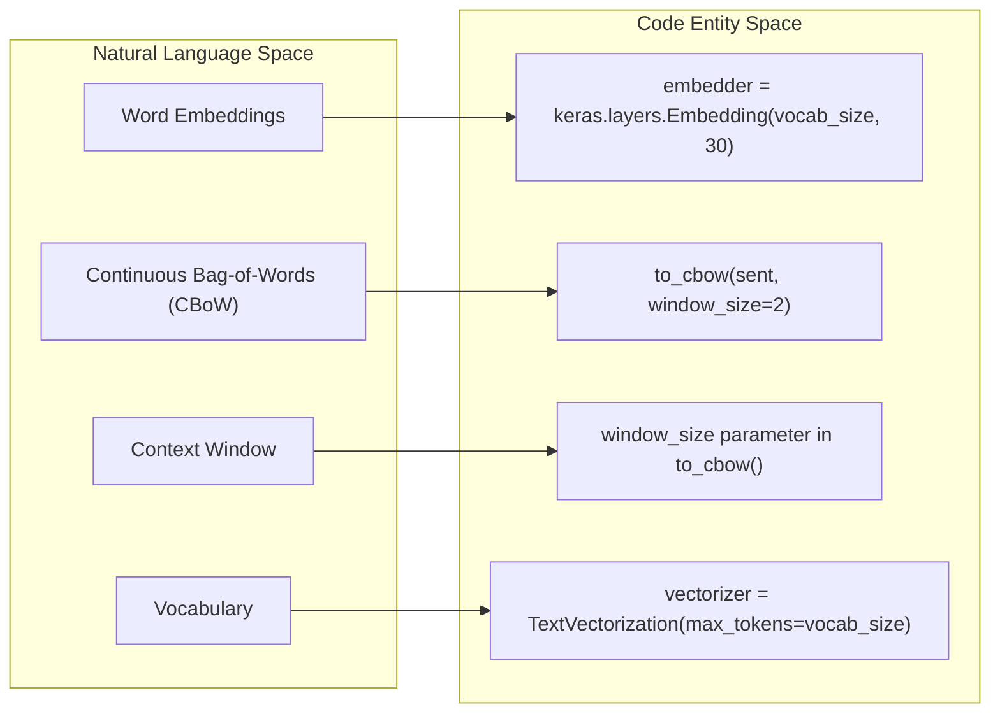
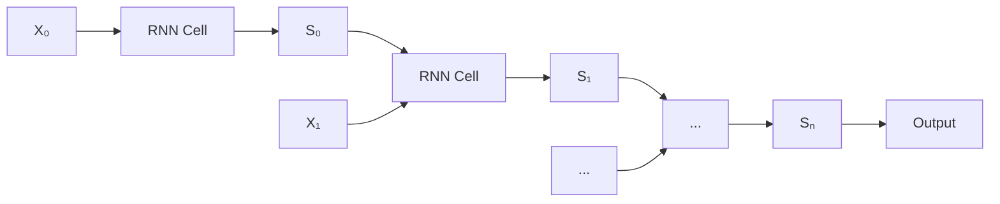
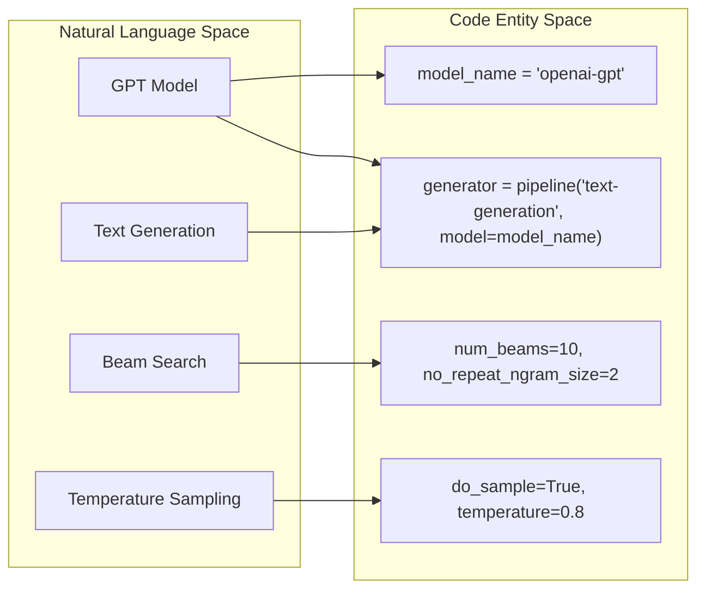

<!-- source: DeepWiki mcp.deepwiki.com · repo microsoft/AI-For-Beginners · extra page Transformers and Modern NLP · fetched 2026-10-26 -->

# Transformers and Modern NLP

<details>
<summary>Relevant source files</summary>

The following files were used as context for generating this wiki page:

- [etc/quiz-app/src/assets/translations/en/lesson-21.json](etc/quiz-app/src/assets/translations/en/lesson-21.json)
- [lessons/4-ComputerVision/06-IntroCV/OpenCV.ipynb](lessons/4-ComputerVision/06-IntroCV/OpenCV.ipynb)
- [lessons/4-ComputerVision/06-IntroCV/README.md](lessons/4-ComputerVision/06-IntroCV/README.md)
- [lessons/4-ComputerVision/08-TransferLearning/TransferLearningPyTorch.ipynb](lessons/4-ComputerVision/08-TransferLearning/TransferLearningPyTorch.ipynb)
- [lessons/4-ComputerVision/10-GANs/StyleTransfer.ipynb](lessons/4-ComputerVision/10-GANs/StyleTransfer.ipynb)
- [lessons/4-ComputerVision/10-GANs/StyleTransfer_Keras.ipynb](lessons/4-ComputerVision/10-GANs/StyleTransfer_Keras.ipynb)
- [lessons/5-NLP/16-RNN/README.md](lessons/5-NLP/16-RNN/README.md)
- [lessons/5-NLP/18-Transformers/README.md](lessons/5-NLP/18-Transformers/README.md)
- [lessons/5-NLP/18-Transformers/assignment.md](lessons/5-NLP/18-Transformers/assignment.md)
- [lessons/5-NLP/19-NER/NER-TF.ipynb](lessons/5-NLP/19-NER/NER-TF.ipynb)
- [lessons/5-NLP/19-NER/README.md](lessons/5-NLP/19-NER/README.md)
- [lessons/5-NLP/19-NER/images/bot-ner.png](lessons/5-NLP/19-NER/images/bot-ner.png)
- [lessons/5-NLP/19-NER/lab/README.md](lessons/5-NLP/19-NER/lab/README.md)
- [lessons/6-Other/21-GeneticAlgorithms/README.md](lessons/6-Other/21-GeneticAlgorithms/README.md)
- [lessons/6-Other/23-MultiagentSystems/README.md](lessons/6-Other/23-MultiagentSystems/README.md)
- [lessons/6-Other/23-MultiagentSystems/assignment.md](lessons/6-Other/23-MultiagentSystems/assignment.md)
- [lessons/X-Extras/X1-MultiModal/Clip.ipynb](lessons/X-Extras/X1-MultiModal/Clip.ipynb)
- [lessons/X-Extras/X1-MultiModal/README.md](lessons/X-Extras/X1-MultiModal/README.md)
- [lessons/X-Extras/X1-MultiModal/images/a_closeup_oil_portrait_of_old_male_teacher_of_math.png](lessons/X-Extras/X1-MultiModal/images/a_closeup_oil_portrait_of_old_male_teacher_of_math.png)
- [lessons/X-Extras/X1-MultiModal/images/a_closeup_oil_portrait_of_young_female_teacher_of_computer_science_with_a_computer.png](lessons/X-Extras/X1-MultiModal/images/a_closeup_oil_portrait_of_young_female_teacher_of_computer_science_with_a_computer.png)
- [translations/README.ja.md](translations/README.ja.md)

</details>


This page covers Lessons 18-20 of the AI-For-Beginners curriculum, focusing on attention mechanisms, transformer architectures, positional encoding, multi-head attention, BERT, named entity recognition (NER), and large language models (LLMs). We examine the transition from recurrent architectures to attention-based models, internal mathematical and structural representations, and code-level patterns used for inference and fine-tuning.

Sources:
- [lessons/5-NLP/18-Transformers/README.md:1-88]()
- [lessons/5-NLP/19-NER/README.md:1-82]()

---

## Language Modeling Fundamentals

Language modeling computes the probability distribution of sequences of words or predicts subsequent tokens given historical context `P(w_N | w_{n-1}, ..., w_0)`. Evaluation relies on **perplexity**, quantifying how well a probability model predicts a sample:

$$\mathrm{Perplexity}(W) = \sqrt[N]{1\over P(W_1,...,W_N)}$$

Word embeddings capture continuous semantic representations. Approaches include N-gram modeling, Continuous Bag-of-Words (CBoW), and Skip-gram.



Sources:
- [lessons/5-NLP/15-LanguageModeling/README.md]()

The bridge between natural language concepts and code execution for vector representation and CBoW is mapped below:



Sources:
- [lessons/5-NLP/15-LanguageModeling/CBoW-TF.ipynb:30-70]()

---

## Recurrent Neural Networks and Their Limitations

Recurrent Neural Networks process text sequences sequentially, passing hidden state vectors $S_i$ alongside input tokens $X_i$ through shared weights.



### Limitations of RNNs and Introduction of LSTMs
1. **Vanishing Gradients**: Long sequences struggle to backpropagate gradients across distant timesteps.
2. **Sequential Bottleneck**: Computations cannot be parallelized across sequence elements during training.

Long Short-Term Memory (LSTM) networks mitigate vanishing gradients by introducing explicit state gates:
- **Forget Gate**: Discards irrelevant information from state $C$.
- **Input Gate**: Injects new token information into state $C$.
- **Output Gate**: Controls what is exposed via hidden state $H_i$.

Sources:
- [lessons/5-NLP/16-RNN/README.md:1-47]()

---

## Attention Mechanisms and Transformer Architecture

Attention mechanisms calculate dynamic weights $\alpha_{t,i}$ between input hidden states $h_i$ and output predictions $y_t$, eliminating the compression bottleneck of encoder-decoder RNNs [lessons/5-NLP/18-Transformers/README.md:12-16]().

### Core Transformer Components

Transformers replace recurrence entirely with self-attention and positional encodings, enabling complete training parallelization [lessons/5-NLP/18-Transformers/README.md:32-38]().

```mermaid
flowchart TD
    Input["Input Tokens"] --> Emb["Embedding Layer"]
    Emb --> PosEnc["Positional Encoding"]
    
    subgraph "Encoder Block (x N)"
        MHA["Multi-Head Self-Attention"]
        AddNorm1["Add & Normalize"]
        FF["Feed Forward Network"]
        AddNorm2["Add & Normalize"]
        
        MHA --> AddNorm1
        AddNorm1 --> FF
        FF --> AddNorm2
    end
    
    PosEnc --> "Encoder Block (x N)"
    "Encoder Block (x N)" --> Output["Encoder Output"]
```

Sources:
- [lessons/5-NLP/18-Transformers/README.md:1-88]()

1. **Positional Encoding**: Adds explicit position vectors (either trainable or fixed sinusoidal functions) to token embeddings since parallel processing removes native sequence order [lessons/5-NLP/18-Transformers/README.md:39-54]().
2. **Multi-Head Self-Attention**: Projects queries, keys, and values into multiple subspaces to capture different relational dependencies (e.g., coreferences, syntax) simultaneously [lessons/5-NLP/18-Transformers/README.md:56-64]().
3. **Encoder-Decoder Attention**: Facilitates cross-attention between decoder layers and encoder outputs during sequence transduction tasks [lessons/5-NLP/18-Transformers/README.md:68-79]().

Sources:
- [lessons/5-NLP/18-Transformers/README.md:1-88]()

---

## BERT and Named Entity Recognition (NER)

### BERT (Bidirectional Encoder Representations from Transformers)
BERT is a multi-layer bidirectional transformer (12 layers for `BERT-base`, 24 for `BERT-large`) pre-trained via unsupervised masked language modeling. It leverages transfer learning for downstream fine-tuning [lessons/5-NLP/18-Transformers/README.md:81-88]().

### Named Entity Recognition as Token Classification
Named Entity Recognition (NER) identifies entities like names, locations, and medical terms within text. It is structured as a **token classification** problem using BIO tagging (`B-` for beginning, `I-` for inner tokens, `O` for others) [lessons/5-NLP/19-NER/README.md:1-49]().

Sources:
- [lessons/5-NLP/19-NER/README.md:1-49]()

---

## Large Language Models and Text Generation Strategies

Large language models like GPT apply autoregressive decoder-only transformer architectures to generate coherent text.

| Model | Parameters | Key Features |
|-------|------------|--------------|
| GPT-2 | 1.5 billion | Unsupervised text generation |
| GPT-3 | 175 billion | Few-shot in-context learning |
| GPT-4 | 100T+ | Multimodal integration |

Sources:
- [lessons/5-NLP/20-LangModels/README.md:1-50]()

The bridge between natural language text generation concepts and their HuggingFace / PyTorch code implementation is mapped below:



Sources:
- [lessons/5-NLP/20-LangModels/README.md:1-50]()
- [lessons/5-NLP/20-LangModels/GPT-PyTorch.ipynb:1-70]()

### Decoding Strategies
- **Greedy Decoding**: Selects the highest probability token at each step.
- **Beam Search**: Maintains top-$K$ candidate sequences (`num_beams=10`) [lessons/5-NLP/20-LangModels/GPT-PyTorch.ipynb:172-275]().
- **Sampling & Temperature**: Controls generation randomness (`temperature=0.8`, `top_k=50`, `top_p=0.9`) [lessons/5-NLP/20-LangModels/GPT-PyTorch.ipynb:172-275]().

Sources:
- [lessons/5-NLP/20-LangModels/GPT-PyTorch.ipynb:172-275]()

---

