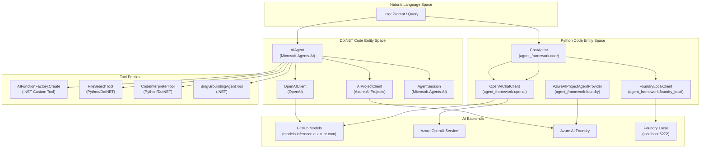

<!-- source: DeepWiki mcp.deepwiki.com · repo microsoft/Agent-Framework-Samples · page 1 Overview · fetched 2026-10-26 -->

# Overview

Relevant source files

The following files were used as context for generating this wiki page:

- [.devcontainer/devcontainer.json](.devcontainer/devcontainer.json)
- [.devcontainer/setup.sh](.devcontainer/setup.sh)
- [.github/dependabot.yml](.github/dependabot.yml)
- [.vscode/settings.json](.vscode/settings.json)
- [00.ForBeginners/04-tool-use/code_samples/dotnet-agent-framework-ghmodels-tool/Program.cs](00.ForBeginners/04-tool-use/code_samples/dotnet-agent-framework-ghmodels-tool/Program.cs)
- [09.Cases/README.md](09.Cases/README.md)
- [Installation/requirements.txt](Installation/requirements.txt)
- [README.md](README.md)

This page describes the purpose, structure, and scope of the **Agent-Framework-Samples** repository. It covers the folder layout, supported languages, AI backends, and the learning progression the repository is designed to follow. For environment setup and credential configuration, see **Getting Started**. For a deep dive into the agent runtime abstractions (`AIAgent`, `AgentSession`), see **Core Concepts**.

---

## Purpose

The repository is a hands-on, structured guide for building AI agents with the **Microsoft Agent Framework (MAF)**. It provides runnable samples in both **Python** and **.NET (C#)**, organized as a progressive curriculum from first principles through production case studies [README.md:1-8]().

The samples demonstrate how to leverage the LLM as a reasoning engine, integrate tools for action execution, and manage conversation state through sessions [README.md:6-18]().

Sources: [README.md:1-18]()

---

## Supported Languages and AI Backends

The framework exposes a consistent abstraction layer across two runtimes and multiple AI backends.

| Language | Package install | Key classes |
|---|---|---|
| Python | `pip install -r Installation/requirements.txt` | `ChatAgent`, `OpenAIChatClient`, `AzureAIAgentClient` |
| .NET (C#) | Build from source (`dotnet build`) | `AIAgent`, `OpenAIClient`, `AgentSession` |

**Python package breakdown** ([Installation/requirements.txt:1-14]()):

| Package | Purpose |
|---|---|
| `agent-framework-core` | Core agent runtime and base abstractions |
| `agent-framework-foundry` | Azure AI Foundry integration |
| `agent-framework-devui` | Local debugging and visualization UI |
| `agent-framework-ag-ui` | AG-UI streaming SSE server integration |
| `agent-framework-a2a` | Agent-to-Agent communication patterns |
| `agent-framework-declarative` | YAML-based workflow and agent definitions |
| `agent-framework-foundry-local` | Foundry Local (SLM) runtime support |
| `agent-framework-tools` | Built-in tool implementations (Code Interpreter, Bing, etc.) |

**Supported AI backends:**

| Backend | Environment Variable(s) | Client Class |
|---|---|---|
| GitHub Models | `GITHUB_TOKEN`, `GITHUB_ENDPOINT`, `GITHUB_MODEL_ID` | `OpenAIClient` / `OpenAIChatClient` |
| Azure OpenAI Service | `AZURE_OPENAI_ENDPOINT`, `AZURE_OPENAI_CHAT_DEPLOYMENT_NAME` | `AzureOpenAIClient` / `AzureOpenAIChatClient` |
| Azure AI Foundry | `AZURE_AI_PROJECT_ENDPOINT`, `AZURE_AI_MODEL_DEPLOYMENT_NAME` | `AIProjectClient` / `AzureAIAgentClient` |
| Foundry Local | `FOUNDRYLOCAL_ENDPOINT`, `FOUNDRYLOCAL_MODEL_DEPLOYMENT_NAME` | `FoundryLocalClient` / `OpenAIChatClient` |

Sources: [README.md:26-30](), [Installation/requirements.txt:1-14](), [00.ForBeginners/04-tool-use/code_samples/dotnet-agent-framework-ghmodels-tool/Program.cs:34-46]()

---

## Repository Folder Structure

**Top-level directory map:**

```mermaid
graph TD
    root["Agent-Framework-Samples (root)"]
    root --> d00["00.ForBeginners\nTutorials extending ai-agents-for-beginners"]
    root --> d01["01.AgentFoundation\nConcept documentation"]
    root --> d02["02.CreateYourFirstAgent\nFirst travel agent (GitHub Models)"]
    root --> d03["03.ExploreAgentFramework\nProvider integrations (AOAI, GHModels, Foundry, Local)"]
    root --> d04["04.Tools\nVision, Code Interpreter, Bing, File Search"]
    root --> d05["05.Providers\nMCP + A2A patterns"]
    root --> d06["06.RAGs\nFile Search + Vector Store RAG"]
    root --> d07["07.Workflow\nSequential, Concurrent, Conditional workflows"]
    root --> d08["08.EvaluationAndTracing\nDevUI, OpenTelemetry, Red Teaming"]
    root --> d09["09.Cases\nProduction case studies"]
    root --> inst["Installation/requirements.txt"]
```

Sources: [README.md:19-33]()

**Detailed folder contents:**

| Directory | .NET Samples | Python Samples |
|---|---|---|
| `00.ForBeginners` | Travel Agent, Basic Agent, Design Patterns, Tool Use, RAG Search, Planning, Multi-Agent | Same (Jupyter notebooks) |
| `01.AgentFoundation` | Documentation only | Documentation only |
| `02.CreateYourFirstAgent` | `dotnet-travelagent-ghmodel/` | `python-travelagent-ghmodel.ipynb` |
| `03.ExploreAgentFramework` | AOAI, GHModels, MS Foundry, Foundry Local | Same |
| `04.Tools` | Vision, Code Interpreter, Bing Grounding, File Search | Same |
| `05.Providers` | MCP with Microsoft Learn | Same |
| `06.RAGs` | File Search RAG | Same |
| `07.Workflow` | Basic, Sequential, Concurrent, Conditional | Same |
| `08.EvaluationAndTracing` | GitHub Models Workflow DevUI | Single agent DevUI, multi-agent DevUI variants |
| `09.Cases` | GHModel.AI, MicrosoftFoundryWithAITKAndMAF | AgenticMarketing, FoundryLocalPipeline, maf_harness_managed_agent |

Sources: [README.md:21-33](), [09.Cases/README.md:1-18]()

---

## Core Architecture

Every sample in the repository is built on a common set of abstractions. The diagram below maps conceptual roles to concrete code entities found in the repository.

**Diagram: Core runtime abstractions and provider wiring**

Sources: [00.ForBeginners/04-tool-use/code_samples/dotnet-agent-framework-ghmodels-tool/Program.cs:42-59](), [09.Cases/README.md:11-12](), [Installation/requirements.txt:1-14]()

---

## Learning Path

The modules are designed to be followed in order. The `00.ForBeginners` track runs in parallel as a conceptual primer.

**Diagram: Module dependency and progression**

```mermaid
graph LR
    subgraph "Foundation"
        M01["01.AgentFoundation\n(Concepts)"]
        M02["02.CreateYourFirstAgent\n(AIAgent + GitHub Models)"]
    end

    subgraph "Intermediate"
        M03["03.ExploreAgentFramework\n(Providers: AOAI, Foundry, Local)"]
        M04["04.Tools\n(Vision, Code Interpreter, Bing)"]
        M06["06.RAGs\n(File Search)"]
    end

    subgraph "Advanced"
        M05["05.Providers\n(MCP, Agent-to-Agent)"]
        M07["07.Workflow\n(Sequential, Concurrent)"]
        M08["08.Evaluation\n(DevUI, OpenTelemetry, RedTeaming)"]
    end

    subgraph "Case Studies"
        C1["09.Cases\n(Production Scenarios)"]
    end

    M01 --> M02
    M02 --> M03
    M03 --> M04
    M04 --> M06
    M06 --> M05
    M05 --> M07
    M07 --> M08
    M08 --> C1
```

Sources: [README.md:19-33]()

---

## Key Abstractions at a Glance

| Concept | Python symbol | .NET symbol | Primary Role |
|---|---|---|---|
| **Agent** | `ChatAgent` | `AIAgent` | The entity configured with instructions and tools [00.ForBeginners/04-tool-use/code_samples/dotnet-agent-framework-ghmodels-tool/Program.cs:49-52](). |
| **Session** | `thread` | `AgentSession` | Manages conversation state and history [00.ForBeginners/04-tool-use/code_samples/dotnet-agent-framework-ghmodels-tool/Program.cs:56](). |
| **Execution** | `run()` / `run_stream()` | `RunAsync()` / `RunStreamingAsync()` | Invokes the agent loop to process a query [00.ForBeginners/04-tool-use/code_samples/dotnet-agent-framework-ghmodels-tool/Program.cs:59](). |
| **Tooling** | Function docstrings | `AIFunctionFactory.Create` | Bridges code functions to LLM tool calls [00.ForBeginners/04-tool-use/code_samples/dotnet-agent-framework-ghmodels-tool/Program.cs:51](). |
| **Workflow** | `WorkflowBuilder` | `AgentWorkflowBuilder` | Orchestrates multi-agent interactions [README.md:30](). |

Sources: [00.ForBeginners/04-tool-use/code_samples/dotnet-agent-framework-ghmodels-tool/Program.cs:49-59](), [README.md:30]()

---

## Production Case Studies (`09.Cases`)

The `09.Cases` directory contains standalone applications that combine multiple framework capabilities into realistic scenarios.

*   **GHModel.AI**: Demonstrates a dual-agent workflow (FrontDesk + Concierge) with DevUI and OpenTelemetry tracing [09.Cases/README.md:8-9]().
*   **AgenticMarketingContentGen**: A four-phase workflow (Strategy, Copywriting, Image, Video) using Pydantic schemas and tools like Tavily and FLUX [09.Cases/README.md:5-6]().
*   **FoundryLocalPipeline**: Iterative Deep Research using local SLMs (Qwen2.5) via `FoundryLocalClient` and red teaming for safety evaluation [09.Cases/README.md:11-12]().
*   **MicrosoftFoundryWithAITKAndMAF**: A declarative "configuration as code" approach using `workflow.yaml` for recruitment scenarios [09.Cases/README.md:14-15]().
*   **maf_harness_managed_agent**: Implements a "Brain-Hands-Memory" architecture with stateless orchestrators and durable session logs [09.Cases/README.md:17-18]().

Sources: [09.Cases/README.md:1-18]()

---

