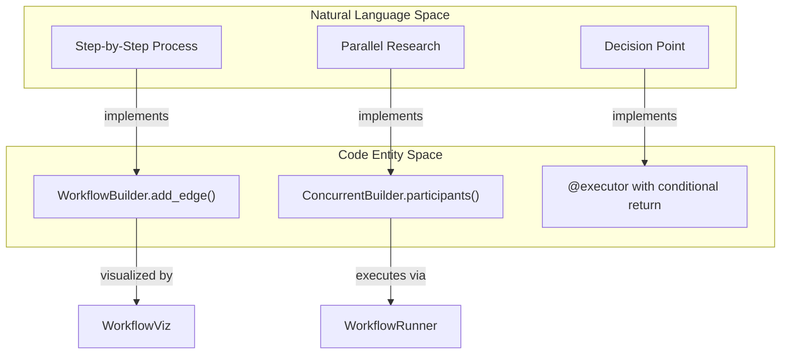
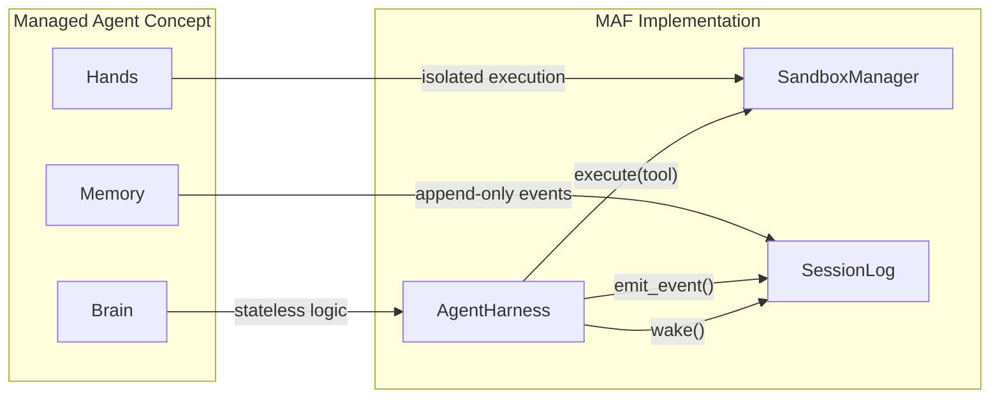

<!-- source: DeepWiki mcp.deepwiki.com · repo microsoft/Agent-Framework-Samples · page 10 Glossary · fetched 2026-10-26 -->

# Glossary

Relevant source files

The following files were used as context for generating this wiki page:

- [.devcontainer/devcontainer.json](.devcontainer/devcontainer.json)
- [.devcontainer/setup.sh](.devcontainer/setup.sh)
- [.github/dependabot.yml](.github/dependabot.yml)
- [.vscode/settings.json](.vscode/settings.json)
- [00.ForBeginners/04-tool-use/code_samples/dotnet-agent-framework-ghmodels-tool/Program.cs](00.ForBeginners/04-tool-use/code_samples/dotnet-agent-framework-ghmodels-tool/Program.cs)
- [07.Workflow/code_samples/dotNET/01.dotnet-agent-framework-workflow-ghmodel-basic/workflow.dot](07.Workflow/code_samples/dotNET/01.dotnet-agent-framework-workflow-ghmodel-basic/workflow.dot)
- [07.Workflow/code_samples/dotNET/02.dotnet-agent-framework-workflow-ghmodel-sequential/workflow.dot](07.Workflow/code_samples/dotNET/02.dotnet-agent-framework-workflow-ghmodel-sequential/workflow.dot)
- [07.Workflow/code_samples/dotNET/03.dotnet-agent-framework-workflow-ghmodel-concurrent/workflow.dot](07.Workflow/code_samples/dotNET/03.dotnet-agent-framework-workflow-ghmodel-concurrent/workflow.dot)
- [07.Workflow/code_samples/python/01.python-agent-framework-workflow-ghmodel-basic.ipynb](07.Workflow/code_samples/python/01.python-agent-framework-workflow-ghmodel-basic.ipynb)
- [07.Workflow/code_samples/python/02.python-agent-framework-workflow-ghmodel-sequential.ipynb](07.Workflow/code_samples/python/02.python-agent-framework-workflow-ghmodel-sequential.ipynb)
- [07.Workflow/code_samples/python/03.python-agent-framework-workflow-ghmodel-concurrent.ipynb](07.Workflow/code_samples/python/03.python-agent-framework-workflow-ghmodel-concurrent.ipynb)
- [07.Workflow/code_samples/python/04.python-agent-framework-workflow-msfoundry-condition.ipynb](07.Workflow/code_samples/python/04.python-agent-framework-workflow-msfoundry-condition.ipynb)
- [09.Cases/README.md](09.Cases/README.md)
- [09.Cases/maf_harness_managed_agent/blog_en.md](09.Cases/maf_harness_managed_agent/blog_en.md)
- [09.Cases/maf_harness_managed_agent/blog_zh.md](09.Cases/maf_harness_managed_agent/blog_zh.md)
- [09.Cases/maf_harness_managed_agent/imgs/logo.png](09.Cases/maf_harness_managed_agent/imgs/logo.png)
- [09.Cases/maf_harness_managed_agent/maf_harness/harness/harness.py](09.Cases/maf_harness_managed_agent/maf_harness/harness/harness.py)
- [09.Cases/maf_harness_managed_agent/maf_harness/hosting/azure_function_host.py](09.Cases/maf_harness_managed_agent/maf_harness/hosting/azure_function_host.py)
- [09.Cases/maf_harness_managed_agent/maf_harness/middleware/middleware.py](09.Cases/maf_harness_managed_agent/maf_harness/middleware/middleware.py)
- [09.Cases/maf_harness_managed_agent/maf_harness/orchestration/multi_agent.py](09.Cases/maf_harness_managed_agent/maf_harness/orchestration/multi_agent.py)
- [09.Cases/maf_harness_managed_agent/maf_harness/sandbox/sandbox.py](09.Cases/maf_harness_managed_agent/maf_harness/sandbox/sandbox.py)
- [09.Cases/maf_harness_managed_agent/maf_harness/session/session_log.py](09.Cases/maf_harness_managed_agent/maf_harness/session/session_log.py)
- [09.Cases/maf_harness_managed_agent/maf_harness/skills/skills.py](09.Cases/maf_harness_managed_agent/maf_harness/skills/skills.py)
- [09.Cases/maf_harness_managed_agent/main.py](09.Cases/maf_harness_managed_agent/main.py)
- [Installation/requirements.txt](Installation/requirements.txt)
- [README.md](README.md)

This glossary defines technical terms, architectural patterns, and domain-specific jargon used throughout the Microsoft Agent Framework (MAF) samples. It serves as a reference for onboarding engineers to bridge the gap between conceptual "Natural Language Space" and concrete "Code Entity Space."

---

## Core Framework Abstractions

### AIAgent
The primary entity representing an autonomous AI. It encapsulates instructions, a reasoning model (LLM), and a set of tools.
*   **Implementation**: Defined as `Agent` in Python [[09.Cases/maf_harness_managed_agent/maf_harness/harness/harness.py:32-33]()] and `AIAgent` in .NET.
*   **Role**: Orchestrates the reasoning loop, deciding when to respond to a user or call a tool.

### AgentSession
A stateful container for a single conversation thread.
*   **Implementation**: `AgentSession` [[09.Cases/maf_harness_managed_agent/maf_harness/session/session_log.py:26-26]()].
*   **Role**: Manages the lifecycle of a conversation, providing a unique `session_id` used to track history and state across turns.

### AgentExecutor
A specialized component within a workflow that encapsulates the logic for running an agent or a specific function.
*   **Implementation**: Referred to as "Executors" in the context of `WorkflowBuilder` [[07.Workflow/README.md:30-30]()].
*   **Role**: Acts as a node in a workflow graph that performs work (e.g., calling an LLM or a tool).

---

## Workflow & Orchestration

### WorkflowBuilder
A fluent API used to design and orchestrate multi-agent processes as directed graphs.
*   **Implementation**: `WorkflowBuilder` [[07.Workflow/code_samples/python/01.python-agent-framework-workflow-ghmodel-basic.ipynb:127-127]()].
*   **Role**: Defines the sequence, branching logic, and transitions between different `AgentExecutor` nodes.

### ConcurrentBuilder
A specialized builder for "Fan-out/Fan-in" patterns where multiple agents execute in parallel.
*   **Implementation**: `ConcurrentBuilder` [[07.Workflow/README.md:30-30]()].
*   **Role**: Manages the simultaneous execution of multiple participants and aggregates their results before moving to the next step.

### Pregel
A graph processing model (Supersteps) used by the framework to manage iterative, stateful execution of workflows.
*   **Concept**: Nodes compute in parallel during a "superstep" and pass messages to be processed in the next superstep.

### WorkflowViz
A utility for generating visual representations of agent workflows.
*   **Implementation**: `WorkflowViz` [[07.Workflow/code_samples/python/01.python-agent-framework-workflow-ghmodel-basic.ipynb:127-127]()].
*   **Role**: Exports workflow graphs to Mermaid or Graphviz formats for debugging and documentation.

**Diagram: Workflow Conceptual to Code Mapping**

*Sources: [[07.Workflow/code_samples/python/01.python-agent-framework-workflow-ghmodel-basic.ipynb:16-19](), [07.Workflow/README.md:30-30](), [07.Workflow/code_samples/python/01.python-agent-framework-workflow-ghmodel-basic.ipynb:127-127]().]*

---

## Managed Agent Architecture (Anthropic Pattern)

### AgentHarness
The "Brain" of the managed agent architecture. It is a stateless orchestrator.
*   **Implementation**: `AgentHarness` [[09.Cases/maf_harness_managed_agent/maf_harness/harness/harness.py:189-189]()].
*   **Role**: Drives the LLM loop but stores no state locally, relying entirely on the `SessionLog`.

### SessionLog
The "Memory" of the managed agent architecture. An append-only, durable event store.
*   **Implementation**: `SessionLog` [[09.Cases/maf_harness_managed_agent/maf_harness/session/session_log.py:65-65]()].
*   **Role**: Decouples session state from the harness, allowing recovery after crashes.

### SandboxManager
The "Hands" of the system. Manages isolated execution environments for tools.
*   **Implementation**: `SandboxManager` [[09.Cases/maf_harness_managed_agent/maf_harness/sandbox/sandbox.py:141-141]()].
*   **Role**: Provisions and reclaims sandboxes (Cattle Mode) to execute untrusted code or tools.

### VaultStore
A secure storage for credentials that never enter the sandbox environment.
*   **Implementation**: `VaultStore` [[09.Cases/maf_harness_managed_agent/maf_harness/sandbox/sandbox.py:27-27]()].
*   **Role**: Holds API keys and tokens, providing them only to the `SandboxManager` at execution time.

### Harness Wake
The process of rehydrating a stateless harness from a durable session log.
*   **Implementation**: `SessionLog.wake(session_id)` [[09.Cases/maf_harness_managed_agent/maf_harness/session/session_log.py:134-134]()].

### Context Compaction
A protocol to summarize old events in the `SessionLog` to fit within the LLM's context window.
*   **Implementation**: `EventKind.COMPACTION` [[09.Cases/maf_harness_managed_agent/maf_harness/session/session_log.py:42-42]()] and the `summarise` skill [[09.Cases/maf_harness_managed_agent/maf_harness/skills/skills.py:88-88]()].

**Diagram: Managed Agent "Brain-Hands-Memory" Mapping**

*Sources: [[09.Cases/maf_harness_managed_agent/maf_harness/harness/harness.py:4-10](), [09.Cases/maf_harness_managed_agent/maf_harness/session/session_log.py:69-72](), [09.Cases/maf_harness_managed_agent/maf_harness/sandbox/sandbox.py:9-13]().]*

---

## AI Clients & Providers

| Term | Description | Code Pointer |
| :--- | :--- | :--- |
| **FoundryChatClient** | Client for Microsoft AI Foundry project endpoints. | `FoundryChatClient` [[09.Cases/maf_harness_managed_agent/maf_harness/harness/harness.py:37-37]()] |
| **OpenAIChatClient** | Client for OpenAI-compatible endpoints (GitHub Models, Azure OpenAI). | `OpenAIChatCompletionClient` [[07.Workflow/code_samples/python/01.python-agent-framework-workflow-ghmodel-basic.ipynb:126-126]()] |
| **AzureAIAgentClient** | Client for persistent Azure AI Foundry agents. | `AIProjectClient` (.NET) [[03.ExploerAgentFramework/README.md:26-26]()] |
| **FoundryLocal** | Integration for running SLMs (Small Language Models) locally. | `FoundryLocalClient` [[03.ExploerAgentFramework/README.md:26-26]()] |
| **MCP** | Model Context Protocol for standardized tool sharing. | `IMcpClient` [[06.6. MCP]()] |

---

## Technical Jargon & Domain Concepts

*   **A2A (Agent-to-Agent)**: A pattern where one agent is registered as a tool for another agent, enabling hierarchical collaboration [[06.7. Agent-to-Agent Communication (A2A)]()].
*   **Cattle Mode**: A design philosophy for sandboxes where instances are considered disposable and replaceable rather than unique "pets" [[09.Cases/maf_harness_managed_agent/maf_harness/sandbox/sandbox.py:10-10]()].
*   **Skill**: A reusable package of instructions and structured capabilities injected into an agent [[09.Cases/maf_harness_managed_agent/maf_harness/skills/skills.py:6-8]()].
*   **Middleware**: Interceptors for cross-cutting concerns like logging, security, and rate limiting [[09.Cases/maf_harness_managed_agent/maf_harness/middleware/middleware.py:39-45]()].
*   **TTFT (Time to First Token)**: A performance metric. The managed agent architecture optimizes TTFT by lazily provisioning sandboxes [[09.Cases/maf_harness_managed_agent/maf_harness/harness/harness.py:109-110]()].
*   **DevUI**: A local debugging interface that provides a visual step-through of agent reasoning and tool calls [[08.EvaluationAndTracing/README.md:31-31]()].
*   **RedTeam**: A safety evaluation class used to scan agents for risks like violence or self-harm [[08.EvaluationAndTracing/README.md:33-33]()].
*   **RAG (Retrieval-Augmented Generation)**: Enhancing agent responses using external data retrieved via a Vector Store or File Search tool [[06.RAGs/README.md:29-29]()].
*   **Structured Output**: Forcing the LLM to return data in a specific schema (e.g., Pydantic models like `CampaignPackage`) [[09.Cases/README.md:6-6]()].

---
*Sources: [[07.Workflow/code_samples/python/01.python-agent-framework-workflow-ghmodel-basic.ipynb:126-128](), [09.Cases/maf_harness_managed_agent/maf_harness/harness/harness.py:32-49](), [09.Cases/maf_harness_managed_agent/maf_harness/session/session_log.py:31-42](), [09.Cases/maf_harness_managed_agent/maf_harness/sandbox/sandbox.py:9-14](), [09.Cases/maf_harness_managed_agent/maf_harness/skills/skills.py:4-11]().]*