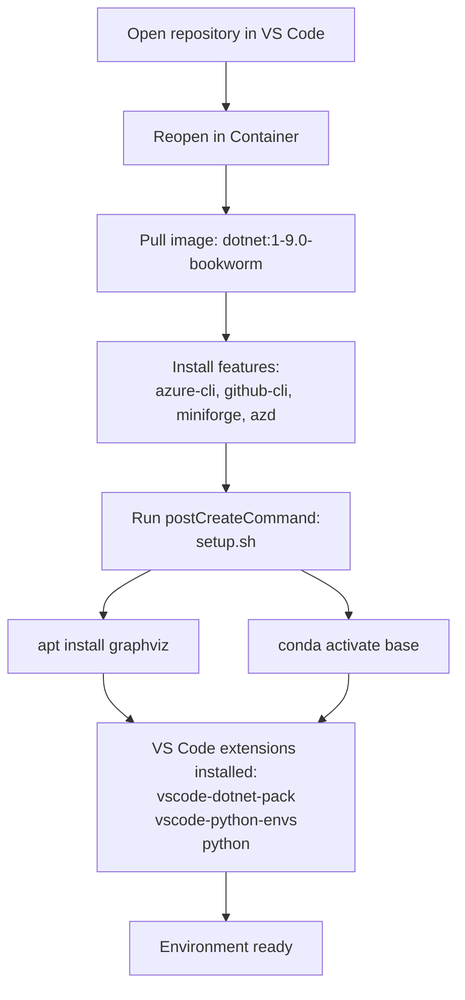
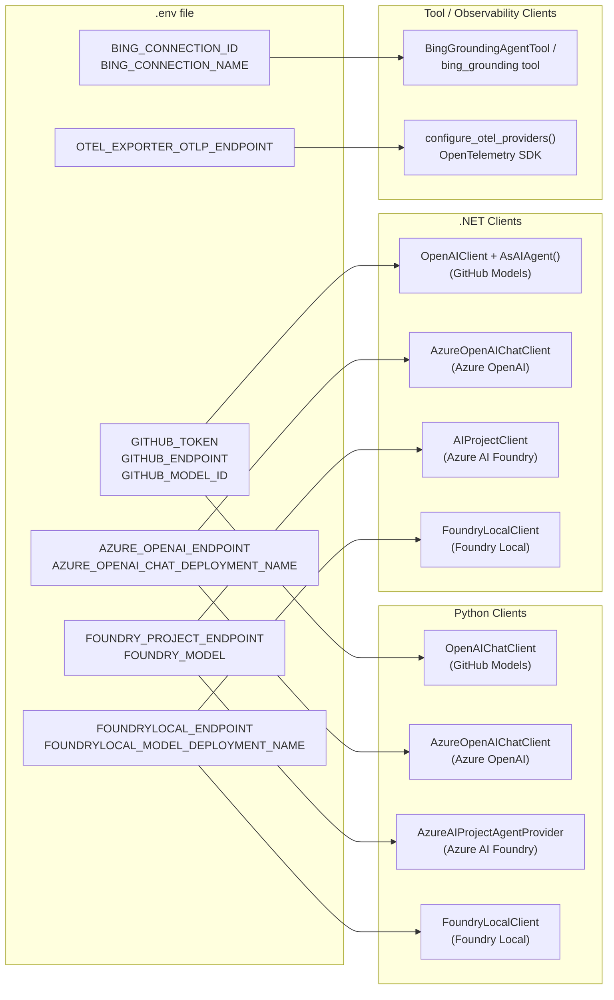

<!-- source: DeepWiki mcp.deepwiki.com · repo microsoft/Agent-Framework-Samples · page 2 Getting Started · fetched 2026-10-26 -->

# Getting Started

<details>
<summary>Relevant source files</summary>

The following files were used as context for generating this wiki page:

- [.devcontainer/devcontainer.json](.devcontainer/devcontainer.json)
- [.devcontainer/setup.sh](.devcontainer/setup.sh)
- [.env.examples](.env.examples)
- [.github/dependabot.yml](.github/dependabot.yml)
- [.vscode/settings.json](.vscode/settings.json)
- [00.ForBeginners/04-tool-use/code_samples/dotnet-agent-framework-ghmodels-tool/Program.cs](00.ForBeginners/04-tool-use/code_samples/dotnet-agent-framework-ghmodels-tool/Program.cs)
- [09.Cases/GHModel.AI/GHModel.Python.AI/GHModel.Python.AI.Workflow.OpenTelemetry/.vscode/settings.json](09.Cases/GHModel.AI/GHModel.Python.AI/GHModel.Python.AI.Workflow.OpenTelemetry/.vscode/settings.json)
- [09.Cases/GHModel.AI/GHModel.Python.AI/GHModel.Python.AI.Workflow.OpenTelemetry/main.py](09.Cases/GHModel.AI/GHModel.Python.AI/GHModel.Python.AI.Workflow.OpenTelemetry/main.py)
- [09.Cases/GHModel.AI/GHModel.Python.AI/GHModel.Python.AI.Workflow.OpenTelemetry/workflow/workflow.py](09.Cases/GHModel.AI/GHModel.Python.AI/GHModel.Python.AI.Workflow.OpenTelemetry/workflow/workflow.py)
- [09.Cases/GHModel.AI/src/Workflows/HrDemoWorkflow.cs](09.Cases/GHModel.AI/src/Workflows/HrDemoWorkflow.cs)
- [09.Cases/MicrosoftFoundryWithAITKAndMAF/CreateWorkflowWithYAML/Program.cs](09.Cases/MicrosoftFoundryWithAITKAndMAF/CreateWorkflowWithYAML/Program.cs)
- [Installation/requirements.txt](Installation/requirements.txt)

</details>


This page covers the minimum steps required to get the Agent-Framework-Samples repository running on your machine: installing language runtimes, pulling the framework source, and supplying the credentials that the samples read at startup. It does not go deep into any individual sample; it establishes the baseline that every sample depends on.

For detailed coverage of the dev container and VS Code tooling, see [Development Environment Setup](#2.1). For a full reference of every environment variable and how it is loaded, see [Configuration Reference](#2.2).

---

## Overview of What You Need

Before running any sample you need three things:

| Requirement | Purpose |
|---|---|
| Language runtime (.NET 9 or Python 3.10+) | Execute the sample code |
| Microsoft Agent Framework source | Provides `Microsoft.Agents.AI` (.NET) and `agent-framework-*` (Python) packages |
| A populated `.env` file | Supplies endpoints and credentials to the samples at runtime |

The repository contains samples in both languages and they can be used independently. You do not need both runtimes unless you want to run both.

Sources: [README.md:34-71]()

---

## Framework Installation

> ⚠️ The Microsoft Agent Framework is in preview (RC2). NuGet and PyPI packages may lag behind the source. **Building from source is strongly recommended.**

### Python

**Runtime requirement:** Python 3.10 or higher.

**Step 1 – Install pre-built convenience packages (quick start):**

The file [Installation/requirements.txt:1-14]() installs all Python sub-packages directly from the `main` branch of the `microsoft/agent-framework` repository using pip's VCS install syntax. This includes core logic, Foundry integration, and specialized tools:

```
agent-framework-core
agent-framework-foundry
agent-framework-devui
agent-framework-ag-ui
agent-framework-anthropic
agent-framework-ollama
agent-framework-a2a
agent-framework-github-copilot
agent-framework-declarative
agent-framework-foundry-local
agent-framework-orchestrations
agent-framework-hyperlight
agent-framework-monty
agent-framework-tools
```

Run:
```bash
pip install -r ./Installation/requirements.txt -U
```

**Step 2 (recommended) – Build from source instead:**

```bash
git clone https://github.com/microsoft/agent-framework.git
cd agent-framework/python
pip install -e .
```

Sources: [README.md:44-58](), [Installation/requirements.txt:1-14]()

---

### .NET

**Runtime requirement:** .NET 9.0 or higher. Visual Studio 2022 or VS Code with the C# extension.

**Build from source:**

```bash
git clone https://github.com/microsoft/agent-framework.git
cd agent-framework/dotnet
dotnet build agent-framework-dotnet.slnx
```

After building, `.csproj` files reference the local source via `<ProjectReference>` instead of NuGet. The case-study projects in `09.Cases` illustrate this pattern — for example, [09.Cases/GHModel.AI/GHModel.dotNET.AI/GHModel.dotNET.AI.Workflow.DevUI/GHModel.dotNET.AI.Workflow.DevUI.csproj:9-13]() references `Microsoft.Agents.AI.DevUI`, `Microsoft.Agents.AI.Hosting`, `Microsoft.Agents.AI.Workflows`, and `Microsoft.Agents.AI.Hosting.OpenAI` directly from disk.

The NuGet packages used across samples include `DotNetEnv` (for `.env` loading), `Azure.Identity`, `Azure.AI.OpenAI`, and `Microsoft.Extensions.AI.OpenAI`.

Sources: [README.md:60-71](), [09.Cases/GHModel.AI/GHModel.dotNET.AI/GHModel.dotNET.AI.Workflow.DevUI/GHModel.dotNET.AI.Workflow.DevUI.csproj:1-25]()

---

## Dev Container (Optional)

The repository ships a pre-configured dev container at [.devcontainer/devcontainer.json:1-43]() that removes most manual setup steps.

**What the container provides:**

| Component | Source |
|---|---|
| Base image: `mcr.microsoft.com/devcontainers/dotnet:1-9.0-bookworm` | [.devcontainer/devcontainer.json:6-6]() |
| `azure-cli` feature | [.devcontainer/devcontainer.json:9-9]() |
| `github-cli` feature | [.devcontainer/devcontainer.json:10-10]() |
| `miniforge` feature | [.devcontainer/devcontainer.json:11-11]() |
| `azd` (Azure Developer CLI) feature | [.devcontainer/devcontainer.json:12-12]() |
| VS Code extensions: `ms-dotnettools.vscode-dotnet-pack`, `ms-python.vscode-python-envs`, `ms-python.python` | [.devcontainer/devcontainer.json:17-19]() |
| `graphviz` system package | [.devcontainer/setup.sh:1-2]() |

The `postCreateCommand` runs [.devcontainer/setup.sh:1-3]() which installs `graphviz` (required by the workflow visualization utilities) and activates the `conda` base environment.

The workspace-level VS Code settings at [.vscode/settings.json:3-4]() configure the Python environment manager to use `conda` by default.

**Dev container flow:**



Sources: [.devcontainer/devcontainer.json:1-43](), [.devcontainer/setup.sh:1-3](), [.vscode/settings.json:1-15]()

---

## Environment Configuration

All samples read credentials from a `.env` file in the repository root. Copy [.env.examples:1-19]() to `.env` and fill in the values that apply to the providers you intend to use.

```
GITHUB_TOKEN="Your GitHub Models Token"
GITHUB_ENDPOINT="Your GitHub Models Endpoint"
GITHUB_MODEL_ID="Your GitHub Model ID"

AZURE_OPENAI_ENDPOINT="Your Azure OpenAI Endpoint"
AZURE_OPENAI_CHAT_DEPLOYMENT_NAME="Your Azure OpenAI Model Deployment Name"

FOUNDRYLOCAL_ENDPOINT="http://localhost:5272/v1"
FOUNDRYLOCAL_MODEL_DEPLOYMENT_NAME="Your Foundry Local Model Deployment Name"

FOUNDRY_PROJECT_ENDPOINT="Your Azure AI Foundry Project Endpoint"
FOUNDRY_MODEL="Your Azure AI Foundry Model Deployment Name"

BING_CONNECTION_ID="Your Bing Connection ID"
BING_CONNECTION_NAME="Your Bing Connection Name"

OTEL_EXPORTER_OTLP_ENDPOINT="http://localhost:4317"
```

**Which variables are required by which provider group:**

| Variable(s) | Required for |
|---|---|
| `GITHUB_TOKEN`, `GITHUB_ENDPOINT`, `GITHUB_MODEL_ID` | GitHub Models samples |
| `AZURE_OPENAI_ENDPOINT`, `AZURE_OPENAI_CHAT_DEPLOYMENT_NAME` | Azure OpenAI samples |
| `FOUNDRY_PROJECT_ENDPOINT`, `FOUNDRY_MODEL` | Azure AI Foundry samples |
| `FOUNDRYLOCAL_ENDPOINT`, `FOUNDRYLOCAL_MODEL_DEPLOYMENT_NAME` | Foundry Local samples (e.g., `09.Cases/FoundryLocalPipeline`) |
| `BING_CONNECTION_ID`, `BING_CONNECTION_NAME` | Bing Grounding tool samples |
| `OTEL_EXPORTER_OTLP_ENDPOINT` | OpenTelemetry tracing (e.g., `GHModel.AI.Workflow.OpenTelemetry`) |

**How `.env` is loaded at runtime:**

- **Python:** `from dotenv import load_dotenv` followed by `load_dotenv()` — seen in [09.Cases/GHModel.AI/GHModel.Python.AI/GHModel.Python.AI.Workflow.OpenTelemetry/main.py:2-16]()
- **.NET:** `DotNetEnv.Env.Load("../../../../.env")` — seen in [00.ForBeginners/04-tool-use/code_samples/dotnet-agent-framework-ghmodels-tool/Program.cs:10-10]()

The path passed to `Env.Load` is relative to the project directory and traverses up to the repository root where `.env` lives.

For a complete description of every variable and its semantics, see [Configuration Reference](#2.2).

Sources: [.env.examples:1-19](), [README.md:99-125](), [09.Cases/GHModel.AI/GHModel.Python.AI/GHModel.Python.AI.Workflow.OpenTelemetry/main.py:2-16](), [00.ForBeginners/04-tool-use/code_samples/dotnet-agent-framework-ghmodels-tool/Program.cs:10-10]()

---

## Credential and Provider Map

The diagram below maps each environment variable group to the framework client class that consumes it, grounding the `.env` file entries in concrete code symbols.

**Environment Variables → Client Classes**



Sources: [.env.examples:1-19](), [00.ForBeginners/04-tool-use/code_samples/dotnet-agent-framework-ghmodels-tool/Program.cs:35-52](), [09.Cases/GHModel.AI/GHModel.Python.AI/GHModel.Python.AI.Workflow.OpenTelemetry/main.py:25-25]()

---

## Platform-Specific Notes

| Platform | Notes |
|---|---|
| **Linux** | Standard `pip install` and `dotnet build`. No extra steps. |
| **macOS** | Use Homebrew for `graphviz` if not using the dev container. |
| **Windows x64** | Standard Windows installation. |
| **Windows ARM64** | Requires OpenSSL for certain Python dependencies. See below. |

**Windows ARM64 – OpenSSL setup:**

```powershell
git config --global core.longpaths true
winget install ShiningLight.OpenSSL.Dev
$env:OPENSSL_DIR="C:\Program Files\OpenSSL-Win64-ARM"
$env:OPENSSL_LIB_DIR="C:\Program Files\OpenSSL-Win64-ARM\lib\VC\arm64\MT"
$env:OPENSSL_STATIC="1"
```

These environment variables must be set before running `pip install`.

Sources: [README.md:75-97]()

---

## Required Azure and GitHub Services

Depending on which samples you intend to run, you will need accounts or access for:

| Service | Used in |
|---|---|
| **GitHub Models** (`gh.io/models`) | Beginner samples and most sequential workflows |
| **Azure OpenAI Service** | Module 03 (AOAI variant) |
| **Azure AI Foundry (V2)** | Advanced tool samples (File Search, Code Interpreter) |
| **Azure CLI** (`az login`) | Required for `AzureCliCredential` used in RBAC-based auth |
| **Azure Developer CLI** (`azd`) | Required for some deployment scenarios |
| **Foundry Local** | Module 03 and local SLM research pipelines |

Sources: [README.md:93-97](), [README.md:40-42]()

---

## Next Steps

Once your environment is set up and `.env` is populated, proceed in this order:

1. **[Core Concepts](#3)** — understand `AIAgent`, `AgentSession`, and tools before touching samples.
2. **[Your First Python Agent](#4.1)** or **[Your First .NET Agent](#4.2)** — run a working agent end-to-end.
3. **[AI Provider Integrations](#5)** — configure the specific backend you have credentials for.

---

