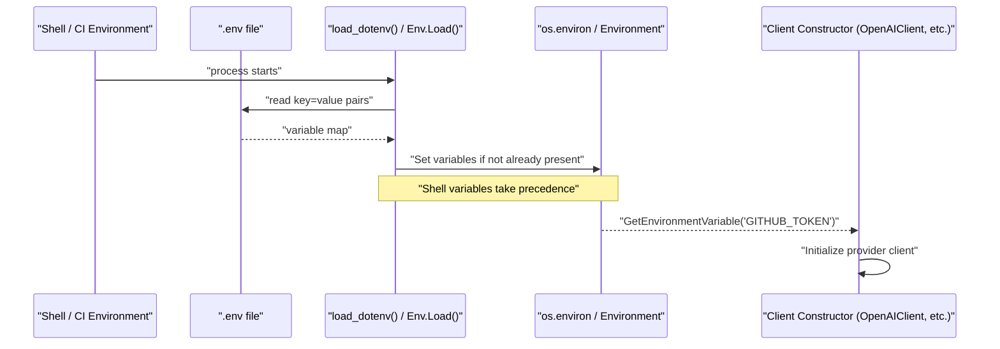

<!-- source: DeepWiki mcp.deepwiki.com · repo microsoft/Agent-Framework-Samples · page 2.2 Configuration Reference · fetched 2026-10-26 -->

# Configuration Reference

<details>
<summary>Relevant source files</summary>

The following files were used as context for generating this wiki page:

- [.devcontainer/devcontainer.json](.devcontainer/devcontainer.json)
- [.devcontainer/setup.sh](.devcontainer/setup.sh)
- [.env.examples](.env.examples)
- [.github/dependabot.yml](.github/dependabot.yml)
- [.vscode/settings.json](.vscode/settings.json)
- [00.ForBeginners/04-tool-use/code_samples/dotnet-agent-framework-ghmodels-tool/Program.cs](00.ForBeginners/04-tool-use/code_samples/dotnet-agent-framework-ghmodels-tool/Program.cs)
- [09.Cases/GHModel.AI/GHModel.Python.AI/GHModel.Python.AI.Workflow.OpenTelemetry/.vscode/settings.json](09.Cases/GHModel.AI/GHModel.Python.AI/GHModel.Python.AI.Workflow.OpenTelemetry/.vscode/settings.json)
- [09.Cases/GHModel.AI/GHModel.Python.AI/GHModel.Python.AI.Workflow.OpenTelemetry/main.py](09.Cases/GHModel.AI/GHModel.Python.AI/GHModel.Python.AI.Workflow.OpenTelemetry/main.py)
- [09.Cases/GHModel.AI/GHModel.Python.AI/GHModel.Python.AI.Workflow.OpenTelemetry/workflow/workflow.py](09.Cases/GHModel.AI/GHModel.Python.AI/GHModel.Python.AI.Workflow.OpenTelemetry/workflow/workflow.py)
- [09.Cases/GHModel.AI/src/Workflows/HrDemoWorkflow.cs](09.Cases/GHModel.AI/src/Workflows/HrDemoWorkflow.cs)
- [09.Cases/MicrosoftFoundryWithAITKAndMAF/CreateWorkflowWithYAML/Program.cs](09.Cases/MicrosoftFoundryWithAITKAndMAF/CreateWorkflowWithYAML/Program.cs)
- [Installation/requirements.txt](Installation/requirements.txt)

</details>


This page documents every environment variable used across the Agent-Framework-Samples repository, explains the purpose of each variable, and describes how variables are loaded at runtime in both Python and .NET projects.

---

## The `.env` File

All samples share a single template for environment variables: [.env.examples:1-19](). Copy this file to `.env` in your working directory and fill in the values appropriate for the providers you intend to use. You do not need to populate every variable—only those relevant to the samples you are running.

```
.env.examples  →  copy to  →  .env  (not committed to source control)
```

The file is structured in provider groups:
[.env.examples:1-19]()

---

## Variable Reference

### GitHub Models

| Variable | Example Value | Purpose |
|---|---|---|
| `GITHUB_TOKEN` | `ghp_...` | Personal Access Token used as the API key for the GitHub Models inference endpoint |
| `GITHUB_ENDPOINT` | `https://models.inference.ai.azure.com` | Base URL for the GitHub Models API |
| `GITHUB_MODEL_ID` | `gpt-4o-mini` | Model identifier to select from the GitHub Models catalog |

These variables are read together to initialize `OpenAIChatClient` (Python) or `OpenAIClient` (C#) pointed at GitHub's inference service. 
Sources: [.env.examples:1-3](), [00.ForBeginners/04-tool-use/code_samples/dotnet-agent-framework-ghmodels-tool/Program.cs:35-46]()

### Azure OpenAI Service

| Variable | Example Value | Purpose |
|---|---|---|
| `AZURE_OPENAI_ENDPOINT` | `https://<resource>.openai.azure.com/` | Endpoint URL of the Azure OpenAI resource |
| `AZURE_OPENAI_CHAT_DEPLOYMENT_NAME` | `gpt-4o` | Name of the model deployment within the Azure OpenAI resource |

Sources: [.env.examples:5-6]()

### Azure AI Foundry

| Variable | Example Value | Purpose |
|---|---|---|
| `FOUNDRY_PROJECT_ENDPOINT` | `https://<hub>.services.ai.azure.com/api/projects/<project>` | Endpoint URL for an Azure AI Foundry project; used to initialize `AIProjectClient` (.NET) or `AzureAIProjectAgentProvider` (Python) |
| `FOUNDRY_MODEL` | `gpt-4o` | Deployment name within the Foundry project |

Sources: [.env.examples:13-14](), [09.Cases/MicrosoftFoundryWithAITKAndMAF/CreateWorkflowWithYAML/Program.cs:17-19]()

### Foundry Local

| Variable | Example Value | Purpose |
|---|---|---|
| `FOUNDRYLOCAL_ENDPOINT` | `http://localhost:5272/v1` | Base URL of the locally running Foundry Local server |
| `FOUNDRYLOCAL_MODEL_DEPLOYMENT_NAME` | `Qwen2.5-1.5B-Instruct` | Name of the SLM loaded in Foundry Local |

Sources: [.env.examples:9-10]()

### Bing Grounding

| Variable | Example Value | Purpose |
|---|---|---|
| `BING_CONNECTION_ID` | `/subscriptions/.../connections/bing-search` | Full Azure resource ID of the Bing Search connection in your AI Foundry hub |
| `BING_CONNECTION_NAME` | `bing-search` | Friendly name used to look up the connection via `AIProjectClient.GetConnectionAsync` |

Sources: [.env.examples:16-17]()

### OpenTelemetry

| Variable | Example Value | Purpose |
|---|---|---|
| `OTEL_EXPORTER_OTLP_ENDPOINT` | `http://localhost:4317` | OTLP collector endpoint for exporting traces and metrics; consumed by `configure_otel_providers()` |

Sources: [.env.examples:19](), [09.Cases/GHModel.AI/GHModel.Python.AI/GHModel.Python.AI.Workflow.OpenTelemetry/main.py:25]()

---

## Variable-to-Provider Map

The diagram below maps each environment variable to the provider or tool it configures and the code entity that reads it.

**Variable Mapping Architecture**

```mermaid
graph TD
    subgraph "GitHubModels"
        G_TOKEN["GITHUB_TOKEN"]
        G_EP["GITHUB_ENDPOINT"]
        G_MID["GITHUB_MODEL_ID"]
        OCClient["OpenAIChatClient (Python) / OpenAIClient (.NET)"]
        G_TOKEN --> OCClient
        G_EP --> OCClient
        G_MID --> OCClient
    end

    subgraph "AzureOpenAI"
        AOAI_EP["AZURE_OPENAI_ENDPOINT"]
        AOAI_DEP["AZURE_OPENAI_CHAT_DEPLOYMENT_NAME"]
        AzOCClient["AzureOpenAIChatClient (Python)"]
        AOAI_EP --> AzOCClient
        AOAI_DEP --> AzOCClient
    end

    subgraph "AzureAIFoundry"
        F_PROJ_EP["FOUNDRY_PROJECT_ENDPOINT"]
        F_MODEL["FOUNDRY_MODEL"]
        B_ID["BING_CONNECTION_ID"]
        B_NAME["BING_CONNECTION_NAME"]
        ProjClient["AIProjectClient (.NET) / AzureAIProjectAgentProvider (Python)"]
        BingTool["BingGroundingSearchConfiguration / bing_grounding tool"]
        F_PROJ_EP --> ProjClient
        F_MODEL --> ProjClient
        B_ID --> BingTool
        B_NAME --> BingTool
    end

    subgraph "FoundryLocal"
        FL_EP["FOUNDRYLOCAL_ENDPOINT"]
        FL_MOD["FOUNDRYLOCAL_MODEL_DEPLOYMENT_NAME"]
        FLClient["FoundryLocalClient"]
        FL_EP --> FLClient
        FL_MOD --> FLClient
    end

    subgraph "Observability"
        OTEL_EP["OTEL_EXPORTER_OTLP_ENDPOINT"]
        OtelProv["configure_otel_providers()"]
        OTEL_EP --> OtelProv
    end
```

Sources: [.env.examples:1-19](), [00.ForBeginners/04-tool-use/code_samples/dotnet-agent-framework-ghmodels-tool/Program.cs:35-46]()

---

## How Variables Are Loaded

### Python — `python-dotenv`

Python samples use the `python-dotenv` package. A call to `load_dotenv()` at the top of the entry-point file reads `.env` and populates `os.environ`.

The standard pattern is:
[09.Cases/GHModel.AI/GHModel.Python.AI/GHModel.Python.AI.Workflow.OpenTelemetry/main.py:15-17]()

```python
from dotenv import load_dotenv
import os

load_dotenv() # Reads .env into os.environ
```

In OpenTelemetry-enabled samples, `load_dotenv()` is called before `configure_otel_providers()` so that `OTEL_EXPORTER_OTLP_ENDPOINT` is available during SDK initialization.
Sources: [09.Cases/GHModel.AI/GHModel.Python.AI/GHModel.Python.AI.Workflow.OpenTelemetry/main.py:16-25]()

### .NET — `DotNetEnv`

.NET samples use the `DotNetEnv` NuGet package. The call `Env.Load()` reads the `.env` file and injects values into `Environment.GetEnvironmentVariable`.

Example usage in .NET:
[00.ForBeginners/04-tool-use/code_samples/dotnet-agent-framework-ghmodels-tool/Program.cs:10-40]()

```csharp
using DotNetEnv;

// Load environment variables from .env file
Env.Load("../../../../.env");

var github_endpoint = Environment.GetEnvironmentVariable("GITHUB_ENDPOINT");
```

---

## Load Order and Runtime Behavior

The diagram below shows the execution sequence from startup to variable consumption.

**Runtime Environment Initialization**

Sources: [00.ForBeginners/04-tool-use/code_samples/dotnet-agent-framework-ghmodels-tool/Program.cs:10-46](), [09.Cases/GHModel.AI/GHModel.Python.AI/GHModel.Python.AI.Workflow.OpenTelemetry/main.py:16-25]()

**Key behaviors:**
- **Precedence:** Shell environment variables take priority over values in `.env`.
- **Timing:** In Python, `load_dotenv()` must be called before importing modules that rely on environment variables for static configuration.
- **Fail-fast:** Most samples check for required variables and throw exceptions if missing, such as the `InvalidOperationException` in .NET.
  Sources: [00.ForBeginners/04-tool-use/code_samples/dotnet-agent-framework-ghmodels-tool/Program.cs:35-39]()

---

## Quick-Start Checklist

| Module Group | Required Variables |
|---|---|
| GitHub Models samples | `GITHUB_TOKEN`, `GITHUB_ENDPOINT`, `GITHUB_MODEL_ID` |
| Azure OpenAI samples | `AZURE_OPENAI_ENDPOINT`, `AZURE_OPENAI_CHAT_DEPLOYMENT_NAME` |
| Azure AI Foundry samples | `FOUNDRY_PROJECT_ENDPOINT`, `FOUNDRY_MODEL` |
| Bing Grounding | `FOUNDRY_PROJECT_ENDPOINT` + `BING_CONNECTION_ID` |
| Foundry Local | `FOUNDRYLOCAL_ENDPOINT`, `FOUNDRYLOCAL_MODEL_DEPLOYMENT_NAME` |
| OpenTelemetry tracing | `OTEL_EXPORTER_OTLP_ENDPOINT` |

Sources: [.env.examples:1-19]()

---

