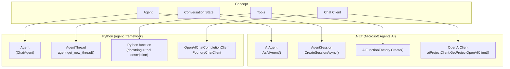
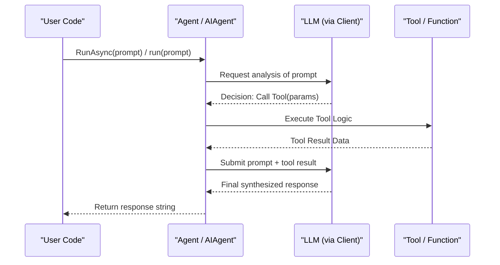

<!-- source: DeepWiki mcp.deepwiki.com · repo microsoft/Agent-Framework-Samples · page 3 Core Concepts · fetched 2026-10-26 -->

# Core Concepts

Relevant source files

The following files were used as context for generating this wiki page:

- [00.ForBeginners/01-intro-to-ai-agents/code_samples/python-agent-framework-travelagent.ipynb](00.ForBeginners/01-intro-to-ai-agents/code_samples/python-agent-framework-travelagent.ipynb)
- [00.ForBeginners/02-explore-agentic-frameworks/code_samples/python-agent-framework-basicagent.ipynb](00.ForBeginners/02-explore-agentic-frameworks/code_samples/python-agent-framework-basicagent.ipynb)
- [00.ForBeginners/03-agentic-design-patterns/code_samples/python-agent-framework-ghmodel-basicagent.ipynb](00.ForBeginners/03-agentic-design-patterns/code_samples/python-agent-framework-ghmodel-basicagent.ipynb)
- [00.ForBeginners/04-tool-use/code_samples/python-agent-framework-ghmodel-tools.ipynb](00.ForBeginners/04-tool-use/code_samples/python-agent-framework-ghmodel-tools.ipynb)
- [00.ForBeginners/05-agentic-rag/code_samples/dotnet-agent-framework-msfoundry-file-search/Program.cs](00.ForBeginners/05-agentic-rag/code_samples/dotnet-agent-framework-msfoundry-file-search/Program.cs)
- [00.ForBeginners/05-agentic-rag/code_samples/python-agent-framework-msfoundry-file-search.ipynb](00.ForBeginners/05-agentic-rag/code_samples/python-agent-framework-msfoundry-file-search.ipynb)
- [00.ForBeginners/07-planning-design/code_samples/python-agent-framrwork-ghmodel-planningdesign.ipynb](00.ForBeginners/07-planning-design/code_samples/python-agent-framrwork-ghmodel-planningdesign.ipynb)
- [00.ForBeginners/08-multi-agent/code_samples/python-agent-framework-ghmodel-workflow-multi-agents.ipynb](00.ForBeginners/08-multi-agent/code_samples/python-agent-framework-ghmodel-workflow-multi-agents.ipynb)
- [09.Cases/README.md](09.Cases/README.md)
- [README.md](README.md)

This page explains the foundational abstractions that every sample in this repository uses: what an AI agent is in the framework's model, how the Microsoft Agent Framework is structured, and which code entities appear in every sample regardless of provider or workflow complexity.

This page provides orientation and overview. The child pages go deeper on each topic: [What Is an AI Agent?](#3.1) covers the agent model and the framework's relationship to Semantic Kernel and AutoGen; [AIAgent and AgentSession](#3.2) documents the two primary runtime classes; [Tools Overview](#3.3) covers the tool registration system. For practical construction steps, see [Building Agents](#4). For per-provider configuration, see [AI Provider Integrations](#5).

---

## What Is an AI Agent?

In this framework, an agent is a runtime component that combines three core elements to achieve autonomy, reactivity, and proactivity [00.ForBeginners/02-explore-agentic-frameworks/code_samples/python-agent-framework-basicagent.ipynb:22-26]():

| Component | Role | Framework Names |
|-----------|------|-----------------|
| **LLM (Reasoning Engine)** | Interprets instructions, decides which tools to call, generates responses | Configured via `IChatClient` (.NET) or `OpenAIChatCompletionClient` / `FoundryChatClient` (Python) |
| **Tools (Action Executors)** | Functions the agent can invoke to retrieve information or perform actions | `AIFunctionFactory.Create()` (.NET); plain Python functions with docstrings |
| **Session / Thread (Memory)** | Persists conversation history across turns in a single interaction | `AgentSession` (.NET); `AgentThread` / `thread` (Python) |

An agent operates in a loop: receive a user message → analyze the request → select a tool → execute tool → synthesize response [00.ForBeginners/04-tool-use/code_samples/python-agent-framework-ghmodel-tools.ipynb:42-45](). This loop is managed by the framework; application code only sees the final answer.

Sources: [00.ForBeginners/02-explore-agentic-frameworks/code_samples/python-agent-framework-basicagent.ipynb:15-33](), [00.ForBeginners/04-tool-use/code_samples/python-agent-framework-ghmodel-tools.ipynb:42-45]()

---

## The Microsoft Agent Framework

The Microsoft Agent Framework (MAF) is designed to be enterprise-ready and simple to integrate [00.ForBeginners/02-explore-agentic-frameworks/code_samples/python-agent-framework-basicagent.ipynb:67-73](). It is distributed as a set of independently installable packages.

**Python packages** [00.ForBeginners/05-agentic-rag/code_samples/python-agent-framework-msfoundry-file-search.ipynb:51-54]():

| Package | Purpose |
|---------|---------|
| `agent-framework-core` | Core agent, session, and workflow abstractions |
| `agent-framework-foundry` | Azure AI Foundry clients and file search integration |
| `agent-framework-devui` | Local DevUI for step-through debugging |
| `agent-framework-a2a` | Agent-to-Agent communication |

**.NET assemblies** referenced across samples [00.ForBeginners/05-agentic-rag/code_samples/dotnet-agent-framework-msfoundry-file-search/Program.cs:2-12]():

| Assembly | Purpose |
|----------|---------|
| `Microsoft.Agents.AI` | Core `AIAgent`, `AgentSession`, and workflow logic |
| `Microsoft.Agents.AI.Foundry` | Integration with Azure AI Projects and persistent agents |
| `Azure.AI.Projects.Agents` | Low-level Azure AI Agent service bindings |

Sources: [00.ForBeginners/02-explore-agentic-frameworks/code_samples/python-agent-framework-basicagent.ipynb:67-73](), [00.ForBeginners/05-agentic-rag/code_samples/python-agent-framework-msfoundry-file-search.ipynb:51-54](), [00.ForBeginners/05-agentic-rag/code_samples/dotnet-agent-framework-msfoundry-file-search/Program.cs:2-12]()

---

## Primary Abstractions

The following diagram maps conceptual roles to the concrete class names used in the codebase.

**Core Abstractions: Concept to Code**

Sources: [00.ForBeginners/05-agentic-rag/code_samples/dotnet-agent-framework-msfoundry-file-search/Program.cs:58-62](), [00.ForBeginners/02-explore-agentic-frameworks/code_samples/python-agent-framework-basicagent.ipynb:113-117](), [00.ForBeginners/05-agentic-rag/code_samples/python-agent-framework-msfoundry-file-search.ipynb:37-41]()

### AIAgent and AgentSession (.NET)

`AIAgent` is the primary entity. In Azure AI Foundry scenarios, it is created by calling `.AsAIAgent()` on an `AIProjectClient` [00.ForBeginners/05-agentic-rag/code_samples/dotnet-agent-framework-msfoundry-file-search/Program.cs:58]().

`AgentSession` manages the stateful context. It is created via `agent.CreateSessionAsync()` [00.ForBeginners/05-agentic-rag/code_samples/dotnet-agent-framework-msfoundry-file-search/Program.cs:62](). To run the agent, you call `agent.RunAsync(query, session)` [00.ForBeginners/05-agentic-rag/code_samples/dotnet-agent-framework-msfoundry-file-search/Program.cs:64]().

### Agent and thread (Python)

In Python, the `Agent` class (often aliased from `ChatAgent`) serves as the orchestrator [00.ForBeginners/02-explore-agentic-frameworks/code_samples/python-agent-framework-basicagent.ipynb:116](). It is initialized with a client, instructions, and tools [00.ForBeginners/01-intro-to-ai-agents/code_samples/python-agent-framework-travelagent.ipynb:196-200]().

For details, see [AIAgent and AgentSession](#3.2).

---

## The Agent Loop

The framework handles the iterative reasoning process where the agent determines if it needs to use a tool before providing a final answer.

**Agent Execution Flow**

Sources: [00.ForBeginners/04-tool-use/code_samples/python-agent-framework-ghmodel-tools.ipynb:42-45](), [00.ForBeginners/01-intro-to-ai-agents/code_samples/python-agent-framework-travelagent.ipynb:28-33]()

---

## Tools

Tools extend agent capabilities beyond text generation [00.ForBeginners/02-explore-agentic-frameworks/code_samples/python-agent-framework-basicagent.ipynb:153-154]().

| Category | Description | Examples |
|----------|-------------|-----------|
| **Custom Functions** | Local code defined by the developer | `get_random_destination` [00.ForBeginners/01-intro-to-ai-agents/code_samples/python-agent-framework-travelagent.ipynb:146-166]() |
| **Hosted Tools** | Managed services provided by Azure AI Foundry | `FileSearchTool` [00.ForBeginners/05-agentic-rag/code_samples/dotnet-agent-framework-msfoundry-file-search/Program.cs:41](), Code Interpreter, Bing Grounding |

**Tool registration:**
- **Python**: Uses function docstrings for the LLM to understand the tool's purpose and return types [00.ForBeginners/02-explore-agentic-frameworks/code_samples/python-agent-framework-basicagent.ipynb:154-162]().
- **.NET**: Uses `AIFunctionFactory.Create` to wrap methods into callable tool definitions.

For details, see [Tools Overview](#3.3).

Sources: [00.ForBeginners/01-intro-to-ai-agents/code_samples/python-agent-framework-travelagent.ipynb:146-166](), [00.ForBeginners/05-agentic-rag/code_samples/dotnet-agent-framework-msfoundry-file-search/Program.cs:41-55]()

---

