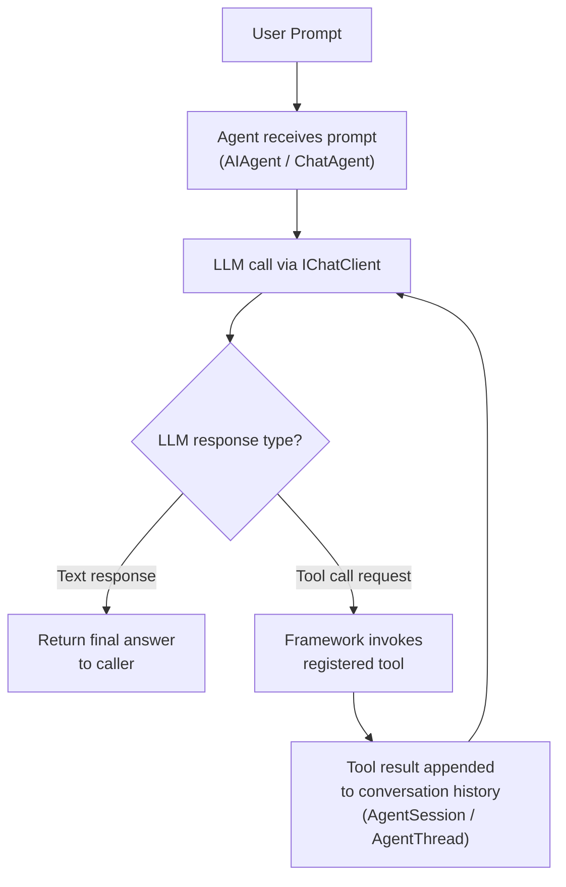
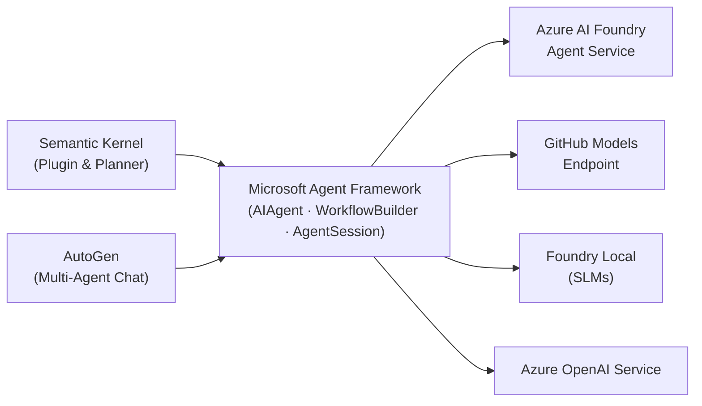

<!-- source: DeepWiki mcp.deepwiki.com · repo microsoft/Agent-Framework-Samples · page 3.1 What Is an AI Agent? · fetched 2026-10-26 -->

# What Is an AI Agent?

Relevant source files

The following files were used as context for generating this wiki page:

- [00.ForBeginners/01-intro-to-ai-agents/code_samples/dotnet-agent-framework-travelagent/dotnet-agent-framework-travelagent.csproj](00.ForBeginners/01-intro-to-ai-agents/code_samples/dotnet-agent-framework-travelagent/dotnet-agent-framework-travelagent.csproj)
- [00.ForBeginners/02-explore-agentic-frameworks/code_samples/dotnet-agent-framework-basicagent/dotnet-agent-framework-basicagent.csproj](00.ForBeginners/02-explore-agentic-frameworks/code_samples/dotnet-agent-framework-basicagent/dotnet-agent-framework-basicagent.csproj)
- [00.ForBeginners/03-agentic-design-patterns/code_samples/dotnet-agent-framework-basicagent/dotnet-agent-framework-basicagent.csproj](00.ForBeginners/03-agentic-design-patterns/code_samples/dotnet-agent-framework-basicagent/dotnet-agent-framework-basicagent.csproj)
- [00.ForBeginners/04-tool-use/code_samples/dotnet-agent-framework-ghmodels-tool/dotnet-agent-framework-ghmodels-tool.csproj](00.ForBeginners/04-tool-use/code_samples/dotnet-agent-framework-ghmodels-tool/dotnet-agent-framework-ghmodels-tool.csproj)
- [00.ForBeginners/05-agentic-rag/code_samples/dotnet-agent-framework-msfoundry-file-search/dotnet-agent-framework-msfoundry-file-search.csproj](00.ForBeginners/05-agentic-rag/code_samples/dotnet-agent-framework-msfoundry-file-search/dotnet-agent-framework-msfoundry-file-search.csproj)
- [00.ForBeginners/07-planning-design/code_samples/dotnet-agent-framrwork-ghmodel-planningdesign/dotnet-agent-framrwork-ghmodel-planningdesign.csproj](00.ForBeginners/07-planning-design/code_samples/dotnet-agent-framrwork-ghmodel-planningdesign/dotnet-agent-framrwork-ghmodel-planningdesign.csproj)
- [00.ForBeginners/08-multi-agent/code_samples/dotnet-agent-framework-ghmodel-workflow-multi-agents/dotnet-agent-framework-ghmodel-workflow-multi-agents.csproj](00.ForBeginners/08-multi-agent/code_samples/dotnet-agent-framework-ghmodel-workflow-multi-agents/dotnet-agent-framework-ghmodel-workflow-multi-agents.csproj)
- [09.Cases/README.md](09.Cases/README.md)
- [README.md](README.md)

This page defines AI agents as the term is used throughout this repository and explains the three constituent parts every agent is built from: a reasoning engine (LLM), tools (action executors), and memory (conversation context). It also explains how the Microsoft Agent Framework relates to its predecessors, Semantic Kernel and AutoGen.

For the runtime classes that implement these concepts (`AIAgent`, `AgentSession`, `AgentThread`), see [AIAgent and AgentSession](#3.2). For a guide to registering specific tool types, see [Tools Overview](#3.3).

---

## The Agent Model

An AI agent is a system that combines an LLM's reasoning capability with the ability to call external functions and maintain conversational state, enabling it to pursue multi-step goals autonomously rather than just responding to a single prompt.

The `01.AgentFoundation` module summarizes the three core components directly:

| Component | Role | Framework Representation |
|---|---|---|
| **LLM (Reasoning Engine)** | Interprets goals, selects actions, generates text | `IChatClient` / `OpenAIChatClient` / `AzureOpenAIChatClient` |
| **Tools (Action Executors)** | Call APIs, run code, search files, access the web | `AIFunctionFactory.Create`, `HostedCodeInterpreterTool`, `FileSearchTool`, `MCPStreamableHTTPTool` |
| **Memory (Context)** | Tracks conversation history across turns | `AgentSession` (Python) / `AgentThread` (.NET) |

Sources: [01.AgentFoundation/README.md:9-15]()

---

## Core Components in Detail

### LLM as Reasoning Engine

The LLM is the decision-making core. It receives the system instructions, conversation history, tool results, and the current user prompt, then decides whether to respond directly or invoke a tool. In the framework, the LLM is accessed through a *chat client* abstraction (`IChatClient`) and never called directly by application code; the agent layer wraps it.

The same agent logic works across multiple LLM backends because the framework normalizes the interface:

| Backend | .NET Client | Python Client |
|---|---|---|
| GitHub Models | `OpenAIClient` (with `models.inference.ai.azure.com` endpoint) | `OpenAIChatClient` |
| Azure OpenAI Service | `AzureOpenAIClient` | `AzureOpenAIChatClient` |
| Azure AI Foundry | `PersistentAgentsClient` → `GetAIAgentAsync` | `AzureAIAgentClient` |
| Foundry Local | `OpenAIClient` (with `localhost:5272/v1` endpoint) | `OpenAIChatClient` |
| Anthropic | — | `agent_framework_anthropic` package |
| Ollama | — | `agent_framework_ollama` package |

Sources: [03.ExploerAgentFramework/README.md:30-310](), [03.ExploerAgentFramework/code_samples/dotNET/04-dotnet-agent-framework-foundrylocal/Program.cs:15-30]()

---

### Tools as Action Executors

Tools are the mechanism by which an agent affects the world beyond generating text. The agent loop determines *when* to call a tool based on the LLM's output; the framework handles actually invoking it and feeding the result back to the LLM.

Tools fall into two categories:

**Custom function tools** — user-defined functions wrapped so the LLM can call them. In .NET, `AIFunctionFactory.Create` wraps a static method annotated with `[Description(...)]`. In Python, a regular function's docstring serves as the tool description. See [00.ForBeginners/04-tool-use/code_samples/dotnet-agent-framework-ghmodels-tool/Program.cs:13-51]() for a concrete example.

**Hosted tools** — pre-built capabilities provided by the platform (Azure AI Foundry). These include:
- `HostedCodeInterpreterTool` / `CodeInterpreterToolDefinition` — sandboxed code execution
- `FileSearchTool` / `FileSearchToolDefinition` — vector store RAG
- `HostedWebSearchTool` / `BingGroundingToolDefinition` — Bing-grounded search
- `MCPStreamableHTTPTool` / `MCPToolDefinition` — Model Context Protocol endpoints

Sources: [01.AgentFoundation/README.md:12-13](), [04.Tools/README.md:1-401](), [05.Providers/README.md:1-30]()

---

### Memory as Conversation Context

An agent without memory resets after every response. The framework provides session/thread objects that accumulate message history across multiple turns so the LLM has full context for follow-up questions.

- **Python**: `AgentSession`, obtained via `agent.create_session_async()` or implicitly managed per-run.
- **.NET**: `AgentThread`, obtained via `agent.GetNewThread()`, or `AgentSession` via `agent.CreateSessionAsync()`.

For persistent agents backed by Azure AI Foundry, the thread is server-side; the client just holds a reference to the thread ID via `Azure.AI.Agents.Persistent`.

Sources: [03.ExploerAgentFramework/README.md:200-260](), [00.ForBeginners/04-tool-use/code_samples/dotnet-agent-framework-ghmodels-tool/Program.cs:54-62](), [00.ForBeginners/08-multi-agent/code_samples/dotnet-agent-framework-ghmodel-workflow-multi-agents/dotnet-agent-framework-ghmodel-workflow-multi-agents.csproj:16-16]()

---

## The Agent Loop

The agent does not simply call the LLM once and return. It runs a loop:

**Agent Execution Loop**

Sources: [01.AgentFoundation/README.md:9-15](), [07.Workflow/README.md:25-37]()

The loop is transparent to application code: calling `agent.RunAsync(prompt)` or `await agent.run(prompt)` blocks until the LLM has finished all tool calls and produced a final text response. Streaming variants (`RunStreamingAsync` / `agent.run_stream`) emit tokens incrementally but follow the same loop internally.

---

## Code Entity Map: Agent Concepts → Framework Classes

**Agent Component to Code Entity Mapping**

```mermaid
graph TD
    subgraph Concept["Conceptual Layer"]
        LLM["Reasoning Engine\n(LLM)"]
        TOOLS["Tools\n(Action Executors)"]
        MEM["Memory\n(Context)"]
        AGENT["Agent"]
    end

    subgraph DotNET[".NET Entities"]
        IChatClient["IChatClient"]
        AIAgent["AIAgent"]
        AIFunctionFactory["AIFunctionFactory.Create()"]
        CodeInterp["CodeInterpreterToolDefinition"]
        FileSearch["FileSearchToolDefinition"]
        BingTool["BingGroundingToolDefinition"]
        MCPTool["MCPToolDefinition"]
        AgentThread["AgentThread"]
        AgentSessionDN["AgentSession"]
    end

    subgraph Python["Python Entities"]
        OpenAIChatClient["OpenAIChatClient"]
        ChatAgent["ChatAgent"]
        FuncTool["Python function\n(docstring as description)"]
        HostedCI["HostedCodeInterpreterTool"]
        HostedFS["HostedFileSearchTool"]
        HostedWS["HostedWebSearchTool"]
        MCPHttp["MCPStreamableHTTPTool"]
        AgentSessionPY["AgentSession"]
    end

    LLM --> IChatClient
    LLM --> OpenAIChatClient
    AGENT --> AIAgent
    AGENT --> ChatAgent
    TOOLS --> AIFunctionFactory
    TOOLS --> CodeInterp
    TOOLS --> FileSearch
    TOOLS --> BingTool
    TOOLS --> MCPTool
    TOOLS --> FuncTool
    TOOLS --> HostedCI
    TOOLS --> HostedFS
    TOOLS --> HostedWS
    TOOLS --> MCPHttp
    MEM --> AgentThread
    MEM --> AgentSessionDN
    MEM --> AgentSessionPY
```

Sources: [00.ForBeginners/04-tool-use/code_samples/dotnet-agent-framework-ghmodels-tool/Program.cs:48-62](), [02.CreateYourFirstAgent/README.md:99-210](), [04.Tools/README.md:1-401](), [05.Providers/README.md:115-163]()

---

## Microsoft Agent Framework and Its Predecessors

The `01.AgentFoundation` README describes the framework as:

> "the spiritual successor and consolidation of learnings from pioneering projects like **Semantic Kernel** and **AutoGen**."

| Framework | Role |
|---|---|
| **Semantic Kernel** | Plugin/skill orchestration, memory connectors, planner primitives |
| **AutoGen** | Multi-agent conversation patterns, agent-to-agent messaging |
| **Microsoft Agent Framework** | Unified successor; merges both into a single runtime with `AIAgent`, `WorkflowBuilder`, and consistent .NET + Python APIs |

The Microsoft Agent Framework does not replace Semantic Kernel or AutoGen for users already invested in them, but for new projects this framework provides a single surface covering all the same capabilities.

**Framework Lineage**

Sources: [01.AgentFoundation/README.md:33-40]()

---

## How a Minimal Agent Is Assembled

The following summary maps the conceptual steps to the actual symbols used in both languages.

| Step | .NET symbol | Python symbol |
|---|---|---|
| 1. Configure LLM connection | `OpenAIClient` / `AzureOpenAIClient` | `OpenAIChatClient` / `AzureOpenAIChatClient` |
| 2. Wrap as agent with instructions | `.AsAIAgent(instructions:...)` or `CreateAIAgent(...)` | `ChatAgent(chat_client=..., instructions=...)` |
| 3. Register tools | `tools: [AIFunctionFactory.Create(...)]` | `tools=[my_function]` |
| 4. Create session/thread | `agent.CreateSessionAsync()` | `agent.create_session_async()` |
| 5. Run | `agent.RunAsync(prompt, session)` | `await agent.run(prompt)` |
| 5a. Streaming variant | `agent.RunStreamingAsync(prompt, session)` | `agent.run_stream(prompt)` |

A concrete .NET example can be seen at [00.ForBeginners/04-tool-use/code_samples/dotnet-agent-framework-ghmodels-tool/Program.cs:48-62](). A Python example is at [02.CreateYourFirstAgent/README.md:186-210]().

For a step-by-step walkthrough of building your first agent in each language, see [Your First Python Agent](#4.1) and [Your First .NET Agent](#4.2).

Sources: [02.CreateYourFirstAgent/README.md:99-228](), [00.ForBeginners/04-tool-use/code_samples/dotnet-agent-framework-ghmodels-tool/Program.cs:1-63](), [03.ExploerAgentFramework/README.md:47-100]()

---

