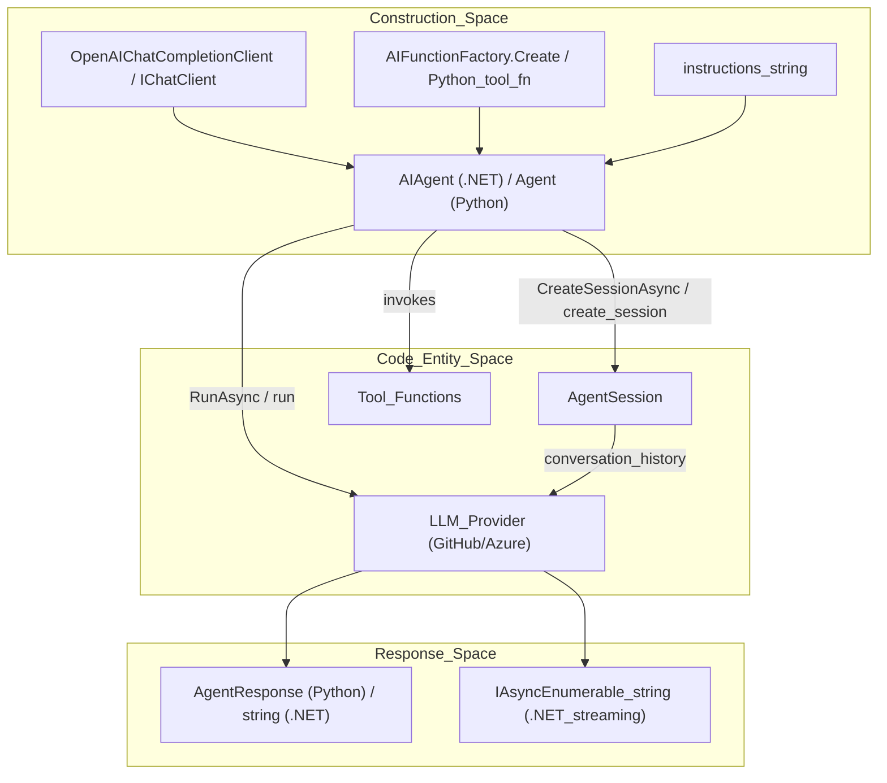
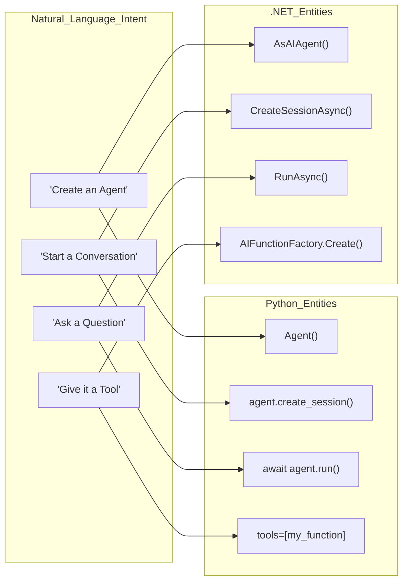

<!-- source: DeepWiki mcp.deepwiki.com · repo microsoft/Agent-Framework-Samples · page 3.2 AIAgent and AgentSession · fetched 2026-10-26 -->

# AIAgent and AgentSession

<details>
<summary>Relevant source files</summary>

The following files were used as context for generating this wiki page:

- [.devcontainer/devcontainer.json](.devcontainer/devcontainer.json)
- [.devcontainer/setup.sh](.devcontainer/setup.sh)
- [.github/dependabot.yml](.github/dependabot.yml)
- [.vscode/settings.json](.vscode/settings.json)
- [00.ForBeginners/04-tool-use/code_samples/dotnet-agent-framework-ghmodels-tool/Program.cs](00.ForBeginners/04-tool-use/code_samples/dotnet-agent-framework-ghmodels-tool/Program.cs)
- [02.CreateYourFirstAgent/code_samples/dotNET/dotnet-travelagent-ghmodel/dotnet-travelagent-ghmodel.csproj](02.CreateYourFirstAgent/code_samples/dotNET/dotnet-travelagent-ghmodel/dotnet-travelagent-ghmodel.csproj)
- [02.CreateYourFirstAgent/code_samples/python/python-travelagent-ghmodel.ipynb](02.CreateYourFirstAgent/code_samples/python/python-travelagent-ghmodel.ipynb)
- [03.ExploerAgentFramework/code_samples/python/01-python-agent-framework-aoai.ipynb](03.ExploerAgentFramework/code_samples/python/01-python-agent-framework-aoai.ipynb)
- [03.ExploerAgentFramework/code_samples/python/02-python-agent-framrwork-ghmodel.ipynb](03.ExploerAgentFramework/code_samples/python/02-python-agent-framrwork-ghmodel.ipynb)
- [Installation/requirements.txt](Installation/requirements.txt)

</details>


This page documents the two primary runtime abstractions in the Microsoft Agent Framework: the agent entity (`Agent` in Python / `AIAgent` in .NET) and the conversation state container (`AgentSession`). It covers how each is constructed, how sessions are created and attached, and how agent execution methods differ between the two languages.

For information on how to choose and configure the underlying chat client (GitHub Models, Azure OpenAI, Foundry, etc.), see **AI Provider Integrations**. For how to define tools that agents can invoke, see **Tools Overview**. For building complete agents from scratch with step-by-step examples, see **Building Agents**.

---

## Conceptual Role of Agent and Session

Every sample in this repository operates around the same two-object model:

**Agent Lifecycle and Runtime Data Flow**



Sources: [00.ForBeginners/04-tool-use/code_samples/dotnet-agent-framework-ghmodels-tool/Program.cs:49-59](), [02.CreateYourFirstAgent/code_samples/python/python-travelagent-ghmodel.ipynb:145-146]()

---

## Python: The `Agent` Class

### Construction

The Python `Agent` class lives in the `agent_framework` package. It is the central orchestrator that combines a client, instructions, and tools.

**Direct Constructor Pattern:**

```python
from agent_framework import Agent
from agent_framework.openai import OpenAIChatCompletionClient

agent = Agent(
    client=openai_chat_client,
    instructions="You are a helpful AI Agent...",
    tools=[get_random_destination],
    name="TravelAgent"
)
```

| Parameter | Type | Purpose |
|---|---|---|
| `client` | `OpenAIChatCompletionClient` | The inference client (e.g., GitHub Models or Azure OpenAI) [03.ExploerAgentFramework/code_samples/python/02-python-agent-framrwork-ghmodel.ipynb:128-132]() |
| `instructions` | `str` | System prompt defining the agent's persona and rules [03.ExploerAgentFramework/code_samples/python/01-python-agent-framework-aoai.ipynb:176-176]() |
| `tools` | `list` | Python functions the agent can call [02.CreateYourFirstAgent/code_samples/python/python-travelagent-ghmodel.ipynb:183-189]() |
| `name` | `str` | Identifier for the agent, used in logs and multi-agent scenarios [03.ExploerAgentFramework/code_samples/python/01-python-agent-framework-aoai.ipynb:175-175]() |

Sources: [03.ExploerAgentFramework/code_samples/python/02-python-agent-framrwork-ghmodel.ipynb:92-93](), [02.CreateYourFirstAgent/code_samples/python/python-travelagent-ghmodel.ipynb:145-146]()

### Sessions: `create_session()`

An `AgentSession` holds the conversation history. In Python, sessions are typically managed explicitly to maintain context across multiple turns.

```python
session = agent.create_session()
```

### Running: `run()` and `run_stream()`

**Non-streaming:**
Returns an `AgentResponse` object containing the full message history and the final text.
```python
response = await agent.run("Plan me a day trip", session=session)
```

**Streaming:**
Used for real-time token delivery to the UI.
```python
async for chunk in agent.run_stream("Plan me a day trip", session=session):
    print(chunk, end="")
```

Sources: [03.ExploerAgentFramework/code_samples/python/02-python-agent-framrwork-ghmodel.ipynb:160-160](), [03.ExploerAgentFramework/code_samples/python/01-python-agent-framework-aoai.ipynb:189-190]()

---

## .NET: The `AIAgent` Class

### Construction

In .NET, `AIAgent` is defined in `Microsoft.Agents.AI`. It is often produced using the `AsAIAgent()` extension method on an `IChatClient`.

**Extension Method Chain:**

```csharp
using Microsoft.Agents.AI;

AIAgent agent = openAIClient
    .GetChatClient(github_model_id)
    .AsIChatClient()
    .AsAIAgent(
        instructions: "You are a helpful AI Agent...",
        tools: [AIFunctionFactory.Create((Func<string>)GetRandomDestination)]
    );
```

| Method/Parameter | Purpose |
|---|---|
| `AsIChatClient()` | Converts `OpenAI.ChatClient` to the generic `IChatClient` interface [00.ForBeginners/04-tool-use/code_samples/dotnet-agent-framework-ghmodels-tool/Program.cs:49-49]() |
| `AsAIAgent()` | Wraps the client with agent-specific logic (instructions, tools) [00.ForBeginners/04-tool-use/code_samples/dotnet-agent-framework-ghmodels-tool/Program.cs:49-52]() |
| `AIFunctionFactory.Create` | Wraps a standard C# method into a tool the agent can understand [00.ForBeginners/04-tool-use/code_samples/dotnet-agent-framework-ghmodels-tool/Program.cs:51-51]() |

Sources: [00.ForBeginners/04-tool-use/code_samples/dotnet-agent-framework-ghmodels-tool/Program.cs:49-52](), [02.CreateYourFirstAgent/code_samples/dotNET/dotnet-travelagent-ghmodel/dotnet-travelagent-ghmodel.csproj:13-14]()

### Sessions: `CreateSessionAsync()`

The `.NET` implementation requires an explicit session to maintain state across calls to the same agent.

```csharp
AgentSession session = await agent.CreateSessionAsync();
```

Sources: [00.ForBeginners/04-tool-use/code_samples/dotnet-agent-framework-ghmodels-tool/Program.cs:56-56]()

### Running: `RunAsync` and `RunStreamingAsync`

**Blocking Execution:**
Returns the final string response from the agent.
```csharp
string response = await agent.RunAsync("Plan me a day trip", session);
```

**Streaming Execution:**
Returns an `IAsyncEnumerable<string>` for real-time output.
```csharp
await foreach (var update in agent.RunStreamingAsync("Plan me a day trip", session))
{
    Console.Write(update);
}
```

Sources: [00.ForBeginners/04-tool-use/code_samples/dotnet-agent-framework-ghmodels-tool/Program.cs:59-62]()

---

## Side-by-Side Comparison

**Natural Language to Code Entity Mapping**



| Feature | Python | .NET |
|---|---|---|
| **Class Name** | `Agent` | `AIAgent` |
| **Session Class** | `AgentSession` | `AgentSession` |
| **Creation** | Constructor or `as_agent()` | Extension `AsAIAgent()` |
| **Primary Run** | `run()` (async) | `RunAsync()` |
| **Streaming** | `run_stream()` | `RunStreamingAsync()` |
| **Tool Registration** | List of functions | `AIFunctionFactory.Create` |
| **Session Init** | `create_session()` (sync) | `CreateSessionAsync()` (async) |

Sources: [02.CreateYourFirstAgent/code_samples/python/python-travelagent-ghmodel.ipynb:145-160](), [00.ForBeginners/04-tool-use/code_samples/dotnet-agent-framework-ghmodels-tool/Program.cs:49-59]()

---

## Implementation Detail: The Agent Loop

When `run()` or `RunAsync()` is called, the framework enters a loop:
1. **Context Assembly**: The `AgentSession` history is combined with the `AIAgent` instructions.
2. **LLM Call**: The request is sent to the `IChatClient` (OpenAI/Azure).
3. **Tool Resolution**: If the LLM returns a tool call, the agent executes the corresponding local function (Python) or `AIFunction` (.NET).
4. **Iteration**: The tool result is appended to the session, and the LLM is called again until a final text response is generated.
5. **Finalization**: The complete turn is saved to the `AgentSession`.

Sources: [00.ForBeginners/04-tool-use/code_samples/dotnet-agent-framework-ghmodels-tool/Program.cs:13-32](), [02.CreateYourFirstAgent/code_samples/python/python-travelagent-ghmodel.ipynb:183-196]()

---

