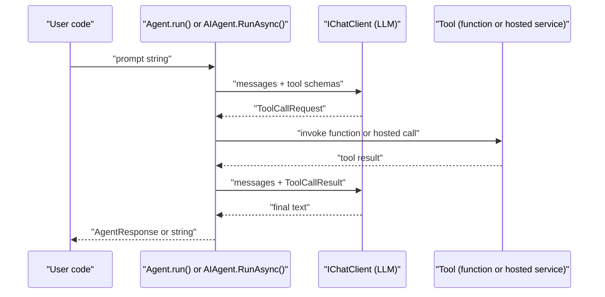
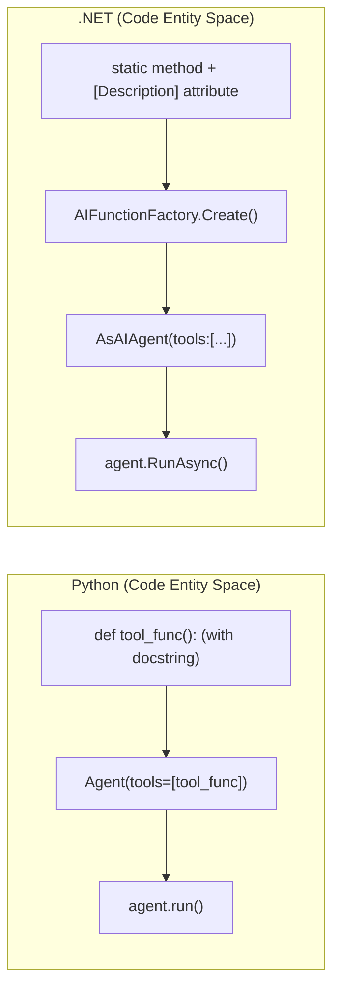
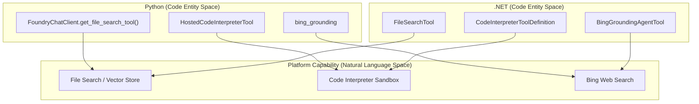

<!-- source: DeepWiki mcp.deepwiki.com · repo microsoft/Agent-Framework-Samples · page 3.3 Tools Overview · fetched 2026-10-26 -->

# Tools Overview

Relevant source files

The following files were used as context for generating this wiki page:

- [00.ForBeginners/01-intro-to-ai-agents/code_samples/python-agent-framework-travelagent.ipynb](00.ForBeginners/01-intro-to-ai-agents/code_samples/python-agent-framework-travelagent.ipynb)
- [00.ForBeginners/02-explore-agentic-frameworks/code_samples/python-agent-framework-basicagent.ipynb](00.ForBeginners/02-explore-agentic-frameworks/code_samples/python-agent-framework-basicagent.ipynb)
- [00.ForBeginners/03-agentic-design-patterns/code_samples/python-agent-framework-ghmodel-basicagent.ipynb](00.ForBeginners/03-agentic-design-patterns/code_samples/python-agent-framework-ghmodel-basicagent.ipynb)
- [00.ForBeginners/04-tool-use/code_samples/python-agent-framework-ghmodel-tools.ipynb](00.ForBeginners/04-tool-use/code_samples/python-agent-framework-ghmodel-tools.ipynb)
- [00.ForBeginners/05-agentic-rag/code_samples/dotnet-agent-framework-msfoundry-file-search/Program.cs](00.ForBeginners/05-agentic-rag/code_samples/dotnet-agent-framework-msfoundry-file-search/Program.cs)
- [00.ForBeginners/05-agentic-rag/code_samples/python-agent-framework-msfoundry-file-search.ipynb](00.ForBeginners/05-agentic-rag/code_samples/python-agent-framework-msfoundry-file-search.ipynb)
- [00.ForBeginners/07-planning-design/code_samples/python-agent-framrwork-ghmodel-planningdesign.ipynb](00.ForBeginners/07-planning-design/code_samples/python-agent-framrwork-ghmodel-planningdesign.ipynb)
- [00.ForBeginners/08-multi-agent/code_samples/python-agent-framework-ghmodel-workflow-multi-agents.ipynb](00.ForBeginners/08-multi-agent/code_samples/python-agent-framework-ghmodel-workflow-multi-agents.ipynb)
- [04.Tools/code_samples/dotNET/msfoundry/01-dotnet-agent-framework-msfoundry-vision/01-dotnet-agent-framework-msfoundry-vision.csproj](04.Tools/code_samples/dotNET/msfoundry/01-dotnet-agent-framework-msfoundry-vision/01-dotnet-agent-framework-msfoundry-vision.csproj)
- [04.Tools/code_samples/dotNET/msfoundry/01-dotnet-agent-framework-msfoundry-vision/Program.cs](04.Tools/code_samples/dotNET/msfoundry/01-dotnet-agent-framework-msfoundry-vision/Program.cs)
- [04.Tools/code_samples/dotNET/msfoundry/02-dotnet-agent-framework-msfoundry-code-interpreter/02-dotnet-agent-framework-msfoundry-code-interpreter.csproj](04.Tools/code_samples/dotNET/msfoundry/02-dotnet-agent-framework-msfoundry-code-interpreter/02-dotnet-agent-framework-msfoundry-code-interpreter.csproj)
- [04.Tools/code_samples/dotNET/msfoundry/02-dotnet-agent-framework-msfoundry-code-interpreter/Program.cs](04.Tools/code_samples/dotNET/msfoundry/02-dotnet-agent-framework-msfoundry-code-interpreter/Program.cs)
- [04.Tools/code_samples/dotNET/msfoundry/03-dotnet-agent-framework-msfoundry-web-search/03-dotnet-agent-framework-msfoundry-web-search.csproj](04.Tools/code_samples/dotNET/msfoundry/03-dotnet-agent-framework-msfoundry-web-search/03-dotnet-agent-framework-msfoundry-web-search.csproj)
- [04.Tools/code_samples/dotNET/msfoundry/03-dotnet-agent-framework-msfoundry-web-search/Program.cs](04.Tools/code_samples/dotNET/msfoundry/03-dotnet-agent-framework-msfoundry-web-search/Program.cs)
- [04.Tools/code_samples/dotNET/msfoundry/04-dotnet-agent-framework-msfoundry-file-search/04-dotnet-agent-framework-msfoundry-file-search.csproj](04.Tools/code_samples/dotNET/msfoundry/04-dotnet-agent-framework-msfoundry-file-search/04-dotnet-agent-framework-msfoundry-file-search.csproj)
- [04.Tools/code_samples/dotNET/msfoundry/04-dotnet-agent-framework-msfoundry-file-search/Program.cs](04.Tools/code_samples/dotNET/msfoundry/04-dotnet-agent-framework-msfoundry-file-search/Program.cs)

This page covers the concept of tools in the Microsoft Agent Framework: how custom Python functions and .NET methods become callable tools, the role of factory methods in .NET, function docstrings in Python, and what built-in hosted tools look like at a conceptual level.

---

## What Is a Tool

A **tool** is a callable unit of work that the LLM can request during an agent run. When the model determines it needs external data or needs to perform an action, it emits a structured tool-call. The framework intercepts the call, executes the associated function or hosted service, and feeds the result back to the LLM. This loop repeats until the LLM produces a final text response.

Tools divide into three kinds:

| Kind | Runs where | Python representation | .NET representation |
|---|---|---|---|
| Custom function | Locally, in your process | Python function with docstring | Static method + `[Description]` + `AIFunctionFactory.Create()` |
| Hosted / built-in | Server-side (Azure AI Foundry) | `HostedFileSearchTool`, `HostedCodeInterpreterTool` | `FileSearchTool`, `CodeInterpreterToolDefinition` |
| Protocol-based | External MCP server | `MCPStreamableHTTPTool` | `MCPToolDefinition` |

---

## Tool Invocation Lifecycle

The sequence below shows how a tool call is inserted into the agent loop, bridging the natural language request to code execution.

**Tool Invocation Lifecycle**

Sources: [00.ForBeginners/04-tool-use/code_samples/python-agent-framework-ghmodel-tools.ipynb:42-45](), [00.ForBeginners/02-explore-agentic-frameworks/code_samples/python-agent-framework-basicagent.ipynb:151-177]()

---

## Custom Function Tools

### Python — Docstring as Description

Any regular Python function can be registered as a tool. The framework reads the function's **docstring** to produce the description that the LLM uses when deciding whether to call the tool. Parameter type annotations generate the argument schema.

The function is registered by including it in the `tools` list passed to the `Agent` constructor:

[00.ForBeginners/01-intro-to-ai-agents/code_samples/python-agent-framework-travelagent.ipynb:143-167]()

[00.ForBeginners/01-intro-to-ai-agents/code_samples/python-agent-framework-travelagent.ipynb:200-206]()

### .NET — `[Description]` Attribute and `AIFunctionFactory`

In .NET, tool registration has two steps:

1. Annotate the method with `[Description("...")]` from `System.ComponentModel`. This string becomes the tool description the LLM reads.
2. Wrap the method with `AIFunctionFactory.Create()` from `Microsoft.Extensions.AI` to produce an `AIFunction` object.

The resulting `AIFunction` is passed in the `tools` array during agent creation (e.g., via `AsAIAgent`).

**Custom Tool Registration Code Paths**

Sources: [00.ForBeginners/01-intro-to-ai-agents/code_samples/python-agent-framework-travelagent.ipynb:143-206](), [00.ForBeginners/03-agentic-design-patterns/code_samples/python-agent-framework-ghmodel-basicagent.ipynb:166-190]()

---

## Built-in Hosted Tools

Hosted tools are services provided by the Azure AI Foundry platform. They run server-side and are represented as objects passed into the agent's `tools` parameter at creation time.

**Hosted Tool Class Names Mapped to Platform Capabilities**

Sources: [00.ForBeginners/05-agentic-rag/code_samples/python-agent-framework-msfoundry-file-search.ipynb:37-41](), [00.ForBeginners/05-agentic-rag/code_samples/dotnet-agent-framework-msfoundry-file-search/Program.cs:41-55](), [04.Tools/code_samples/dotNET/msfoundry/04-dotnet-agent-framework-msfoundry-file-search/Program.cs:39-49]()

### File Search (RAG)

File search provides Retrieval-Augmented Generation (RAG) by querying a vector store of uploaded documents.

1. **Upload**: Files are uploaded via `OpenAIFileClient` with `FileUploadPurpose.Assistants`.
2. **Vector Store**: A `VectorStore` is created using `VectorStoreClient` and linked to the file IDs.
3. **Tool Creation**: A `FileSearchTool` (.NET) or the result of `get_file_search_tool()` (Python) is instantiated using the vector store ID.
4. **Agent Registration**: The tool is added to the `Tools` collection of the agent definition.

Sources: [00.ForBeginners/05-agentic-rag/code_samples/dotnet-agent-framework-msfoundry-file-search/Program.cs:27-55](), [04.Tools/code_samples/dotNET/msfoundry/04-dotnet-agent-framework-msfoundry-file-search/Program.cs:25-49]()

### Code Interpreter

The code interpreter provides a sandboxed execution environment on the platform. The agent writes code and the platform runs it, returning results including stdout and generated files.

- **Python:** `HostedCodeInterpreterTool()` is passed in the `tools` argument.
- **.NET:** `CodeInterpreterToolDefinition` is used within `ProjectsAgentVersionCreationOptions`.

Sources: [04.Tools/code_samples/dotNET/msfoundry/02-dotnet-agent-framework-msfoundry-code-interpreter/02-dotnet-agent-framework-msfoundry-code-interpreter.csproj:1-20]()

### Bing Grounding

Bing grounding enables live web searches, with citations included in the agent response.

- **Python:** Integrated via `AzureAIProjectAgentProvider` and specified as `bing_grounding`.
- **.NET:** `BingGroundingAgentTool` is configured with a connection ID from the Azure AI Project.

Sources: [04.Tools/code_samples/dotNET/msfoundry/03-dotnet-agent-framework-msfoundry-web-search/Program.cs:1-30]()

---

## Protocol-Based Tools (MCP)

Model Context Protocol (MCP) tools connect an agent to an external tool server over HTTP or stdio.

- **Python:** `MCPStreamableHTTPTool` acts as a client to an MCP server.
- **.NET:** `IMcpClient` is created via `McpClientFactory`, and tools are listed using `ListToolsAsync()`.

Detailed implementation details for MCP and Agent-to-Agent (A2A) patterns are covered in sections [6.6]() and [6.7]().

Sources: [00.ForBeginners/07-planning-design/code_samples/python-agent-framrwork-ghmodel-planningdesign.ipynb:95-99](), [00.ForBeginners/08-multi-agent/code_samples/python-agent-framework-ghmodel-workflow-multi-agents.ipynb:129-134]()

---

