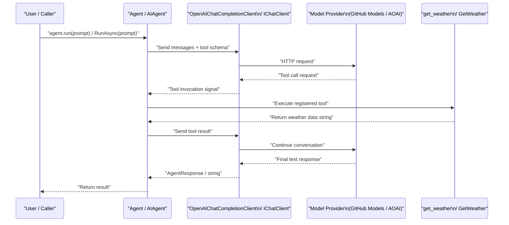

<!-- source: DeepWiki mcp.deepwiki.com · repo microsoft/Agent-Framework-Samples · page 4 Building Agents · fetched 2026-10-26 -->

# Building Agents

<details>
<summary>Relevant source files</summary>

The following files were used as context for generating this wiki page:

- [02.CreateYourFirstAgent/code_samples/dotNET/dotnet-travelagent-ghmodel/dotnet-travelagent-ghmodel.csproj](02.CreateYourFirstAgent/code_samples/dotNET/dotnet-travelagent-ghmodel/dotnet-travelagent-ghmodel.csproj)
- [02.CreateYourFirstAgent/code_samples/python/python-travelagent-ghmodel.ipynb](02.CreateYourFirstAgent/code_samples/python/python-travelagent-ghmodel.ipynb)
- [03.ExploerAgentFramework/code_samples/dotNET/01-dotnet-agent-framework-aoai/01-dotnet-agent-framework-aoai.csproj](03.ExploerAgentFramework/code_samples/dotNET/01-dotnet-agent-framework-aoai/01-dotnet-agent-framework-aoai.csproj)
- [03.ExploerAgentFramework/code_samples/dotNET/01-dotnet-agent-framework-aoai/Program.cs](03.ExploerAgentFramework/code_samples/dotNET/01-dotnet-agent-framework-aoai/Program.cs)
- [03.ExploerAgentFramework/code_samples/dotNET/02-dotnet-agent-framework-ghmodel/02-dotnet-agent-framework-ghmodel.csproj](03.ExploerAgentFramework/code_samples/dotNET/02-dotnet-agent-framework-ghmodel/02-dotnet-agent-framework-ghmodel.csproj)
- [03.ExploerAgentFramework/code_samples/dotNET/03-dotnet-agent-framework-msfoundry/03-dotnet-agent-framework-msfoundry.csproj](03.ExploerAgentFramework/code_samples/dotNET/03-dotnet-agent-framework-msfoundry/03-dotnet-agent-framework-msfoundry.csproj)
- [03.ExploerAgentFramework/code_samples/dotNET/03-dotnet-agent-framework-msfoundry/Program.cs](03.ExploerAgentFramework/code_samples/dotNET/03-dotnet-agent-framework-msfoundry/Program.cs)
- [03.ExploerAgentFramework/code_samples/dotNET/04-dotnet-agent-framework-foundrylocal/04-dotnet-agent-framework-foundrylocal.csproj](03.ExploerAgentFramework/code_samples/dotNET/04-dotnet-agent-framework-foundrylocal/04-dotnet-agent-framework-foundrylocal.csproj)
- [03.ExploerAgentFramework/code_samples/python/01-python-agent-framework-aoai.ipynb](03.ExploerAgentFramework/code_samples/python/01-python-agent-framework-aoai.ipynb)
- [03.ExploerAgentFramework/code_samples/python/02-python-agent-framrwork-ghmodel.ipynb](03.ExploerAgentFramework/code_samples/python/02-python-agent-framrwork-ghmodel.ipynb)
- [03.ExploerAgentFramework/code_samples/python/03-python-agent-framework-msfoundry.ipynb](03.ExploerAgentFramework/code_samples/python/03-python-agent-framework-msfoundry.ipynb)
- [03.ExploerAgentFramework/code_samples/python/04-python-agent-framework-foundrylocal.ipynb](03.ExploerAgentFramework/code_samples/python/04-python-agent-framework-foundrylocal.ipynb)

</details>


This page covers the end-to-end mechanics of constructing an agent using the Microsoft Agent Framework in both Python and .NET. It describes the mandatory components — the chat client, agent object, instructions, and tools — and explains how they fit together before an agent can process a request.

For foundational definitions of `AIAgent`, `AgentSession`, and the agent loop, see [Core Concepts](#3). For configuration of the underlying AI provider (GitHub Models, Azure OpenAI, Azure AI Foundry, Foundry Local), see [AI Provider Integrations](#5). For detailed, step-by-step language-specific tutorials, see [Your First Python Agent](#4.1) and [Your First .NET Agent](#4.2).

---

## Component Model

Every agent, regardless of language or AI provider, is assembled from the same three components.

**Agent assembly diagram**

```mermaid
graph TD
    subgraph "Configuration"
        ENV["".env file\n(GITHUB_TOKEN, GITHUB_ENDPOINT, etc.)""]
    end

    subgraph "Python"
        PY_CLIENT[""OpenAIChatCompletionClient\n(agent_framework.openai)""]
        PY_AGENT[""Agent\n(agent_framework)""]
        PY_TOOL[""Python function\n(e.g. get_random_destination)""]
    end

    subgraph ".NET"
        NET_CLIENT[""OpenAIClient\n(OpenAI namespace)""]
        NET_CHAT[""IChatClient\n(.AsIChatClient())""]
        NET_AGENT[""AIAgent\n(.AsAIAgent())""]
        NET_TOOL[""AIFunctionFactory.Create\n(Microsoft.Extensions.AI)""]
    end

    ENV --> PY_CLIENT
    ENV --> NET_CLIENT
    PY_CLIENT --> PY_AGENT
    PY_TOOL --> PY_AGENT
    NET_CLIENT --> NET_CHAT
    NET_CHAT --> NET_AGENT
    NET_TOOL --> NET_AGENT
```

Sources: [02.CreateYourFirstAgent/code_samples/python/python-travelagent-ghmodel.ipynb:140-248](), [03.ExploerAgentFramework/code_samples/python/02-python-agent-framrwork-ghmodel.ipynb:90-148](), [02.CreateYourFirstAgent/code_samples/dotNET/dotnet-travelagent-ghmodel/dotnet-travelagent-ghmodel.csproj:11-16]()

---

## Step 1 — Load Environment Variables

Both runtimes load credentials from a `.env` file before any agent object is constructed.

| Language | Mechanism | Relevant Line(s) |
|---|---|---|
| Python | `dotenv.load_dotenv()` | [02.CreateYourFirstAgent/code_samples/python/python-travelagent-ghmodel.ipynb:170-170]() |
| .NET | `DotNetEnv.Env.Load(path)` | [03.ExploerAgentFramework/code_samples/dotNET/03-dotnet-agent-framework-msfoundry/Program.cs:10-10]() |

The key environment variables consumed at this stage are `GITHUB_TOKEN`, `GITHUB_ENDPOINT`, and `GITHUB_MODEL_ID`. See [Configuration Reference](#2.2) for the complete list.

Sources: [02.CreateYourFirstAgent/code_samples/python/python-travelagent-ghmodel.ipynb:166-171](), [03.ExploerAgentFramework/code_samples/dotNET/01-dotnet-agent-framework-aoai/Program.cs:7-10]()

---

## Step 2 — Initialize the Chat Client

The chat client is the object that communicates with the model provider. It is constructed before the agent and passed into it.

**Python** uses `OpenAIChatCompletionClient` from `agent_framework.openai`:

```python
openai_chat_client = OpenAIChatCompletionClient(
    base_url=os.environ.get("GITHUB_ENDPOINT"),
    api_key=os.environ.get("GITHUB_TOKEN"),
    model=os.environ.get("GITHUB_MODEL_ID")
)
```
[03.ExploerAgentFramework/code_samples/python/02-python-agent-framrwork-ghmodel.ipynb:126-132]()

**.NET** constructs an `OpenAIClient` (or `AzureOpenAIClient`) then adapts it to the framework's needs. For Azure OpenAI, it uses `AzureCliCredential` for secure access:

[03.ExploerAgentFramework/code_samples/dotNET/01-dotnet-agent-framework-aoai/Program.cs:15-19]()

The framework provides the `AsAIAgent()` extension to bridge the client to the `AIAgent` abstraction.

Sources: [03.ExploerAgentFramework/code_samples/python/02-python-agent-framrwork-ghmodel.ipynb:126-132](), [03.ExploerAgentFramework/code_samples/dotNET/01-dotnet-agent-framework-aoai/Program.cs:15-19]()

---

## Step 3 — Define Tools

Tools are ordinary functions decorated with descriptive docstrings (Python) or `[Description]` attributes (.NET). The framework reflects on these at registration time to produce the tool schema that the model sees.

**Tool definition comparison**

```mermaid
graph LR
    subgraph "Python"
        PY_FN[""def get_random_destination() -> str\n\"\"\"docstring used as tool description\"\"\"""]
    end

    subgraph ".NET"
        NET_FN[""static string GetRandomDestination()\n[Description(\"...\")] attribute""]
        NET_WRAP[""AIFunctionFactory.Create(\n  (Func<string>)GetRandomDestination\n)""]
        NET_FN --> NET_WRAP
    end

    PY_FN --> AGENT_PY[""Agent(tools=[get_random_destination])""]
    NET_WRAP --> AGENT_NET[""AIAgent via .AsAIAgent(tools: [...])""]
```

- **Python**: Pass the function object directly in the `tools` list. The docstring and `Annotated` type hints become the tool description visible to the model. [03.ExploerAgentFramework/code_samples/python/04-python-agent-framework-foundrylocal.ipynb:87-93]()
- **.NET**: Wrap the method in `AIFunctionFactory.Create(...)` before passing it to `AsAIAgent`.

Sources: [02.CreateYourFirstAgent/code_samples/python/python-travelagent-ghmodel.ipynb:181-215](), [03.ExploerAgentFramework/code_samples/python/04-python-agent-framework-foundrylocal.ipynb:139-143]()

---

## Step 4 — Create the Agent

With the client and tools ready, the agent object is constructed.

| Parameter | Python (`Agent`) | .NET (`AsAIAgent`) |
|---|---|---|
| Chat client | `client=openai_chat_client` | called on the `IChatClient` instance |
| System instructions | `instructions="..."` | `instructions: "..."` |
| Tool list | `tools=[get_weather]` | `tools: [AIFunctionFactory.Create(...)]` |
| Agent name | `name="LocalAgent"` | `name: "MAFDemoAgent"` |

**Python:**
[03.ExploerAgentFramework/code_samples/python/02-python-agent-framrwork-ghmodel.ipynb:142-148]()

**.NET:**
[03.ExploerAgentFramework/code_samples/dotNET/01-dotnet-agent-framework-aoai/Program.cs:15-19]()

Sources: [03.ExploerAgentFramework/code_samples/python/02-python-agent-framrwork-ghmodel.ipynb:142-148](), [03.ExploerAgentFramework/code_samples/dotNET/01-dotnet-agent-framework-aoai/Program.cs:15-19]()

---

## Step 5 — Run the Agent

Both runtimes offer two execution modes: a complete response and a streaming response.

**Execution methods**

```mermaid
graph TD
    subgraph "Python (Agent)"
        PY_RUN[""agent.run(prompt)\n→ AgentResponse""]
        PY_STREAM[""agent.run_stream(prompt)\n→ async iterator of chunks""]
    end

    subgraph ".NET (AIAgent)"
        NET_RUN[""await agent.RunAsync(prompt)\n→ string""]
        NET_STREAM[""await foreach agent.RunStreamingAsync(prompt)\n→ IAsyncEnumerable<string>""]
    end
```

**Python — complete response:**
[03.ExploerAgentFramework/code_samples/python/02-python-agent-framrwork-ghmodel.ipynb:157-160]()
The response is an `AgentResponse` object. The final text is typically accessed via `response.text` or by inspecting `response.messages`. [03.ExploerAgentFramework/code_samples/python/03-python-agent-framework-msfoundry.ipynb:107-107]()

**.NET — complete and streaming:**
[03.ExploerAgentFramework/code_samples/dotNET/01-dotnet-agent-framework-aoai/Program.cs:22-27]()

Sources: [03.ExploerAgentFramework/code_samples/python/02-python-agent-framrwork-ghmodel.ipynb:157-160](), [03.ExploerAgentFramework/code_samples/dotNET/01-dotnet-agent-framework-aoai/Program.cs:22-27]()

---

## Full Data Flow

The diagram below maps the complete request lifecycle from user prompt to rendered output, using the concrete class names from the codebase.



Sources: [03.ExploerAgentFramework/code_samples/python/04-python-agent-framework-foundrylocal.ipynb:156-168](), [03.ExploerAgentFramework/code_samples/dotNET/01-dotnet-agent-framework-aoai/Program.cs:15-27]()

---

## Project Setup Reference

### Python Dependencies

Install the core package before running any Python sample:

```bash
pip install agent-framework-core -U
```
[03.ExploerAgentFramework/code_samples/python/02-python-agent-framrwork-ghmodel.ipynb:41-41]()

Key imports used in Python agent files:

| Symbol | Module |
|---|---|
| `Agent` | `agent_framework` |
| `OpenAIChatCompletionClient` | `agent_framework.openai` |
| `FoundryChatClient` | `agent_framework.foundry` |
| `FoundryLocalClient` | `agent_framework_foundry_local` |

Sources: [03.ExploerAgentFramework/code_samples/python/02-python-agent-framrwork-ghmodel.ipynb:92-93](), [03.ExploerAgentFramework/code_samples/python/03-python-agent-framework-msfoundry.ipynb:26-27](), [03.ExploerAgentFramework/code_samples/python/04-python-agent-framework-foundrylocal.ipynb:32-32]()

### .NET NuGet Package References

[02.CreateYourFirstAgent/code_samples/dotNET/dotnet-travelagent-ghmodel/dotnet-travelagent-ghmodel.csproj:11-16]()

| Package | Purpose |
|---|---|
| `Microsoft.Agents.AI` | Core `AIAgent` abstraction and `AsAIAgent()` extension |
| `Microsoft.Extensions.AI.OpenAI` | `IChatClient` adapter for OpenAI SDK |
| `Azure.AI.Projects` | Integration with Azure AI Foundry |
| `Azure.Identity` | `AzureCliCredential` for secure auth |
| `DotNetEnv` | `.env` file loading via `Env.Load()` |

Sources: [02.CreateYourFirstAgent/code_samples/dotNET/dotnet-travelagent-ghmodel/dotnet-travelagent-ghmodel.csproj:11-16](), [03.ExploerAgentFramework/code_samples/dotNET/03-dotnet-agent-framework-msfoundry/03-dotnet-agent-framework-msfoundry.csproj:11-19]()

---

## Azure AI Foundry Variant (.NET)

When targeting Azure AI Foundry, `AIProjectClient` is used to manage agent versions. The `AsAIAgent()` method is called on the project client by passing a `ProjectsAgentVersion`.

[03.ExploerAgentFramework/code_samples/dotNET/03-dotnet-agent-framework-msfoundry/Program.cs:16-33]()

The `FoundryAgent` produced this way integrates with the persistent capabilities of the Foundry platform. For full details on this distinction, see [Azure AI Foundry](#5.3).

Sources: [03.ExploerAgentFramework/code_samples/dotNET/03-dotnet-agent-framework-msfoundry/Program.cs:16-33]()

---

