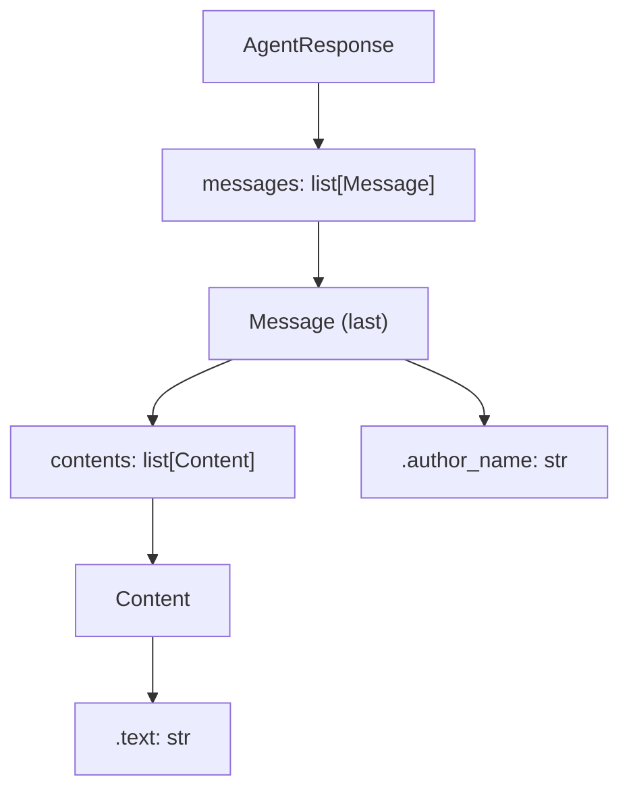
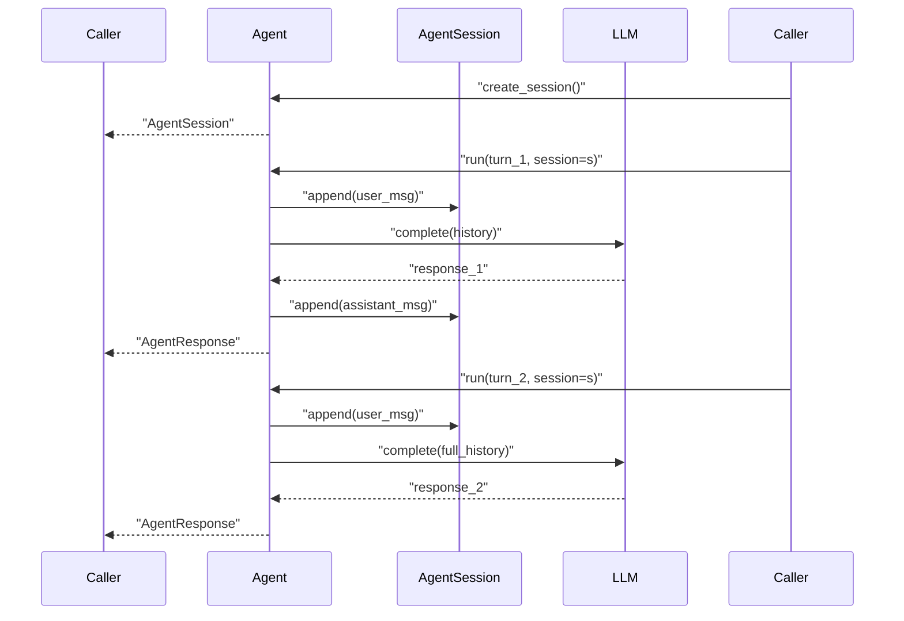
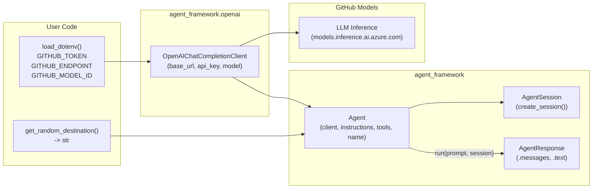

<!-- source: DeepWiki mcp.deepwiki.com · repo microsoft/Agent-Framework-Samples · page 4.1 Your First Python Agent · fetched 2026-10-26 -->

# Your First Python Agent

<details>
<summary>Relevant source files</summary>

The following files were used as context for generating this wiki page:

- [00.ForBeginners/01-intro-to-ai-agents/code_samples/python-agent-framework-travelagent.ipynb](00.ForBeginners/01-intro-to-ai-agents/code_samples/python-agent-framework-travelagent.ipynb)
- [00.ForBeginners/02-explore-agentic-frameworks/code_samples/python-agent-framework-basicagent.ipynb](00.ForBeginners/02-explore-agentic-frameworks/code_samples/python-agent-framework-basicagent.ipynb)
- [00.ForBeginners/03-agentic-design-patterns/code_samples/python-agent-framework-ghmodel-basicagent.ipynb](00.ForBeginners/03-agentic-design-patterns/code_samples/python-agent-framework-ghmodel-basicagent.ipynb)
- [00.ForBeginners/04-tool-use/code_samples/python-agent-framework-ghmodel-tools.ipynb](00.ForBeginners/04-tool-use/code_samples/python-agent-framework-ghmodel-tools.ipynb)
- [00.ForBeginners/05-agentic-rag/code_samples/dotnet-agent-framework-msfoundry-file-search/Program.cs](00.ForBeginners/05-agentic-rag/code_samples/dotnet-agent-framework-msfoundry-file-search/Program.cs)
- [00.ForBeginners/05-agentic-rag/code_samples/python-agent-framework-msfoundry-file-search.ipynb](00.ForBeginners/05-agentic-rag/code_samples/python-agent-framework-msfoundry-file-search.ipynb)
- [00.ForBeginners/07-planning-design/code_samples/python-agent-framrwork-ghmodel-planningdesign.ipynb](00.ForBeginners/07-planning-design/code_samples/python-agent-framrwork-ghmodel-planningdesign.ipynb)
- [00.ForBeginners/08-multi-agent/code_samples/python-agent-framework-ghmodel-workflow-multi-agents.ipynb](00.ForBeginners/08-multi-agent/code_samples/python-agent-framework-ghmodel-workflow-multi-agents.ipynb)
- [02.CreateYourFirstAgent/code_samples/dotNET/dotnet-travelagent-ghmodel/dotnet-travelagent-ghmodel.csproj](02.CreateYourFirstAgent/code_samples/dotNET/dotnet-travelagent-ghmodel/dotnet-travelagent-ghmodel.csproj)
- [02.CreateYourFirstAgent/code_samples/python/python-travelagent-ghmodel.ipynb](02.CreateYourFirstAgent/code_samples/python/python-travelagent-ghmodel.ipynb)
- [03.ExploerAgentFramework/code_samples/python/01-python-agent-framework-aoai.ipynb](03.ExploerAgentFramework/code_samples/python/01-python-agent-framework-aoai.ipynb)
- [03.ExploerAgentFramework/code_samples/python/02-python-agent-framrwork-ghmodel.ipynb](03.ExploerAgentFramework/code_samples/python/02-python-agent-framrwork-ghmodel.ipynb)

</details>


This page walks through every step required to build a working Python agent using the Microsoft Agent Framework: initializing the chat client, writing agent instructions, registering a custom tool function, creating a session, invoking the agent, and reading the response. The travel planning agent from `02.CreateYourFirstAgent/code_samples/python/python-travelagent-ghmodel.ipynb` is used as the concrete working example throughout.

For the equivalent .NET walkthrough, see [Your First .NET Agent](#4.2). For a conceptual explanation of what `Agent` and `AgentSession` represent in the framework, see [AIAgent and AgentSession](#3.2). For details on all supported AI backends, see [AI Provider Integrations](#5).

---

## Prerequisites

Before running any Python agent, three environment variables must be present in a `.env` file or exported to the shell. `python-dotenv` loads these at runtime.

| Variable | Purpose | Example Value |
|---|---|---|
| `GITHUB_TOKEN` | Personal access token for GitHub Models authentication | `ghp_...` |
| `GITHUB_ENDPOINT` | Base URL for the OpenAI-compatible inference endpoint | `https://models.inference.ai.azure.com` |
| `GITHUB_MODEL_ID` | Model identifier sent with every request | `gpt-4o-mini` |

See [Configuration Reference](#2.2) for the full list of environment variables used across the repository, and [GitHub Models](#5.1) for an explanation of the GitHub Models backend specifically.

Install the required Python package:

```bash
pip install agent-framework-core -U
```

---

## Key Imports

Every Python agent built with this framework starts with the same two imports:

[02.CreateYourFirstAgent/code_samples/python/python-travelagent-ghmodel.ipynb:141-147]()

- `Agent` — the top-level agent class from `agent_framework`. It owns instructions, tools, and the chat client.
- `OpenAIChatCompletionClient` — the adapter in `agent_framework.openai` that wraps any OpenAI-compatible HTTP endpoint, including GitHub Models, Azure OpenAI, and Foundry Local.

`load_dotenv()` from `python-dotenv` is called immediately after imports to populate `os.environ` from the `.env` file.

[02.CreateYourFirstAgent/code_samples/python/python-travelagent-ghmodel.ipynb:163-171]()

Sources: `02.CreateYourFirstAgent/code_samples/python/python-travelagent-ghmodel.ipynb`

---

## Step 1 — Define a Tool Function

A tool is an ordinary Python function. The framework reads the function's docstring to generate the tool description that the LLM sees. The function signature determines the parameters the model can pass.

[02.CreateYourFirstAgent/code_samples/python/python-travelagent-ghmodel.ipynb:179-215]()

Key points about the `get_random_destination` tool function:

- **Return type annotation** (`-> str`) is required so the framework knows how to serialize the result.
- **Docstring** becomes the tool description visible to the model. A clear, specific docstring improves tool selection accuracy.
- The function contains no agent-specific code — it is plain Python and can be tested independently.

The same pattern appears across all beginner notebooks: `00.ForBeginners/01-intro-to-ai-agents/code_samples/python-agent-framework-travelagent.ipynb`, `00.ForBeginners/02-explore-agentic-frameworks/code_samples/python-agent-framework-basicagent.ipynb`, and `00.ForBeginners/04-tool-use/code_samples/python-agent-framework-ghmodel-tools.ipynb`.

For a deeper treatment of custom tools, see [Custom Function Tools](#6.1).

Sources: `02.CreateYourFirstAgent/code_samples/python/python-travelagent-ghmodel.ipynb`, `00.ForBeginners/01-intro-to-ai-agents/code_samples/python-agent-framework-travelagent.ipynb`

---

## Step 2 — Initialize OpenAIChatCompletionClient

`OpenAIChatCompletionClient` is constructed with three keyword arguments pulled from environment variables:

[02.CreateYourFirstAgent/code_samples/python/python-travelagent-ghmodel.ipynb:223-231]()

| Parameter | Environment Variable | Role |
|---|---|---|
| `base_url` | `GITHUB_ENDPOINT` | Points to the OpenAI-compatible inference endpoint |
| `api_key` | `GITHUB_TOKEN` | Authenticates the HTTP request |
| `model` | `GITHUB_MODEL_ID` | Sent as the `model` field in each request |

`OpenAIChatCompletionClient` is the Python equivalent of `OpenAIClient` in .NET. The same constructor signature is reused when targeting Azure OpenAI or Foundry Local by changing only the environment variable values.

Sources: `02.CreateYourFirstAgent/code_samples/python/python-travelagent-ghmodel.ipynb`, `00.ForBeginners/02-explore-agentic-frameworks/code_samples/python-agent-framework-basicagent.ipynb`

---

## Step 3 — Create the Agent

The `Agent` constructor accepts the client, a plain-text instructions string, and a list of tool callables:

[02.CreateYourFirstAgent/code_samples/python/python-travelagent-ghmodel.ipynb:240-248]()

| Parameter | Type | Purpose |
|---|---|---|
| `client` | `OpenAIChatCompletionClient` | Underlying LLM connection |
| `instructions` | `str` | System-level instructions prepended to every conversation |
| `tools` | `list[Callable]` | Python functions the agent may call via function-calling |
| `name` | `str` (optional) | Agent identifier used in workflow routing and logs |

When `name` is omitted (as in the simplest form above), the agent has no named identity — relevant for single-agent scenarios. When building workflows, `name` is required so `WorkflowBuilder` can address the executor.

An alternative construction path, used in several beginner notebooks, calls `chat_client.as_agent(instructions=..., name=...)` on the `OpenAIChatCompletionClient` instance directly:

[03.ExploerAgentFramework/code_samples/python/01-python-agent-framework-aoai.ipynb:164-166]()

Both forms produce the same `Agent` object.

Sources: `02.CreateYourFirstAgent/code_samples/python/python-travelagent-ghmodel.ipynb`, `03.ExploerAgentFramework/code_samples/python/01-python-agent-framework-aoai.ipynb`

---

## Step 4 — Run the Agent

`agent.run()` is an `async` method. It accepts a user message string and returns an `AgentResponse`.

[02.CreateYourFirstAgent/code_samples/python/python-travelagent-ghmodel.ipynb:256-260]()

The method executes the complete agent loop internally:

**Agent execution loop: `agent.run()`**

```mermaid
sequenceDiagram
    participant "Caller" as Caller
    participant "Agent" as Agent
    participant "OpenAIChatCompletionClient" as Client
    participant "LLM" as LLM
    participant "get_random_destination()" as Tool

    Caller->>"Agent": "run(user_message)"
    "Agent"->>"Client": "complete(messages)"
    "Client"->>"LLM": "POST /chat/completions"
    "LLM"-->>"Client": "tool_call: get_random_destination"
    "Client"-->>"Agent": "tool_call response"
    "Agent"->>"get_random_destination()": "invoke()"
    "get_random_destination()"-->>"Agent": "\"Cairo, Egypt\""
    "Agent"->>"Client": "complete(messages + tool_result)"
    "Client"->>"LLM": "POST /chat/completions"
    "LLM"-->>"Client": "final text"
    "Client"-->>"Agent": "final text"
    "Agent"-->>Caller: "AgentResponse"
```

Sources: `02.CreateYourFirstAgent/code_samples/python/python-travelagent-ghmodel.ipynb`, `00.ForBeginners/01-intro-to-ai-agents/code_samples/python-agent-framework-travelagent.ipynb`

---

## Step 5 — Read the AgentResponse

`agent.run()` returns an `AgentResponse`. The final assistant message is the last element of `response.messages`:

[02.CreateYourFirstAgent/code_samples/python/python-travelagent-ghmodel.ipynb:309-325]()

The response structure has two levels of nesting:

**`AgentResponse` object model**



| Access path | Type | Value |
|---|---|---|
| `response.messages[-1]` | `Message` | The final assistant turn |
| `response.messages[-1].contents[0]` | `Content` | First content block of the message |
| `response.messages[-1].contents[0].text` | `str` | The text of the response |
| `response.text` | `str` | Shorthand for the full text of the response |

`response.text` provides a shortcut that combines all content blocks into a single string, as seen in the RAG example:

[00.ForBeginners/05-agentic-rag/code_samples/python-agent-framework-msfoundry-file-search.ipynb:259-261]()

Sources: `02.CreateYourFirstAgent/code_samples/python/python-travelagent-ghmodel.ipynb`, `00.ForBeginners/05-agentic-rag/code_samples/python-agent-framework-msfoundry-file-search.ipynb`

---

## Step 6 — Multi-Turn Conversations with Sessions

A session preserves conversation history across multiple `run()` calls. Without a session, each call is stateless.

[00.ForBeginners/02-explore-agentic-frameworks/code_samples/python-agent-framework-basicagent.ipynb:218-232]()

`agent.create_session()` returns an `AgentSession` object. Pass it as the `session` keyword argument to `agent.run()`:

[00.ForBeginners/03-agentic-design-patterns/code_samples/python-agent-framework-ghmodel-basicagent.ipynb:309-311]()

The session accumulates the full message history so that follow-up turns like `"I don't like that destination. Plan me another vacation."` can reference the previous exchange:

[00.ForBeginners/03-agentic-design-patterns/code_samples/python-agent-framework-ghmodel-basicagent.ipynb:364-367]()

**Session-based multi-turn flow**



Sources: `00.ForBeginners/02-explore-agentic-frameworks/code_samples/python-agent-framework-basicagent.ipynb`, `00.ForBeginners/03-agentic-design-patterns/code_samples/python-agent-framework-ghmodel-basicagent.ipynb`, `00.ForBeginners/04-tool-use/code_samples/python-agent-framework-ghmodel-tools.ipynb`

---

## Complete Component Map

The diagram below maps the conceptual agent components to the exact Python symbols used in the code.

**Python agent component map**



Sources: `02.CreateYourFirstAgent/code_samples/python/python-travelagent-ghmodel.ipynb`, `00.ForBeginners/01-intro-to-ai-agents/code_samples/python-agent-framework-travelagent.ipynb`, `00.ForBeginners/02-explore-agentic-frameworks/code_samples/python-agent-framework-basicagent.ipynb`

---

## Summary of the Pattern

The five concrete steps to build a minimal Python agent are:

1. Call `load_dotenv()` to populate credentials.
2. Construct `OpenAIChatCompletionClient(base_url=..., api_key=..., model=...)`.
3. Define one or more plain Python functions as tools (with docstrings and return type annotations).
4. Construct `Agent(client=..., instructions=..., tools=[...])`.
5. `await agent.run("user message")` and read `.messages[-1].contents[0].text` or `.text` from the returned `AgentResponse`.

Add `session = await agent.create_session()` and pass `session=session` to `run()` when conversation history must persist across turns.

---

## Where to Go Next

| Topic | Page |
|---|---|
| Equivalent .NET walkthrough | [Your First .NET Agent](#4.2) |
| Connecting to Azure OpenAI instead of GitHub Models | [Azure OpenAI Service](#5.2) |
| Using Azure AI Foundry as the backend | [Azure AI Foundry](#5.3) |
| Running a model locally with Foundry Local | [Foundry Local](#5.4) |
| Built-in tools: file search, code interpreter, Bing | [Tools and Capabilities](#6) |
| Combining multiple agents into a workflow | [Workflow Orchestration](#7) |

---

