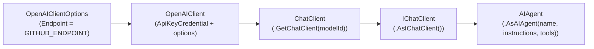
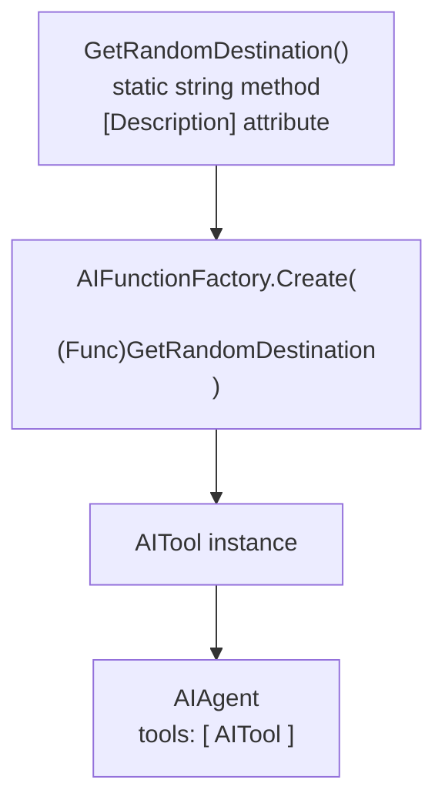
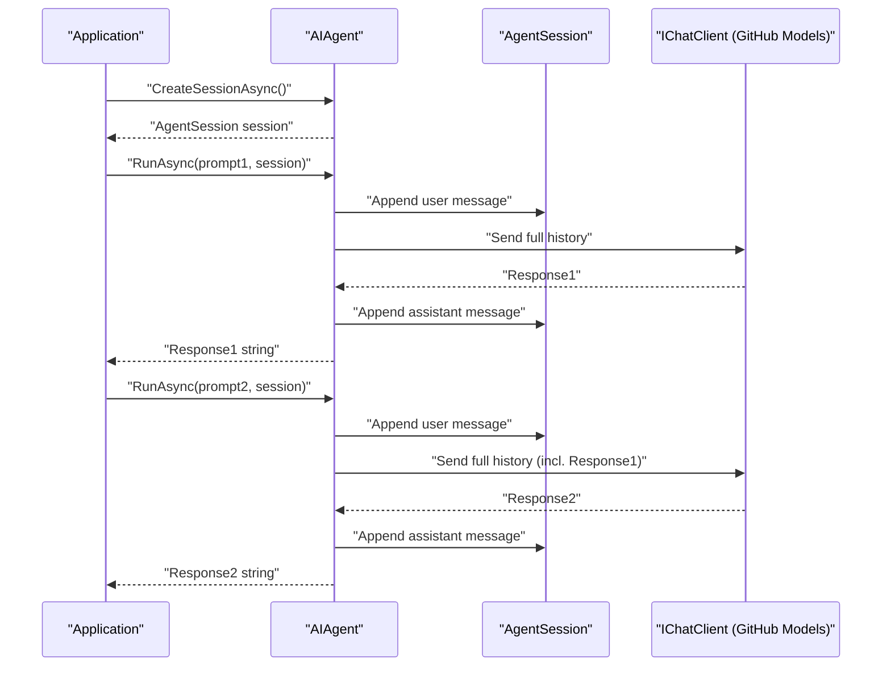
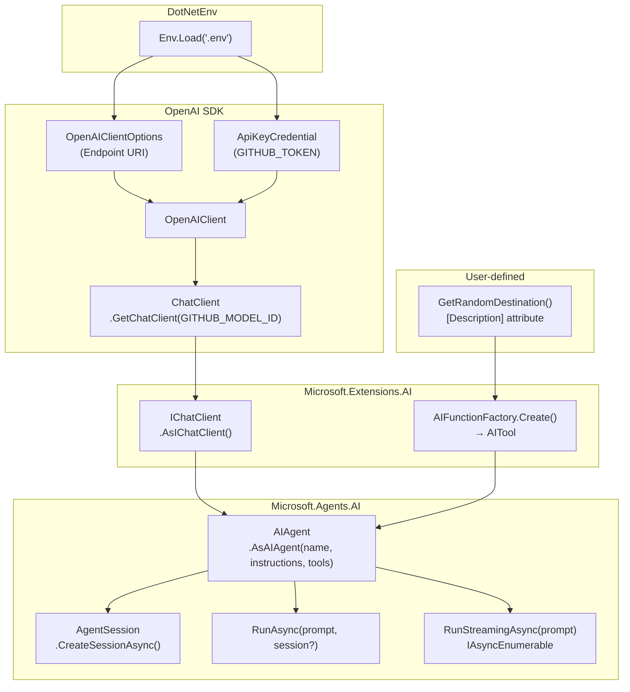

<!-- source: DeepWiki mcp.deepwiki.com · repo microsoft/Agent-Framework-Samples · page 4.2 Your First .NET Agent · fetched 2026-10-26 -->

# Your First .NET Agent

Relevant source files

The following files were used as context for generating this wiki page:

- [00.ForBeginners/01-intro-to-ai-agents/code_samples/dotnet-agent-framework-travelagent/dotnet-agent-framework-travelagent.csproj](00.ForBeginners/01-intro-to-ai-agents/code_samples/dotnet-agent-framework-travelagent/dotnet-agent-framework-travelagent.csproj)
- [00.ForBeginners/02-explore-agentic-frameworks/code_samples/dotnet-agent-framework-basicagent/dotnet-agent-framework-basicagent.csproj](00.ForBeginners/02-explore-agentic-frameworks/code_samples/dotnet-agent-framework-basicagent/dotnet-agent-framework-basicagent.csproj)
- [00.ForBeginners/03-agentic-design-patterns/code_samples/dotnet-agent-framework-basicagent/dotnet-agent-framework-basicagent.csproj](00.ForBeginners/03-agentic-design-patterns/code_samples/dotnet-agent-framework-basicagent/dotnet-agent-framework-basicagent.csproj)
- [00.ForBeginners/04-tool-use/code_samples/dotnet-agent-framework-ghmodels-tool/dotnet-agent-framework-ghmodels-tool.csproj](00.ForBeginners/04-tool-use/code_samples/dotnet-agent-framework-ghmodels-tool/dotnet-agent-framework-ghmodels-tool.csproj)
- [00.ForBeginners/05-agentic-rag/code_samples/dotnet-agent-framework-msfoundry-file-search/dotnet-agent-framework-msfoundry-file-search.csproj](00.ForBeginners/05-agentic-rag/code_samples/dotnet-agent-framework-msfoundry-file-search/dotnet-agent-framework-msfoundry-file-search.csproj)
- [00.ForBeginners/07-planning-design/code_samples/dotnet-agent-framrwork-ghmodel-planningdesign/dotnet-agent-framrwork-ghmodel-planningdesign.csproj](00.ForBeginners/07-planning-design/code_samples/dotnet-agent-framrwork-ghmodel-planningdesign/dotnet-agent-framrwork-ghmodel-planningdesign.csproj)
- [00.ForBeginners/08-multi-agent/code_samples/dotnet-agent-framework-ghmodel-workflow-multi-agents/dotnet-agent-framework-ghmodel-workflow-multi-agents.csproj](00.ForBeginners/08-multi-agent/code_samples/dotnet-agent-framework-ghmodel-workflow-multi-agents/dotnet-agent-framework-ghmodel-workflow-multi-agents.csproj)
- [02.CreateYourFirstAgent/code_samples/dotNET/dotnet-travelagent-ghmodel/dotnet-travelagent-ghmodel.csproj](02.CreateYourFirstAgent/code_samples/dotNET/dotnet-travelagent-ghmodel/dotnet-travelagent-ghmodel.csproj)
- [02.CreateYourFirstAgent/code_samples/python/python-travelagent-ghmodel.ipynb](02.CreateYourFirstAgent/code_samples/python/python-travelagent-ghmodel.ipynb)
- [03.ExploerAgentFramework/code_samples/python/01-python-agent-framework-aoai.ipynb](03.ExploerAgentFramework/code_samples/python/01-python-agent-framework-aoai.ipynb)
- [03.ExploerAgentFramework/code_samples/python/02-python-agent-framrwork-ghmodel.ipynb](03.ExploerAgentFramework/code_samples/python/02-python-agent-framrwork-ghmodel.ipynb)

This page walks through the complete process of building a .NET agent using the Microsoft Agent Framework: setting up the project, loading credentials, constructing the AI client, registering tools, and invoking the agent. The example used throughout is the travel planning agent in `02.CreateYourFirstAgent/code_samples/dotNET/dotnet-travelagent-ghmodel/`.

For the equivalent Python walkthrough, see [4.1](). For a broader discussion of `AIAgent` and `AgentSession` as framework abstractions, see [3.2](). For details on connecting to providers other than GitHub Models, see [5]().

---

## Project Setup

Every .NET agent sample in this repository targets `net10.0` and depends on a consistent set of packages.

**Required package references** (from [02.CreateYourFirstAgent/code_samples/dotNET/dotnet-travelagent-ghmodel/dotnet-travelagent-ghmodel.csproj:1-23]()):

| Package | Version | Purpose |
|---------|---------|---------|
| `DotNetEnv` | 3.1.1 | Loads environment variables from a `.env` file |
| `Microsoft.Extensions.AI` | 10.4.0 | Core AI abstractions (`IChatClient`, `AIFunctionFactory`) |
| `Microsoft.Extensions.AI.OpenAI` | 10.4.0 | OpenAI-compatible client implementation |
| `OpenAI` | 2.9.1 | `OpenAIClient`, `OpenAIClientOptions`, `ApiKeyCredential` |

In addition to these NuGet packages, two framework assemblies must be referenced. Because the framework is in preview, the samples reference the projects directly:

- `Microsoft.Agents.AI` — core agent types (`AIAgent`, `AgentSession`, extension methods)
- `Microsoft.Agents.AI.OpenAI` — `AsAIAgent()` extension on OpenAI chat clients

> **Note**: The `.csproj` files in the repository use local `<ProjectReference>` paths pointing to a cloned copy of the `agent-framework` repository [02.CreateYourFirstAgent/code_samples/dotNET/dotnet-travelagent-ghmodel/dotnet-travelagent-ghmodel.csproj:18-20]().

Sources: [02.CreateYourFirstAgent/code_samples/dotNET/dotnet-travelagent-ghmodel/dotnet-travelagent-ghmodel.csproj:1-23](), [00.ForBeginners/04-tool-use/code_samples/dotnet-agent-framework-ghmodels-tool/dotnet-agent-framework-ghmodels-tool.csproj:1-24]()

---

## Environment Variables

The sample reads three environment variables at startup. These must be present in a `.env` file at the root of the repository (or set in the shell environment).

| Variable | Required | Description |
|----------|----------|-------------|
| `GITHUB_ENDPOINT` | Yes | GitHub Models inference endpoint (`https://models.inference.ai.azure.com`) |
| `GITHUB_TOKEN` | Yes | Personal Access Token for GitHub Models authentication |
| `GITHUB_MODEL_ID` | No | Model identifier; defaults to `gpt-4o-mini` if unset |

`DotNetEnv.Env.Load()` is called at program startup to populate `Environment.GetEnvironmentVariable()` from the `.env` file.

Sources: [02.CreateYourFirstAgent/code_samples/python/python-travelagent-ghmodel.ipynb:62-67](), [03.ExploerAgentFramework/code_samples/python/02-python-agent-framrwork-ghmodel.ipynb:52-56]()

---

## Constructing the Client Chain

The framework uses a layered client construction pattern. Each layer wraps the previous one:

**Diagram: Client Construction Chain**

### Step 1 — Configure the `OpenAIClientOptions`

`OpenAIClientOptions` carries the custom endpoint URI that redirects the OpenAI SDK to GitHub Models instead of `api.openai.com`.

### Step 2 — Create the `OpenAIClient`

`OpenAIClient` is initialized with an `ApiKeyCredential` (wrapping `GITHUB_TOKEN`) and the options object above.

### Step 3 — Call `.GetChatClient(modelId)` then `.AsIChatClient()`

`.GetChatClient(modelId)` returns an OpenAI `ChatClient` scoped to the specified deployment. `.AsIChatClient()` adapts it to the `IChatClient` interface expected by the framework.

### Step 4 — Call `.AsAIAgent()`

`.AsAIAgent()` is an extension method from `Microsoft.Agents.AI.OpenAI` that wraps the `IChatClient` in an `AIAgent`. It accepts:

| Parameter | Type | Description |
|-----------|------|-------------|
| `name` | `string` | Identifies the agent (used in logging and DevUI) |
| `instructions` | `string` | System prompt that defines the agent's behavior |
| `tools` | `IList<AITool>` | Tools the agent may invoke during a run |

Sources: [03.ExploerAgentFramework/code_samples/python/02-python-agent-framrwork-ghmodel.ipynb:126-132](), [03.ExploerAgentFramework/code_samples/python/02-python-agent-framrwork-ghmodel.ipynb:142-148]()

---

## Defining and Registering Tools

**Diagram: Tool Registration Flow**

Tools are ordinary C# static methods decorated with `[System.ComponentModel.Description]`. The `[Description]` attribute text becomes the tool's description in the function-calling schema sent to the LLM.

`AIFunctionFactory.Create()` converts a delegate into an `AITool` instance that the agent runtime can invoke. The cast to `(Func<string>)` is often used when the method is a local function so that the compiler can resolve the overload.

Sources: [02.CreateYourFirstAgent/code_samples/python/python-travelagent-ghmodel.ipynb:180-205](), [00.ForBeginners/04-tool-use/code_samples/dotnet-agent-framework-ghmodels-tool/dotnet-agent-framework-ghmodels-tool.csproj:1-24]()

---

## Running the Agent

The `AIAgent` exposes two execution methods. Both are `async` and can be awaited.

| Method | Returns | Use when |
|--------|---------|----------|
| `RunAsync(prompt)` | `Task<string>` | You want the complete response after the agent finishes |
| `RunStreamingAsync(prompt)` | `IAsyncEnumerable<string>` | You want to display tokens as they arrive |

### `RunAsync`

Returns a single string containing the agent's final text response.

### `RunStreamingAsync`

Yields `string` chunks via `await foreach`. Each chunk is a token or small token group from the LLM. The loop writes each chunk immediately to the console, producing a streaming output effect.

Sources: [03.ExploerAgentFramework/code_samples/python/02-python-agent-framrwork-ghmodel.ipynb:157-162](), [03.ExploerAgentFramework/code_samples/python/01-python-agent-framework-aoai.ipynb:187-200]()

---

## Managing Conversation State with `AgentSession`

By default, each call to `RunAsync` starts a stateless turn. To maintain conversation history across multiple turns, create an `AgentSession` using `CreateSessionAsync()` and pass it to subsequent `RunAsync` calls.

**Diagram: Multi-Turn Conversation with `AgentSession`**

When a session is not passed, the agent treats each `RunAsync` call as a fresh, independent conversation.

Sources: [02.CreateYourFirstAgent/code_samples/python/python-travelagent-ghmodel.ipynb:40-42]()

---

## End-to-End Summary

**Diagram: Full `.NET` Agent Assembly (code entity view)**

Sources: [02.CreateYourFirstAgent/code_samples/dotNET/dotnet-travelagent-ghmodel/dotnet-travelagent-ghmodel.csproj:1-23](), [03.ExploerAgentFramework/code_samples/python/02-python-agent-framrwork-ghmodel.ipynb:1-196]()

---

## Common Variations

| Scenario | Change required |
|----------|----------------|
| Use Azure OpenAI instead of GitHub Models | Replace `OpenAIClientOptions.Endpoint` with your Azure endpoint; use `AzureOpenAIChatClient` or equivalent — see [5.2]() |
| Use Azure AI Foundry persistent agents | Replace the `AsAIAgent()` call with `AIProjectClient.CreateAIAgentAsync()` — see [5.3]() |
| Use Foundry Local (offline SLMs) | Point `OpenAIClientOptions.Endpoint` at `FOUNDRYLOCAL_ENDPOINT` — see [5.4]() |
| Add more tools | Pass additional `AIFunctionFactory.Create(...)` entries in the `tools` array |
| Use streaming by default | Replace `RunAsync` with `RunStreamingAsync` and iterate with `await foreach` |
| Share state across turns | Call `CreateSessionAsync()` once and pass the `AgentSession` to every `RunAsync` call |

---

