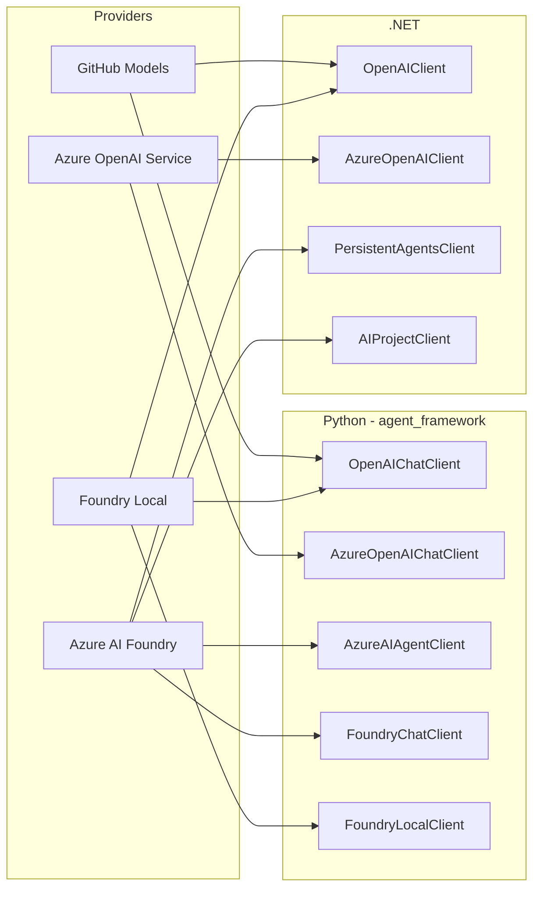

<!-- source: DeepWiki mcp.deepwiki.com · repo microsoft/Agent-Framework-Samples · page 5 AI Provider Integrations · fetched 2026-10-26 -->

# AI Provider Integrations

Relevant source files

The following files were used as context for generating this wiki page:

- [00.ForBeginners/README.md](00.ForBeginners/README.md)
- [01.AgentFoundation/README.md](01.AgentFoundation/README.md)
- [02.CreateYourFirstAgent/README.md](02.CreateYourFirstAgent/README.md)
- [03.ExploerAgentFramework/README.md](03.ExploerAgentFramework/README.md)
- [03.ExploerAgentFramework/code_samples/dotNET/01-dotnet-agent-framework-aoai/01-dotnet-agent-framework-aoai.csproj](03.ExploerAgentFramework/code_samples/dotNET/01-dotnet-agent-framework-aoai/01-dotnet-agent-framework-aoai.csproj)
- [03.ExploerAgentFramework/code_samples/dotNET/01-dotnet-agent-framework-aoai/Program.cs](03.ExploerAgentFramework/code_samples/dotNET/01-dotnet-agent-framework-aoai/Program.cs)
- [03.ExploerAgentFramework/code_samples/dotNET/02-dotnet-agent-framework-ghmodel/02-dotnet-agent-framework-ghmodel.csproj](03.ExploerAgentFramework/code_samples/dotNET/02-dotnet-agent-framework-ghmodel/02-dotnet-agent-framework-ghmodel.csproj)
- [03.ExploerAgentFramework/code_samples/dotNET/03-dotnet-agent-framework-msfoundry/03-dotnet-agent-framework-msfoundry.csproj](03.ExploerAgentFramework/code_samples/dotNET/03-dotnet-agent-framework-msfoundry/03-dotnet-agent-framework-msfoundry.csproj)
- [03.ExploerAgentFramework/code_samples/dotNET/03-dotnet-agent-framework-msfoundry/Program.cs](03.ExploerAgentFramework/code_samples/dotNET/03-dotnet-agent-framework-msfoundry/Program.cs)
- [03.ExploerAgentFramework/code_samples/dotNET/04-dotnet-agent-framework-foundrylocal/04-dotnet-agent-framework-foundrylocal.csproj](03.ExploerAgentFramework/code_samples/dotNET/04-dotnet-agent-framework-foundrylocal/04-dotnet-agent-framework-foundrylocal.csproj)
- [03.ExploerAgentFramework/code_samples/python/03-python-agent-framework-msfoundry.ipynb](03.ExploerAgentFramework/code_samples/python/03-python-agent-framework-msfoundry.ipynb)
- [03.ExploerAgentFramework/code_samples/python/04-python-agent-framework-foundrylocal.ipynb](03.ExploerAgentFramework/code_samples/python/04-python-agent-framework-foundrylocal.ipynb)
- [04.Tools/README.md](04.Tools/README.md)
- [05.Providers/README.md](05.Providers/README.md)
- [06.RAGs/README.md](06.RAGs/README.md)
- [07.Workflow/README.md](07.Workflow/README.md)

This page describes the four AI backends (providers) supported across the Microsoft Agent Framework samples: the client classes used to connect to each, required environment variables, authentication patterns, and the agent creation call chains. This page covers provider configuration at the framework level.

For step-by-step agent construction using a configured client, see [Building Agents](#4). For hosted tools that require a specific provider (Bing Grounding, Code Interpreter, File Search), see [Tools and Capabilities](#6).

---

## Provider Overview

| Provider | Base Endpoint | Auth Mechanism | Agent Persistence |
|---|---|---|---|
| **GitHub Models** | `https://models.inference.ai.azure.com` | `GITHUB_TOKEN` (PAT) | Stateless, in-process |
| **Azure OpenAI Service** | Customer-owned Azure endpoint | `AzureCliCredential` | Stateless, in-process |
| **Azure AI Foundry** | Azure AI Project endpoint | `AzureCliCredential` | Persistent — server-side threads |
| **Foundry Local** | `http://localhost:5272/v1` | No auth (`"nokey"`) | Stateless, in-process |

Sources: [03.ExploerAgentFramework/README.md:1-30]()

---

**Provider-to-Client-Class Mapping**

Sources: [03.ExploerAgentFramework/README.md:48-340](), [03.ExploerAgentFramework/code_samples/python/03-python-agent-framework-msfoundry.ipynb:26-27](), [03.ExploerAgentFramework/code_samples/python/04-python-agent-framework-foundrylocal.ipynb:32-32](), [03.ExploerAgentFramework/code_samples/dotNET/03-dotnet-agent-framework-msfoundry/Program.cs:16-18]()

---

**(.NET) Agent Creation Call Chain per Provider**

```mermaid
graph TD
    subgraph standard["GitHub Models / Azure OpenAI Service / Foundry Local"]
        S_CLIENT["OpenAIClient or AzureOpenAIClient(credentials, options)"]
        S_CHAT["GetChatClient(model_id)"]
        S_AGENT["CreateAIAgent(instructions, tools)"]
        S_RUN["RunAsync(prompt)"]
        S_CLIENT --> S_CHAT --> S_AGENT --> S_RUN
    end

    subgraph foundry["Azure AI Foundry - Persistent Agents"]
        F_CLIENT["new PersistentAgentsClient(endpoint, AzureCliCredential)"]
        F_CREATE["Administration.CreateAgentAsync(model, name, instructions)"]
        F_GET["GetAIAgentAsync(agentMetadata.Value.Id)"]
        F_THREAD["agent.GetNewThread()"]
        F_RUN["agent.RunAsync(prompt, thread)"]
        F_CLIENT --> F_CREATE --> F_GET --> F_THREAD --> F_RUN
    end

    subgraph foundry_proj["Azure AI Foundry - AIProjectClient"]
        P_CLIENT["new AIProjectClient(endpoint, AzureCliCredential)"]
        P_VER["AgentAdministrationClient.CreateAgentVersionAsync(name, options)"]
        P_AGENT["aiProjectClient.AsAIAgent(agentVersion)"]
        P_RUN["agent.RunAsync(prompt)"]
        P_CLIENT --> P_VER --> P_AGENT --> P_RUN
    end
```

The key distinction for Azure AI Foundry is the **two-step agent creation**: the agent is first registered with the service (via `CreateAgentAsync` or `CreateAgentVersionAsync`), then a runnable `AIAgent` is retrieved. Conversation state can be tracked in an `AgentThread` held server-side.

Sources: [03.ExploerAgentFramework/README.md:57-230](), [03.ExploerAgentFramework/code_samples/dotNET/03-dotnet-agent-framework-msfoundry/Program.cs:16-33](), [05.Providers/README.md:51-68]()

---

## GitHub Models

GitHub Models exposes an OpenAI-compatible inference API. Both `OpenAIChatClient` (Python) and `OpenAIClient` (.NET) target the same endpoint using the GitHub personal access token as the API key.

For details, see [GitHub Models](#5.1).

### Environment Variables

| Variable | Description |
|---|---|
| `GITHUB_TOKEN` | GitHub Personal Access Token (PAT) |
| `GITHUB_ENDPOINT` | `https://models.inference.ai.azure.com` |
| `GITHUB_MODEL_ID` | Model identifier, e.g. `gpt-4o-mini` |

Sources: [02.CreateYourFirstAgent/README.md:17-21](), [03.ExploerAgentFramework/README.md:14-16]()

---

## Azure OpenAI Service

Azure OpenAI uses Azure Identity for credential-free authentication. `AzureCliCredential` reads the signed-in Azure CLI session (`az login`). This approach is preferred for production to avoid hard-coded keys.

For details, see [Azure OpenAI Service](#5.2).

### Environment Variables

| Variable | Description |
|---|---|
| `AZURE_OPENAI_ENDPOINT` | Azure OpenAI resource URL, e.g. `https://<name>.openai.azure.com` |
| `AZURE_OPENAI_CHAT_DEPLOYMENT_NAME` | Deployment name (also seen as `AZURE_OPENAI_RESPONSES_DEPLOYMENT_NAME`) |

Sources: [03.ExploerAgentFramework/README.md:18-19](), [03.ExploerAgentFramework/code_samples/dotNET/01-dotnet-agent-framework-aoai/Program.cs:9-10]()

---

## Azure AI Foundry

Azure AI Foundry (formerly MS Foundry) hosts **persistent agents** — the agent definition and conversation threads are stored server-side. This enables hosted tools like Bing Grounding, Code Interpreter, and File Search.

For details, see [Azure AI Foundry](#5.3).

### Environment Variables

| Variable | Description |
|---|---|
| `AZURE_AI_PROJECT_ENDPOINT` | Azure AI project endpoint URL (also seen as `FOUNDRY_PROJECT_ENDPOINT`) |
| `AZURE_AI_MODEL_DEPLOYMENT_NAME` | Model deployment name (also seen as `FOUNDRY_MODEL`) |

Sources: [03.ExploerAgentFramework/README.md:24-26](), [03.ExploerAgentFramework/code_samples/dotNET/03-dotnet-agent-framework-msfoundry/Program.cs:12-13]()

---

## Foundry Local

Foundry Local runs small language models (SLMs) on the local machine and exposes an OpenAI-compatible HTTP API. It is ideal for privacy, offline scenarios, and low-latency local inference.

For details, see [Foundry Local](#5.4).

### Environment Variables

| Variable | Description |
|---|---|
| `FOUNDRYLOCAL_ENDPOINT` | Local server URL, default `http://localhost:5272/v1` |
| `FOUNDRYLOCAL_MODEL_DEPLOYMENT_NAME` | SLM name, e.g. `qwen2.5-1.5b-instruct-generic-cpu:4` |

Sources: [03.ExploerAgentFramework/README.md:21-22](), [03.ExploerAgentFramework/code_samples/python/04-python-agent-framework-foundrylocal.ipynb:131-131]()

---

## Authentication Summary

| Provider | .NET Credential | Python Credential | Package |
|---|---|---|---|
| GitHub Models | `new ApiKeyCredential(GITHUB_TOKEN)` | `api_key=GITHUB_TOKEN` | Built-in / `dotenv` |
| Azure OpenAI | `new AzureCliCredential()` | `AzureCliCredential()` | `Azure.Identity` / `azure-identity` |
| Azure AI Foundry | `new AzureCliCredential()` | `AzureCliCredential()` (async) | `Azure.Identity` / `azure-identity` |
| Foundry Local | `new ApiKeyCredential("nokey")` | `api_key="nokey"` | None required |

Sources: [03.ExploerAgentFramework/README.md:120-147](), [03.ExploerAgentFramework/README.md:57-71](), [03.ExploerAgentFramework/README.md:212-230](), [03.ExploerAgentFramework/README.md:288-307]()

---

