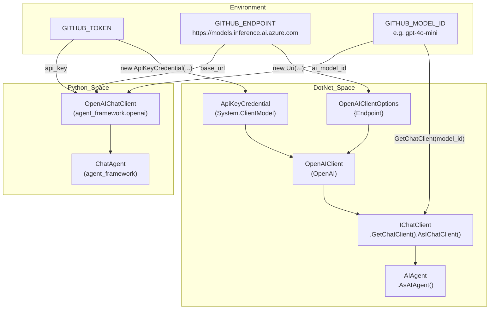
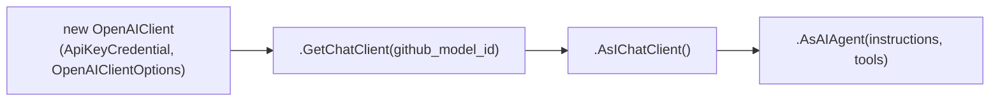
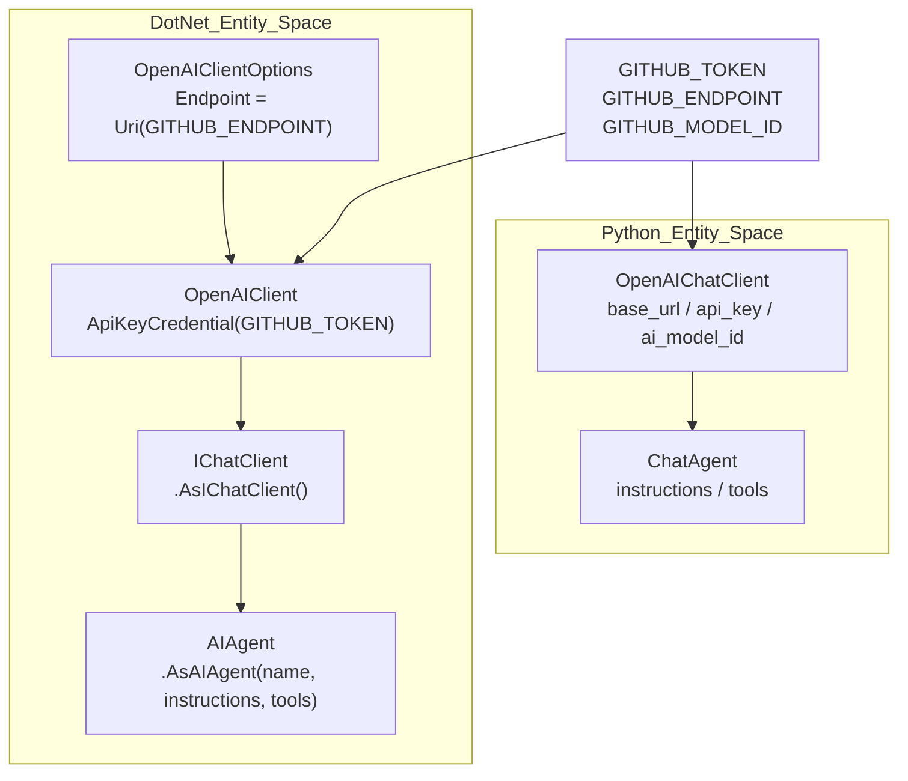

<!-- source: DeepWiki mcp.deepwiki.com · repo microsoft/Agent-Framework-Samples · page 5.1 GitHub Models · fetched 2026-10-26 -->

# GitHub Models

Relevant source files

The following files were used as context for generating this wiki page:

- [00.ForBeginners/README.md](00.ForBeginners/README.md)
- [01.AgentFoundation/README.md](01.AgentFoundation/README.md)
- [02.CreateYourFirstAgent/README.md](02.CreateYourFirstAgent/README.md)
- [02.CreateYourFirstAgent/code_samples/dotNET/dotnet-travelagent-ghmodel/Program.cs](02.CreateYourFirstAgent/code_samples/dotNET/dotnet-travelagent-ghmodel/Program.cs)
- [03.ExploerAgentFramework/README.md](03.ExploerAgentFramework/README.md)
- [03.ExploerAgentFramework/code_samples/dotNET/02-dotnet-agent-framework-ghmodel/Program.cs](03.ExploerAgentFramework/code_samples/dotNET/02-dotnet-agent-framework-ghmodel/Program.cs)
- [04.Tools/README.md](04.Tools/README.md)
- [05.Providers/README.md](05.Providers/README.md)
- [06.RAGs/README.md](06.RAGs/README.md)
- [07.Workflow/README.md](07.Workflow/README.md)

This page covers how to configure the Microsoft Agent Framework to use **GitHub Models** as the LLM backend. It explains the required environment variables, the client initialization patterns in both Python and .NET, and how the resulting client connects to the rest of the framework.

For the counterpart providers — Azure OpenAI, Azure AI Foundry, and Foundry Local — see pages [5.2](), [5.3](), and [5.4](). For a general introduction to the client layer and how providers plug into the framework, see [5]().

---

## What Is GitHub Models?

GitHub Models is a hosted model inference service accessible at `https://models.inference.ai.azure.com`. It exposes an OpenAI-compatible API, so the same `OpenAIClient` / `OpenAIChatClient` classes used for standard OpenAI calls work here without modification — the only difference is the base URL and the credential type (a GitHub Personal Access Token rather than an OpenAI API key). [03.ExploerAgentFramework/README.md:103-116]()

Because the endpoint is OpenAI-compatible, no special SDK is needed. The framework uses `OpenAIChatClient` (Python) and `OpenAIClient` (C#) against the GitHub endpoint. [03.ExploerAgentFramework/README.md:103-106]()

---

## Environment Variables

All GitHub Models samples read three variables from the environment. These are typically stored in a `.env` file at the repository root and loaded at startup. [02.CreateYourFirstAgent/README.md:11-21]()

| Variable | Required | Example Value | Purpose |
|---|---|---|---|
| `GITHUB_TOKEN` | Yes | `ghp_xxxxxxxxxxxx` | GitHub Personal Access Token used as the API key |
| `GITHUB_ENDPOINT` | Yes | `https://models.inference.ai.azure.com` | Base URL of the GitHub Models inference service |
| `GITHUB_MODEL_ID` | No (has default) | `gpt-4o-mini` | Model deployment name to use for completions |

Sources: [02.CreateYourFirstAgent/README.md:17-29](), [03.ExploerAgentFramework/README.md:12-15](), [00.ForBeginners/README.md:92-95]()

---

## Connection Architecture

**Diagram: GitHub Models client initialization flow**

Sources: [03.ExploerAgentFramework/README.md:126-173](), [02.CreateYourFirstAgent/code_samples/dotNET/dotnet-travelagent-ghmodel/Program.cs:19-33]()

---

## Python Integration

### Loading Environment Variables

Python samples use `python-dotenv` to load the `.env` file. [03.ExploerAgentFramework/README.md:161-165]()

### Constructing the Client

`OpenAIChatClient` is imported from `agent_framework.openai`. Its constructor accepts three keyword arguments that map directly to the environment variables. [03.ExploerAgentFramework/README.md:167-172]()

| Constructor Parameter | Environment Variable | Notes |
|---|---|---|
| `base_url` | `GITHUB_ENDPOINT` | Points to the GitHub Models inference endpoint |
| `api_key` | `GITHUB_TOKEN` | GitHub PAT, used in place of an OpenAI API key |
| `ai_model_id` | `GITHUB_MODEL_ID` | The model to use (e.g., `gpt-4o-mini`) |

### Creating an Agent

The `OpenAIChatClient` instance is passed to the `ChatAgent` constructor or used via the `create_agent` method. [03.ExploerAgentFramework/README.md:151-156]()

### Running the Agent

| Method | Returns | Use when |
|---|---|---|
| `await agent.run(prompt)` | `AgentResponse` | Full response after completion |
| `async for chunk in agent.run_stream(prompt)` | Streamed chunks | Real-time token-by-token output |

Sources: [03.ExploerAgentFramework/README.md:174-180](), [02.CreateYourFirstAgent/README.md:150-160]()

---

## .NET Integration

### Loading Environment Variables

.NET samples use `DotNetEnv` to load the `.env` file. [03.ExploerAgentFramework/code_samples/dotNET/02-dotnet-agent-framework-ghmodel/Program.cs:9]()

### Project Dependencies

The .NET implementation requires several packages to bridge the standard OpenAI client to the Agent Framework. [02.CreateYourFirstAgent/README.md:41-51]()

| Package | Purpose |
|---|---|
| `DotNetEnv` | Load `.env` files |
| `Microsoft.Extensions.AI` | `IChatClient` abstraction |
| `Microsoft.Extensions.AI.OpenAI` | OpenAI-compatible client adapter |
| `OpenAI` | `OpenAIClient`, `OpenAIClientOptions`, `ApiKeyCredential` |
| `Microsoft.Agents.AI` | `AIAgent`, `AIFunctionFactory` |

### Client Initialization Chain

The .NET integration uses a method chain to go from raw credentials to an `AIAgent`. [03.ExploerAgentFramework/README.md:126-147]()

**Diagram: .NET GitHub Models initialization chain**

Sources: [03.ExploerAgentFramework/code_samples/dotNET/02-dotnet-agent-framework-ghmodel/Program.cs:18-30](), [02.CreateYourFirstAgent/code_samples/dotNET/dotnet-travelagent-ghmodel/Program.cs:19-33]()

- `OpenAIClientOptions.Endpoint` is set to `new Uri(github_endpoint)`. [02.CreateYourFirstAgent/code_samples/dotNET/dotnet-travelagent-ghmodel/Program.cs:20-23]()
- `ApiKeyCredential` wraps the `GITHUB_TOKEN` string. [02.CreateYourFirstAgent/code_samples/dotNET/dotnet-travelagent-ghmodel/Program.cs:26]()
- `.GetChatClient(github_model_id)` selects the model deployment. [03.ExploerAgentFramework/code_samples/dotNET/02-dotnet-agent-framework-ghmodel/Program.cs:28]()
- `.AsIChatClient()` adapts the OpenAI chat client to the `IChatClient` interface. [03.ExploerAgentFramework/code_samples/dotNET/02-dotnet-agent-framework-ghmodel/Program.cs:29]()
- `.AsAIAgent(...)` wraps the chat client in an `AIAgent`. [03.ExploerAgentFramework/code_samples/dotNET/02-dotnet-agent-framework-ghmodel/Program.cs:30]()

### Running the Agent

| Method | Returns | Use when |
|---|---|---|
| `await agent.RunAsync(prompt)` | `string` | Full response after completion |
| `await foreach (var update in agent.RunStreamingAsync(prompt))` | `IAsyncEnumerable<string>` | Streamed token output |

Sources: [03.ExploerAgentFramework/code_samples/dotNET/02-dotnet-agent-framework-ghmodel/Program.cs:34-41](), [02.CreateYourFirstAgent/code_samples/dotNET/dotnet-travelagent-ghmodel/Program.cs:37-44]()

---

## Registering Tools

GitHub Models supports function calling. Tools are registered at agent construction time. [02.CreateYourFirstAgent/README.md:121-122]()

**Python** — Define a function and pass it as the `tools` argument. The framework uses the function's docstring for the tool description. [02.CreateYourFirstAgent/README.md:155-160]()

**C#** — Wrap a method with `AIFunctionFactory.Create(...)` and include it in the `tools` array passed to `.AsAIAgent(...)`. Use the `[Description]` attribute on the method for the tool description. [02.CreateYourFirstAgent/code_samples/dotNET/dotnet-travelagent-ghmodel/Program.cs:32-33](), [02.CreateYourFirstAgent/code_samples/dotNET/dotnet-travelagent-ghmodel/Program.cs:48-49]()

For a full treatment of tool patterns, see [6.1]().

---

## Summary: Python vs. .NET at a Glance

**Diagram: Side-by-side class mapping for GitHub Models**

Sources: [03.ExploerAgentFramework/README.md:126-173](), [02.CreateYourFirstAgent/code_samples/dotNET/dotnet-travelagent-ghmodel/Program.cs:19-33]()

| Aspect | Python | C# |
|---|---|---|
| Client class | `OpenAIChatClient` | `OpenAIClient` + `.AsIChatClient()` |
| Agent class | `ChatAgent` | `AIAgent` via `.AsAIAgent()` |
| Env loading | `load_dotenv()` | `Env.Load(path)` |
| Tool wrapping | Plain function in `tools=` | `AIFunctionFactory.Create(func)` |
| Blocking run | `await agent.run(prompt)` | `await agent.RunAsync(prompt)` |
| Streaming run | `async for chunk in agent.run_stream(prompt)` | `await foreach` over `agent.RunStreamingAsync(prompt)` |

---

