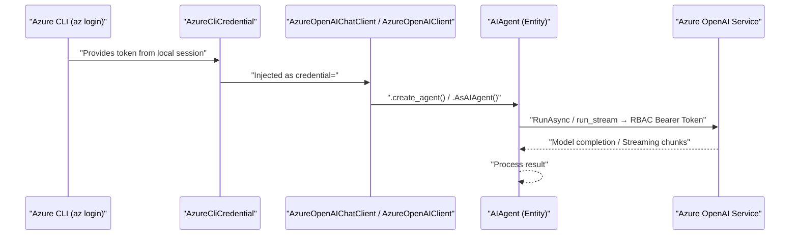
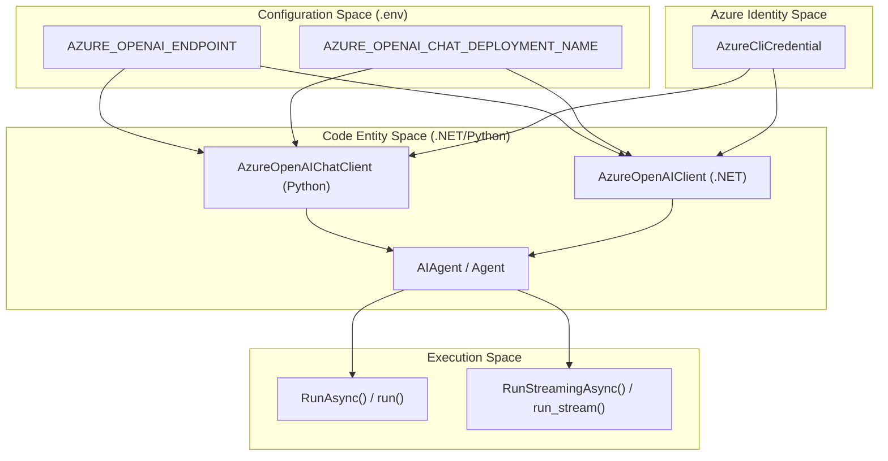

<!-- source: DeepWiki mcp.deepwiki.com · repo microsoft/Agent-Framework-Samples · page 5.2 Azure OpenAI Service · fetched 2026-10-26 -->

# Azure OpenAI Service

Relevant source files

The following files were used as context for generating this wiki page:

- [00.ForBeginners/README.md](00.ForBeginners/README.md)
- [01.AgentFoundation/README.md](01.AgentFoundation/README.md)
- [02.CreateYourFirstAgent/README.md](02.CreateYourFirstAgent/README.md)
- [03.ExploerAgentFramework/README.md](03.ExploerAgentFramework/README.md)
- [03.ExploerAgentFramework/code_samples/dotNET/01-dotnet-agent-framework-aoai/01-dotnet-agent-framework-aoai.csproj](03.ExploerAgentFramework/code_samples/dotNET/01-dotnet-agent-framework-aoai/01-dotnet-agent-framework-aoai.csproj)
- [03.ExploerAgentFramework/code_samples/dotNET/01-dotnet-agent-framework-aoai/Program.cs](03.ExploerAgentFramework/code_samples/dotNET/01-dotnet-agent-framework-aoai/Program.cs)
- [03.ExploerAgentFramework/code_samples/dotNET/02-dotnet-agent-framework-ghmodel/02-dotnet-agent-framework-ghmodel.csproj](03.ExploerAgentFramework/code_samples/dotNET/02-dotnet-agent-framework-ghmodel/02-dotnet-agent-framework-ghmodel.csproj)
- [03.ExploerAgentFramework/code_samples/dotNET/03-dotnet-agent-framework-msfoundry/03-dotnet-agent-framework-msfoundry.csproj](03.ExploerAgentFramework/code_samples/dotNET/03-dotnet-agent-framework-msfoundry/03-dotnet-agent-framework-msfoundry.csproj)
- [03.ExploerAgentFramework/code_samples/dotNET/03-dotnet-agent-framework-msfoundry/Program.cs](03.ExploerAgentFramework/code_samples/dotNET/03-dotnet-agent-framework-msfoundry/Program.cs)
- [03.ExploerAgentFramework/code_samples/dotNET/04-dotnet-agent-framework-foundrylocal/04-dotnet-agent-framework-foundrylocal.csproj](03.ExploerAgentFramework/code_samples/dotNET/04-dotnet-agent-framework-foundrylocal/04-dotnet-agent-framework-foundrylocal.csproj)
- [03.ExploerAgentFramework/code_samples/python/03-python-agent-framework-msfoundry.ipynb](03.ExploerAgentFramework/code_samples/python/03-python-agent-framework-msfoundry.ipynb)
- [03.ExploerAgentFramework/code_samples/python/04-python-agent-framework-foundrylocal.ipynb](03.ExploerAgentFramework/code_samples/python/04-python-agent-framework-foundrylocal.ipynb)
- [04.Tools/README.md](04.Tools/README.md)
- [05.Providers/README.md](05.Providers/README.md)
- [06.RAGs/README.md](06.RAGs/README.md)
- [07.Workflow/README.md](07.Workflow/README.md)

This page covers how to configure and connect agents to **Azure OpenAI Service** using the Microsoft Agent Framework. It focuses on the `AzureOpenAIChatClient` (Python) and `AzureOpenAIClient` (.NET) classes, `AzureCliCredential`-based authentication, and the relevant environment variables for production-ready, RBAC-compliant integrations.

---

## Overview

Azure OpenAI Service is Microsoft's managed deployment of OpenAI models. Within this repository, it is a primary production-grade backend. The key distinction from other providers (like GitHub Models) is that it uses **Azure Identity** for authentication rather than a static API key, enabling Role-Based Access Control (RBAC) and audit-logged access.

The primary samples demonstrating this integration are:
- **Python**: [03.ExploerAgentFramework/code_samples/python/01-python-agent-framework-aoai.ipynb]()
- **.NET**: [03.ExploerAgentFramework/code_samples/dotNET/01-dotnet-agent-framework-aoai/Program.cs]()

---

## Authentication Model

The repository utilizes `AzureCliCredential` from the `azure-identity` package. This approach delegates credential resolution to the Azure CLI session established by `az login`, avoiding hard-coded secrets.

**Required Azure permissions for the calling identity:**

| Role | Scope |
|---|---|
| `Cognitive Services User` | Azure OpenAI resource |
| `Cognitive Services OpenAI User` | Azure OpenAI resource (narrower scope) |

**Prerequisites:**
1. An Azure OpenAI resource with a model deployment.
2. The calling identity assigned one of the roles above.
3. Azure CLI installed and authenticated via `az login`.

Sources: [03.ExploerAgentFramework/README.md:36-45](), [03.ExploerAgentFramework/code_samples/dotNET/01-dotnet-agent-framework-aoai/Program.cs:15-19]()

---

## Environment Variables

The following variables must be configured in the `.env` file for the framework to resolve the service endpoint and deployment name.

| Variable | Purpose |
|---|---|
| `AZURE_OPENAI_ENDPOINT` | The HTTPS endpoint of the Azure OpenAI resource (e.g., `https://<resource>.openai.azure.com/`) |
| `AZURE_OPENAI_CHAT_DEPLOYMENT_NAME` | The name of the specific model deployment (e.g., `gpt-4o-mini`) |

Sources: [03.ExploerAgentFramework/README.md:17-19](), [03.ExploerAgentFramework/code_samples/dotNET/01-dotnet-agent-framework-aoai/Program.cs:9-10]()

---

## Implementation Details

### Python Integration

The Python implementation uses `AzureOpenAIChatClient` to wrap the service connection. It leverages the `.create_agent()` (or `.as_agent()` in some variants) method to configure the agent's behavior.

**Key Steps:**
1. Initialize `AzureCliCredential`.
2. Instantiate `AzureOpenAIChatClient` with the credential.
3. Create the agent with `instructions`.

Sources: [03.ExploerAgentFramework/README.md:85-91]()

### .NET Integration

The .NET implementation uses the `Azure.AI.OpenAI` client in conjunction with `Microsoft.Agents.AI` extension methods.

**Key Steps:**
1. Load environment variables using `DotNetEnv.Env.Load()`. [03.ExploerAgentFramework/code_samples/dotNET/01-dotnet-agent-framework-aoai/Program.cs:7]()
2. Create an `AzureOpenAIClient` using the endpoint and `AzureCliCredential`. [03.ExploerAgentFramework/code_samples/dotNET/01-dotnet-agent-framework-aoai/Program.cs:15-17]()
3. Call `.GetChatClient(aoai_model_id)` and extend it using `.AsAIAgent()`. [03.ExploerAgentFramework/code_samples/dotNET/01-dotnet-agent-framework-aoai/Program.cs:18-19]()

---

## Architecture Diagrams

### Azure OpenAI Authentication and Invocation Flow

This diagram illustrates how the `AzureCliCredential` bridges the local environment to the cloud service.

Sources: [03.ExploerAgentFramework/README.md:36-45](), [03.ExploerAgentFramework/code_samples/dotNET/01-dotnet-agent-framework-aoai/Program.cs:15-27]()

### Code Entity Map: From Environment to Execution

This diagram maps the environment configuration to the specific code entities used in the framework.

Sources: [03.ExploerAgentFramework/code_samples/dotNET/01-dotnet-agent-framework-aoai/Program.cs:9-27](), [03.ExploerAgentFramework/README.md:58-99]()

---

## Provider Comparison

Azure OpenAI is the preferred choice for production due to its security posture.

| Feature | Azure OpenAI | GitHub Models | Foundry Local |
|---|---|---|---|
| **Client Class** | `AzureOpenAIChatClient` | `OpenAIChatClient` | `FoundryLocalClient` |
| **Authentication** | `AzureCliCredential` (RBAC) | `ApiKeyCredential` (PAT) | None (Local) |
| **Endpoint** | `*.openai.azure.com` | `models.inference.ai.azure.com` | `localhost` |
| **Key Variable** | `AZURE_OPENAI_ENDPOINT` | `GITHUB_TOKEN` | `FOUNDRYLOCAL_ENDPOINT` |

Sources: [03.ExploerAgentFramework/README.md:11-28](), [03.ExploerAgentFramework/code_samples/dotNET/01-dotnet-agent-framework-aoai/Program.cs:1-31]()

---

## Why Use This Approach?

1. **Credential-Free Development**: Developers do not need to manage or rotate API keys; access is tied to their Azure identity.
2. **Production Parity**: Using `AzureCliCredential` locally and `DefaultAzureCredential` in production (e.g., via Managed Identity) allows the same code to run in both environments without modification.
3. **Security**: Fine-grained RBAC allows administrators to grant "User" access without exposing the management plane or the primary service keys.

Sources: [03.ExploerAgentFramework/README.md:32-45](), [03.ExploerAgentFramework/code_samples/dotNET/01-dotnet-agent-framework-aoai/Program.cs:15-19]()

---

