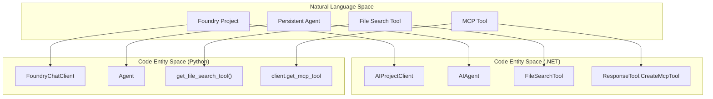
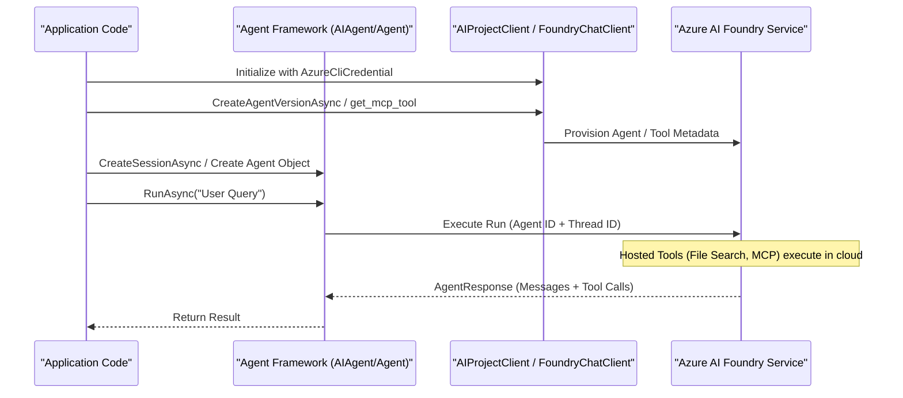

<!-- source: DeepWiki mcp.deepwiki.com · repo microsoft/Agent-Framework-Samples · page 5.3 Azure AI Foundry · fetched 2026-10-26 -->

# Azure AI Foundry

Relevant source files

The following files were used as context for generating this wiki page:

- [03.ExploerAgentFramework/code_samples/dotNET/01-dotnet-agent-framework-aoai/01-dotnet-agent-framework-aoai.csproj](03.ExploerAgentFramework/code_samples/dotNET/01-dotnet-agent-framework-aoai/01-dotnet-agent-framework-aoai.csproj)
- [03.ExploerAgentFramework/code_samples/dotNET/01-dotnet-agent-framework-aoai/Program.cs](03.ExploerAgentFramework/code_samples/dotNET/01-dotnet-agent-framework-aoai/Program.cs)
- [03.ExploerAgentFramework/code_samples/dotNET/02-dotnet-agent-framework-ghmodel/02-dotnet-agent-framework-ghmodel.csproj](03.ExploerAgentFramework/code_samples/dotNET/02-dotnet-agent-framework-ghmodel/02-dotnet-agent-framework-ghmodel.csproj)
- [03.ExploerAgentFramework/code_samples/dotNET/03-dotnet-agent-framework-msfoundry/03-dotnet-agent-framework-msfoundry.csproj](03.ExploerAgentFramework/code_samples/dotNET/03-dotnet-agent-framework-msfoundry/03-dotnet-agent-framework-msfoundry.csproj)
- [03.ExploerAgentFramework/code_samples/dotNET/03-dotnet-agent-framework-msfoundry/Program.cs](03.ExploerAgentFramework/code_samples/dotNET/03-dotnet-agent-framework-msfoundry/Program.cs)
- [03.ExploerAgentFramework/code_samples/dotNET/04-dotnet-agent-framework-foundrylocal/04-dotnet-agent-framework-foundrylocal.csproj](03.ExploerAgentFramework/code_samples/dotNET/04-dotnet-agent-framework-foundrylocal/04-dotnet-agent-framework-foundrylocal.csproj)
- [03.ExploerAgentFramework/code_samples/python/03-python-agent-framework-msfoundry.ipynb](03.ExploerAgentFramework/code_samples/python/03-python-agent-framework-msfoundry.ipynb)
- [03.ExploerAgentFramework/code_samples/python/04-python-agent-framework-foundrylocal.ipynb](03.ExploerAgentFramework/code_samples/python/04-python-agent-framework-foundrylocal.ipynb)
- [05.Providers/code_samples/dotNET/01-dotnet-agent-framework-aifoundry-mcp/AgentMCP.Console/AgentMCP.Console.csproj](05.Providers/code_samples/dotNET/01-dotnet-agent-framework-aifoundry-mcp/AgentMCP.Console/AgentMCP.Console.csproj)
- [05.Providers/code_samples/dotNET/01-dotnet-agent-framework-aifoundry-mcp/AgentMCP.Console/Program.cs](05.Providers/code_samples/dotNET/01-dotnet-agent-framework-aifoundry-mcp/AgentMCP.Console/Program.cs)
- [05.Providers/code_samples/python/01-python-agent-framework-aifoundry-mcp.ipynb](05.Providers/code_samples/python/01-python-agent-framework-aifoundry-mcp.ipynb)
- [06.RAGs/code_samples/dotNET/dotnet-agent-framework-msfoundry-file-search/Program.cs](06.RAGs/code_samples/dotNET/dotnet-agent-framework-msfoundry-file-search/Program.cs)
- [06.RAGs/code_samples/dotNET/dotnet-agent-framework-msfoundry-file-search/dotnet-agent-framework-msfoundry-file-search.csproj](06.RAGs/code_samples/dotNET/dotnet-agent-framework-msfoundry-file-search/dotnet-agent-framework-msfoundry-file-search.csproj)
- [06.RAGs/code_samples/python/python-agent-framework-msfoundry-file-search.ipynb](06.RAGs/code_samples/python/python-agent-framework-msfoundry-file-search.ipynb)

This page covers how the Microsoft Agent Framework (MAF) samples connect to **Azure AI Foundry** (formerly MS Foundry) as an AI backend. It details how to initialize clients, authenticate using Azure identity, create persistent agents, and leverage hosted capabilities like file search, code interpreter, and the Model Context Protocol (MCP).

---

## What Azure AI Foundry Provides

Unlike standard OpenAI or Azure OpenAI endpoints, Azure AI Foundry exposes a **project endpoint** that manages stateful, persistent agents server-side. 

Key features include:
- **Persistence**: Agent definitions and conversation threads are stored in the Foundry project, surviving client-side process restarts [05.Providers/code_samples/dotNET/01-dotnet-agent-framework-aifoundry-mcp/AgentMCP.Console/Program.cs:36-43]().
- **Hosted Tools**: Tools like File Search and Code Interpreter run in managed infrastructure [06.RAGs/code_samples/python/python-agent-framework-msfoundry-file-search.ipynb:22-26]().
- **Enterprise Integration**: Native support for Model Context Protocol (MCP) and Bing Grounding [05.Providers/code_samples/python/01-python-agent-framework-aifoundry-mcp.ipynb:10-20]().

---

## Configuration

The following environment variables are used to connect to Azure AI Foundry:

| Variable | Description |
|---|---|
| `FOUNDRY_PROJECT_ENDPOINT` | The full URL of the Azure AI Foundry project endpoint [05.Providers/code_samples/dotNET/01-dotnet-agent-framework-aifoundry-mcp/AgentMCP.Console/Program.cs:15-15]() |
| `FOUNDRY_MODEL` | The deployment name of the model (e.g., `gpt-4o-mini`) [05.Providers/code_samples/dotNET/01-dotnet-agent-framework-aifoundry-mcp/AgentMCP.Console/Program.cs:16-16]() |

These are loaded via `load_dotenv()` in Python [05.Providers/code_samples/python/01-python-agent-framework-aifoundry-mcp.ipynb:174-174]() and `Env.Load()` in .NET [05.Providers/code_samples/dotNET/01-dotnet-agent-framework-aifoundry-mcp/AgentMCP.Console/Program.cs:12-12]().

---

## Client Architecture

The framework uses specific client classes to bridge the gap between local code and the Foundry service.

### Entity Mapping: Natural Language to Code

This diagram maps conceptual Foundry components to the specific classes used in the codebase.

**Foundry Entity Mapping**

**Sources:** [05.Providers/code_samples/dotNET/01-dotnet-agent-framework-aifoundry-mcp/AgentMCP.Console/Program.cs:22-33](), [06.RAGs/code_samples/dotNET/dotnet-agent-framework-msfoundry-file-search/Program.cs:19-39](), [05.Providers/code_samples/python/01-python-agent-framework-aifoundry-mcp.ipynb:150-195](), [06.RAGs/code_samples/python/python-agent-framework-msfoundry-file-search.ipynb:116-117]()

---

## Implementation Details

### .NET: AIProjectClient and AIAgent

In .NET, the `AIProjectClient` from `Azure.AI.Projects` is the primary entry point. It is used to manage agents and retrieve specialized clients for files or vector stores.

1. **Initialization**: Connect using `DefaultAzureCredential` or `AzureCliCredential` [05.Providers/code_samples/dotNET/01-dotnet-agent-framework-aifoundry-mcp/AgentMCP.Console/Program.cs:22-22]().
2. **Agent Creation**: Use `aiProjectClient.AgentAdministrationClient.CreateAgentVersionAsync` to define the agent's model, instructions, and tools [05.Providers/code_samples/dotNET/01-dotnet-agent-framework-aifoundry-mcp/AgentMCP.Console/Program.cs:36-43]().
3. **Execution**: Convert the version to an `AIAgent` using `aiProjectClient.AsAIAgent(agentVersion)` [05.Providers/code_samples/dotNET/01-dotnet-agent-framework-aifoundry-mcp/AgentMCP.Console/Program.cs:45-45]().

**Sources:** [05.Providers/code_samples/dotNET/01-dotnet-agent-framework-aifoundry-mcp/AgentMCP.Console/Program.cs:15-50](), [06.RAGs/code_samples/dotNET/dotnet-agent-framework-msfoundry-file-search/Program.cs:19-52]()

### Python: FoundryChatClient and Agent

In Python, the `FoundryChatClient` simplifies interaction with the Foundry project.

1. **Initialization**: Instantiate `FoundryChatClient(credential=AzureCliCredential())` [03.ExploerAgentFramework/code_samples/python/03-python-agent-framework-msfoundry.ipynb:60-60]().
2. **Agent Definition**: Create an `Agent` instance passing the client. The client handles the underlying communication with the Foundry project endpoint [03.ExploerAgentFramework/code_samples/python/03-python-agent-framework-msfoundry.ipynb:70-74]().
3. **Run**: Execute queries via `agent.run(query)` [03.ExploerAgentFramework/code_samples/python/03-python-agent-framework-msfoundry.ipynb:86-86]().

**Sources:** [03.ExploerAgentFramework/code_samples/python/03-python-agent-framework-msfoundry.ipynb:60-86](), [05.Providers/code_samples/python/01-python-agent-framework-aifoundry-mcp.ipynb:184-185]()

---

## Hosted Tool Integration

Foundry agents support tools that run entirely server-side.

### File Search and RAG
This requires uploading files to the Foundry service and creating a `VectorStore`.

- **.NET**: Use `OpenAIFileClient` to upload and `VectorStoreClient` to index [06.RAGs/code_samples/dotNET/dotnet-agent-framework-msfoundry-file-search/Program.cs:25-36]().
- **Python**: Use `FoundryChatClient`'s underlying client to manage vector stores [06.RAGs/code_samples/python/python-agent-framework-msfoundry-file-search.ipynb:196-197]().

### Model Context Protocol (MCP)
Foundry supports connecting to MCP servers (like Microsoft Learn) to retrieve external data.

- **Approval Policy**: In .NET, you can set a `toolCallApprovalPolicy` (e.g., `AlwaysRequireApproval`). The agent response will then contain `ToolApprovalRequestContent`, which the application must handle by prompting the user [05.Providers/code_samples/dotNET/01-dotnet-agent-framework-aifoundry-mcp/AgentMCP.Console/Program.cs:29-33, 51-73]().
- **Python**: Connect using `client.get_mcp_tool(name, url)` [05.Providers/code_samples/python/01-python-agent-framework-aifoundry-mcp.ipynb:195-201]().

---

## Data Flow Diagram

The following diagram illustrates the interaction between the local application, the Microsoft Agent Framework, and the Azure AI Foundry service.

**Foundry Agent Execution Flow**

**Sources:** [05.Providers/code_samples/dotNET/01-dotnet-agent-framework-aifoundry-mcp/AgentMCP.Console/Program.cs:22-50](), [06.RAGs/code_samples/dotNET/dotnet-agent-framework-msfoundry-file-search/Program.cs:19-58](), [03.ExploerAgentFramework/code_samples/python/03-python-agent-framework-msfoundry.ipynb:60-86]()

---

## NuGet Package Reference (.NET)

For .NET projects, the following packages are essential for Foundry integration:

| Package | Purpose |
|---|---|
| `Azure.AI.Projects` | Core project and agent management [05.Providers/code_samples/dotNET/01-dotnet-agent-framework-aifoundry-mcp/AgentMCP.Console/AgentMCP.Console.csproj:18-18]() |
| `Azure.AI.Projects.OpenAI` | Integration between Foundry and OpenAI protocols [05.Providers/code_samples/dotNET/01-dotnet-agent-framework-aifoundry-mcp/AgentMCP.Console/AgentMCP.Console.csproj:16-16]() |
| `Azure.AI.Agents.Persistent` | Support for stateful, server-side agent sessions [05.Providers/code_samples/dotNET/01-dotnet-agent-framework-aifoundry-mcp/AgentMCP.Console/AgentMCP.Console.csproj:17-17]() |
| `Azure.Identity` | Token-based authentication [05.Providers/code_samples/dotNET/01-dotnet-agent-framework-aifoundry-mcp/AgentMCP.Console/AgentMCP.Console.csproj:12-12]() |

**Sources:** [05.Providers/code_samples/dotNET/01-dotnet-agent-framework-aifoundry-mcp/AgentMCP.Console/AgentMCP.Console.csproj:11-20](), [06.RAGs/code_samples/dotNET/dotnet-agent-framework-msfoundry-file-search/dotnet-agent-framework-msfoundry-file-search.csproj:12-20]()

---

