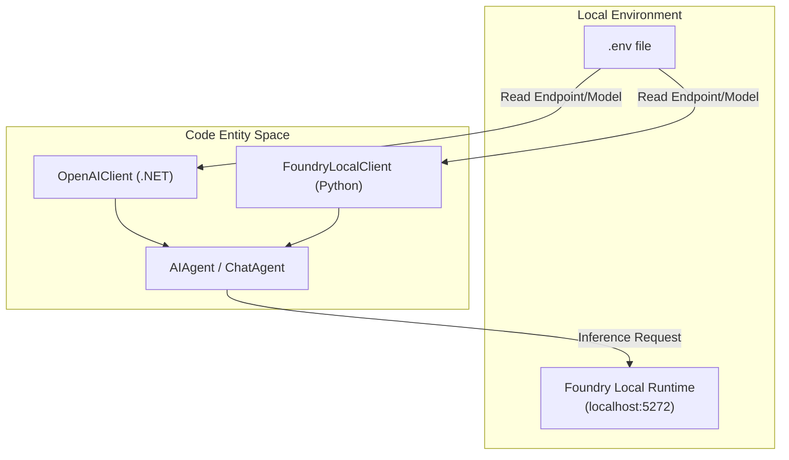
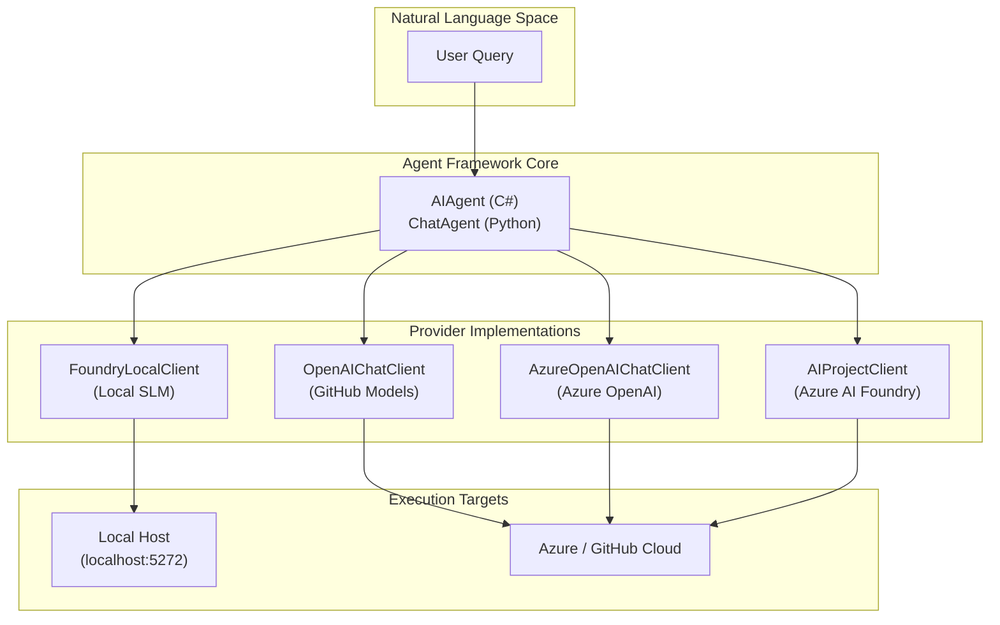

<!-- source: DeepWiki mcp.deepwiki.com · repo microsoft/Agent-Framework-Samples · page 5.4 Foundry Local · fetched 2026-10-26 -->

# Foundry Local

<details>
<summary>Relevant source files</summary>

The following files were used as context for generating this wiki page:

- [00.ForBeginners/README.md](00.ForBeginners/README.md)
- [01.AgentFoundation/README.md](01.AgentFoundation/README.md)
- [02.CreateYourFirstAgent/README.md](02.CreateYourFirstAgent/README.md)
- [03.ExploerAgentFramework/README.md](03.ExploerAgentFramework/README.md)
- [03.ExploerAgentFramework/code_samples/dotNET/04-dotnet-agent-framework-foundrylocal/Program.cs](03.ExploerAgentFramework/code_samples/dotNET/04-dotnet-agent-framework-foundrylocal/Program.cs)
- [04.Tools/README.md](04.Tools/README.md)
- [05.Providers/README.md](05.Providers/README.md)
- [06.RAGs/README.md](06.RAGs/README.md)
- [07.Workflow/README.md](07.Workflow/README.md)

</details>


This page covers how to configure and use **Microsoft Foundry Local** as an AI model provider within the Microsoft Agent Framework. It explains the `FoundryLocalClient` class, the required environment variables, and the initialization pattern for creating agents that run inference locally.

---

## What Is Foundry Local

Foundry Local is Microsoft's runtime for executing small language models (SLMs) on a local machine [03.ExploerAgentFramework/README.md:21-23](). It exposes an OpenAI-compatible HTTP endpoint that the Microsoft Agent Framework can connect to through the `FoundryLocalClient` class (Python) or by configuring a standard `OpenAIClient` with a local endpoint (.NET) [03.ExploerAgentFramework/code_samples/dotNET/04-dotnet-agent-framework-foundrylocal/Program.cs:21-26]().

From the framework's perspective, local inference is one of several interchangeable chat client implementations. It can be swapped for GitHub Models or Azure OpenAI Service without changing core agent logic [03.ExploerAgentFramework/README.md:1-3]().

**When to prefer local inference:**

| Concern | Benefit |
|---|---|
| **Privacy** | Data remains on-device; prompts and responses never leave the machine. |
| **Offline** | No cloud connectivity required at inference time. |
| **Latency** | No network round-trip to a remote cloud endpoint. |
| **Cost** | No per-token API billing during development or testing. |

Sources: [03.ExploerAgentFramework/README.md:21-23](), [03.ExploerAgentFramework/code_samples/dotNET/04-dotnet-agent-framework-foundrylocal/Program.cs:20-26]()

---

## Environment Variables

Foundry Local requires two primary environment variables to be defined in a `.env` file [03.ExploerAgentFramework/README.md:21-23]().

| Variable | Purpose | Example value |
|---|---|---|
| `FOUNDRYLOCAL_ENDPOINT` | HTTP base URL where the local runtime is listening. | `http://localhost:5272/v1` |
| `FOUNDRYLOCAL_MODEL_DEPLOYMENT_NAME` | The specific name of the local model deployment. | `Qwen3-0.6b-cpu` |

Sources: [03.ExploerAgentFramework/README.md:21-23](), [03.ExploerAgentFramework/code_samples/dotNET/04-dotnet-agent-framework-foundrylocal/Program.cs:12-15]()

---

## Client and Agent Initialization

### .NET Implementation
In .NET, Foundry Local is accessed by configuring a standard `OpenAIClient` with the local endpoint and a placeholder API key [03.ExploerAgentFramework/code_samples/dotNET/04-dotnet-agent-framework-foundrylocal/Program.cs:21-26](). The client is then converted to an `AIAgent` using the `AsAIAgent()` extension method [03.ExploerAgentFramework/code_samples/dotNET/04-dotnet-agent-framework-foundrylocal/Program.cs:29-32]().

```csharp
// Configure OpenAI client for Foundry Local
var openAIOptions = new OpenAIClientOptions()
{
    Endpoint = new Uri(foundryLocalEndpoint)
};

// No real API key is required for local inference
var openAIClient = new OpenAIClient(new ApiKeyCredential("nokey"), openAIOptions);

// Create AI Agent
AIAgent agent = openAIClient
    .GetChatClient(foundryLocalModelId)
    .AsIChatClient()
    .AsAIAgent(instructions: "You are a helpful assistant.", name: "FoundryLocalAgent");
```

### Python Implementation
The Python implementation uses `FoundryLocalClient` from the `agent_framework` library. It follows the same `.create_agent()` or `.as_agent()` pattern used by cloud providers.

### Initialization Flow

**Title: Foundry Local Connection Flow**



Sources: [03.ExploerAgentFramework/code_samples/dotNET/04-dotnet-agent-framework-foundrylocal/Program.cs:12-32](), [03.ExploerAgentFramework/README.md:21-23]()

---

## Provider Comparison

The diagram below illustrates how local inference sits alongside cloud-based providers in the Agent Framework architecture.

**Title: AI Provider Integration Architecture**



Sources: [03.ExploerAgentFramework/README.md:32-116](), [03.ExploerAgentFramework/code_samples/dotNET/04-dotnet-agent-framework-foundrylocal/Program.cs:29-32]()

---

## Running Local Agents

Once initialized, a local agent supports both standard execution (`RunAsync`) and streaming (`RunStreamingAsync`) [03.ExploerAgentFramework/code_samples/dotNET/04-dotnet-agent-framework-foundrylocal/Program.cs:36-43]().

**Example execution (.NET):**
```csharp
// Standard Run
Console.WriteLine(await agent.RunAsync("Can you introduce yourself?"));

// Streaming Run
await foreach (var update in agent.RunStreamingAsync("What can you help me with?"))
{
    Console.Write(update);
}
```

> [!IMPORTANT]
> **Model Capacity:** Local Small Language Models (SLMs) like Qwen-0.6B have significantly lower reasoning capacity than cloud-hosted models like GPT-4o. When using Foundry Local, ensure instructions are concise and tool definitions are simple to maintain reliability [03.ExploerAgentFramework/README.md:23]().

Sources: [03.ExploerAgentFramework/code_samples/dotNET/04-dotnet-agent-framework-foundrylocal/Program.cs:34-45](), [03.ExploerAgentFramework/README.md:21-23]()

---

