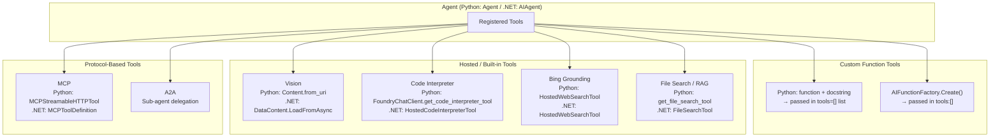
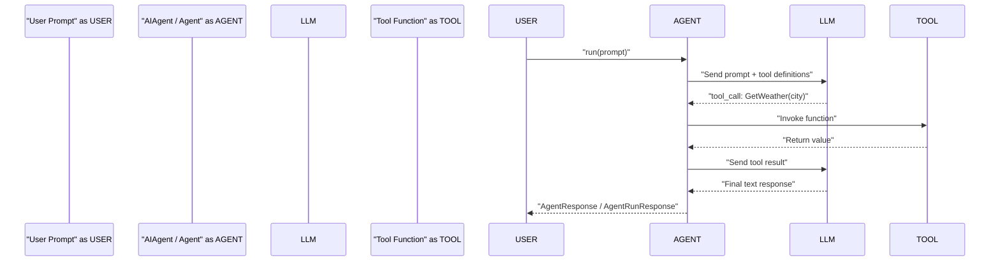
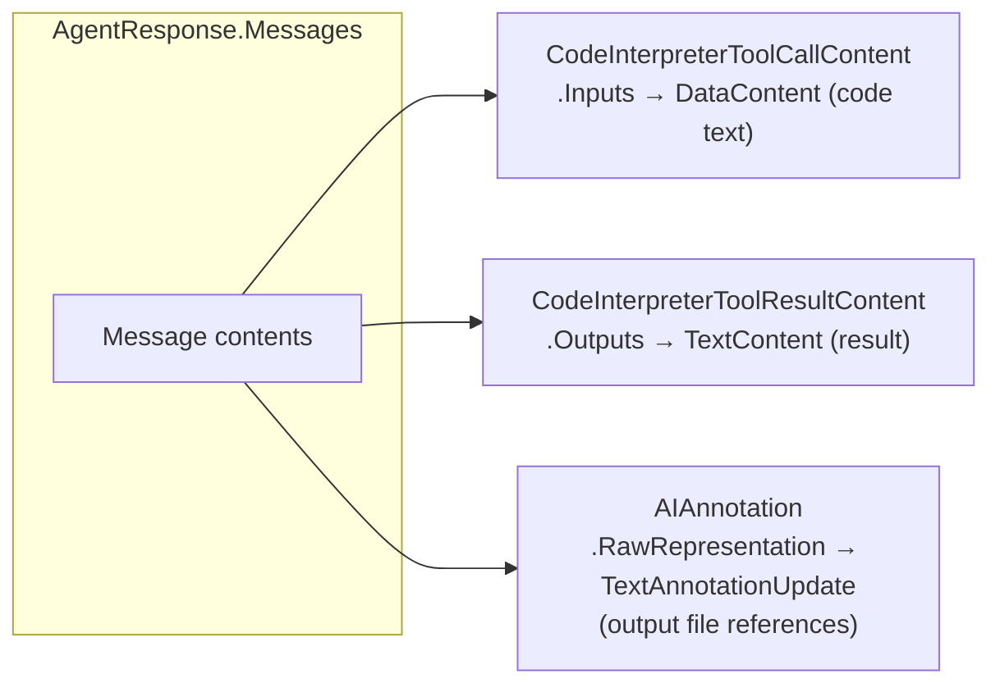
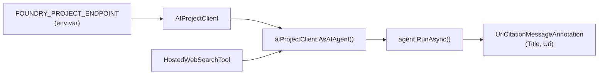
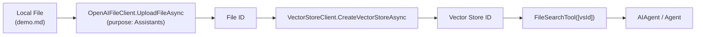
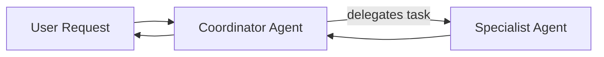

<!-- source: DeepWiki mcp.deepwiki.com · repo microsoft/Agent-Framework-Samples · page 6 Tools and Capabilities · fetched 2026-10-26 -->

# Tools and Capabilities

Relevant source files

The following files were used as context for generating this wiki page:

- [04.Tools/code_samples/dotNET/msfoundry/01-dotnet-agent-framework-msfoundry-vision/01-dotnet-agent-framework-msfoundry-vision.csproj](04.Tools/code_samples/dotNET/msfoundry/01-dotnet-agent-framework-msfoundry-vision/01-dotnet-agent-framework-msfoundry-vision.csproj)
- [04.Tools/code_samples/dotNET/msfoundry/01-dotnet-agent-framework-msfoundry-vision/Program.cs](04.Tools/code_samples/dotNET/msfoundry/01-dotnet-agent-framework-msfoundry-vision/Program.cs)
- [04.Tools/code_samples/dotNET/msfoundry/02-dotnet-agent-framework-msfoundry-code-interpreter/02-dotnet-agent-framework-msfoundry-code-interpreter.csproj](04.Tools/code_samples/dotNET/msfoundry/02-dotnet-agent-framework-msfoundry-code-interpreter/02-dotnet-agent-framework-msfoundry-code-interpreter.csproj)
- [04.Tools/code_samples/dotNET/msfoundry/02-dotnet-agent-framework-msfoundry-code-interpreter/Program.cs](04.Tools/code_samples/dotNET/msfoundry/02-dotnet-agent-framework-msfoundry-code-interpreter/Program.cs)
- [04.Tools/code_samples/dotNET/msfoundry/03-dotnet-agent-framework-msfoundry-web-search/03-dotnet-agent-framework-msfoundry-web-search.csproj](04.Tools/code_samples/dotNET/msfoundry/03-dotnet-agent-framework-msfoundry-web-search/03-dotnet-agent-framework-msfoundry-web-search.csproj)
- [04.Tools/code_samples/dotNET/msfoundry/03-dotnet-agent-framework-msfoundry-web-search/Program.cs](04.Tools/code_samples/dotNET/msfoundry/03-dotnet-agent-framework-msfoundry-web-search/Program.cs)
- [04.Tools/code_samples/dotNET/msfoundry/04-dotnet-agent-framework-msfoundry-file-search/04-dotnet-agent-framework-msfoundry-file-search.csproj](04.Tools/code_samples/dotNET/msfoundry/04-dotnet-agent-framework-msfoundry-file-search/04-dotnet-agent-framework-msfoundry-file-search.csproj)
- [04.Tools/code_samples/dotNET/msfoundry/04-dotnet-agent-framework-msfoundry-file-search/Program.cs](04.Tools/code_samples/dotNET/msfoundry/04-dotnet-agent-framework-msfoundry-file-search/Program.cs)
- [04.Tools/code_samples/python/msfoundry/01.python-agent-framework-msfoundry-vision.ipynb](04.Tools/code_samples/python/msfoundry/01.python-agent-framework-msfoundry-vision.ipynb)
- [04.Tools/code_samples/python/msfoundry/02.python-agent-framework-msfoundry-code-interpreter.ipynb](04.Tools/code_samples/python/msfoundry/02.python-agent-framework-msfoundry-code-interpreter.ipynb)
- [04.Tools/code_samples/python/msfoundry/04.python-agent-framework-msfoundry-file-search.ipynb](04.Tools/code_samples/python/msfoundry/04.python-agent-framework-msfoundry-file-search.ipynb)

This page is a reference for all tool types supported by the Microsoft Agent Framework samples, covering configuration requirements, key API classes, and how tools are registered with agents in both Python and .NET. It covers samples found in the `04.Tools/` and `05.Providers/` directories.

For foundational context on what tools are and how the agent loop invokes them, see [Tools Overview](#3.3). For workflow orchestration across multiple agents, see [Workflow Orchestration](#7). For observability of tool calls during execution, see [OpenTelemetry and Tracing](#8.2).

---

## Tool Types at a Glance

The framework supports two categories of tools: **custom function tools** (user-defined functions elevated to callable tools) and **hosted/built-in tools** (platform-managed capabilities such as code execution, web search, and file retrieval).

| Tool Type | Python Class / Object | .NET Class | Provider Required |
|---|---|---|---|
| Custom Function | Python function + docstring | `AIFunctionFactory.Create` | Any |
| Vision (multimodal input) | `DataContent` in `ChatMessage` | `DataContent` in `ChatMessage` | Azure AI Foundry (`gpt-4o`) |
| Code Interpreter | `HostedCodeInterpreterTool` | `HostedCodeInterpreterTool` | Azure AI Foundry |
| Bing Grounding | `HostedWebSearchTool` | `HostedWebSearchTool` | Azure AI Foundry + Bing connection |
| File Search (RAG) | `FileSearchTool` | `FileSearchTool` | Azure AI Foundry |
| MCP Tools | `MCPStreamableHTTPTool` | `MCPToolDefinition` | Any MCP-compatible server |
| Agent-to-Agent (A2A) | Sub-agent as callable | Sub-agent delegation | Any |

Sources: [04.Tools/code_samples/python/msfoundry/02.python-agent-framework-msfoundry-code-interpreter.ipynb:71-71](), [04.Tools/code_samples/dotNET/msfoundry/02-dotnet-agent-framework-msfoundry-code-interpreter/Program.cs:26-26](), [04.Tools/code_samples/dotNET/msfoundry/03-dotnet-agent-framework-msfoundry-web-search/Program.cs:28-28]()

---

## Tool Registration Architecture

The following diagram maps the tool system from natural language concepts to concrete code entities used across the samples.

**Tool types and their code entities**

Sources: [04.Tools/code_samples/python/msfoundry/01.python-agent-framework-msfoundry-vision.ipynb:132-152](), [04.Tools/code_samples/dotNET/msfoundry/01-dotnet-agent-framework-msfoundry-vision/Program.cs:24-32](), [04.Tools/code_samples/dotNET/msfoundry/02-dotnet-agent-framework-msfoundry-code-interpreter/Program.cs:22-26](), [04.Tools/code_samples/dotNET/msfoundry/04-dotnet-agent-framework-msfoundry-file-search/Program.cs:39-49]()

---

## Custom Function Tools

Custom function tools let any ordinary function become part of an agent's decision loop. The agent's LLM decides when to call the function based on its name and description.

**How tool description is conveyed:**

| Language | Mechanism |
|---|---|
| Python | Function docstring (`"""..."""`) |
| .NET | `[Description("...")]` attribute on the method |

**Tool invocation lifecycle:**

For complete details including .NET `AIFunctionFactory.Create` and Python docstring patterns, see [Custom Function Tools](#6.1).

---

## Vision

Vision enables an agent to accept image data as part of a user message. The image is embedded in a `ChatMessage` using `DataContent` alongside a `TextContent` prompt.

**Requirements:**
- Model must be vision-capable (e.g., `gpt-4o-mini` or `gpt-4o`)
- Azure AI Foundry endpoint (`FOUNDRY_PROJECT_ENDPOINT`)

**Key classes:**

| Language | Message Construction | Image Encoding |
|---|---|---|
| Python | `Content.from_uri(uri=image_uri, media_type="image/png")` | Base64 Data URI |
| .NET | `await DataContent.LoadFromAsync(imgPath)` | File path or Stream |

**Python flow:**  
[04.Tools/code_samples/python/msfoundry/01.python-agent-framework-msfoundry-vision.ipynb:139-152]()

**NET flow:**  
[04.Tools/code_samples/dotNET/msfoundry/01-dotnet-agent-framework-msfoundry-vision/Program.cs:29-32]()

The `.NET` sample uses `aiProjectClient.AsAIAgent()` and constructs a `ChatMessage` containing both `TextContent` and `DataContent`.

Sources: [04.Tools/code_samples/dotNET/msfoundry/01-dotnet-agent-framework-msfoundry-vision/Program.cs:11-32](), [04.Tools/code_samples/python/msfoundry/01.python-agent-framework-msfoundry-vision.ipynb:132-154]()

For the complete walkthrough, see [Vision](#6.2).

---

## Code Interpreter

The Code Interpreter tool provisions a sandboxed execution container. The agent writes Python code and receives the output.

**Key classes:**

| Language | Tool Class | Response Content Types |
|---|---|---|
| Python | `FoundryChatClient.get_code_interpreter_tool()` | `result.text` |
| .NET | `HostedCodeInterpreterTool` | `CodeInterpreterToolCallContent`, `CodeInterpreterToolResultContent` |

**Python registration:**
[04.Tools/code_samples/python/msfoundry/02.python-agent-framework-msfoundry-code-interpreter.ipynb:67-72]()

**NET registration and response parsing:**
[04.Tools/code_samples/dotNET/msfoundry/02-dotnet-agent-framework-msfoundry-code-interpreter/Program.cs:22-46]()

In .NET, `CodeInterpreterToolCallContent` is used to inspect the code generated by the agent, while `CodeInterpreterToolResultContent` contains the actual execution output from the sandbox.

**Response content model (.NET):**

Sources: [04.Tools/code_samples/dotNET/msfoundry/02-dotnet-agent-framework-msfoundry-code-interpreter/Program.cs:31-59](), [04.Tools/code_samples/python/msfoundry/02.python-agent-framework-msfoundry-code-interpreter.ipynb:101-104]()

For the full guide, see [Code Interpreter](#6.3).

---

## Bing Grounding

Bing Grounding connects an agent to live web search results. This is implemented via the `HostedWebSearchTool`.

**Required environment variables:**
- `FOUNDRY_PROJECT_ENDPOINT`: Your Azure AI Foundry project endpoint.
- `FOUNDRY_MODEL`: Deployment name (e.g., `gpt-4o-mini`).

**Python registration:**
[04.Tools/code_samples/python/msfoundry/04.python-agent-framework-msfoundry-file-search.ipynb:38-41]() (Conceptually similar to File Search tool resolution).

**NET registration:**
[04.Tools/code_samples/dotNET/msfoundry/03-dotnet-agent-framework-msfoundry-web-search/Program.cs:25-28]()

The agent uses `HostedWebSearchTool` to find up-to-date information. Citations are returned as `UriCitationMessageAnnotation` objects within the message contents.

**NET Bing tool wiring:**

Sources: [04.Tools/code_samples/dotNET/msfoundry/03-dotnet-agent-framework-msfoundry-web-search/Program.cs:16-46]()

For the complete guide including citation handling, see [Bing Grounding](#6.4).

---

## File Search and RAG

File Search enables Retrieval-Augmented Generation (RAG) by indexing documents into a vector store.

**Setup sequence:**

**Python:** Uses `FoundryChatClient` and `get_file_search_tool()`.
[04.Tools/code_samples/python/msfoundry/04.python-agent-framework-msfoundry-file-search.ipynb:38-42]()

**NET:** Uses `OpenAIFileClient` to upload documents and `VectorStoreClient` to create the searchable index.
[04.Tools/code_samples/dotNET/msfoundry/04-dotnet-agent-framework-msfoundry-file-search/Program.cs:25-49]()

Sources: [04.Tools/code_samples/dotNET/msfoundry/04-dotnet-agent-framework-msfoundry-file-search/Program.cs:19-58](), [04.Tools/code_samples/python/msfoundry/04.python-agent-framework-msfoundry-file-search.ipynb:195-205]()

For the complete walkthrough, see [File Search and RAG](#6.5).

---

## Model Context Protocol (MCP)

MCP is a standard protocol for discovering and invoking external tools at runtime. 

For the full guide including the A2A/MCP interplay, see [Model Context Protocol (MCP)](#6.6).

---

## Agent-to-Agent Communication (A2A)

A2A is a compositional pattern where one agent delegates to another specialized agent as if calling a tool.

**Conceptual pattern:**

For implementation details, see [Agent-to-Agent Communication (A2A)](#6.7).

---

