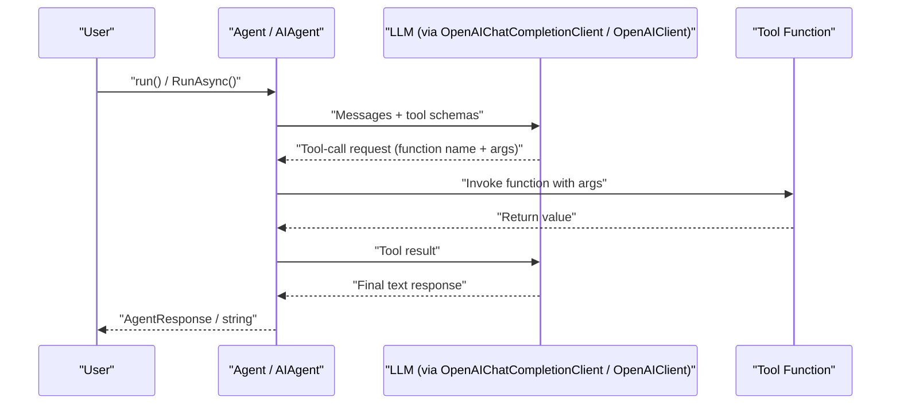
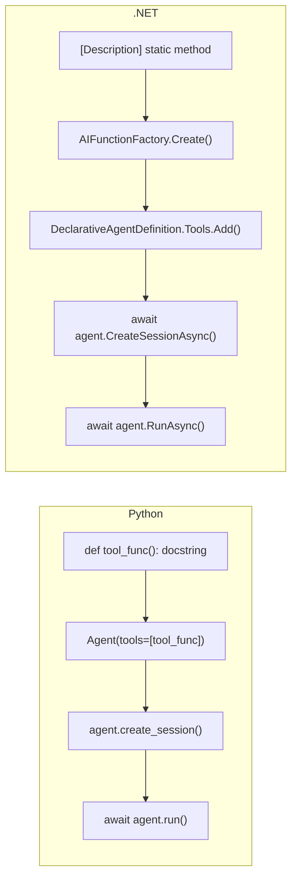

<!-- source: DeepWiki mcp.deepwiki.com · repo microsoft/Agent-Framework-Samples · page 6.1 Custom Function Tools · fetched 2026-10-26 -->

# Custom Function Tools

<details>
<summary>Relevant source files</summary>

The following files were used as context for generating this wiki page:

- [.devcontainer/devcontainer.json](.devcontainer/devcontainer.json)
- [.devcontainer/setup.sh](.devcontainer/setup.sh)
- [.github/dependabot.yml](.github/dependabot.yml)
- [.vscode/settings.json](.vscode/settings.json)
- [00.ForBeginners/01-intro-to-ai-agents/code_samples/python-agent-framework-travelagent.ipynb](00.ForBeginners/01-intro-to-ai-agents/code_samples/python-agent-framework-travelagent.ipynb)
- [00.ForBeginners/02-explore-agentic-frameworks/code_samples/python-agent-framework-basicagent.ipynb](00.ForBeginners/02-explore-agentic-frameworks/code_samples/python-agent-framework-basicagent.ipynb)
- [00.ForBeginners/03-agentic-design-patterns/code_samples/python-agent-framework-ghmodel-basicagent.ipynb](00.ForBeginners/03-agentic-design-patterns/code_samples/python-agent-framework-ghmodel-basicagent.ipynb)
- [00.ForBeginners/04-tool-use/code_samples/dotnet-agent-framework-ghmodels-tool/Program.cs](00.ForBeginners/04-tool-use/code_samples/dotnet-agent-framework-ghmodels-tool/Program.cs)
- [00.ForBeginners/04-tool-use/code_samples/python-agent-framework-ghmodel-tools.ipynb](00.ForBeginners/04-tool-use/code_samples/python-agent-framework-ghmodel-tools.ipynb)
- [00.ForBeginners/05-agentic-rag/code_samples/dotnet-agent-framework-msfoundry-file-search/Program.cs](00.ForBeginners/05-agentic-rag/code_samples/dotnet-agent-framework-msfoundry-file-search/Program.cs)
- [00.ForBeginners/05-agentic-rag/code_samples/python-agent-framework-msfoundry-file-search.ipynb](00.ForBeginners/05-agentic-rag/code_samples/python-agent-framework-msfoundry-file-search.ipynb)
- [00.ForBeginners/07-planning-design/code_samples/python-agent-framrwork-ghmodel-planningdesign.ipynb](00.ForBeginners/07-planning-design/code_samples/python-agent-framrwork-ghmodel-planningdesign.ipynb)
- [00.ForBeginners/08-multi-agent/code_samples/python-agent-framework-ghmodel-workflow-multi-agents.ipynb](00.ForBeginners/08-multi-agent/code_samples/python-agent-framework-ghmodel-workflow-multi-agents.ipynb)
- [Installation/requirements.txt](Installation/requirements.txt)

</details>


This page explains how to define, register, and invoke custom function tools in the Microsoft Agent Framework, covering both Python and .NET. It focuses on plain user-defined functions as tools — not built-in hosted tools such as file search, code interpreter, or Bing grounding. For those, see [File Search and RAG](#6.5), [Code Interpreter](#6.3), and [Bing Grounding](#6.4). For MCP-based tools, see [Model Context Protocol (MCP)](#6.6).

---

## What Custom Function Tools Are

Custom function tools are ordinary Python functions or .NET static methods that an agent can call during its reasoning loop. When an agent receives a user message, it sends the message plus the schemas of all registered tools to the LLM. The LLM may respond with a tool-call request. The framework then invokes the matching function and feeds the result back to the LLM, which uses it to produce the final response [00.ForBeginners/04-tool-use/code_samples/python-agent-framework-ghmodel-tools.ipynb:42-45]().

The tool schema — the name, description, and parameter types sent to the LLM — is derived automatically from the function's signature and documentation:

| Element | Python source | .NET source |
|---|---|---|
| Tool name | Function name (`get_random_destination`) | Method name (`GetRandomDestination`) |
| Tool description | Docstring [00.ForBeginners/02-explore-agentic-frameworks/code_samples/python-agent-framework-basicagent.ipynb:154-162]() | `[Description("...")]` attribute |
| Parameter types | Type annotations | Method parameter types |
| Return type | Return annotation (`-> str`) | Method return type |

---

## Tool Invocation Lifecycle

**Tool Call Sequence**



Sources: [00.ForBeginners/04-tool-use/code_samples/python-agent-framework-ghmodel-tools.ipynb:42-45](), [00.ForBeginners/01-intro-to-ai-agents/code_samples/python-agent-framework-travelagent.ipynb:28-33]()

---

## Python: Defining and Registering Tools

### Defining a Tool Function

Any Python function can be a tool. The framework inspects the function's docstring and type annotations to build the tool schema that is sent to the LLM. A meaningful docstring is required for the LLM to know when and how to invoke the tool [00.ForBeginners/04-tool-use/code_samples/python-agent-framework-ghmodel-tools.ipynb:107-111]().

```python
def get_random_destination() -> str:
    """Get a random vacation destination.
    
    This function serves as a tool that the agent can call when it needs
    to suggest a random destination for travel planning.
    
    Returns:
        str: A randomly selected destination from the predefined list
    """
    destinations = ["Barcelona, Spain", "Paris, France", "Tokyo, Japan"]
    return destinations[randint(0, len(destinations) - 1)]
```

See [00.ForBeginners/02-explore-agentic-frameworks/code_samples/python-agent-framework-basicagent.ipynb:154-177]().

### Registering Tools with an Agent

Tool functions are passed as a list to the `tools` parameter of the `Agent` constructor. The agent handles all schema extraction, serialization, and invocation internally [00.ForBeginners/01-intro-to-ai-agents/code_samples/python-agent-framework-travelagent.ipynb:196-205]().

```python
agent = Agent(
    client=openai_chat_client,
    instructions="You are a helpful travel planning agent.",
    tools=[get_random_destination]
)
```

See [00.ForBeginners/01-intro-to-ai-agents/code_samples/python-agent-framework-travelagent.ipynb:196-205]().

### Running the Agent

```python
session = agent.create_session()
response = await agent.run("Plan me a day trip", session=session)
```

- `create_session()` returns an `AgentSession` that maintains conversation history [00.ForBeginners/01-intro-to-ai-agents/code_samples/python-agent-framework-travelagent.ipynb:35-37]().
- `await agent.run(...)` triggers the full agent loop including any tool calls [00.ForBeginners/04-tool-use/code_samples/python-agent-framework-ghmodel-tools.ipynb:42-45]().

---

## .NET: Defining and Registering Tools

### Defining a Tool Method

In .NET, tool functions are typically static methods annotated with `[Description]` from `System.ComponentModel`. The description string becomes the tool's description in the LLM schema.

```csharp
[Description("Get a random vacation destination.")]
static string GetRandomDestination()
{
    var destinations = new List<string> { "Barcelona, Spain", "Paris, France" };
    return destinations[new Random().Next(destinations.Count)];
}
```

### Wrapping with AIFunctionFactory.Create

Before passing a method to the agent, it must be wrapped using `AIFunctionFactory.Create` from `Microsoft.Extensions.AI`. This converts the method reference into an `AIFunction` object carrying the tool schema.

```csharp
AIFunctionFactory.Create((Func<string>)GetRandomDestination)
```

### Registering Tools with an Agent

Tools are registered by adding them to the `Tools` collection of the agent configuration. When using Azure AI Foundry, tools are added to the `DeclarativeAgentDefinition` [00.ForBeginners/05-agentic-rag/code_samples/dotnet-agent-framework-msfoundry-file-search/Program.cs:44-55]().

```csharp
ProjectsAgentVersion agentVersion = await aiProjectClient.AgentAdministrationClient.CreateAgentVersionAsync(
    "dotNETAgent",
    new ProjectsAgentVersionCreationOptions(
        new DeclarativeAgentDefinition(model: deploymentName)
        {
            Instructions = "You are a helpful assistant.",
            Tools = { fileSearchTool } // Add custom AIFunctions here
        }));
```

Sources: [00.ForBeginners/05-agentic-rag/code_samples/dotnet-agent-framework-msfoundry-file-search/Program.cs:44-55]()

---

## Code Entity Map

The following diagram maps the conceptual tool pipeline to the actual code entities in both languages.

**Custom Tool Code Entity Map**

```mermaid
graph TD
    subgraph Python ["Python Space"]
        PF["get_random_destination()
        (Function with docstring)"]
        PA["Agent(tools=[get_random_destination])
        (agent_framework.Agent)"]
        PS["agent.create_session()
        (AgentSession)"]
        PR["await agent.run(prompt, session)
        (AgentResponse)"]
        PF -->|"passed to"| PA
        PA --> PS
        PS --> PR
    end

    subgraph DotNET [".NET Space"]
        NF["GetRandomDestination()
        ([Description] method)"]
        NW["AIFunctionFactory.Create()
        (Microsoft.Extensions.AI)"]
        NA["aiProjectClient.AsAIAgent()
        (Microsoft.Agents.AI.Foundry)"]
        NS["agent.CreateSessionAsync()
        (AgentSession)"]
        NR["agent.RunAsync(prompt, session)
        (AgentResponse)"]
        NF -->|"wrapped by"| NW
        NW -->|"registered in"| NA
        NA --> NS
        NS --> NR
    end
```



Sources: [00.ForBeginners/02-explore-agentic-frameworks/code_samples/python-agent-framework-basicagent.ipynb:116-117](), [00.ForBeginners/01-intro-to-ai-agents/code_samples/python-agent-framework-travelagent.ipynb:196-205](), [00.ForBeginners/05-agentic-rag/code_samples/dotnet-agent-framework-msfoundry-file-search/Program.cs:58-64]()

---

## Side-by-Side Comparison

The following diagram shows the parallel between Python and .NET constructs at each stage.

**Python vs .NET Tool Registration**



Sources: [00.ForBeginners/03-agentic-design-patterns/code_samples/python-agent-framework-ghmodel-basicagent.ipynb:128-132](), [00.ForBeginners/05-agentic-rag/code_samples/dotnet-agent-framework-msfoundry-file-search/Program.cs:44-64]()

---

## Multi-Turn Tool Use

Both Python and .NET implementations use an `AgentSession` to accumulate conversation history. When `run()` or `RunAsync()` is called multiple times on the same session, the agent retains prior tool results and context [00.ForBeginners/01-intro-to-ai-agents/code_samples/python-agent-framework-travelagent.ipynb:35-37]().

**Python multi-turn example:**
```python
session = agent.create_session()
# Turn 1: Agent calls tool
res1 = await agent.run("Plan a trip", session=session)
# Turn 2: Agent remembers the destination from Turn 1
res2 = await agent.run("What is the weather there?", session=session)
```

---

## Required Packages and Imports

| Language | Package / Import | Purpose |
|---|---|---|
| Python | `from agent_framework import Agent` | Main agent class [00.ForBeginners/02-explore-agentic-frameworks/code_samples/python-agent-framework-basicagent.ipynb:116]() |
| Python | `from agent_framework.openai import OpenAIChatCompletionClient` | AI client for GitHub Models [00.ForBeginners/02-explore-agentic-frameworks/code_samples/python-agent-framework-basicagent.ipynb:117]() |
| .NET | `Microsoft.Agents.AI` | Core AI agent abstractions [00.ForBeginners/05-agentic-rag/code_samples/dotnet-agent-framework-msfoundry-file-search/Program.cs:6]() |
| .NET | `Microsoft.Agents.AI.Foundry` | Azure AI Foundry integration [00.ForBeginners/05-agentic-rag/code_samples/dotnet-agent-framework-msfoundry-file-search/Program.cs:7]() |
| .NET | `Microsoft.Extensions.AI` | Tool factory and common AI interfaces |

Sources: [Installation/requirements.txt:1-2](), [00.ForBeginners/05-agentic-rag/code_samples/dotnet-agent-framework-msfoundry-file-search/Program.cs:1-12]()

---

## Key Guidelines

- **Docstrings are mandatory for Python tools.** The LLM relies on the docstring to understand the tool's purpose and how to populate parameters [00.ForBeginners/04-tool-use/code_samples/python-agent-framework-ghmodel-tools.ipynb:107-111]().
- **Return types should be simple.** Prefer strings or JSON-serializable objects so the framework can easily pass them back to the LLM [00.ForBeginners/04-tool-use/code_samples/python-agent-framework-ghmodel-tools.ipynb:109-110]().
- **Single Responsibility.** Each tool should have a focused purpose (e.g., `get_random_destination`) to improve tool selection accuracy [00.ForBeginners/04-tool-use/code_samples/python-agent-framework-ghmodel-tools.ipynb:23-26]().
- **Type Safety.** Use Python type hints (e.g., `-> str`) and .NET strong typing to ensure the framework generates valid JSON schemas for the LLM [00.ForBeginners/04-tool-use/code_samples/python-agent-framework-ghmodel-tools.ipynb:24]().

For building your first agent end-to-end with custom tools, see [Your First Python Agent](#4.1) and [Your First .NET Agent](#4.2). For hosted tools that run inside the Azure AI Foundry service, see [Tools and Capabilities](#6).

---

