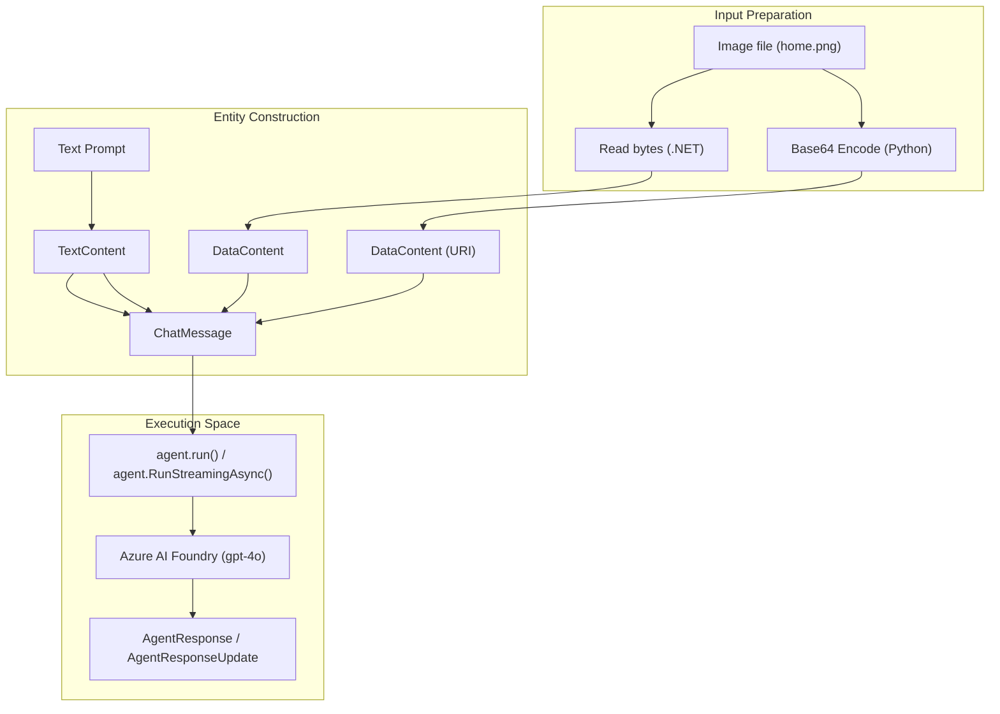
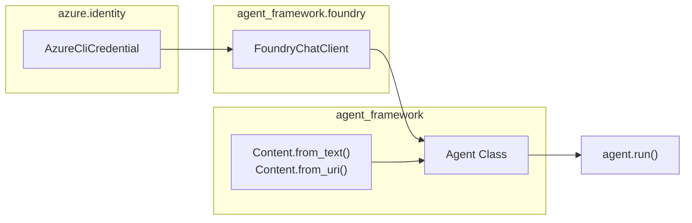
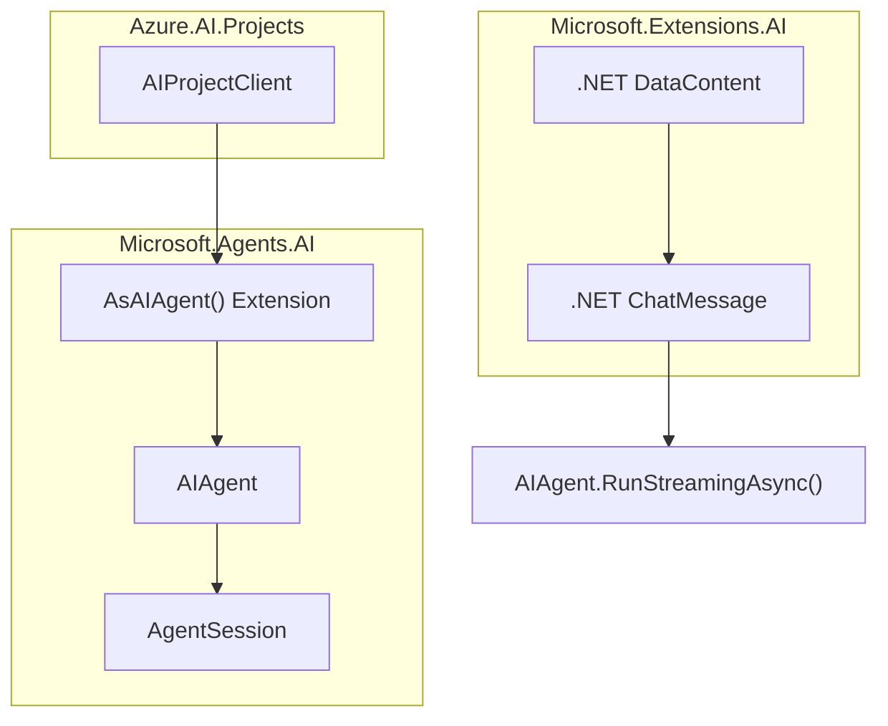

<!-- source: DeepWiki mcp.deepwiki.com · repo microsoft/Agent-Framework-Samples · page 6.2 Vision · fetched 2026-10-26 -->

# Vision

Relevant source files

The following files were used as context for generating this wiki page:

- [04.Tools/code_samples/dotNET/msfoundry/01-dotnet-agent-framework-msfoundry-vision/01-dotnet-agent-framework-msfoundry-vision.csproj](04.Tools/code_samples/dotNET/msfoundry/01-dotnet-agent-framework-msfoundry-vision/01-dotnet-agent-framework-msfoundry-vision.csproj)
- [04.Tools/code_samples/dotNET/msfoundry/01-dotnet-agent-framework-msfoundry-vision/Program.cs](04.Tools/code_samples/dotNET/msfoundry/01-dotnet-agent-framework-msfoundry-vision/Program.cs)
- [04.Tools/code_samples/dotNET/msfoundry/02-dotnet-agent-framework-msfoundry-code-interpreter/02-dotnet-agent-framework-msfoundry-code-interpreter.csproj](04.Tools/code_samples/dotNET/msfoundry/02-dotnet-agent-framework-msfoundry-code-interpreter/02-dotnet-agent-framework-msfoundry-code-interpreter.csproj)
- [04.Tools/code_samples/dotNET/msfoundry/02-dotnet-agent-framework-msfoundry-code-interpreter/Program.cs](04.Tools/code_samples/dotNET/msfoundry/02-dotnet-agent-framework-msfoundry-code-interpreter/Program.cs)
- [04.Tools/code_samples/dotNET/msfoundry/03-dotnet-agent-framework-msfoundry-web-search/03-dotnet-agent-framework-msfoundry-web-search.csproj](04.Tools/code_samples/dotNET/msfoundry/03-dotnet-agent-framework-msfoundry-web-search/03-dotnet-agent-framework-msfoundry-web-search.csproj)
- [04.Tools/code_samples/dotNET/msfoundry/03-dotnet-agent-framework-msfoundry-web-search/Program.cs](04.Tools/code_samples/dotNET/msfoundry/03-dotnet-agent-framework-msfoundry-web-search/Program.cs)
- [04.Tools/code_samples/dotNET/msfoundry/04-dotnet-agent-framework-msfoundry-file-search/04-dotnet-agent-framework-msfoundry-file-search.csproj](04.Tools/code_samples/dotNET/msfoundry/04-dotnet-agent-framework-msfoundry-file-search/04-dotnet-agent-framework-msfoundry-file-search.csproj)
- [04.Tools/code_samples/dotNET/msfoundry/04-dotnet-agent-framework-msfoundry-file-search/Program.cs](04.Tools/code_samples/dotNET/msfoundry/04-dotnet-agent-framework-msfoundry-file-search/Program.cs)
- [04.Tools/code_samples/python/msfoundry/01.python-agent-framework-msfoundry-vision.ipynb](04.Tools/code_samples/python/msfoundry/01.python-agent-framework-msfoundry-vision.ipynb)
- [04.Tools/code_samples/python/msfoundry/02.python-agent-framework-msfoundry-code-interpreter.ipynb](04.Tools/code_samples/python/msfoundry/02.python-agent-framework-msfoundry-code-interpreter.ipynb)
- [04.Tools/code_samples/python/msfoundry/04.python-agent-framework-msfoundry-file-search.ipynb](04.Tools/code_samples/python/msfoundry/04.python-agent-framework-msfoundry-file-search.ipynb)

This page explains how to pass image data to an agent using the Microsoft Agent Framework. It covers model configuration, the message construction pattern using `ChatMessage` with `DataContent`, and both Python and .NET implementations against Azure AI Foundry.

## Overview

Vision queries send image data alongside a text prompt within a single `ChatMessage`. Multimodal models like `gpt-4o` or `gpt-4o-mini` process both modalities to interpret visual context. Unlike specialized tools like [Code Interpreter](6.3) or [Bing Grounding](6.4), vision is an intrinsic capability of the model and does not require explicit tool registration.

**Key Requirements:**
- **Model**: A vision-capable model deployment (e.g., `gpt-4o` or `gpt-4o-mini`).
- **Data Format**: Images are typically passed as `image/png` or `image/jpeg`.
- **Environment**: Configuration of `FOUNDRY_PROJECT_ENDPOINT` and `FOUNDRY_MODEL` environment variables.

Sources: [04.Tools/code_samples/dotNET/msfoundry/01-dotnet-agent-framework-msfoundry-vision/Program.cs:11-12](), [04.Tools/code_samples/python/msfoundry/01.python-agent-framework-msfoundry-vision.ipynb:67-68]()

---

## Message Construction

The core pattern involves wrapping image data in a `DataContent` object and combining it with `TextContent` inside a `ChatMessage`.

**Vision Data Flow:**

Sources: [04.Tools/code_samples/dotNET/msfoundry/01-dotnet-agent-framework-msfoundry-vision/Program.cs:29-32](), [04.Tools/code_samples/python/msfoundry/01.python-agent-framework-msfoundry-vision.ipynb:139-151]()

---

## Python Implementation

The Python implementation uses `FoundryChatClient` to interact with Azure AI Foundry. It reads the image from disk, encodes it to base64, and constructs a data URI.

**Implementation Details:**
- **Client**: `FoundryChatClient` initialized with `AzureCliCredential` [04.Tools/code_samples/python/msfoundry/01.python-agent-framework-msfoundry-vision.ipynb:134]().
- **Encoding**: Uses `base64.b64encode` to create a `data:image/png;base64,...` URI [04.Tools/code_samples/python/msfoundry/01.python-agent-framework-msfoundry-vision.ipynb:141-143]().
- **Execution**: The `agent.run()` method accepts a list of `Content` objects [04.Tools/code_samples/python/msfoundry/01.python-agent-framework-msfoundry-vision.ipynb:147-152]().

**Python Code Entity Space:**

Sources: [04.Tools/code_samples/python/msfoundry/01.python-agent-framework-msfoundry-vision.ipynb:21-23](), [04.Tools/code_samples/python/msfoundry/01.python-agent-framework-msfoundry-vision.ipynb:133-137]()

---

## .NET Implementation

The .NET implementation leverages `Microsoft.Agents.AI` and `Microsoft.Extensions.AI` abstractions. It uses `DataContent.LoadFromAsync` to simplify image loading.

**Implementation Details:**
- **Client**: `AIProjectClient` from `Azure.AI.Projects` [04.Tools/code_samples/dotNET/msfoundry/01-dotnet-agent-framework-msfoundry-vision/Program.cs:22]().
- **Agent Extension**: The `AsAIAgent()` extension method creates an `AIAgent` instance from the project client [04.Tools/code_samples/dotNET/msfoundry/01-dotnet-agent-framework-msfoundry-vision/Program.cs:24-27]().
- **Data Loading**: `DataContent.LoadFromAsync(imgPath)` automatically handles reading and media type detection [04.Tools/code_samples/dotNET/msfoundry/01-dotnet-agent-framework-msfoundry-vision/Program.cs:31]().
- **Streaming**: Demonstrates `agent.RunStreamingAsync()` to process partial updates [04.Tools/code_samples/dotNET/msfoundry/01-dotnet-agent-framework-msfoundry-vision/Program.cs:36-39]().

**.NET Code Entity Space:**

Sources: [04.Tools/code_samples/dotNET/msfoundry/01-dotnet-agent-framework-msfoundry-vision/Program.cs:22-36](), [04.Tools/code_samples/dotNET/msfoundry/01-dotnet-agent-framework-msfoundry-vision/01-dotnet-agent-framework-msfoundry-vision.csproj:12-19]()

---

## Comparison Table

| Feature | Python Implementation | .NET Implementation |
| :--- | :--- | :--- |
| **Primary Client** | `FoundryChatClient` | `AIProjectClient` |
| **Agent Class** | `Agent` | `AIAgent` |
| **Image Loading** | Manual `base64` encoding | `DataContent.LoadFromAsync` |
| **Message Structure** | List of `Content` objects | Array of `AIContent` objects |
| **Streaming** | Supported via `run_stream` | Supported via `RunStreamingAsync` |
| **Auth** | `AzureCliCredential` | `DefaultAzureCredential` |

Sources: [04.Tools/code_samples/python/msfoundry/01.python-agent-framework-msfoundry-vision.ipynb:133-152](), [04.Tools/code_samples/dotNET/msfoundry/01-dotnet-agent-framework-msfoundry-vision/Program.cs:22-39]()

---

## Example Scenario: Furniture Consultant

Both implementations demonstrate a "Furniture Sales Consultant" agent.

1. **Instructions**: "You are my furniture sales consultant, you can find different furniture elements from the pictures and give me a purchase suggestion" [04.Tools/code_samples/dotNET/msfoundry/01-dotnet-agent-framework-msfoundry-vision/Program.cs:17]().
2. **Input**: A picture of a living room (`home.png`) and a text query asking to identify items for a modern living room [04.Tools/code_samples/dotNET/msfoundry/01-dotnet-agent-framework-msfoundry-vision/Program.cs:30]().
3. **Output**: The agent identifies items (e.g., 3-seat sofa, accent lounge chair) and provides estimated market prices and purchase suggestions [04.Tools/code_samples/python/msfoundry/01.python-agent-framework-msfoundry-vision.ipynb:82-127]().

Sources: [04.Tools/code_samples/dotNET/msfoundry/01-dotnet-agent-framework-msfoundry-vision/Program.cs:14-17](), [04.Tools/code_samples/python/msfoundry/01.python-agent-framework-msfoundry-vision.ipynb:81-128]()

---

