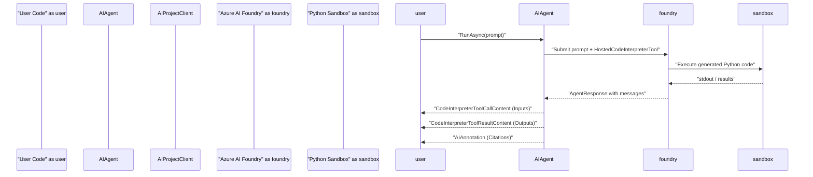
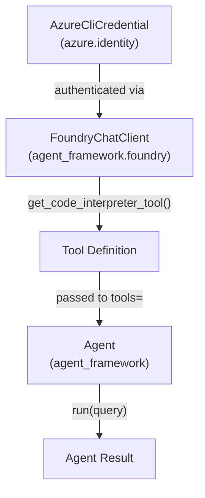
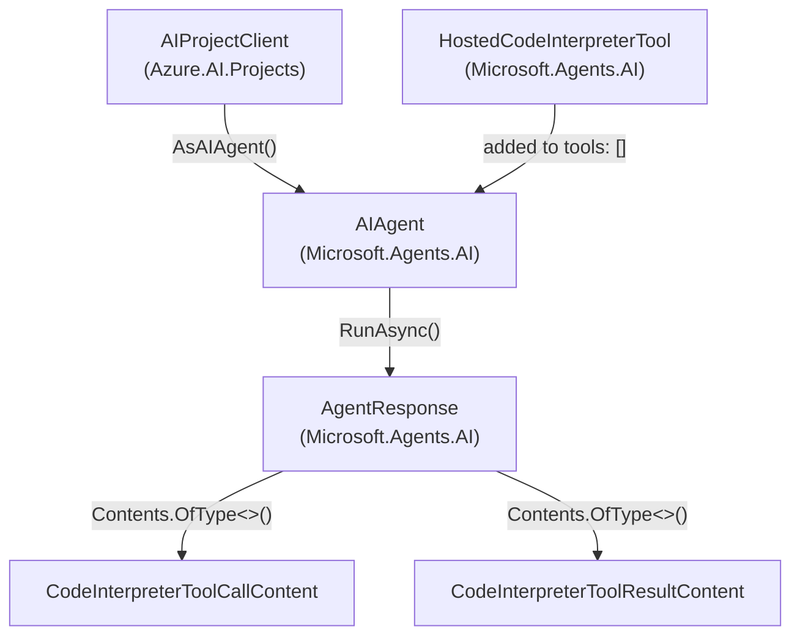

<!-- source: DeepWiki mcp.deepwiki.com · repo microsoft/Agent-Framework-Samples · page 6.3 Code Interpreter · fetched 2026-10-26 -->

# Code Interpreter

<details>
<summary>Relevant source files</summary>

The following files were used as context for generating this wiki page:

- [04.Tools/code_samples/dotNET/msfoundry/01-dotnet-agent-framework-msfoundry-vision/01-dotnet-agent-framework-msfoundry-vision.csproj](04.Tools/code_samples/dotNET/msfoundry/01-dotnet-agent-framework-msfoundry-vision/01-dotnet-agent-framework-msfoundry-vision.csproj)
- [04.Tools/code_samples/dotNET/msfoundry/01-dotnet-agent-framework-msfoundry-vision/Program.cs](04.Tools/code_samples/dotNET/msfoundry/01-dotnet-agent-framework-msfoundry-vision/Program.cs)
- [04.Tools/code_samples/dotNET/msfoundry/02-dotnet-agent-framework-msfoundry-code-interpreter/02-dotnet-agent-framework-msfoundry-code-interpreter.csproj](04.Tools/code_samples/dotNET/msfoundry/02-dotnet-agent-framework-msfoundry-code-interpreter/02-dotnet-agent-framework-msfoundry-code-interpreter.csproj)
- [04.Tools/code_samples/dotNET/msfoundry/02-dotnet-agent-framework-msfoundry-code-interpreter/Program.cs](04.Tools/code_samples/dotNET/msfoundry/02-dotnet-agent-framework-msfoundry-code-interpreter/Program.cs)
- [04.Tools/code_samples/dotNET/msfoundry/03-dotnet-agent-framework-msfoundry-web-search/03-dotnet-agent-framework-msfoundry-web-search.csproj](04.Tools/code_samples/dotNET/msfoundry/03-dotnet-agent-framework-msfoundry-web-search/03-dotnet-agent-framework-msfoundry-web-search.csproj)
- [04.Tools/code_samples/dotNET/msfoundry/03-dotnet-agent-framework-msfoundry-web-search/Program.cs](04.Tools/code_samples/dotNET/msfoundry/03-dotnet-agent-framework-msfoundry-web-search/Program.cs)
- [04.Tools/code_samples/dotNET/msfoundry/04-dotnet-agent-framework-msfoundry-file-search/04-dotnet-agent-framework-msfoundry-file-search.csproj](04.Tools/code_samples/dotNET/msfoundry/04-dotnet-agent-framework-msfoundry-file-search/04-dotnet-agent-framework-msfoundry-file-search.csproj)
- [04.Tools/code_samples/dotNET/msfoundry/04-dotnet-agent-framework-msfoundry-file-search/Program.cs](04.Tools/code_samples/dotNET/msfoundry/04-dotnet-agent-framework-msfoundry-file-search/Program.cs)
- [04.Tools/code_samples/python/msfoundry/01.python-agent-framework-msfoundry-vision.ipynb](04.Tools/code_samples/python/msfoundry/01.python-agent-framework-msfoundry-vision.ipynb)
- [04.Tools/code_samples/python/msfoundry/02.python-agent-framework-msfoundry-code-interpreter.ipynb](04.Tools/code_samples/python/msfoundry/02.python-agent-framework-msfoundry-code-interpreter.ipynb)
- [04.Tools/code_samples/python/msfoundry/04.python-agent-framework-msfoundry-file-search.ipynb](04.Tools/code_samples/python/msfoundry/04.python-agent-framework-msfoundry-file-search.ipynb)

</details>


This page covers how to enable the Code Interpreter hosted tool in agent definitions, how the tool container is configured, and how to extract structured output from agent responses—including the generated code, execution results, and file annotations. Both the Python and .NET implementations against Azure AI Foundry are covered.

For general tool concepts (function tools, tool registration lifecycle), see **6.1 Custom Function Tools**. For file search and vector store RAG, see **6.5 File Search and RAG**. For Bing Grounding, see **6.4 Bing Grounding**.

---

## What Is the Code Interpreter Tool?

The Code Interpreter is a **hosted tool** provided by Azure AI Foundry. When enabled on an agent, the model can write and execute Python code in a sandboxed container managed by the service. The agent uses this tool autonomously when a user prompt calls for computation, data transformation, or algorithmic reasoning that is better handled with code than plain language.

Unlike custom function tools (see [6.1 Custom Function Tools]()), the Code Interpreter does not require any local function implementation. The execution environment is entirely cloud-managed.

---

## Prerequisites

The Code Interpreter tool requires an Azure AI Foundry project. The following environment variable must be set:

| Variable | Purpose |
|---|---|
| `FOUNDRY_PROJECT_ENDPOINT` | The Azure AI Foundry project endpoint URL |

For loading this variable in .NET, `DotNetEnv` is used [04.Tools/code_samples/dotNET/msfoundry/02-dotnet-agent-framework-msfoundry-code-interpreter/Program.cs:9](). In Python, `python-dotenv` is used [04.Tools/code_samples/python/msfoundry/02.python-agent-framework-msfoundry-code-interpreter.ipynb:46]().

---

## Architecture

The diagram below maps the Code Interpreter flow from user prompt through tool invocation to structured response parsing, using the exact class names from the codebase.

**Diagram: Code Interpreter Request and Response Flow**


Sources: [04.Tools/code_samples/dotNET/msfoundry/02-dotnet-agent-framework-msfoundry-code-interpreter/Program.cs:28-46]()

---

## Python Implementation

In Python, the `FoundryChatClient` provides a static method `get_code_interpreter_tool()` to simplify the configuration.

**Diagram: Python Code Interpreter Class Relationships**


Sources: [04.Tools/code_samples/python/msfoundry/02.python-agent-framework-msfoundry-code-interpreter.ipynb:67-73]()

### Implementation Details
The agent is initialized by passing the tool definition to the `Agent` constructor. The `FoundryChatClient` handles the communication with Azure AI Foundry.

```python
# Create a Foundry-backed agent with code interpreter
agent = Agent(
    client=FoundryChatClient(credential=AzureCliCredential()),
    name="Coding-Agent",
    instructions="You are a helpful assistant that can write and execute Python code.",
    tools=FoundryChatClient.get_code_interpreter_tool(),
)

result = await agent.run("Write a python function that returns a random even number.")
```
Sources: [04.Tools/code_samples/python/msfoundry/02.python-agent-framework-msfoundry-code-interpreter.ipynb:67-103]()

---

## .NET Implementation

The .NET implementation uses the `AIProjectClient` to create an `AIAgent` with `HostedCodeInterpreterTool`.

**Diagram: .NET Code Interpreter Class Relationships**


Sources: [04.Tools/code_samples/dotNET/msfoundry/02-dotnet-agent-framework-msfoundry-code-interpreter/Program.cs:22-42]()

### Tool Configuration
The tool is enabled by passing a new instance of `HostedCodeInterpreterTool` to the `AsAIAgent` extension method.
```csharp
AIAgent agent = aiProjectClient.AsAIAgent(
    deploymentName,
    instructions: AgentInstructions,
    name: AgentName,
    tools: [new HostedCodeInterpreterTool() { Inputs = [] }]);
```
Sources: [04.Tools/code_samples/dotNET/msfoundry/02-dotnet-agent-framework-msfoundry-code-interpreter/Program.cs:22-26]()

### Parsing the Response
After `agent.RunAsync(prompt)` returns an `AgentResponse`, structured content can be extracted:

| Content Type | How to Extract | Purpose |
|---|---|---|
| `CodeInterpreterToolCallContent` | `.OfType<CodeInterpreterToolCallContent>()` | Access the code generated by the model [04.Tools/code_samples/dotNET/msfoundry/02-dotnet-agent-framework-msfoundry-code-interpreter/Program.cs:31](). |
| `CodeInterpreterToolResultContent` | `.OfType<CodeInterpreterToolResultContent>()` | Access the stdout/results of the execution [04.Tools/code_samples/dotNET/msfoundry/02-dotnet-agent-framework-msfoundry-code-interpreter/Program.cs:42](). |
| `AIAnnotation` | `.SelectMany(C => C.Annotations)` | Access file citations (e.g., `TextAnnotationUpdate`) [04.Tools/code_samples/dotNET/msfoundry/02-dotnet-agent-framework-msfoundry-code-interpreter/Program.cs:49](). |

**Extracting Code Input:**
The code text is stored in `DataContent` within the `Inputs` collection.
```csharp
if (toolCallContent?.Inputs is not null)
{
    DataContent? codeInput = toolCallContent.Inputs.OfType<DataContent>().FirstOrDefault();
    if (codeInput?.HasTopLevelMediaType("text") ?? false)
    {
        Console.WriteLine($"Code Input: {Encoding.UTF8.GetString(codeInput.Data.ToArray())}");
    }
}
```
Sources: [04.Tools/code_samples/dotNET/msfoundry/02-dotnet-agent-framework-msfoundry-code-interpreter/Program.cs:32-39]()

---

## NuGet Package Dependencies (.NET)

The following packages are required for the Code Interpreter sample:

| Package | Version | Purpose |
|---|---|---|
| `Azure.AI.Projects` | 2.0.0 | Core AI Foundry Project client [04.Tools/code_samples/dotNET/msfoundry/02-dotnet-agent-framework-msfoundry-code-interpreter/02-dotnet-agent-framework-msfoundry-code-interpreter.csproj:16](). |
| `Azure.AI.Agents.Persistent` | 1.2.0-beta.10 | Persistent agent state management [04.Tools/code_samples/dotNET/msfoundry/02-dotnet-agent-framework-msfoundry-code-interpreter/02-dotnet-agent-framework-msfoundry-code-interpreter.csproj:18](). |
| `Azure.Identity` | 1.20.0 | `DefaultAzureCredential` or `AzureCliCredential` [04.Tools/code_samples/dotNET/msfoundry/02-dotnet-agent-framework-msfoundry-code-interpreter/02-dotnet-agent-framework-msfoundry-code-interpreter.csproj:14](). |
| `DotNetEnv` | 3.1.1 | Environment variable management [04.Tools/code_samples/dotNET/msfoundry/02-dotnet-agent-framework-msfoundry-code-interpreter/02-dotnet-agent-framework-msfoundry-code-interpreter.csproj:15](). |

Sources: [04.Tools/code_samples/dotNET/msfoundry/02-dotnet-agent-framework-msfoundry-code-interpreter/02-dotnet-agent-framework-msfoundry-code-interpreter.csproj:12-20]()

---

