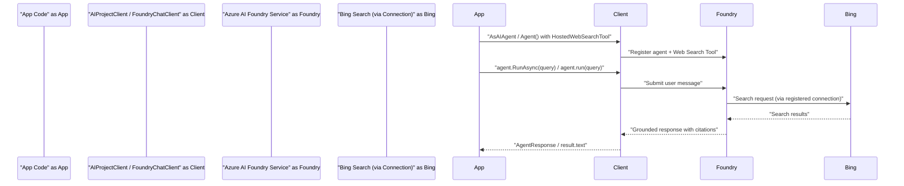
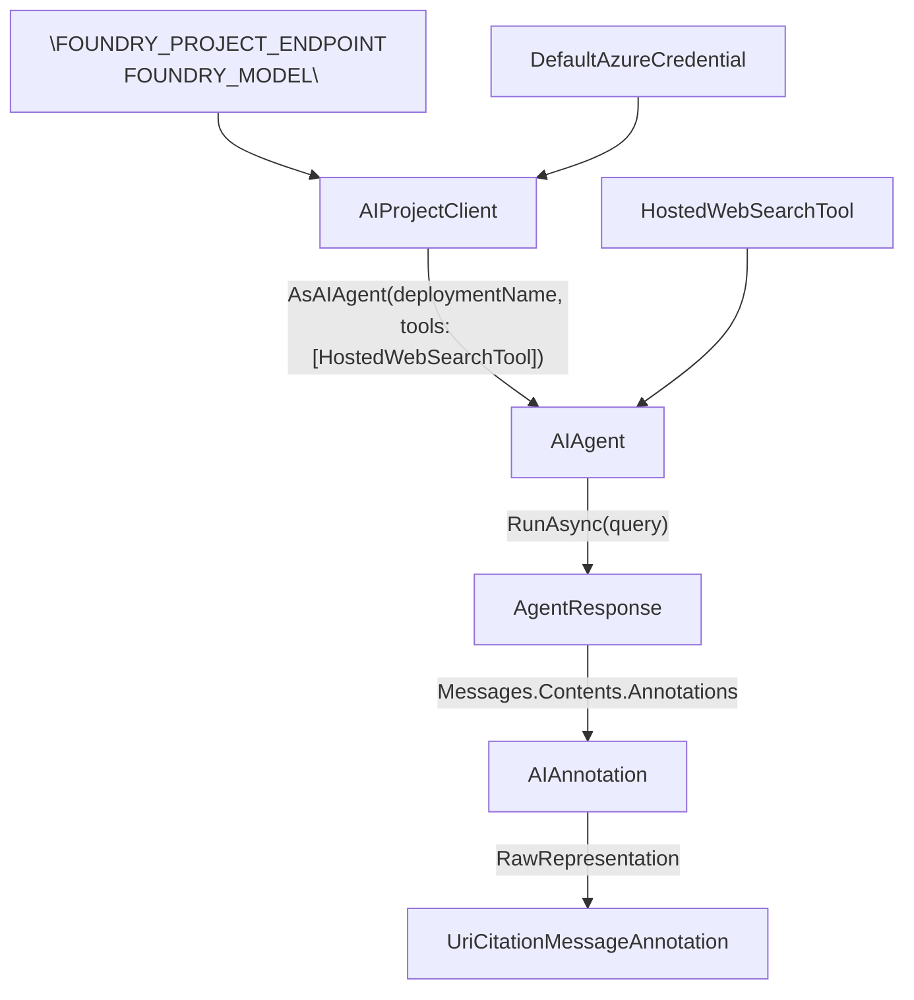
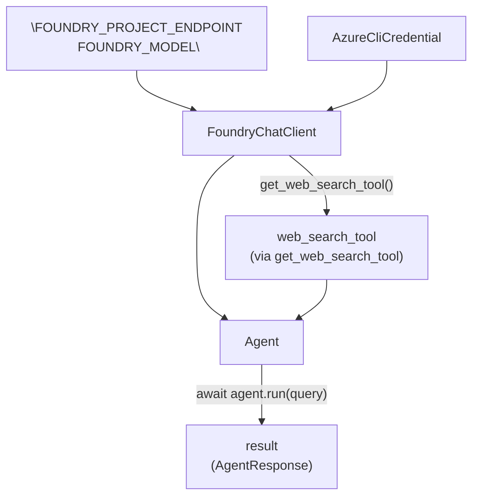

<!-- source: DeepWiki mcp.deepwiki.com · repo microsoft/Agent-Framework-Samples · page 6.4 Bing Grounding · fetched 2026-10-26 -->

# Bing Grounding

Relevant source files

The following files were used as context for generating this wiki page:

- [04.Tools/code_samples/dotNET/msfoundry/01-dotnet-agent-framework-msfoundry-vision/01-dotnet-agent-framework-msfoundry-vision.csproj](04.Tools/code_samples/dotNET/msfoundry/01-dotnet-agent-framework-msfoundry-vision/01-dotnet-agent-framework-msfoundry-vision.csproj)
- [04.Tools/code_samples/dotNET/msfoundry/01-dotnet-agent-framework-msfoundry-vision/Program.cs](04.Tools/code_samples/dotNET/msfoundry/01-dotnet-agent-framework-msfoundry-vision/Program.cs)
- [04.Tools/code_samples/dotNET/msfoundry/02-dotnet-agent-framework-msfoundry-code-interpreter/02-dotnet-agent-framework-msfoundry-code-interpreter.csproj](04.Tools/code_samples/dotNET/msfoundry/02-dotnet-agent-framework-msfoundry-code-interpreter/02-dotnet-agent-framework-msfoundry-code-interpreter.csproj)
- [04.Tools/code_samples/dotNET/msfoundry/02-dotnet-agent-framework-msfoundry-code-interpreter/Program.cs](04.Tools/code_samples/dotNET/msfoundry/02-dotnet-agent-framework-msfoundry-code-interpreter/Program.cs)
- [04.Tools/code_samples/dotNET/msfoundry/03-dotnet-agent-framework-msfoundry-web-search/03-dotnet-agent-framework-msfoundry-web-search.csproj](04.Tools/code_samples/dotNET/msfoundry/03-dotnet-agent-framework-msfoundry-web-search/03-dotnet-agent-framework-msfoundry-web-search.csproj)
- [04.Tools/code_samples/dotNET/msfoundry/03-dotnet-agent-framework-msfoundry-web-search/Program.cs](04.Tools/code_samples/dotNET/msfoundry/03-dotnet-agent-framework-msfoundry-web-search/Program.cs)
- [04.Tools/code_samples/dotNET/msfoundry/04-dotnet-agent-framework-msfoundry-file-search/04-dotnet-agent-framework-msfoundry-file-search.csproj](04.Tools/code_samples/dotNET/msfoundry/04-dotnet-agent-framework-msfoundry-file-search/04-dotnet-agent-framework-msfoundry-file-search.csproj)
- [04.Tools/code_samples/dotNET/msfoundry/04-dotnet-agent-framework-msfoundry-file-search/Program.cs](04.Tools/code_samples/dotNET/msfoundry/04-dotnet-agent-framework-msfoundry-file-search/Program.cs)
- [04.Tools/code_samples/python/msfoundry/03.python-agent-framework-msfoundry-web-search.ipynb](04.Tools/code_samples/python/msfoundry/03.python-agent-framework-msfoundry-web-search.ipynb)

This page covers how to configure and use the Bing grounding tool within the Microsoft Agent Framework, enabling agents to retrieve live web information and include citations in their responses. Both .NET and Python implementations are described.

Bing grounding is one of several hosted tool types available in the framework. For an overview of all tool types, see [Tools Overview](#3.3). For the Azure AI Foundry provider that hosts this tool, see [Azure AI Foundry](#5.3).

---

## Overview

Bing grounding is a **hosted tool** provided by Azure AI Foundry. When enabled, the agent can issue search queries to Bing during inference and incorporate retrieved web content into its answers, including source citations. The tool is not invoked by application code—the model decides when to use it based on the conversation context and its instructions.

Because this tool is hosted by the Foundry service, it requires:

1. An **Azure AI Foundry project** (not a plain Azure OpenAI endpoint).
2. A **Bing connection** registered in that Foundry project.
3. The connection's **ID or name** passed to the tool configuration at agent creation time.

---

## Request Flow

**Diagram: Bing Grounding Request Flow**

Sources: [04.Tools/code_samples/dotNET/msfoundry/03-dotnet-agent-framework-msfoundry-web-search/Program.cs:25-30](), [04.Tools/code_samples/python/msfoundry/03.python-agent-framework-msfoundry-web-search.ipynb:83-96]()

---

## Environment Variables

| Variable | Language | Purpose |
|---|---|---|
| `FOUNDRY_PROJECT_ENDPOINT` | Both | Azure AI Foundry project endpoint URL [04.Tools/code_samples/dotNET/msfoundry/03-dotnet-agent-framework-msfoundry-web-search/Program.cs:16]() |
| `FOUNDRY_MODEL` | Both | Model deployment name (e.g., `gpt-4o-mini`) [04.Tools/code_samples/dotNET/msfoundry/03-dotnet-agent-framework-msfoundry-web-search/Program.cs:17]() |

For a full reference of all environment variables used across the samples, see [Configuration Reference](#2.2).

---

## .NET Implementation

### NuGet Dependencies

The web search sample targets `net10.0` and requires the following packages (see [04.Tools/code_samples/dotNET/msfoundry/03-dotnet-agent-framework-msfoundry-web-search/03-dotnet-agent-framework-msfoundry-web-search.csproj:13-19]()):

| Package | Version |
|---|---|
| `Azure.AI.Projects` | 2.0.0 |
| `Azure.AI.Projects.OpenAI` | 2.0.0-beta.1 |
| `Azure.AI.Agents.Persistent` | 1.2.0-beta.10 |
| `Azure.Identity` | 1.20.0 |
| `DotNetEnv` | 3.1.1 |
| `Microsoft.Extensions.AI.OpenAI` | 10.4.0 |

### Step-by-Step Setup

**Diagram: .NET Class and Object Relationships**

Sources: [04.Tools/code_samples/dotNET/msfoundry/03-dotnet-agent-framework-msfoundry-web-search/Program.cs:22-46]()

**1. Create the project client**

Instantiate `AIProjectClient` with the Foundry endpoint and `DefaultAzureCredential`:

[04.Tools/code_samples/dotNET/msfoundry/03-dotnet-agent-framework-msfoundry-web-search/Program.cs:22-22]()

**2. Create the AIAgent with HostedWebSearchTool**

Use the `AsAIAgent` extension method to configure the agent. The `tools` parameter receives a list containing a new instance of `HostedWebSearchTool`:

[04.Tools/code_samples/dotNET/msfoundry/03-dotnet-agent-framework-msfoundry-web-search/Program.cs:25-28]()

**3. Run the agent and handle citations**

`RunAsync` returns an `AgentResponse`. Grounded responses often include `AIAnnotation` objects within the message contents. For web searches, these can be cast to `UriCitationMessageAnnotation` to retrieve the source `Title` and `Uri`:

[04.Tools/code_samples/dotNET/msfoundry/03-dotnet-agent-framework-msfoundry-web-search/Program.cs:30-46]()

---

## Python Implementation

### Step-by-Step Setup

**Diagram: Python Class and Object Relationships**

Sources: [04.Tools/code_samples/python/msfoundry/03.python-agent-framework-msfoundry-web-search.ipynb:83-96]()

**1. Import and configure the client**

`FoundryChatClient` from `agent_framework.foundry` is the Python abstraction for interacting with Azure AI Foundry. It is initialized with a credential:

[04.Tools/code_samples/python/msfoundry/03.python-agent-framework-msfoundry-web-search.ipynb:87-87]()

**2. Retrieve the web search tool**

The `FoundryChatClient` provides a static helper method `get_web_search_tool()` to generate the necessary tool definition for Bing grounding:

[04.Tools/code_samples/python/msfoundry/03.python-agent-framework-msfoundry-web-search.ipynb:83-83]()

**3. Create and run the agent**

Pass the retrieved `web_search_tool` to the `Agent` constructor. Calling `await agent.run(query)` executes the reasoning loop where the agent can invoke Bing:

[04.Tools/code_samples/python/msfoundry/03.python-agent-framework-msfoundry-web-search.ipynb:86-96]()

---

## Side-by-Side Comparison

| Aspect | .NET | Python |
|---|---|---|
| Provider class | `AIProjectClient` | `FoundryChatClient` |
| Tool Initialization | `new HostedWebSearchTool()` | `FoundryChatClient.get_web_search_tool()` |
| Agent creation | `aiProjectClient.AsAIAgent(...)` | `Agent(client=FoundryChatClient(...), ...)` |
| Execution | `await agent.RunAsync(query)` | `await agent.run(query)` |
| Citation Access | `annotation.RawRepresentation as UriCitationMessageAnnotation` | Accessed via `result.text` or message metadata |

---

## Agent Instructions Pattern

Both samples use a similar instruction pattern to ensure the model utilizes the search tool and provides citations:

> *"You are a helpful assistant that can search the web for current information. Use the Bing search tool to find up-to-date information and provide accurate, well-sourced answers. Always cite your sources when possible."*

[04.Tools/code_samples/dotNET/msfoundry/03-dotnet-agent-framework-msfoundry-web-search/Program.cs:11-13](), [04.Tools/code_samples/python/msfoundry/03.python-agent-framework-msfoundry-web-search.ipynb:57-59]()

---

## Prerequisites and Notes

- **Bing connection must be registered in the Foundry project.** The search tool relies on a valid connection existing within the Azure AI Foundry project targeted by the endpoint.
- **Authentication:** .NET samples typically use `DefaultAzureCredential` [04.Tools/code_samples/dotNET/msfoundry/03-dotnet-agent-framework-msfoundry-web-search/Program.cs:22](), while Python samples often use `AzureCliCredential` [04.Tools/code_samples/python/msfoundry/03.python-agent-framework-msfoundry-web-search.ipynb:87](). Ensure you have run `az login` or configured managed identity.
- **Model selection:** The model must support tool calling. The samples default to `gpt-4o-mini` [04.Tools/code_samples/dotNET/msfoundry/03-dotnet-agent-framework-msfoundry-web-search/Program.cs:17]().

---

## Sample File Locations

| Language | File |
|---|---|
| .NET | [04.Tools/code_samples/dotNET/msfoundry/03-dotnet-agent-framework-msfoundry-web-search/Program.cs]() |
| .NET project | [04.Tools/code_samples/dotNET/msfoundry/03-dotnet-agent-framework-msfoundry-web-search/03-dotnet-agent-framework-msfoundry-web-search.csproj]() |
| Python | [04.Tools/code_samples/python/msfoundry/03.python-agent-framework-msfoundry-web-search.ipynb]() |

---

