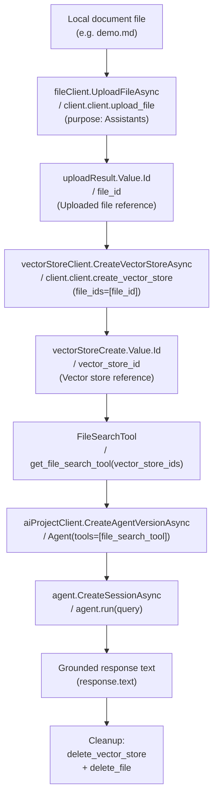
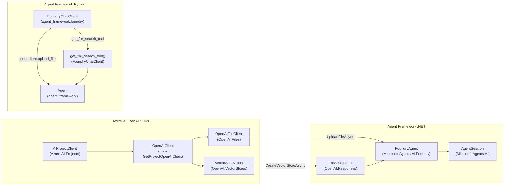

<!-- source: DeepWiki mcp.deepwiki.com · repo microsoft/Agent-Framework-Samples · page 6.5 File Search and RAG · fetched 2026-10-26 -->

# File Search and RAG

<details>
<summary>Relevant source files</summary>

The following files were used as context for generating this wiki page:

- [04.Tools/code_samples/python/msfoundry/01.python-agent-framework-msfoundry-vision.ipynb](04.Tools/code_samples/python/msfoundry/01.python-agent-framework-msfoundry-vision.ipynb)
- [04.Tools/code_samples/python/msfoundry/02.python-agent-framework-msfoundry-code-interpreter.ipynb](04.Tools/code_samples/python/msfoundry/02.python-agent-framework-msfoundry-code-interpreter.ipynb)
- [04.Tools/code_samples/python/msfoundry/04.python-agent-framework-msfoundry-file-search.ipynb](04.Tools/code_samples/python/msfoundry/04.python-agent-framework-msfoundry-file-search.ipynb)
- [05.Providers/code_samples/dotNET/01-dotnet-agent-framework-aifoundry-mcp/AgentMCP.Console/AgentMCP.Console.csproj](05.Providers/code_samples/dotNET/01-dotnet-agent-framework-aifoundry-mcp/AgentMCP.Console/AgentMCP.Console.csproj)
- [05.Providers/code_samples/dotNET/01-dotnet-agent-framework-aifoundry-mcp/AgentMCP.Console/Program.cs](05.Providers/code_samples/dotNET/01-dotnet-agent-framework-aifoundry-mcp/AgentMCP.Console/Program.cs)
- [05.Providers/code_samples/python/01-python-agent-framework-aifoundry-mcp.ipynb](05.Providers/code_samples/python/01-python-agent-framework-aifoundry-mcp.ipynb)
- [06.RAGs/code_samples/dotNET/dotnet-agent-framework-msfoundry-file-search/Program.cs](06.RAGs/code_samples/dotNET/dotnet-agent-framework-msfoundry-file-search/Program.cs)
- [06.RAGs/code_samples/dotNET/dotnet-agent-framework-msfoundry-file-search/dotnet-agent-framework-msfoundry-file-search.csproj](06.RAGs/code_samples/dotNET/dotnet-agent-framework-msfoundry-file-search/dotnet-agent-framework-msfoundry-file-search.csproj)
- [06.RAGs/code_samples/python/python-agent-framework-msfoundry-file-search.ipynb](06.RAGs/code_samples/python/python-agent-framework-msfoundry-file-search.ipynb)

</details>


This page explains how to build Retrieval-Augmented Generation (RAG) agents using the file search tool in the Microsoft Agent Framework. It covers uploading documents, creating vector stores, configuring the file search tool, querying agents with grounded responses, and cleaning up cloud resources.

For background on what agents and sessions are, see [3.2](). For the Azure AI Foundry provider that backs these hosted tools, see [5.3](). For other hosted tools such as Code Interpreter or Bing Grounding, see [6.3]() and [6.4]().

---

## What Is Agentic RAG?

RAG (Retrieval-Augmented Generation) grounds an agent's responses in external documents rather than the model's training data. The file search tool indexes uploaded documents into a **vector store** on the Azure AI Foundry service. When a user asks a question, the tool performs semantic search over that vector store and supplies the retrieved passages as context before the LLM generates its answer.

This pattern is appropriate when:
- Answers must be traceable to specific documents (compliance, legal, technical documentation) [04.Tools/code_samples/python/msfoundry/04.python-agent-framework-msfoundry-file-search.ipynb:17-18]().
- The knowledge base changes frequently and model fine-tuning is impractical.
- The agent must refuse to answer questions not covered by uploaded content [04.Tools/code_samples/python/msfoundry/04.python-agent-framework-msfoundry-file-search.ipynb:43-47]().

---

## End-to-End Workflow

**Diagram: RAG Workflow — Natural Language to Code Entities**



Sources: [06.RAGs/code_samples/dotNET/dotnet-agent-framework-msfoundry-file-search/Program.cs:24-58](), [04.Tools/code_samples/python/msfoundry/04.python-agent-framework-msfoundry-file-search.ipynb:191-228]()

---

## Prerequisites

| Requirement | Details |
|---|---|
| Azure subscription | Azure AI Foundry workspace with a deployed model [04.Tools/code_samples/python/msfoundry/04.python-agent-framework-msfoundry-file-search.ipynb:56-58]() |
| Authentication | `az login` with `AzureCliCredential` [06.RAGs/code_samples/dotNET/dotnet-agent-framework-msfoundry-file-search/Program.cs:21]() |
| Environment variable | `FOUNDRY_PROJECT_ENDPOINT` — your Foundry project endpoint [06.RAGs/code_samples/dotNET/dotnet-agent-framework-msfoundry-file-search/Program.cs:15]() |
| Environment variable | `FOUNDRY_MODEL` — deployment name (e.g., `gpt-4o`) [06.RAGs/code_samples/dotNET/dotnet-agent-framework-msfoundry-file-search/Program.cs:16]() |
| .NET packages | `Azure.AI.Projects`, `OpenAI`, `Microsoft.Agents.AI.Foundry` [06.RAGs/code_samples/dotNET/dotnet-agent-framework-msfoundry-file-search/dotnet-agent-framework-msfoundry-file-search.csproj:12-25]() |
| Python packages | `agent-framework-core`, `agent-framework-foundry`, `azure-identity` [04.Tools/code_samples/python/msfoundry/04.python-agent-framework-msfoundry-file-search.ipynb:51-54]() |

---

## Key Types and Classes

**Diagram: Code Entities Involved in File Search RAG**



Sources: [06.RAGs/code_samples/dotNET/dotnet-agent-framework-msfoundry-file-search/Program.cs:19-56](), [04.Tools/code_samples/python/msfoundry/04.python-agent-framework-msfoundry-file-search.ipynb:112-212]()

---

## .NET Implementation

The .NET RAG sample demonstrates using the `AIProjectClient` to orchestrate file uploads and vector store management.

### Step 1 — Initialize Clients
[06.RAGs/code_samples/dotNET/dotnet-agent-framework-msfoundry-file-search/Program.cs:19-22]()

`AIProjectClient` is initialized with the project endpoint and `AzureCliCredential`. `GetProjectOpenAIClient()` returns an `OpenAIClient` configured for the project.

### Step 2 — Upload the Document
[06.RAGs/code_samples/dotNET/dotnet-agent-framework-msfoundry-file-search/Program.cs:24-28]()

`OpenAIFileClient.UploadFileAsync` takes a local file path and `FileUploadPurpose.Assistants`. The returned `Id` is used for indexing.

### Step 3 — Create a Vector Store
[06.RAGs/code_samples/dotNET/dotnet-agent-framework-msfoundry-file-search/Program.cs:31-36]()

`VectorStoreClient.CreateVectorStoreAsync` indexes the file. Note the `#pragma warning disable OPENAI001` as these are preview APIs.

### Step 4 — Configure the File Search Tool
[06.RAGs/code_samples/dotNET/dotnet-agent-framework-msfoundry-file-search/Program.cs:38-40]()

A `FileSearchTool` is instantiated using the vector store ID. This tool is then added to the `DeclarativeAgentDefinition` [06.RAGs/code_samples/dotNET/dotnet-agent-framework-msfoundry-file-search/Program.cs:48]().

### Step 5 — Create the Agent and Run
[06.RAGs/code_samples/dotNET/dotnet-agent-framework-msfoundry-file-search/Program.cs:42-58]()

The agent is created via `CreateAgentVersionAsync`. It is then cast to a `FoundryAgent` using `aiProjectClient.AsAIAgent(agentVersion)`. A session is created, and `RunAsync` is called with the user query.

---

## Python Implementation

The Python implementation uses `FoundryChatClient` which provides convenient access to the underlying Azure AI client for RAG operations.

### Step 1 — Initialize Client
[04.Tools/code_samples/python/msfoundry/04.python-agent-framework-msfoundry-file-search.ipynb:188-189]()

Initialize `FoundryChatClient` with `AzureCliCredential`.

### Step 2 — Upload and Index
[04.Tools/code_samples/python/msfoundry/04.python-agent-framework-msfoundry-file-search.ipynb:191-198]()

The sample uses `client.client.upload_file` and `client.client.create_vector_store`. It then associates the file with the vector store using `client.client.create_vector_store_file`.

### Step 3 — Configure File Search Tool
[04.Tools/code_samples/python/msfoundry/04.python-agent-framework-msfoundry-file-search.ipynb:210-212]()

The `FoundryChatClient.get_file_search_tool(vector_store_ids=[vector_store.id])` method generates the tool definition required for the agent.

### Step 4 — Create Agent and Query
[04.Tools/code_samples/python/msfoundry/04.python-agent-framework-msfoundry-file-search.ipynb:214-228]()

The `Agent` is initialized with the `FoundryChatClient` and the `file_search_tool`. The `agent.run(query)` method executes the RAG loop.

---

## Agent Instructions for Strict Grounding

Both implementations use a system prompt to ensure the agent only answers from document content:

> *"You are an AI assistant that helps people find information in a set of documents. Use the File Search tool to look up relevant information from the files when needed to answer user questions. If you don't know the answer, just say you don't know. Do not make up answers."* [06.RAGs/code_samples/dotNET/dotnet-agent-framework-msfoundry-file-search/Program.cs:47]()

The Python version uses a similar instruction to avoid general knowledge responses [04.Tools/code_samples/python/msfoundry/04.python-agent-framework-msfoundry-file-search.ipynb:43-48]().

---

## Resource Cleanup

Cloud resources (vector stores and files) should be deleted to avoid costs and clutter.

**Python cleanup pattern:**
[04.Tools/code_samples/python/msfoundry/04.python-agent-framework-msfoundry-file-search.ipynb:230-234]()

```python
# Cleanup vector store and file
client.client.delete_vector_store(vector_store.id)
client.client.delete_file(file.id)
```

In .NET, use `vectorStoreClient.DeleteVectorStoreAsync(vectorStoreId)` and `fileClient.DeleteFileAsync(fileId)` to perform similar cleanup.

Sources: [06.RAGs/code_samples/dotNET/dotnet-agent-framework-msfoundry-file-search/Program.cs:1-60](), [04.Tools/code_samples/python/msfoundry/04.python-agent-framework-msfoundry-file-search.ipynb:1-235]()

---

