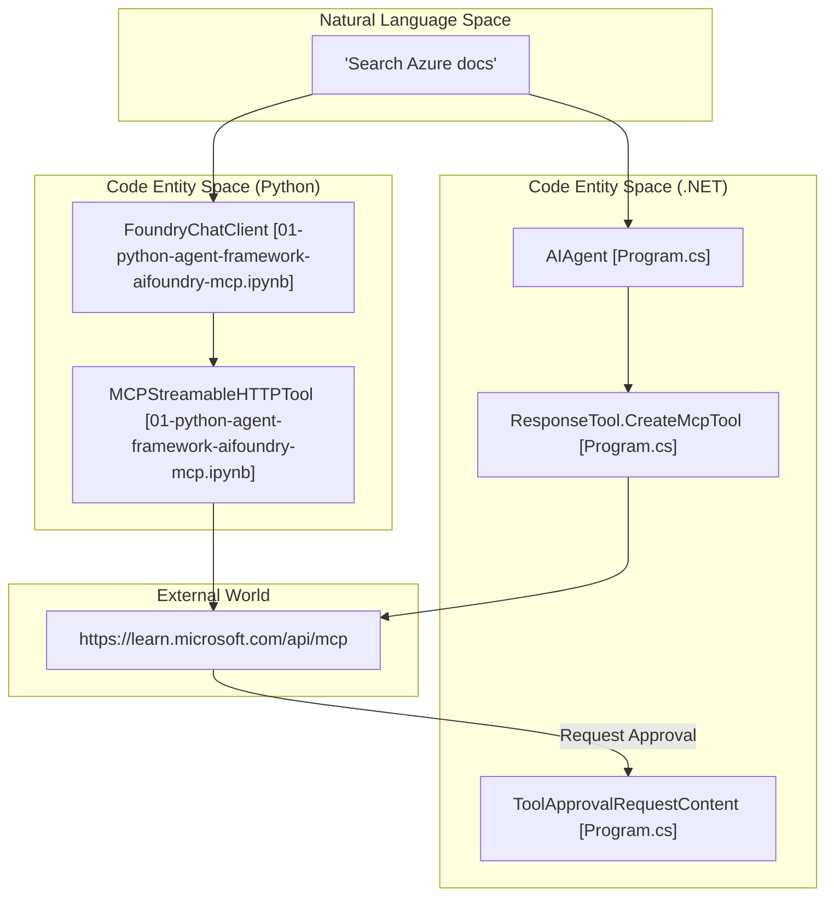
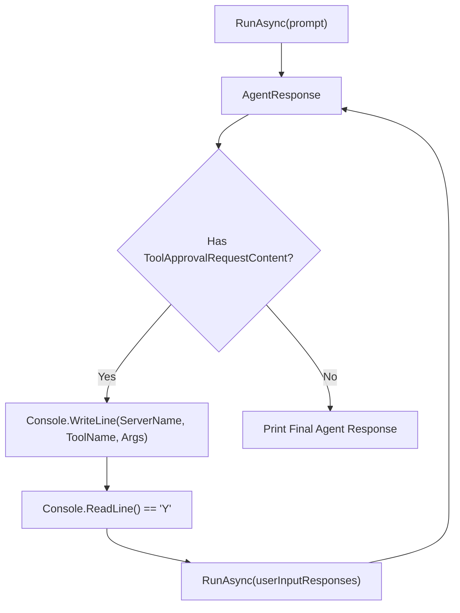

<!-- source: DeepWiki mcp.deepwiki.com · repo microsoft/Agent-Framework-Samples · page 6.6 Model Context Protocol (MCP) · fetched 2026-10-26 -->

# Model Context Protocol (MCP)

<details>
<summary>Relevant source files</summary>

The following files were used as context for generating this wiki page:

- [.devcontainer/devcontainer.json](.devcontainer/devcontainer.json)
- [.devcontainer/setup.sh](.devcontainer/setup.sh)
- [.github/dependabot.yml](.github/dependabot.yml)
- [.vscode/settings.json](.vscode/settings.json)
- [00.ForBeginners/04-tool-use/code_samples/dotnet-agent-framework-ghmodels-tool/Program.cs](00.ForBeginners/04-tool-use/code_samples/dotnet-agent-framework-ghmodels-tool/Program.cs)
- [05.Providers/code_samples/dotNET/01-dotnet-agent-framework-aifoundry-mcp/AgentMCP.Console/AgentMCP.Console.csproj](05.Providers/code_samples/dotNET/01-dotnet-agent-framework-aifoundry-mcp/AgentMCP.Console/AgentMCP.Console.csproj)
- [05.Providers/code_samples/dotNET/01-dotnet-agent-framework-aifoundry-mcp/AgentMCP.Console/Program.cs](05.Providers/code_samples/dotNET/01-dotnet-agent-framework-aifoundry-mcp/AgentMCP.Console/Program.cs)
- [05.Providers/code_samples/python/01-python-agent-framework-aifoundry-mcp.ipynb](05.Providers/code_samples/python/01-python-agent-framework-aifoundry-mcp.ipynb)
- [06.RAGs/code_samples/dotNET/dotnet-agent-framework-msfoundry-file-search/Program.cs](06.RAGs/code_samples/dotNET/dotnet-agent-framework-msfoundry-file-search/Program.cs)
- [06.RAGs/code_samples/dotNET/dotnet-agent-framework-msfoundry-file-search/dotnet-agent-framework-msfoundry-file-search.csproj](06.RAGs/code_samples/dotNET/dotnet-agent-framework-msfoundry-file-search/dotnet-agent-framework-msfoundry-file-search.csproj)
- [06.RAGs/code_samples/python/python-agent-framework-msfoundry-file-search.ipynb](06.RAGs/code_samples/python/python-agent-framework-msfoundry-file-search.ipynb)
- [Installation/requirements.txt](Installation/requirements.txt)

</details>


This page explains the Model Context Protocol (MCP) integration within the Agent Framework Samples. It covers how to connect AI agents to external data sources using standardized MCP interfaces, creating clients, and managing tool approvals in both .NET and Python.

---

## What Is MCP?

The Model Context Protocol (MCP) is an open standard that enables AI agents to discover and interact with tools hosted on remote servers. Instead of hard-coding API integrations, an agent connects to an MCP endpoint, retrieves a list of available capabilities, and invokes them as needed.

The samples primarily demonstrate connecting to the **Microsoft Learn MCP endpoint** (`https://learn.microsoft.com/api/mcp`) to allow agents to search technical documentation in real-time.

**Enterprise Applications:**
*   **Knowledge Base Integration:** Connecting to corporate wikis or documentation systems [05.Providers/code_samples/python/01-python-agent-framework-aifoundry-mcp.ipynb:81-86]().
*   **Business System Integration:** Accessing CRM, ERP, or database queries through standardized protocols [05.Providers/code_samples/python/01-python-agent-framework-aifoundry-mcp.ipynb:87-92]().
*   **Real-Time Data:** Streaming live metrics from IoT platforms or monitoring systems [05.Providers/code_samples/python/01-python-agent-framework-aifoundry-mcp.ipynb:93-98]().

Sources: [05.Providers/code_samples/python/01-python-agent-framework-aifoundry-mcp.ipynb:8-33]()

---

## MCP Architecture and Data Flow

The following diagram bridges the high-level protocol concepts to the specific code entities used in the framework.

**Diagram: MCP Code-to-Entity Mapping**



Sources: [05.Providers/code_samples/dotNET/01-dotnet-agent-framework-aifoundry-mcp/AgentMCP.Console/Program.cs:29-51](), [05.Providers/code_samples/python/01-python-agent-framework-aifoundry-mcp.ipynb:195-210]()

---

## .NET Implementation

### Implementation Details
In .NET, MCP tools are integrated using the `Azure.AI.Projects` and `Microsoft.Agents.AI` libraries. Tools are defined as `ResponseTool` objects and attached to an `AIAgent`.

**Key Components:**
*   **`AIProjectClient`**: The primary entry point for interacting with Azure AI Foundry [05.Providers/code_samples/dotNET/01-dotnet-agent-framework-aifoundry-mcp/AgentMCP.Console/Program.cs:22]().
*   **`ResponseTool.CreateMcpTool`**: Factory method to define the MCP server URI, allowed tools, and approval policies [05.Providers/code_samples/dotNET/01-dotnet-agent-framework-aifoundry-mcp/AgentMCP.Console/Program.cs:29-33]().
*   **`McpToolCallApprovalPolicy`**: Controls whether the agent requires explicit user consent before executing a remote tool call [05.Providers/code_samples/dotNET/01-dotnet-agent-framework-aifoundry-mcp/AgentMCP.Console/Program.cs:33]().

### Approval Workflow
When `GlobalMcpToolCallApprovalPolicy.AlwaysRequireApproval` is set, the `RunAsync` method returns `ToolApprovalRequestContent`. The application must iterate through these requests, collect user input, and submit the approval back to the agent.

**Diagram: .NET Tool Approval Logic**



Sources: [05.Providers/code_samples/dotNET/01-dotnet-agent-framework-aifoundry-mcp/AgentMCP.Console/Program.cs:50-75]()

---

## Python Implementation

### Implementation Details
Python uses the `FoundryChatClient` to manage MCP interactions. Tools can be retrieved dynamically or defined as streamable HTTP tools.

**Key Components:**
*   **`FoundryChatClient`**: Configured with `AzureCliCredential` for secure access to AI Foundry resources [05.Providers/code_samples/python/01-python-agent-framework-aifoundry-mcp.ipynb:184-185]().
*   **`client.get_mcp_tool`**: Retrieves an MCP tool definition from a URL. Setting `require_approval=False` allows the agent to execute tools autonomously [05.Providers/code_samples/python/01-python-agent-framework-aifoundry-mcp.ipynb:195-200]().
*   **`MCPStreamableHTTPTool`**: Used for HTTP-based MCP services requiring real-time data streaming [05.Providers/code_samples/python/01-python-agent-framework-aifoundry-mcp.ipynb:75]().

### Pattern: Multi-Source Data
Python agents can be configured with multiple MCP sources simultaneously, allowing them to aggregate data from CRM, ERP, and documentation systems in a single reasoning step.

```python
# Multiple MCP sources in single workflow
tools = [
    MCPTool("crm", "https://crm.company.com/mcp"),
    MCPTool("erp", "https://erp.company.com/mcp"), 
    MCPTool("docs", "https://docs.company.com/mcp")
]
```
Sources: [05.Providers/code_samples/python/01-python-agent-framework-aifoundry-mcp.ipynb:112-120]()

---

## Configuration Reference

The following environment variables are required to run the MCP samples:

| Variable | Purpose | Source |
|---|---|---|
| `FOUNDRY_PROJECT_ENDPOINT` | The URI for the Azure AI Foundry project. | [05.Providers/code_samples/dotNET/01-dotnet-agent-framework-aifoundry-mcp/AgentMCP.Console/Program.cs:15]() |
| `FOUNDRY_MODEL` | The deployment name of the LLM (e.g., `gpt-4o-mini`). | [05.Providers/code_samples/dotNET/01-dotnet-agent-framework-aifoundry-mcp/AgentMCP.Console/Program.cs:16]() |

**Dependencies:**
*   **.NET**: Requires `ModelContextProtocol` (v1.2.0) and `Azure.AI.Agents.Persistent` [05.Providers/code_samples/dotNET/01-dotnet-agent-framework-aifoundry-mcp/AgentMCP.Console/AgentMCP.Console.csproj:14-17]().
*   **Python**: Requires `agent-framework-azure-ai` and `azure-identity` [05.Providers/code_samples/python/01-python-agent-framework-aifoundry-mcp.ipynb:41-54]().

Sources: [05.Providers/code_samples/dotNET/01-dotnet-agent-framework-aifoundry-mcp/AgentMCP.Console/Program.cs:12-22](), [05.Providers/code_samples/python/01-python-agent-framework-aifoundry-mcp.ipynb:143-153]()

---

