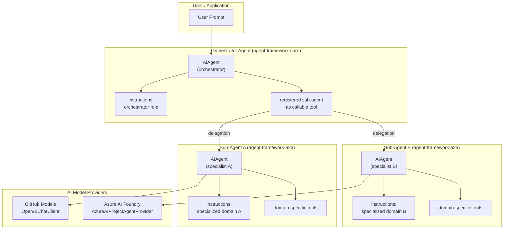
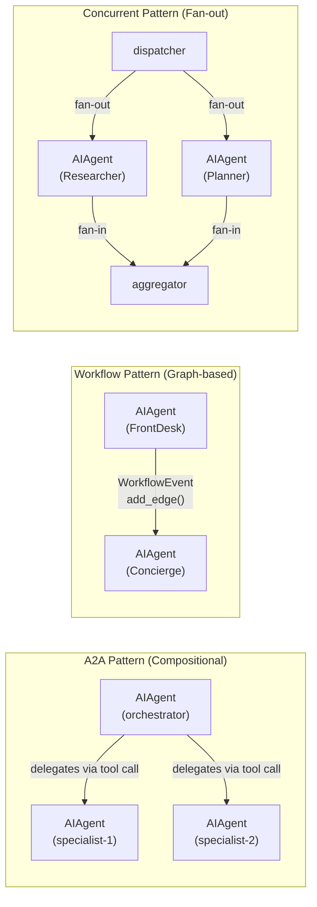
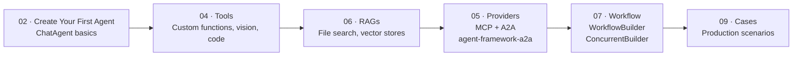

<!-- source: DeepWiki mcp.deepwiki.com · repo microsoft/Agent-Framework-Samples · page 6.7 Agent-to-Agent Communication (A2A) · fetched 2026-10-26 -->

# Agent-to-Agent Communication (A2A)

<details>
<summary>Relevant source files</summary>

The following files were used as context for generating this wiki page:

- [.devcontainer/devcontainer.json](.devcontainer/devcontainer.json)
- [.devcontainer/setup.sh](.devcontainer/setup.sh)
- [.github/dependabot.yml](.github/dependabot.yml)
- [.vscode/settings.json](.vscode/settings.json)
- [00.ForBeginners/04-tool-use/code_samples/dotnet-agent-framework-ghmodels-tool/Program.cs](00.ForBeginners/04-tool-use/code_samples/dotnet-agent-framework-ghmodels-tool/Program.cs)
- [09.Cases/README.md](09.Cases/README.md)
- [Installation/requirements.txt](Installation/requirements.txt)
- [README.md](README.md)

</details>


This page covers the Agent-to-Agent (A2A) pattern in the Microsoft Agent Framework: what it is, why it exists, the `agent-framework-a2a` Python package, and how to compose specialized agents into hierarchical systems. The **05.Providers** module is the primary home for A2A material in this repository.

**Related pages:**
- For MCP (Model Context Protocol) tool integration, see [6.6]().
- For workflow-based multi-agent orchestration (sequential, concurrent, conditional pipelines), see [7]() and [7.5]().
- For the core `AIAgent` / `ChatAgent` abstractions that A2A builds on, see [3.2]().

---

## What Is the A2A Pattern?

A2A (Agent-to-Agent) describes a composition pattern where one agent invokes another agent as if it were a tool or sub-agent. The calling agent remains the orchestrator; the called agent is responsible for a narrower, specialized domain. Each participant is a fully self-contained agent with its own instructions, tools, and optionally its own backing model.

This is distinct from:

| Approach | How agents relate | Key abstraction |
|---|---|---|
| **A2A** | One agent calls another as a delegate/tool | `agent-framework-a2a` package |
| **Workflow (sequential/concurrent/conditional)** | Agents exchange `WorkflowEvent` messages via a graph | `WorkflowBuilder`, `ConcurrentBuilder` |
| **MCP** | Agent calls an external tool server over HTTP | `MCPStreamableHTTPTool`, `HostedMCPTool` |

Sources: [README.md:14](), [Installation/requirements.txt:7]()

---

## The `agent-framework-a2a` Package

The Python ecosystem provides A2A support through a dedicated package, listed in the repository's consolidated requirements file:

[Installation/requirements.txt:7]()

```python
agent-framework-a2a @ git+https://github.com/microsoft/agent-framework.git@main#subdirectory=python/packages/a2a
```

This package lives in the `python/packages/a2a` subdirectory of the upstream `agent-framework` repository. It is installed alongside the other agent-framework packages (`agent-framework-core`, `agent-framework-foundry`, `agent-framework-devui`, etc.) using:

```bash
pip install -r ./Installation/requirements.txt -U
```

Sources: [Installation/requirements.txt:1-10](), [README.md:46-58]()

---

## A2A Architecture

The following diagram maps the conceptual A2A pattern to concrete code entities in the framework.

**Diagram: A2A Agent Composition Model**



Sources: [Installation/requirements.txt:1-10](), [README.md:23-31](), [00.ForBeginners/04-tool-use/code_samples/dotnet-agent-framework-ghmodels-tool/Program.cs:49-52]()

---

**Diagram: A2A vs. Workflow Topologies**



Sources: [README.md:30](), [09.Cases/README.md:8-9](), [Installation/requirements.txt:11]()

---

## Application Scenarios

The A2A pattern is utilized in several advanced scenarios within the framework:

| Scenario | Description | Example in Repo |
|---|---|---|
| **Task Delegation** | A "manager" agent decomposes complex requests into sub-tasks, routing each to a specialized worker agent. | `GHModel.AI` (FrontDesk to Concierge) [09.Cases/README.md:8-9]() |
| **Managed Agents** | Decoupling the reasoning engine (Brain) from the tool execution layer (Hands). | `maf_harness_managed_agent` [09.Cases/README.md:17-18]() |
| **Specialized Expertise** | A generalist agent consults a domain-expert agent (e.g., for code interpretation or deep research). | `FoundryLocalPipeline` [09.Cases/README.md:11-12]() |

Sources: [09.Cases/README.md:1-18]()

---

## Positioning Within the Learning Path

A2A is an **Advanced Level** topic in the repository's tutorial progression, bridging the gap between single-agent tool use and full-scale multi-agent orchestration.



A2A assumes familiarity with single-agent patterns (see [4]()) and tool registration (see [6.1]()) before composing agents together. For production-scale multi-agent scenarios that use A2A alongside workflow orchestration and observability, see the case studies in [9]().

Sources: [README.md:6-18](), [README.md:128-145]()

---

## Summary

| Item | Value |
|---|---|
| Python package | `agent-framework-a2a` [Installation/requirements.txt:7]() |
| Package source path | `python/packages/a2a` in the upstream `agent-framework` repo |
| Module location | `05.Providers` [README.md:28]() |
| Primary concept | One `AIAgent` calls another `AIAgent` as a delegated tool |
| Differs from workflows | No `WorkflowBuilder` graph; delegation is driven by the orchestrator agent's tool calls |
| Differs from MCP | Callee is a full agent, not an external tool server |

Sources: [Installation/requirements.txt:7](), [README.md:28](), [09.Cases/README.md:1-18]()

---

