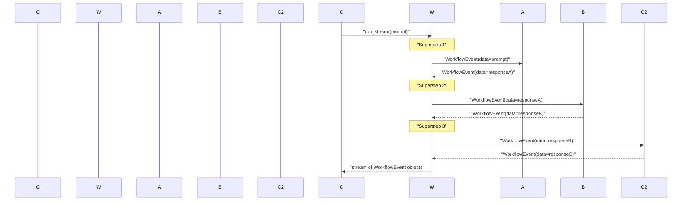
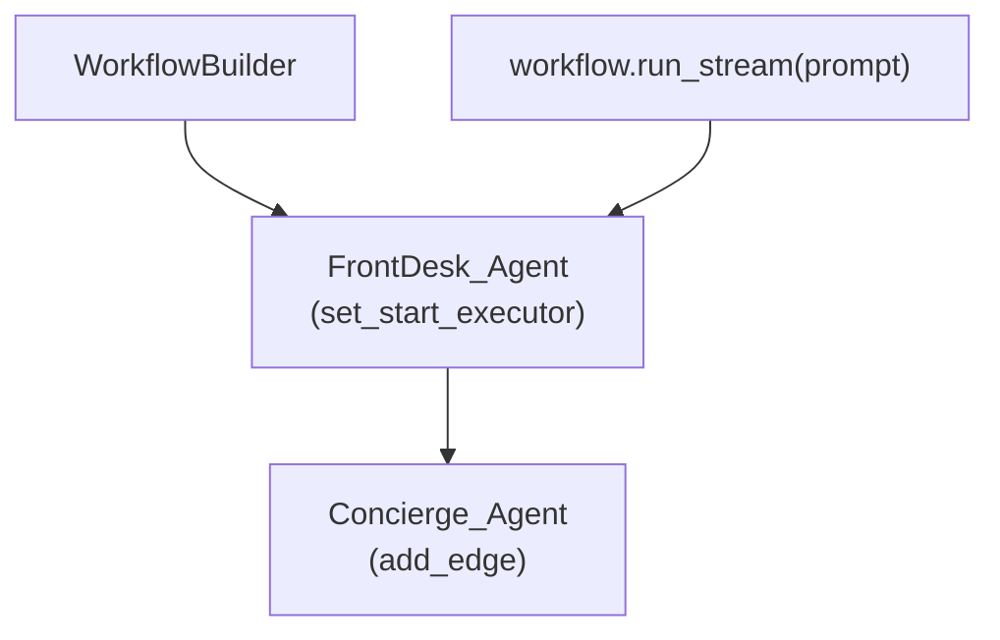
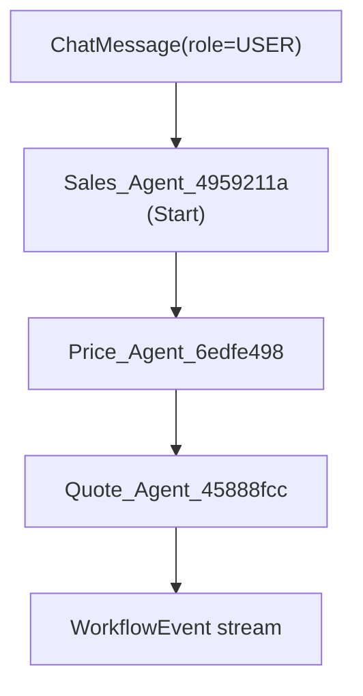
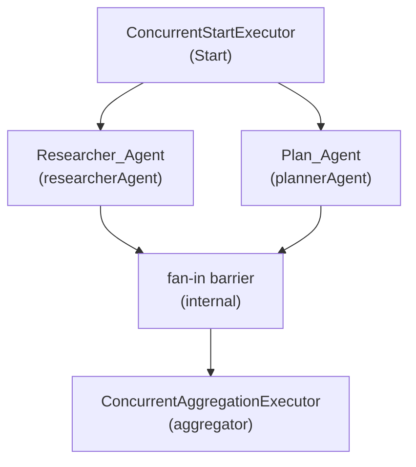
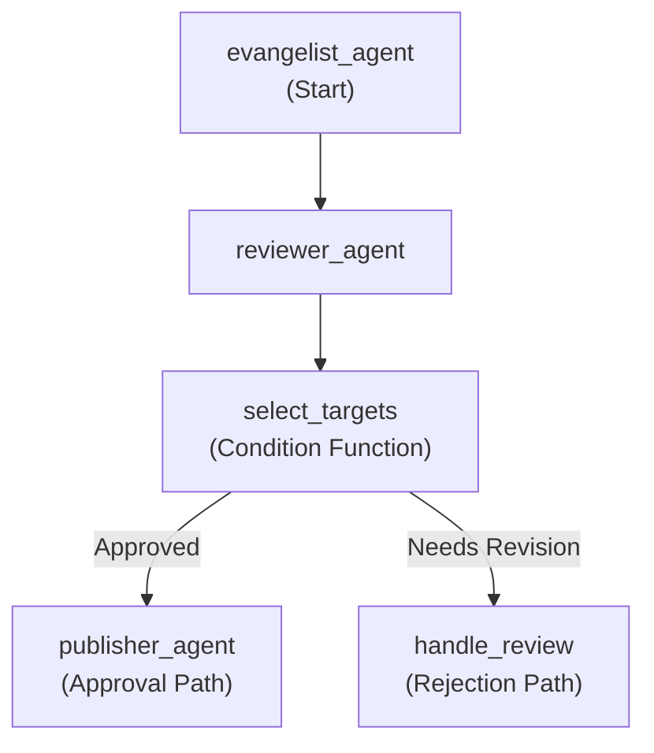

<!-- source: DeepWiki mcp.deepwiki.com · repo microsoft/Agent-Framework-Samples · page 7 Workflow Orchestration · fetched 2026-10-26 -->

# Workflow Orchestration

<details>
<summary>Relevant source files</summary>

The following files were used as context for generating this wiki page:

- [07.Workflow/code_samples/dotNET/01.dotnet-agent-framework-workflow-ghmodel-basic/01.dotnet-agent-framework-workflow-ghmodel-basic.csproj](07.Workflow/code_samples/dotNET/01.dotnet-agent-framework-workflow-ghmodel-basic/01.dotnet-agent-framework-workflow-ghmodel-basic.csproj)
- [07.Workflow/code_samples/dotNET/01.dotnet-agent-framework-workflow-ghmodel-basic/workflow.dot](07.Workflow/code_samples/dotNET/01.dotnet-agent-framework-workflow-ghmodel-basic/workflow.dot)
- [07.Workflow/code_samples/dotNET/02.dotnet-agent-framework-workflow-ghmodel-sequential/02.dotnet-agent-framework-workflow-ghmodel-sequential.csproj](07.Workflow/code_samples/dotNET/02.dotnet-agent-framework-workflow-ghmodel-sequential/02.dotnet-agent-framework-workflow-ghmodel-sequential.csproj)
- [07.Workflow/code_samples/dotNET/02.dotnet-agent-framework-workflow-ghmodel-sequential/workflow.dot](07.Workflow/code_samples/dotNET/02.dotnet-agent-framework-workflow-ghmodel-sequential/workflow.dot)
- [07.Workflow/code_samples/dotNET/03.dotnet-agent-framework-workflow-ghmodel-concurrent/03.dotnet-agent-framework-workflow-ghmodel-concurrent.csproj](07.Workflow/code_samples/dotNET/03.dotnet-agent-framework-workflow-ghmodel-concurrent/03.dotnet-agent-framework-workflow-ghmodel-concurrent.csproj)
- [07.Workflow/code_samples/dotNET/03.dotnet-agent-framework-workflow-ghmodel-concurrent/Program.cs](07.Workflow/code_samples/dotNET/03.dotnet-agent-framework-workflow-ghmodel-concurrent/Program.cs)
- [07.Workflow/code_samples/dotNET/03.dotnet-agent-framework-workflow-ghmodel-concurrent/workflow.dot](07.Workflow/code_samples/dotNET/03.dotnet-agent-framework-workflow-ghmodel-concurrent/workflow.dot)
- [07.Workflow/code_samples/dotNET/04.dotnet-agent-framework-workflow-msfoundry-condition/04.dotnet-agent-framework-workflow-msfoundry-condition.csproj](07.Workflow/code_samples/dotNET/04.dotnet-agent-framework-workflow-msfoundry-condition/04.dotnet-agent-framework-workflow-msfoundry-condition.csproj)
- [07.Workflow/code_samples/dotNET/04.dotnet-agent-framework-workflow-msfoundry-condition/Program.cs](07.Workflow/code_samples/dotNET/04.dotnet-agent-framework-workflow-msfoundry-condition/Program.cs)
- [07.Workflow/code_samples/python/01.python-agent-framework-workflow-ghmodel-basic.ipynb](07.Workflow/code_samples/python/01.python-agent-framework-workflow-ghmodel-basic.ipynb)
- [07.Workflow/code_samples/python/02.python-agent-framework-workflow-ghmodel-sequential.ipynb](07.Workflow/code_samples/python/02.python-agent-framework-workflow-ghmodel-sequential.ipynb)
- [07.Workflow/code_samples/python/03.python-agent-framework-workflow-ghmodel-concurrent.ipynb](07.Workflow/code_samples/python/03.python-agent-framework-workflow-ghmodel-concurrent.ipynb)
- [07.Workflow/code_samples/python/04.python-agent-framework-workflow-msfoundry-condition.ipynb](07.Workflow/code_samples/python/04.python-agent-framework-workflow-msfoundry-condition.ipynb)

</details>


This page describes the MAF (Microsoft Agent Framework) workflow system: its graph-based execution model, the builder APIs used to construct workflows, and the four supported topologies (sequential, multi-step sequential, concurrent, and conditional). It covers both Python and .NET implementations.

For information on individual agent setup and configuration before placing agents into a workflow, see [Building Agents](#4). For the production case studies that apply these patterns, see [Case Studies](#9).

---

## What the Workflow System Does

The workflow system orchestrates multiple `AIAgent` instances so they communicate through typed events in a defined graph topology. Rather than writing manual plumbing code between agents, you declare **executors** (nodes) and **edges** (directed connections), and the runtime processes them in synchronized steps.

The underlying model is based on the [Pregel](https://kowshik.github.io/JPregel/pregel_paper.pdf) graph computation model: execution proceeds in **supersteps**, where every active executor processes its incoming messages before the next superstep begins. This gives the system deterministic, auditable execution.

Sources: [07.Workflow/README.md:22-35]()

---

## Core Abstractions

### Component Roles

| Component | Python Symbol | .NET Symbol | Role |
|---|---|---|---|
| Processing node | `Agent` / `AgentExecutor` | `AIAgent` / custom executor class | Runs agent logic on incoming messages |
| Directed connection | `add_edge(a, b)` | `.AddEdge(a, b)` | Routes output from one executor to another |
| Conditional branch | `add_multi_selection_edge_group(...)` | `.AddEdge(..., condition:...)` | Routes to different executors based on output content |
| Fan-out node | built into `ConcurrentBuilder` | `ConcurrentStartExecutor` | Broadcasts a message to multiple agents simultaneously |
| Fan-in node | built into `ConcurrentBuilder` | `ConcurrentAggregationExecutor` | Waits for all parallel branches and merges results |
| Workflow object | `workflow.run_stream(prompt)` | `InProcessExecution.RunStreamingAsync(...)` | Entry point; returns an async stream of `WorkflowEvent` |
| Event type | `WorkflowEvent` | `WorkflowEvent` | Carries data between executors and out to callers |
| Visualization | `WorkflowViz` | `.ToMermaidString()` / `.ToDotString()` | Exports Mermaid and Graphviz representations of the graph |

Sources: [07.Workflow/README.md:29-37](), [07.Workflow/code_samples/python/01.python-agent-framework-workflow-ghmodel-basic.ipynb:123-128](), [07.Workflow/code_samples/python/03.python-agent-framework-workflow-ghmodel-concurrent.ipynb:162-166](), [07.Workflow/code_samples/dotNET/03.dotnet-agent-framework-workflow-ghmodel-concurrent/Program.cs:57-61]()

---

### WorkflowBuilder API (Python)

**WorkflowBuilder** is the primary builder for sequential and conditional workflows. It follows a fluent interface:

```python
WorkflowBuilder()
  .set_start_executor(executor)   # designates the entry node
  .add_edge(source, target)       # adds a directed edge
  .add_multi_selection_edge_group(source, [a, b], selection_func=fn)
  .build()                        # returns the runnable workflow object
```

**ConcurrentBuilder** is the builder for fan-out/fan-in topologies:

```python
ConcurrentBuilder()
  .participants([agent_a, agent_b])   # all agents run in parallel
  .build()
```

Sources: [07.Workflow/code_samples/python/01.python-agent-framework-workflow-ghmodel-basic.ipynb:246-246](), [07.Workflow/code_samples/python/02.python-agent-framework-workflow-ghmodel-sequential.ipynb:248-248](), [07.Workflow/code_samples/python/03.python-agent-framework-workflow-ghmodel-concurrent.ipynb:166-166](), [07.Workflow/code_samples/python/03.python-agent-framework-workflow-ghmodel-concurrent.ipynb:230-230]()

---

### WorkflowBuilder API (.NET)

The .NET `WorkflowBuilder` takes the start executor in its constructor and uses method chaining:

```csharp
var workflow = new WorkflowBuilder(startExecutor)
  .AddEdge(a, b)
  .AddFanOutEdge(startExecutor, [researcherAgent, plannerAgent])
  .AddFanInBarrierEdge([researcherAgent, plannerAgent], aggregationExecutor)
  .WithOutputFrom(aggregationExecutor)
  .Build();
```

For conditional routing, the `.AddEdge` overload accepts a `condition` parameter of type `Func<object?, bool>`.

Sources: [07.Workflow/code_samples/dotNET/03.dotnet-agent-framework-workflow-ghmodel-concurrent/Program.cs:50-54](), [07.Workflow/README.md:122-136](), [07.Workflow/README.md:355-365]()

---

### WorkflowViz (Python & .NET)

Workflows can be visualized to debug the topology. Python uses a dedicated `WorkflowViz` class, while .NET provides extension methods on the built workflow.

| Method (Python) | Method (.NET) | Output |
|---|---|---|
| `viz.to_mermaid()` | `workflow.ToMermaidString()` | Mermaid `flowchart TD` or `digraph` string |
| `viz.to_digraph()` | `workflow.ToDotString()` | Graphviz `digraph` DOT string |
| `viz.export(format="svg")` | — | SVG file (Python requires `graphviz` system package) |

Sources: [07.Workflow/code_samples/python/01.python-agent-framework-workflow-ghmodel-basic.ipynb:284-296](), [07.Workflow/code_samples/dotNET/03.dotnet-agent-framework-workflow-ghmodel-concurrent/Program.cs:83-88]()

---

## Execution Model

**Diagram: Superstep Execution Model**



Sources: [07.Workflow/README.md:22-37]()

Each executor processes its inbox, produces output, and the workflow routes output along declared edges into the next superstep's inboxes.

---

## Workflow Patterns

### Pattern 1 — Basic Sequential

One agent's output is passed directly to the next. This is the two-node case: `FrontDesk → Concierge`.

**Diagram: FrontDesk → Concierge (WorkflowBuilder)**



Sources: [07.Workflow/code_samples/python/01.python-agent-framework-workflow-ghmodel-basic.ipynb:224-246](), [07.Workflow/code_samples/dotNET/01.dotnet-agent-framework-workflow-ghmodel-basic/workflow.dot:1-9]()

**Python construction:**
[07.Workflow/code_samples/python/01.python-agent-framework-workflow-ghmodel-basic.ipynb:246-246]()

**.NET equivalent:**
[07.Workflow/README.md:122-136]()

---

### Pattern 2 — Multi-Step Sequential

Extends the basic chain to three or more agents. Each agent specializes in one transformation.

**Example:** `Sales-Agent → Price-Agent → Quote-Agent` (furniture sales pipeline)

**Diagram: Three-Stage Sequential Pipeline (WorkflowBuilder)**



Sources: [07.Workflow/code_samples/dotNET/02.dotnet-agent-framework-workflow-ghmodel-sequential/workflow.dot:1-11](), [07.Workflow/code_samples/python/02.python-agent-framework-workflow-ghmodel-sequential.ipynb:219-248]()

---

### Pattern 3 — Concurrent (Fan-Out / Fan-In)

Multiple agents receive the same input simultaneously and their outputs are merged by an aggregator.

**Diagram: Concurrent Execution Structure**



Sources: [07.Workflow/code_samples/dotNET/03.dotnet-agent-framework-workflow-ghmodel-concurrent/Program.cs:46-54](), [07.Workflow/code_samples/dotNET/03.dotnet-agent-framework-workflow-ghmodel-concurrent/workflow.dot:1-17]()

**.NET explicit executors:**
- `ConcurrentStartExecutor`: Broadcasts `ChatMessage` and `TurnToken` to kick off parallel agents [07.Workflow/code_samples/dotNET/03.dotnet-agent-framework-workflow-ghmodel-concurrent/Program.cs:100-112]().
- `ConcurrentAggregationExecutor`: Collects results and yields final output once all messages are received [07.Workflow/code_samples/dotNET/03.dotnet-agent-framework-workflow-ghmodel-concurrent/Program.cs:118-140]().

---

### Pattern 4 — Conditional

The workflow takes different paths based on the content of an agent's output.

**Diagram: Conditional Routing Logic**



Sources: [07.Workflow/README.md:311-343](), [07.Workflow/code_samples/python/04.python-agent-framework-workflow-msfoundry-condition.ipynb:63-77]()

**.NET implementation:** Uses the `.AddEdge` overload with a `condition` predicate [07.Workflow/README.md:350-365]().

---

## WorkflowEvent and Event Filtering

All data flowing through a workflow is wrapped in `WorkflowEvent`. Callers consume the event stream and dispatch on event type.

**Typical consumption pattern (Python):**
[07.Workflow/code_samples/python/01.python-agent-framework-workflow-ghmodel-basic.ipynb:391-413]()

```python
async for event in workflow.run_stream(prompt):
    if isinstance(event, WorkflowOutputEvent):
        print(f"Final Output: {event.data}")
```

**Typical consumption pattern (.NET):**
[07.Workflow/code_samples/dotNET/03.dotnet-agent-framework-workflow-ghmodel-concurrent/Program.cs:61-75]()

```csharp
await foreach (WorkflowEvent evt in run.WatchStreamAsync())
{
    if (evt is WorkflowOutputEvent output) { /* ... */ }
}
```

---

## Sub-pages

Detailed coverage of each pattern is in the following sub-pages:

- [Workflow Architecture](#7.1) — `WorkflowBuilder`, `WorkflowEvent`, `WorkflowViz`, superstep model.
- [Sequential Workflows](#7.2) — FrontDesk/Concierge and Sales/Price/Quote examples.
- [Concurrent Workflows](#7.3) — `ConcurrentBuilder`, dispatcher, and aggregator patterns.
- [Conditional Workflows](#7.4) — Dynamic branching and selection functions.
- [Multi-Agent Systems](#7.5) — Collaboration between multiple `AIAgent` instances.

---

