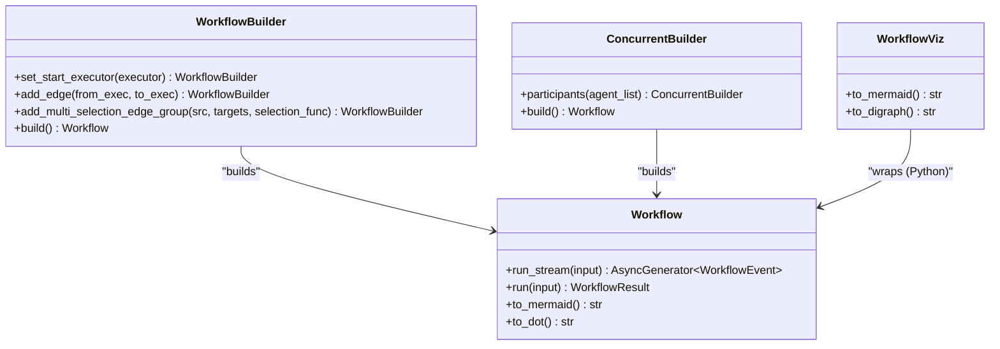
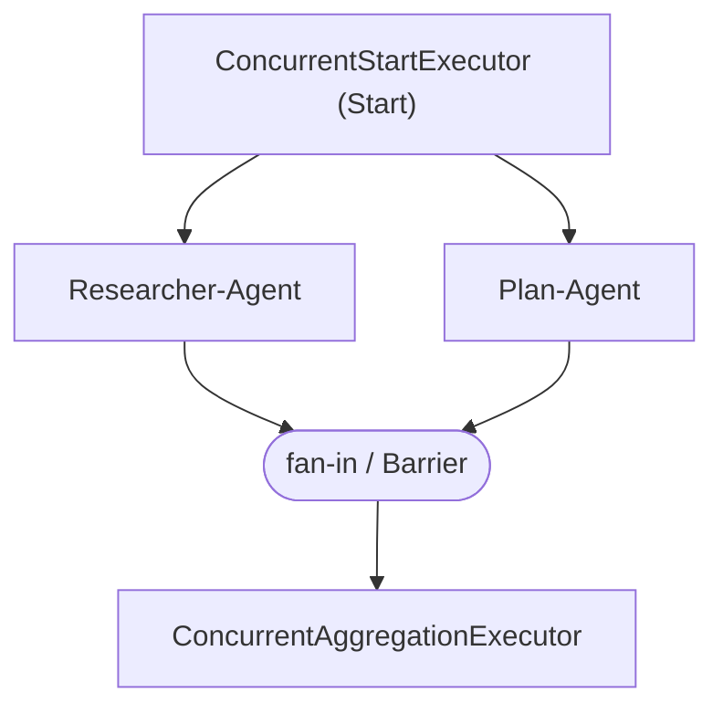
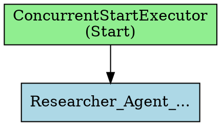
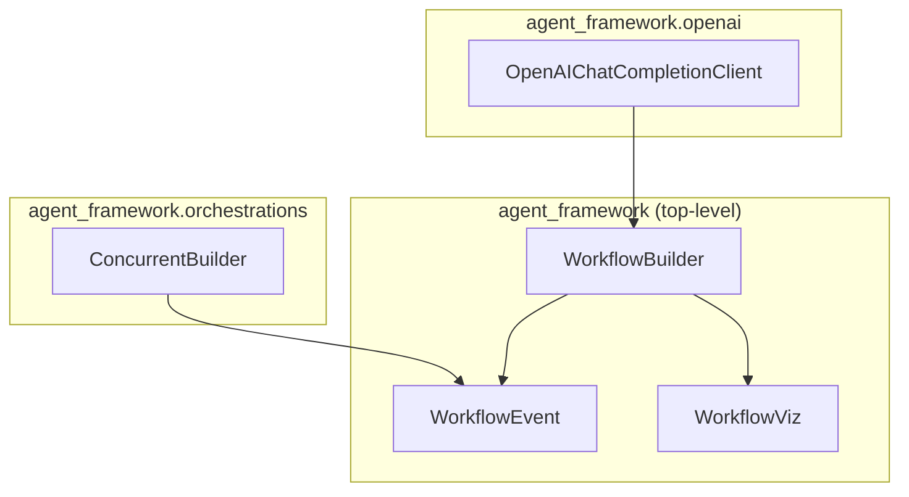

<!-- source: DeepWiki mcp.deepwiki.com · repo microsoft/Agent-Framework-Samples · page 7.1 Workflow Architecture · fetched 2026-10-26 -->

# Workflow Architecture

<details>
<summary>Relevant source files</summary>

The following files were used as context for generating this wiki page:

- [07.Workflow/code_samples/dotNET/01.dotnet-agent-framework-workflow-ghmodel-basic/01.dotnet-agent-framework-workflow-ghmodel-basic.csproj](07.Workflow/code_samples/dotNET/01.dotnet-agent-framework-workflow-ghmodel-basic/01.dotnet-agent-framework-workflow-ghmodel-basic.csproj)
- [07.Workflow/code_samples/dotNET/01.dotnet-agent-framework-workflow-ghmodel-basic/workflow.dot](07.Workflow/code_samples/dotNET/01.dotnet-agent-framework-workflow-ghmodel-basic/workflow.dot)
- [07.Workflow/code_samples/dotNET/02.dotnet-agent-framework-workflow-ghmodel-sequential/02.dotnet-agent-framework-workflow-ghmodel-sequential.csproj](07.Workflow/code_samples/dotNET/02.dotnet-agent-framework-workflow-ghmodel-sequential/02.dotnet-agent-framework-workflow-ghmodel-sequential.csproj)
- [07.Workflow/code_samples/dotNET/02.dotnet-agent-framework-workflow-ghmodel-sequential/workflow.dot](07.Workflow/code_samples/dotNET/02.dotnet-agent-framework-workflow-ghmodel-sequential/workflow.dot)
- [07.Workflow/code_samples/dotNET/03.dotnet-agent-framework-workflow-ghmodel-concurrent/03.dotnet-agent-framework-workflow-ghmodel-concurrent.csproj](07.Workflow/code_samples/dotNET/03.dotnet-agent-framework-workflow-ghmodel-concurrent/03.dotnet-agent-framework-workflow-ghmodel-concurrent.csproj)
- [07.Workflow/code_samples/dotNET/03.dotnet-agent-framework-workflow-ghmodel-concurrent/Program.cs](07.Workflow/code_samples/dotNET/03.dotnet-agent-framework-workflow-ghmodel-concurrent/Program.cs)
- [07.Workflow/code_samples/dotNET/03.dotnet-agent-framework-workflow-ghmodel-concurrent/workflow.dot](07.Workflow/code_samples/dotNET/03.dotnet-agent-framework-workflow-ghmodel-concurrent/workflow.dot)
- [07.Workflow/code_samples/dotNET/04.dotnet-agent-framework-workflow-msfoundry-condition/04.dotnet-agent-framework-workflow-msfoundry-condition.csproj](07.Workflow/code_samples/dotNET/04.dotnet-agent-framework-workflow-msfoundry-condition/04.dotnet-agent-framework-workflow-msfoundry-condition.csproj)
- [07.Workflow/code_samples/dotNET/04.dotnet-agent-framework-workflow-msfoundry-condition/Program.cs](07.Workflow/code_samples/dotNET/04.dotnet-agent-framework-workflow-msfoundry-condition/Program.cs)
- [07.Workflow/code_samples/python/01.python-agent-framework-workflow-ghmodel-basic.ipynb](07.Workflow/code_samples/python/01.python-agent-framework-workflow-ghmodel-basic.ipynb)
- [07.Workflow/code_samples/python/02.python-agent-framework-workflow-ghmodel-sequential.ipynb](07.Workflow/code_samples/python/02.python-agent-framework-workflow-ghmodel-sequential.ipynb)
- [07.Workflow/code_samples/python/03.python-agent-framework-workflow-ghmodel-concurrent.ipynb](07.Workflow/code_samples/python/03.python-agent-framework-workflow-ghmodel-concurrent.ipynb)
- [07.Workflow/code_samples/python/04.python-agent-framework-workflow-msfoundry-condition.ipynb](07.Workflow/code_samples/python/04.python-agent-framework-workflow-msfoundry-condition.ipynb)

</details>


This page describes the internal architecture of the MAF Workflow system: its execution model, core abstractions, and the two primary builder APIs (`WorkflowBuilder` and `ConcurrentBuilder`). It covers how agents are wrapped as Executors, how Edges connect them, how events are streamed, and how `WorkflowViz` produces visual representations.

For the practical patterns built on top of this architecture, see:
- Sequential chaining: [Sequential Workflows](#7.2)
- Parallel execution: [Concurrent Workflows](#7.3)
- Branching logic: [Conditional Workflows](#7.4)
- Multi-agent collaboration: [Multi-Agent Systems](#7.5)

---

## Execution Model

The workflow system is built on a **Pregel-style graph execution model**. Processing advances in synchronized steps called **supersteps**. In each superstep, every active executor that has received a message processes it and may emit messages to neighboring executors (via Edges). The runtime advances superstep-by-step until no more messages are in flight and all terminal executors have completed.

**Workflow Execution Model (Pregel-style Supersteps)**

```mermaid
graph LR
  subgraph "Superstep 1"
    direction TB
    s1_input["Input Message"] --> s1_exec["Executor A"]
    s1_exec --> s1_out["Output Message"]
  end
  subgraph "Superstep 2"
    direction TB
    s2_input["Output Message"] --> s2_exec["Executor B"]
    s2_exec --> s2_out["WorkflowEvent (streamed)"]
  end
  "Superstep 1" --> "Superstep 2"
```

Sources: [07.Workflow/code_samples/python/01.python-agent-framework-workflow-ghmodel-basic.ipynb:16-19](), [07.Workflow/code_samples/python/03.python-agent-framework-workflow-ghmodel-concurrent.ipynb:16-19]()

---

## Core Abstractions

### Executors

An **Executor** is the fundamental unit of processing in a workflow graph. Every agent participating in a workflow is treated as an executor. Custom non-agent executors can also be defined for tasks like dispatching, aggregating, or converting message types.

In Python, an agent becomes an executor by being passed directly to `WorkflowBuilder` or `ConcurrentBuilder`. In .NET, executors are classes that inherit from `Executor` [07.Workflow/code_samples/dotNET/03.dotnet-agent-framework-workflow-ghmodel-concurrent/Program.cs:100-101]().

Each executor can have **message handlers** that are invoked automatically. In .NET, these are marked with the `[MessageHandler]` attribute [07.Workflow/code_samples/dotNET/03.dotnet-agent-framework-workflow-ghmodel-concurrent/Program.cs:103-104]().

### Edges

An **Edge** defines a directed connection between two executors, determining where messages travel after an executor completes a step.

| Edge Type | Python API | .NET API | Behavior |
|---|---|---|---|
| Simple | `.add_edge(a, b)` | `.AddEdge(a, b)` | Unconditional forward |
| Conditional | `.add_multi_selection_edge_group(src, targets, selection_func)` | `.AddEdge(src, tgt, condition: ...)` | Route based on logic |
| Fan-out | (auto via `ConcurrentBuilder`) | `.AddFanOutEdge(src, targets)` | Broadcast to multiple targets [07.Workflow/code_samples/dotNET/03.dotnet-agent-framework-workflow-ghmodel-concurrent/Program.cs:51-51]() |
| Fan-in | (auto via `ConcurrentBuilder`) | `.AddFanInBarrierEdge(sources, agg)` | Collect from multiple sources [07.Workflow/code_samples/dotNET/03.dotnet-agent-framework-workflow-ghmodel-concurrent/Program.cs:52-52]() |

Sources: [07.Workflow/code_samples/dotNET/03.dotnet-agent-framework-workflow-ghmodel-concurrent/Program.cs:50-54](), [07.Workflow/code_samples/python/01.python-agent-framework-workflow-ghmodel-basic.ipynb:246-246]()

### WorkflowEvent

`WorkflowEvent` is the base event type emitted during streaming execution [07.Workflow/code_samples/dotNET/03.dotnet-agent-framework-workflow-ghmodel-concurrent/Program.cs:61-61](). Every significant transition or message is surfaced as a `WorkflowEvent` through `run.WatchStreamAsync()` (.NET) or `run_stream()` (Python).

In .NET, specialized events include:
- `WorkflowOutputEvent`: Emitted when an executor yields a final result [07.Workflow/code_samples/dotNET/03.dotnet-agent-framework-workflow-ghmodel-concurrent/Program.cs:66-66]().

Sources: [07.Workflow/code_samples/dotNET/03.dotnet-agent-framework-workflow-ghmodel-concurrent/Program.cs:61-75](), [07.Workflow/code_samples/python/01.python-agent-framework-workflow-ghmodel-basic.ipynb:127-127]()

---

## Primary Builder APIs

**API Surface: WorkflowBuilder vs. ConcurrentBuilder**



Sources: [07.Workflow/code_samples/python/01.python-agent-framework-workflow-ghmodel-basic.ipynb:127-127](), [07.Workflow/code_samples/python/03.python-agent-framework-workflow-ghmodel-concurrent.ipynb:166-166](), [07.Workflow/code_samples/dotNET/03.dotnet-agent-framework-workflow-ghmodel-concurrent/Program.cs:50-54]()

### WorkflowBuilder

`WorkflowBuilder` constructs directed graphs of executors.

**Python example — three-node sequential chain:**
[07.Workflow/code_samples/python/02.python-agent-framework-workflow-ghmodel-sequential.ipynb:248-253]()
```python
workflow = (WorkflowBuilder()
    .set_start_executor(sales_agent)
    .add_edge(sales_agent, price_agent)
    .add_edge(price_agent, quote_agent)
    .build())
```

**.NET equivalent:**
[07.Workflow/code_samples/dotNET/03.dotnet-agent-framework-workflow-ghmodel-concurrent/Program.cs:50-54]()
```csharp
var workflow = new WorkflowBuilder(startExecutor)
            .AddFanOutEdge(startExecutor, [researcherAgent, plannerAgent])
            .AddFanInBarrierEdge([researcherAgent, plannerAgent], aggregationExecutor)
            .WithOutputFrom(aggregationExecutor)
            .Build();
```

### ConcurrentBuilder (Python)

`ConcurrentBuilder` is a higher-level Python API that automatically inserts a dispatcher and an aggregator around parallel agents [07.Workflow/code_samples/python/03.python-agent-framework-workflow-ghmodel-concurrent.ipynb:166-166]().

**Concurrent Workflow Internal Graph**



Sources: [07.Workflow/code_samples/dotNET/03.dotnet-agent-framework-workflow-ghmodel-concurrent/workflow.dot:1-17](), [07.Workflow/code_samples/python/03.python-agent-framework-workflow-ghmodel-concurrent.ipynb:60-74]()

---

## Workflow Visualization

The framework provides tools to export the graph structure for debugging.

| Method | Output | Language |
|---|---|---|
| `ToMermaidString()` / `to_mermaid()` | Mermaid `flowchart TD` string | .NET [07.Workflow/code_samples/dotNET/03.dotnet-agent-framework-workflow-ghmodel-concurrent/Program.cs:83-83]() / Python |
| `ToDotString()` / `to_digraph()` | Graphviz `digraph` DOT string | .NET [07.Workflow/code_samples/dotNET/03.dotnet-agent-framework-workflow-ghmodel-concurrent/Program.cs:88-88]() / Python |

**Example Graphviz DOT output:**
[07.Workflow/code_samples/dotNET/03.dotnet-agent-framework-workflow-ghmodel-concurrent/workflow.dot:1-17]()


---

## Import and Module Map

**Python imports and their origin module**



Sources: [07.Workflow/code_samples/python/01.python-agent-framework-workflow-ghmodel-basic.ipynb:126-127](), [07.Workflow/code_samples/python/03.python-agent-framework-workflow-ghmodel-concurrent.ipynb:165-167]()

---

## Summary of Key Types

| Type | Language | Role |
|---|---|---|
| `WorkflowBuilder` | Python & .NET | Constructs directed executor graphs [07.Workflow/code_samples/dotNET/03.dotnet-agent-framework-workflow-ghmodel-concurrent/Program.cs:50-50]() |
| `ConcurrentBuilder` | Python | Shorthand for parallel agent execution [07.Workflow/code_samples/python/03.python-agent-framework-workflow-ghmodel-concurrent.ipynb:166-166]() |
| `Executor` | .NET | Base class for workflow nodes [07.Workflow/code_samples/dotNET/03.dotnet-agent-framework-workflow-ghmodel-concurrent/Program.cs:101-101]() |
| `WorkflowEvent` | Python & .NET | Streamed execution update [07.Workflow/code_samples/dotNET/03.dotnet-agent-framework-workflow-ghmodel-concurrent/Program.cs:61-61]() |
| `IWorkflowContext` | .NET | Interface for sending messages within an executor [07.Workflow/code_samples/dotNET/03.dotnet-agent-framework-workflow-ghmodel-concurrent/Program.cs:104-104]() |
| `WorkflowViz` | Python | Utility for rendering graph strings [07.Workflow/code_samples/python/01.python-agent-framework-workflow-ghmodel-basic.ipynb:127-127]() |

---

