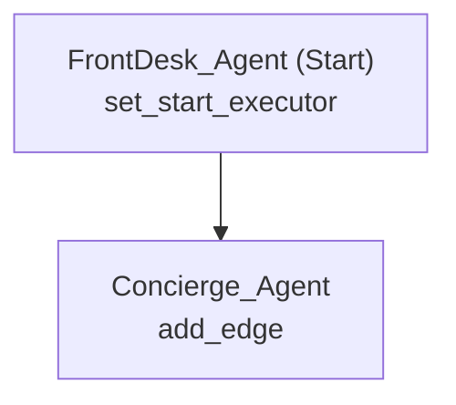
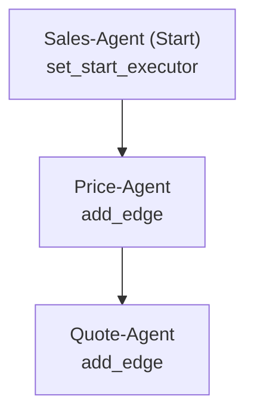
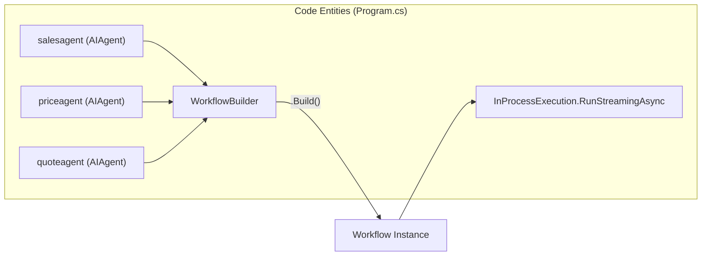

<!-- source: DeepWiki mcp.deepwiki.com · repo microsoft/Agent-Framework-Samples · page 7.2 Sequential Workflows · fetched 2026-10-26 -->

# Sequential Workflows

<details>
<summary>Relevant source files</summary>

The following files were used as context for generating this wiki page:

- [07.Workflow/code_samples/dotNET/01.dotnet-agent-framework-workflow-ghmodel-basic/Program.cs](07.Workflow/code_samples/dotNET/01.dotnet-agent-framework-workflow-ghmodel-basic/Program.cs)
- [07.Workflow/code_samples/dotNET/01.dotnet-agent-framework-workflow-ghmodel-basic/workflow.dot](07.Workflow/code_samples/dotNET/01.dotnet-agent-framework-workflow-ghmodel-basic/workflow.dot)
- [07.Workflow/code_samples/dotNET/02.dotnet-agent-framework-workflow-ghmodel-sequential/Program.cs](07.Workflow/code_samples/dotNET/02.dotnet-agent-framework-workflow-ghmodel-sequential/Program.cs)
- [07.Workflow/code_samples/dotNET/02.dotnet-agent-framework-workflow-ghmodel-sequential/workflow.dot](07.Workflow/code_samples/dotNET/02.dotnet-agent-framework-workflow-ghmodel-sequential/workflow.dot)
- [07.Workflow/code_samples/dotNET/03.dotnet-agent-framework-workflow-ghmodel-concurrent/workflow.dot](07.Workflow/code_samples/dotNET/03.dotnet-agent-framework-workflow-ghmodel-concurrent/workflow.dot)
- [07.Workflow/code_samples/python/01.python-agent-framework-workflow-ghmodel-basic.ipynb](07.Workflow/code_samples/python/01.python-agent-framework-workflow-ghmodel-basic.ipynb)
- [07.Workflow/code_samples/python/02.python-agent-framework-workflow-ghmodel-sequential.ipynb](07.Workflow/code_samples/python/02.python-agent-framework-workflow-ghmodel-sequential.ipynb)
- [07.Workflow/code_samples/python/03.python-agent-framework-workflow-ghmodel-concurrent.ipynb](07.Workflow/code_samples/python/03.python-agent-framework-workflow-ghmodel-concurrent.ipynb)
- [07.Workflow/code_samples/python/04.python-agent-framework-workflow-msfoundry-condition.ipynb](07.Workflow/code_samples/python/04.python-agent-framework-workflow-msfoundry-condition.ipynb)

</details>


This page covers how to chain multiple agents in a fixed linear order using the `WorkflowBuilder` API (Python) and the `WorkflowBuilder` class (.NET). Each agent in the chain receives the accumulated conversation context from all preceding agents and appends its own response before passing control forward.

For the general workflow architecture and the Pregel superstep execution model that underpins all workflow types, see [Workflow Architecture](#7.1). For fan-out patterns where agents run in parallel, see [Concurrent Workflows](#7.3). For branch-on-condition patterns, see [Conditional Workflows](#7.4).

---

## What a Sequential Workflow Does

A sequential workflow defines a directed path through a set of agents: A → B → C. When a user prompt is submitted, the first agent processes it, then its full response is appended to the conversation and forwarded to the next agent, and so on. The final agent's response is the terminal output.

The conversation state is cumulative—each downstream agent sees everything that came before it in the thread, including the original user message and all prior agent responses.

**Topology diagram — FrontDesk → Concierge (2-agent chain)**



**Topology diagram — Sales → Price → Quote (3-agent chain)**



Sources: [07.Workflow/code_samples/python/01.python-agent-framework-workflow-ghmodel-basic.ipynb:241-247](), [07.Workflow/code_samples/python/02.python-agent-framework-workflow-ghmodel-sequential.ipynb:241-249]()

---

## Python API

### Core Imports

```python
from agent_framework.openai import OpenAIChatCompletionClient
from agent_framework import WorkflowBuilder, WorkflowEvent, WorkflowViz
```

Sources: [07.Workflow/code_samples/python/01.python-agent-framework-workflow-ghmodel-basic.ipynb:123-128](), [07.Workflow/code_samples/python/02.python-agent-framework-workflow-ghmodel-sequential.ipynb:116-118]()

### WorkflowBuilder API Reference (Python)

| Method | Description |
|---|---|
| `WorkflowBuilder()` | Creates a new empty workflow graph. |
| `.set_start_executor(agent)` | Marks the given agent (or `AgentExecutor`) as the entry point. [07.Workflow/code_samples/python/01.python-agent-framework-workflow-ghmodel-basic.ipynb:242]() |
| `.add_edge(from_agent, to_agent)` | Adds a directed edge, meaning `to_agent` runs after `from_agent`. [07.Workflow/code_samples/python/01.python-agent-framework-workflow-ghmodel-basic.ipynb:243]() |
| `.build()` | Compiles the graph and returns a runnable workflow object. [07.Workflow/code_samples/python/01.python-agent-framework-workflow-ghmodel-basic.ipynb:244]() |
| `workflow.run_stream(prompt)` | Async generator that yields `WorkflowEvent` instances during execution. [07.Workflow/code_samples/python/01.python-agent-framework-workflow-ghmodel-basic.ipynb:388]() |

---

### Example 1: Two-Agent Chain (FrontDesk → Concierge)

This is the canonical introductory example used in the basic workflow notebook.

**Agents defined in:** [07.Workflow/code_samples/python/01.python-agent-framework-workflow-ghmodel-basic.ipynb:186-237]()

**Workflow assembly:**
[07.Workflow/code_samples/python/01.python-agent-framework-workflow-ghmodel-basic.ipynb:241-247]()

```python
workflow = WorkflowBuilder() \
    .set_start_executor(front_desk_agent) \
    .add_edge(front_desk_agent, reviewer_agent) \
    .build()
```

- `front_desk_agent`: Provides a single activity recommendation for a travel destination.
- `reviewer_agent` (named `"Concierge"`): Evaluates the recommendation and approves or requests a refinement.

**Running the workflow:**
[07.Workflow/code_samples/python/01.python-agent-framework-workflow-ghmodel-basic.ipynb:388-397]()

```python
async for event in workflow.run_stream('I would like to go to Paris.'):
    if isinstance(event, WorkflowEvent):
        # Process streaming data
        print(event.data)
```

---

### Example 2: Three-Agent Chain (Sales → Price → Quote)

This example extends the chain to three agents and demonstrates a multi-stage document-generation pipeline. It also uses an image input via `ChatMessage`.

**Agents defined in:** [07.Workflow/code_samples/python/02.python-agent-framework-workflow-ghmodel-sequential.ipynb:170-239]()

**Workflow assembly:**
[07.Workflow/code_samples/python/02.python-agent-framework-workflow-ghmodel-sequential.ipynb:241-249]()

```python
workflow = WorkflowBuilder() \
    .set_start_executor(sales_agent) \
    .add_edge(sales_agent, price_agent) \
    .add_edge(price_agent, quote_agent) \
    .build()
```

| Agent Name | Role |
|---|---|
| `Sales-Agent` | Identifies furniture items from an image and suggests purchases. |
| `Price-Agent` | Provides price ranges and budget alternatives for identified items. |
| `Quote-Agent` | Formats the combined output as a structured Markdown quote document. |

**Submitting a multimodal message:**
[07.Workflow/code_samples/python/02.python-agent-framework-workflow-ghmodel-sequential.ipynb:419-442]()

```python
message = ChatMessage(
    role=Role.USER,
    contents=[
        Content.from_data(image_bytes, "image/png"),
        Content.from_text("Please find the relevant furniture...")
    ]
)
async for event in workflow.run_stream(message):
    ...
```

---

## .NET API

### WorkflowBuilder (Sequential)

In .NET, sequential workflows are constructed using the `WorkflowBuilder` class found in `Microsoft.Agents.AI.Workflows`.

**Workflow assembly:** [07.Workflow/code_samples/dotNET/02.dotnet-agent-framework-workflow-ghmodel-sequential/Program.cs:68-72]()

```csharp
var workflow = new WorkflowBuilder(salesagent)
            .AddEdge(salesagent, priceagent)
            .AddEdge(priceagent, quoteagent)
            .Build();
```

**Execution via InProcessExecution:** [07.Workflow/code_samples/dotNET/02.dotnet-agent-framework-workflow-ghmodel-sequential/Program.cs:81-87]()

```csharp
StreamingRun run = await InProcessExecution.RunStreamingAsync(workflow, userMessage);
await foreach (WorkflowEvent evt in run.WatchStreamAsync())
{
    if (evt is AgentResponseUpdateEvent executorComplete)
    {
        Console.WriteLine($"{executorComplete.ExecutorId}: {executorComplete.Data}");
    }
}
```

**Code Entity Mapping — .NET Sequential Workflow**



Sources: [07.Workflow/code_samples/dotNET/02.dotnet-agent-framework-workflow-ghmodel-sequential/Program.cs:61-81]()

---

## Python vs .NET API Comparison

| Concept | Python | .NET |
|---|---|---|
| Build a sequential chain | `WorkflowBuilder().set_start_executor(a).add_edge(a,b).build()` | `new WorkflowBuilder(a).AddEdge(a,b).Build()` |
| Agent instantiation | `chat_client.as_agent(...)` | `chatClient.AsAIAgent(...)` |
| Stream execution | `async for event in workflow.run_stream(prompt)` | `InProcessExecution.RunStreamingAsync(workflow, message)` |
| Event handling | `isinstance(event, WorkflowEvent)` | `evt is AgentResponseUpdateEvent` |

Sources: [07.Workflow/code_samples/python/02.python-agent-framework-workflow-ghmodel-sequential.ipynb:241-249](), [07.Workflow/code_samples/dotNET/02.dotnet-agent-framework-workflow-ghmodel-sequential/Program.cs:69-81]()

---

## Event Model

During execution, the workflow yields `WorkflowEvent` objects. In .NET, these are specialized as `AgentResponseUpdateEvent` when an agent produces output.

| Event Property | Description |
|---|---|
| `ExecutorId` / `executor_id` | The ID of the agent currently executing. |
| `Data` / `data` | The text chunk or message content produced by the agent. |

Sources: [07.Workflow/code_samples/dotNET/02.dotnet-agent-framework-workflow-ghmodel-sequential/Program.cs:89-94](), [07.Workflow/code_samples/python/01.python-agent-framework-workflow-ghmodel-basic.ipynb:392-397]()

---

## Workflow Visualization

The `WorkflowViz` class (Python) and methods like `ToMermaidString()` (.NET) produce renderable representations of the sequential graph.

| Method | Output |
|---|---|
| `workflow.ToMermaidString()` (.NET) | Mermaid `flowchart TD` or `graph TD` string. [07.Workflow/code_samples/dotNET/02.dotnet-agent-framework-workflow-ghmodel-sequential/Program.cs:99]() |
| `workflow.ToDotString()` (.NET) | Graphviz DOT language string. [07.Workflow/code_samples/dotNET/02.dotnet-agent-framework-workflow-ghmodel-sequential/Program.cs:104]() |
| `WorkflowViz(workflow).to_mermaid()` (Python) | Mermaid string representation. [07.Workflow/code_samples/python/01.python-agent-framework-workflow-ghmodel-basic.ipynb:254]() |

**Example DOT Output (Sales → Price → Quote):**
[07.Workflow/code_samples/dotNET/02.dotnet-agent-framework-workflow-ghmodel-sequential/workflow.dot:1-11]()

```mermaid
digraph Workflow {
  rankdir=TD;
  node [shape=box];
  "Sales_Agent" [label="Sales_Agent\n(Start)"];
  "Price_Agent" [label="Price_Agent"];
  "Quote_Agent" [label="Quote_Agent"];
  "Sales_Agent" -> "Price_Agent";
  "Price_Agent" -> "Quote_Agent";
}
```

---

## Where Sequential Workflows Appear in the Repository

| Module | File(s) | Notes |
|---|---|---|
| 07.Workflow basics (Python) | `01.python-agent-framework-workflow-ghmodel-basic.ipynb` | Intro 2-agent chain (FrontDesk → Concierge) |
| 07.Workflow sequential (Python) | `02.python-agent-framework-workflow-ghmodel-sequential.ipynb` | 3-agent chain with image input (Sales → Price → Quote) |
| 07.Workflow basic (.NET) | `07.Workflow/code_samples/dotNET/01.dotnet-agent-framework-workflow-ghmodel-basic/Program.cs` | .NET implementation of FrontDesk → Concierge |
| 07.Workflow sequential (.NET) | `07.Workflow/code_samples/dotNET/02.dotnet-agent-framework-workflow-ghmodel-sequential/Program.cs` | .NET implementation of Sales → Price → Quote |

Sources: [07.Workflow/code_samples/dotNET/01.dotnet-agent-framework-workflow-ghmodel-basic/Program.cs:52-54](), [07.Workflow/code_samples/dotNET/02.dotnet-agent-framework-workflow-ghmodel-sequential/Program.cs:69-72]()

---

