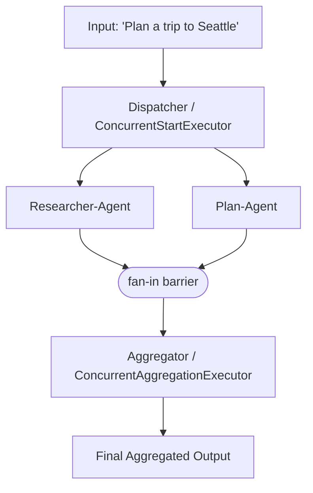
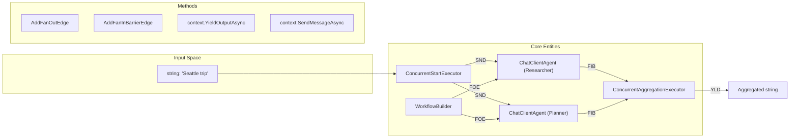
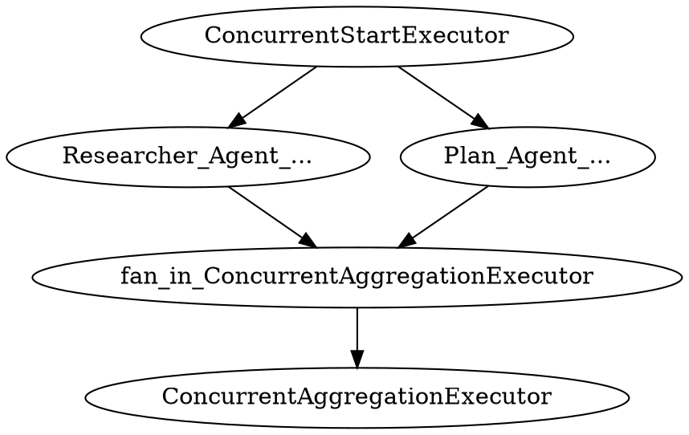

<!-- source: DeepWiki mcp.deepwiki.com · repo microsoft/Agent-Framework-Samples · page 7.3 Concurrent Workflows · fetched 2026-10-26 -->

# Concurrent Workflows

<details>
<summary>Relevant source files</summary>

The following files were used as context for generating this wiki page:

- [07.Workflow/code_samples/dotNET/01.dotnet-agent-framework-workflow-ghmodel-basic/01.dotnet-agent-framework-workflow-ghmodel-basic.csproj](07.Workflow/code_samples/dotNET/01.dotnet-agent-framework-workflow-ghmodel-basic/01.dotnet-agent-framework-workflow-ghmodel-basic.csproj)
- [07.Workflow/code_samples/dotNET/01.dotnet-agent-framework-workflow-ghmodel-basic/workflow.dot](07.Workflow/code_samples/dotNET/01.dotnet-agent-framework-workflow-ghmodel-basic/workflow.dot)
- [07.Workflow/code_samples/dotNET/02.dotnet-agent-framework-workflow-ghmodel-sequential/02.dotnet-agent-framework-workflow-ghmodel-sequential.csproj](07.Workflow/code_samples/dotNET/02.dotnet-agent-framework-workflow-ghmodel-sequential/02.dotnet-agent-framework-workflow-ghmodel-sequential.csproj)
- [07.Workflow/code_samples/dotNET/02.dotnet-agent-framework-workflow-ghmodel-sequential/workflow.dot](07.Workflow/code_samples/dotNET/02.dotnet-agent-framework-workflow-ghmodel-sequential/workflow.dot)
- [07.Workflow/code_samples/dotNET/03.dotnet-agent-framework-workflow-ghmodel-concurrent/03.dotnet-agent-framework-workflow-ghmodel-concurrent.csproj](07.Workflow/code_samples/dotNET/03.dotnet-agent-framework-workflow-ghmodel-concurrent/03.dotnet-agent-framework-workflow-ghmodel-concurrent.csproj)
- [07.Workflow/code_samples/dotNET/03.dotnet-agent-framework-workflow-ghmodel-concurrent/Program.cs](07.Workflow/code_samples/dotNET/03.dotnet-agent-framework-workflow-ghmodel-concurrent/Program.cs)
- [07.Workflow/code_samples/dotNET/03.dotnet-agent-framework-workflow-ghmodel-concurrent/workflow.dot](07.Workflow/code_samples/dotNET/03.dotnet-agent-framework-workflow-ghmodel-concurrent/workflow.dot)
- [07.Workflow/code_samples/dotNET/04.dotnet-agent-framework-workflow-msfoundry-condition/04.dotnet-agent-framework-workflow-msfoundry-condition.csproj](07.Workflow/code_samples/dotNET/04.dotnet-agent-framework-workflow-msfoundry-condition/04.dotnet-agent-framework-workflow-msfoundry-condition.csproj)
- [07.Workflow/code_samples/dotNET/04.dotnet-agent-framework-workflow-msfoundry-condition/Program.cs](07.Workflow/code_samples/dotNET/04.dotnet-agent-framework-workflow-msfoundry-condition/Program.cs)
- [07.Workflow/code_samples/python/01.python-agent-framework-workflow-ghmodel-basic.ipynb](07.Workflow/code_samples/python/01.python-agent-framework-workflow-ghmodel-basic.ipynb)
- [07.Workflow/code_samples/python/02.python-agent-framework-workflow-ghmodel-sequential.ipynb](07.Workflow/code_samples/python/02.python-agent-framework-workflow-ghmodel-sequential.ipynb)
- [07.Workflow/code_samples/python/03.python-agent-framework-workflow-ghmodel-concurrent.ipynb](07.Workflow/code_samples/python/03.python-agent-framework-workflow-ghmodel-concurrent.ipynb)
- [07.Workflow/code_samples/python/04.python-agent-framework-workflow-msfoundry-condition.ipynb](07.Workflow/code_samples/python/04.python-agent-framework-workflow-msfoundry-condition.ipynb)

</details>


This page documents the concurrent (parallel) workflow pattern in the Microsoft Agent Framework: how to fan out a single input to multiple agents simultaneously, the differences between the Python `ConcurrentBuilder` and the .NET `WorkflowBuilder` fan-out implementation, and how to retrieve aggregated results. For foundational workflow concepts including the Pregel-style execution model, see [Workflow Architecture](7.1). For sequential chaining, see [Sequential Workflows](7.2).

---

## Concept Overview

A concurrent workflow sends the same input to multiple agents at the same time. All participant agents run in parallel within a single superstep (or concurrent turns), and their outputs are collected by an aggregator before the workflow terminates.

This pattern is appropriate when:
- Multiple perspectives on the same input are independently useful (e.g., a **Researcher-Agent** and a **Plan-Agent** analyzing a destination simultaneously).
- There is no data dependency between parallel agents—neither needs the other's output to begin.
- Reducing total latency by parallelizing work is a priority.

---

## Architecture and Data Flow

The framework handles concurrency through a "Fan-Out/Fan-In" pattern. 

1.  **Dispatcher/Start Node**: Receives the initial input and broadcasts it to all parallel participants.
2.  **Parallel Participants**: Multiple agents (e.g., `researcherAgent`, `plannerAgent`) execute their logic simultaneously.
3.  **Fan-In Barrier**: A synchronization point that waits for all parallel branches to complete.
4.  **Aggregator**: Collects the individual results into a single collection or formatted string.

### Logic Flow Diagram


Sources: [07.Workflow/code_samples/dotNET/03.dotnet-agent-framework-workflow-ghmodel-concurrent/Program.cs:46-54](), [07.Workflow/code_samples/python/03.python-agent-framework-workflow-ghmodel-concurrent.ipynb:60-74]()

---

## Implementation: Python

In Python, the `ConcurrentBuilder` provides a high-level abstraction that automatically injects the dispatcher and aggregator nodes.

### Code Example
[07.Workflow/code_samples/python/03.python-agent-framework-workflow-ghmodel-concurrent.ipynb:225-232]()
```python
from agent_framework.orchestrations import ConcurrentBuilder

# Build the workflow by passing a list of agents
workflow = ConcurrentBuilder().participants([research_agent, plan_agent]).build()

# Execute and retrieve results
events = await workflow.run("Plan a trip to Seattle in December")
outputs = events.get_outputs()
```

### Key Python Classes
- **`ConcurrentBuilder`**: Specialized builder for parallel execution [07.Workflow/code_samples/python/03.python-agent-framework-workflow-ghmodel-concurrent.ipynb:166-166]().
- **`WorkflowViz`**: Used to visualize the concurrent structure as Mermaid or DOT [07.Workflow/code_samples/python/03.python-agent-framework-workflow-ghmodel-concurrent.ipynb:165-165]().

---

## Implementation: .NET

In .NET, concurrency is expressed more explicitly using `AddFanOutEdge` and `AddFanInBarrierEdge` within the standard `WorkflowBuilder`. Developers define custom `Executor` classes to handle the start (dispatch) and end (aggregation) logic.

### 1. The Dispatcher (`ConcurrentStartExecutor`)
The dispatcher broadcasts the user message and a `TurnToken` to all connected agents.
[07.Workflow/code_samples/dotNET/03.dotnet-agent-framework-workflow-ghmodel-concurrent/Program.cs:100-112]()

### 2. The Aggregator (`ConcurrentAggregationExecutor`)
The aggregator inherits from `Executor<List<ChatMessage>>`. It collects messages until the expected count (e.g., 2) is reached, then yields the final output.
[07.Workflow/code_samples/dotNET/03.dotnet-agent-framework-workflow-ghmodel-concurrent/Program.cs:118-140]()

### 3. Building the Workflow
[07.Workflow/code_samples/dotNET/03.dotnet-agent-framework-workflow-ghmodel-concurrent/Program.cs:50-54]()
```csharp
var workflow = new WorkflowBuilder(startExecutor)
            .AddFanOutEdge(startExecutor, [researcherAgent, plannerAgent])
            .AddFanInBarrierEdge([researcherAgent, plannerAgent], aggregationExecutor)
            .WithOutputFrom(aggregationExecutor)
            .Build();
```

---

## Code Entity Map

The following diagram maps the .NET code entities to their roles in the concurrent execution space.


Sources: [07.Workflow/code_samples/dotNET/03.dotnet-agent-framework-workflow-ghmodel-concurrent/Program.cs:35-54](), [07.Workflow/code_samples/dotNET/03.dotnet-agent-framework-workflow-ghmodel-concurrent/Program.cs:108-110](), [07.Workflow/code_samples/dotNET/03.dotnet-agent-framework-workflow-ghmodel-concurrent/Program.cs:133-133]()

---

## Comparison: Python vs. .NET

| Feature | Python (`ConcurrentBuilder`) | .NET (`WorkflowBuilder`) |
|---|---|---|
| **Abstraction Level** | High (Auto-generates infrastructure) | Low (Explicitly define executors) |
| **Start Node** | Internal `dispatcher` | `ConcurrentStartExecutor` |
| **End Node** | Internal `aggregator` | `ConcurrentAggregationExecutor` |
| **Edge Type** | Implicit parallel edges | `AddFanOutEdge` / `AddFanInBarrierEdge` |
| **Result Access** | `events.get_outputs()` | `WorkflowOutputEvent` data |

Sources: [07.Workflow/code_samples/python/03.python-agent-framework-workflow-ghmodel-concurrent.ipynb:229-231](), [07.Workflow/code_samples/dotNET/03.dotnet-agent-framework-workflow-ghmodel-concurrent/Program.cs:50-54]()

---

## Workflow Visualization

The framework can export the concurrent topology to Graphviz (DOT) format. This reveals the `fan-in` barrier used to synchronize the parallel agents before aggregation.

**Example DOT Output (Simplified):**
[07.Workflow/code_samples/dotNET/03.dotnet-agent-framework-workflow-ghmodel-concurrent/workflow.dot:1-17]()


---

## Usage Notes

- **Rate Limits**: Because agents execute simultaneously, they consume LLM API quota (tokens/min and requests/min) concurrently. Ensure your backend (e.g., GitHub Models) has sufficient headroom [07.Workflow/code_samples/python/03.python-agent-framework-workflow-ghmodel-concurrent.ipynb:53-57]().
- **Agent Isolation**: Parallel agents do not share state during the turn. Each receives the same initial context but cannot see the "intermediate" thoughts of its peers until the aggregation step [07.Workflow/code_samples/python/03.python-agent-framework-workflow-ghmodel-concurrent.ipynb:100-102]().
- **Streaming**: You can watch the progress of concurrent workflows using `run.WatchStreamAsync()` (.NET) or `workflow.run_stream()` (Python) to see events from all agents as they arrive [07.Workflow/code_samples/dotNET/03.dotnet-agent-framework-workflow-ghmodel-concurrent/Program.cs:61-64]().

---

