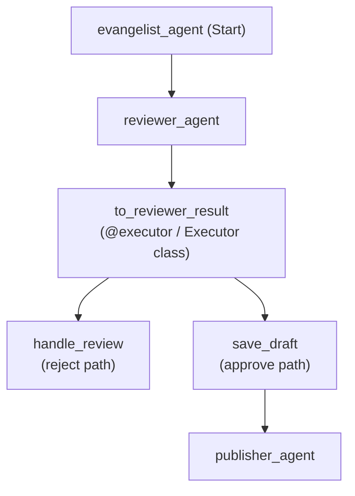
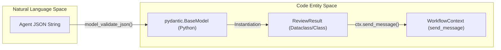
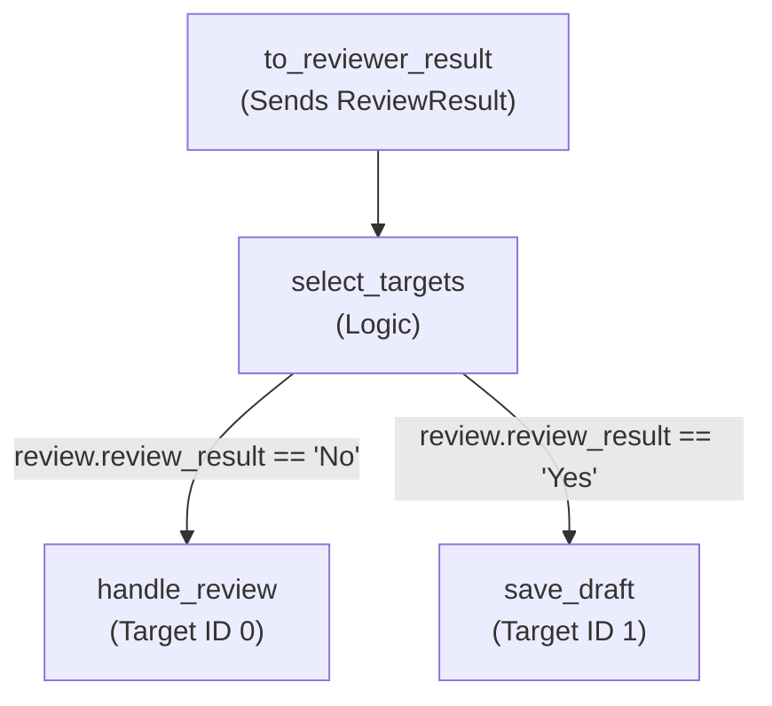
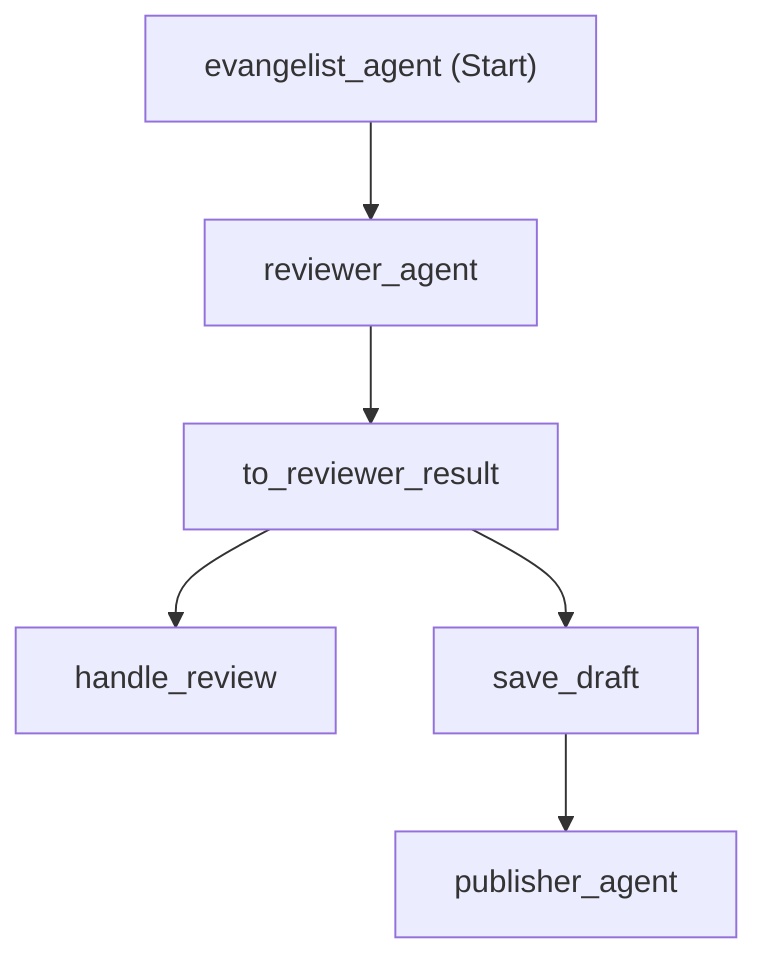

<!-- source: DeepWiki mcp.deepwiki.com · repo microsoft/Agent-Framework-Samples · page 7.4 Conditional Workflows · fetched 2026-10-26 -->

# Conditional Workflows

<details>
<summary>Relevant source files</summary>

The following files were used as context for generating this wiki page:

- [07.Workflow/code_samples/dotNET/01.dotnet-agent-framework-workflow-ghmodel-basic/01.dotnet-agent-framework-workflow-ghmodel-basic.csproj](07.Workflow/code_samples/dotNET/01.dotnet-agent-framework-workflow-ghmodel-basic/01.dotnet-agent-framework-workflow-ghmodel-basic.csproj)
- [07.Workflow/code_samples/dotNET/01.dotnet-agent-framework-workflow-ghmodel-basic/workflow.dot](07.Workflow/code_samples/dotNET/01.dotnet-agent-framework-workflow-ghmodel-basic/workflow.dot)
- [07.Workflow/code_samples/dotNET/02.dotnet-agent-framework-workflow-ghmodel-sequential/02.dotnet-agent-framework-workflow-ghmodel-sequential.csproj](07.Workflow/code_samples/dotNET/02.dotnet-agent-framework-workflow-ghmodel-sequential/02.dotnet-agent-framework-workflow-ghmodel-sequential.csproj)
- [07.Workflow/code_samples/dotNET/02.dotnet-agent-framework-workflow-ghmodel-sequential/workflow.dot](07.Workflow/code_samples/dotNET/02.dotnet-agent-framework-workflow-ghmodel-sequential/workflow.dot)
- [07.Workflow/code_samples/dotNET/03.dotnet-agent-framework-workflow-ghmodel-concurrent/03.dotnet-agent-framework-workflow-ghmodel-concurrent.csproj](07.Workflow/code_samples/dotNET/03.dotnet-agent-framework-workflow-ghmodel-concurrent/03.dotnet-agent-framework-workflow-ghmodel-concurrent.csproj)
- [07.Workflow/code_samples/dotNET/03.dotnet-agent-framework-workflow-ghmodel-concurrent/Program.cs](07.Workflow/code_samples/dotNET/03.dotnet-agent-framework-workflow-ghmodel-concurrent/Program.cs)
- [07.Workflow/code_samples/dotNET/03.dotnet-agent-framework-workflow-ghmodel-concurrent/workflow.dot](07.Workflow/code_samples/dotNET/03.dotnet-agent-framework-workflow-ghmodel-concurrent/workflow.dot)
- [07.Workflow/code_samples/dotNET/04.dotnet-agent-framework-workflow-msfoundry-condition/04.dotnet-agent-framework-workflow-msfoundry-condition.csproj](07.Workflow/code_samples/dotNET/04.dotnet-agent-framework-workflow-msfoundry-condition/04.dotnet-agent-framework-workflow-msfoundry-condition.csproj)
- [07.Workflow/code_samples/dotNET/04.dotnet-agent-framework-workflow-msfoundry-condition/Program.cs](07.Workflow/code_samples/dotNET/04.dotnet-agent-framework-workflow-msfoundry-condition/Program.cs)
- [07.Workflow/code_samples/python/01.python-agent-framework-workflow-ghmodel-basic.ipynb](07.Workflow/code_samples/python/01.python-agent-framework-workflow-ghmodel-basic.ipynb)
- [07.Workflow/code_samples/python/02.python-agent-framework-workflow-ghmodel-sequential.ipynb](07.Workflow/code_samples/python/02.python-agent-framework-workflow-ghmodel-sequential.ipynb)
- [07.Workflow/code_samples/python/03.python-agent-framework-workflow-ghmodel-concurrent.ipynb](07.Workflow/code_samples/python/03.python-agent-framework-workflow-ghmodel-concurrent.ipynb)
- [07.Workflow/code_samples/python/04.python-agent-framework-workflow-msfoundry-condition.ipynb](07.Workflow/code_samples/python/04.python-agent-framework-workflow-msfoundry-condition.ipynb)

</details>


This page explains how to implement dynamic branching logic in the Microsoft Agent Framework (MAF) workflow system. It covers the `@executor` decorator pattern, the `select_targets` routing function, `WorkflowContext` message passing, and the structured-output pattern that drives conditional edges in both Python and .NET.

For foundational workflow concepts (`WorkflowBuilder`, `WorkflowEvent`, superstep execution), see [Workflow Architecture](7.1). For linear pipelines without branching, see [Sequential Workflows](7.2). For parallel fan-out, see [Concurrent Workflows](7.3).

---

## Overview

A conditional workflow routes execution to different downstream nodes based on the output of an intermediate step. In MAF, this is achieved by:

1.  **Defining custom executor nodes**: Using the `@executor` decorator in Python or inheriting from `Executor` in .NET.
2.  **Implementing Routing Logic**: In Python, a `select_targets` function inspects messages; in .NET, developers can use specialized edges or custom logic within the `HandleAsync` method.
3.  **Typed Message Passing**: Using `WorkflowContext.send_message()` (Python) or `context.SendMessageAsync()` (.NET) to pass structured data between nodes.

The primary samples are:
*   **Python**: `07.Workflow/code_samples/python/04.python-agent-framework-workflow-msfoundry-condition.ipynb` [07.Workflow/code_samples/python/04.python-agent-framework-workflow-msfoundry-condition.ipynb:1-13]()
*   ** .NET**: `07.Workflow/code_samples/dotNET/04.dotnet-agent-framework-workflow-msfoundry-condition/Program.cs` [07.Workflow/code_samples/dotNET/04.dotnet-agent-framework-workflow-msfoundry-condition/04.dotnet-agent-framework-workflow-msfoundry-condition.csproj:1-34]()

---

## The Content-Review/Publish Example

The sample models a publishing pipeline where:
1.  An **Evangelist agent** writes a draft.
2.  A **Reviewer agent** checks it against specific requirements (e.g., word count).
3.  A **custom executor** parses the review decision and branches:
    *   **If approved** → `save_draft` executor → **Publisher agent** saves the file.
    *   **If rejected** → `handle_review` executor → outputs a failure message.

### Workflow Topology (Content-Review)


Sources: [07.Workflow/code_samples/python/04.python-agent-framework-workflow-msfoundry-condition.ipynb:63-77](), [07.Workflow/code_samples/python/04.python-agent-framework-workflow-msfoundry-condition.ipynb:418-454]()

---

## Key Code Constructs

| Concept | Python Construct | .NET Construct | Description |
| :--- | :--- | :--- | :--- |
| **Custom node** | `@executor(id="...")` | `class MyExecutor : Executor` | Marks a function/class as a named workflow node. |
| **Branch routing** | `select_targets(msg, target_ids)` | Custom `HandleAsync` logic | Logic determining which downstream target IDs to activate. |
| **State container** | `ReviewResult` (`@dataclass`) | `ReviewResult` (class/record) | Typed object passed between nodes. |
| **Structured LLM** | `ReviewAgent(BaseModel)` | `ReviewAgent` (class) | Schema for parsing agent JSON response. |
| **Message passing** | `ctx.send_message(...)` | `context.SendMessageAsync(...)` | Sends typed messages to downstream executors. |
| **Terminal output** | `ctx.yield_output(...)` | `context.YieldOutputAsync(...)` | Emits a final result string from the workflow. |

Sources: [07.Workflow/code_samples/python/04.python-agent-framework-workflow-msfoundry-condition.ipynb:327-386](), [07.Workflow/code_samples/dotNET/03.dotnet-agent-framework-workflow-ghmodel-concurrent/Program.cs:100-140]()

---

## Structured Output and Routing

Agent responses must be converted to typed objects before routing decisions can be made.

### Data Flow Space to Code Entity Space



In the Python sample, `ReviewAgent` is a `pydantic.BaseModel` used with `model_validate_json()` to parse the LLM's raw JSON text. `ReviewResult` is a `@dataclass` that flows through the `WorkflowContext` as a typed message. [07.Workflow/code_samples/python/04.python-agent-framework-workflow-msfoundry-condition.ipynb:327-358]()

---

## The Executor Pattern

### Python: `@executor`
Functions decorated with `@executor(id="...")` accept a typed input and a `WorkflowContext`.
*   **`to_reviewer_result`**: Receives `AgentExecutorResponse`, parses JSON into `ReviewResult`, and forwards it. [07.Workflow/code_samples/python/04.python-agent-framework-workflow-msfoundry-condition.ipynb:344-357]()
*   **`handle_review`**: The rejection branch. Calls `ctx.yield_output()` to terminate execution with an error. [07.Workflow/code_samples/python/04.python-agent-framework-workflow-msfoundry-condition.ipynb:370-378]()
*   **`save_draft`**: The approval branch. Wraps content in `AgentExecutorRequest` to trigger the next agent. [07.Workflow/code_samples/python/04.python-agent-framework-workflow-msfoundry-condition.ipynb:380-385]()

### .NET: `Executor` Classes
In .NET, executors are classes inheriting from `Executor` or `Executor<T>`.
*   **`ConcurrentStartExecutor`**: Broadcasts `ChatMessage` and `TurnToken`. [07.Workflow/code_samples/dotNET/03.dotnet-agent-framework-workflow-ghmodel-concurrent/Program.cs:100-112]()
*   **`ConcurrentAggregationExecutor`**: Aggregates messages and calls `YieldOutputAsync` when a threshold is met. [07.Workflow/code_samples/dotNET/03.dotnet-agent-framework-workflow-ghmodel-concurrent/Program.cs:118-140]()

---

## Routing Logic: `select_targets`

In Python, the routing function is a non-decorated function passed to the `WorkflowBuilder`.

```python
def select_targets(review: ReviewResult, target_ids: list[str]) -> list[str]:
    # target_ids = [handle_review_id, save_draft_id]
    if review.review_result == "Yes":
        return [target_ids[1]] # save_draft
    return [target_ids[0]]     # handle_review
```
Sources: [07.Workflow/code_samples/python/04.python-agent-framework-workflow-msfoundry-condition.ipynb:360-366]()

### Runtime Branching Diagram



---

## Workflow Visualization

The `WorkflowViz` tool renders the static topology. Even if a branch is conditional, both potential paths are displayed in the graph visualization because the structure is declared at build time.

**Generated Mermaid Example:**

Sources: [07.Workflow/code_samples/python/04.python-agent-framework-workflow-msfoundry-condition.ipynb:418-454](), [07.Workflow/code_samples/dotNET/03.dotnet-agent-framework-workflow-ghmodel-concurrent/workflow.dot:1-17]()

---

## WorkflowContext Capabilities

The `WorkflowContext` (Python) and `IWorkflowContext` (.NET) provide the primary interface for node interaction during a superstep.

| Method | Role |
| :--- | :--- |
| `send_message` / `SendMessageAsync` | Forwards a typed message to the next superstep's executors. |
| `yield_output` / `YieldOutputAsync` | Marks the workflow as complete and provides the final result. |

Sources: [07.Workflow/code_samples/python/04.python-agent-framework-workflow-msfoundry-condition.ipynb:370-385](), [07.Workflow/code_samples/dotNET/03.dotnet-agent-framework-workflow-ghmodel-concurrent/Program.cs:133-133]()

---

## Comparison of Workflow Patterns

| Feature | Sequential | Concurrent | Conditional |
| :--- | :--- | :--- | :--- |
| **Edge Type** | Static, 1:1 | Static, 1:N (Fan-out) | Dynamic, 1:Subset |
| **Routing Logic** | Implicit | Implicit (Broadcast) | `select_targets` / Custom Logic |
| **Node Types** | Agents | Agents + Aggregators | Agents + Custom Executors |
| **Data Flow** | Linear | Parallel | Branching |

Sources: [07.Workflow/code_samples/python/01.python-agent-framework-workflow-ghmodel-basic.ipynb:67-85](), [07.Workflow/code_samples/python/02.python-agent-framework-workflow-ghmodel-sequential.ipynb:70-78](), [07.Workflow/code_samples/python/03.python-agent-framework-workflow-ghmodel-concurrent.ipynb:58-81]()

---

