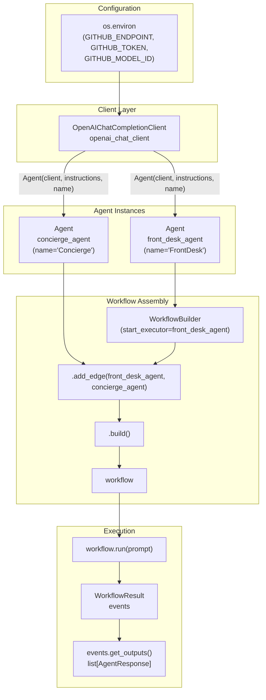
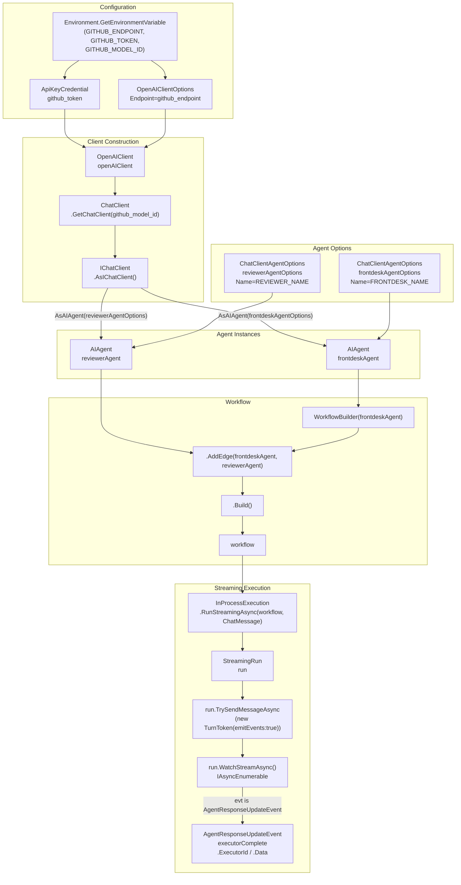
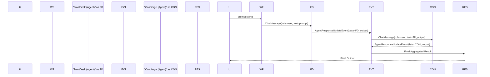

<!-- source: DeepWiki mcp.deepwiki.com · repo microsoft/Agent-Framework-Samples · page 7.5 Multi-Agent Systems · fetched 2026-10-26 -->

# Multi-Agent Systems

<details>
<summary>Relevant source files</summary>

The following files were used as context for generating this wiki page:

- [00.ForBeginners/01-intro-to-ai-agents/code_samples/python-agent-framework-travelagent.ipynb](00.ForBeginners/01-intro-to-ai-agents/code_samples/python-agent-framework-travelagent.ipynb)
- [00.ForBeginners/02-explore-agentic-frameworks/code_samples/python-agent-framework-basicagent.ipynb](00.ForBeginners/02-explore-agentic-frameworks/code_samples/python-agent-framework-basicagent.ipynb)
- [00.ForBeginners/03-agentic-design-patterns/code_samples/python-agent-framework-ghmodel-basicagent.ipynb](00.ForBeginners/03-agentic-design-patterns/code_samples/python-agent-framework-ghmodel-basicagent.ipynb)
- [00.ForBeginners/04-tool-use/code_samples/python-agent-framework-ghmodel-tools.ipynb](00.ForBeginners/04-tool-use/code_samples/python-agent-framework-ghmodel-tools.ipynb)
- [00.ForBeginners/05-agentic-rag/code_samples/dotnet-agent-framework-msfoundry-file-search/Program.cs](00.ForBeginners/05-agentic-rag/code_samples/dotnet-agent-framework-msfoundry-file-search/Program.cs)
- [00.ForBeginners/05-agentic-rag/code_samples/python-agent-framework-msfoundry-file-search.ipynb](00.ForBeginners/05-agentic-rag/code_samples/python-agent-framework-msfoundry-file-search.ipynb)
- [00.ForBeginners/07-planning-design/code_samples/python-agent-framrwork-ghmodel-planningdesign.ipynb](00.ForBeginners/07-planning-design/code_samples/python-agent-framrwork-ghmodel-planningdesign.ipynb)
- [00.ForBeginners/08-multi-agent/code_samples/dotnet-agent-framework-ghmodel-workflow-multi-agents/Program.cs](00.ForBeginners/08-multi-agent/code_samples/dotnet-agent-framework-ghmodel-workflow-multi-agents/Program.cs)
- [00.ForBeginners/08-multi-agent/code_samples/python-agent-framework-ghmodel-workflow-multi-agents.ipynb](00.ForBeginners/08-multi-agent/code_samples/python-agent-framework-ghmodel-workflow-multi-agents.ipynb)

</details>


This page explains how multiple `AIAgent` instances are defined, wired together, and executed within the Microsoft Agent Framework workflow system. It covers the Python `WorkflowBuilder` API and the equivalent .NET implementation, and describes how agent outputs are passed between stages via `WorkflowEvent` objects.

For background on the workflow execution model (Pregel supersteps, `WorkflowBuilder` internals, `WorkflowViz`), see [Workflow Architecture](#7.1). For patterns that govern how agents are chained (sequential, concurrent, conditional), see [Sequential Workflows](#7.2), [Concurrent Workflows](#7.3), and [Conditional Workflows](#7.4). For agent-to-agent communication at the protocol level (A2A), see [Agent-to-Agent Communication (A2A)](#6.7).

---

## Conceptual Overview

A multi-agent system in this framework is a workflow where each node is a distinct `Agent` (Python) or `AIAgent` (.NET) instance, each configured with its own name, instructions, and optional tools. Agents are connected by directed edges; the workflow engine routes the output of one agent as the context input to the next.

The canonical example throughout the repository is a two-agent hotel concierge system:

| Agent name | Role | Behavior |
|---|---|---|
| `FrontDesk` | Travel specialist | Provides a single, concise travel recommendation |
| `Concierge` | Quality reviewer | Evaluates the recommendation for local authenticity; approves or requests refinement |

This producer–reviewer pattern appears in the beginner module (`00.ForBeginners/08-multi-agent`) and the foundational workflow module (`07.Workflow`), in both Python and .NET.

Sources: [00.ForBeginners/08-multi-agent/code_samples/python-agent-framework-ghmodel-workflow-multi-agents.ipynb:51-63](), [00.ForBeginners/08-multi-agent/code_samples/dotnet-agent-framework-ghmodel-workflow-multi-agents/Program.cs:28-46]()

---

## Python: Agent Creation and Wiring

### Creating Agents from a Shared Client

All agents in a Python multi-agent workflow share a single `OpenAIChatCompletionClient` (or similar). Each agent is initialized as an `Agent` instance, supplying a `name`, `instructions` string, and the client.

**Agent creation in Python**
[00.ForBeginners/02-explore-agentic-frameworks/code_samples/python-agent-framework-basicagent.ipynb:190-210]()

```python
# Configure the client
openai_chat_client = OpenAIChatCompletionClient(
    base_url=os.environ.get("GITHUB_ENDPOINT"),
    api_key=os.environ.get("GITHUB_TOKEN"),
    model=os.environ.get("GITHUB_MODEL_ID")
)

# Create agents
front_desk_agent = Agent(
    client=openai_chat_client,
    instructions=FRONTDESK_INSTRUCTIONS,
    name=FRONTDESK_NAME,
)

concierge_agent = Agent(
    client=openai_chat_client,
    instructions=REVIEWER_INSTRUCTIONS,
    name=REVIEWER_NAME,
)
```

The `name` field controls the `author_name` value on outgoing messages and the `executor_id` in workflow events, making agent attribution traceable through the output.

### Building the Workflow

`WorkflowBuilder` accepts the start executor and one or more `add_edge` calls, then produces a compiled workflow via `build()`.

[00.ForBeginners/08-multi-agent/code_samples/python-agent-framework-ghmodel-workflow-multi-agents.ipynb:43-46]()

```python
workflow = WorkflowBuilder(start_executor=front_desk_agent)
    .add_edge(front_desk_agent, concierge_agent)
    .build()
```

### Running the Workflow and Reading Output

#### Batch run (`workflow.run`)

`events.get_outputs()` returns a `list[AgentResponse]`. Each `AgentResponse` carries:
- `messages[0].author_name` — the agent name that produced this message.
- `text` — the final text content of the agent's reply.

`events.get_final_state()` returns a `WorkflowRunState` enum value, e.g. `WorkflowRunState.IDLE`.

#### Streaming run (`workflow.run_stream`)

Each `WorkflowEvent` carries a `data` attribute containing the partial or complete agent output at that step.

Sources: [00.ForBeginners/08-multi-agent/code_samples/python-agent-framework-ghmodel-workflow-multi-agents.ipynb:66-77](), [00.ForBeginners/01-intro-to-ai-agents/code_samples/python-agent-framework-travelagent.ipynb:108-109]()

---

## .NET: Agent Creation and Wiring

### Creating Agents

In .NET, agents are created by chaining calls from `OpenAIClient` using the `AsAIAgent` extension method:

[00.ForBeginners/08-multi-agent/code_samples/dotnet-agent-framework-ghmodel-workflow-multi-agents/Program.cs:49-63]()

```csharp
ChatClientAgentOptions frontdeskAgentOptions = new()
{
    Name = FRONTDESK_NAME,
    Description = FRONTDESK_INSTRUCTIONS
};

ChatClientAgentOptions reviewerAgentOptions = new()
{
    Name = REVIEWER_NAME,
    Description = REVIEWER_INSTRUCTIONS
};

AIAgent reviewerAgent  = openAIClient
    .GetChatClient(github_model_id)
    .AsIChatClient()
    .AsAIAgent(reviewerAgentOptions);

AIAgent frontdeskAgent = openAIClient
    .GetChatClient(github_model_id)
    .AsIChatClient()
    .AsAIAgent(frontdeskAgentOptions);
```

`ChatClientAgentOptions.Name` sets the agent identity. `ChatClientAgentOptions.Description` carries the system instructions.

### Building the Workflow

[00.ForBeginners/08-multi-agent/code_samples/dotnet-agent-framework-ghmodel-workflow-multi-agents/Program.cs:66-68]()

```csharp
var workflow = new WorkflowBuilder(frontdeskAgent)
    .AddEdge(frontdeskAgent, reviewerAgent)
    .Build();
```

### Running the Workflow with Streaming

[00.ForBeginners/08-multi-agent/code_samples/dotnet-agent-framework-ghmodel-workflow-multi-agents/Program.cs:71-85]()

```csharp
StreamingRun run = await InProcessExecution.RunStreamingAsync(
    workflow,
    new ChatMessage(ChatRole.User, "I would like to go to Paris."));

// Send message to start workflow
await run.TrySendMessageAsync(new TurnToken(emitEvents: true));

// Process streaming workflow events
await foreach (WorkflowEvent evt in run.WatchStreamAsync())
{
    if (evt is AgentResponseUpdateEvent executorComplete)
    {
        Console.WriteLine($"{executorComplete.ExecutorId}: {executorComplete.Data}");
    }
}
```

Key types:
- `StreamingRun` — handle to an in-flight workflow execution.
- `TurnToken` — controls event emission during a workflow turn.
- `AgentResponseUpdateEvent` — a `WorkflowEvent` subtype; exposes `ExecutorId` (agent name) and `Data` (text chunk).

Sources: [00.ForBeginners/08-multi-agent/code_samples/dotnet-agent-framework-ghmodel-workflow-multi-agents/Program.cs:1-89]()

---

## .NET Project Dependencies

The multi-agent .NET sample requires the following NuGet packages:

| Package | Purpose |
|---|---|
| `Microsoft.Agents.AI` | Core `AIAgent`, `AgentSession` types |
| `Microsoft.Agents.AI.Workflows` | `WorkflowBuilder`, `InProcessExecution`, `WorkflowEvent` |
| `Microsoft.Agents.AI.OpenAI` | `AsAIAgent()` extension for OpenAI clients |
| `Azure.AI.Agents.Persistent` | Persistent agent backend (Azure AI Foundry) |
| `OpenTelemetry.Api` | Distributed tracing instrumentation |
| `DotNetEnv` | `.env` file loading |
| `OpenAI` | `OpenAIClient`, `ChatClient` |

Sources: [00.ForBeginners/08-multi-agent/code_samples/dotnet-agent-framework-ghmodel-workflow-multi-agents/Program.cs:1-9]()

---

## Diagrams

### Python Multi-Agent Assembly

**Python: class and call chain for building a two-agent workflow**



Sources: [00.ForBeginners/08-multi-agent/code_samples/python-agent-framework-ghmodel-workflow-multi-agents.ipynb:36-46](), [00.ForBeginners/02-explore-agentic-frameworks/code_samples/python-agent-framework-basicagent.ipynb:190-210]()

---

### .NET Multi-Agent Assembly

**.NET: class and call chain for building a two-agent streaming workflow**



Sources: [00.ForBeginners/08-multi-agent/code_samples/dotnet-agent-framework-ghmodel-workflow-multi-agents/Program.cs:1-89]()

---

### Message Flow Through a Two-Agent Workflow

**How a user prompt propagates through FrontDesk → Concierge**



Sources: [00.ForBeginners/08-multi-agent/code_samples/python-agent-framework-ghmodel-workflow-multi-agents.ipynb:43-46](), [00.ForBeginners/08-multi-agent/code_samples/dotnet-agent-framework-ghmodel-workflow-multi-agents/Program.cs:71-85]()

---

## Multi-Agent Design Patterns Used in Samples

The following patterns appear concretely in the sample code. All can be implemented using the same `WorkflowBuilder` API; the difference is in the instructions and edge topology.

| Pattern | Topology | Example in repo |
|---|---|---|
| Producer–Reviewer | FrontDesk → Concierge | `08-multi-agent` beginner notebook |
| Pipeline Pattern | Sequential stages | `08-multi-agent` Technical Architecture |
| Hierarchical Pattern | Lead coordinates specialists | `08-multi-agent` Design Patterns |
| Committee Pattern | Multiple contributors | `08-multi-agent` Design Patterns |

Sources: [00.ForBeginners/08-multi-agent/code_samples/python-agent-framework-ghmodel-workflow-multi-agents.ipynb:97-120]()

---

## Key Identifiers Summary

| Symbol | Language | Package / Module | Role |
|---|---|---|---|
| `Agent` | Python | `agent_framework` | Per-agent instance with instructions and tools |
| `OpenAIChatCompletionClient` | Python | `agent_framework.openai` | Client for connecting to OpenAI-compatible APIs |
| `WorkflowBuilder` | Python / .NET | `agent_framework` / `Microsoft.Agents.AI.Workflows` | Workflow graph builder |
| `WorkflowEvent` | Python / .NET | `agent_framework` / `Microsoft.Agents.AI.Workflows` | Base class for events emitted during execution |
| `AIAgent` | .NET | `Microsoft.Agents.AI` | Per-agent instance |
| `ChatClientAgentOptions` | .NET | `Microsoft.Agents.AI` | Agent name + description (instructions) |
| `InProcessExecution` | .NET | `Microsoft.Agents.AI.Workflows` | Executes workflow in-process; returns `StreamingRun` |
| `StreamingRun` | .NET | `Microsoft.Agents.AI.Workflows` | Handle to a running workflow; `.WatchStreamAsync()` |
| `AgentResponseUpdateEvent` | .NET | `Microsoft.Agents.AI.Workflows` | `WorkflowEvent` subtype; `.ExecutorId`, `.Data` |

Sources: [00.ForBeginners/08-multi-agent/code_samples/python-agent-framework-ghmodel-workflow-multi-agents.ipynb:36-46](), [00.ForBeginners/08-multi-agent/code_samples/dotnet-agent-framework-ghmodel-workflow-multi-agents/Program.cs:1-89]()

---

