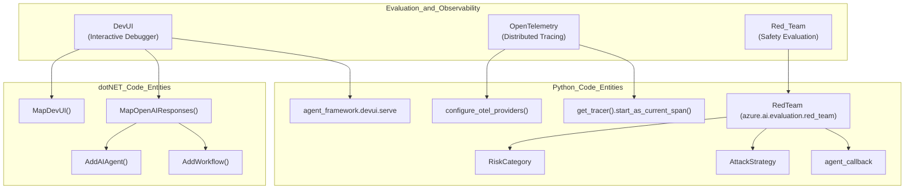
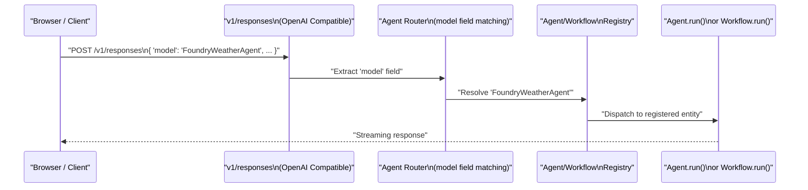
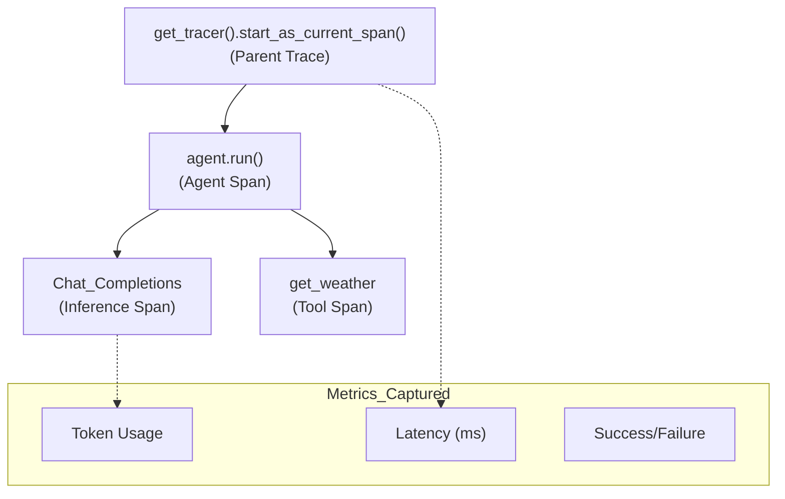

<!-- source: DeepWiki mcp.deepwiki.com · repo microsoft/Agent-Framework-Samples · page 8 Evaluation and Observability · fetched 2026-10-26 -->

# Evaluation and Observability

<details>
<summary>Relevant source files</summary>

The following files were used as context for generating this wiki page:

- [08.EvaluationAndTracing/dotNET/GHModel.dotNET.AI.Workflow.DevUI/GHModel.dotNET.AI.Workflow.DevUI.csproj](08.EvaluationAndTracing/dotNET/GHModel.dotNET.AI.Workflow.DevUI/GHModel.dotNET.AI.Workflow.DevUI.csproj)
- [08.EvaluationAndTracing/python/multi_workflow_msfoundry_devui/workflow/workflow.py](08.EvaluationAndTracing/python/multi_workflow_msfoundry_devui/workflow/workflow.py)
- [08.EvaluationAndTracing/python/singe_msfoundry_agent_devui/agent.py](08.EvaluationAndTracing/python/singe_msfoundry_agent_devui/agent.py)
- [08.EvaluationAndTracing/python/tracer_aspire/.env.example](08.EvaluationAndTracing/python/tracer_aspire/.env.example)
- [08.EvaluationAndTracing/python/tracer_aspire/README.md](08.EvaluationAndTracing/python/tracer_aspire/README.md)
- [08.EvaluationAndTracing/python/tracer_aspire/simple.py](08.EvaluationAndTracing/python/tracer_aspire/simple.py)

</details>


This page covers the tools provided in module `08.EvaluationAndTracing` and used throughout the production case studies for monitoring, debugging, and evaluating agent behavior. Three distinct mechanisms are documented here: **DevUI** for interactive visual debugging, **OpenTelemetry** for distributed tracing and performance metrics, and **Red Teaming** for automated safety evaluation.

For the underlying workflow architecture that these tools observe, see [Workflow Orchestration](#7). For the specific case study that demonstrates all three tools together, see [Foundry Local Deep Research Pipeline](#9.3).

---

## Overview

The framework approaches agent quality from three complementary angles:

| Dimension | Tool | Entry Point | Purpose |
|---|---|---|---|
| Interactive Debugging | MAF DevUI | `MapDevUI()` / `serve()` | Step-through workflow execution in a browser UI |
| Performance Observability | OpenTelemetry (OTEL) | `configure_otel_providers` / `OTLP_ENDPOINT` | Distributed tracing, latency, tool invocation spans |
| Safety Evaluation | Azure AI Red Team | `RedTeam.scan()` | Adversarial probing for risk category violations |

**Overview diagram: evaluation tools mapped to code entities**



Sources: [08.EvaluationAndTracing/python/tracer_aspire/simple.py:38-41](), [08.EvaluationAndTracing/python/singe_msfoundry_agent_devui/agent.py:66-80](), [08.EvaluationAndTracing/dotNET/GHModel.dotNET.AI.Workflow.DevUI/GHModel.dotNET.AI.Workflow.DevUI.csproj:9-13]()

---

## DevUI

The MAF DevUI is a browser-based interface for interacting with registered agents and workflows. It exposes an OpenAI-compatible `/v1/responses` endpoint that routes requests to named agents or workflows by matching the `model` field in the request body to a registered agent or workflow name.

### .NET Setup

In .NET, DevUI is activated in an ASP.NET Core application. The key project references required include `Microsoft.Agents.AI.DevUI` and `Microsoft.Agents.AI.Hosting.OpenAI`.

- `builder.AddAIAgent(name, instructions)` — registers an agent under a name.
- `builder.AddWorkflow(name, factory)` — registers a workflow under a name.
- `app.MapOpenAIResponses()` — exposes `/v1/responses`, routes by `model` field.
- `app.MapDevUI()` — serves the DevUI web assets at `/devui`.

Sources: [08.EvaluationAndTracing/dotNET/GHModel.dotNET.AI.Workflow.DevUI/GHModel.dotNET.AI.Workflow.DevUI.csproj:9-12]()

### Python Setup

In Python, the DevUI is served via the `serve` function from `agent_framework.devui`. It can host both individual `Agent` instances and complex `Workflow` objects.

[08.EvaluationAndTracing/python/singe_msfoundry_agent_devui/agent.py:79-80]()
[08.EvaluationAndTracing/python/multi_workflow_msfoundry_devui/workflow/workflow.py:154-167]()

The default Python DevUI port is typically `8090` or `8093` depending on the sample configuration.

### DevUI Request Routing

**Diagram: DevUI request routing through code entities**



Sources: [08.EvaluationAndTracing/python/singe_msfoundry_agent_devui/agent.py:72-80](), [08.EvaluationAndTracing/python/multi_workflow_msfoundry_devui/workflow/workflow.py:134-167]()

---

## OpenTelemetry and Tracing

OpenTelemetry (OTEL) is used to capture end-to-end latency, workflow stage timings, and tool invocation overhead. Traces are exported to a collector endpoint, such as the .NET Aspire Dashboard.

### Configuration

The relevant environment variable for exporting traces is:

```env
OTEL_EXPORTER_OTLP_ENDPOINT=http://localhost:4317
```

In Python, the provider is initialized via `configure_otel_providers()` which reads standard OTEL environment variables and `ENABLE_INSTRUMENTATION`.

[08.EvaluationAndTracing/python/tracer_aspire/simple.py:38-41]()
[08.EvaluationAndTracing/python/tracer_aspire/.env.example:7-12]()

### What Gets Traced

| Span Type | Description |
|---|---|
| **Client Span** | Created using `get_tracer().start_as_current_span("Name", kind=SpanKind.CLIENT)`. |
| **Agent Run** | Automatically instrumented by the framework to track `agent.run()` duration. |
| **Tool Execution** | Tracks duration and status of tools like `get_weather`. |
| **LLM Inference** | Captures chat completion latency and token usage. |

**Diagram: OpenTelemetry span hierarchy**



Sources: [08.EvaluationAndTracing/python/tracer_aspire/simple.py:49-63](), [08.EvaluationAndTracing/python/tracer_aspire/README.md:84-90]()

---

## Red Teaming and Safety Evaluation

Red teaming evaluates agents against safety risk categories (Violence, HateUnfairness, Sexual, SelfHarm). This is typically performed using the `RedTeam` class from `azure.ai.evaluation`.

### The Evaluation Bridge

A bridge function (often named `agent_callback`) is defined to connect the Red Team scanner to the specific agent instance. This function handles the conversion between the scanner's prompt and the agent's `run()` or `run_stream()` methods.

### Running a Scan

1.  **Define Risk Categories**: Specify which harms to test for.
2.  **Select Attack Strategies**: Choose how the adversarial prompts are generated.
3.  **Execute Scan**: Run `RedTeam.scan()` and interpret the resulting scores.

For details, see [Red Teaming and Safety Evaluation](#8.3).

---

## Sub-pages

Detailed implementation guides for each tool are in the following sub-pages:

- [DevUI](#8.1) — Explain the MAF DevUI: how to launch it in .NET and Python, and how it is used for interactive step-through debugging.
- [OpenTelemetry and Tracing](#8.2) — Explain how to configure `configure_otel_providers`, instrument workflow spans, and export traces to the Aspire Dashboard.
- [Red Teaming and Safety Evaluation](#8.3) — Explain how to use the `RedTeam` class to evaluate agents for safety risk categories and interpret results.

---

