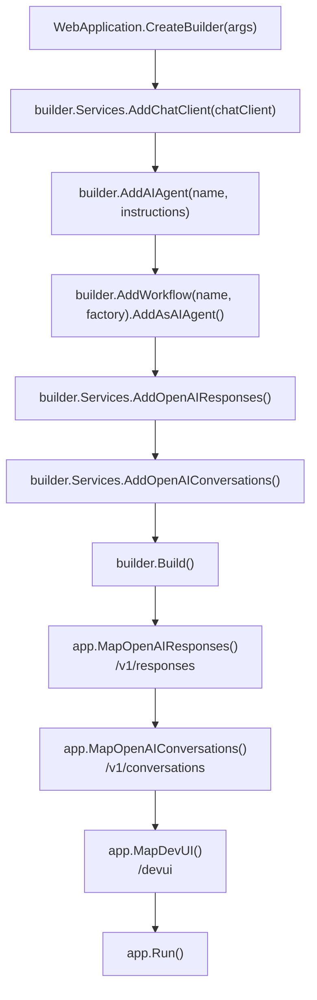
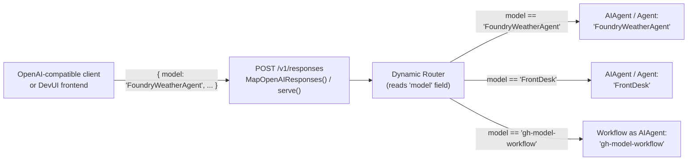
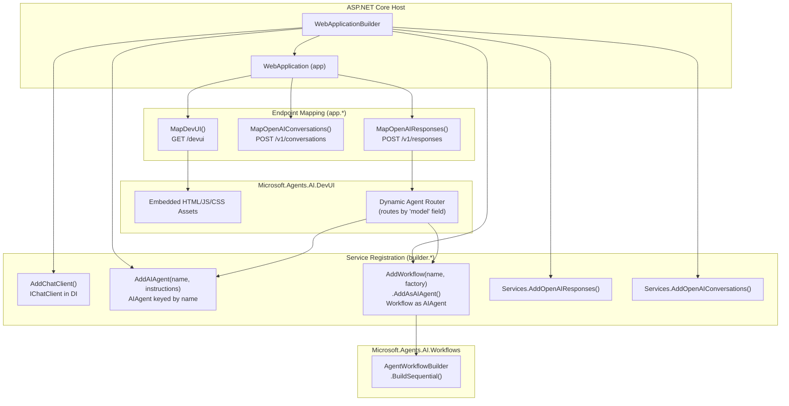

<!-- source: DeepWiki mcp.deepwiki.com · repo microsoft/Agent-Framework-Samples · page 8.1 DevUI · fetched 2026-10-26 -->

# DevUI

<details>
<summary>Relevant source files</summary>

The following files were used as context for generating this wiki page:

- [08.EvaluationAndTracing/dotNET/GHModel.dotNET.AI.Workflow.DevUI/GHModel.dotNET.AI.Workflow.DevUI.csproj](08.EvaluationAndTracing/dotNET/GHModel.dotNET.AI.Workflow.DevUI/GHModel.dotNET.AI.Workflow.DevUI.csproj)
- [08.EvaluationAndTracing/python/multi_workflow_msfoundry_devui/workflow/workflow.py](08.EvaluationAndTracing/python/multi_workflow_msfoundry_devui/workflow/workflow.py)
- [08.EvaluationAndTracing/python/singe_msfoundry_agent_devui/agent.py](08.EvaluationAndTracing/python/singe_msfoundry_agent_devui/agent.py)
- [09.Cases/GHModel.AI/GHModel.Python.AI/GHModel.Python.AI.Workflow.DevUI/main.py](09.Cases/GHModel.AI/GHModel.Python.AI/GHModel.Python.AI.Workflow.DevUI/main.py)
- [09.Cases/GHModel.AI/GHModel.dotNET.AI/GHModel.dotNET.AI.Workflow.AGUI/GHModel.dotNET.AI.Workflow.AGUI.Server/GHModel.dotNET.AI.Workflow.AGUI.Server.csproj](09.Cases/GHModel.AI/GHModel.dotNET.AI/GHModel.dotNET.AI.Workflow.AGUI/GHModel.dotNET.AI.Workflow.AGUI.Server/GHModel.dotNET.AI.Workflow.AGUI.Server.csproj)
- [09.Cases/GHModel.AI/GHModel.dotNET.AI/GHModel.dotNET.AI.Workflow.DevUI/GHModel.dotNET.AI.Workflow.DevUI.csproj](09.Cases/GHModel.AI/GHModel.dotNET.AI/GHModel.dotNET.AI.Workflow.DevUI/GHModel.dotNET.AI.Workflow.DevUI.csproj)
- [09.Cases/GHModel.AI/GHModel.dotNET.AI/GHModel.dotNET.AI.Workflow.DevUI/Program.cs](09.Cases/GHModel.AI/GHModel.dotNET.AI/GHModel.dotNET.AI.Workflow.DevUI/Program.cs)
- [09.Cases/GHModel.AI/GHModel.dotNET.AI/GHModel.dotNET.AI.Workflow.OpenTelemetry/GHModel.dotNET.AI.Workflow.OpenTelemetry.csproj](09.Cases/GHModel.AI/GHModel.dotNET.AI/GHModel.dotNET.AI.Workflow.OpenTelemetry/GHModel.dotNET.AI.Workflow.OpenTelemetry.csproj)

</details>


The DevUI is an interactive web interface provided by the Microsoft Agent Framework (MAF) for debugging and observing agent and workflow execution. This page covers how to configure and launch DevUI in both .NET and Python, how the OpenAI-compatible `/v1/responses` endpoint routes requests to named agents or workflows, and how the interface supports interactive step-through of multi-agent workflows.

For information about OpenTelemetry-based distributed tracing used alongside DevUI, see [OpenTelemetry and Tracing](#8.2). For the production case study that ships with DevUI enabled by default, see [GHModel.AI Travel Assistant](#9.1).

---

## What DevUI Provides

DevUI serves two concerns simultaneously:

| Concern | Mechanism |
|---|---|
| Interactive web UI for sending prompts and inspecting agent responses | Served from embedded assembly resources via `MapDevUI()` in .NET or `serve()` in Python |
| OpenAI-compatible REST endpoint for routing requests to agents/workflows by name | Exposed via `MapOpenAIResponses()` at `/v1/responses` |

The routing mechanism is the key integration point: the `model` field in an OpenAI Responses API request is interpreted as the **name of a registered agent or workflow** rather than an LLM model identifier. This allows the DevUI frontend (or any OpenAI-compatible client) to address specific agents or workflows by name.

---

## .NET Setup

### Dependencies and Namespaces

The .NET DevUI is provided by the `Microsoft.Agents.AI.DevUI` and `Microsoft.Agents.AI.Hosting` packages. The relevant usings are:

[09.Cases/GHModel.AI/GHModel.dotNET.AI/GHModel.dotNET.AI.Workflow.DevUI/Program.cs:18-22]()

```csharp
using Microsoft.Agents.AI;
using Microsoft.Agents.AI.DevUI;
using Microsoft.Agents.AI.Hosting;
using Microsoft.Agents.AI.Workflows;
```

### ASP.NET Core Wiring

The following diagram maps the configuration sequence to the specific API calls made in `Program.cs`:

**DevUI .NET Configuration Flow**



Sources: [09.Cases/GHModel.AI/GHModel.dotNET.AI/GHModel.dotNET.AI.Workflow.DevUI/Program.cs:58-127]()

### Service Registration

All agent and workflow registrations must happen on `builder` before `builder.Build()`:

| Call | Purpose |
|---|---|
| `builder.Services.AddChatClient(chatClient)` | Registers the underlying `IChatClient` (e.g., `OpenAIClient`) [09.Cases/GHModel.AI/GHModel.dotNET.AI/GHModel.dotNET.AI.Workflow.DevUI/Program.cs:75]() |
| `builder.AddAIAgent(name, instructions)` | Registers a named `AIAgent` in the DI container [09.Cases/GHModel.AI/GHModel.dotNET.AI/GHModel.dotNET.AI.Workflow.DevUI/Program.cs:78]() |
| `builder.AddWorkflow(name, factory).AddAsAIAgent()` | Registers a workflow and exposes it as a named `AIAgent` [09.Cases/GHModel.AI/GHModel.dotNET.AI/GHModel.dotNET.AI.Workflow.DevUI/Program.cs:102-106]() |
| `builder.Services.AddOpenAIResponses()` | Registers request-handling services for `/v1/responses` [09.Cases/GHModel.AI/GHModel.dotNET.AI/GHModel.dotNET.AI.Workflow.DevUI/Program.cs:108]() |

Example registration:

[09.Cases/GHModel.AI/GHModel.dotNET.AI/GHModel.dotNET.AI.Workflow.DevUI/Program.cs:99-106]()

```csharp
var reviewerAgentBuilder = builder.AddAIAgent(ReviewerAgentName, ReviewerAgentInstructions);
var frontDeskAgentBuilder = builder.AddAIAgent(FrontDeskAgentName, FrontDeskAgentInstructions);

builder.AddWorkflow("gh-model-workflow", (sp, key) =>
{
    var agents = new List<IHostedAgentBuilder>() { reviewerAgentBuilder, frontDeskAgentBuilder }.Select(ab => sp.GetRequiredKeyedService<AIAgent>(ab.Name));
    return AgentWorkflowBuilder.BuildSequential(workflowName: key, agents: agents);
}).AddAsAIAgent();
```

### Endpoint Mapping

After `builder.Build()`, map the endpoints on `app`. `MapDevUI()` should typically be guarded by an environment check:

[09.Cases/GHModel.AI/GHModel.dotNET.AI/GHModel.dotNET.AI.Workflow.DevUI/Program.cs:116-121]()

```csharp
app.MapOpenAIResponses();
app.MapOpenAIConversations();

if (builder.Environment.IsDevelopment())
{
    app.MapDevUI();
}
```

### Default URLs

| Endpoint | URL |
|---|---|
| DevUI web interface | `http://localhost:50518/devui` [09.Cases/GHModel.AI/GHModel.dotNET.AI/GHModel.dotNET.AI.Workflow.DevUI/Program.cs:124]() |
| OpenAI Responses API | `http://localhost:50518/v1/responses` [09.Cases/GHModel.AI/GHModel.dotNET.AI/GHModel.dotNET.AI.Workflow.DevUI/Program.cs:125]() |

---

## Python Setup

In Python, DevUI is launched using the `serve` function from `agent_framework.devui`. It accepts a list of `entities` which can be `Agent` instances or `Workflow` objects.

### Launching with an Agent
[08.EvaluationAndTracing/python/singe_msfoundry_agent_devui/agent.py:66-80]()
```python
from agent_framework.devui import serve

# ... agent setup ...
agent = asyncio.run(_foundry_setup())

# Launch server with the agent
serve(entities=[agent], port=8090, auto_open=True)
```

### Launching with a Workflow
[09.Cases/GHModel.AI/GHModel.Python.AI/GHModel.Python.AI.Workflow.DevUI/main.py:12-23]()
```python
from agent_framework.devui import serve
from workflow import workflow

# Launch server with the workflow
serve(entities=[workflow], port=8090, auto_open=True)
```

| Runtime | Default DevUI URL |
|---|---|
| .NET | `http://localhost:50518/devui` |
| Python | `http://localhost:8090` (Configurable via `port` parameter) |

---

## Request Routing via the `model` Field

The parameterless `MapOpenAIResponses()` in .NET and the `serve()` function in Python create a **dynamic routing** endpoint. Rather than forwarding requests to a specific LLM, it interprets the `model` field in the OpenAI Responses API request body as a registered agent or workflow name.

**Routing Diagram: `model` Field → Named Agent or Workflow**



Sources: [09.Cases/GHModel.AI/GHModel.dotNET.AI/GHModel.dotNET.AI.Workflow.DevUI/Program.cs:44-46](), [08.EvaluationAndTracing/python/singe_msfoundry_agent_devui/agent.py:72-80]()

---

## Workflow Step-Through and Visualization

DevUI is specifically designed for interactive step-through debugging of multi-agent workflows. When a workflow is served:

1.  **Visualization**: It renders the workflow graph (e.g., sequential, conditional, or concurrent) defined via `WorkflowBuilder`.
2.  **Superstep Execution**: In Pregel-style workflows, DevUI allows the user to observe transitions between executors.
3.  **State Inspection**: Users can inspect the `WorkflowContext` and the messages passed between agents.

For example, in a conditional workflow, DevUI shows the decision point where a `selection_func` routes execution to different branches based on an agent's response.

[08.EvaluationAndTracing/python/multi_workflow_msfoundry_devui/workflow/workflow.py:56-73]()
[08.EvaluationAndTracing/python/multi_workflow_msfoundry_devui/workflow/workflow.py:154-165]()

---

## Full .NET Component Map

**DevUI .NET Component Relationships**



Sources: [09.Cases/GHModel.AI/GHModel.dotNET.AI/GHModel.dotNET.AI.Workflow.DevUI/Program.cs:55-128]()

---

